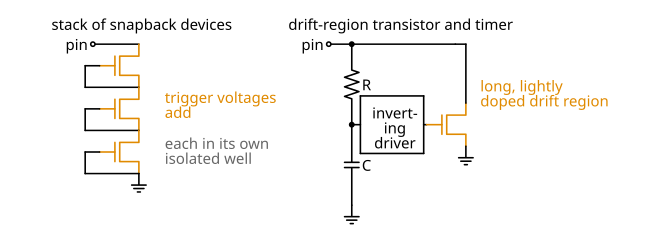
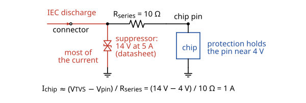

.. _esd-higher-levels:

IEC level 4 protection
======================

This page works out what a pin wired to a connector needs to survive
:std:`IEC 61000-4-2` level 4, ±8 kV contact or ±15 kV air discharge, and
compares the ways to provide it: on the chip, on the board, or both. The
choice for each of evampire's connector pins is an open design decision
(:ref:`esd-open`).

Level 4 current
---------------

The level 4 contact discharge peaks at 30 A ([ESD-TB505]_, Figure 2), and
the simulated generator at 29.4 A (:doc:`simulation`). The protection must
carry that current without any device exceeding its failure current, and
hold the pad low enough for every circuit behind it.

The width of protection device that carries a peak current at its failure
current is:

.. math::

   W_\text{min} = \frac{I_\text{peak}}{I_\text{t2}}

.. list-table::
   :header-rows: 1
   :widths: 20 60 20

   * - Symbol
     - Meaning
     - Unit
   * - :math:`W_\text{min}`
     - Device width at which the peak current reaches the failure current
     - µm
   * - :math:`I_\text{peak}`
     - Peak current of the discharge
     - A
   * - :math:`I_\text{t2}`
     - :term:`Second breakdown current` of the device, per micrometre
       (:numref:`tab-esd-limits`)
     - mA/µm

It applies to one device carrying the whole current, and has no margin.
For a 6 V diode at 30 mA/µm,
:math:`W_\text{min} = 30\ \text{A} / 30\ \text{mA/µm} = 1000\ \text{µm}`.
For a grounded-gate NMOS at 7 mA/µm,
:math:`W_\text{min} = 30\ \text{A} / 7\ \text{mA/µm} = 4300\ \text{µm}`.
The standard pad's drain diodes are 480 µm (PMOS) and 304 µm (NMOS)
(:doc:`io-cells`).

The voltage budget is the second limit. At 30 A, every 0.1 Ω between the
pad and the grounded supply adds 3 V. The pad must stay below the output
NMOS's 10.7 V trigger, if snapback is not to carry the current, and the
input gates below their 12 V minimum oxide breakdown (:ref:`esd-limits`).

Wider diodes and more clamps
----------------------------

:numref:`tab-esd-scaled` repeats the ±8 kV contact discharge with the pad's
diodes widened, as if dedicated diodes were added beside the output
drivers, and with more DVDD and DVSS pads, each with its rail clamp. The
output NMOS and its snapback stay as they are.

.. csv-table:: ±8 kV contact discharge with wider diodes and more supply
               pads: the diode width as a multiple of the standard pad's,
               the number of DVDD and of DVSS pads, and the highest pad
               voltage, whose sign gives the discharge's polarity
   :name: tab-esd-scaled
   :file: sim/results/scaled.csv
   :header-rows: 1

The two polarities respond differently:

* In the negative discharge the NMOS drain diode alone carries the
  current, so only the diode width matters: the rows with one and with four
  supply pads agree. Four times the standard width brings the diode to
  0.80 of its failure current. The row with one supply pad and four times
  the diode width was simulated for its first 4 ns only
  (:numref:`tab-esd-solver`), which covers the first peak. The row with
  one supply pad and twice the diode width stalled the solver with every
  setting, so it has no result.
* In the positive discharge the current crosses the PMOS drain diode and
  the rail clamps, and the clamps need several volts to carry their share
  of it. In every case simulated the pad passes the output NMOS's 10.7 V
  trigger during the first peak, and the snapped-back NMOS is the most
  stressed device. With one supply pad, the dedicated diodes beside the
  output NMOS also break down in reverse and carry several amperes
  (:numref:`tab-esd-dedicated`). The foundry gives no failure current for
  a diode in reverse breakdown.

* With four times the diode width and four DVDD and four DVSS pads, the
  pad reaches 10.9 V, only 0.2 V past the trigger, for about half a
  nanosecond. The NMOS snaps back and carries 2.01 times its failure
  current. If the NMOS takes 500 ps rather than 100 ps to trigger, it does
  not snap back, and the PMOS drain diode is the most stressed device, at
  0.49 of its limit (:numref:`tab-esd-trigger-time`). Which happens depends
  on how fast the real NMOS triggers, which the foundry does not
  publish.

.. csv-table:: Reverse current of the dedicated diodes in the positive
               8 kV discharges with wider diodes
   :name: tab-esd-dedicated
   :file: sim/results/dedicated.csv
   :header-rows: 1

A pad for a positive level 4 discharge therefore needs either clamps that
hold the pad below 10.7 V at 30 A, or a snapback device wide enough to
carry the current that reaches it. At 7 mA/µm the second takes about
4300 µm of grounded-gate NMOS (above). Sizing either is a custom I/O cell
design, and needs the ring resistance of the evampire layout.

The added diode width adds capacitance to the pin. From the foundry diode
model's junction capacitance (0.95 fF/µm² of area and 0.133 fF/µm of
perimeter, [ESD-GF180-MODELS-DIODE]_), each 1000 µm of diode built like the TLP
test structure adds about 1.1 pF at 0 V. A pin with 1000 µm diodes to both
rails carries about 2.3 pF of them. Whether a signal tolerates that is a
question for each interface.

Pins above the supply
---------------------

The standard pad cannot serve a pin that must carry more than DVDD in
normal use. Its PMOS drain is P-type silicon inside an N-type well tied to
DVDD (:numref:`fig-esd-io-cell`). Once the pad rises about 0.7 V above
DVDD, that P-N junction is forward biased and conducts. The pad also snaps back at 10.7 V. Either
path would load a high-voltage signal.

Such a pin needs a clamp that blocks current up to the pin's working
voltage. It must also conduct before the weakest junction or oxide behind
the pin breaks down. A junction breaks down by avalanche: the electric
field across its depleted region grows strong enough that carriers knock
further carriers loose (:numref:`fig-hv-depletion`). Lighter doping
spreads the field over a wider region, so the junction withstands more
voltage. A gate oxide fails when
its field exceeds what the oxide withstands, about 12 V across the 6 V
oxide ([ESD-GF180-EP-OX]_).

How the circuit behind the pin is built sets that weakest point. Take a
stack of transistors in series that shares a high voltage between them:

* If every transistor sits in its own isolating well
  (:numref:`fig-hv-dnw-stack`), the stack divides the pad voltage evenly. The 15.6 V peak of a +8 kV discharge then puts
  about 1.6 V on each of ten transistors. The full 15.6 V lands on the
  junction that isolates the top well from the substrate. That junction
  must withstand it.
* If the transistors share the substrate (:numref:`fig-hv-stack-section`),
  the top transistor's N-type region meets the P-type substrate at a junction that breaks down at
  8.5 V minimum and 11 V typical ([ESD-GF180-EP-JN]_). During a discharge
  that junction becomes a path into the substrate, and no measured
  failure current covers it.

A clamp that stays off to a set voltage and then carries amperes can be
built in two ways. One is a stack of snapback devices, whose trigger
voltages add. The other is a transistor with a long, lightly doped drift
region that withstands the working voltage, switched on by a timer like
the rail clamp's (:numref:`fig-esd-hv-clamps`). Designing either is a
separate task. Neither is simulated here.

         transistors in series, whose trigger voltages add. Right, a
         resistor from the pin and a capacitor to ground form a timer whose
         node drives, through a driver, the gate of a transistor with a
         long, lightly doped drift region, connected from the pin to
         ground.

   Two kinds of clamp for a pin that works above DVDD, drawn as block
   schematics.

Level 4 on other chips
----------------------

For reference, the Texas Instruments TRS3232E, an RS-232 transceiver,
specifies ±8 kV contact and ±15 kV air discharge on its four bus pins
([ESD-TRS3232E]_, section 5.3). Its other pins are rated ±2 kV human body
model, its bus pins ±15 kV ([ESD-TRS3232E]_, section 5.2).

The IEC rating has conditions ([ESD-TRS3232E]_, section 5.3, notes 1 and
2). In the RGT, D, DB and PW packages it needs a capacitor of at least
1 µF from the supply to ground. For the DYY package the datasheet
recommends a series resistor of at least 50 Ω on logic inputs tied to a
supply. The TRS3232E is made in another process, so its rating says
nothing about gf180mcu.

Board protection
----------------

The common alternative puts a :term:`transient voltage suppressor <TVS>`
at the connector, with a series resistor between it and the chip. The
suppressor carries most of the current, and the resistor limits what
reaches the chip's own protection (:numref:`fig-esd-board-tvs`). For
reference:

* The Texas Instruments TPD1E10B06 suppressor is rated ±30 kV contact and
  ±30 kV air discharge ([ESD-TPD1E10B06]_, section 5.3). It has 12 pF of
  capacitance, a dynamic resistance of 0.32 Ω to 0.38 Ω, and clamps at
  14 V at most with 5 A of 8/20 µs surge current ([ESD-TPD1E10B06]_,
  section 5.6).
* Texas Instruments shows its SN65HVD1781 RS-485 transceiver, rated
  ±16 kV human body model on its bus pins, with a protection circuit for
  8 kV IEC discharges: an SMBJ43CA suppressor and two 10 Ω pulse-proof
  resistors ([ESD-SN65HVD1781]_, section 1 and section 10.2, Figure 19 and
  Table 4).

The share of the current that still reaches the chip depends on the
suppressor's clamping voltage, the series resistor and the chip's own
protection. While both conduct, the chip pin's current is approximately:

.. math::

   I_\text{chip} \approx \frac{V_\text{TVS} - V_\text{pin}}{R_\text{series}}

.. list-table::
   :header-rows: 1
   :widths: 20 60 20

   * - Symbol
     - Meaning
     - Unit
   * - :math:`I_\text{chip}`
     - Current into the chip's pin
     - A
   * - :math:`V_\text{TVS}`
     - Voltage across the suppressor at the discharge current
     - V
   * - :math:`V_\text{pin}`
     - Voltage at which the chip's protection holds its pin
       (:numref:`tab-esd-events-voltage`)
     - V
   * - :math:`R_\text{series}`
     - Resistor between the suppressor and the pin
     - Ω

It neglects the inductance of the board traces. As an example, take the
TPD1E10B06 at its 14 V maximum for 5 A, the standard pad holding about 4 V
at a current near 1 A (:doc:`results-hbm`), and 10 Ω in series:
:math:`(14\ \text{V} - 4\ \text{V}) / 10\ \Omega = 1\ \text{A}`.

         connector to ground, rated 14 V at 5 A, carries most of the
         current. A 10 ohm series resistor leads on to the chip pin, whose
         protection holds the pin near 4 V. The chip current is about
         (V_TVS minus V_pin) divided by R_series, (14 V minus 4 V) divided
         by 10 ohm, 1 A.

   A board suppressor at the connector and a series resistor in front of
   the chip pin, with the example values above.

The 30 A of a level 4 discharge is six times the datasheet's 5 A clamping
figure. The datasheet fits its dynamic resistance to TLP measurements
between 10 A and 20 A ([ESD-TPD1E10B06]_, section 5.6, note 1). If that
0.38 Ω slope held from 14 V at 5 A up to 30 A, the suppressor would sit
near :math:`14\ \text{V} + 25\ \text{A} \times 0.38\ \Omega = 23.5\ \text{V}`.
10 Ω would then pass about
:math:`(23.5\ \text{V} - 4\ \text{V}) / 10\ \Omega = 2\ \text{A}` to the
pin. 30 A lies beyond the fitted range, so this is an extrapolation, and a
TLP measurement of the suppressor at 30 A would replace it.

.. _esd-open:

Open questions
--------------

* Which of evampire's pins are wired to connectors and so face the IEC test:
  the Ethernet pairs, the USB Type-C pins, the power inputs, or others. The
  Ethernet pairs also face charged cable discharges
  (:doc:`/ethernet/magnetics/events`).
* For each such pin, whether the board carries a suppressor, the chip
  carries widened protection in a custom I/O cell, or both.
* Which pins work above DVDD, and the clamp each needs: its turn-on
  voltage, its failure current, and the breakdown of the weakest junction
  or oxide it protects.
* The resistance of evampire's DVDD and DVSS rings, which the pad's voltage
  at 30 A depends on.
* How the foundry's 100 ns TLP failure currents apply to the 1 ns first
  peak of the IEC pulse. A very fast TLP measurement of gf180mcu test
  structures would establish it.
* The charged device model rating of evampire's pins, which depends on the
  package.
