.. _esd-io-cells:

gf180mcu I/O cell protection
============================

The standard gf180mcu I/O cells have ESD protection built in. The cells'
netlists give the size of each protection device, and the foundry has
measured the limits of each device.

Library rating
--------------

The foundry I/O library, gf180mcu_fd_io, targets 2000 V
:term:`human body model <Human body model>`, 200 V machine model and 500 V
:term:`charged device model <Charged device model>` on every pad
([ESD-GF180-IO]_, ESD protection page). It also targets ±100 mA
:term:`latch-up` immunity ([ESD-GF180-IO]_, latch-up page). No
:std:`IEC 61000-4-2` level is given for the library.

The library ships a netlist of every cell ([ESD-GF180-IO-SRC]_). Three of
them contain the protection structures that follow:

* ``gf180mcu_fd_io__bi_t``, the bidirectional digital pad. The input-only
  pads ``in_c`` and ``in_s`` contain the same protection.
* ``gf180mcu_fd_io__dvdd`` and ``gf180mcu_fd_io__dvss``, the pads that
  bring the I/O supply DVDD and its ground DVSS onto the chip. Each one
  contains a :term:`rail clamp`.
* ``gf180mcu_fd_io__asig_5p0``, the analogue pad, which has diodes only.

Protection structure
--------------------

The protection of the bidirectional pad has three parts: the output
driver, the secondary protection of the input gates and the rail clamp.
:numref:`fig-esd-io-cell` shows them, with the clamps of the supply pads.
:numref:`fig-esd-io-gds-cell` shows where the output driver and the
secondary protection lie in the cell's layout, drawn from the foundry's GDS
file. :numref:`fig-esd-io-gds-clamp` shows the rail clamp in a supply pad.
Every pad sits on two rings of metal that run round the chip: DVDD and
DVSS.

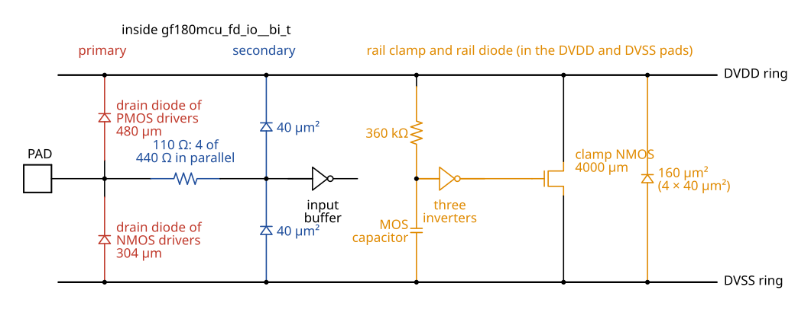
         bottom. On the left, the PAD connects to a diode up to DVDD,
         labelled drain diode of PMOS drivers 480 µm, and a diode up from
         DVSS, labelled drain diode of NMOS drivers 304 µm. A 110 ohm
         resistor, four 440 ohm resistors in parallel, leads to an inner
         node with two small 40 square micrometre diodes to the rails and
         the input buffer. On the right, a rail clamp: a 360 kilohm
         resistor from DVDD and a MOS capacitor to DVSS meet at a node that
         drives three inverters, which drive the gate of a 4000 µm NMOS
         transistor connected between DVDD and DVSS.
   :width: 100%

   The ESD protection of gf180mcu_fd_io__bi_t, and the rail clamp in each
   DVDD and DVSS pad.

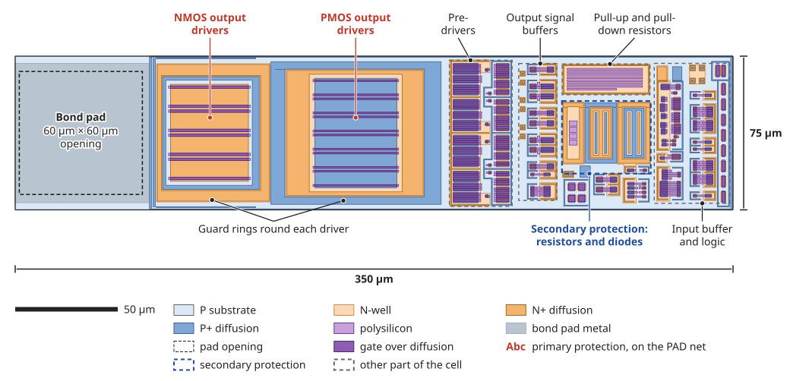
         left: the bond pad, the NMOS output drivers, the PMOS output drivers,
         the pre-drivers, the output signal buffers, the pull-up and
         pull-down resistors, a blue box round the secondary protection, and
         the input buffer and logic at the right edge.
   :width: 100%

   The layout of gf180mcu_fd_io__bi_t, with the bond pad at the left as in
   :numref:`fig-esd-io-cell`. Red and blue mark the primary and the
   secondary protection in both. :ref:`esd-layout-floorplan` describes
   each part.

Each symbol of the schematic is a group of shapes in a layout.
:numref:`tab-esd-schematic-layout` pairs them, with the layout figure
that shows each one. The layout figures use the schematic's colours
(:ref:`esd-layout`).

.. list-table:: Each part of the schematic and its form in the layout
   :name: tab-esd-schematic-layout
   :header-rows: 1
   :widths: 30 46 24

   * - In the schematic
     - In the layout
     - Layout figure
   * - PAD
     - The bond pad and the metal 2 bus over both output drivers
     - :numref:`fig-esd-io-gds-pad-net`
   * - Drain diode of the PMOS drivers, 480 µm
     - Six P+ drains of the PMOS output drivers, in an N-well with an N+
       ring on DVDD
     - :numref:`fig-esd-io-gds-paths`
   * - Drain diode of the NMOS drivers, 304 µm
     - Four N+ drains of the NMOS output drivers, inside a P+ ring on
       DVSS
     - :numref:`fig-esd-io-gds-paths`, :numref:`fig-esd-io-gds-driver`
   * - 110 Ω resistor
     - Four polysilicon resistors side by side
     - :numref:`fig-esd-io-gds-secondary`
   * - Two 40 µm² diodes
     - Two strips of 20 µm × 1 µm for each diode: P+ strips to DVDD, N+
       strips from DVSS
     - :numref:`fig-esd-io-gds-secondary`
   * - Input buffer
     - The input buffer and logic at the core end of the cell
     - :numref:`fig-esd-io-gds-cell`
   * - 360 kΩ resistor
     - Twelve timer resistors of 30 kΩ
     - :numref:`fig-esd-io-gds-clamp`
   * - MOS capacitor
     - Eight timer capacitors of 10 µm × 25 µm
     - :numref:`fig-esd-io-gds-clamp`
   * - Three inverters
     - The three inverters between the clamp transistor and the timer
     - :numref:`fig-esd-io-gds-clamp`
   * - Clamp NMOS, 4000 µm
     - Four blocks of 20 fingers, each finger 50 µm wide
     - :numref:`fig-esd-io-gds-clamp`
   * - DVDD ring and DVSS ring
     - Stripes of metal 3 to metal 5 that cross every pad cell
     - :numref:`fig-esd-io-gds-ring`

Primary protection
~~~~~~~~~~~~~~~~~~

The pad has no separate primary diodes. The output transistors are the
primary protection. Their drains connect to the pad, and each drain is a
diffusion in a well, so it forms a diode with that well
(:numref:`fig-esd-driver-section`):

* The PMOS drains (P+ in an N-well tied to DVDD) form a diode from the pad
  to DVDD. Four transistors of 80 µm and four of 40 µm give 480 µm of
  width ([ESD-BI-T-CDL]_, lines 42 to 72).
* The NMOS drains (N+ in a P-well tied to DVSS) form a diode from DVSS to
  the pad. Eight transistors of 38 µm give 304 µm of width (same lines).

:numref:`fig-esd-io-gds-pad-net` shows the pad's metal and every drain it
connects to, in the layout.

These transistors are drawn as ESD devices. Their drains are silicide
blocked for 3.78 µm (NMOS) and 2.78 µm (PMOS), and the NMOS gates are
1.15 µm long, against 0.7 µm in the rest of the cell. The design manual
requires silicide blocking at the drain of a transistor that must survive
the turn-on of its :term:`parasitic bipolar transistor <Snapback>`
([ESD-GF180-DRM-14-4]_). The blocked silicide adds resistance that spreads
the current across the whole width. :numref:`fig-esd-io-gds-silicide`
shows the blocked drains in the layout.

The NMOS output transistors, with their gates held low, also act as a
grounded-gate NMOS. Above about 10.7 V the parasitic NPN transistor inside
each one turns on and :term:`snaps back <Snapback>` to about 6 V
(:ref:`esd-limits`).

The cross-section :numref:`fig-esd-driver-section` cuts across the gates.
:numref:`fig-esd-io-gds-driver` shows the same NMOS transistors from
above, in the layout, with the rings that surround them. The line A–A′
in the layout is the cut that the cross-section draws for the NMOS: from
the drain contacts at A, across the blocked drain, the gate and the
source, to the P+ ring at A′.

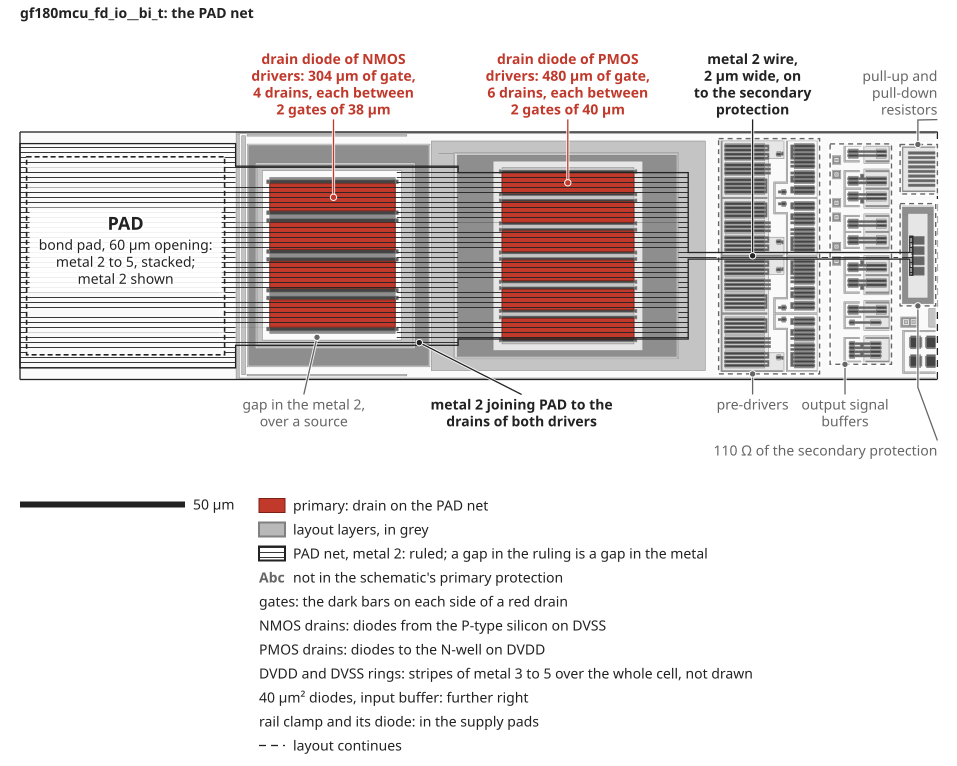
         red. The bond pad joins a metal 2 bus over both output drivers.
         Under the bus, four NMOS drains and six PMOS drains are drawn dark
         red, each between two gates. A metal 2 wire 2 µm wide runs on to
         the four secondary protection resistors.
   :width: 100%

   The PAD net in the layout: the bond pad, its metal 2 bus and the ten
   drains that are the primary protection. :ref:`esd-layout-pad`
   describes the connection.

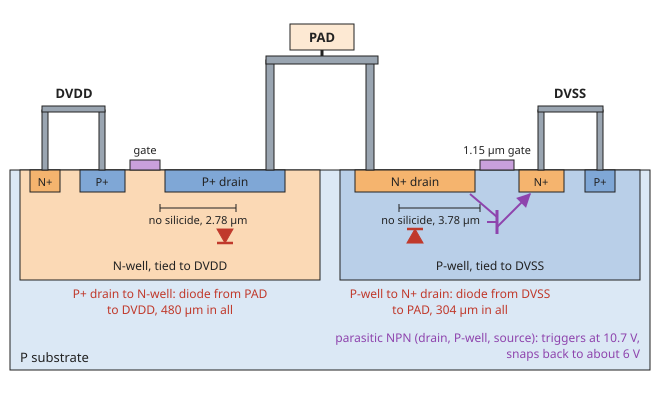
         N-well on DVDD: its P+ drain, connected to PAD and silicide
         blocked for 2.78 µm beside the gate, forms a diode from PAD to
         DVDD with the N-well, 480 µm in all. Right, an NMOS in a P-well on
         DVSS: its N+ drain, connected to PAD and silicide blocked for
         3.78 µm, forms a diode from DVSS to PAD with the P-well, 304 µm in
         all; its gate is 1.15 µm long. The letters A, at the NMOS drain,
         and A′, at the P+ contact, mark the cut A–A′ of the layout. A
         parasitic NPN transistor inside
         the NMOS, with the drain as collector, the P-well as base and the
         source as emitter, triggers at 10.7 V and snaps back to about 6 V.

   The output transistors in cross-section, whose drains are the pad's primary
   protection, schematic and not to scale. A and A′ are the ends of the cut
   marked in :numref:`fig-esd-io-gds-driver`.

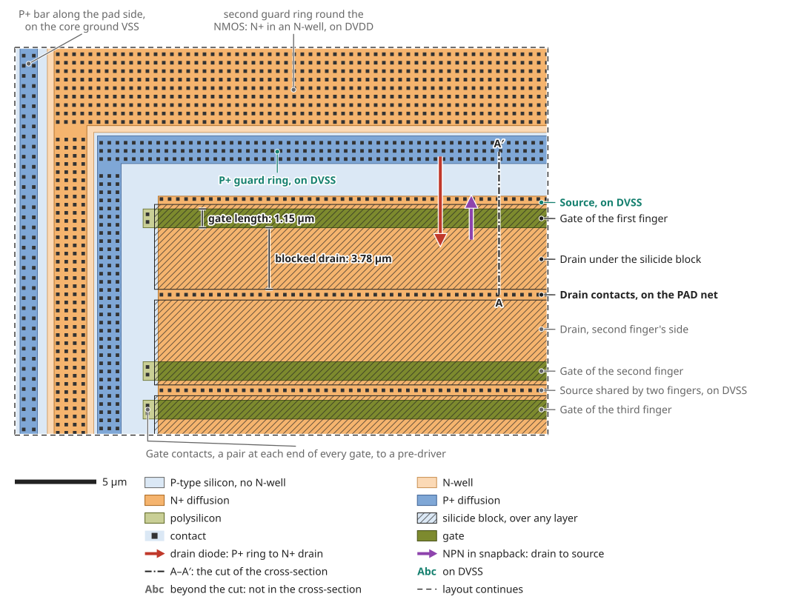
         guard ring on DVDD and a P+ guard ring on DVSS lie a source strip on
         DVSS and a gate 1.15 µm long. Next is a wide drain on PAD, silicide
         blocked for 3.78 µm on each side of its row of contacts. A second gate,
         a shared source and a third gate follow. A dash-dot line A–A′ runs
         from the drain contacts across the gate and source to the P+ ring.
         It is the cut of the cross-section.
   :width: 100%

   One corner of the NMOS output drivers in the layout, seen from above.
   The line A–A′ is the cut that :numref:`fig-esd-driver-section` draws.
   :ref:`esd-layout-driver-parts` describes each part.

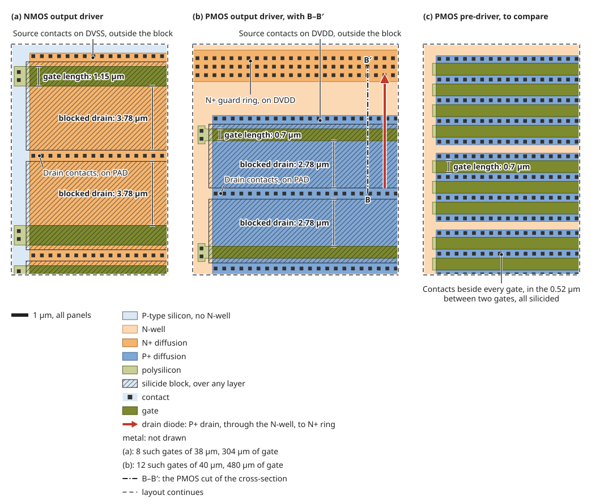
         silicide blocked for 3.78 µm on each side of the drain contacts. (b) A
         PMOS output driver, its drain blocked for 2.78 µm on each side. (c) A
         pre-driver with no silicide block, where contacts stand beside every
         gate.
   :width: 100%

   The blocked drains of :numref:`fig-esd-driver-section` in the layout,
   NMOS in (a) and PMOS in (b), beside a pre-driver transistor that has no
   silicide block. :ref:`esd-layout-silicide` gives the sizes.

Secondary protection
~~~~~~~~~~~~~~~~~~~~

The input buffer's transistor gates are reached through four 440 Ω
polysilicon resistors in parallel, about 110 Ω, and two small diodes of
40 µm² junction area to DVDD and DVSS ([ESD-BI-T-CDL]_, lines 568 to 573).
The resistor limits the current that reaches the small diodes, so the
gates stay below the pad by the voltage across it. The difference grows
with the current: in the simulated +2 kV human body model discharge the pad
reaches 5.6 V and the gates 5.4 V, and in the +8 kV IEC discharge the pad
reaches 15.6 V and the gates 12.4 V (:numref:`tab-esd-events-voltage`).
:numref:`fig-esd-io-gds-secondary` shows the resistors and the diodes in
the layout.

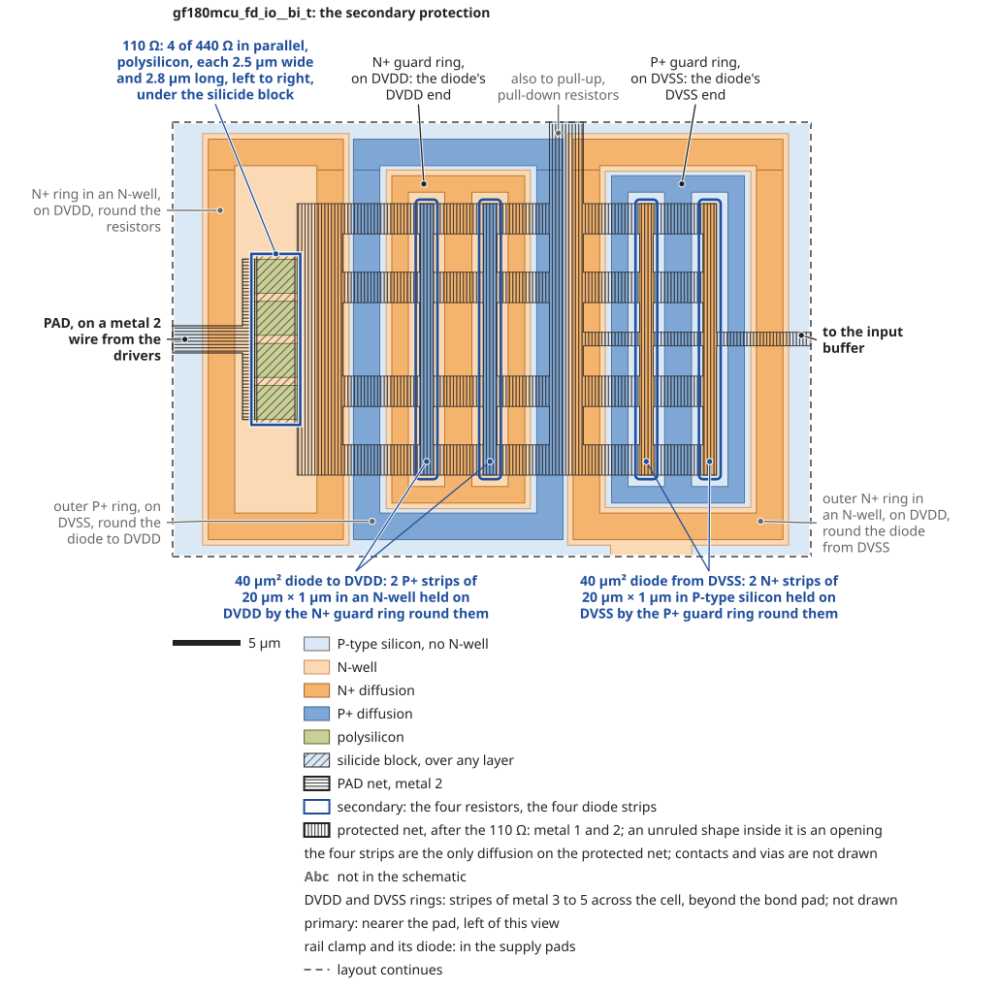
         metal 2 wire and ends on four polysilicon resistors in parallel. The
         protected net, in blue, leaves the resistors, passes over two P+ diode
         strips in an N-well on DVDD and two N+ diode strips in substrate on
         DVSS, and leaves at the right for the input buffer.
   :width: 100%

   The secondary protection of gf180mcu_fd_io__bi_t in the layout: the
   blue part of :numref:`fig-esd-io-cell`. :ref:`esd-layout-secondary`
   gives the size of each part.

Rail clamp
~~~~~~~~~~

A positive discharge into the pad, with DVSS grounded, flows through the
PMOS drain diode onto the DVDD ring. Nothing on DVDD would then let it
reach DVSS, except breakdown. Each DVDD and DVSS pad therefore contains a
rail clamp ([ESD-DVDD-CDL]_):

#. Twelve 30 kΩ polysilicon resistors in series, 360 kΩ, charge eight
   10 µm × 25 µm MOS capacitors from DVDD.
#. When DVDD rises in nanoseconds, the capacitor voltage lags, so the
   timer node stays near DVSS.
#. Three inverters, powered from DVDD itself, invert that low level. The
   third drives the gate of an NMOS transistor 4000 µm wide (80 fingers of
   50 µm) between DVDD and DVSS.
#. The transistor turns on and conducts the discharge current from DVDD to
   DVSS at a few volts.

:numref:`fig-esd-io-gds-clamp` shows these parts in the layout of the DVDD
pad.

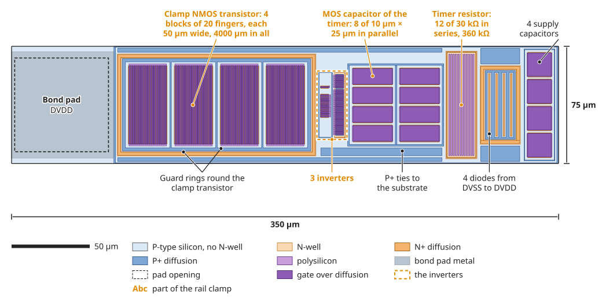
         bond pad, the clamp transistor as four blocks of 20 fingers, three
         inverters, eight timer capacitors, twelve timer resistors, four diodes
         from DVSS to DVDD and four supply capacitors at the right edge.
   :width: 100%

   The rail clamp in the layout of gf180mcu_fd_io__dvdd, in the orange of
   the rail clamp in :numref:`fig-esd-io-cell`. :ref:`esd-layout-clamp`
   describes the clamp transistor's fingers.

The clamp needs no supply. The discharge itself raises DVDD, which powers
the inverters. The timer's time constant decides which events turn it on:

.. math::

   \begin{aligned}
   \tau_\text{clamp} &= R_\text{clamp} \times C_\text{clamp} \\
   C_\text{clamp} &= \frac{\varepsilon_0 \times
   \varepsilon_\text{ox}}{t_\text{ox}} \times A_\text{clamp}
   \end{aligned}

.. list-table::
   :header-rows: 1
   :widths: 18 52 16 14

   * - Symbol
     - Meaning
     - Value
     - Unit
   * - :math:`\tau_\text{clamp}`
     - Time constant of the clamp timer
     - result
     - s
   * - :math:`R_\text{clamp}`
     - Timer resistor, 12 × 30 kΩ ([ESD-DVDD-CDL]_)
     - 360
     - kΩ
   * - :math:`C_\text{clamp}`
     - Timer capacitance, with the MOS capacitors in inversion
     - result
     - F
   * - :math:`\varepsilon_0`
     - Permittivity of free space
     - 8.854 × 10⁻¹²
     - F/m
   * - :math:`\varepsilon_\text{ox}`
     - Relative permittivity of the gate oxide ([ESD-GF180-MODELS]_,
       ``epsrox``)
     - 3.9
     - none
   * - :math:`t_\text{ox}`
     - Thickness of the 6 V gate oxide ([ESD-GF180-MODELS]_, ``toxe``)
     - 15.2
     - nm
   * - :math:`A_\text{clamp}`
     - Total capacitor area, 8 × 10 µm × 25 µm
     - 2000
     - µm²

The oxide capacitance is
:math:`8.854 \times 10^{-12} \times 3.9 / 15.2\ \text{nm} = 2.27\ \text{fF/µm}^2`,
so :math:`C_\text{clamp} = 2.27\ \text{fF/µm}^2 \times 2000\ \text{µm}^2 =
4.5\ \text{pF}` and
:math:`\tau_\text{clamp} = 360\ \text{k}\Omega \times 4.5\ \text{pF} =
1.6\ \text{µs}`. The foundry's capacitor model gives 2.18 fF/µm² in
inversion, 4.35 pF in all, which agrees ([ESD-GF180-MODELS]_). This is a
hand estimate. The simulations on :doc:`results-hbm` use the transistor
models instead.

The estimate holds once the capacitors are in inversion. The timer node
starts at DVSS, where the capacitors are depleted and the model gives only
0.075 pF. The node therefore rises quickly to about 0.7 V, with a time
constant of 360 kΩ × 0.075 pF = 27 ns, and only then charges at the
1.6 µs rate. 0.7 V is below the
first inverter's switching voltage, so the clamp still turns on.

A human body model discharge decays with a time constant of 150 ns, ten
times shorter than 1.6 µs, so the clamp stays on for the whole event. A
supply that rises much more slowly than 1.6 µs lets the timer node follow
DVDD, so the clamp stays off in normal use (:numref:`fig-esd-clamp-timing`).
:numref:`fig-esd-hbm-pos` shows a whole simulated event.

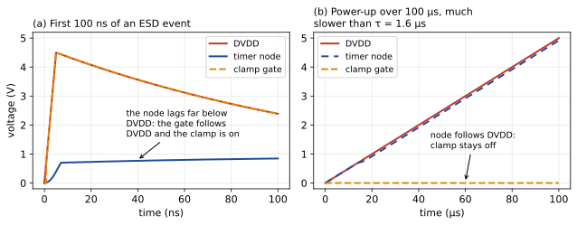
         DVDD jumps to 4.5 V within nanoseconds and decays with a 150 ns
         time constant; the timer node rises only to about 0.7 V to 0.8 V,
         far below DVDD, so the clamp gate follows DVDD and the clamp is
         on. (b) In a power-up over 100 µs, much slower
         than the 1.6 µs time constant, the timer node follows DVDD and the
         clamp gate stays at 0 V.

   The rail clamp timer in the first 100 ns of an ESD event and in a slow
   power-up, from the hand estimate above with an illustrative DVDD.

Discharge paths
---------------

An ESD test applies each polarity between a pin and each supply pin. With
DVSS as the grounded pin, the paths are as in :numref:`tab-esd-paths`
and :numref:`fig-esd-paths`. :numref:`fig-esd-io-gds-paths` draws the
currents on the layout of the output drivers. :numref:`fig-esd-io-gds-ring`
follows the first path along the rails to a supply pad.

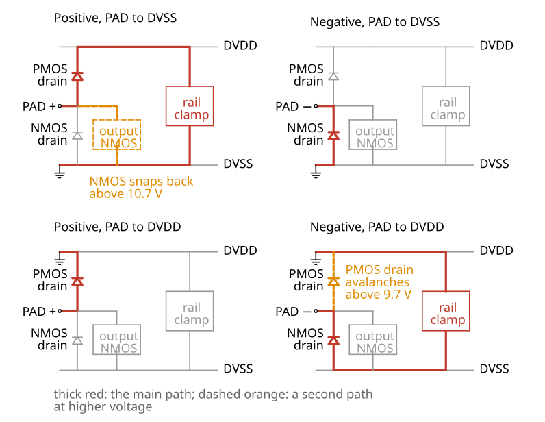
         per discharge mode, with the current's path drawn thick. Positive,
         PAD to DVSS: through the PMOS drain diode onto DVDD, the rail clamp
         and DVSS to ground; above 10.7 V the output NMOS also snaps back
         from PAD to DVSS. Negative, PAD to DVSS: from ground through the
         NMOS drain diode to PAD. Positive, PAD to DVDD: through the PMOS
         drain diode to the grounded DVDD. Negative, PAD to DVDD: from the
         grounded DVDD through the rail clamp to DVSS and the NMOS drain
         diode to PAD; above 9.7 V the PMOS drain also avalanches from DVDD
         to PAD.
   :width: 100%

   The current path of each discharge mode through the bidirectional pad.

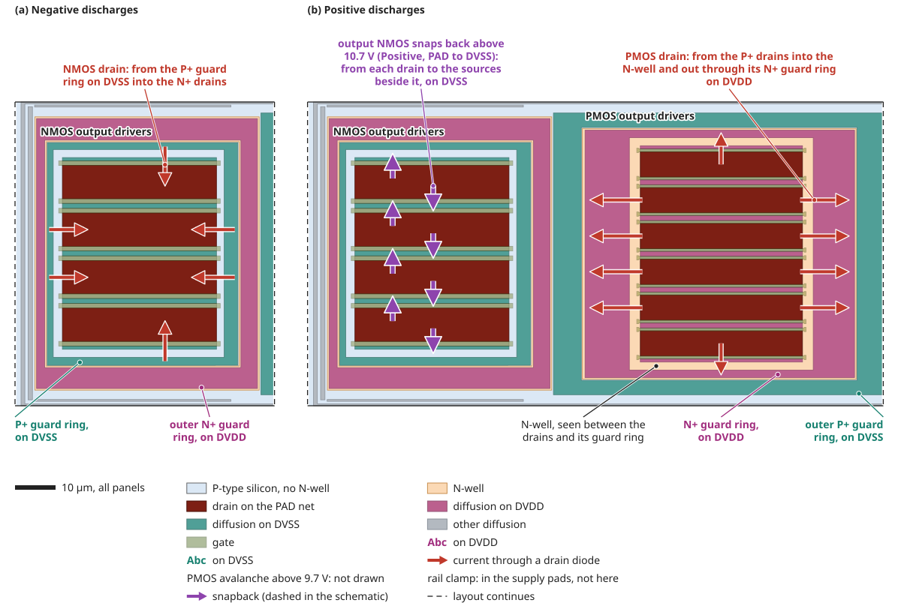
         PAD dark red, DVDD magenta, DVSS green. In the NMOS drivers, red arrows
         run from the P+ ring on DVSS to the N+ drains, and purple arrows from
         each drain to the sources beside it. In the PMOS drivers, red arrows run
         from the P+ drains across the N-well to its N+ ring on DVDD.
   :width: 100%

   The diode and snapback currents of :numref:`fig-esd-paths`, drawn on the
   layout of the output drivers. The red arrows are the two drain diodes
   of that figure, and the purple arrows its dashed purple snapback path.
   :ref:`esd-layout-paths` follows each one.

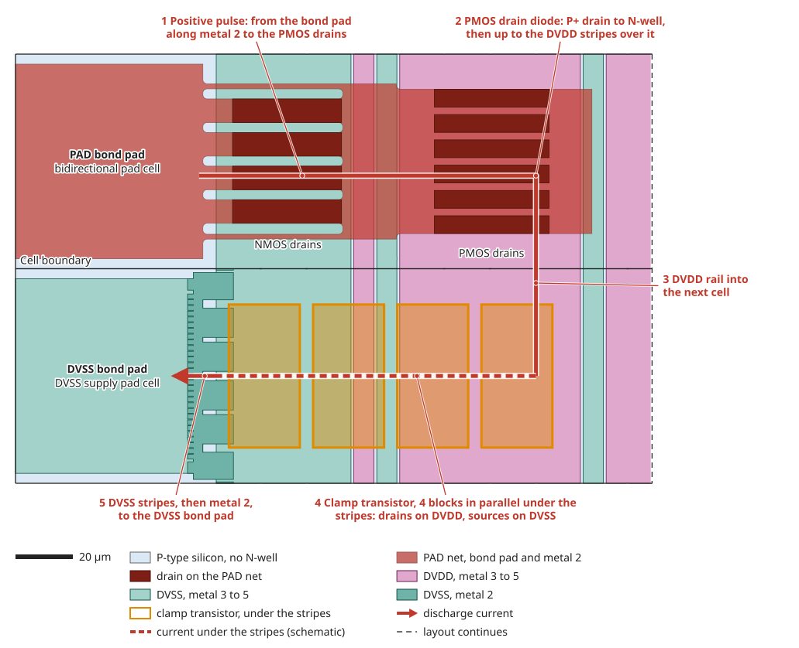
         side by side. Stripes of metal 3 to 5, DVDD in magenta and DVSS in
         green, cross both cells. A red path with arrowheads, in five
         numbered steps, runs from the PAD bond pad to the PMOS drains, onto the DVDD stripes, along them
         into the supply pad, through the clamp transistor and back to the DVSS
         bond pad.
   :width: 100%

   The thick red path of the panel "Positive, PAD to DVSS" in
   :numref:`fig-esd-paths`, drawn on the layout of two neighbouring cells.
   :ref:`esd-layout-ring` lists the numbered steps.

.. list-table:: Current paths through the bidirectional pad
   :name: tab-esd-paths
   :header-rows: 1
   :widths: 24 76

   * - Discharge
     - Path
   * - Positive, PAD to DVSS
     - PMOS drain diode onto DVDD, then the rail clamp to DVSS. Above
       10.7 V the output NMOS also snaps back, from the pad to DVSS
   * - Negative, PAD to DVSS
     - NMOS drain diode, forward biased, from DVSS to the pad
   * - Positive, PAD to DVDD
     - PMOS drain diode, forward biased, onto DVDD
   * - Negative, PAD to DVDD
     - The rail clamp from DVDD to DVSS, switched on as DVDD rises above
       DVSS, then the NMOS drain diode, forward biased, from DVSS to the
       pad. Above about 9.7 V the PMOS drain also conducts in avalanche,
       from DVDD to the pad

The analogue pad ``asig_5p0`` has the same two diode paths, with larger
dedicated diodes, each four 150 µm² parts (600 µm² in all), and no
series resistor
([ESD-ASIG-CDL]_). Its signal reaches the core directly, so the core
circuit connected to it sees the full pad voltage.

.. _esd-limits:

TLP limits
----------

The gf180mcu design manual gives :term:`transmission line pulse <TLP>`
(TLP) measurements of each ESD device. A TLP tester applies rectangular
pulses 100 ns long with a 10 ns rise, at rising current, and measures the
voltage, and the leakage current after each one ([ESD-GF180-DRM-14-4]_,
[ESD-GF180-DRM-14-5-5]_). :numref:`fig-esd-tlp-limits` plots the measured
points of all four devices. The current at
which the device fails, the :term:`second breakdown current`, scales with
the device's width, so the manual gives it per micrometre
(:numref:`tab-esd-limits`).

.. list-table:: TLP limits of 5 V and 6 V ESD devices
   :name: tab-esd-limits
   :header-rows: 1
   :widths: 34 22 22 22

   * - Device
     - Turn-on (V)
     - Failure current (mA/µm)
     - Voltage at failure (V)
   * - N+/P-well diode [ESD-GF180-DRM-14-5-7]_
     - about 1, forward
     - 30
     - 6.7
   * - P+/N-well diode [ESD-GF180-DRM-14-5-8]_
     - about 1, forward
     - 31
     - 6.9
   * - Grounded-gate NMOS [ESD-GF180-DRM-14-5-5]_
     - 10.7, snaps back to 6.2
     - 7
     - 8
   * - Grounded-gate PMOS [ESD-GF180-DRM-14-5-6]_
     - 9.7, does not snap back
     - 5.3
     - 14.1

The 6.2 V holding voltage is the manual's table value. A straight line
through the measured points after snapback meets zero current at 5.8 V,
and the simulation uses that fit (:doc:`simulation`). The PMOS has no
snapback: its current rises steadily above its avalanche voltage, to
failure at about 14 V.

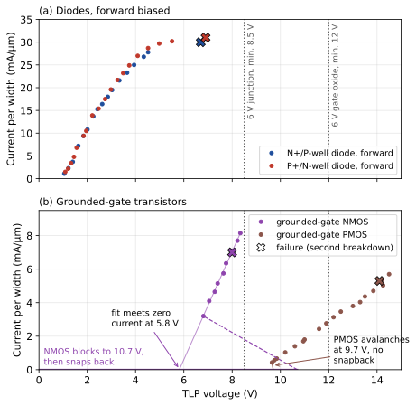
         from 0 to 15 V. Top, the two diodes conduct forward from about
         1 V and reach about 28 to 30 mA/µm by 4.5 to 5.5 V; they fail at
         30 mA/µm at 6.7 V and 31 mA/µm at 6.9 V. Bottom, the grounded-gate
         NMOS blocks to 10.7 V, snaps back to about 6.8 V and rises steeply,
         its straight-line fit meeting zero current at 5.8 V; it fails at
         7 mA/µm at 8 V. The grounded-gate PMOS avalanches at 9.7 V with no
         snapback and fails at 5.3 mA/µm at 14.1 V. Dotted lines mark the
         8.5 V minimum junction breakdown and the 12 V minimum gate oxide
         breakdown.
   :width: 100%

   TLP measurements of the four 6 V ESD devices, with each device's
   failure point, read from the gf180mcu design manual.

The voltage that the protection reaches must stay below the limits of the
circuits it protects (:numref:`tab-esd-breakdown`).

.. list-table:: Breakdown voltages that bound the pad voltage
   :name: tab-esd-breakdown
   :header-rows: 1
   :widths: 50 25 25

   * - Breakdown
     - Minimum (V)
     - Typical (V)
   * - 6 V gate oxide [ESD-GF180-EP-OX]_
     - 12
     - 16
   * - N+ to P-well junction of a 6 V NMOS [ESD-GF180-EP-JN]_
     - 8.5
     - 11
   * - P+ to N-well junction of a 6 V PMOS [ESD-GF180-EP-JN]_
     - 8.5
     - 10.5

The minimum oxide breakdown is taken as the limit for the input
transistors' gates. The design manual also warns that TLP results can
differ from human body model results, because the waveforms differ
([ESD-GF180-DRM-14-4]_).
