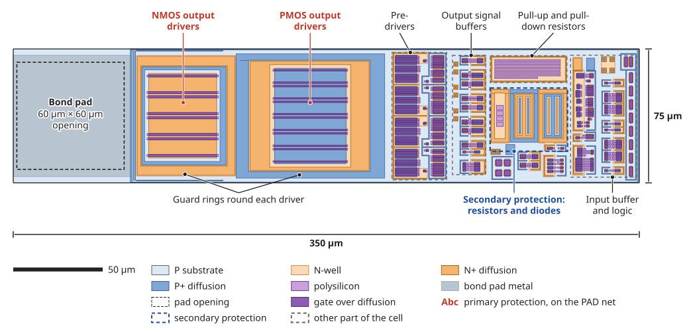
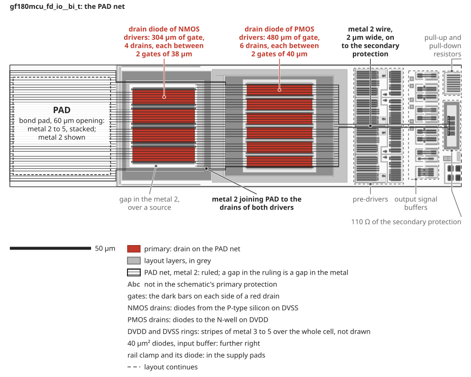
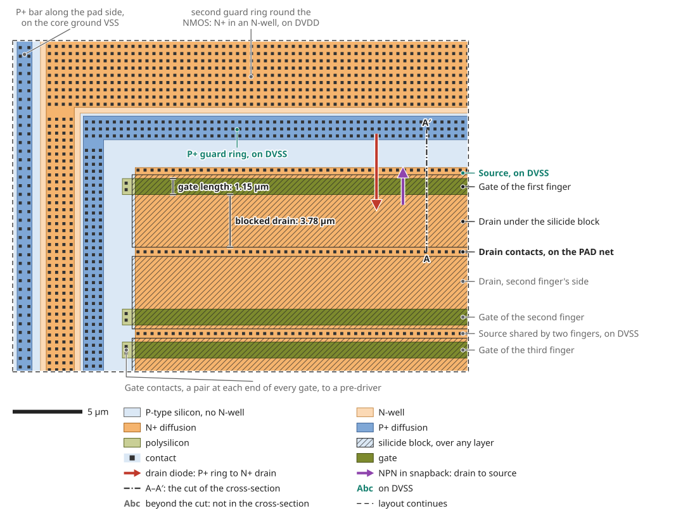
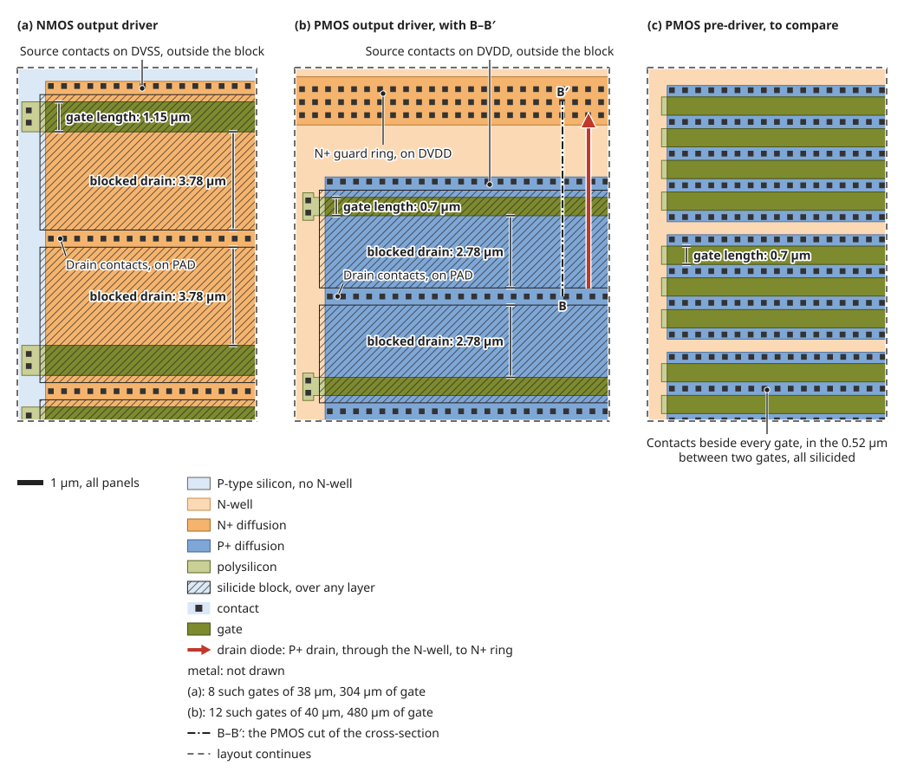
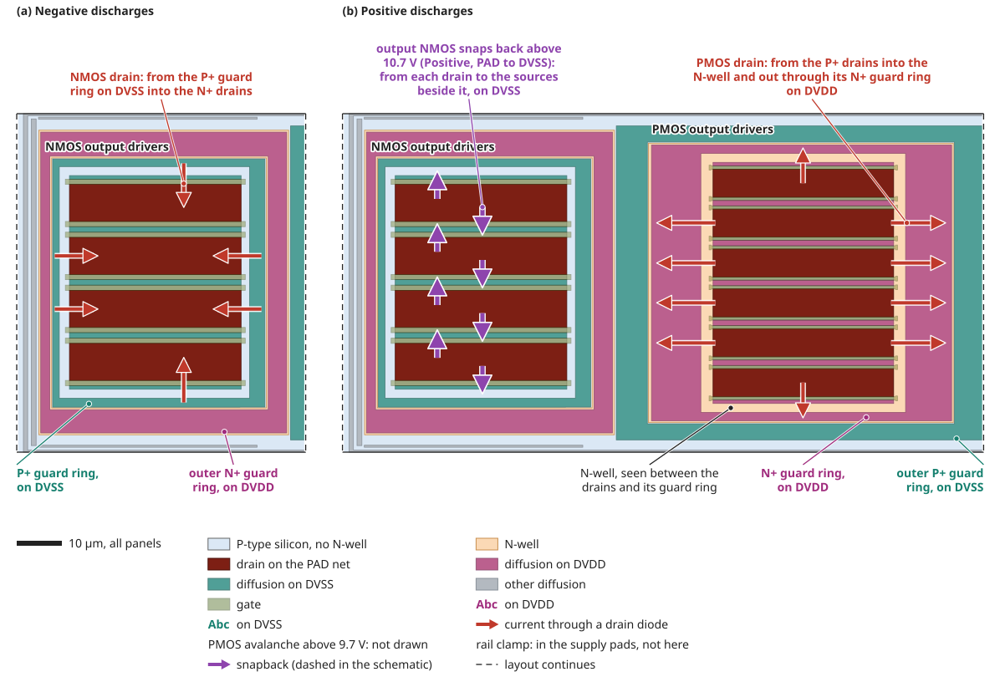
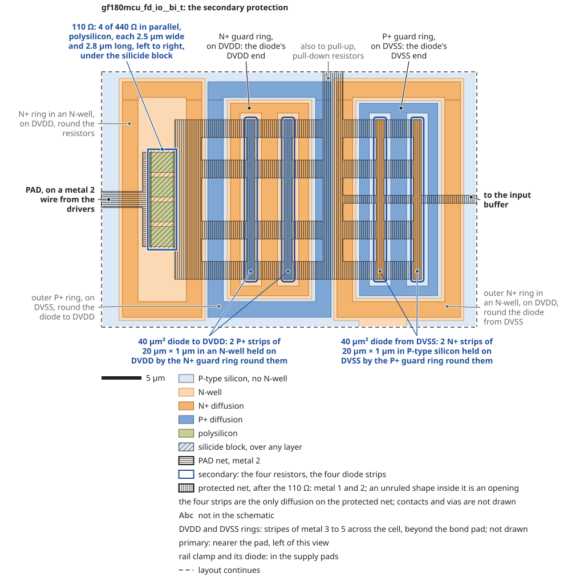
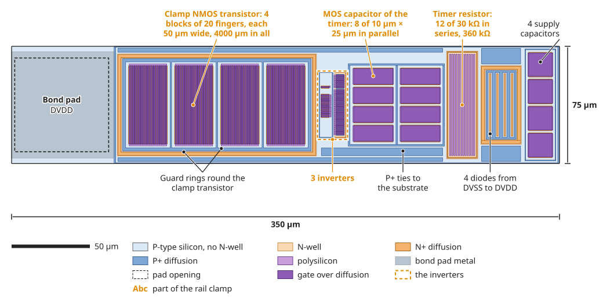
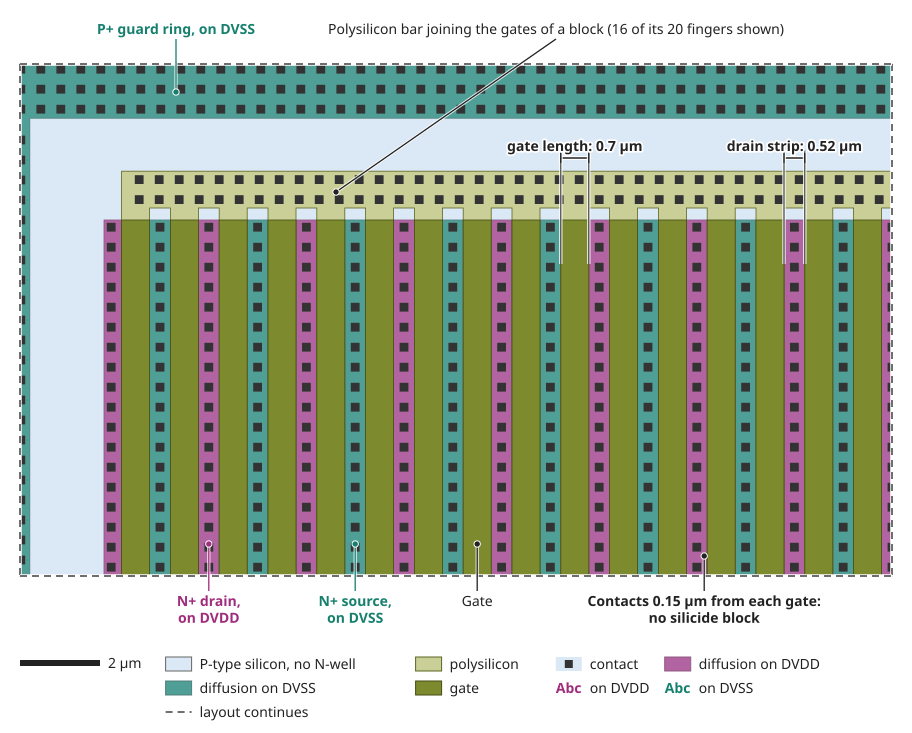
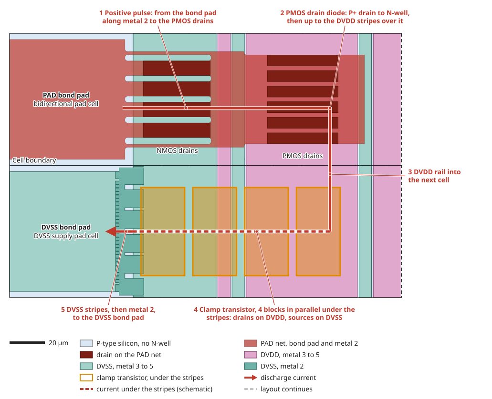

.. _esd-layout:

I/O cell layout
===============

The gf180mcu I/O library publishes the mask layout of every pad cell as a
GDS file beside its netlist ([ESD-GF180-IO-SRC]_). In the layout each
protection device of :doc:`io-cells` has a real size and position: the
output transistors and their guard rings alone fill two fifths of the
bidirectional pad.

Every layout figure is drawn from the foundry's GDS file, in the version
for five metal layers, by the script in :ref:`esd-layout-method`. The
figures share four conventions:

* The bond pad is at the left and the chip's core at the right, as in the
  schematic :numref:`fig-esd-io-cell`. This turns the foundry's drawing a
  quarter turn clockwise.
* Each layer has the same colour in every figure, and the silicon layers
  have the colours of the cross-section :numref:`fig-esd-driver-section`.
* Red marks the PAD net and the discharge current, blue the secondary
  protection and orange the rail clamp, as in the schematic. Magenta marks
  what connects to DVDD and green what connects to DVSS.
* A bar under each figure gives its scale, and a dashed edge of the frame
  shows where the layout continues beyond the figure.

Bidirectional pad floorplan
---------------------------

The bidirectional pad ``gf180mcu_fd_io__bi_t`` is 75 µm wide and 350 µm
long ([ESD-BI-T-GDS]_). Its parts lie in the order the signal meets them,
from the bond pad towards the core (:numref:`fig-esd-gds-cell`):

#. The bond pad, with a 60 µm × 60 µm opening in the passivation.
#. The NMOS output drivers, inside two guard rings.
#. The PMOS output drivers, in their own N-well.
#. The four pre-drivers that switch the output drivers' gates, and the
   buffers of the signals that control them.
#. The secondary protection. The foundry's name for this block,
   ``comp018green_esd_cdm``, gives its purpose: the
   :term:`charged device model`.
#. The input buffer and the rest of the logic, next to the core.

The two output drivers and their guard rings reach from 66 µm to 208 µm
along the cell, 142 µm of its 350 µm. The output drivers are therefore the
largest part of the cell, and they are also its primary ESD protection
(:ref:`esd-io-cells`).

         showing N-well, N+ diffusion, P+ diffusion and polysilicon. From
         the left: the bond pad with a 60 µm by 60 µm opening; the NMOS
         output drivers inside guard rings; the PMOS output drivers in an
         N-well, each driver inside guard rings; the pre-drivers; the
         output signal buffers; a blue box round the secondary protection,
         resistors and diodes; and the input buffer and logic at the right
         edge. The cell is 350 µm long and 75 µm wide.
   :width: 100%

   The parts of gf180mcu_fd_io__bi_t, drawn from its layout.

Pad connection
--------------

The bond pad is a stack of metal 2 to metal 5, joined by vias. Metal 2
continues from the pad as a bus over both output drivers
(:numref:`fig-esd-gds-pad-net`). The bus connects to four NMOS drains and
six PMOS drains, and each drain lies between two gates, so it serves two
transistor fingers. These ten drains are every diffusion on the PAD net.

A metal 2 wire 2 µm wide leaves the far end of the bus and crosses the
pre-drivers to the four resistors of the secondary protection. Nothing
else connects to the pad: the discharge current has no path into the cell
except through the drains and that wire.

         in red. The bond pad, metal 2 to metal 5 stacked, joins a metal 2
         bus that covers both output drivers. Under the bus, four NMOS
         drains and six PMOS drains are drawn dark red; each lies between
         two gates. A metal 2 wire 2 µm wide runs on from the bus to the
         four secondary protection resistors.
   :width: 100%

   The PAD net of gf180mcu_fd_io__bi_t: the bond pad, the metal 2 bus and
   every drain the bus connects to.

Output driver parts
-------------------

Each NMOS output driver is eight fingers side by side, and neighbouring
fingers share a source or a drain. :numref:`fig-esd-gds-nmos-driver` shows
one corner of them. Across the fingers the diffusion repeats as source,
gate, drain, gate, source:

* A source is a narrow strip with one row of contacts to DVSS.
* A gate is a polysilicon strip 1.15 µm long over the diffusion.
* A drain is 8.22 µm wide, with one row of contacts to PAD along its
  middle. The rest of it lies under the silicide block.

Three rings surround the fingers. The innermost is P+ diffusion in the
substrate, tied to DVSS: it is the body contact of the transistors and
the anode of the NMOS drain diode. The next is N+ diffusion in an N-well,
tied to DVDD. It collects electrons that a forward-biased drain injects
into the substrate, before they reach other circuits, which is the
protection against :term:`latch-up`. The outermost is P+ diffusion tied
to the core ground VSS.

         contacts drawn as black squares. Three rings run along the top and
         left: an outer P+ ring to VSS, an N+ guard ring in an N-well to
         DVDD, and a P+ guard ring to DVSS. Inside them, from the top: a
         source strip to DVSS, a gate 1.15 µm long, a wide drain hatched as
         silicide blocked for 3.78 µm on each side of a row of drain
         contacts to PAD, the gate of the second finger, a source shared by
         two fingers, and the gate of the third finger. Each gate has
         contacts at its end, which connect to the pre-drivers.
   :width: 100%

   One corner of the NMOS output drivers of gf180mcu_fd_io__bi_t. Three of
   the eight gates are shown, and 24 µm of their 38 µm width.

Silicide block
--------------

The silicide block layer covers each gate of an output driver and the
drain beside it (:numref:`fig-esd-gds-silicide-block`). It reaches 3.78 µm
from the gate over an NMOS drain and 2.78 µm over a PMOS drain. Between
the two blocked parts of a drain a strip 0.66 µm wide stays silicided, and
the drain contacts stand on it. On the source side the block reaches only
0.28 µm past the gate.

A drain's current must therefore cross 3.78 µm or 2.78 µm of unsilicided
diffusion between the contacts and the gate. That length is the ballast
resistance of :ref:`esd-io-cells`. An ordinary transistor has none: in a
pre-driver the contacts stand directly beside each gate
(:numref:`fig-esd-gds-silicide-block`, c).

The only other silicide block in the cell covers polysilicon resistors:
the four of the secondary protection and the pull-up and pull-down
resistors.

         gate 1.15 µm long, then an N+ drain hatched as silicide blocked
         for 3.78 µm, a row of drain contacts, and another 3.78 µm of
         blocked drain before the next gate. (b) A PMOS output driver: a
         gate 0.7 µm long and a P+ drain blocked for 2.78 µm on each side
         of its contacts. In both, the source contacts stand outside the
         block. (c) A PMOS pre-driver with no silicide block, where a row of
         contacts stands beside every gate.
   :width: 100%

   The silicide-blocked drains of both output drivers, beside a pre-driver
   transistor that has no silicide block.

Discharge paths in the drivers
------------------------------

The currents of :numref:`tab-esd-paths` all pass through the output
drivers. :numref:`fig-esd-gds-paths` colours each diffusion of the drivers
by the net it connects to, and draws each current across the silicon it
crosses:

* A positive pulse forward-biases the PMOS drains. The current leaves the
  six P+ drains into the N-well under them and reaches the N+ ring round
  the well, which is tied to DVDD.
* A negative pulse forward-biases the NMOS drains. The current enters
  from the P+ ring tied to DVSS, crosses the substrate under the sources
  and gates, and leaves through the four N+ drains.
* Above 10.7 V a positive pulse also makes the NMOS drivers snap back.
  That current crosses under each gate, from a drain to the source on
  either side.

Both diode currents cross the well or substrate sideways, from under the
drains to a ring at the edge. This is the well resistance that makes a
real drain diode more resistive than the foundry's test diode
(:ref:`esd-simulation`).

         net: drains on PAD dark red, diffusion on DVDD magenta, diffusion
         on DVSS green. Left, the NMOS drivers: red arrows run from the P+
         ring on DVSS inwards to the N+ drains, the negative pulse through
         the NMOS drain diode; orange arrows run from each drain to the
         sources beside it, the snapback of a positive pulse above 10.7 V.
         Right, the PMOS
         drivers: red arrows run outwards from the P+ drains across the
         N-well to its N+ ring on DVDD, the positive pulse through the PMOS
         drain diode.
   :width: 100%

   The discharge currents drawn on the output drivers of
   gf180mcu_fd_io__bi_t.

Secondary protection layout
---------------------------

The secondary protection fits in an area about 30 µm × 43 µm
(:numref:`fig-esd-gds-secondary`). The 2 µm wire from the pad ends on four
polysilicon resistors side by side, each 2.5 µm wide and 2.8 µm long under
one silicide block. Their far ends join in one net that passes over the
diodes and continues to the gates of the input buffer:

* Two P+ strips, each 20 µm × 1 µm, in an N-well tied to DVDD. They are
  the diode from the protected net to DVDD.
* Two N+ strips of the same size in the P substrate, inside an N-well
  ring. They are the diode from DVSS to the protected net.

Each strip has a ring of the opposite diffusion round it, a few
micrometres away, which is the diode's other terminal.

         a metal 2 wire drawn red and ends on four polysilicon resistors,
         2.5 µm by 2.8 µm each and in parallel, under a hatched silicide
         block. The protected net, drawn blue, leaves the resistors, sends a
         branch to the pull-up and pull-down resistors, passes over two
         P+ diode strips of 20 µm by 1 µm in an N-well tied to DVDD and two
         N+ diode strips of the same size in the P substrate inside an
         N-well ring, and leaves at the right for the gates of the input
         buffer.
   :width: 100%

   The secondary protection of gf180mcu_fd_io__bi_t: four resistors and
   two pairs of diodes.

Rail clamp layout
-----------------

The supply pad ``gf180mcu_fd_io__dvdd`` has the same outline as the
bidirectional pad, and the rail clamp fills it ([ESD-DVDD-GDS]_,
:numref:`fig-esd-gds-clamp`). The clamp transistor takes the place of the
output drivers: four blocks of 20 fingers, each finger 50 µm wide. Behind
it lie the three inverters, the eight timer capacitors and the twelve
timer resistors of :ref:`esd-io-cells`. The last part of the cell holds
four diodes from DVSS to DVDD and four capacitors between the rails.

         DVDD bond pad; the clamp transistor as four blocks of 20 fingers
         of 50 µm inside guard rings; three inverters; eight timer
         capacitors of 10 µm by 25 µm; twelve timer resistors of 30
         kilohms; four diodes from DVSS to DVDD; and four supply capacitors
         at the right edge. Bars of P+ diffusion tie the substrate.
   :width: 100%

   The parts of gf180mcu_fd_io__dvdd, drawn from its layout.

The clamp transistor has no silicide block
(:numref:`fig-esd-gds-clamp-fingers`). Its drains and sources are strips
0.52 µm wide between gates 0.7 µm long, each with one row of contacts
0.15 µm from the gates on either side. The drains connect to DVDD and the sources to
DVSS, alternately. One bar of polysilicon joins the 20 gates of a block.

The difference from the output drivers follows from how each conducts.
The inverters turn the clamp transistor on through its gate, so the
current flows in the channel of all 80 fingers. An output driver's gate
is off during a discharge, and the driver must survive its
:term:`parasitic bipolar transistor <Snapback>` turning on, which is what
the silicide block is for (:ref:`esd-io-cells`).

         vertical strips of diffusion alternate between drains on DVDD,
         magenta, and sources on DVSS, green, each with one column of
         contacts, 0.52 µm wide and separated by gates 0.7 µm long. A
         polysilicon bar along
         the top joins the 20 gates of a block, and a P+ guard ring on DVSS
         runs round the outside. Contacts stand 0.15 µm from each gate,
         with no silicide block.
   :width: 100%

   One corner of the clamp transistor of gf180mcu_fd_io__dvdd. Sixteen of
   its 80 fingers are shown, and 9 µm of their 50 µm width.

Path across the ring
--------------------

Metal 3, metal 4 and metal 5 cross every pad cell in stripes, one above
another, in the direction of the cell's 75 µm width. Each stripe is in the
same place in every cell, so the stripes of neighbouring cells join into
rails that run round the chip. Most of them are DVDD or DVSS
(:numref:`fig-esd-gds-ring`).

A positive discharge from PAD to DVSS uses those rails
(:numref:`tab-esd-paths`). :numref:`fig-esd-gds-ring` follows it through a
bidirectional pad and the DVSS supply pad beside it ([ESD-DVSS-GDS]_):

#. From the bond pad along the metal 2 bus to the PMOS drains.
#. Through the PMOS drain diode into the N-well, whose N+ ring connects to
   the DVDD stripes above it.
#. Along the DVDD rail into the supply pad.
#. Through the clamp transistor, whose drains connect to the DVDD stripes
   and whose sources connect to the DVSS stripes.
#. Along the DVSS stripes, and then metal 2, to the DVSS bond pad.

The supply pad need not be the neighbouring cell. Each cell between the
two adds 75 µm of rail to the path, and that rail's resistance adds to
the voltage at the pad (:doc:`results-hbm`).

         pad cell, below, side by side as on the pad ring. Stripes of metal
         3 to 5 cross both cells, some DVDD in magenta and some DVSS in green,
         each continuing from one cell into the other. One red arrow marks
         the current. Step 1, from the PAD bond pad along metal 2 to the
         PMOS drains. Step 2, through the PMOS drain diode onto the DVDD
         stripes above. Step 3, along the DVDD rail into the supply pad.
         Step 4, drawn dashed, through the clamp transistor, four orange
         blocks under the stripes, with drains on DVDD and sources on DVSS.
         Step 5, along the DVSS stripes and then metal 2 to the DVSS bond
         pad.
   :width: 100%

   A positive discharge from PAD to DVSS, through gf180mcu_fd_io__bi_t and
   the gf180mcu_fd_io__dvss cell beside it. The first 222 µm of each cell
   are shown.

Netlist and layout comparison
-----------------------------

Every size that :doc:`io-cells` takes from a netlist can also be measured
in the layout. :numref:`tab-esd-gds-check` gives both for each protection
device, and all of them agree.

.. csv-table:: Sizes of the protection devices in the netlist and the layout
   :name: tab-esd-gds-check
   :file: gds/layout-check.csv
   :header-rows: 1
   :widths: 28 36 8 14 14

The layout also confirms the connections of :numref:`fig-esd-io-cell`.
Following each net through the contacts and vias shows that:

* PAD reaches only the ten driver drains and the four resistors;
* the NMOS sources and the P+ ring round them are on DVSS;
* the PMOS sources and the N+ ring of their N-well are on DVDD;
* the protected net reaches the four diode strips and the input buffer.

.. _esd-layout-method:

Drawing method
--------------

The script :download:`gds/figures.py <gds/figures.py>` draws every layout
figure, and :download:`gds/check.py <gds/check.py>` writes
:numref:`tab-esd-gds-check` and stops with an error if a size differs.
Both read the :wikipedia:`GDS <GDSII>` files with the gdstk library
([ESD-GDSTK]_) and need only a
checkout of the I/O library at the commit that :ref:`esd-simulation`
pins:

.. code-block:: sh

   GF180_IO=$PWD/globalfoundries-pdk-libs-gf180mcu_fd_io \
       uv run docs/esd/gds/figures.py
   GF180_IO=$PWD/globalfoundries-pdk-libs-gf180mcu_fd_io \
       uv run docs/esd/gds/check.py

Three modules in the same folder do the work:

* :download:`gds/gdskit.py <gds/gdskit.py>` flattens a cell, merges the
  shapes of each layer and follows a net from one shape through the
  contacts and vias. The layer numbers are those of the design manual
  ([ESD-GF180-DRM-4-1]_).
* :download:`gds/layfig.py <gds/layfig.py>` draws a window of a cell with
  its labels, scale bar and legend.
* :download:`gds/figs_pad.py <gds/figs_pad.py>`,
  :download:`gds/figs_driver.py <gds/figs_driver.py>` and
  :download:`gds/figs_clamp.py <gds/figs_clamp.py>` hold the figures.

The figures show what the masks draw, with two changes. N+ diffusion is
the active area inside the N+ implant, and P+ diffusion the active area
inside the P+ implant, so each diffusion has the colour of its doping.
Most figures leave out the metal, vias and contacts that would hide the
silicon, and show only the metal of the net in question.

A net is followed through metal, contacts and vias only. A transistor's
channel and a resistor's body do not join the two sides, so a drain and
its source count as different nets.
