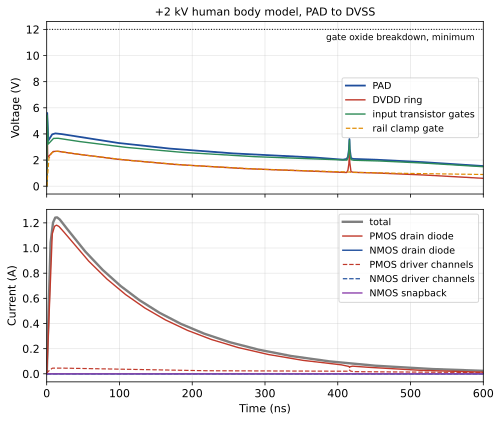
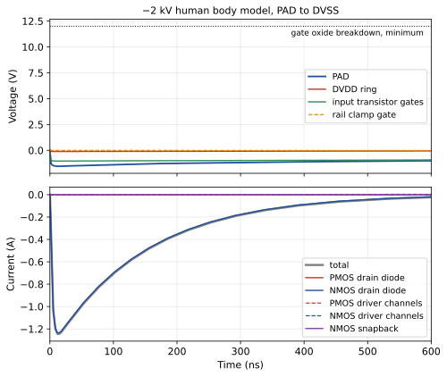
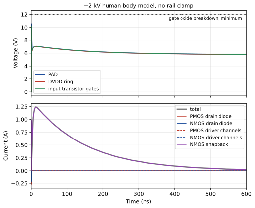

.. _esd-results-hbm:

Simulated human body model discharges
=====================================

This page gives the simulated human body model discharges into the
bidirectional pad ``gf180mcu_fd_io__bi_t``, with DVSS grounded, built as
described on :doc:`simulation`. It compares the current in each protection
device with the current at which the foundry measured that device failing
(:ref:`esd-limits`). :doc:`results-iec` gives the IEC discharges.

In the current graphs on this page, a current is positive when it flows
out of the pad into the chip.

The 2 kV discharge
------------------

:numref:`fig-esd-hbm-pos` shows a positive 2 kV discharge, which stays far
below the measured limits. In the first
nanoseconds the rail clamp's gate rises behind DVDD, and the clamp turns
on. From about 5 ns the gate is within 0.1 V of DVDD. The PMOS drain diode
then carries almost the whole current onto DVDD, and the clamp carries it
on to DVSS.

         to about 4 V and decays to about 1.5 V, the input transistor gates
         follow a little below it, DVDD jumps to 4.5 V in the first
         nanosecond and then sits near 2.7 V at the peak current, and the
         rail clamp gate rises behind DVDD and then follows it. All stay
         far below the 12 V gate oxide breakdown line. Bottom, currents: the total peaks at 1.24 A near
         15 ns and decays; the PMOS drain diode carries almost all of it,
         the PMOS driver channels a few tens of milliamperes.
   :width: 100%

   Voltages and currents of a +2 kV human body model discharge into PAD.

* The pad reaches 5.6 V in the first nanosecond, while the clamp turns
  on, then 4.0 V at the peak current of 1.24 A. DVDD reaches 4.5 V, then
  2.7 V at the peak current.
* The PMOS drain diode carries 1.2 A, 2.5 mA per micrometre of its 480 µm
  width: 8 % of the 31 mA/µm at which the foundry measured that diode type
  failing.
* The PMOS output transistors' channels carry about 50 mA. Their gates sit
  at 0 V, held there by the unpowered predriver, so the pad turns them on
  as it rises above DVDD.
* The input transistors' gates reach 5.4 V, below the 12 V minimum
  breakdown of their oxide.

Near 415 ns, with DVDD fallen to about 1 V, close to the threshold voltage
of the 6 V transistors, the clamp's inverters change state. DVDD jumps
from 1.0 V to 2.6 V for about 2 ns, while the clamp gate stays near 1 V.
The clamp keeps carrying the remaining current, about 80 mA, and DVDD
falls back to 1.1 V.

A negative discharge takes the other path. The NMOS drain diode conducts
forward from DVSS to the pad, and the pad goes to −1.5 V
(:numref:`fig-esd-hbm-neg`). The diode carries 4.1 mA/µm, 14 % of its
measured limit.

         −1.5 V and recovers slowly, the input gates to about −1 V, DVDD and
         the clamp gate stay near 0 V. Bottom, the total current falls to
         −1.25 A near 15 ns and decays; the NMOS drain diode carries all of
         it.
   :width: 100%

   Voltages and currents of a −2 kV human body model discharge into PAD.

Discharge without the rail clamp
--------------------------------

:numref:`fig-esd-hbm-noclamp` repeats the positive discharge with the DVDD
and DVSS pads, and so their clamps, removed. The PMOS drain diode now has
nowhere to send the current, and the pad rises until the output NMOS
reaches its 10.7 V trigger and :term:`snaps back <Snapback>`. The NMOS then
carries the whole discharge at about 7 V.

         input gates spike to about 13 V for under a nanosecond, then sit
         near 7 V
         and fall slowly to 6 V. Bottom, the total current peaks at 1.24 A
         and the NMOS snapback branch carries all of it.
   :width: 100%

   The same +2 kV discharge with the rail clamps removed.

The grounded-gate NMOS fails at 7 mA/µm, a quarter of the diodes' limit.
Without the clamp, the same 2 kV discharge uses 58 % of the NMOS limit,
against 8 % of the diode limit with it. The clamp moves the current onto
the device that can carry more of it, at a lower voltage.

Before the NMOS snaps back, the pad and the input gates spike to 13.3 V
(:numref:`tab-esd-events-voltage`), and stay above 12 V for about 80 ps
(:numref:`fig-esd-hbm-noclamp`). The spike lasts as long as the NMOS takes
to trigger. The simulation sets that at about 100 ps, and the NMOS carries
no avalanche current before then (:doc:`simulation`), so the spike's
height is an upper estimate. With the clamp, the input gates stay at
5.4 V.

Sensitivity to uncertain inputs
-------------------------------

The drain diodes' series resistance and the resistance of the supply rings
are the inputs least known (:doc:`simulation`). :numref:`tab-esd-sens`
repeats the +2 kV human body model discharge with each changed.

.. csv-table:: +2 kV human body model with the least-known inputs changed
   :name: tab-esd-sens
   :file: sim/results/sensitivity.csv
   :header-rows: 1

Doubling the drain diodes' resistance raises the pad by 0.2 V at the peak
current. A ring resistance of 1 Ω raises it by 1.3 V: the current crosses
the DVDD ring on its way to the clamps, while the DVSS pads are where the
tester's ground connects (:numref:`fig-esd-testbench`). At the 29 A of an 8 kV IEC discharge, the same
1 Ω would add 29 V, so a pad built for the IEC test needs a ring resistance
far below 1 Ω (:doc:`higher-levels`).
