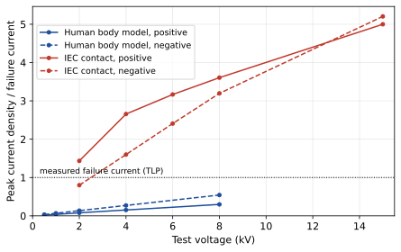

.. _esd-results-iec:

Simulated IEC contact discharges
================================

This page gives the simulated :std:`IEC 61000-4-2` contact discharges into
the bidirectional pad ``gf180mcu_fd_io__bi_t``, with DVSS grounded, and
compares them with the human body model discharges on
:doc:`results-hbm`. It compares the current in each protection device with
the current at which the foundry measured that device failing
(:ref:`esd-limits`).

In the current graphs on this page, a current is positive when it flows
out of the pad into the chip.

The 8 kV contact discharge exceeds the measured limits
------------------------------------------------------

:numref:`fig-esd-iec-8kv` shows an 8 kV contact discharge, level 4 of
:std:`IEC 61000-4-2`. The first peak of 29.4 A arrives within a
nanosecond.

.. figure:: figures/iec-8kv.svg
   :name: fig-esd-iec-8kv
   :alt: Two graphs against time from 0 to 150 ns. Top, PAD jumps to
         13.7 V within a nanosecond, dips, then stays above the 12 V gate
         oxide line from about 8 ns to 33 ns before decaying; DVDD and the
         clamp gate reach about 10 V; the input gates peak near 11.5 V.
         Bottom, the total current peaks at 29.4 A near 1 ns, dips to 11 A,
         rises again to 20 A near 15 ns and decays. The PMOS drain diode
         carries up to 12.5 A, the NMOS snapback about 7.5 A and the NMOS
         drain diode up to 7 A.
   :width: 100%

   Voltages and currents of a +8 kV :std:`IEC 61000-4-2` contact discharge
   into PAD.

The rail clamp turns on: its gate follows DVDD. The current divides
between three paths from the pad (:numref:`tab-esd-events-current`):

* through the PMOS drain diode to DVDD and the rail clamps, about 12.7 A
  (26.4 mA/µm over 480 µm);
* through the snapped-back output NMOS to DVSS, 25.2 mA/µm, 3.6 times its
  measured limit;
* through the NMOS drain diode in reverse breakdown, which the foundry
  diode model places at 11 V, 23.9 mA/µm.

To carry their 12.7 A, the two 4000 µm clamp transistors need about 10 V
across them, so DVDD rises to about 10 V. The PMOS drain diode adds about
3.7 V more, so the pad reaches 13.7 V (:numref:`tab-esd-events-voltage`),
passes the output NMOS's 10.7 V trigger, and the NMOS snaps back.

The pad stays above 12 V for 22 ns. The 110 Ω secondary resistor and
diodes hold the input gates to 11.5 V, just below the minimum oxide
breakdown.

Three parts of this result rest on devices outside what their models
cover:

* DVDD at about 10 V is above the 8.5 V minimum junction breakdown of a 6 V
  NMOS (:numref:`tab-esd-breakdown`). The clamp transistor is an ordinary
  6 V NMOS without silicide blocking, and the simulation gives it no
  snapback branch.
* The foundry measured the diodes' failure current forward biased. The
  NMOS drain diode's reverse-breakdown current is compared with that
  forward limit.
* The snapback branch latches on at 10.7 V for the rest of the event
  (:doc:`simulation`).

The negative 8 kV discharge flows through the NMOS drain diode alone, at
96 mA/µm, 3.2 times its limit.

.. csv-table:: Peak voltages in each simulated event
   :name: tab-esd-events-voltage
   :file: sim/results/events-voltage.csv
   :header-rows: 1

.. csv-table:: Peak current density in each device, and the largest as a
               fraction of that device's measured failure current
   :name: tab-esd-events-current
   :file: sim/results/events-current.csv
   :header-rows: 1

The IEC rows at 15 kV apply the contact-discharge waveform at 15 kV. They
are not the air-discharge test: 15 kV air is level 4, counted as the same
severity as 8 kV contact (:ref:`esd-events`), while the contact waveform at
15 kV carries nearly twice the current of 8 kV contact.
:numref:`tab-esd-solver` lists the events that needed another solver
setting (:doc:`simulation`). Every event was simulated over the whole
pulse.

.. csv-table:: Events not solved with Gear integration over the whole pulse
   :name: tab-esd-solver
   :file: sim/results/solver.csv
   :header-rows: 1

How the stress grows with the test voltage
------------------------------------------

:numref:`fig-esd-sweep` and :numref:`tab-esd-sweep` give every test level
of both tests in both polarities. For each event the graph shows the most
stressed device's peak current density divided by its measured failure
current.

         to 5, against test voltage from 0 to 15 kV. The human body model
         lines, positive and negative, rise slowly to 0.3 and 0.54 at
         8 kV, below the failure line at 1. The IEC contact lines start
         above 1 at 2 kV positive and 0.8 at 2 kV negative, and rise to
         about 5 at 15 kV.
   :width: 100%

   Stress on the most stressed protection device against test voltage.

.. csv-table:: Every simulated test level
   :name: tab-esd-sweep
   :file: sim/results/sweep.csv
   :header-rows: 1

What the results show, read with the limits on :doc:`simulation`:

* In the human body model (HBM) discharges up to 8 kV, four times the
  library's 2 kV target, the simulated current densities stay below the
  measured limits. The highest is 54 % of the NMOS drain diode's limit, in
  the −8 kV discharge. The simulation has no heating, no layout resistance
  and no measured limit for the output transistors themselves
  (:doc:`simulation`), so this is a comparison of current densities, not a
  rating.
* Every positive IEC level from 2 kV contact upward exceeds a measured
  limit, and so does the negative discharge from 4 kV upward. In positive
  discharges the snapped-back output NMOS is the most stressed device; in
  negative discharges, the NMOS drain diode. At −2 kV the NMOS drain diode
  reaches 0.80 of its limit.
* The foundry measured its limits with 100 ns pulses. The IEC first peak
  rises in under 1 ns ([ESD-TB505]_) and is over within a few nanoseconds
  (:numref:`fig-esd-sources`). How the limits apply to so short a pulse is
  listed under :ref:`esd-open`.

