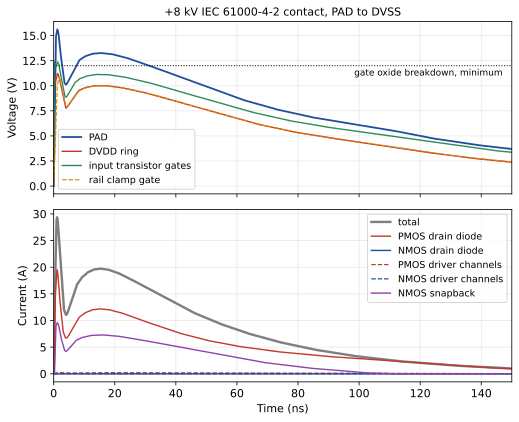

.. _esd-results-iec:

Simulated IEC contact discharges
================================

This page gives the simulated :std:`IEC 61000-4-2` contact discharges into
the bidirectional pad ``gf180mcu_fd_io__bi_t``, with DVSS grounded, and
compares them with the human body model discharges on
:doc:`results-hbm`. It compares the current in each protection device with
the current at which the foundry measured that device failing
(:ref:`esd-limits`).

In the current graphs on this page, a current is positive when it flows
out of the pad into the chip.

The 8 kV contact discharge exceeds the measured limits
------------------------------------------------------

:numref:`fig-esd-iec-8kv` shows an 8 kV contact discharge, level 4 of
:std:`IEC 61000-4-2`. The first peak of 29.4 A arrives within a
nanosecond.

         15.3 V within a nanosecond, dips to 10 V, rises to 13 V near 15 ns
         and stays above the 12 V gate oxide line until about 30 ns before
         decaying; DVDD and the clamp gate reach about 11 V, then about
         10 V; the input gates peak at 12.4 V. Bottom, the total current
         peaks at 29.4 A near 1 ns, dips to 11 A, rises again to 20 A near
         15 ns and decays. The PMOS drain diode carries up to 17.5 A and
         the NMOS snapback up to 9.3 A.
   :width: 100%

   Voltages and currents of a +8 kV :std:`IEC 61000-4-2` contact discharge
   into PAD.

The rail clamp turns on: its gate follows DVDD. At the first peak the
current divides between two paths from the pad
(:numref:`tab-esd-events-current`):

* through the PMOS drain diode to DVDD and the rail clamps, 17.5 A
  (36.6 mA/µm over 480 µm, 1.2 times its measured limit);
* through the snapped-back output NMOS to DVSS, 9.3 A (30.7 mA/µm over
  304 µm), 4.4 times its measured limit.

The two 4000 µm clamp transistors need about 10 V to 11 V across them to
carry their share, so DVDD rises that far. The pad rises past the output
NMOS's 10.7 V trigger within 0.3 ns, and the NMOS snaps back
(:numref:`tab-esd-trigger`). The snapped-back NMOS and the PMOS drain diode
then hold the pad at 15.3 V at the peak current
(:numref:`tab-esd-events-voltage`).

The pad stays above 12 V for 26 ns. The 110 Ω secondary resistor and
diodes do not hold the input gates below the 12 V minimum oxide breakdown:
they reach 12.4 V, and stay above 12 V for about 1 ns in all.

Two parts of this result rest on devices outside what their models cover:

* DVDD at 10 V to 11 V is above the 8.5 V minimum junction breakdown of a
  6 V NMOS (:numref:`tab-esd-breakdown`). The clamp transistor is an
  ordinary 6 V NMOS without silicide blocking, and the simulation gives it
  no snapback branch.
* Until the snapback closes, the simulated NMOS drain carries no avalanche
  current, so the pad's first rise is an upper estimate. The snapback
  closes once the pad has stayed above 10.7 V for about 100 ps
  (:doc:`simulation`). The foundry does not publish how fast its NMOS
  triggers.

.. csv-table:: When the output NMOS snapped back in each event, and the
               highest pad voltage before then
   :name: tab-esd-trigger
   :file: sim/results/trigger.csv
   :header-rows: 1

The negative 8 kV discharge flows through the NMOS drain diode alone, at
96 mA/µm, 3.2 times its limit. DVDD stays within 0.5 V of DVSS, so the
PMOS drain does not reach its avalanche voltage.

.. csv-table:: Peak voltages in each simulated event
   :name: tab-esd-events-voltage
   :file: sim/results/events-voltage.csv
   :header-rows: 1

.. csv-table:: Peak current density in each device in mA/µm, and the
               largest as a fraction of that device's measured failure
               current
   :name: tab-esd-events-current
   :file: sim/results/events-current.csv
   :header-rows: 1

The IEC rows at 15 kV apply the contact-discharge waveform at 15 kV. They
are not the air-discharge test: 15 kV air is level 4, counted as the same
severity as 8 kV contact (:ref:`esd-events`), while the contact waveform at
15 kV carries nearly twice the current of 8 kV contact. At −15 kV the
PMOS drain also avalanches, carrying 4.7 mA/µm.

:numref:`tab-esd-solver` lists the events that needed another solver
setting or a shorter run (:doc:`simulation`). Three negative discharges,
including −15 kV, were simulated for their first 4 ns only. That covers
the first peak, which sets their stress; the later, lower hump is not
simulated.

.. csv-table:: Events not solved with Gear integration over the whole pulse
   :name: tab-esd-solver
   :file: sim/results/solver.csv
   :header-rows: 1

How the stress grows with the test voltage
------------------------------------------

:numref:`fig-esd-sweep` and :numref:`tab-esd-sweep` give every test level
of both tests in both polarities. For each event the graph shows the most
stressed device's peak current density divided by its measured failure
current.

.. figure:: figures/sweep.svg
   :name: fig-esd-sweep
   :alt: Graph of peak current density divided by failure current, from 0
         to 6, against test voltage from 0 to 15 kV. The human body model
         lines, positive and negative, rise slowly to 0.3 and 0.54 at
         8 kV, below the failure line at 1. The IEC contact lines start
         at 1.65 at 2 kV positive and 0.8 at 2 kV negative, and rise to
         about 5.3 and 5.7 at 15 kV.
   :width: 100%

   Stress on the most stressed protection device against test voltage.

.. csv-table:: Every simulated test level
   :name: tab-esd-sweep
   :file: sim/results/sweep.csv
   :header-rows: 1

What the results show, read with the limits on :doc:`simulation`:

* In the human body model (HBM) discharges up to 8 kV, four times the
  library's 2 kV target, the simulated current densities stay below the
  measured limits. The highest is 54 % of the NMOS drain diode's limit, in
  the −8 kV discharge. The simulation has no heating, no layout resistance
  and no measured limit for the output transistors themselves
  (:doc:`simulation`), so this is a comparison of current densities, not a
  rating.
* Every positive IEC level from 2 kV contact upward exceeds a measured
  limit, and so does the negative discharge from 4 kV upward. In positive
  discharges the snapped-back output NMOS is the most stressed device; in
  negative discharges, the NMOS drain diode. At −2 kV the NMOS drain diode
  reaches 0.80 of its limit.
* The foundry measured its limits with 100 ns pulses. The IEC first peak
  rises in under 1 ns ([ESD-TB505]_) and is over within a few nanoseconds
  (:numref:`fig-esd-sources`). How the limits apply to so short a pulse is
  listed under :ref:`esd-open`.

