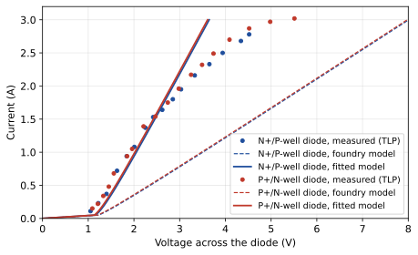
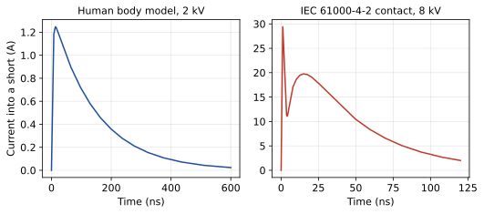

.. _esd-simulation:

How the ESD simulation is built
===============================

This page describes the circuit simulation behind :doc:`results-hbm` and
:doc:`results-iec`: what is
simulated, which foundry models it uses, what it adds to them and why, and
what it cannot show.

The simulated chip is three foundry cells
-----------------------------------------

The simulation runs in :wikipedia:`ngspice <Ngspice>` ([ESD-NGSPICE]_)
with the typical-corner gf180mcu device models at 27 °C
([ESD-GF180-MODELS]_). The circuit is the foundry's own netlists of three
pads ([ESD-GF180-IO-SRC]_):

* one bidirectional pad, ``gf180mcu_fd_io__bi_t``, which receives the
  discharge;
* one DVDD supply pad and one DVSS supply pad, each with its rail clamp,
  joined to the bidirectional pad by the DVDD and DVSS rings.

The tester grounds DVSS, as a human body model test does for a pin
stressed against ground. Every other pin floats, as on an unpowered chip.
The core-side inputs of the pad (``A``, ``OE`` and the others) are tied
low, which is where an unpowered core leaves them. The rings have no
resistance in the main runs, and :doc:`results-hbm` shows the effect of
1 Ω.

The script :download:`sim/esd_sim.py <sim/esd_sim.py>` builds and runs
every test circuit, and :download:`sim/cdl2spice.py <sim/cdl2spice.py>`
translates the foundry's netlists into ngspice form.

Three changes add the behaviour of an ESD event
-----------------------------------------------

The foundry netlists and models are written for normal operation. An ESD
event drives the protection devices to amperes and into breakdown, which
the models do not cover. :numref:`tab-esd-sim-physics` lists what the
simulation adds.

.. list-table:: Changes that add ESD behaviour
   :name: tab-esd-sim-physics
   :header-rows: 1
   :widths: 32 68

   * - Change
     - Reason
   * - Adds a drain diode to each output transistor, scaled by width
     - The netlist gives the silicide-blocked output transistors no drain
       area. The real drain forms a diode with its well, the main ESD path
   * - Fits the drain diodes' series resistance to the TLP measurements
     - The foundry diode model has about three times the resistance the
       foundry measured at ESD currents (:numref:`fig-esd-diode-fit`)
   * - Adds the snapback of the output NMOS
     - Compact transistor models do not include the parasitic bipolar
       transistor. A switched branch fitted to the TLP measurement stands
       in for it

Five changes work around faults in the models under ngspice
-----------------------------------------------------------

The rest of the changes keep the foundry models from giving wrong results
or stopping the simulator (:numref:`tab-esd-sim-faults`).

.. list-table:: Changes that work around faults in the models
   :name: tab-esd-sim-faults
   :header-rows: 1
   :widths: 32 68

   * - Change
     - Reason
   * - Uses each poly resistor's value from the netlist
     - ngspice 44 converts the body of the foundry's ``ppolyf_u`` model,
       written as a voltage-dependent expression, into a resistance equal
       to the resistor's length in metres
   * - Builds each silicide-blocked transistor from two resistors and the
       core transistor
     - The foundry's ``nmos_6p0_sab`` and ``pmos_6p0_sab`` contain the same
       faulty resistor expression, and a junction meant for capacitance
       only, which ngspice's default saturation current makes a forward
       diode. The resistances use the foundry's sheet resistance, 60 Ω/sq
       for N+ and 185 Ω/sq for P+ ([ESD-GF180-MODELS-SAB]_)
   * - Gives those core transistors tiny junction areas
     - ngspice treats a junction area of 0 as not given and computes one
       from the geometry. A 38 µm NMOS then passes 0.78 A at 1 V forward,
       with no series resistance
   * - Simulates each MOS capacitor as its transistor
     - The foundry's ``nmoscap_6p0`` expression model stops ngspice at the
       first time step. The 6 V NMOS model, gate to one plate and source,
       drain and body to the other, gives the same capacitance
   * - Splits transistors wider than 100 µm
     - The model bins stop at 100 µm. The 4000 µm clamp transistor becomes
       40 transistors of 100 µm in parallel

Without the resistor change, the rail clamp's 360 kΩ timer resistor
simulates as about 160 Ω, the two contact resistances alone. The clamp
then turns off within 30 ns of a discharge. Without the transistor
changes, unintended junctions carry a fifth of a human body model
discharge, and the solver stalls in negative IEC discharges.

The solver uses Gear integration. An event that stalls it is rerun with
the trapezoidal method, then the trapezoidal method with a tighter limit on
the error of each time step (``trtol=1``), then Gear integration with a
0.1 ns maximum step. These settings change only how the solver chooses its
time steps. An event that stalls all of them would be simulated to 4 ns
only, past the IEC pulse's first peak. :numref:`tab-esd-solver` lists the
events that needed another setting.

The diodes are fitted to the foundry's measurements
---------------------------------------------------

The gf180mcu design manual plots TLP measurements of a 6 V N+/P-well diode
and a 6 V P+/N-well diode ([ESD-GF180-DRM-14-5-7]_,
[ESD-GF180-DRM-14-5-8]_). The caption of each figure gives the structure:
four fingers (NF=4) of 25 µm (DL) with a 0.9 µm junction (DW), so 100 µm
of width. The measured points, read from those figures, are in
:download:`sim/tlp_gf180mcu.csv <sim/tlp_gf180mcu.csv>`.

The simulation keeps the foundry model's junction parameters and refits
only its series resistance, to the measured points between 0.2 A and 2 A.
Above about 2 A the measured curves bend over as the diodes heat, which no
compact model includes (:numref:`fig-esd-diode-fit`).

         two diodes. Measured points of both diodes rise steeply from about
         1 V and reach 2 A at about 3 V. The foundry model curves are much
         flatter and reach 2 A only near 5.7 V. The fitted model curves
         follow the measured points up to about 2 A.
   :width: 100%

   Measured TLP current of the two 6 V diodes against the foundry model
   and the fitted model.

.. csv-table:: Series resistance of a 100 µm diode, foundry and fitted
   :name: tab-esd-diode-fit
   :file: sim/results/diode-fit.csv
   :header-rows: 1

The fit gives 0.77 Ω for each 100 µm diode, against 2.22 Ω in the foundry
model (:numref:`tab-esd-diode-fit`), with a root-mean-square error of 0.13 V
to 0.14 V over the fitted points. The
added drain diodes take the fitted model and scale it with width: the PMOS
drain diode is 480 µm wide, so 4.8 times the test diode.

The drain of a transistor is not laid out like the test diode. Its current
also crosses the silicide-blocked drain and the well under the channel, so
the real drain diode has more resistance than the scaled test diode.
:doc:`results-hbm` shows what doubling it changes.

The snapback branch follows the TLP measurement
-----------------------------------------------

The design manual's 6 V grounded-gate NMOS triggers at 10.7 V
([ESD-GF180-DRM-14-5-5]_). The caption of its figure gives eight fingers
(NF=8) of 25 µm (GW), so 200 µm of width. A straight line through its measured
points after snapback gives the holding voltage and on-resistance
(:numref:`tab-esd-gg-fit`).

.. csv-table:: Straight-line fit to the snapped-back grounded-gate NMOS
   :name: tab-esd-gg-fit
   :file: sim/results/ggnmos-fit.csv
   :header-rows: 1

The simulation puts a switch and a current source in series from the pad
to DVSS. The switch closes when the pad passes 10.7 V and stays closed for
the rest of the event. A switch that opened again near the holding voltage
would toggle on and off as the pulse decays, and stall the solver. The
current source carries the pad's excess over the holding voltage divided by
the on-resistance, and nothing below the holding voltage. The on-resistance
is the fitted value divided by the 304 µm width of the output NMOS.

The test generators are checked against their standards
-------------------------------------------------------

Each generator is a charged capacitor that discharges through a resistor
and the inductance of its wiring into the pin:

* Human body model: 100 pF and 1500 Ω ([ESD-ESDA-P5]_), with 5 µH, which
  sets a rise time within the 2 ns to 10 ns that the ESD Association gives.
  Renesas gives up to 25 ns when the generator discharges into a 500 Ω
  resistor ([ESD-TB505]_, "Pulse Rise Time"). A conducting pin is close to
  a short circuit, so the 2 ns to 10 ns range applies here.
* :std:`IEC 61000-4-2`: 150 pF and 330 Ω with 2 µH ([ESD-TB505]_,
  Figure 1). A second branch of 6 pF, 200 Ω and 120 nH in parallel forms
  the fast first peak. These three values are chosen to reproduce the
  peak current and rise time below. They are not taken from the standard.

:numref:`fig-esd-sources` shows the current of each generator into a
short circuit, and :numref:`tab-esd-sources` compares it with the published
values.

         the 2 kV human body model rises in a few nanoseconds to about
         1.25 A and decays over several hundred nanoseconds. Right, the
         8 kV IEC generator rises in under a nanosecond to about 29.5 A,
         falls, and decays over about 100 ns.
   :width: 100%

   Current of the two simulated generators into a short circuit.

.. csv-table:: Simulated generators into a short circuit
   :name: tab-esd-sources
   :file: sim/results/sources.csv
   :header-rows: 1

The human body model peaks at 0.62 A per kilovolt, against 0.67 A per
kilovolt published ([ESD-ESDA-P5]_). The inductance lets the capacitor
discharge a little before the current reaches its peak. The rise time of
6.1 ns is within the published 2 ns to 10 ns. The IEC generator peaks at
3.68 A per kilovolt in 0.62 ns, against 3.75 A per kilovolt
([ESD-TB505]_, Figure 2) and a rise of less than 1 ns ([ESD-TB505]_,
"Pulse Rise Time").

The simulation cannot show heating or failure
---------------------------------------------

The device models do not include self-heating, and so cannot show a device
failing. The results judge survival instead by comparing the peak current
per micrometre in each device with the failure current that the foundry
measured (:ref:`esd-limits`). That comparison has three weaknesses:

* TLP pulses last 100 ns. A human body model pulse lasts longer, and an
  IEC pulse's first peak is shorter, so the TLP limit does not apply to
  either directly. The design manual warns that TLP results can differ
  from human body model results ([ESD-GF180-DRM-14-4]_).
* The output transistors are not laid out like the test structures, so
  their failure current per micrometre is not measured.
* The simulation has no layout resistance: no ring resistance in the main
  runs, no via or metal resistance inside the cells.

The simulation also leaves out the :term:`charged device model`. That
test depends on the package's capacitance and the bond wire's inductance,
neither of which is fixed for evampire.

Running the simulation
----------------------

The script needs ngspice 44 or later and checkouts of the foundry's model
and I/O cell repositories. Run it in a
:wikipedia:`systemd <Systemd>` scope that limits its memory:

.. code-block:: sh

   git clone https://github.com/google/globalfoundries-pdk-libs-gf180mcu_fd_pr.git
   git clone https://github.com/google/globalfoundries-pdk-libs-gf180mcu_fd_io.git
   GF180_PR=$PWD/globalfoundries-pdk-libs-gf180mcu_fd_pr \
   GF180_IO=$PWD/globalfoundries-pdk-libs-gf180mcu_fd_io \
   systemd-run --user --scope -p MemoryMax=8G -p MemorySwapMax=0 \
       uv run docs/esd/sim/esd_sim.py

It writes the figures to ``docs/esd/figures/`` and the tables to
``docs/esd/sim/results/``.
