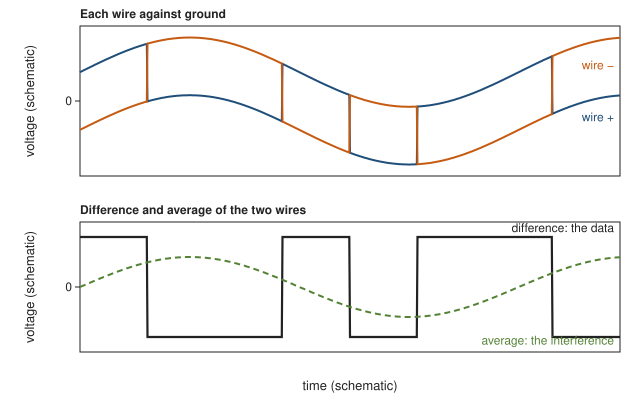

Cable and RJ45 socket
=====================

This page describes the four twisted pairs of an Ethernet cable, the
:term:`RJ45` pins they use, and the two pin assignments that let two ports
find each other. It is the starting point for the other pages on the
:term:`magnetics`.

Twisted pairs
-------------

An Ethernet cable holds four :term:`twisted pairs <twisted pair>`: four
pairs of wires, the two wires of each pair twisted around each other. Each
pair is a :wikipedia:`balanced line <Balanced_line>`, a
:wikipedia:`transmission line <Transmission_line>` whose two wires carry
equal and opposite signals. Its nominal
:wikipedia:`characteristic impedance <Characteristic_impedance>` is 100 Ω
(:clause:`40.7.2.2`).

A signal is sent as a voltage difference between the two wires of a pair,
the :term:`differential-mode voltage`. The receiver looks only at that
difference. Interference from outside reaches both wires of a pair nearly
equally, as a :term:`common-mode voltage`, and does not change the
difference. :numref:`fig-magnetics-cm-dm` shows the two parts.

         wire of a pair against ground: both follow the same slow wave of
         interference, with the data added to one wire and subtracted from
         the other. The lower one shows the difference of the two wires, a
         clean square wave of data, and their average, the slow wave of
         interference alone.

   The voltages of the two wires of a pair, and their difference and
   average (schematic, not to scale).

Gigabit Ethernet, :term:`1000BASE-T`, sends data on all four pairs in both
directions at the same time (:clause:`40`). 10 Mbit/s Ethernet (10BASE-T,
:clause:`14`) and 100 Mbit/s Ethernet (100BASE-TX, :clause:`25`) use two
pairs, one in each direction. Whether an integrated transceiver also
supports these two speeds is open (:ref:`requirements-open-questions`), so
these pages give their values only where they differ.
:numref:`fig-magnetics-pair-usage` compares the two.

.. graphviz:: pair-usage.dot
   :name: fig-magnetics-pair-usage
   :caption: The pairs that carry data, and in which direction, at
             1000 Mbit/s and at 10 and 100 Mbit/s.
   :alt: Left, 1000BASE-T: pairs A, B, C and D each carry data in both
         directions between the port and the far end. Right, 10BASE-T and
         100BASE-TX: pair A transmits from the port, pair B receives, and
         pairs C and D are drawn dashed as not used.
   :align: center

RJ45 contacts and pairs
-----------------------

The RJ45 plug and socket have eight contacts, numbered 1 to 8. The
connection between the transceiver and the cable is called the
:term:`MDI`, the medium dependent interface: the eight contacts and the
electrical requirements on them. :numref:`tbl-magnetics-rj45` shows which
contacts form which pair, and :numref:`fig-magnetics-rj45` draws them in
order. One pair uses contacts 3 and 6, on either side of the pair on
contacts 4 and 5.

.. graphviz:: rj45.dot
   :name: fig-magnetics-rj45
   :caption: The eight RJ45 contacts in numbered order and the pairs they
             form, with the MDI assignment.
   :alt: Eight contacts in a row, numbered 1 to 8, with their 1000BASE-T
         signal names. Contacts 1 and 2 form pair A, used to transmit at
         10 and 100 Mbit/s. Contacts 3 and 6 form pair B, used to receive,
         and straddle contacts 4 and 5, which form pair C. Contacts 7 and 8
         form pair D. Pairs C and D are not used at 10 and 100 Mbit/s.
   :align: center

.. list-table:: RJ45 contact use with the MDI assignment. "BI" marks a pair
                that carries data in both directions.
   :name: tbl-magnetics-rj45
   :header-rows: 1
   :widths: 16 22 22 40

   * - Contacts
     - Pair
     - 1000BASE-T signals
     - 10BASE-T and 100BASE-TX use
   * - 1, 2
     - A
     - BI_DA+, BI_DA−
     - transmit
   * - 3, 6
     - B
     - BI_DB+, BI_DB−
     - receive
   * - 4, 5
     - C
     - BI_DC+, BI_DC−
     - not used
   * - 7, 8
     - D
     - BI_DD+, BI_DD−
     - not used

The 1000BASE-T signal names are those of
:clause:`Table 40-12 <40>`. The 10BASE-T and 100BASE-TX use is given in
:clause:`14.5.1` and :clause:`Table 25-2 <25>`.

MDI and MDI-X pin assignments
-----------------------------

A transmitter at one end of a cable must reach the receiver at the other
end. With a straight-through cable, contact 1 to contact 1 and so on, this
works only when the two ends use opposite pin assignments, called
:term:`MDI` and :term:`MDI-X`. :numref:`fig-magnetics-crossover` shows the
two assignments at each speed. At 1000 Mbit/s, MDI-X swaps pair A
with pair B and pair C with pair D (:clause:`Table 40-12 <40>`).

.. graphviz:: crossover.dot
   :name: fig-magnetics-crossover
   :caption: The MDI and MDI-X pin assignments at 10 and 100 Mbit/s and at
             1000 Mbit/s, joined by a straight-through cable.
   :alt: Two pairs of ports joined by straight cables. At 1000 Mbit/s the
         MDI port puts BI_DA, BI_DB, BI_DC and BI_DD on pins 1 and 2, 3 and
         6, 4 and 5, and 7 and 8; the MDI-X port puts BI_DB, BI_DA, BI_DD
         and BI_DC on the same pins. At 10 and 100 Mbit/s, on the MDI port
         the transmitter uses pins 1 and 2 and the receiver pins 3 and 6; on
         the MDI-X port these are swapped, so each transmitter reaches the
         other port's receiver.
   :align: center

Automatic MDI/MDI-X configuration (:clause:`40.4.4`) lets a port find the
right assignment by itself. While there is no link, the port chooses MDI
or MDI-X from a pseudo-random sequence, and listens for the other end for
one sample period of 62 ms ± 2 ms (:clause:`40.4.5.2`). It keeps the
assignment that hears the other end. The function is optional in
1000BASE-T. For reference, the KSZ9031RNX transceiver implements it
[MAG-KSZ9031]_.

Because either pair can end up carrying either direction, all four channels
of a port's front end must be identical. The *front end* of a port means
everything between the transceiver's converters and the RJ45 socket: the
line driver and receiver, the coupling parts, protection and termination.
