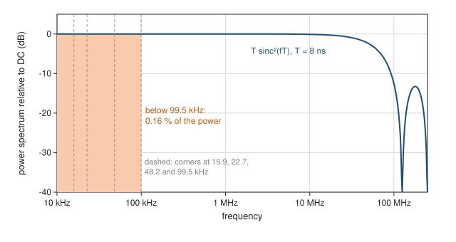
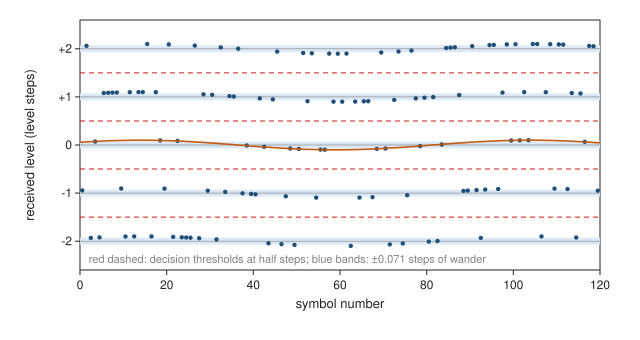
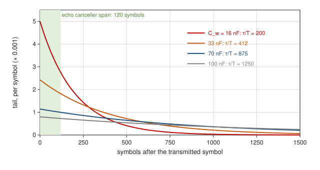
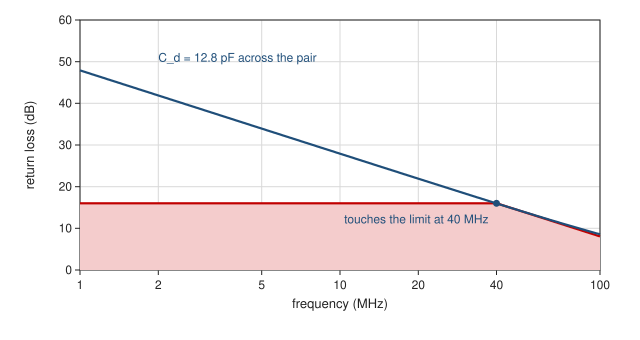

Capacitor-coupled gigabit over long cables
==========================================

This page works through what can limit gigabit Ethernet, 1000BASE-T,
running through coupling capacitors over a long cable, and gives the
measurements that would show whether it does. Capacitor coupling is shown
for short links and backplanes, and in one vendor test for cables up to
100 m ([MAG-ADIWIKI]_). Cable reach of the integrated transceiver is a
parameter (:ref:`requirements-open-questions`), so the effects that
depend on it are given as a function of reach.

Low-frequency content
---------------------

1000BASE-T scrambles its data so that the transmitted symbols are
uncorrelated, and shapes them with the filter
:math:`0.75 + 0.25 z^{-1}`: each output is three quarters of the present
symbol plus one quarter of the previous one (:clause:`40.6.1.2.3`, note 1;
:doc:`../phy-electrical/index`). That filter passes zero frequency
unchanged, and there is no line code that removes the average, so the
signal has energy right down to zero frequency. Any high-pass filter in the
path, transformer or capacitor, removes some of it. The receiver corrects
the resulting baseline wander digitally ([MAG-AB-TUTORIAL]_, slide 51).

Power below the corner frequency
~~~~~~~~~~~~~~~~~~~~~~~~~~~~~~~~

Model the symbol stream as uncorrelated symbols with square pulses, one
every :math:`T`. Its power spectrum is then proportional to
:math:`T\,\text{sinc}^2(fT)`, flat at low frequencies, and its integral
from zero to infinity is one half. Below a corner frequency far under
:math:`1/T` the spectrum is close to its value at zero, so the fraction of
the power below the corner is:

.. math::

   P_\text{below} \approx \frac{f_\text{c} T}{1/2} = 2 f_\text{c} T

.. list-table::
   :header-rows: 1
   :widths: 18 62 20

   * - Symbol
     - Meaning
     - Unit
   * - :math:`P_\text{below}`
     - Fraction of the signal power below the corner frequency
     - none
   * - :math:`f_\text{c}`
     - Corner of the high-pass filter, :math:`1/(2\pi\tau)`
     - Hz
   * - :math:`T`
     - Symbol period, 8 ns at 125 million symbols per second
     - s

This is an estimate: real symbols are not square and the shaping filter is
left out. For :math:`C_\text{w} = 16\ \text{nF}`, the time constant is
:math:`\tau = 1.6\ \mu\text{s}` (:doc:`coupling-capacitors`), so:

.. math::

   f_\text{c} = \frac{1}{2\pi \times 1.6\ \mu\text{s}} = 99.5\ \text{kHz}

   P_\text{below} &= 2 \times 99.5\ \text{kHz} \times 8\ \text{ns} \\
   &= 0.0016

That is 0.16 % of the power.

:numref:`fig-magnetics-psd` shows how little of the spectrum lies below
the corners.

         frequency from 10 kHz to 250 MHz on a log scale. The
         spectrum T sinc²(fT) with T = 8 ns is flat to beyond 10
         MHz and falls to a null at 125 MHz. The region below the
         99.5 kHz corner is shaded and holds 0.16 % of the power.
         Dashed lines mark the corners at 15.9, 22.7, 48.2 and
         99.5 kHz.

   The power spectrum of the symbol stream, and the high-pass corners
   of the coupling capacitors.

Baseline wander
~~~~~~~~~~~~~~~

The part of the signal that a high-pass filter removes is the signal passed
through the matching low-pass filter. For uncorrelated symbols and a time
constant much longer than the symbol period, the removed part has a
root-mean-square size:

.. math::

   \sigma_\text{w}^2 = \sigma^2 \sum_{k=0}^{\infty} h_k^2

   h_k = \frac{T}{\tau} e^{-kT/\tau}

   \frac{\sigma_\text{w}}{\sigma} \approx \sqrt{\frac{T}{2\tau}}

.. list-table::
   :header-rows: 1
   :widths: 18 62 20

   * - Symbol
     - Meaning
     - Unit
   * - :math:`\sigma_\text{w}`
     - Root-mean-square baseline wander
     - level steps
   * - :math:`\sigma`
     - Root-mean-square signal
     - level steps
   * - :math:`h_k`
     - Response of the low-pass filter :math:`k` symbols after a symbol
     - none
   * - :math:`k`
     - Number of symbols since the symbol
     - none
   * - :math:`\tau`
     - Time constant of the high-pass filter
     - s

The sum is a :wikipedia:`geometric series <Geometric_series>` equal to
:math:`(T/\tau)^2 / (1 - e^{-2T/\tau})`, which is close to
:math:`T/(2\tau)` when :math:`T \ll \tau`.

1000BASE-T uses five levels, :wikipedia:`PAM-5 <Pulse-amplitude_modulation>`,
from −2 to +2 in steps of one. If the five levels are equally likely, the
mean of their squares is :math:`(4 + 1 + 0 + 1 + 4)/5 = 2`, so
:math:`\sigma = \sqrt{2} = 1.41` level steps. A symbol is decided wrongly
when the error reaches half a step. Real 1000BASE-T symbols are not equally
likely; this is an assumption.

For :math:`C_\text{w} = 16\ \text{nF}`:

.. math::

   \sigma_\text{w} &= 1.41 \times \sqrt{\frac{8\ \text{ns}}{2 \times 1.6\ \mu\text{s}}} \\
   &= 1.41 \times 0.050 = 0.071\ \text{level steps}

That is 14 % of half a step. :numref:`tbl-magnetics-lowfreq` applies the
formulas to four capacitor values.

:numref:`fig-magnetics-wander` shows that size against the decision thresholds.

         120. Random symbols sit on the five PAM-5 levels from −2 to
         +2, shifted by a slowly drifting baseline. A blue band of
         ±0.071 steps around each level shows the size of the wander
         for 16 nF; red dashed lines at the half steps mark the
         decision thresholds, far outside the bands.

   PAM-5 symbols with baseline wander of 0.071 level steps r.m.s., for
   C_w = 16 nF, against the decision thresholds (drift shape schematic,
   size to scale).

.. list-table:: Low-frequency effect of the coupling capacitors at one end
                of the link (estimates)
   :name: tbl-magnetics-lowfreq
   :header-rows: 1
   :widths: 32 17 17 17 17

   * - :math:`C_\text{w}` (nF)
     - 16
     - 33
     - 70
     - 100
   * - :math:`\tau` (µs)
     - 1.6
     - 3.3
     - 7.0
     - 10
   * - :math:`f_\text{c}` (kHz)
     - 99.5
     - 48.2
     - 22.7
     - 15.9
   * - Left after 500 ns (%)
     - 73.2
     - 85.9
     - 93.1
     - 95.1
   * - Power below :math:`f_\text{c}` (%)
     - 0.16
     - 0.077
     - 0.036
     - 0.025
   * - Wander, share of half a step (%)
     - 14
     - 9.8
     - 6.8
     - 5.7
   * - Tail, :math:`\tau / T` (symbols)
     - 200
     - 412
     - 875
     - 1250

At 70 nF the capacitors behave like standard 350 µH magnetics, so a
receiver designed for transformers sees nothing new. At 16 nF the wander is
:math:`\sqrt{7.0 / 1.6} = 2.1` times larger, and the receiver's correction
must absorb it. A message on the IEEE 802.3 reflector, the working group's
mailing list, states that the scrambler makes baseline wander too small to
cause a measurable bit error rate ([MAG-DOVE]_). That was written about
links with transformers.

Echo tail
---------

Each end transmits and receives on the same pair at the same time. A
:wikipedia:`hybrid <Hybrid_coil>` subtracts most of the transmitted signal
from the received one, and adaptive
:wikipedia:`echo cancellers <Echo_suppression_and_cancellation>` remove
the rest ([MAG-AB-TUTORIAL]_, slide 22; :doc:`../phy-electrical/index`).
The hybrid is a circuit in the transceiver, so it works the same way
without a transformer.

What changes is the echo's low-frequency tail. The coupling capacitors'
high-pass filter gives the echo a slowly decaying tail of :math:`\tau / T`
symbols, the last row of :numref:`tbl-magnetics-lowfreq`. For reference,
the echo canceller of the design in the 1000BASE-T tutorial spans 120
symbols ([MAG-AB-TUTORIAL]_, slide 51). The tail is therefore left to the
baseline-wander correction, as it already is for transformer tails
([MAG-US6775529]_).

:numref:`fig-magnetics-echo-tail` compares the tails with the canceller span.

         symbols after the transmitted symbol from 0 to 1500. The
         first 120 symbols are shaded as the echo canceller span. Four
         decaying exponentials start at 5.0 for 16 nF with τ/T = 200,
         2.4 for 33 nF with 412, 1.1 for 70 nF with 875 and 0.8 for
         100 nF with 1250, and all reach far beyond the canceller
         span.

   The low-frequency tail of the echo for four capacitor values, against
   the span of the echo canceller.

The echo can be up to 10 dB stronger than the far-end
signal, so its baseline wander matters more ([MAG-US7738567]_). With
capacitors at the near end and a transformer at the far end, the echo
passes through one high-pass filter and the far-end signal through two;
the correction must handle both.

:numref:`fig-magnetics-echo-paths` shows the two paths.

.. graphviz:: echo-paths.dot
   :name: fig-magnetics-echo-paths
   :caption: The high-pass filters that the echo and the far-end signal pass, with
             capacitors at the near end and a transformer at the far
             end.
   :alt: A row: near-end transceiver, coupling capacitors as high-pass filter
         1, the cable, the far-end transformer as high-pass filter 2,
         and the far-end transceiver. An arrow shows the far-end
         signal passing high-pass 2 and then high-pass 1; a second
         arrow shows the echo passing high-pass 1 only.
   :align: center

Common-mode noise
-----------------

The receiver of :clause:`40.6.1.3.3` must keep receiving while a
common-mode signal of 1.0 V rms, swept from 1 MHz to 250 MHz, is coupled
onto all four pairs of a 100 m cable by a clamp 20 cm from the receiver. A
transformer and choke reject this signal before the transceiver. Coupling
capacitors pass it almost completely: 33 nF is 4.8 Ω at 1 MHz. The
receiver itself, with any external choke, must reject it.

:numref:`fig-magnetics-cm-noise-test` shows the set-up.

.. graphviz:: cm-noise-test.dot
   :name: fig-magnetics-cm-noise-test
   :caption: The common-mode noise test of :clause:`40.6.1.3.3`.
   :alt: A link partner joins a 100 m cable of four pairs. A clamp 20 cm from
         the receiver couples a 1.0 V rms signal, swept from 1 MHz to
         250 MHz, onto all four pairs. Between the clamp and the
         receiver, magnetics reject the signal, while coupling
         capacitors pass it: 33 nF is 4.8 Ω at 1 MHz. The target is
         under 30 mV peak to peak of differential noise, a CMRR of
         39.5 dB or more.
   :align: center

The IEEE 802.3ab task force ([MAG-8023AB]_), which wrote :clause:`40`,
chose the 1.0 V rms level to keep the differential noise it produces below
30 mV peak to peak ([MAG-AB-MINUTES]_, page 3). Meeting that needs a
common-mode rejection ratio (CMRR) of at least:

.. math::

   \text{CMRR} \ge 20 \log_{10} \frac{V_\text{cm}}{V_\text{dm}}

.. list-table::
   :header-rows: 1
   :widths: 18 62 20

   * - Symbol
     - Meaning
     - Unit
   * - :math:`\text{CMRR}`
     - Common-mode rejection ratio of the receiver and any choke together
     - dB
   * - :math:`V_\text{cm}`
     - Peak-to-peak common-mode voltage on the pair
     - V
   * - :math:`V_\text{dm}`
     - Peak-to-peak differential noise allowed
     - V

With :math:`V_\text{cm} = 2\sqrt{2} \times 1.0\ \text{V} = 2.83\ \text{V}`
and :math:`V_\text{dm} = 30\ \text{mV}`:

.. math::

   \text{CMRR} \ge 20 \log_{10} \frac{2.83\ \text{V}}{0.030\ \text{V}}
   = 39.5\ \text{dB}

The result is an estimate: it assumes the clamp puts the full 1.0 V rms on
the pair at the receiver. It is consistent with the 30 dB to 43 dB that
magnetics give (:doc:`functions`). For reference, Analog Devices
recommends an external choke for capacitor-coupled cables longer than
about 1 m for this reason ([MAG-ADIWIKI]_).

Parasitic capacitance
---------------------

Everything on the chip side of the capacitors adds capacitance across the
line: pads, on-chip protection, external protection diodes and board
traces. A capacitance across a 100 Ω port reflects part of the signal:

.. math::

   \lvert\Gamma\rvert = \frac{\omega R C_\text{d}}
   {\sqrt{4 + (\omega R C_\text{d})^2}}

   C_\text{d} \le \frac{2 \lvert\Gamma\rvert_\text{max}}
   {\omega R \sqrt{1 - \lvert\Gamma\rvert_\text{max}^2}}

.. list-table::
   :header-rows: 1
   :widths: 18 62 20

   * - Symbol
     - Meaning
     - Unit
   * - :math:`C_\text{d}`
     - Capacitance across the pair
     - F
   * - :math:`\omega`
     - Angular frequency, :math:`2\pi f`
     - rad/s
   * - :math:`R`
     - Port resistance, 100 Ω
     - Ω

The formula gives the reflection of a capacitor in parallel with a matched
100 Ω port, from the reflection coefficient of :doc:`matching-and-droop`. At
40 MHz, where the limit is still 16 dB (:math:`\lvert\Gamma\rvert = 0.1585`):

.. math::

   C_\text{d} &\le \frac{0.321}{2\pi \times 40\ \text{MHz} \times 100\ \Omega} \\
   &= 12.8\ \text{pF}

That is 12.8 pF across the pair, or about 25 pF from each wire to ground,
two in series. At 100 MHz, where the limit is 8.1 dB, the budget is
13.7 pF. This is the whole budget, shared with the error of the
transceiver's own termination. It limits how large the protection on the
chip side can be.

:numref:`fig-magnetics-rl-parasitic` shows the 12.8 pF case against the
limit.

         100 MHz, with the 1000BASE-T limit shaded. The return
         loss of a 100 Ω port with 12.8 pF across it falls from
         about 48 dB at 1 MHz and touches the 16 dB limit at 40
         MHz.

   Return loss of a matched port with 12.8 pF across the pair.

Surges and discharges pass the capacitors as fast edges, which the
protection on the chip side must clamp. The options are on
:doc:`without-transformer`.

Margin against cable reach
--------------------------

The cable attenuates the far-end signal, while the echo, the common-mode
noise injected near the receiver, and any residue from the coupling
capacitors stay the same size. The extra impairments of capacitor coupling
therefore cost more margin on a longer cable. IEEE 802.3 limits the
insertion loss of a 100 m link (:clause:`40.7.2.1`); for a shorter cable
it scales roughly with length:

.. math::

   \text{IL}(f, \ell) \approx \frac{\ell}{100\ \text{m}}
   \left(2.1 f^{0.529} + \frac{0.4}{\sqrt{f}}\right)

.. list-table::
   :header-rows: 1
   :widths: 18 62 20

   * - Symbol
     - Meaning
     - Unit
   * - :math:`\text{IL}`
     - Insertion loss of the cable
     - dB
   * - :math:`f`
     - Frequency, from 1 to 100, in MHz
     - MHz
   * - :math:`\ell`
     - Cable reach
     - m

The scaling by length is an estimate; the standard gives the limit only
for a full link. :numref:`tbl-magnetics-reach` gives the loss at 62.5 MHz,
half the symbol rate, together with an estimate of the common-mode
rejection needed. That estimate assumes the noise the receiver tolerates
scales with the far-end signal at the same frequency, so the 39.5 dB at
100 m falls by the loss saved on a shorter cable.

.. list-table:: Cable loss and common-mode rejection target as a function
                of reach (estimates)
   :name: tbl-magnetics-reach
   :header-rows: 1
   :widths: 30 35 35

   * - Reach (m)
     - Loss at 62.5 MHz (dB)
     - CMRR target (dB)
   * - 1
     - 0.2
     - 21
   * - 10
     - 1.9
     - 23
   * - 30
     - 5.6
     - 26
   * - 50
     - 9.4
     - 30
   * - 100
     - 18.8
     - 39.5

The low-frequency results of :numref:`tbl-magnetics-lowfreq` change little
with reach, because the cable attenuates little below 1 MHz (2.5 dB at
1 MHz over 100 m).

Open questions
--------------

Each question names the measurement that would answer it.

* Does capacitor-coupled 1000BASE-T work reliably over a full 100 m link
  with standard link partners, and with which capacitor value and choke? A
  board with an external gigabit transceiver, a voltage-mode driver and
  on-chip termination (for reference, the KSZ9031RNX [MAG-KSZ9031]_ or the
  ADIN1300 [MAG-ADIWIKI]_) answers it. It connects through coupling
  capacitors to an RJ45 socket, with footprints for 16 nF to 100 nF per
  wire, chokes, protection diodes and a standard-magnetics variant.
  Running 1000BASE-T against several commercial switches over 1 m, 10 m,
  30 m, 50 m and 100 m of Category 5e cable, at the temperature extremes,
  and recording frame errors, the transceiver's signal-quality readout and
  link drops, answers it as a function of reach.
* Does that board pass the :clause:`40` transmitter tests, the MDI return
  loss (:clause:`40.8.3.1`), the impedance balance (:clause:`40.8.3.2`) and
  the common-mode noise test (:clause:`40.6.1.3.3`)? The UNH-IOL test suite
  implements them ([MAG-UNH40]_).
* Does it pass the 2250 V isolation test, :std:`IEC 61000-4-2` discharges,
  :std:`IEC 61000-4-5` surges, radio-emission limits
  (:std:`FCC Part 15 <fcc-part-15>`), and Power over Ethernet detection and
  classification against standard power sourcing equipment?
* What common-mode range, rejection, return loss and clamp behaviour do the
  line driver, the receiver input with common-mode feedback, and the pin
  protection reach in gf180mcu? Test structures on a gf180mcu run, each
  connected through coupling capacitors to a cable, answer it before the
  full transceiver exists.
