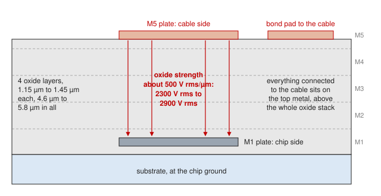

Isolation without a transformer
===============================

A transformer gives an Ethernet port electrical isolation, and a port
without one can reach it by three routes, within what the gf180mcu process
can hold. How the isolation is made in the full design is an open question
(:ref:`requirements-open-questions`), so all three routes are options. The
isolation tests themselves are described on :doc:`functions`.

Isolation routes
----------------

:numref:`fig-magnetics-isolation-routes` shows where the isolation barrier
sits in each route.

.. graphviz:: isolation-routes.dot
   :name: fig-magnetics-isolation-routes
   :caption: The three routes to isolating a port without a transformer,
             with the isolation barrier marked by a dashed outline.
   :alt: Three rows. Row 1: RJ45, then external high-voltage capacitors that
         form the barrier, then evampire. Row 2: RJ45, then a cable-side
         die, then an isolator that forms the barrier, then evampire.
         Row 3: RJ45, then evampire, which holds an on-die barrier in front
         of its circuits.
   :align: center

External high-voltage parts
   Capacitors that carry the data and hold off the test voltage, mounted on
   the board between the RJ45 socket and evampire.
A second die on the cable side
   The line driver and receiver sit on a separate die at cable potential,
   either a custom gf180mcu die or a commercial part. An isolator between
   the two dies carries the data.
A barrier on the evampire die
   Capacitors built in the oxide between evampire's metal layers carry the
   data, and hold off the test voltage.

The routes can also be combined, for example a second die whose barrier is
built into one of the two dies. Each route also has to isolate the Power
over Ethernet power path.

Capacitors in the isolation tests
---------------------------------

A capacitor blocks direct current, so a barrier made of capacitors passes
the 2250 V direct-voltage test of :std:`Annex J.1 <802.3>` if each
capacitor withstands it (:doc:`functions`). In the alternating-voltage test,
1500 V rms at 50 Hz, the capacitors conduct. The test is applied between
all the MDI wires together and the equipment, so all eight capacitors carry
current in parallel (:numref:`fig-magnetics-hipot`).

.. graphviz:: hipot.dot
   :name: fig-magnetics-hipot
   :caption: The alternating-voltage isolation test on a capacitor-coupled
             port.
   :alt: A test source of 1500 V rms at 50 Hz drives the eight MDI wires,
         tied together. Each wire passes through its coupling capacitor
         C_w to the equipment, evampire and the rest of the board, and the
         source returns to the equipment. The current is 2π f times 8 C_w
         times V, for example 75 mA at 20 nF.
   :align: center

The current is:

.. math::

   I = 2\pi f \times 8 C_\text{w} \times V

.. list-table::
   :header-rows: 1
   :widths: 18 62 20

   * - Symbol
     - Meaning
     - Unit
   * - :math:`I`
     - Current through the capacitors during the test
     - A
   * - :math:`f`
     - Test frequency, 50 Hz
     - Hz
   * - :math:`C_\text{w}`
     - Coupling capacitor in each of the eight wires
     - F
   * - :math:`V`
     - Test voltage, 1500 V rms
     - V

For :math:`C_\text{w} = 20\ \text{nF}`:

.. math::

   I = 2\pi \times 50\ \text{Hz} \times 160\ \text{nF} \times 1500\ \text{V}
   = 75\ \text{mA}

:numref:`tbl-magnetics-ac-current` gives the current for the capacitor
values considered.

.. list-table:: Current through the coupling capacitors in the 1500 V rms,
                50 Hz test
   :name: tbl-magnetics-ac-current
   :header-rows: 1
   :widths: 34 33 33

   * - :math:`C_\text{w}` (nF)
     - All eight wires (nF)
     - Test current (mA)
   * - 10
     - 80
     - 38
   * - 20
     - 160
     - 75
   * - 33
     - 264
     - 124
   * - 100
     - 800
     - 377

:std:`Annex J.1 <802.3>` counts as breakdown only a current that rises
rapidly and without control, so a steady capacitive current does not fail
the test. The test equipment must still supply it, and many testers stop at
a set current. The direct-voltage test avoids the issue for a
capacitor-coupled port.

External high-voltage capacitors
--------------------------------

The route uses ceramic capacitors that carry the data and hold off the test
voltage. Texas Instruments notes that high-voltage multi-layer ceramic
capacitors are readily available for this ([MAG-SNLA088]_, section 5), and
the transformerless Power over Ethernet patents use them
([MAG-US8132027]_).

The largest suitable parts considered are 10 nF ceramic capacitors
in an 1812 package, 4.5 mm × 3.2 mm, rated 2000 V and tested at 2400 V
([MAG-KEMET1812]_). One part per path withstands the 2250 V test. A wire
that needs 20 nF takes two in parallel:

.. math::

   N = 8\ \text{wires} \times 2 = 16\ \text{capacitors per port}

If the rated voltage, not the test voltage, had to exceed 2250 V, each path
would need two parts in series: 5 nF at a 4000 V rating. Four such strings
in parallel give 20 nF, so a port would need 64 capacitors. 33 nF to
100 nF per wire needs more parts, or larger high-voltage capacitors.

:numref:`fig-magnetics-hv-caps` compares the three arrangements.

.. graphviz:: hv-caps.dot
   :name: fig-magnetics-hv-caps
   :caption: External high-voltage capacitors for one wire, from 10 nF 2000 V parts
             in an 1812 package.
   :alt: Three arrangements for one wire using 10 nF parts. One part: 10 nF,
         which holds the 2250 V test, 8 parts per port. Two in
         parallel: 20 nF, 16 parts per port. Four strings of two in
         series: 20 nF at a 4000 V rating, 64 parts per port.
   :align: center

Capacitors certified for bridging insulation in mains equipment, class Y2
under IEC 60384-14 ([MAG-IEC60384-14]_), are another option. The
surface-mount parts cited here go up to 4.7 nF ([MAG-KEMETCAS]_, product
table), below the 16 nF needed, so several are needed in parallel. Whether
the IEEE 802.3 isolation is a safety function for evampire boards, and so
needs certified parts, is set by the product safety standard
(:std:`IEC 62368-1`) and is an open question.

Second die at cable potential
-----------------------------

The line driver, receiver and protection sit on a separate die whose ground
follows the cable. Only signals and power cross the barrier between the two
dies. The barrier can be a commercial digital isolator, an isolator built
into one of the dies, or a small transformer.

What crosses the barrier depends on how the transceiver is split. If the
whole transceiver is on the cable-side die, the barrier carries the
one-byte-per-clock interface: eight bits each way at 125 MHz, 1 Gbit/s in
each direction (:ref:`the transceiver requirements <req-transceivers>`). For reference, the TI ISO7741
digital isolator carries 100 Mbit/s per channel across a barrier rated
5000 V rms, and the ISO644x family 150 Mbit/s per channel
([MAG-ISO7741]_, features). If only the line driver and receiver are on
the cable-side die, the barrier carries the converters' samples, several
times more data.

:numref:`fig-magnetics-second-die` compares the two splits.

.. graphviz:: second-die.dot
   :name: fig-magnetics-second-die
   :caption: Two ways to split the transceiver with a second die at cable
             potential.
   :alt: Top, the whole transceiver on the cable-side die: evampire's
         forwarding logic exchanges the byte interface, 8 bits each
         way at 125 MHz, 1 Gbit/s, across a dashed barrier with the
         die holding the converters, signal processing, driver and
         receiver, which connects to the cable. Bottom, only the line
         driver and receiver on the cable-side die: evampire holds the
         forwarding logic, signal processing and converters, and the
         converter samples, several times more data, cross the
         barrier. Power crosses too, from Power over Ethernet or an
         isolated supply.
   :align: center

The cable-side die also needs power on its own side of the barrier. A port
that takes Power over Ethernet can draw it from the cable; otherwise it
needs an isolated supply, as for the Power over Ethernet power path.

The cable-side die can be a custom gf180mcu die, which keeps evampire's
own design in both dies. It can also be a commercial Ethernet transceiver
with an external isolator, which would make the cable-side die an
external transceiver in the sense of the first-version board.

Barrier on the evampire die
---------------------------

Capacitors on evampire whose plates are the lowest and highest metal layers
can hold off a high voltage across the oxide between them. Every part of
the die that connects to the cable, including its bond pads, must then sit
above that oxide. :doc:`coupling-capacitors` gives the die area such
capacitors take. The lateral paths must hold the test voltage
too: between the cable-side and chip-side pads, from the cable-side metal
to the seal ring at the die edge, and across the package and bond wires.

:numref:`fig-magnetics-die-barrier` shows the arrangement in cross-section;
it draws only the vertical path through the oxide.

         ground, an oxide stack holds metal levels M1 to M5. A plate on M1
         is on the chip side; a plate on M5 above it, and the bond pad to
         the cable beside it, are on the cable side. Arrows across the four
         oxide layers between the plates, 1.15 µm to 1.45 µm each and
         4.6 µm to 5.8 µm in all, mark the voltage held. At about
         500 V rms/µm the stack holds 2300 V rms to 2900 V rms in a short
         test.

   An isolation capacitor between the lowest and highest metal layers,
   with everything connected to the cable on the top metal (schematic,
   not to scale, vertical path only).

The oxide between the first and fifth metal layers of gf180mcu is four
layers of 1.15 µm to 1.45 µm ([MAG-GF180]_, inter-layer specification),
4.6 µm to 5.8 µm in all. Texas Instruments gives the short-term strength of
silicon dioxide as about 500 V rms per µm ([MAG-SSZY028]_, page 2):

.. math::

   V_\text{bd} = E_\text{bd}\, d

.. list-table::
   :header-rows: 1
   :widths: 18 62 20

   * - Symbol
     - Meaning
     - Unit
   * - :math:`V_\text{bd}`
     - Short-term breakdown voltage of the oxide stack
     - V rms
   * - :math:`E_\text{bd}`
     - Short-term dielectric strength of silicon dioxide, about 500
     - V rms/µm
   * - :math:`d`
     - Thickness of the oxide stack, 4.6 to 5.8
     - µm

The estimate is :math:`500 \times 4.6 = 2300` V rms to
:math:`500 \times 5.8 = 2900` V rms in a short test. That is above the
1500 V rms test level, with less margin than commercial isolators use for
a lifetime of use. For reference, commercial capacitive isolators use at
least 13.5 µm of oxide with two capacitors in series ([MAG-SSZY024]_,
page 2), and a published digital isolator built in standard CMOS reached
2.5 kV ([MAG-KAERIYAMA]_). The real strength of the gf180mcu oxide stack
is established only by test structures.

gf180mcu voltage limits
-----------------------

Any route that puts a cable wire directly on a chip pin needs a junction
that holds the cable voltage to the chip substrate. :numref:`tbl-magnetics-gf180`
gives the documented values for the structures that matter for the cable
connection. The rated voltage is a conservative operating limit, and
"none" marks a structure with no rating. The
breakdown is the documented minimum; the real breakdown can be higher, and
only test structures establish it.

.. list-table:: gf180mcu voltage limits that matter for the cable
                connection, from the PDK documentation
   :name: tbl-magnetics-gf180
   :header-rows: 1
   :widths: 46 27 27

   * - Structure
     - Rated (V)
     - Minimum breakdown (V)
   * - 3.3 V transistor, drain
     - 3.3
     - 7
   * - 6 V transistor, drain
     - 6
     - 8.5
   * - 10 V drain-extended transistor (LDMOS), drain
     - 10
     - 13.2
   * - N-well to substrate junction
     - none
     - 10
   * - MIM capacitor, 1.0 fF/µm²
     - 20
     - 20
   * - MIM capacitor, 2.0 fF/µm²
     - 6.6
     - 6.6

The values are from the gf180mcu electrical specifications
([MAG-GF180]_, sections 3, 5.4, 5.5, 6.2 and 8). The LDMOS has its own
10 V process models, and its well is tied to the substrate. The
`wafer.space <https://wafer.space/>`_ flow uses the
`open_pdks <https://github.com/RTimothyEdwards/open_pdks>`_ "gf180mcuD"
variant with five metal layers and a MIM capacitor; whether it offers the
10 V LDMOS is an open question. The deep N-well to substrate junction has
no specified breakdown, and the device models use about 30 V.

No documented gf180mcu junction is specified to hold the 57 V of Power over
Ethernet to the substrate, let alone the isolation test. Stacking
transistors divides a voltage between their drains, but not between a well
and the substrate. :numref:`fig-hv-stack-section` shows a stack in
cross-section. Whether a custom structure holds more is open, and needs
test structures. Until such a structure is shown, a cable wire reaches
evampire only through one of the three barriers above.

Isolation of the Power over Ethernet path
-----------------------------------------

With capacitor-coupled data, the Power over Ethernet circuits connect to the
cable directly, not through a transformer winding. The power path must then
be isolated as well, for example by an isolated converter. For reference,
the transformerless Power over Ethernet patent isolates its power
converter ([MAG-US8132027]_). Isolated and non-isolated converters for the
Power over Ethernet input are described on
:doc:`../../power/converters/buck-boost`, and the arrangement of the
converters on :doc:`../../power/converters/index`.

:numref:`fig-magnetics-poe-isolation` shows the two paths across the
barrier.

.. graphviz:: poe-isolation.dot
   :name: fig-magnetics-poe-isolation
   :caption: The data and the power crossing the isolation barrier
             separately in a capacitor-coupled port.
   :alt: The cable connects to the coupling capacitors, which straddle a
         dashed isolation barrier and carry the data to evampire. The
         cable also connects directly, with no winding, to the Power over
         Ethernet input, which feeds an isolated converter that straddles
         the barrier and supplies evampire.
   :align: center

Partial isolation
-----------------

A board whose ports meet the isolation only in part, or not at all, can be
used safely only where both ends of every cable share a ground, such as
inside one piece of equipment or one rack. Connecting it between buildings,
or to equipment on a different power system, exposes the chip to the
ground differences and surges that the isolation exists to block
(:numref:`fig-magnetics-ground-loop`). IEEE
802.3 makes no exception for equipment inside one enclosure ([MAG-POTTERF]_).

Open questions
--------------

* Is the full design required to pass the IEEE 802.3 isolation test, and
  is the direct-voltage test an acceptable way to qualify it?
* Is the isolation a safety function under :std:`IEC 62368-1` for evampire
  boards, so that certified capacitors are needed?
* Which parts give 16 nF to 100 nF per wire with a withstand voltage of at
  least 2250 V, and at what size for eight paths per port?
* Which route, or which combination of routes, does the full design use?
* What bandwidth, power and delay does the second-die route need, for each
  way of splitting the transceiver?
* What are the breakdown voltages of the deep N-well junction and of the
  oxide between metal layers? Test structures on a gf180mcu run answer
  both.
* Is the 10 V LDMOS available in the wafer.space flow?
* Must the Power over Ethernet converter on each port be isolated?
