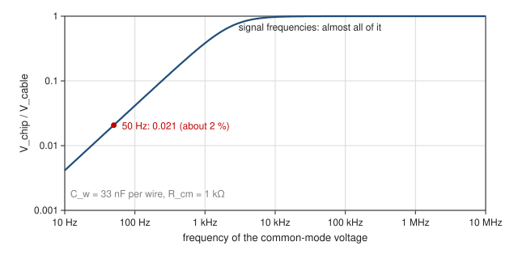

Jobs without a transformer
==========================

This page gives the options for each job of the :term:`magnetics`
(:doc:`functions`) when the port has coupling capacitors instead of a
transformer. Each job has options built from external parts and options
built on evampire. The choice between them is open. Isolation has its own
page, :doc:`isolation`, and the capacitor size is worked out on
:doc:`coupling-capacitors`.

Options on evampire can use custom devices and cells beyond the standard
devices of the gf180mcu process design kit (:ref:`req-process`). Prior work
from other processes and products is given as a reference example of what
has been built, not as a prediction for evampire.

Common-mode voltage
-------------------

The coupling capacitors block direct voltage and slow changes of
common-mode voltage, so the chip, not the cable, sets the common-mode
voltage on its side of the capacitors. Fast common-mode changes pass
through the capacitors and must be handled on the chip side.

Slow ground differences
~~~~~~~~~~~~~~~~~~~~~~~

Suppose the cable's common-mode voltage moves at mains frequency relative
to the chip ground, and the chip holds each pair's common-mode node at its
bias voltage through a resistance. For common-mode signals the two
capacitors of the pair act in parallel, and form a divider with that
resistance (:numref:`fig-magnetics-cm-divider-circuit`).

.. graphviz:: cm-divider.dot
   :name: fig-magnetics-cm-divider-circuit
   :caption: The common-mode divider of one capacitor-coupled pair.
   :alt: The cable's common-mode voltage V_cable drives the pair's two
         coupling capacitors in parallel, 2 C_w, into the chip-side
         common-mode node. A resistance R_cm joins that node to the bias
         voltage, and V_chip appears across R_cm. The cable source and the
         bias return to the chip ground.
   :align: center

The fraction that reaches the chip is:

.. math::

   \frac{V_\text{chip}}{V_\text{cable}} =
   \frac{R_\text{cm}}{\sqrt{R_\text{cm}^2 + X_\text{cm}^2}}

   X_\text{cm} = \frac{1}{2\pi f \times 2 C_\text{w}}

.. list-table::
   :header-rows: 1
   :widths: 24 56 20

   * - Symbol
     - Meaning
     - Unit
   * - :math:`V_\text{chip} / V_\text{cable}`
     - Fraction of the cable's common-mode voltage that reaches the chip
     - none
   * - :math:`R_\text{cm}`
     - Resistance from the chip-side common-mode node to the bias voltage
     - Ω
   * - :math:`X_\text{cm}`
     - Reactance of the pair's two coupling capacitors in parallel
     - Ω
   * - :math:`f`
     - Frequency of the ground difference
     - Hz
   * - :math:`C_\text{w}`
     - Coupling capacitor in each wire
     - F

This is an estimate: it treats the bias circuit as a plain resistance. For
:math:`f = 50\ \text{Hz}`, :math:`C_\text{w} = 33\ \text{nF}`, and an assumed
:math:`R_\text{cm} = 1\ \text{k}\Omega`:

.. math::

   X_\text{cm} = \frac{1}{2\pi \times 50\ \text{Hz} \times 66\ \text{nF}}
   = 48\ \text{k}\Omega

   \frac{V_\text{chip}}{V_\text{cable}} = \frac{1}{\sqrt{1 + 48^2}} = 0.021

About 2 % of a mains-frequency ground difference reaches the chip. At
signal frequencies the capacitors pass common-mode noise almost completely,
so rejection there comes from the receiver and from a choke or termination.

:numref:`fig-magnetics-cm-divider` shows the fraction against frequency.

         against frequency from 10 Hz to 10 MHz, for 33 nF per wire and
         1 kΩ. The fraction rises with frequency, is 0.021 at 50 Hz, and is
         close to 1 above about 10 kHz.

   The fraction of the cable's common-mode voltage that reaches the chip,
   for C_w = 33 nF and the assumed R_cm = 1 kΩ.

Common-mode rejection options
~~~~~~~~~~~~~~~~~~~~~~~~~~~~~

External common-mode choke
   As in single-pair automotive Ethernet. For reference, the DP83TC811
   uses 200 µH chokes with 42 dB of common-mode rejection from 10 MHz to
   100 MHz ([MAG-DP83TC811]_, MDI table).
Receiver with a wide common-mode range and high rejection
   Together with a common-mode feedback loop that senses the pair's
   common-mode voltage and drives it back to the bias point. For reference,
   integrated receivers for other twisted-pair buses take a wide range: a
   CAN receiver takes −12 V to +12 V of common-mode voltage
   ([MAG-TCAN1044]_, common-mode input range), and an RS-485
   receiver −25 V to +25 V ([MAG-THVD2450]_, common-mode input range).
Active common-mode choke
   A circuit that senses and cancels common-mode current. For reference, a
   commercial part adds up to 10 dB of common-mode suppression from 1 MHz
   to 125 MHz, used alongside a transformer ([MAG-KTA1552]_). The patent
   behind it notes a trade-off between loop stability and common-mode
   rejection ([MAG-US7965480]_).

:numref:`fig-magnetics-cm-options` compares the three.

.. graphviz:: cm-options.dot
   :name: fig-magnetics-cm-options
   :caption: Three options for common-mode rejection on a capacitor-coupled pair.
   :alt: Three rows from the cable to the receiver. First, an external
         common-mode choke, for example 200 µH and 42 dB, then the
         coupling capacitor C_w and the receiver. Second, the coupling
         capacitor and a receiver with a wide common-mode range, with
         a block that senses the common-mode voltage and drives it
         back to the bias point. Third, an active common-mode choke
         that senses and cancels common-mode current, then the
         coupling capacitor and the receiver.
   :align: center

The input range of a receiver built from gf180mcu devices is set by the
devices at its input when the pins connect to them directly. A resistive
or capacitive divider in front of the receiver extends the range by its
division ratio, at the cost of a smaller signal and more noise. Stacked,
drain-extended or custom input devices extend it further. The range needed
is set by the fast common-mode steps that pass the capacitors, which is an
open question below.

The rejection that magnetics give, 30 dB to 43 dB (:doc:`functions`),
and the estimate of about 40 dB on :doc:`gigabit-risk` set the target for
the choke, capacitors and on-chip circuits together.

Differential termination
------------------------

With a voltage-mode driver the 100 Ω termination is already on the chip
([MAG-KSZ9031]_, section 12), so matching the cable does not need a
transformer. The coupling capacitors add a series reactance at low
frequencies, sized on :doc:`coupling-capacitors`.

Active termination, also called synthesised impedance, sets the driver's
output impedance by feedback instead of by a resistor. It saves transmit
power. For reference, it is used in line drivers for telephone-line data
links ([MAG-US6538500]_). It can also cancel part of the coupling
capacitors' reactance. Whether it reaches the 1000BASE-T return loss over
1 MHz to 100 MHz is an open question.

Inductors across the pair
-------------------------

The coupling capacitors set the droop (:doc:`coupling-capacitors`). Power
over Ethernet inductors fitted across the pair also shunt low frequencies,
as a transformer's magnetising inductance does. The 80 µH minimum of
:doc:`matching-and-droop` therefore applies to their inductance across the
pair ([MAG-GARDNER14]_, slide 4). The receiver's baseline-wander correction
(:doc:`../phy-electrical/index`) absorbs whatever the capacitors and
inductors remove; :doc:`gigabit-risk` estimates how much.

:numref:`fig-magnetics-inductor-droop` shows the two high-pass elements; the capacitors alone are :numref:`fig-magnetics-cap-model`.

.. graphviz:: inductor-droop.dot
   :name: fig-magnetics-inductor-droop
   :caption: A Power over Ethernet inductor across a capacitor-coupled pair.
   :alt: The transceiver, a 100 Ω source, drives wires plus and minus through a
         coupling capacitor C_w in each wire. An inductor of 80 µH or
         more sits across the pair on the cable side, and the cable is
         a 100 Ω load. A note says the series capacitors and the
         inductor across the pair are two high-pass elements.
   :align: center

Common-mode termination and filtering
-------------------------------------

Without a transformer, the common mode still needs a termination and a
filter. The options are these.

External termination on the cable side
   As in the standard circuit: 75 Ω per pair to a shared capacitor to
   chassis, with a blocking capacitor in series with each resistor when
   Power over Ethernet is present. Without a transformer the pair has no
   centre tap, so two resistors per pair, one from each wire, form one. For
   reference, single-pair automotive Ethernet uses two 1 kΩ resistors and a
   4.7 nF capacitor ([MAG-OA100T1]_, figure 1). Values for four-pair
   1000BASE-T are an open question.
External choke
   As for common-mode rejection above.
Active common-mode termination on evampire
   The common-mode feedback loop can present a set impedance, for example
   75 Ω, to common-mode signals at the chip side of the capacitors. Its
   bandwidth must reach the frequencies at which emissions are measured.

:numref:`fig-magnetics-cap-termination` shows the external and the active
termination.

.. graphviz:: cap-termination.dot
   :name: fig-magnetics-cap-termination
   :caption: Common-mode termination of a capacitor-coupled pair, on the
             cable side and on evampire; resistor values are open.
   :alt: Left, external termination: two resistors R, one from each cable
         wire, meet at a midpoint that forms the centre tap. A blocking
         capacitor, fitted with Power over Ethernet, joins it to a
         capacitor shared by the four pairs, which goes to chassis. The
         coupling capacitors C_w then lead to the chip. Right, active
         termination: behind the coupling capacitors, a common-mode
         feedback loop on evampire connects to both wires and presents
         about 75 Ω.
   :align: center

Protection behind the capacitors
--------------------------------

Without a transformer, the coupling capacitors' voltage rating holds off a
common-mode surge. The fast edge that passes through them reaches the chip
side and must be clamped there. A capacitor :math:`C_\text{w}` that sees a
step :math:`\Delta V` passes a charge :math:`C_\text{w} \Delta V`. The
clamps can be built three ways:

External protection diodes
   Between each chip-side node and signal ground, after the coupling
   capacitors. They do not break the isolation, because the capacitors are
   in series with them. For reference, Analog Devices simulated fast
   transient bursts of 1 kV and 4 kV on a 2 m cable into an ADIN1300 with
   33 nF capacitors. Without a protection diode, 100 V to 400 V reached the
   transceiver pins; with one, less than 10 V ([MAG-ADIWIKI]_).
Clamps on evampire
   The gf180mcu I/O cells target 2 kV human-body model; the analogue pad
   cells contain only diodes ([MAG-GFIO]_). Custom clamps, for example
   thyristor (SCR) or parasitic-bipolar clamps sized for the charge that
   passes the capacitors, are possible. The system-level and surge events
   of :doc:`events` carry tens of times more energy than the I/O cells are
   designed for.
Both
   An external clamp takes the bulk of the energy and a smaller clamp on
   evampire limits the voltage at the pins.

Which split is used depends on the events the product must pass, the
charge that reaches the chip side, and the capacitance the clamps add. That
capacitance counts against the return loss budget of about 12.8 pF across
each pair (:doc:`gigabit-risk`). A diode across each pair on the cable
side, with no connection to ground, limits differential surges and does
not affect the isolation.

:numref:`fig-magnetics-cap-protection` shows where each part sits on one
pair.

.. graphviz:: cap-protection.dot
   :name: fig-magnetics-cap-protection
   :caption: Protection of one capacitor-coupled pair.
   :alt: One pair from the RJ45 socket and cable to evampire. On the cable
         side a diode across the pair, with no ground connection, limits
         differential surges. Each wire then passes a coupling capacitor
         C_w, which holds off a common-mode surge and passes a charge
         C_w ΔV for a step ΔV. On the chip side external diodes to signal
         ground and clamps on evampire, such as thyristor or parasitic
         bipolar clamps, take the fast edge. All chip-side capacitance
         across the pair, clamps included, fits a budget of about 12.8 pF.
   :align: center

Line drivers
------------

A voltage-mode driver sets its own common-mode voltage and needs no centre
tap ([MAG-ENT114]_). With capacitors, this job of the centre tap
disappears.

A current-mode driver also works through capacitors. It takes its supply
from pull-up resistors to the supply on the chip side of the capacitors,
in place of the transformer's centre tap. For reference, Texas Instruments
couples a current-mode DP83848 through 33 nF capacitors this way, with
pull-up resistors to 3.3 V on each pin ([MAG-SNLA088]_, figure 5). An
inductor can take the place of the resistors.

:numref:`fig-magnetics-cap-drivers` shows both drivers.

.. graphviz:: cap-drivers.dot
   :name: fig-magnetics-cap-drivers
   :caption: A voltage-mode and a current-mode line driver coupled through
             capacitors, with no centre tap.
   :alt: Left, a voltage-mode driver with built-in termination sets its
         own common-mode voltage and drives the cable through a capacitor
         C_w in each wire. Right, a current-mode driver of switched current
         sinks; each wire has a pull-up resistor to a 3.3 V supply on the
         chip side of a 33 nF capacitor, and an inductor can replace the
         resistors.
   :align: center

Power over Ethernet current path
--------------------------------

The power must reach both wires of a pair equally without loading the
data. Three options exist, drawn in :numref:`fig-magnetics-poe-paths`.

.. graphviz:: poe-paths.dot
   :name: fig-magnetics-poe-paths
   :caption: Three ways to carry Power over Ethernet current on a
             capacitor-coupled pair (schematic).
   :alt: Three rows, each a pair from the cable through a coupling
         capacitor C_w in each wire to the chip. In the first, a
         centre-tapped inductor of 80 µH or more across the pair feeds
         the power circuits from its tap; the current splits, half each
         way, and only the leakage counts toward the 100 µH limit. In the
         second, two separate inductors, one from each wire, meet and feed
         the power circuits; each carries 0.474 A and the full inductance
         is in the power path. In the third, an external pass transistor
         controlled from evampire feeds the power circuits; it holds 57 V,
         carries about 0.5 A and drops about 2 V, about 1 W.
   :align: center

Centre-tapped inductor across each pair
   One winding with a centre tap and no second winding: the cable-side
   half of a transformer. The current enters at the centre tap and splits,
   the fields cancel, and the core sees only the unbalance. Texas
   Instruments mentions a centre-tapped inductor as a way to carry Power
   over Ethernet current ([MAG-TPS2376H]_, section 9.2.1.3). Its
   inductance across the pair must be at least 80 µH. Only its leakage
   inductance counts against the 100 µH limit of a powered device
   (:doc:`poe`), because the current flows through the two halves in
   opposite directions. For reference, standard Power over Ethernet
   magnetics use such windings ([MAG-ENT98]_, section 3.9).
Two separate inductors per pair
   Each inductor carries the current of one wire, up to
   :math:`0.948\ \text{A} / 2 = 0.474\ \text{A}` with equal sharing at
   Class 8 (:doc:`poe`), without saturating. Together they must exceed
   80 µH across the pair. Their series inductance on the power path is the
   full inductance, which conflicts with the 100 µH limit of a powered
   device. For reference, coupled inductors sold for single-pair power have
   56 µH to 250 µH per winding and saturation currents of 0.36 A to 2.1 A
   ([MAG-TDKSPE]_, product table).
Active inductor
   A transistor circuit, also called a :wikipedia:`gyrator <Gyrator>`, that
   passes direct current with a low resistance but presents a high
   impedance at signal frequencies. For reference, patents describe it for
   single-pair power, with a drop of about 2 V and an emulated inductance
   "on the order of millihenries", for data rates up to about 100 Mbit/s
   ([MAG-US11038490]_, [MAG-US11394315]_).

The pass device of an active inductor must hold the Power over Ethernet
voltage, 57 V, and carry about 0.5 A. The current is a matter of device
width. The voltage is the limit: no documented gf180mcu junction is
specified to hold 57 V to the substrate (:doc:`isolation`). The pass
device is therefore an external transistor controlled from evampire,
unless a custom on-chip structure is shown to hold the voltage. Its loss
is about :math:`0.5\ \text{A} \times 2\ \text{V} = 1\ \text{W}` per pair at
the drop given in the patent (an estimate).

Detection signature
-------------------

The coupling capacitors block direct current, so the data circuits do not
change the signature resistance. They do add capacitance between the two
pairs that carry power. If every chip-side node returns to one ground, the
two capacitors of each pair are in parallel, :math:`2 C_\text{w}`, and the
two pairs are joined through two such groups in series
(:numref:`fig-magnetics-cap-signature`):

.. graphviz:: cap-signature.dot
   :name: fig-magnetics-cap-signature
   :caption: The coupling capacitors as seen by the detection source,
             when every chip-side node returns to one chip ground.
   :alt: The detection source of 2.7 V to 10.1 V sits across powered pair
         1 and powered pair 2, with the powered device's signature of
         23.7 kΩ to 26.3 kΩ and 50 nF to 120 nF between them. Each wire of
         each pair also has a coupling capacitor C_w; the two of each pair
         join, 2 C_w, and both groups go to the chip ground. The two
         groups in series give C_extra = C_w, in parallel with the
         signature.
   :align: center

The capacitance is:

.. math::

   C_\text{extra} = \frac{(2C_\text{w})(2C_\text{w})}{2C_\text{w} + 2C_\text{w}}
   = C_\text{w}

.. list-table::
   :header-rows: 1
   :widths: 18 62 20

   * - Symbol
     - Meaning
     - Unit
   * - :math:`C_\text{extra}`
     - Capacitance that the coupling capacitors add between the two powered
       pairs
     - F

This is an estimate for one grounding arrangement. With
:math:`C_\text{w} = 33\ \text{nF}`, it adds 33 nF to the 50 nF to 120 nF
window of a powered device's signature (:doc:`poe`); with 100 nF it adds
100 nF, almost the whole window. The real value depends on where the chip
ground sits relative to the powered device's input.

When the port supplies power, the chip-side nodes must also survive the
detection, classification and power-on steps of the power sourcing
equipment, from 2.7 V up to 57 V (:doc:`../../power/poe/index`). The
capacitors hold this direct voltage.

Identical channels
------------------

All four channels of the front end are identical, including the Power over
Ethernet inductors, which are fitted on all four pairs for four-pair power
(:doc:`cable`).

Open questions
--------------

* Is an external common-mode choke needed to meet radio-emission limits, or
  can on-chip common-mode feedback and termination replace it?
* What common-mode termination values suit four-pair cable without centre
  taps?
* What common-mode input range does the receiver need behind the
  capacitors, and is it reached with direct inputs, an input divider or
  custom input devices?
* Can active termination meet the 1000BASE-T return loss, and does it help
  with the capacitors' reactance?
* What external protection is needed for system-level discharges, surges
  and charged cables, and what charge must clamps on evampire absorb?
* Centre-tapped inductors, separate inductors or active inductors? Can a
  centre-tapped inductor meet both the 80 µH data requirement and the
  100 µH powered-device limit at 0.948 A per pair?
* How much capacitance do the coupling capacitors add to the powered-device
  signature in the real grounding arrangement?
