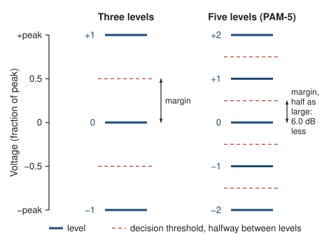
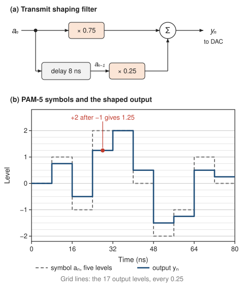

.. _phy-1000base-t-coding:

1000BASE-T: PAM-5 and trellis coding
====================================

This page explains how 1000BASE-T (:clause:`40`) carries 1000 Mbit/s: all
four pairs at once, five signal levels, a shaping filter, scrambling and an
error-correcting trellis code. :doc:`1000base-t-echo` explains how each pair
carries both directions at the same time.

.. _phy-1000-rate:

Data rate
---------

1000BASE-T sends on all four pairs at the same time, at 125 MBd on each
(:clause:`40.1.3`). The data rate in one direction is

.. math::

   R = N_\text{pairs} \times f_\text{sym} \times b_\text{sym}

.. list-table::
   :header-rows: 1
   :widths: 20 60 20

   * - Symbol
     - Meaning
     - Unit
   * - :math:`R`
     - Data rate in one direction
     - bit/s
   * - :math:`N_\text{pairs}`
     - Number of pairs carrying data, 4
     - none
   * - :math:`f_\text{sym}`
     - :term:`Symbol rate` on each pair, 125 MBd
     - Bd
   * - :math:`b_\text{sym}`
     - Data bits carried by one symbol, 2
     - bit

Substituting:

.. math::

   R &= 4 \times 125 \times 10^{6} \times 2 \\
     &= 1000 \times 10^{6}\ \text{bit/s}

A symbol lasts 8 ns, and in that time the four pairs together carry
:math:`4 \times 2 = 8` bits, one byte, in each direction. The forwarding
logic exchanges one byte every 8 ns too, so no rate conversion is needed
between the two (:ref:`arch-rgmii`).

The fastest pattern a symbol stream can hold changes level every symbol and
repeats every two symbols. At 125 MBd that is a 62.5 MHz signal, half the
symbol rate, called the :wikipedia:`Nyquist frequency
<Nyquist_frequency>`. A channel that passes frequencies up to it can carry
the symbols, so these pages use 62.5 MHz as the reference frequency. The
transmitted spectrum is about 80 MHz wide (:clause:`40.7.1`), inside the
100 MHz for which the cable is specified.

.. _phy-pam5:

Five-level signalling
---------------------

Two bits per symbol need at least four levels. 1000BASE-T uses five, −2,
−1, 0, +1 and +2, which is five-level
:wikipedia:`pulse amplitude modulation <Pulse-amplitude_modulation>`,
:term:`PAM-5` (:clause:`40.1.3`). One code group is four symbols, one on
each pair in the same 8 ns period (:numref:`fig-phy-pam5`).

.. wavedrom::
   :caption: Each 8 ns symbol period carries one byte as a code group of
             four five-level symbols, one on each pair.
   :name: fig-phy-pam5
   :alt: Timing diagram with a row of bytes n to n+5, one per symbol
         period, above four rows labelled pair A to pair D. In each period
         each pair carries one symbol, labelled An to Dn.

   { "signal": [
       { "name": "byte", "wave": "======", "data": ["n", "n+1", "n+2", "n+3", "n+4", "n+5"] },
       { "name": "pair A", "wave": "======", "data": ["A n", "A n+1", "A n+2", "A n+3", "A n+4", "A n+5"] },
       { "name": "pair B", "wave": "======", "data": ["B n", "B n+1", "B n+2", "B n+3", "B n+4", "B n+5"] },
       { "name": "pair C", "wave": "======", "data": ["C n", "C n+1", "C n+2", "C n+3", "C n+4", "C n+5"] },
       { "name": "pair D", "wave": "======", "data": ["D n", "D n+1", "D n+2", "D n+3", "D n+4", "D n+5"] }
     ],
     "config": { "hscale": 1.5 }
   }

A code group can take :math:`5^4 = 625` values. Each group carries the
8 data bits plus one bit added by the error-correcting code, which needs
:math:`2^{9} = 512` values. That leaves :math:`625 - 512 = 113` code
groups for idle and control (:clause:`40.3.1.3.5`,
:clause:`Table 40-1 <40>`).

Five levels cost noise tolerance. For the same peak voltage, three levels
(−1, 0, +1, as in :doc:`100base-tx`) are spaced twice as far apart as five
levels (−2 to +2). A receiver misreads a level when noise exceeds half the
spacing, so five levels tolerate half the noise voltage
(:numref:`fig-phy-level-spacing`).

         peak. Three levels, minus 1, 0 and plus 1, have decision
         thresholds at minus and plus half the peak, so the margin from 0
         to the next threshold is half the peak. Five levels, minus 2 to
         plus 2, have thresholds at plus and minus a quarter and three
         quarters of the peak, so their margin is half as large, 6.0 dB
         less.
   :align: center

   Three and five levels at the same peak voltage: the five-level noise
   margin is half as large.

A voltage ratio of 2 is

.. math::

   20 \log_{10} 2 = 6.0\ \text{dB}

so PAM-5 needs about 6 dB more signal-to-noise ratio than three-level
signalling for the same error rate ([PHY-TUT98]_ slide 22). The trellis code
described below wins this back.

.. _phy-shaping:

Transmit shaping filter
-----------------------

Each pair must be able to send fixed *test modes* on command, so that its
output can be measured without a receiver (:clause:`40.6.1.1.2`). In test
mode 1 the peak differential output must lie between 0.67 V and 0.82 V into
100 Ω (:clause:`40.6.1.2.1`). For reference, the TI DP83867 gives 0.745 V as
typical ([PHY-DP83867]_ section 6.5).

The transmitter filters the symbols before the digital-to-analogue
converter, to reduce the energy sent at high frequencies. The 802.3ab
tutorial's example filter mixes each symbol with the previous one
([PHY-TUT98]_ slides 22 and 37):

.. math::

   y_n = 0.75\,a_n + 0.25\,a_{n-1}

.. list-table::
   :header-rows: 1
   :widths: 20 60 20

   * - Symbol
     - Meaning
     - Unit
   * - :math:`a_n`
     - PAM-5 symbol of symbol period :math:`n`, one of −2, −1, 0, +1, +2
     - level
   * - :math:`y_n`
     - Level driven onto the pair in symbol period :math:`n`
     - level
   * - :math:`n`
     - Index of the symbol period
     - none

For example, :math:`a_n = +2` after :math:`a_{n-1} = -1` gives
:math:`y_n = 1.5 - 0.25 = 1.25`. Because :math:`y_n = (3a_n + a_{n-1})/4`
and :math:`3a_n + a_{n-1}` is a whole number from −8 to +8, the output
takes 17 levels: the multiples of 0.25 from −2 to +2. The digital-to-analogue
converter therefore needs at least 17 levels. The tutorial's design point
lists a 17-level converter at 125 MHz ([PHY-TUT98]_ slide 51), and the
DP83867 describes its output as 17-level shaped PAM-5 ([PHY-DP83867]_
Figure 7‑1). :numref:`fig-phy-shaping` shows the filter and an example
sequence.

         0.75 to a sum, and through an 8 ns delay and a multiplier of 0.25
         to the same sum, whose output y n goes to the DAC. Bottom, level
         against time from 0 to 80 ns: ten PAM-5 symbols 0, +1, −1, +2, +2,
         0, −2, −1, +1, 0 drawn dashed, and the shaped output 0, 0.75,
         −0.5, 1.25, 2, 0.5, −1.5, −1.25, 0.5, 0.25 drawn solid, on faint
         grid lines at every 0.25 from −2 to +2. The 1.25 point is marked:
         +2 after −1.
   :align: center

   The example transmit shaping filter and its output for ten symbols;
   every output lies on one of the 17 levels.

.. _phy-1000-scrambler:

Scrambling
----------

Before coding, the data is combined by exclusive-OR with a pseudo-random
sequence from a 33-bit linear feedback shift register, the *side-stream
scrambler* (:clause:`40.3.1.3.1`). The two ends of a link use different
generator polynomials:

.. list-table:: Scrambler polynomials of the two link ends
   :name: tab-phy-scramblers
   :header-rows: 1
   :widths: 30 70

   * - Role
     - Generator polynomial
   * - Master
     - :math:`1 + x^{13} + x^{33}`
   * - Slave
     - :math:`1 + x^{20} + x^{33}`

In this notation (:numref:`tab-phy-scramblers`), :math:`x^{k}` marks a tap
after :math:`k` stages of the shift register, and the new bit is the
exclusive-OR of the taps. Master and slave are explained in
:doc:`1000base-t-receiver`.

Scrambling makes the transmitted symbols uncorrelated over time, between
the four pairs and between the two directions on each pair
(:clause:`40.1.4`). This spreads the transmitted power across the band,
and it lets the :doc:`adaptive cancellers <1000base-t-echo>` tell the
transceiver's own symbols apart from the far end's. The scrambler runs
continuously, so the receiver locks its own copy to the incoming stream
before any data arrives.

.. _phy-trellis:

Trellis code
------------

A :term:`trellis code` adds redundancy with a small state machine in the
transmitter, so that only some sequences of code groups are legal. In
1000BASE-T a convolutional encoder with three bits of state, so eight
states, adds the ninth bit to each byte (:clause:`40.3.1.3.4`). The five
levels are split into two subsets, :math:`X = \{-1, +1\}` and
:math:`Y = \{-2, 0, +2\}` ([PHY-TUT98]_ slide 44), and the encoder state
decides which subsets may follow which. Two legal *sequences* then differ
by more than two neighbouring levels do, which gives about 6 dB of coding
gain ([PHY-TUT98]_ slide 22). The general technique is
:wikipedia:`trellis coded modulation <Trellis_modulation>`.

The receiver decodes it with a :wikipedia:`Viterbi decoder
<Viterbi_decoder>`. Rather than deciding each symbol alone, it follows the
most likely path through the encoder states over several symbol periods and
picks the legal sequence closest to what was received. The decoder and the
equaliser's feedback loop must finish each step in one 8 ns symbol period,
which makes them the critical timing path of the receiver
([PHY-TUT98]_ slide 23). :doc:`integration/signal-processing` covers that
loop.

.. _phy-idle:

Idle and frame delimiters
-------------------------

Between frames the transmitter sends idle code groups whose symbols use
only −2, 0 and +2 (:clause:`40.1.3`). The three widely spaced levels make
it easier for a receiver to lock on and train its filters before it can
decode all five levels. A frame starts with a two-code-group
Start-of-Stream delimiter and ends with two convolutional state reset code
groups followed by a two-code-group End-of-Stream delimiter
(:clause:`40.1.3.1`, :numref:`fig-phy-frame-delimiters`).

.. wavedrom::
   :caption: The code groups around one frame, one slot per 8 ns symbol
             period: SSD is the Start-of-Stream delimiter, CSReset the
             convolutional state reset and ESD the End-of-Stream
             delimiter; the number of data code groups depends on the
             frame.
   :name: fig-phy-frame-delimiters
   :alt: Timing diagram of one row of code groups: two idle code groups
         using only −2, 0 and +2, two SSD code groups, four data code
         groups using all five levels, two CSReset code groups, two ESD
         code groups, then idle again.

   { "signal": [
       { "name": "code groups", "wave": "3.4.5...6.7.3.",
         "data": ["idle", "SSD", "data, 5 levels", "CSReset", "ESD", "idle"] },
       { "name": "levels", "wave": "3.x.5...x...3.",
         "data": ["−2, 0, +2", "all five", "−2, 0, +2"] }
     ],
     "config": { "hscale": 1.6 }
   }

In :numref:`fig-phy-frame-delimiters` the hatched slots of the lower row
are the delimiters and resets, whose levels these pages do not list.
