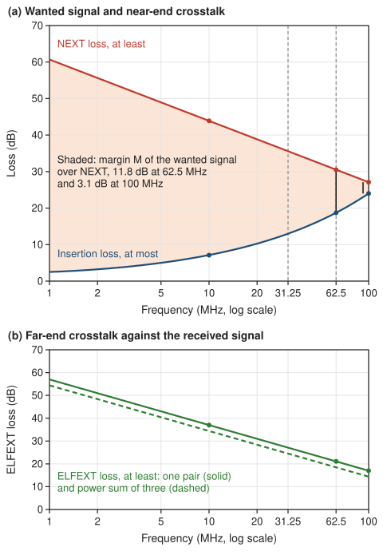

.. _phy-echo-page:

1000BASE-T: channel, echo and crosstalk
=======================================

1000BASE-T carries both directions at once on each pair, so it must handle
the echo and crosstalk of the cable as well as its loss. A :term:`hybrid`
and adaptive cancellers remove the echo and crosstalk. The effects
themselves are introduced in :doc:`job`.

.. _phy-channel-limits:

Channel limits
--------------

:clause:`40.7` limits the link segment with three formulas of frequency.
Each is a loss in decibels; a loss of :math:`L` dB multiplies a voltage by
:math:`10^{-L/20}`.

.. math::

   L_\text{IL}(f) < 2.1\,f^{0.529} + \frac{0.4}{f}

   L_\text{NEXT}(f) \ge 27.1 - 16.8\,\log_{10}\!\left(\frac{f}{100}\right)

   L_\text{ELFEXT}(f) > 17 - 20\,\log_{10}\!\left(\frac{f}{100}\right)

.. list-table::
   :header-rows: 1
   :widths: 22 58 20

   * - Symbol
     - Meaning
     - Unit
   * - :math:`f`
     - Frequency, from 1 MHz to 100 MHz; the numbers in the formulas
       assume :math:`f` in MHz
     - MHz
   * - :math:`L_\text{IL}`
     - :term:`Insertion loss` of one pair, at most (:clause:`40.7.2.1`)
     - dB
   * - :math:`L_\text{NEXT}`
     - Near-end :term:`crosstalk` loss between any two pairs, at least:
       how much weaker the signal coupled from one neighbouring pair at
       the same end is than the signal on that pair
       (:clause:`40.7.3.1.1`)
     - dB
   * - :math:`L_\text{ELFEXT}`
     - Equal-level far-end crosstalk loss between the worst two pairs, at
       least: the far-end crosstalk measured against the wanted signal
       after it has crossed the same cable (:clause:`40.7.3.2.1`)
     - dB

The formulas approximate the limits of a 100 m Class D channel and include
the patch cords and connectors (:clause:`40.7.2.1`). They are limits for
one disturbing pair; the three far-end disturbers together are limited by a
power sum, at least :math:`14.4 - 20\log_{10}(f/100)` dB
(:clause:`40.7.3.2.2`).

For example, at the Nyquist frequency :math:`f = 62.5` MHz:

.. math::

   L_\text{IL} &< 2.1 \times 62.5^{0.529} + \frac{0.4}{62.5} \\
               &= 2.1 \times 8.91 + 0.006 \\
               &= 18.7\ \text{dB}

   10^{-18.7/20} = 0.116

so at least 12 % of the transmitted voltage at that frequency reaches the
far end. :numref:`tab-phy-channel-limits` gives the same calculation at
other frequencies, and :numref:`fig-phy-channel-limits` plots the limits.

         1 MHz to 100 MHz on a log scale. Top: the insertion loss limit
         rises from about 2.5 dB at 1 MHz through 7.1 dB at 10 MHz and
         18.7 dB at 62.5 MHz to 24.0 dB at 100 MHz. The NEXT loss limit
         falls from about 61 dB at 1 MHz through 43.9 dB at 10 MHz and
         30.5 dB at 62.5 MHz to 27.1 dB at 100 MHz. The gap between them is
         shaded as the margin, 11.8 dB at 62.5 MHz and 3.1 dB at 100 MHz.
         Dashed lines mark 31.25 MHz and 62.5 MHz. Bottom: the ELFEXT loss
         limit, measured against the received signal, falls from 57 dB to
         17 dB, and the power-sum limit runs 2.6 dB below it.
   :align: center

   The 1000BASE-T channel limits of :clause:`40.7` against frequency:
   insertion loss and NEXT loss with the margin between them shaded, and
   ELFEXT loss, which is already relative to the received signal.

.. list-table:: 1000BASE-T channel limits for a 100 m channel, from the
   formulas of :clause:`40.7`
   :name: tab-phy-channel-limits
   :header-rows: 1
   :widths: 20 20 20 20 20

   * - :math:`f` (MHz)
     - :math:`L_\text{IL}` at most (dB)
     - Voltage that arrives (%)
     - :math:`L_\text{NEXT}` at least (dB)
     - :math:`L_\text{ELFEXT}` at least (dB)
   * - 10
     - 7.1
     - 44
     - 43.9
     - 37.0
   * - 31.25
     - 13.0
     - 22
     - 35.6
     - 27.1
   * - 62.5
     - 18.7
     - 12
     - 30.5
     - 21.1
   * - 100
     - 24.0
     - 6
     - 27.1
     - 17.0

.. _phy-next-margin:

Near-end crosstalk margin
-------------------------

The wanted signal and the near-end crosstalk start from transmitters of the
same size. The wanted signal is reduced by the insertion loss, and the
crosstalk by the near-end crosstalk loss, so the wanted signal exceeds the
crosstalk from one neighbouring pair by

.. math::

   M(f) = L_\text{NEXT}(f) - L_\text{IL}(f)

where :math:`M` is the margin in dB, shaded in
:numref:`fig-phy-channel-limits`. At 62.5 MHz,
:math:`M = 30.5 - 18.7 = 11.8` dB; at 100 MHz, :math:`M = 27.1 - 24.0 =
3.1` dB. There are three neighbouring pairs, and the transceiver's own
transmission on the same pair, the echo, is larger still. The receiver
works only because it removes these known signals (:ref:`phy-echo`).

.. _phy-echo:

Hybrid
------

Each pair carries :math:`1000 / 4 = 250` Mbit/s in each direction at the
same time (:clause:`40.1.3`). Both ends drive the same two wires, so the
voltage at a transceiver's pins is the sum of several signals
(:numref:`fig-phy-impairments`):

#. the far end's signal, the one the receiver wants, reduced by the
   insertion loss;
#. the transceiver's own transmitted signal, at full size, and its
   reflections from connectors and impedance changes along the cable,
   together called the *echo*;
#. near-end crosstalk from the transceiver's own transmitters on the
   other three pairs;
#. far-end crosstalk from the far end's transmitters on the other three
   pairs.

.. graphviz:: cable-impairments.dot
   :name: fig-phy-impairments
   :caption: The four signals that reach the receiver of pair A; pairs C and
             D, not drawn, add more of signals 3 and 4.
   :alt: Two transceivers, local on the left and far end on the right, each
         with boxes for pair A and pair B. Four numbered lines reach the
         local pair A: 1, a thick line from the far-end pair A, the wanted
         signal; 2, a dashed loop from pair A back to itself, the echo;
         3, a dotted line from the local pair B, near-end crosstalk; 4, a
         thin line from the far-end pair B, far-end crosstalk.
   :align: center

The first stage is the :term:`hybrid`, an analogue circuit that lets one
pair carry both directions (:clause:`40.1.3`). It drives a replica of the
transmitted signal into a network matched to the line and subtracts the
replica from the line voltage, so the transceiver's own signal cancels and
the far end's signal remains (:numref:`fig-phy-hybrid`).

The subtraction is
exact only if the replica matches the real line, which a real cable and its
connectors never do, so part of the echo remains ([PHY-HEALEY]_ slides 24
to 27). In the Microchip KSZ9031 this stage is an analogue hybrid that
"relieves the burden of the ADC" ([PHY-KSZ9031]_ section 3.2.1).

.. graphviz:: hybrid.dot
   :name: fig-phy-hybrid
   :caption: A resistive hybrid subtracts a replica of the transceiver's
             own signal from the line, leaving the far-end signal.
   :alt: The driver feeds two branches: a matching resistance to the pair
         and cable, and a replica resistance to a replica load. A
         subtractor takes the line node minus the replica node and passes
         the far-end signal to the receiver and ADC.
   :align: center

.. _phy-echo-canceller:

Echo canceller
--------------

The second stage is the echo canceller, a digital adaptive
:wikipedia:`finite impulse response <Finite_impulse_response>` (FIR)
filter. Its input is the sequence of symbols the transceiver has sent; its
output is a prediction of the echo those symbols cause at the
analogue-to-digital converter (ADC); the prediction is subtracted from the
received samples. Each filter coefficient, or *tap*, multiplies one past
symbol. The coefficients adapt continuously to keep the remaining error
small, commonly with the :wikipedia:`least-mean-squares
<Least_mean_squares_filter>` method ([PHY-TUT98]_ slide 58).
:numref:`fig-phy-echo-canceller` shows the structure.

.. graphviz:: echo-canceller.dot
   :name: fig-phy-echo-canceller
   :caption: An adaptive FIR echo canceller: each tap multiplies one past
             symbol by a coefficient, and the sum predicts the echo.
   :alt: The symbols sent pass along a delay line of 8 ns stages. Each
         stage output, or tap, feeds a multiplier by a coefficient c0, c1,
         c2 up to cn. The products are summed to give the predicted echo,
         which is subtracted from the ADC samples, far-end signal plus
         echo. The result is the far-end signal and the error, which
         feeds a least-mean-squares update that adjusts the coefficients.
   :align: center

Reflections from far along the cable return long after the symbol that
caused them, so the filter is long. The 802.3ab tutorial's examples use 60
and 120 echo taps at 125 MHz ([PHY-TUT98]_ slides 33 and 51).
:doc:`integration/signal-processing` relates the length to the cable
reach.

.. _phy-crosstalk:

Near-end crosstalk cancellers
-----------------------------

Near-end crosstalk comes from the transceiver's own transmitters on the
other three pairs, so the transceiver knows exactly what caused it. Each
receiver runs three more adaptive FIR filters, one for each other pair,
that predict and subtract that crosstalk ([PHY-KSZ9031]_ section 3.2.5).
With the two :term:`equalisers <equaliser>` of
:ref:`the receiver page <phy-equalisation>`, each receiver has
five adaptive filters, and the transceiver has twenty ([PHY-HEALEY]_
slide 38). :numref:`fig-phy-next-cancellers` shows where the inputs of the
four cancellers of one receiver come from.

.. graphviz:: next-cancellers.dot
   :name: fig-phy-next-cancellers
   :caption: The four cancellers of the receiver of pair A, each driven by
             one of the transceiver's own transmitters.
   :alt: Four rows on the left: the transceiver's own symbols on pairs A,
         B, C and D. Pair A's symbols feed the echo canceller; pairs B, C
         and D each feed a near-end crosstalk canceller. All four outputs
         are subtracted from the pair A ADC samples, and the result goes
         to the equaliser and decoder of pair A. A dashed box shows that
         far-end crosstalk enters the ADC samples with no canceller.
   :align: center

Far-end crosstalk comes from symbols the receiving transceiver did not
send, so it cannot be predicted from its own symbols. The cable limits keep
it small instead (:clause:`40.7.3.2`). The 802.3ab tutorial's design point
keeps 5.7 dB of margin with worst-case far-end crosstalk and no far-end
canceller ([PHY-TUT98]_ slide 51).
