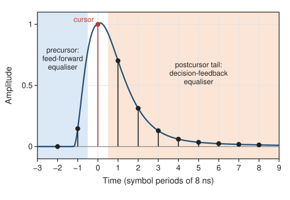

.. _phy-1000base-t-receiver:

1000BASE-T: receiver and clocking
=================================

Behind its cancellers, a 1000BASE-T receiver has equalisers, master and
slave clocking that keeps the cancellers matched, and correction of the
delays between pairs. The blocks of a whole transceiver do a large amount
of arithmetic every symbol period.

.. _phy-equalisation:

Equalisers
----------

An :term:`equaliser` is a filter whose response is the inverse of the
cable's, so that cable and equaliser together pass all frequencies alike
and each symbol no longer overlaps its neighbours (see
:wikipedia:`equalisation <Equalization_(communications)>`). The loss
depends on the cable's length and type, so the equaliser adapts to each
cable and keeps adapting while the link runs. Gigabit receivers use two
parts ([PHY-TUT98]_ slides 30 and 51):

* a *feed-forward equaliser* (FFE), an FIR filter on the incoming samples,
  removes the part of the overlap that arrives ahead of each symbol;
* a *decision-feedback equaliser* (DFE), an FIR filter fed with the
  symbols the receiver has already decided, subtracts their lingering
  tails. Its input is the decided symbols rather than the noisy samples, so
  it adds no noise.

:numref:`fig-phy-pulse-response` shows which part of a received pulse each
equaliser removes, and :numref:`fig-phy-equalisers` how the two connect.

.. graphviz:: equalisers.dot
   :name: fig-phy-equalisers
   :caption: The feed-forward equaliser filters the samples; the
             decision-feedback equaliser filters the decided symbols, and
             its output is subtracted before the decision.
   :alt: Samples after the cancellers go through the feed-forward
         equaliser, an FIR filter, to a subtractor and then to the
         decision, the trellis decoder, which outputs the decided symbols.
         The decided symbols also feed the decision-feedback equaliser,
         an FIR filter, whose output, the postcursor tails, goes back to
         the subtractor.
   :align: center

         minus 3 to 9. A smooth received pulse rises from about minus 1.2,
         peaks at 1 at time 0 and decays over the following periods.
         Stems mark its samples once per symbol period: a small one at
         minus 1 in a blue precursor region labelled feed-forward
         equaliser, the cursor of 1 at 0, and decreasing samples of about
         0.7, 0.3, 0.13 and smaller from 1 to 8 in an orange postcursor
         region labelled decision-feedback equaliser.
   :align: center

   A received symbol pulse sampled once per symbol period: the
   feed-forward equaliser removes the precursor and the decision-feedback
   equaliser the postcursor tail; the shape is schematic.

The receive path also corrects *baseline wander*. The coupling
transformers, or the coupling capacitors of a transformer-free connection
(:doc:`../magnetics/index`), block DC, so a long run of symbols that does
not average to zero shifts the zero level
(:numref:`fig-phy-baseline-wander`). A slow feedback loop restores it
([PHY-TUT98]_ slide 51; [PHY-KSZ9031]_ Figure 3‑2).

.. _phy-master-slave:

Master and slave clocking
-------------------------

The echo and near-end crosstalk cancellers are driven by the transceiver's
own transmit symbols, while the ADC samples at the far end's symbol timing.
The cancellers stay matched only if the transmit and receive symbol rates
are exactly equal. 1000BASE-T makes one end the timing reference
(:clause:`40.1.3`, :numref:`fig-phy-master-slave`):

* the *master* transmits on its own local clock;
* the *slave* recovers the master's clock from the received signal and
  transmits on it, which the standard calls loop timing.

.. graphviz:: master-slave.dot
   :name: fig-phy-master-slave
   :caption: The slave transmits on the clock it recovers from the master, so
             the whole link runs on the master's crystal.
   :alt: Two boxes, master and slave. In the master, a crystal clocks the
         transmitter at 125 MHz. Symbols go to the slave's receiver and
         clock recovery, whose recovered clock drives the slave's
         transmitter, which sends symbols back to the master's receiver at
         the same rate.
   :align: center

The master's symbol rate must be 125 MHz ± 0.01 %, that is ±100 parts per
million or ±12.5 kHz (:clause:`40.6.1.2.6`), and the receiver must accept
the same range (:clause:`40.6.1.3.2`). Which end is master is decided during
:doc:`autonegotiation`. The Microchip KSZ9031 datasheet notes that loop
timing also helps echo and near-end crosstalk cancellation
([PHY-KSZ9031]_ section 3.2.4). Some datasheets use the names leader and
follower for the same roles ([PHY-DP83867]_ section 7.4.3.2), and the
standard defines optional alternative names in its Annex K.

After autonegotiation both ends train their equalisers and cancellers on
idle symbols. A slave must reach reliable reception within
350 ms ± 5 ms and a master within 750 ms ± 10 ms, the *maxwait_timer*
(:clause:`40.4.5.2`, :numref:`fig-phy-startup`).

.. _phy-pair-skew:

Pair skew and swaps
-------------------

The four pairs of a cable differ slightly in length and propagation speed,
so symbols sent together arrive at different times. The standard allows up
to 50 ns of difference between any two pairs (:clause:`40.7.4.2`), and
the receiver realigns them (:clause:`40.1.4`, :numref:`fig-phy-pair-skew`). It also detects and corrects
pairs that are swapped or have their two wires reversed, using the idle
symbols sent before data starts (:clause:`40.1.4`; [PHY-KSZ9031]_
section 3.4).

.. wavedrom::
   :caption: Symbols sent together on the four pairs arrive at different
             times and the receiver realigns them; the offsets are drawn
             smaller than the 50 ns, about six symbol periods, that the
             standard allows.
   :name: fig-phy-pair-skew
   :alt: Timing diagram. Four rows, pair A to pair D as received, each
         carrying symbols n, n+1 and n+2, shifted by different fractions
         of a symbol, less than the 50 ns allowed. A fifth row, after alignment, carries the code
         groups n, n+1 and n+2 in step.

   { "signal": [
       { "name": "pair A in", "wave": "x===x.", "data": ["A n", "A n+1", "A n+2"] },
       { "name": "pair B in", "wave": "x===x.", "data": ["B n", "B n+1", "B n+2"], "phase": -0.6 },
       { "name": "pair C in", "wave": "x===x.", "data": ["C n", "C n+1", "C n+2"], "phase": -0.25 },
       { "name": "pair D in", "wave": "x===x.", "data": ["D n", "D n+1", "D n+2"], "phase": -0.8 },
       {},
       { "name": "aligned", "wave": "x.===x", "data": ["n", "n+1", "n+2"] }
     ],
     "config": { "hscale": 2 }
   }

Separately, a cable can be wired straight through or crossed over. A
transceiver can detect which, and swap its pairs to match: automatic
MDI/MDI-X configuration, which is optional (:clause:`40.4.4`). The name
comes from the :wikipedia:`medium dependent interface
<Medium-dependent_interface>`, the connector pins; the crossover itself is
described in :clause:`40.8.2`.

.. _phy-blocks:

Transceiver blocks
------------------

A gigabit transceiver has a copy of the signal path for each of the four
pairs. :numref:`fig-phy-blocks` puts the blocks together for one
pair, and :numref:`tab-phy-blocks` lists them with the page that explains
each one.

.. graphviz:: transceiver-blocks.dot
   :name: fig-phy-blocks
   :caption: The blocks of a 1000BASE-T transceiver, with one of the four
             identical pair channels drawn between the byte interface (top)
             and the cable (bottom).
   :alt: Top: the byte interface with bytes to send and received bytes.
         Transmit path downwards: scrambler and trellis encoder, transmit
         shaping filter, DAC and line driver, hybrid, cable interface.
         Receive path upwards: hybrid, amplifier, filter and ADC, a
         subtractor, adaptive equaliser, trellis decoder and descrambler.
         Dashed lines carry sent symbols to the echo canceller and the three
         near-end crosstalk cancellers, whose outputs go to the subtractor.
         Bottom: blocks shared by all four pairs, a 25 MHz crystal, clock
         synthesis and recovery, autonegotiation and management registers.
   :align: center

.. list-table:: Blocks of a 1000BASE-T transceiver
   :name: tab-phy-blocks
   :header-rows: 1
   :widths: 40 15 45

   * - Block
     - Copies
     - Explained in
   * - Scrambler, trellis encoder and transmit shaping filter
     - 1
     - :doc:`1000base-t-coding`
   * - DAC and line driver
     - 4
     - :doc:`line-drivers`
   * - Hybrid
     - 4
     - :ref:`phy-echo`
   * - Amplifier, filter and ADC
     - 4
     - :doc:`integration/receiver`
   * - Echo canceller
     - 4
     - :ref:`phy-echo-canceller`
   * - Near-end crosstalk cancellers
     - 12
     - :ref:`phy-crosstalk`
   * - Feed-forward and decision-feedback equalisers
     - 4
     - :ref:`phy-equalisation`
   * - Trellis decoder and descrambler
     - 1
     - :ref:`phy-trellis`
   * - Clock synthesis and clock recovery
     - 1
     - :ref:`phy-master-slave`
   * - Autonegotiation
     - 1
     - :doc:`autonegotiation`
   * - Management registers
     - 1
     - :ref:`phy-position`

The ADC is preceded by a variable-gain amplifier that scales the signal to
the ADC's input range, and by a filter that removes noise above the band
([PHY-KSZ9031]_ sections 3.2.2 and 3.2.3). Clock synthesis multiplies a
25 MHz crystal or oscillator up to the 125 MHz symbol clock in both the TI
DP83867 and the Microchip KSZ9031 ([PHY-DP83867]_ section 9.2.1.2;
[PHY-KSZ9031]_ section 3.6).

.. _phy-dsp-rate:

Arithmetic rate
---------------

Every 8 ns, for each of the four pairs, the receiver evaluates and adapts
five filters and takes one step of the Viterbi decoder. Each tap does one
multiply-and-add per symbol, so the arithmetic rate is

.. math::

   N_\text{taps} &= N_\text{pairs} \times N_\text{pair} \\
   N_\text{pair} &= N_\text{echo} + N_\text{NEXT} + N_\text{FFE} + N_\text{DFE}

   R_\text{ops} = N_\text{taps} \times f_\text{sym}

.. list-table::
   :header-rows: 1
   :widths: 22 58 20

   * - Symbol
     - Meaning
     - Unit
   * - :math:`N_\text{taps}`
     - Total filter taps in the transceiver
     - none
   * - :math:`N_\text{pair}`
     - Total taps for one pair
     - none
   * - :math:`N_\text{pairs}`
     - Number of pairs, 4
     - none
   * - :math:`N_\text{echo}`, :math:`N_\text{NEXT}`, :math:`N_\text{FFE}`,
       :math:`N_\text{DFE}`
     - Taps per pair of the echo canceller, the three near-end crosstalk
       cancellers together, the feed-forward equaliser and the
       decision-feedback equaliser
     - none
   * - :math:`f_\text{sym}`
     - Symbol rate, :math:`125 \times 10^{6}` per second
     - s⁻¹
   * - :math:`R_\text{ops}`
     - Multiply-and-add operations per second for the filters
     - s⁻¹

The 802.3ab tutorial's design point uses 120 echo taps, 72 near-end
crosstalk taps, 16 feed-forward taps and 12 decision-feedback taps per
pair ([PHY-TUT98]_ slide 51). The 72 crosstalk taps cover the three
cancellers of a pair together; the same tutorial's receiver comparison
gives 75 taps per channel for the near-end crosstalk cancellers
([PHY-TUT98]_ slide 33). Substituting:

.. math::

   N_\text{taps} &= 4 \times (120 + 72 + 16 + 12) = 880 \\
   R_\text{ops} &= 880 \times 125 \times 10^{6} \\
                &= 1.1 \times 10^{11}\ \text{s}^{-1}

Adapting the coefficients takes about as many operations again. This
arithmetic is the transceiver's *digital signal processing* (DSP).
:doc:`integration/signal-processing` treats it as a requirement on
evampire and relates the tap counts to the cable reach.
