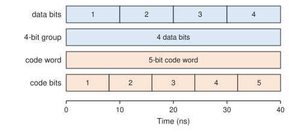
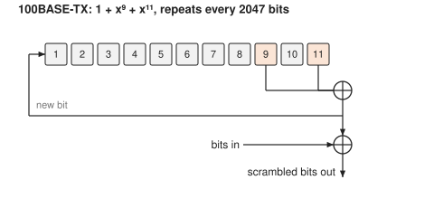
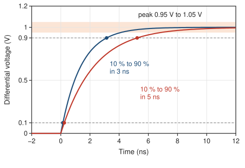
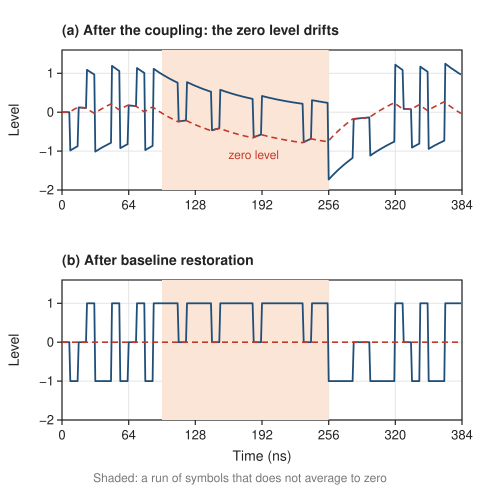

.. _phy-100base-tx:

100BASE-TX: 4B5B, scrambling and MLT-3
======================================

100BASE-TX (:clause:`24` and :clause:`25`) codes its data with 4B5B and
scrambling, and sends it on the wire as a three-level MLT-3 signal, which
its receiver must recover.

100BASE-TX uses the same pairs as :doc:`10base-t`, pins 1 and 2 and pins 3
and 6 of the :term:`RJ45` socket, one pair for each direction
(:clause:`Table 25-2 <25>`). Because each pair carries only one direction,
it needs no :term:`hybrid` or echo cancelling. :clause:`25` adopts the
twisted-pair signalling of the FDDI standard :std:`ANSI X3.263 <x3-263>`
[PHY-X3263]_, with the changes listed in :clause:`25.4`.

.. _phy-4b5b:

4B5B coding
-----------

The coding layer replaces each 4-bit group of data with a 5-bit code word
from a fixed table, :wikipedia:`4B5B <4B5B>` (:clause:`24.2.2.1`,
:clause:`Table 24-1 <24>`). The 16 data code words each contain at least
two 1 bits, which become transitions on the wire. Some of the other 16
code words mark idle, and the start and end of a frame. The rate on the
wire is therefore 5/4 of the data rate:

.. math::

   f_\text{line} = \frac{5}{4} \times R

.. list-table::
   :header-rows: 1
   :widths: 20 60 20

   * - Symbol
     - Meaning
     - Unit
   * - :math:`f_\text{line}`
     - Rate of code bits on the wire, one symbol per code bit
     - Bd
   * - :math:`R`
     - Data rate
     - bit/s

For :math:`R = 100` Mbit/s:

.. math::

   f_\text{line} = \frac{5}{4} \times 100 \times 10^{6} = 125 \times 10^{6}\ \text{Bd}

which is why 100BASE-TX runs at 125 MBd, the same symbol rate as
1000BASE-T (:numref:`fig-phy-4b5b`).

         one 4-bit group; below it, one 5-bit code word in the same 40 ns,
         made of five 8 ns code bits.
   :align: center

   4B5B coding: each 4-bit group of data, 40 ns at 100 Mbit/s,
   becomes a 5-bit code word sent in the same 40 ns at 125 MBd.

.. _phy-100base-tx-scrambler:

Scrambling
----------

The code bits are combined, by exclusive-OR, with the output of an
11-bit :wikipedia:`linear feedback shift register
<Linear-feedback_shift_register>` with the polynomial
:math:`1 + x^9 + x^{11}`, which repeats every
:math:`2^{11} - 1 = 2047` bits ([PHY-CAM96]_ page 2; [PHY-KSZ9031]_
section 3.1.3). The scrambler makes the transmitted power look like noise,
spread across the band. Without it, a repeating pattern such as the idle
code would put its energy into a few frequencies and radiate more. The
receiver's descrambler locks to the scrambled idle code between frames
(:clause:`25.4.12`). :numref:`fig-phy-100base-tx-scrambler` shows the
shift register.

         11 shaded as taps. The outputs of stages 9 and 11 meet in an
         exclusive-OR whose output, the new bit, feeds back into stage 1
         and also goes to a second exclusive-OR with the incoming bits,
         whose output is the scrambled bits.
   :align: center

   The 100BASE-TX scrambler, :math:`1 + x^9 + x^{11}`: the exclusive-OR
   of stages 9 and 11 feeds stage 1 and scrambles the bits.

.. _phy-mlt3:

MLT-3 coding
------------

The scrambled bits are sent with :wikipedia:`MLT-3 <MLT-3_encoding>`, a
three-level code using −1, 0 and +1 [PHY-X3263]_. A 1 bit moves the output
one step along the repeating cycle 0, +1, 0, −1; a 0 bit holds the output
where it is (:numref:`fig-phy-mlt3`).

.. wavedrom::
   :caption: MLT-3 coding: each 1 bit steps the output along the cycle 0,
             +1, 0, −1, and each 0 bit holds it.
   :name: fig-phy-mlt3
   :alt: Timing diagram of the bits 1 1 1 1 0 1 1 0 0 1 and the resulting
         three-level waveform, which steps +1, 0, −1, 0, holds, +1, 0, holds,
         holds, −1.

   { "signal": [
       { "name": "bit", "wave": "==========", "data": ["1","1","1","1","0","1","1","0","0","1"] },
       { "name": "MLT-3", "wave": "1z0z.1z..0" }
     ],
     "config": { "hscale": 1.2 }
   }

A full cycle of the waveform takes four 1 bits, so the fastest pattern, all
1 bits, has a period of four code bits. Its frequency is a quarter of the
symbol rate, :math:`125\ \text{MHz} / 4 = 31.25\ \text{MHz}`. A 100 m
channel loses about 13 dB at that frequency
(:numref:`tab-phy-channel-limits`), against 24 dB at 100 MHz.

.. _phy-100base-tx-levels:

Signal levels and edges
-----------------------

A 100BASE-TX transmitter drives ±1 V with edges of 3 ns to 5 ns.
:numref:`tab-phy-100base-tx` gives the main transmitter limits. They are
set in :std:`ANSI X3.263 <x3-263>` and checked by the University of New
Hampshire InterOperability Laboratory test suite [PHY-UNH25]_.

.. list-table:: 100BASE-TX transmitter limits
   :name: tab-phy-100base-tx
   :header-rows: 1
   :widths: 46 18 18 18

   * - Quantity
     - Minimum
     - Nominal
     - Maximum
   * - Peak differential output into 100 Ω (V)
     - 0.95
     - 1.0
     - 1.05
   * - Rise and fall time, 10 % to 90 % (ns)
     - 3
     -
     - 5
   * - Overshoot (%)
     -
     -
     - 5
   * - Transmit jitter, peak-to-peak (ns)
     -
     -
     - 1.4
   * - Symbol rate error (parts per million)
     - −50
     -
     - +50

:numref:`fig-phy-100base-tx-edges` draws the two edge-time limits as
single-pole edges against the peak band.

         minus 2 ns to 12 ns. Two exponential edges start at 0 ns: one
         reaches 90 % at about 3.1 ns, a 10 % to 90 % time of 3 ns, and
         the other at about 5.2 ns, a 10 % to 90 % time of 5 ns. Dashed
         lines mark 10 % and 90 %, and a shaded band marks the peak of
         0.95 V to 1.05 V.
   :align: center

   The fastest and slowest allowed 100BASE-TX edges, drawn as single-pole
   responses, with dots at their 10 % and 90 % points.

.. _phy-100base-tx-receiver:

Receiver
--------

The receiver reverses the transmit steps and corrects what the cable did
(:numref:`fig-phy-100base-tx-rx`):

* an adaptive :term:`equaliser` undoes the frequency-dependent loss of the
  cable, which depends on its length;
* a feedback loop corrects *baseline wander*, the drift of the zero level
  that the transformer causes when a long run of symbols does not average to
  zero (:clause:`25.4.11` names the test pattern for it);
* a :wikipedia:`clock recovery <Clock_recovery>` loop locks to the
  transitions of the received signal;
* the coding steps are undone: MLT-3 to bits, descrambling and 5B-to-4B
  decoding.

The Microchip KSZ9031 datasheet describes the same chain
([PHY-KSZ9031]_ section 3.1.2).

.. graphviz:: rx-100base-tx.dot
   :name: fig-phy-100base-tx-rx
   :caption: The 100BASE-TX receive chain: first the steps that correct
             the cable, then the steps that undo the coding.
   :alt: Top row, left to right: receive pair, adaptive equaliser,
         baseline wander correction, clock recovery and sampling, labelled
         correct what the cable did. Bottom row, right to left: MLT-3 to
         bits, descrambler, 5B-to-4B decoder, data nibbles, labelled undo
         the transmitter's coding.
   :align: center

:numref:`fig-phy-baseline-wander` shows baseline wander and its
correction.

         baseline restoration: MLT-3 symbols stepping through 0, +1, 0
         and −1 around a fixed zero level, with a shaded run in which zero
         bits hold the line at +1 for 20 symbols. Top, the same symbols
         after the coupling: during the run the dashed zero level drifts
         down to about −0.9, and the signal sags towards it, then the
         zero level recovers.
   :align: center

   Baseline wander: a coupling that blocks DC shifts the zero level during
   a run of symbols that does not average to zero, and the restoring loop
   removes the shift; the time constant is schematic.
