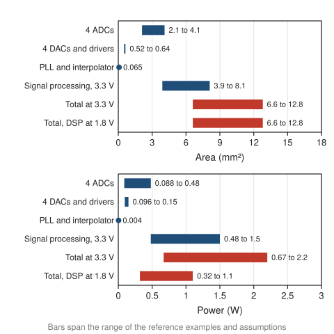

.. _phy-int-area-power:

Area and power
==============

This page adds up area and power for one integrated 1000BASE-T port from
the reference examples and assumptions of the other pages. The result is
an illustration from published designs in other processes, not a
prediction for evampire: the area and power of a gf180mcu transceiver are
not known. Synthesis of the signal processing for gf180mcu, and test chips
of the ADC, the line driver and the PLL, would establish them. The totals
leave out the blocks for 100BASE-TX and 10BASE-T, which every port also
needs (:ref:`the transceiver requirements <req-transceivers>`).

.. _phy-int-dsp-power:

Signal-processing power
-----------------------

The power of logic that does a fixed amount of work per symbol is

.. math::

   P_\text{DSP} = N_\text{gates} \times \alpha \times f_\text{sym} \times E

.. list-table::
   :header-rows: 1
   :widths: 20 60 20

   * - Symbol
     - Meaning
     - Unit
   * - :math:`P_\text{DSP}`
     - Switching power of the signal processing
     - W
   * - :math:`N_\text{gates}`
     - Gates needed for one symbol's work, in 2-input NAND equivalents
     - none
   * - :math:`\alpha`
     - Fraction of gates that make a full charge and discharge per
       symbol
     - none
   * - :math:`f_\text{sym}`
     - Symbol rate, :math:`125 \times 10^{6}` per second
     - s⁻¹
   * - :math:`E`
     - Energy per charge and discharge of one gate (:ref:`phy-int-energy`)
     - J

The formula does not depend on the clock: doubling the paths and halving
the clock leaves :math:`N_\text{gates} \times f_\text{sym}` per unit of
work unchanged, to first order. It leaves out the clock network and
leakage. The inputs are assumptions:

* :math:`N_\text{gates}` from 250 000 to 400 000. The 802.3ab tutorial's
  design point is 330 000 gates, and its layout study 400 000
  ([PHY-TUT98]_ slides 51 and 61). The low value takes 330 000 and
  replaces its 158 000-gate decoder by the 79 000-gate look-ahead decoder
  of the :ref:`decision loop <phy-int-decision-loop>`: :math:`330\,000 - 79\,000 = 251\,000`.
* :math:`\alpha` from 0.1 to 0.2, an assumed activity for datapath logic.
* :math:`E` of 154 fJ at 3.3 V and 41.6 fJ at 1.8 V.

At 3.3 V the low end is
:math:`250\,000 \times 0.1 \times 125 \times 10^{6} \times 154\ \text{fJ} =
0.48` W and the high end
:math:`400\,000 \times 0.2 \times 125 \times 10^{6} \times 154\ \text{fJ} =
1.5` W. At 1.8 V the same gates give 0.13 W to 0.42 W, if the cell and
supply options of :doc:`cells` let the decision loop close at that supply.

The area of :math:`N_\text{gates}` gates, each the area
:math:`A_\text{NAND2}` of :numref:`tab-phy-int-nand2`, with a fraction
:math:`u` of the area filled by cells, is
:math:`N_\text{gates} \times A_\text{NAND2} / u`. With :math:`u = 0.7`
(an assumption), 250 000 gates in the fd_sc 7-track library take
:math:`250\,000 \times 10.976\ \mu\text{m}^2 / 0.7 = 3.9\ \text{mm}^2`, and
400 000 gates in the 9-track library take 8.1 mm².

.. _phy-int-totals:

Totals for one port
-------------------

One port comes to about 0.7 W to 2.2 W and 7 mm² to 13 mm² at 3.3 V
(estimate). :numref:`tab-phy-int-area-power` adds the parts. Each range spans the
reference examples or assumptions named in its source column, and
:numref:`fig-phy-int-area-power` draws the ranges.

.. list-table:: Illustration of the area and power of one port (estimate)
   :name: tab-phy-int-area-power
   :header-rows: 1
   :widths: 30 30 20 20

   * - Part
     - Source
     - Area (mm²)
     - Power (W)
   * - 4 ADCs
     - designs of :numref:`tab-phy-int-adcs` and :numref:`tab-phy-int-adc-area`
     - 2.1 to 4.1
     - 0.088 to 0.48
   * - 4 DACs and line drivers
     - 180 nm 100BASE-TX drivers ([PHY-BUHR21]_; [PHY-BUHR18]_;
       [PHY-RICHTER14]_)
     - 0.52 to 0.64
     - 0.096 to 0.15
   * - PLL and phase interpolator
     - [PHY-BUHR21]_
     - 0.065
     - 0.004
   * - Signal processing, fd_sc cells at 3.3 V
     - :ref:`phy-int-dsp-power`
     - 3.9 to 8.1
     - 0.48 to 1.5
   * - Total at 3.3 V
     - sum of the rows above
     - 6.6 to 12.8
     - 0.67 to 2.2
   * - Total with the signal processing at 1.8 V
     - same, with 0.13 W to 0.42 W for the signal processing
     - 6.6 to 12.8
     - 0.32 to 1.1

         ADCs 2.1 to 4.1, 4 DACs and drivers 0.52 to 0.64, PLL and
         interpolator 0.065, signal processing at 3.3 V 3.9 to 8.1, total
         at 3.3 V 6.6 to 12.8. Power in W: 0.088 to 0.48, 0.096 to 0.15,
         0.004, 0.48 to 1.5, and a total of 0.67 to 2.2.
   :align: center

   The area and power ranges of :numref:`tab-phy-int-area-power` by part
   (estimate).

Not estimated, for want of a gigabit reference example in a comparable
process: the receive amplifiers and filters, the hybrids, the protection,
the clock distribution, the leakage, and the optional analogue echo
cancellers (for reference, about 1 mm² and 43 mW each in 0.4 µm,
[PHY-LEE01]_).

For the two ports, each value doubles: about 13 mm² to 26 mm², and 1.3 W
to 4.4 W at 3.3 V or 0.64 W to 2.1 W with the signal processing at 1.8 V
(estimate). The transceivers' power is part of the board's own consumption
in the :ref:`power budget <power-budget>`.

.. _phy-int-whole-chips:

Whole transceivers in other processes
-------------------------------------

:numref:`tab-phy-int-chips` lists the power of whole gigabit transceivers
as reference examples: 0.45 W to 3.1 W per port.

.. list-table:: Reference examples: power of one 1000BASE-T port
   :name: tab-phy-int-chips
   :header-rows: 1
   :widths: 46 24 30

   * - Design
     - Process
     - Power per port (W)
   * - 802.3ab tutorial layout study, including the analogue front end
       ([PHY-TUT98]_ slide 61; [PHY-QAM97]_)
     - 0.25 µm, 2.5 V
     - 3.1
   * - Marvell Alaska 88E1000, 10/100/1000 ([PHY-ED2000]_)
     - 0.18 µm, 3.3 V
     - 1.8
   * - Vitesse VSC8244, four ports ([PHY-VSC8244]_)
     - 0.13 µm
     - 0.64
   * - Microchip KSZ9031, full traffic ([PHY-KSZ9031]_ Tables 3‑12 to
       3‑15)
     -
     - 0.45 to 0.62
   * - TI DP83867, full operation ([PHY-DP83867]_ section 6.5)
     -
     - 0.46 to 0.53

The KSZ9031 and DP83867 ranges cover their supply options. Empty cells:
not given in the source.

.. _phy-int-area-power-questions:

Open questions
--------------

* The area and power of a gf180mcu gigabit transceiver, which synthesis of
  the signal processing and test chips of the analogue blocks establish.
* The area and power of the blocks not estimated above.
