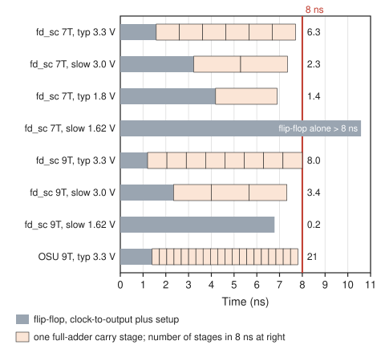
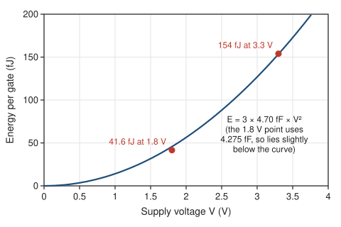

.. _phy-int-cells-page:

Devices, cell libraries and supply options
==========================================

gf180mcu offers the transceiver its transistors, standard-cell libraries
that each fit a different amount of logic in one 8 ns symbol period, and a
switching energy that sets the power of the signal processing. The choice
of cells and supply is open.

.. _phy-int-devices:

Transistors
-----------

gf180mcu has 3.3 V, 5 V, 6 V and 10 V transistors.
:numref:`tab-phy-int-devices` gives their typical values from the PDK's electrical parameters ([PHY-GF180PDK]_).

.. list-table:: gf180mcu n-channel transistors, typical values
   :name: tab-phy-int-devices
   :header-rows: 1
   :widths: 34 22 22 22

   * - Device
     - Length (µm)
     - Threshold (V)
     - Current (µA/µm)
   * - 3.3 V
     - 0.28
     - 0.63
     - 510
   * - 5 V
     - 0.6
     - 0.70
     - 500
   * - 6 V
     - 0.7
     - 0.73
     - 570
   * - 10 V drain-extended (LDMOS)
     - 0.6
     - 0.84
     - 535

The saturation current is per µm of width, for W = 10 µm at minimum length,
with gate and drain at the rated voltage; for the 10 V device the gate is at
6 V and the drain at 10 V. The length is the minimum gate length. The gate
oxide of the 3.3 V transistors withstands at least 7 V, and that of the
5 V and 6 V transistors at least 12 V. The 3.3 V p-channel transistor has a threshold
of −0.73 V and a saturation current of 250 µA/µm. The 10 V device's drain
holds at least 13.2 V ([PHY-GF180PDK]_).

The PDK also has MIM capacitors (1.0, 1.5 or 2.0 fF/µm², depending on the
process option), polysilicon resistors from about 7 Ω to 3000 Ω per square,
vertical NPN and PNP bipolar transistors, Schottky diodes and 2 to 6 metal
layers ([PHY-GF180PDK]_). Custom transistor layouts, parasitic bipolar
transistors and stacked or drain-extended devices are also in scope
(:ref:`req-process`).

.. _phy-int-cells:

Cell libraries
--------------

Three families of standard cells are available:

* ``gf180mcu_fd_sc_mcu7t5v0`` and ``gf180mcu_fd_sc_mcu9t5v0``, the
  foundry's 7-track and 9-track libraries. Both are built from the 5 V
  transistors and characterised at 1.8 V, 3.3 V and 5 V
  ([PHY-GF180SC]_). The track count is the number of routing tracks in the
  height of one cell row.
* ``gf180mcu_osu_sc_gp9t3v3`` and ``gf180mcu_osu_sc_gp12t3v3`` from
  Oklahoma State University, characterised for a 3.3 V supply at the
  typical corner and 25 °C ([PHY-OSU]_).
* Custom cells, including non-traditional logic styles such as
  :wikipedia:`dynamic <Dynamic_logic_(digital_electronics)>` or domino
  logic, :wikipedia:`current-mode logic <Current-mode_logic>` and
  :wikipedia:`pass-transistor logic <Pass_transistor_logic>`
  (:ref:`req-process`).

.. _phy-int-logic-depth:

Logic depth per 8 ns
--------------------

The time left for logic between two flip-flops in a period :math:`T` is

.. math::

   t_\text{logic} = T - t_\text{clk-Q} - t_\text{setup}

and dividing by the delay of one full-adder carry stage gives a measure of
how much arithmetic fits:

.. math::

   N_\text{carry} = \frac{t_\text{logic}}{t_\text{carry}}

.. list-table::
   :header-rows: 1
   :widths: 22 58 20

   * - Symbol
     - Meaning
     - Unit
   * - :math:`t_\text{logic}`
     - Time left for logic in one period
     - ns
   * - :math:`T`
     - Period; 8 ns for a loop that closes every symbol
     - ns
   * - :math:`t_\text{clk-Q}`
     - Flip-flop clock-to-output delay, worse of rise and fall
     - ns
   * - :math:`t_\text{setup}`
     - Flip-flop setup time, worse of rise and fall
     - ns
   * - :math:`t_\text{carry}`
     - Full adder delay to the carry output, worst input
     - ns
   * - :math:`N_\text{carry}`
     - Carry stages that fit in one period
     - none

For the 7-track library at the typical 3.3 V corner:

.. math::

   t_\text{logic} &= 8 - 1.20 - 0.38 = 6.42\ \text{ns} \\
   N_\text{carry} &= 6.42 / 1.02 = 6.3

:numref:`tab-phy-int-timing` gives the same calculation for each library
and corner, from the Liberty timing of the smallest flip-flop
(``dffq_1``, ``dff_1``) and full adder (``addf_1``), at an input slew of
0.287 ns and a load of 0.0122 pF ([PHY-GF180SC]_; [PHY-OSU]_).

.. list-table:: Full-adder carry stages in 8 ns for each cell library
   (estimate)
   :name: tab-phy-int-timing
   :header-rows: 1
   :widths: 40 20 20 20

   * - Library and corner
     - Flip-flop (ns)
     - Carry (ns)
     - Stages in 8 ns
   * - fd_sc 7-track, typical, 3.3 V, 25 °C
     - 1.58
     - 1.02
     - 6.3
   * - fd_sc 7-track, slow, 3.0 V, 125 °C
     - 3.23
     - 2.06
     - 2.3
   * - fd_sc 7-track, typical, 1.8 V, 25 °C
     - 4.19
     - 2.70
     - 1.4
   * - fd_sc 7-track, slow, 1.62 V, 125 °C
     - 10.58
     - 6.80
     - 0
   * - fd_sc 9-track, typical, 3.3 V, 25 °C
     - 1.20
     - 0.85
     - 8.0
   * - fd_sc 9-track, slow, 3.0 V, 125 °C
     - 2.34
     - 1.66
     - 3.4
   * - fd_sc 9-track, slow, 1.62 V, 125 °C
     - 6.78
     - 5.50
     - 0.2
   * - OSU 9-track, typical, 3.3 V, 25 °C
     - 1.40
     - 0.32
     - 21

The flip-flop column is :math:`t_\text{clk-Q} + t_\text{setup}` and the
carry column is :math:`t_\text{carry}`. In the 1.62 V slow-corner row of the 7-track library the flip-flop alone
takes longer than 8 ns. The OSU cells are characterised at the typical
corner only, so their slow-corner speed comes from simulation with the PDK
models. The OSU 12-track library gives the same timing as the 9-track one
([PHY-OSU]_). :numref:`fig-phy-int-carry-stages` draws each row.

         corner, with a red line at 8 ns. Each bar starts with the
         flip-flop time and is filled with carry stages up to 8 ns, with the
         number of stages at the right: fd_sc 7-track typical 3.3 V 6.3,
         slow 3.0 V 2.3, typical 1.8 V 1.4, slow 1.62 V 0 because the
         flip-flop alone exceeds 8 ns; fd_sc 9-track typical 3.3 V 8.0,
         slow 3.0 V 3.4, slow 1.62 V 0.2; OSU 9-track typical 3.3 V 21.
   :align: center

   How the 8 ns period divides into flip-flop time and full-adder carry
   stages for each cell library and corner (estimate).

.. _phy-int-cell-options:

Cell and supply options
-----------------------

The choice of cells and supply is open. What the
:ref:`decision loop <phy-int-decision-loop>` needs depends on its
structure: its logic depth in carry stages, to be
found by synthesis. Each option below can meet it under different
conditions:

* fd_sc cells at 3.3 V fit 2.3 carry stages per 8 ns at the 7-track slow
  corner and 3.4 at the 9-track slow corner. A look-ahead loop that needs
  no more than that closes; a deeper loop needs a different option.
* fd_sc cells at a lower supply use less energy per operation
  (:ref:`phy-int-energy`) but fit less logic per period. The filters can
  use parallel paths at a lower clock; the decision loop cannot, so it
  needs a supply or cells fast enough for its depth. Supplies between
  1.8 V and 3.3 V are not in the foundry characterisation and need their
  own.
* OSU 3.3 V cells fit about three times as many carry stages as the fd_sc
  7-track cells at the typical corner, at about twice the area per
  2-input NAND gate (:numref:`tab-phy-int-nand2`).
* Custom or non-traditional cells for the loop alone, with standard cells
  for the rest.

.. list-table:: Area of one 2-input NAND gate in each library
   :name: tab-phy-int-nand2
   :header-rows: 1
   :widths: 60 40

   * - Library
     - Area (µm²)
   * - fd_sc 7-track (``nand2_1``)
     - 10.976
   * - fd_sc 9-track (``nand2_1``)
     - 14.112
   * - OSU 9-track (``nand2_1``)
     - 20.79
   * - OSU 12-track (``nand2_1``)
     - 26.46

.. _phy-int-energy:

Switching energy
----------------

Charging a node of capacitance :math:`C` to voltage :math:`V` stores
:math:`\tfrac{1}{2} C V^2` and dissipates as much again in the
transistors; discharging it dissipates the stored half. One full charge
and discharge therefore takes

.. math::

   E = C V^2

from the supply (see :wikipedia:`CMOS`, power).
Take the switched capacitance of one gate as three times the input
capacitance of a 2-input NAND gate: its own output and wiring, plus two
inputs that it drives (an assumption). With the fd_sc 7-track ``nand2_1``
input capacitance of 4.70 fF at 3.3 V and 4.275 fF at 1.8 V
([PHY-GF180SC]_):

.. math::

   E_{3.3} &= 3 \times 4.70\ \text{fF} \times (3.3\ \text{V})^2 = 154\ \text{fJ} \\
   E_{1.8} &= 3 \times 4.275\ \text{fF} \times (1.8\ \text{V})^2 = 41.6\ \text{fJ}

.. list-table::
   :header-rows: 1
   :widths: 20 60 20

   * - Symbol
     - Meaning
     - Unit
   * - :math:`E`
     - Energy drawn from the supply per full charge and discharge
     - J
   * - :math:`C`
     - Switched capacitance
     - F
   * - :math:`V`
     - Supply voltage
     - V
   * - :math:`E_{3.3}`, :math:`E_{1.8}`
     - :math:`E` for one gate of the 7-track library at 3.3 V and 1.8 V
     - fJ

At 1.8 V each operation takes :math:`41.6 / 154 = 0.27` of the energy at
3.3 V (:numref:`fig-phy-int-energy`). :doc:`area-power` uses these values.

         voltage from 0 to 4 V. A parabola E = 3 × 4.70 fF × V squared
         passes through 154 fJ at 3.3 V; a point at 41.6 fJ at 1.8 V lies
         slightly below it because the input capacitance there is
         4.275 fF.
   :align: center

   Switching energy per gate against supply voltage.

.. _phy-int-cells-questions:

Open questions
--------------

* Which cells and supply the signal processing uses, and the decision
  loop in particular.
* The slow-corner timing of the OSU cells and of the fd_sc cells at
  supplies between 1.8 V and 3.3 V, from simulation with the PDK models.
* The transition frequency, maximum oscillation frequency and
  transconductance efficiency of the gf180mcu transistors, which set the
  speed of the ADC, DAC and line driver, from simulation with the PDK
  models.
