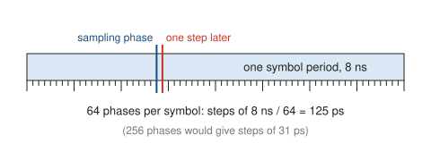
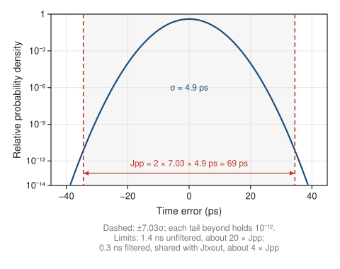

.. _phy-int-clock:

Clock recovery
==============

This page states what the integrated transceiver's clocks must do: the
accuracy of the reference, the phase control of the ADC sampling clock in
master and slave, and the jitter limits. :ref:`The receiver page <phy-master-slave>`
explains master and slave clocking.

.. _phy-int-reference:

Reference clock
---------------

The master's symbol rate must be 125 MHz ± 0.01 %, that is ±100 parts per
million (:clause:`40.6.1.2.6`). Both ends of a link take their timing from
the master's local clock, so only that clock's accuracy matters for the
link. For reference, the TI DP83867 uses a 25 MHz reference of ±50 parts
per million, plus ±50 parts per million for one year of ageing
([PHY-DP83867]_ Table 9‑2), and multiplies it up with a
:wikipedia:`phase-locked loop <Phase-locked_loop>` (PLL). The same total of
±100 parts per million fits the standard's limit
(:numref:`fig-phy-int-clock-loop`).

.. _phy-int-phase:

Sampling phase
--------------

The slave recovers the master's clock and transmits with it; the master
transmits with its own clock and still needs to sample its receiver at the
right phase of the slave's symbols, which arrive after the cable delay
(:clause:`40.1.3`). One approach is a PLL at the symbol rate followed by a
phase interpolator that moves the sampling phase in fixed steps. For
reference:

* a 1997 jitter analysis for 1000BASE-T takes 64 phases per symbol, steps
  of :math:`8\ \text{ns}/64 = 125` ps, and states that a 125 ps step causes
  tolerable degradation in PAM-5 ([PHY-OSCAR97]_ slide 5);
* a 180 nm PLL and 256-phase interpolator for 100BASE-TX gives steps of
  :math:`8\ \text{ns}/256 = 31` ps, 4.9 ps rms jitter, 4.0 mW and
  0.065 mm², with a digital clock recovery of 204 standard cells
  ([PHY-BUHR21]_).

The timing-recovery loop that decides the phase is digital. It works on
the ADC samples, so it can be developed and checked on samples captured
from a real cable before the chip exists. :numref:`fig-phy-int-clock-loop`
shows the loop and :numref:`fig-phy-int-phase-steps` the phase steps.

.. graphviz:: clock-loop.dot
   :name: fig-phy-int-clock-loop
   :caption: The clocks of one port: the PLL makes the 125 MHz symbol
             clock, and the digital timing-recovery loop sets the ADC
             sampling phase through the phase interpolator.
   :alt: A 25 MHz crystal, plus or minus 50 ppm plus plus or minus 50 ppm
         of ageing, feeds a PLL that multiplies by 5 to 125 MHz, plus or
         minus 100 ppm. The PLL feeds a phase interpolator whose output is
         the ADC sampling clock. The ADC's received samples go to digital
         timing recovery, which sets the interpolator's phase, drawn
         dashed. The transmitter takes its clock from the PLL in the
         master and from the interpolator, dashed, in the slave.
   :align: center

         A blue line marks the present sampling phase and a red line one
         tick later marks the phase one step later. Text: 64 phases per
         symbol give steps of 8 ns divided by 64, 125 ps; 256 phases would
         give steps of 31 ps.
   :align: center

   One symbol period divided into 64 sampling phases of 125 ps.

.. _phy-int-jitter:

Jitter
------

The master's clock jitter must stay below 1.4 ns peak-to-peak unfiltered
and 0.3 ns after a 5 kHz high-pass filter (:clause:`40.6.1.2.5`,
:numref:`tab-phy-int-reqs`). PLLs are commonly specified by their rms jitter
:math:`\sigma`. To compare, take the jitter as Gaussian, and the
peak-to-peak value as the range whose ends are each exceeded with
probability :math:`10^{-12}`:

.. math::

   J_\text{pp} = 2\,Q\,\sigma

.. list-table::
   :header-rows: 1
   :widths: 20 60 20

   * - Symbol
     - Meaning
     - Unit
   * - :math:`J_\text{pp}`
     - Peak-to-peak jitter
     - ps
   * - :math:`Q`
     - Number of standard deviations beyond which one tail of a
       :wikipedia:`normal distribution <Normal_distribution>` holds a
       probability of :math:`10^{-12}`, 7.03 (see
       :wikipedia:`Q-function`)
     - none
   * - :math:`\sigma`
     - Root-mean-square jitter
     - ps

With :math:`\sigma = 4.9` ps:

.. math::

   J_\text{pp} = 2 \times 7.03 \times 4.9\ \text{ps} = 69\ \text{ps}

which is about one twentieth of the 1.4 ns unfiltered limit and about a
quarter of the 0.3 ns limit after the 5 kHz high-pass filter (estimate,
for the reference example above; a gf180mcu PLL needs its own design and
measurement). :numref:`fig-phy-int-jitter` draws the distribution.

         to 1 against time error from −45 ps to 45 ps. A Gaussian curve
         with sigma 4.9 ps peaks at 0. Dashed lines at about ±34 ps mark
         7.03 sigma either side, beyond each of which a tail holds a
         probability of 1e-12, and an arrow between them is labelled
         Jpp = 2 × 7.03 × 4.9 ps = 69 ps. A note says the 1.4 ns
         unfiltered limit is about 20 times Jpp, and the 0.3 ns limit after
         a 5 kHz high-pass filter about 4 times Jpp.
   :align: center

   Gaussian jitter of 4.9 ps rms and its peak-to-peak value at a tail
   probability of 10⁻¹² each side.

.. _phy-int-training-time:

Training time
-------------

After autonegotiation, the slave must lock to the master's clock and both
ends must train their equalisers and cancellers before the maxwait_timer
expires: 350 ms ± 5 ms for a slave and 750 ms ± 10 ms for a master
(:clause:`40.4.5.2`, :numref:`fig-phy-startup`). The timing recovery
and the adaptation of
:doc:`signal-processing` share this time.

.. _phy-int-clock-questions:

Open questions
--------------

* The phase step and jitter of a gf180mcu PLL and phase interpolator, which
  need a design and a test chip.
* How fast the timing recovery and the adaptation converge together within
  the maxwait_timer, which a simulation of the start-up answers.
