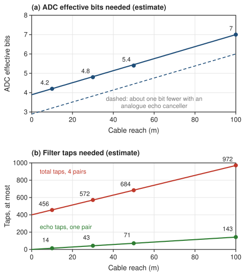

.. _phy-int-receiver:

Integrated receiver
===================

Before the digital filters, the integrated receiver shares the echo between
analogue and digital stages, and its analogue-to-digital converter (ADC)
needs a number of effective bits that depends on cable reach.
:doc:`../1000base-t-echo` explains the hybrid and the echo canceller.

.. _phy-int-echo:

Echo removal
------------

The receiver sees its own transmission at full size, while the far-end
signal at 100 MHz can be as small as 6 % of its launched voltage over a
100 m channel (:numref:`tab-phy-channel-limits`). The echo is removed in
stages (:numref:`fig-phy-int-echo-path`). Whatever the analogue stages
leave sets the input range the ADC must handle, and so its resolution.

.. graphviz:: echo-path.dot
   :name: fig-phy-int-echo-path
   :caption: The echo passes the hybrid, an optional analogue echo canceller
             and the ADC before the digital echo canceller removes the rest.
   :alt: Left to right: the pins carry the far-end signal plus the full
         echo; the hybrid leaves a residual echo; an optional analogue echo
         canceller, drawn dashed, leaves a smaller residual; the amplifier
         and ADC produce samples; the digital echo canceller removes the
         rest. Dashed lines carry the sent symbols to both cancellers.
   :align: center

Without transformers the hybrid works on the coupled pins, so its balance
depends on how well the on-chip replica matches the line and the external
parts of the chosen isolation route (:ref:`phy-int-cable`).
:numref:`tab-phy-int-echo` gives reference examples of how the work has
been shared.

.. list-table:: Reference examples of echo removal
   :name: tab-phy-int-echo
   :header-rows: 1
   :widths: 30 25 45

   * - Approach
     - Example
     - Published result
   * - Analogue hybrid, then a long digital echo canceller
     - 802.3ab tutorial design point ([PHY-TUT98]_ slide 51)
     - 120-tap digital echo canceller; ADC range 2.2 V peak-to-peak for a
       2 V peak-to-peak launch
   * - Hybrid plus an analogue echo canceller before the ADC
     - Lee and Razavi, 0.4 µm ([PHY-LEE01]_)
     - 4 taps, 10 dB of echo suppression, 43 mW, about 1 mm²
   * - Hybrid plus an analogue echo canceller before the ADC
     - Microchip KSZ9031 ([PHY-KSZ9031]_ section 3.2.1)
     - Analogue echo cancellation that reduces the burden on the ADC
   * - Driver and receiver merged into one circuit
     - Pan and others, 28 nm ([PHY-PAN14]_ abstract)
     - Transmission, reception and termination in one circuit; passes
       the 1000BASE-T tests from 2.5 V

.. _phy-int-analogue-echo:

Analogue echo canceller
-----------------------

An analogue echo canceller is an analogue FIR filter fed with the sent
symbols. For reference, Lee and Razavi's 0.4 µm design removes about
10 dB of echo, which relaxes the ADC by about one bit and removes about 50
taps from the digital canceller ([PHY-LEE01]_; [PHY-LEE00]_). They also
note that near-end crosstalk lies about 16 dB below the uncorrected echo in
their example channel, so analogue cancellation beyond 10 dB to 15 dB
gains less there ([PHY-LEE01]_).

For evampire the trade is open. The analogue canceller costs area and power
in every one of the four channels; it saves ADC resolution and digital
taps, whose cost in gf180mcu is set by :doc:`cells`. Which side is cheaper
depends on the cell library, the ADC architecture and the cable reach, and
is settled by building both, or by simulating them, for gf180mcu.

.. _phy-int-adc:

ADC resolution
--------------

An ideal :math:`N`-bit converter with full-scale range :math:`V_\text{FS}`
has steps of :math:`q = V_\text{FS}/2^N`. Its rounding error is spread
evenly between :math:`-q/2` and :math:`+q/2`, so its mean square is
:math:`q^2/12`. A full-scale sine wave has mean square
:math:`V_\text{FS}^2/8`. The ratio of the two is the
:wikipedia:`signal-to-quantisation-noise ratio
<Signal-to-quantization-noise_ratio>`:

.. math::

   \text{SQNR} &= 10\log_{10}\!\left(1.5 \times 2^{2N}\right) \\
               &= 6.02\,N + 1.76\ \text{dB}

A real converter is described by its
:wikipedia:`effective number of bits <Effective_number_of_bits>` (ENOB),
found by putting its measured signal-to-noise-and-distortion ratio
(:wikipedia:`SINAD`) into the same formula:

.. math::

   \text{ENOB} = \frac{\text{SINAD} - 1.76\ \text{dB}}{6.02\ \text{dB}}

.. list-table::
   :header-rows: 1
   :widths: 20 60 20

   * - Symbol
     - Meaning
     - Unit
   * - :math:`N`
     - Resolution of an ideal converter
     - bit
   * - :math:`\text{SQNR}`
     - Ratio of full-scale sine power to rounding-noise power
     - dB
   * - :math:`\text{SINAD}`
     - Measured ratio of signal to noise and distortion
     - dB
   * - :math:`\text{ENOB}`
     - Resolution of an ideal converter with the same SINAD
     - bit

For example, a SINAD of 45.4 dB gives
:math:`(45.4 - 1.76)/6.02 = 7.2` effective bits.

At 100 m, the 802.3ab tutorial's design point uses an ADC of 6.5 ideal bits
([PHY-TUT98]_ slide 51), and its receiver comparison uses 7 ideal bits
([PHY-TUT98]_ slide 33). Lee and Razavi state at least 7 bits, 8 in
practice ([PHY-LEE01]_). The target at 100 m is therefore about 7
effective bits at 125 MS/s (estimate), and about one bit fewer with an
analogue echo canceller.

Over a shorter cable the far-end signal arrives larger, while the echo and
the ADC's full-scale range, set by the launch level and the hybrid, stay
the same. Each 6.02 dB of extra signal saves one bit:

.. math::

   N_\text{ADC}(L) &\approx N_{100} - \Delta N \\
   \Delta N &= \frac{L_\text{IL,100} \times (1 - L / 100\ \text{m})}{6.02\ \text{dB}}

.. list-table::
   :header-rows: 1
   :widths: 20 60 20

   * - Symbol
     - Meaning
     - Unit
   * - :math:`N_\text{ADC}(L)`
     - Effective bits needed for cable reach :math:`L`
     - bit
   * - :math:`\Delta N`
     - Bits saved by the shorter cable
     - bit
   * - :math:`N_{100}`
     - Effective bits needed at 100 m, about 7
     - bit
   * - :math:`L_\text{IL,100}`
     - Insertion loss of 100 m at 62.5 MHz, 18.7 dB
       (:numref:`tab-phy-channel-limits`)
     - dB
   * - :math:`L`
     - Cable reach, up to 100 m
     - m

The estimate assumes insertion loss in proportion to length, ignores the
connectors' share of the loss, and keeps the full-scale range constant. It
is to be confirmed by simulation with channel models.
:numref:`tab-phy-int-adc-reach` applies it.

.. list-table:: ADC effective bits as a function of cable reach (estimate)
   :name: tab-phy-int-adc-reach
   :header-rows: 1
   :widths: 25 40 35

   * - Reach (m)
     - Loss at 62.5 MHz (dB)
     - Effective bits
   * - 100
     - 18.7
     - 7
   * - 50
     - 9.4
     - 5.4
   * - 30
     - 5.6
     - 4.8
   * - 10
     - 1.9
     - 4.2

:numref:`fig-phy-int-reach` plots the table, with the filter taps of
:numref:`tab-phy-int-reach-taps`.

         bits rise in a straight line through 4.2 at 10 m, 4.8 at 30 m,
         5.4 at 50 m and 7 at 100 m, with a dashed line one bit lower for
         an analogue echo canceller. Bottom, taps at most: total taps for
         4 pairs rise through 456, 572, 684 and 972, and echo taps for one
         pair through 14, 43, 71 and 143, at the same reaches.
   :align: center

   ADC effective bits and filter taps needed against cable reach
   (estimate).

.. _phy-int-adc-options:

ADC architectures
-----------------

:numref:`tab-phy-int-adcs` lists reference examples of 7-bit to 8-bit
converters at 100 MS/s to 200 MS/s. The spurious-free dynamic range (SFDR)
is how far below the signal the largest unwanted tone lies.

.. list-table:: Reference examples of 7-bit to 8-bit ADCs
   :name: tab-phy-int-adcs
   :header-rows: 1
   :widths: 46 18 18 18

   * - Design
     - Rate (MS/s)
     - Power (mW)
     - ENOB (bits)
   * - Folding, 0.35 µm, 3.3 V ([PHY-HEO02]_)
     - 200
     - 120
     -
   * - Folding, 0.35 µm ([PHY-YOON00]_)
     - 125
     - 110
     - 6.4
   * - Time-interleaved pipelined, 0.18 µm, 1.8 V ([PHY-LIMOTYRAKIS05]_)
     - 150
     - 71
     - 7.2
   * - Pipelined, 0.18 µm, 1.8 V ([PHY-JIANG08]_)
     - 200
     - 22
     - 7.2
   * - Pipelined, 0.18 µm, 1.8 V ([PHY-ZHANG10]_)
     - 100
     - 23.4
     - 6.94

.. list-table:: Area of the ADCs whose source gives it
   :name: tab-phy-int-adc-area
   :header-rows: 1
   :widths: 60 40

   * - Design
     - Area (mm²)
   * - Folding, 0.35 µm, 3.3 V ([PHY-HEO02]_)
     - 1.02
   * - Folding, 0.35 µm ([PHY-YOON00]_)
     - 0.8
   * - Pipelined, 0.18 µm, 1.8 V ([PHY-ZHANG10]_)
     - 0.53

Empty cell: not given in the source. :numref:`tab-phy-int-adc-area` gives
the area where the source states it. The folding converter of
[PHY-HEO02]_ is specified by an SFDR of 42.5 dB. The ENOB of
[PHY-ZHANG10]_ is at 80 MHz input; the ENOB of [PHY-LIMOTYRAKIS05]_ and
[PHY-JIANG08]_ follows from their 45.4 dB and 45 dB SINAD.

The options for evampire are:

* folding converters, shown at 3.3 V in 0.35 µm,
  the closest of these examples to the gf180mcu 3.3 V transistors;
* pipelined and time-interleaved converters,
  shown at lower power with 1.8 V transistors, which would be redesigned
  for the gf180mcu 3.3 V or 5 V transistors;
* :wikipedia:`successive-approximation <Successive-approximation_ADC>`
  converters, which find each bit in turn with one comparator and a
  capacitor DAC, interleaved to reach 125 MS/s.

Each needs a gf180mcu design and a test chip to set its power and area.
:numref:`fig-phy-int-adc-options` sketches the three families.

.. graphviz:: adc-options.dot
   :name: fig-phy-int-adc-options
   :caption: Simplified sketches of the three ADC families.
   :alt: Three sketches. Folding: the input goes to folding amplifiers
         and fine comparators, and directly to coarse comparators; both
         feed an encoder. Pipelined, time-interleaved: the input passes
         stages that each resolve a few bits and pass on a residue; a note
         says several copies take turns to reach 125 MS/s. Successive
         approximation: one comparator, bit-by-bit logic and a capacitor
         DAC in a loop; a note says several copies take turns.
   :align: center

.. _phy-int-analogue-alternatives:

Analogue filters and equalisers
-------------------------------

Most of the echo canceller, the crosstalk cancellers and the equalisers
can be built as analogue FIR filters or as an analogue decision-feedback
equaliser ahead of the ADC, instead of digital filters after it
(:numref:`fig-phy-int-analogue-chain`).

.. graphviz:: analogue-chain.dot
   :name: fig-phy-int-analogue-chain
   :caption: Digital filters after a fast ADC, or analogue filters before
             a coarse ADC.
   :alt: Two chains. Digital filters: hybrid, then an ADC of about 7
         effective bits, then digital echo, NEXT, FFE and DFE filters.
         Analogue filters: hybrid, then analogue FIR filters and an
         analogue DFE, then a coarse ADC or comparators.
   :align: center

The gigabit reference designs cited for the transceiver do this work in
digital logic
([PHY-TUT98]_ slide 51; [PHY-HE01]_), in processes of 0.25 µm and smaller.
The gf180mcu standard cells are built from 5 V transistors of 0.5 µm and
0.6 µm gate length (:ref:`phy-int-cells`), so digital logic there is larger
and slower than in those designs. The case for digital filters is
therefore weaker for evampire, and custom analogue circuits are in scope
(:ref:`req-process`).

For reference, the analogue echo canceller above is an analogue FIR
filter ([PHY-LEE01]_), and a 180 nm 100BASE-TX transceiver uses an
analogue equaliser with digital tuning and five comparators in place of an
ADC ([PHY-BUHR20A]_; [PHY-BUHR21]_). Analogue filters need their
coefficients set and held to the accuracy that the 7-bit target implies;
how to do that in gf180mcu is open.

.. _phy-int-receiver-questions:

Open questions
--------------

* How much echo the hybrid removes on the transformer-free connection, and
  so the ADC range and resolution.
* Whether an analogue echo canceller, analogue equalisers or an analogue
  decision-feedback equaliser are used, and with how many taps.
* Which ADC architecture is used, with which transistors, and its power and
  area in gf180mcu.
* The transition frequency and transconductance efficiency of the gf180mcu
  transistors, which set the speed of the analogue blocks; they come from
  simulation with the PDK models.
