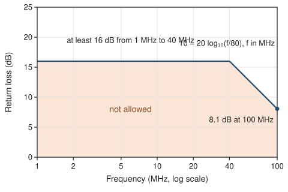

.. _phy-int-reqs-page:

Integrated transceiver requirements
===================================

One integrated 1000BASE-T port connects to the forwarding logic through a
byte interface and is built from a set of blocks, each with requirements
from IEEE 802.3. The slower speeds have limits of their own.

.. _phy-int-interface:

Byte interface
--------------

The :term:`forwarding logic` exchanges one byte per 8 ns with each port in
each direction, with a data-valid flag and an error flag: TX_EN and TX_ER
on transmit, RX_DV and RX_ER on receive, as on the gigabit media
independent interface (:clause:`35`). An external transceiver carries the
same signals over :term:`RGMII` (:ref:`arch-rgmii`), so the forwarding
logic is the same whether the transceiver is external or on the chip.

On receive, the bytes are timed by the clock recovered from the cable, and
the :ref:`rate-matching buffer <arch-rate-matching>` moves them onto
evampire's own clock, as with RGMII. On transmit, a slave sends on the
clock it recovers from the master (:clause:`40.1.3`, :ref:`phy-master-slave`), not on
evampire's clock, so the transmit bytes also cross clock domains, through
a transmit buffer
(:numref:`fig-phy-int-byte-interface`). A master needs the same buffer
unless its symbol clock is evampire's own clock.

.. graphviz:: byte-interface.dot
   :name: fig-phy-int-byte-interface
   :caption: The byte interface of one port, with the integrated
             transceiver and with an external one over RGMII; both
             directions cross between evampire's clock and the symbol
             clock.
   :alt: Top, integrated transceiver: the forwarding logic sends TXD[7:0],
         TX_EN and TX_ER, one byte per 8 ns, through a transmit buffer to
         the integrated transceiver; the transceiver sends RXD[7:0], RX_DV
         and RX_ER through a receive rate-matching buffer to the
         forwarding logic. Labels mark evampire's clock on the forwarding
         logic side and the symbol clock on the transceiver side. Bottom, external
         transceiver: the forwarding logic exchanges the same signals with
         the RGMII block and buffer, which connects to the external
         transceiver through the RGMII pins.
   :align: center

.. _phy-int-blocks:

Blocks of one port
------------------

One port has four analogue channels, one for each pair, and logic shared
by all four. :numref:`tab-phy-int-blocks` lists the blocks of one port, with the number
of copies and the page that specifies each. :numref:`fig-phy-blocks` shows
how they connect.

.. list-table:: Blocks of one integrated 1000BASE-T port
   :name: tab-phy-int-blocks
   :header-rows: 1
   :widths: 50 15 35

   * - Block
     - Copies
     - Specified in
   * - DAC and line driver
     - 4
     - :doc:`transmitter`
   * - Termination and line protection
     - 4
     - :doc:`transmitter`
   * - Hybrid, optional analogue echo canceller, amplifier and ADC
     - 4
     - :doc:`receiver`
   * - Echo canceller, three crosstalk cancellers and two equalisers
     - 4
     - :doc:`signal-processing`
   * - Trellis decoder with decision feedback
     - 1
     - :doc:`signal-processing`
   * - Scrambler, encoder and delimiters
     - 1
     - :ref:`phy-1000base-t-coding`
   * - Clock synthesis and recovery
     - 1
     - :doc:`clock-recovery`
   * - Link pulses, autonegotiation and registers
     - 1
     - :doc:`control`

.. _phy-int-1000-reqs:

1000BASE-T requirements
-----------------------

The standard sets the 1000BASE-T requirements at the connector. It tests
the transmitter with four fixed *test modes*, patterns
sent on command so that the output can be measured with no receiver
(:clause:`40.6.1.1.2`). :numref:`tab-phy-int-reqs` lists the requirements
that the analogue blocks must meet.

.. list-table:: 1000BASE-T requirements on one port
   :name: tab-phy-int-reqs
   :header-rows: 1
   :widths: 50 25 25

   * - Quantity
     - Limit
     - Subclause
   * - Peak output in test mode 1 (V)
     - 0.67 to 0.82
     - :clause:`40.6.1.2.1`
   * - Difference of each test-mode-1 peak from their average (%)
     - less than 1
     - :clause:`40.6.1.2.1`
   * - Output kept 500 ns after a peak, in test mode 1 (%)
     - more than 73.1
     - :clause:`40.6.1.2.2`
   * - Peak distortion in test mode 4 (mV)
     - less than 10
     - :clause:`40.6.1.2.4`
   * - Common-mode output, peak-to-peak (mV)
     - less than 50
     - :clause:`40.8.3.3`
   * - Return loss, 1 MHz to 40 MHz (dB)
     - at least 16
     - :clause:`40.8.3.1`
   * - Return loss, 40 MHz to 100 MHz (dB)
     - at least :math:`10 - 20\log_{10}(f/80)`, with :math:`f` in MHz
     - :clause:`40.8.3.1`
   * - Master clock jitter, peak-to-peak (ns)
     - less than 1.4
     - :clause:`40.6.1.2.5`
   * - Master clock jitter after a 5 kHz high-pass filter, plus the
       output jitter Jtxout, peak-to-peak (ns)
     - less than 0.3
     - :clause:`40.6.1.2.5`
   * - Slave clock jitter after a 32 kHz high-pass filter, plus Jtxout,
       above the master's filtered value (ns)
     - at most 0.4
     - :clause:`40.6.1.2.5`
   * - Symbol rate error (parts per million)
     - within ±100
     - :clause:`40.6.1.2.6`
   * - Bit error ratio over a compliant link
     - below :math:`10^{-10}`
     - :clause:`40.6.1.3.1`

The return-loss limit falls from 16 dB at 40 MHz to
:math:`10 - 20\log_{10}(100/80) = 8.1` dB at 100 MHz
(:numref:`fig-phy-int-return-loss`). The slave's unfiltered jitter,
measured against the master's clock, is also less than 1.4 ns
(:clause:`40.6.1.2.5`). Jtxout is the peak-to-peak jitter of the output's
zero crossings relative to the transmit clock, measured in test modes 2
and 3, so the filtered limits share their budget between the clock and
the driver (:clause:`40.6.1.2.5`).

         1 MHz to 100 MHz on a log scale. The limit is flat at 16 dB from
         1 MHz to 40 MHz, then falls along 10 minus 20 log10 of f over 80
         to 8.1 dB at 100 MHz. The region below the line is shaded as not
         allowed.
   :align: center

   The 1000BASE-T return-loss limit of :clause:`40.8.3.1`: a port's
   return loss must stay above the line.

.. _phy-int-slower-reqs:

Slower-speed limits
-------------------

The integrated transceiver also supports the slower speeds, and meets
the limits of :numref:`tab-phy-100base-tx` for 100BASE-TX and
:numref:`tab-phy-10base-t` for 10BASE-T. :doc:`slower-speeds` lists the
blocks they add.
