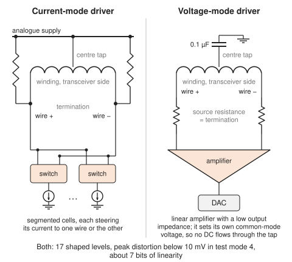

.. _phy-line-drivers:

Line drivers and the transformer centre tap
===========================================

This page explains the two common kinds of transceiver line driver and how
each sets the connection of the transformer centre tap on a board with
:term:`magnetics`. :doc:`../magnetics/index` covers the transformers
themselves and the transformer-free connection.

.. _phy-driver-levels:

Gigabit driver requirements
---------------------------

A 1000BASE-T driver sends the 17 levels of the
:ref:`transmit shaping filter <phy-shaping>`, and
its peak distortion in test mode 4 must stay below 10 mV
(:clause:`40.6.1.2.4`). :doc:`integration/transmitter` shows that this
needs about 7 bits of linearity. Two ways to build it are in use:

* a segmented, switched current-steering
  :wikipedia:`digital-to-analogue converter
  <Digital-to-analog_converter>` that drives the line directly, the
  *current-mode* driver below;
* a linear amplifier with a low output impedance fed from a DAC, the
  *voltage-mode* driver below.

:numref:`fig-phy-line-drivers` draws both, simplified to one pair.

         transceiver-side transformer winding with its centre tap. Left,
         current-mode: the centre tap and two termination resistors go to
         the analogue supply rail; the two wires go down to switched
         current cells, each with a switch that steers the current of its
         current source to wire plus or wire minus, with more cells
         implied. Right, voltage-mode: a DAC feeds a differential linear
         amplifier whose two outputs reach the wires through source
         resistors that are also the termination; the centre tap goes to
         ground through a 0.1 µF capacitor. A note below says both produce
         17 shaped levels, peak distortion below 10 mV in test mode 4, and
         about 7 bits of linearity.
   :align: center

   The two kinds of gigabit line driver, simplified to one pair.

10BASE-T and 100BASE-TX drivers need fewer levels (:numref:`tab-phy-speeds`)
but have their own amplitude and edge-shape limits
(:doc:`10base-t`, :doc:`100base-tx`).

.. _phy-centre-tap:

Centre-tap connection
---------------------

On a board with magnetics, each pair connects to the cable through a
transformer whose winding on the transceiver side is brought out at its
midpoint, the *centre tap*. How the centre tap is connected depends on the
type of driver, and :numref:`fig-phy-centre-tap` compares the two
connections.

.. graphviz:: centre-tap.dot
   :name: fig-phy-centre-tap
   :caption: A current-mode driver draws its current through the centre tap
             from the analogue supply; a voltage-mode driver needs only a
             capacitor from the centre tap to ground.
   :alt: Two columns. Left, current-mode driver: analogue supply connected
         to the winding's centre tap, which connects to both wires of the
         pair and to current sinks in the driver; the link carries DC
         current and bias. Right, voltage-mode driver: a 0.1 µF capacitor
         to ground connected to the centre tap by a dashed line marked AC
         path only, and the winding connected to a driver that sets its own
         common-mode voltage.
   :align: center

Current-mode driver
   The output stage steers controlled currents into one wire of the pair
   or the other, with termination resistors from each wire to the supply.
   The output transistors only sink current, so the current must come
   through the transformer winding. The centre tap is therefore connected
   to the transceiver's analogue supply and decoupled to ground. For
   reference, the datasheets of the TI DP83848 and DP83822 10/100
   transceivers require this connection ([PHY-DP83848]_ Figure 7‑2;
   [PHY-DP83822]_ section 6.3).
Voltage-mode driver
   The output stage drives each wire through an on-chip source impedance
   that is also the line termination. It sets its own common-mode voltage
   and needs no current through the centre tap. Each centre tap is
   connected to ground only through its own capacitor, 0.1 µF in both
   datasheets cited here, and the four centre taps are kept apart because
   the drivers may hold different pairs at different common-mode voltages.
   For reference, the Microchip KSZ9031 uses voltage-mode drivers
   ([PHY-KSZ9031]_ section 12.0), and the TI DP83867 requires the same
   separate capacitor connection ([PHY-DP83867]_ Figure 9‑2).

The two connections are not interchangeable, so a board follows the
datasheet of the transceiver it uses. Without transformers, a current-mode
driver gets its DC current from pull-up resistors or inductors on the chip
side of the coupling capacitors, while a voltage-mode driver needs none;
:doc:`../magnetics/index` describes both circuits.
