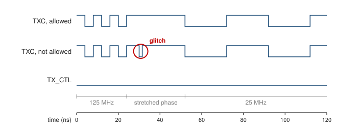

Data at each link speed
=======================

How the RGMII clock, control and data signals carry bytes at 1000, 100 and
10 Mbit/s, and what the receive data signals carry between frames. The
signals are listed on :doc:`signals`.

.. _rgmii-speeds:

Clock frequency
---------------

The RGMII clock runs at 125 MHz, 25 MHz or 2.5 MHz, one frequency for
each link speed.

.. list-table:: RGMII clock at each link speed
   :name: tab-rgmii-speeds
   :header-rows: 1
   :widths: 34 33 33

   * - Link speed (Mbit/s)
     - Clock (MHz)
     - Clock period (ns)
   * - 1000
     - 125
     - 8
   * - 100
     - 25
     - 40
   * - 10
     - 2.5
     - 400

:numref:`tab-rgmii-speeds` gives the clock frequencies and periods
(:std:`RGMII 2.0 <rgmii-2-0>` Table 2 and its note 2). The limits on each
clock period and on the duty cycle are on :doc:`timing`.

.. _rgmii-1000:

Data at 1000 Mbit/s
-------------------

At 1000 Mbit/s each clock cycle carries one byte. The low four bits, the
low :wikipedia:`nibble <Nibble>`, are sampled at the rising edge of the
clock. The high nibble is sampled at the falling edge
(:std:`RGMII 2.0 <rgmii-2-0>` section 3.2). Using both edges in this way is
called :wikipedia:`double data rate <Double_data_rate>`.

.. wavedrom::
   :name: fig-rgmii-1000-byte
   :alt: Timing diagram: TXC with TXD carrying nibbles 1, 0, 3, 2, 5, 4 on
         successive clock edges while TX_CTL is high, forming the bytes 0x01,
         0x23 and 0x45.
   :caption: Three bytes sent at 1000 Mbit/s, low nibble first, with each
             clock edge in the middle of its nibble.

   { "signal": [
       { "name": "TXC",      "wave": "p....", "period": 2, "phase": -0.5 },
       { "name": "TXD[3:0]", "wave": "x.======x.",
         "data": ["1", "0", "3", "2", "5", "4"] },
       { "name": "TX_CTL",   "wave": "0.1.....0." },
       {},
       { "name": "byte",     "wave": "x.=.=.=.x.",
         "data": ["0x01", "0x23", "0x45"] }
     ],
     "config": { "hscale": 1 }
   }

:numref:`fig-rgmii-1000-byte` draws the clock as the receiving chip sees
it, after the delay described on :doc:`timing`. A byte with the value 0x23
is sent as the nibble 3 at the rising edge and then the nibble 2 at the
falling edge.

The low nibble goes first because Ethernet sends the least significant bit
of each byte first (:clause:`3.3`). The MII sends the low nibble of each
byte first for the same reason (:clause:`Figure 22-13 <22>`), and the
LAN91C111 datasheet shows the same order [RGMII-LAN91C111]_ section 7.5.4.

.. _rgmii-control:

Control signal encoding
-----------------------

The control signal carries two GMII signals (:clause:`35`) in each clock
cycle (:std:`RGMII 2.0 <rgmii-2-0>` section 3.4):

* at the rising edge, "data valid" (receive) or "transmit enable"
  (transmit);
* at the falling edge, "data valid" or "transmit enable",
  :wikipedia:`exclusive-or <Exclusive_or>` "error".

With this coding the control signal stays high at both edges for every
good byte, and low at both edges between frames. It changes in the middle
of a cycle only for an error, which saves power.
:numref:`tab-rgmii-ctl` lists the four combinations.

.. list-table:: Meaning of TX_CTL and RX_CTL in one clock cycle
   :name: tab-rgmii-ctl
   :header-rows: 1
   :widths: 20 20 60

   * - Rising edge
     - Falling edge
     - Meaning
   * - 0
     - 0
     - Between frames
   * - 1
     - 1
     - A good byte of a frame
   * - 1
     - 0
     - A byte of a frame with an error
   * - 0
     - 1
     - Not a frame byte: RXD or TXD carries a code

For a byte with an error, the receiving transceiver detected a problem
with that byte. On transmit, the code tells the transceiver to send an
error on the cable instead of the byte, so that the far end discards the
frame. The codes that go with the last row are GMII codes
(:clause:`Table 35-1 <35>`, :clause:`Table 35-2 <35>`,
:std:`RGMII 2.0 <rgmii-2-0>` Tables 3 and 4). evampire treats each of them
as "no frame":

0x0E, false carrier
   On receive only. The transceiver saw activity on the cable that did not
   begin a valid frame.
0x0F, carrier extend
   Symbols that lengthen a short frame (:clause:`35.2.3.5`). They are used
   only at 1000 Mbit/s in half duplex (:clause:`4.2.3.4`).
0xFF, carrier sense
   On receive only, in RGMII. It reports that the other end is sending.

.. wavedrom::
   :name: fig-rgmii-ctl-encoding
   :alt: Timing diagram: RX_CTL is low while idle, high on both edges for
         good bytes, high then low for the byte with an error, and low again
         when idle; decoded data valid and error signals are shown below.
   :caption: RX_CTL over seven clock cycles with one byte received with an
             error.

   { "signal": [
       { "name": "RXC",     "wave": "p......", "period": 2, "phase": -0.5 },
       { "name": "RX_CTL",  "wave": "0.1....01.0..." },
       {},
       { "name": "valid",   "wave": "01...0.", "period": 2 },
       { "name": "error",   "wave": "0..10..", "period": 2 },
       { "name": "meaning", "wave": "233532.", "period": 2,
         "data": ["idle", "byte", "byte", "error", "byte", "idle"] }
     ],
     "config": { "hscale": 1 }
   }

In :numref:`fig-rgmii-ctl-encoding` RX_CTL is high at both edges for each
good byte, and high then low for the byte with the error. The receiving
logic recovers the two flags as:

.. math::

   v = c_\text{r}

   e = c_\text{r} \oplus c_\text{f}

.. list-table::
   :header-rows: 1
   :widths: 15 70 15

   * - Symbol
     - Meaning
     - Unit
   * - :math:`v`
     - Data valid (receive) or transmit enable (transmit)
     - none
   * - :math:`e`
     - Receive error or transmit error
     - none
   * - :math:`c_\text{r}`
     - Level of RX_CTL or TX_CTL at the rising edge of the cycle
     - none
   * - :math:`c_\text{f}`
     - Level of RX_CTL or TX_CTL at the falling edge of the same cycle
     - none

All four are logic levels, 0 or 1, and :math:`\oplus` is exclusive-or. For
the error byte in :numref:`fig-rgmii-ctl-encoding`, :math:`c_\text{r} = 1`
and :math:`c_\text{f} = 0` give :math:`v = 1` and :math:`e = 1`.

.. _rgmii-10-100:

Data at 10 and 100 Mbit/s
-------------------------

At 100 Mbit/s and 10 Mbit/s the clock slows to 25 MHz or 2.5 MHz, and each
clock cycle carries one nibble instead of one byte. A byte takes two clock
cycles, low nibble first. The data may be repeated on the falling edge
(:std:`RGMII 2.0 <rgmii-2-0>` section 5.0). The KSZ9031RNX samples the data
at the rising edge only, and the control signal at both edges
[RGMII-KSZ9031]_ section 7.1.

.. wavedrom::
   :name: fig-rgmii-100-nibble
   :alt: Timing diagram at 100 Mbit/s: RXC with one nibble per clock cycle
         on RXD (1, 0, 3, 2, 5, 4) while RX_CTL stays high; the nibbles form
         the bytes 0x01, 0x23 and 0x45.
   :caption: Three bytes received at 100 Mbit/s, one nibble per clock cycle,
             with each nibble centred on the rising edge.

   { "signal": [
       { "name": "RXC",      "wave": "p.....", "period": 2, "phase": -1 },
       { "name": "RXD[3:0]", "wave": "=.=.=.=.=.=.",
         "data": ["1", "0", "3", "2", "5", "4"] },
       { "name": "RX_CTL",   "wave": "1..........." },
       {},
       { "name": "byte",     "wave": "=...=...=...",
         "data": ["0x01", "0x23", "0x45"] }
     ],
     "config": { "hscale": 1 }
   }

In :numref:`fig-rgmii-100-nibble` each clock cycle lasts 40 ns. At
10 Mbit/s the same drawing applies with 400 ns cycles.

.. _rgmii-speed-change:

Clock behaviour at a speed change
---------------------------------

The transceiver generates RXC at every speed, and evampire generates TXC.
The high or low phase of a clock may be stretched or shrunk when the
transceiver changes speed. The same applies when RXC moves from its
free-running clock to the clock recovered from a newly arriving frame
(:std:`RGMII 2.0 <rgmii-2-0>` Table 2 note 3).

The stretching may last at most three clock periods of the lower of the two
speeds, and must keep the minimum duty cycle. The clocks must not glitch
(:std:`RGMII 2.0 <rgmii-2-0>` section 5.0). The media access controller
holds TX_CTL low until it runs at the same speed as the transceiver, so
evampire sends TXC at the new speed before it starts a frame.

:numref:`fig-rgmii-speed-change` shows an allowed change and a glitch.

         at 125 MHz, then holds high for a stretched phase, then runs at
         25 MHz. The second TXC is the same but has a very short low pulse
         inside the stretched phase, circled and marked as a glitch. TX_CTL
         stays low throughout.

   TXC changing from 125 MHz to 25 MHz with a stretched high phase, and the
   glitch that is not allowed (stretch length schematic).

.. _rgmii-in-band:

In-band link status
-------------------

When RX_CTL is low at both edges, no :term:`frame` is being received. The
RGMII specification defines an optional :term:`in-band status`: during
these gaps the transceiver puts its link state on RXD[3:0], the same at
both edges (:std:`RGMII 2.0 <rgmii-2-0>` section 3.4.1 and Table 4).

.. list-table:: In-band status on RXD[3:0] while RX_CTL is low
   :name: tab-rgmii-in-band
   :header-rows: 1
   :widths: 20 30 50

   * - Bit
     - Meaning
     - Values
   * - RXD[0]
     - Link status
     - 0 for link down, 1 for link up
   * - RXD[2:1]
     - Speed, as the RXC frequency
     - 00 for 2.5 MHz, 01 for 25 MHz, 10 for 125 MHz, 11 reserved
   * - RXD[3]
     - Duplex
     - 0 for half duplex, 1 for full duplex

With :numref:`tab-rgmii-in-band`, a gigabit full-duplex link that is up
shows the nibble 1101 (0xD) between frames, as at the start of
:numref:`fig-rgmii-frame-start`. While the link is down, the
speed and duplex bits give the transceiver's own settings
(:std:`RGMII 2.0 <rgmii-2-0>` section 3.4.1).

The status is optional. The KSZ9031RNX always sends it [RGMII-KSZ9031]_
section 3.9.4. evampire reads the link state through the management
interface (see :doc:`mdio`), which every transceiver has, and can use the
in-band status as a faster indication where a transceiver sends it.
