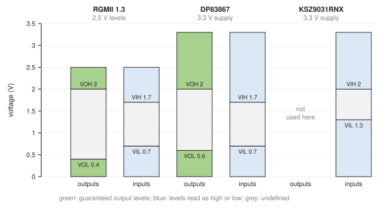

Electrical levels and board layout
==================================

The logic levels of the RGMII signals, as the specifications define them
and as transceivers implement them, and the board layout rules for the
traces. evampire's own pins are described on :doc:`io-cells`.

.. _rgmii-spec-levels:

Levels in the specifications
----------------------------

The two versions of the RGMII specification use different levels.
Version 1.3 uses 2.5 V
:wikipedia:`CMOS <CMOS>` levels (:std:`JESD8-5`), for the data signals and
also for MDC and MDIO (:std:`RGMII 1.3 <rgmii-1-3>` section 4.0 and
Table 5). :numref:`tab-rgmii-levels-1-3` gives them.

.. list-table:: Logic levels of RGMII version 1.3
   :name: tab-rgmii-levels-1-3
   :header-rows: 1
   :widths: 50 25 25

   * - Level
     - Min (V)
     - Max (V)
   * - Output high, at 1 mA
     - 2.0
     -
   * - Output low, at 1 mA
     -
     - 0.40
   * - Input high
     - 1.7
     -
   * - Input low
     -
     - 0.70

An empty cell means no limit. Version 2.0 specifies 1.5 V
:wikipedia:`high-speed transceiver logic (HSTL)
<High-speed_transceiver_logic>` Class 1 levels instead (:std:`JESD8-6`;
:std:`RGMII 2.0 <rgmii-2-0>` section 4.0).

.. _rgmii-phy-levels:

Levels in transceivers
----------------------

Transceivers use neither level exclusively. Their RGMII pins run from a
separate I/O supply that the board designer chooses, at 3.3 V, 2.5 V or
1.8 V.

.. list-table:: RGMII I/O supply options of two transceivers
   :name: tab-rgmii-phy-io
   :header-rows: 1
   :widths: 40 60

   * - Transceiver
     - I/O supply (V)
   * - TI DP83867
     - 3.3, 2.5 or 1.8, each ±5 %
   * - Microchip KSZ9031RNX
     - 3.3, 2.5 or 1.8

:numref:`tab-rgmii-phy-io` gives the supplies from [RGMII-DP83867]_
sections 5 and 6.3 and [RGMII-KSZ9031]_ section 2 (DVDDH pins).
:numref:`tab-rgmii-phy-levels` gives their logic levels with a 3.3 V
supply.

.. list-table:: Logic levels with a 3.3 V I/O supply (V)
   :name: tab-rgmii-phy-levels
   :header-rows: 1
   :widths: 40 30 30

   * - Level
     - DP83867
     - KSZ9031RNX
   * - Input high, min
     - 1.7
     - 2.0
   * - Input low, max
     - 0.7
     - 1.3
   * - Output high at 4 mA, min
     - 2.0
     -
   * - Output low at 4 mA, max
     - 0.6
     -

The DP83867 values are from [RGMII-DP83867]_ section 6.5 and the
KSZ9031RNX values from [RGMII-KSZ9031]_ section 6. An empty cell means the
value is not used here. Both devices accept 3.3 V, the level evampire uses
(see :doc:`io-cells`).

:numref:`fig-rgmii-levels` compares the levels of the specification and
of the two transceivers.

         levels: outputs at least 2.0 V high and at most 0.40 V low; inputs
         high above 1.7 V and low below 0.70 V. DP83867 with a 3.3 V
         supply: outputs at least 2.0 V high and at most 0.6 V low; inputs
         1.7 V and 0.7 V. KSZ9031RNX with a 3.3 V supply: inputs 2.0 V and
         1.3 V; outputs not used here. The region between each pair of
         levels is undefined.

   The logic levels of :numref:`tab-rgmii-levels-1-3` and
   :numref:`tab-rgmii-phy-levels`.

.. _rgmii-board:

Board traces
------------

The traces between evampire and the transceiver are a few centimetres long.
That is long compared with edges of under a nanosecond, so each trace
behaves as a :wikipedia:`transmission line <Transmission_line>`. GMII,
which has similar edge rates, notes the same (:clause:`35.5.2`). The
rules below are those of the DP83867 layout guidelines, used here as a
reference example.

Impedance and length
   The traces have a
   :wikipedia:`characteristic impedance <Characteristic_impedance>` of
   50 Ω. They are shorter than 51 mm (2 inches) where possible and never
   longer than 152 mm (6 inches) [RGMII-DP83867]_ section 9.2.2.1.1.
Matched lengths
   All transmit traces have the same length, and so do all receive traces.
   The skew within TXD[3:0] and within RXD[3:0] is at most 11 ps, about
   1.5 mm (60 mil) of trace [RGMII-DP83867]_ sections 9.2.2.1.1 and
   9.4.1.
Source termination
   The output resistance of the driver plus any series resistor matches
   the trace impedance, with the resistor next to the driving pin
   (:wikipedia:`termination <Electrical_termination>`). The DP83867 trims
   its own RGMII output impedance to about 50 Ω, adjustable from about
   35 Ω to 70 Ω, so it needs no external resistor [RGMII-DP83867]_
   register 0x0170.
Vias and stubs
   The traces have no :wikipedia:`vias <Via_(electronics)>`, which are
   holes that move a trace between board layers, and no stubs, which are
   unused branches of a trace [RGMII-DP83867]_ section 9.4.1.

The series resistor on evampire's outputs depends on the output resistance
of evampire's pad cell, discussed on :doc:`io-cells`.

:numref:`fig-rgmii-board-trace` summarises the rules for one signal.

.. graphviz:: board-trace.dot
   :name: fig-rgmii-board-trace
   :caption: One RGMII signal on the board, with the layout rules of the DP83867
             guidelines.
   :alt: One signal from left to right: the driver's output resistance, a
         series resistor next to the driving pin, a 50 Ω trace and the
         receiver. Notes say the resistance and resistor together
         match 50 Ω; the trace is under 51 mm where possible and at
         most 152 mm, with no vias or stubs and lengths matched within
         11 ps, about 1.5 mm; and the DP83867 trims its own output to
         about 50 Ω, from 35 Ω to 70 Ω.
   :align: center
