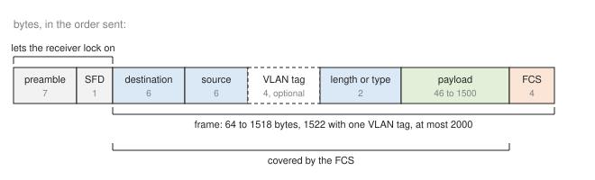

Frames on the interface
=======================

An Ethernet frame crosses the RGMII data signals as a sequence of fields,
starting with the preamble and the start frame delimiter, and a gap
separates one frame from the next. How each byte is split into nibbles is
described on :doc:`data`.

.. _rgmii-frame-fields:

Frame fields
------------

A :term:`frame` is one Ethernet message
(:wikipedia:`Ethernet frame <Ethernet_frame>`). On RXD and TXD it is sent as
a sequence of bytes, each byte as two nibbles, low nibble first.
:numref:`tab-rgmii-frame-fields` lists its fields in the order they are
sent, and :numref:`fig-rgmii-frame` draws them.

         preamble 7, SFD 1, destination address 6, source address 6, an
         optional VLAN tag 4, length or type 2, payload 46 to 1500, or 42
         to 1500 with a tag, and FCS
         4. A bracket over the preamble and SFD reads "lets the receiver
         lock on". A bracket from the destination address to the FCS reads
         "frame: 64 to 1518 bytes, 1522 with one VLAN tag, at most 2000". A
         bracket from the destination address to the payload reads
         "covered by the FCS".

   The fields of a frame, with the optional VLAN tag; with a tag the
   payload can be as short as 42 bytes (:clause:`3.2.8`; field widths not
   to scale).

.. list-table:: Fields of a frame in the order they are sent
   :name: tab-rgmii-frame-fields
   :header-rows: 1
   :widths: 35 15 50

   * - Field
     - Bytes
     - Contents
   * - :term:`Preamble`
     - 7
     - The byte 0x55, repeated (:clause:`3.2.1`)
   * - :term:`Start frame delimiter` (SFD)
     - 1
     - The byte 0xD5, which marks the end of the preamble (:clause:`3.2.2`)
   * - Destination :term:`MAC address`
     - 6
     - The address of the device the frame is for (:clause:`3.2.4`)
   * - Source MAC address
     - 6
     - The address of the device that sent the frame (:clause:`3.2.5`)
   * - Length or type
     - 2
     - The payload length, or the protocol carried
       (:wikipedia:`EtherType <EtherType>`) (:clause:`3.2.6`)
   * - Payload
     - 46 to 1500
     - The data, padded to at least 46 bytes (:clause:`3.2.7`,
       :clause:`3.2.8`)
   * - :term:`Frame check sequence` (FCS)
     - 4
     - A 32-bit :wikipedia:`cyclic redundancy check <Cyclic_redundancy_check>`
       over the addresses, length or type, payload and padding
       (:clause:`3.2.9`)

The preamble lets the receiver lock on to the signal (:clause:`3.2.1`).
The frame itself begins with the destination address, immediately after
the SFD (:clause:`3.2.2`). The ENC28J60 datasheet gives the same fields
[RGMII-ENC28J60]_ section 5.1.

A length or type value of 1500 or less is a length; a value of 1536
(0x0600) or more is a type (:clause:`3.2.6`). The two bytes of this field
are sent most significant byte first.

.. _rgmii-frame-lengths:

Frame length
------------

From the destination address to the checksum, a basic frame is 64 to
1518 bytes long (:clause:`Table 4-2 <4>`, minFrameSize and
maxBasicFrameSize). A frame that carries tags, such as the 4-byte
:term:`VLAN tag` of :std:`IEEE 802.1Q <802.1Q>`, may be longer. One VLAN tag
gives 1522 bytes, and IEEE 802.3 allows such frames up to 2000 bytes
(:clause:`Table 4-2 <4>`, maxEnvelopeFrameSize). The UNH-IOL MAC test suite
uses the same 1518-byte and 1522-byte limits [RGMII-IOL-MAC]_ test 4.1.3.

Some networks also use :wikipedia:`jumbo frames <Jumbo_frame>` of up to
about 9000 bytes. The KSZ9031RNX supports frames of up to 16 kB
([RGMII-KSZ9031]_ features list, page 1). evampire forwards jumbo frames but does not
deliver them to the processor (see :ref:`req-memory`).

.. _rgmii-preamble-nibbles:

Preamble and SFD nibbles
------------------------

The preamble is seven bytes of the bit pattern 10101010, and the SFD is the
bit pattern 10101011, each written in the order the bits are sent
(:clause:`35.2.3.2.1`). Ethernet sends the least significant bit of each
byte first (:clause:`3.3`). The first bit sent, 1, is therefore bit 0, and
each preamble byte has the value 0x55. The SFD has the value 0xD5, binary
1101 0101.

On a 4-bit interface each preamble byte is the nibble 5 twice, and the SFD
is the nibble 5 followed by the nibble D (:clause:`Table 22-3 <22>`). The
LAN91C111 looks for this "5Dh" pattern to find the start of a frame
[RGMII-LAN91C111]_ section 7.5.4. On RGMII at 1000 Mbit/s the preamble is
therefore the nibble 5 fourteen times, and the SFD is 5 then D.

.. wavedrom::
   :name: fig-rgmii-frame-start
   :alt: Timing diagram at 1000 Mbit/s: RXD shows the in-band status nibble
         D while RX_CTL is low, then RX_CTL goes high and RXD carries
         preamble nibbles 5, the start frame delimiter nibbles 5 and D, and
         the first destination address nibbles 1 and 0.
   :caption: Start of a frame at 1000 Mbit/s, where the cell marked
             "more 5" stands for the preamble nibbles not drawn.

   { "signal": [
       { "name": "RXC",      "wave": "p......", "period": 2, "phase": -0.5 },
       { "name": "RX_CTL",   "wave": "0...1........." },
       { "name": "RXD[3:0]", "wave": "=...====2.====",
         "data": ["D", "5", "5", "5", "5", "more 5", "5", "D",
                  "1", "0"] },
       {},
       { "name": "field",    "wave": "2...3.....4.5.",
         "data": ["gap", "preamble", "SFD", "address"] }
     ],
     "config": { "hscale": 1 }
   }

In :numref:`fig-rgmii-frame-start`, RXD carries the
:ref:`in-band status <rgmii-in-band>` 0xD before the frame: link up,
1000 Mbit/s, full duplex. The frame starts when RX_CTL goes high.

.. _rgmii-preamble-shrink:

Shortened preamble
------------------

A gigabit transceiver may pass on fewer than seven preamble bytes. IEEE
802.3 allows the preamble to shrink between the sending and the receiving
media access controller. The receiver must work even when no preamble
byte at all comes before the SFD (:clause:`35.2.3.2.2`,
:clause:`Table 35-3 <35>`).

Transceivers do this at other speeds too. The KSZ9031RNX removes all seven
preamble bytes when it receives at 10 Mbit/s, and starts the frame on RXD
with the SFD [RGMII-KSZ9031]_ section 3.1.5. The UNH-IOL MAC test suite
checks that a receiver accepts frames with a varied amount of preamble
[RGMII-IOL-MAC]_ test 4.2.4.

:numref:`fig-rgmii-preamble-shrink` shows a full, a shorter and a missing
preamble.

.. wavedrom::
   :name: fig-rgmii-preamble-shrink
   :alt: Three timing diagrams of RX_CTL and RXD at 1000 Mbit/s. With the full
         preamble, RX_CTL rises and RXD carries many nibbles 5, then 5 and D.
         With a shortened preamble, RX_CTL rises later and RXD carries 5, 5,
         then 5 and D. With no preamble, RXD carries only 5 and D.
   :caption: The start of a frame with a full, a shortened and no preamble,
             where the receiver finds the frame from the D that follows a 5
             and the cell marked "more 5" stands for the nibbles not drawn.

   { "signal": [
       ["full",
         { "name": "RX_CTL", "wave": "01........" },
         { "name": "RXD[3:0]", "wave": "x====2.==x", "data": ["5", "5", "5", "5", "more 5", "5", "D"] }
       ],
       {},
       ["shorter",
         { "name": "RX_CTL", "wave": "0....1...." },
         { "name": "RXD[3:0]", "wave": "x....====x", "data": ["5", "5", "5", "D"] }
       ],
       {},
       ["none",
         { "name": "RX_CTL", "wave": "0......1.." },
         { "name": "RXD[3:0]", "wave": "x......==x", "data": ["5", "D"] }
       ]
     ],
     "config": { "hscale": 1 }
   }

The receiving logic therefore finds the start of a frame from the SFD, not
by counting preamble bytes. A device that forwards frames sends a full
preamble of seven bytes itself (:clause:`35.2.3.2.1`), whatever arrived.
How evampire does this is on :doc:`port-logic`.

.. _rgmii-gap:

Gap between frames
------------------

A transmitter leaves a gap of at least 96 bit times between the end of one
frame and the start of the next preamble, at every speed up to
1000 Mbit/s (:clause:`Table 4-2 <4>`, interPacketGap; see also
:wikipedia:`interpacket gap <Interpacket_gap>`). At 1000 Mbit/s that is
12 byte times, 96 ns. At 10 Mbit/s the ENC28J60 datasheet gives the same
gap as 9.6 µs [RGMII-ENC28J60]_ register MABBIPG.

:numref:`fig-rgmii-gap` shows the gap on the transmit signals.

.. wavedrom::
   :name: fig-rgmii-gap
   :alt: Timing diagram: TXD carries the last FCS nibbles of frame N while
         TX_CTL is high, then TX_CTL is low for the gap of 12 byte times or
         more, drawn with a break, then TX_CTL rises and TXD carries the
         preamble nibbles 5 of frame N+1.
   :caption: The gap between two frames on TX_CTL and TXD, at least 12 byte times,
             96 ns, at 1000 Mbit/s (the break shortens the drawing).

   { "signal": [
       { "name": "TX_CTL", "wave": "1..0...|...1.." },
       { "name": "TXD[3:0]", "wave": "x==x...|...==.", "data": ["FCS", "FCS", "5", "5"] },
       { "name": "field", "wave": "x4.2...|...3..", "data": ["frame N", "gap", "frame N+1"] }
     ],
     "config": { "hscale": 1 }
   }

The gap seen by a receiver can be shorter. At 1000 Mbit/s it can shrink to
64 bit times, measured at the GMII, because of network delays, added
preamble bits and clock tolerances (:clause:`Table 4-2 <4>` note 3). The
UNH-IOL MAC test suite gives the same values [RGMII-IOL-MAC]_ test 4.2.2.
