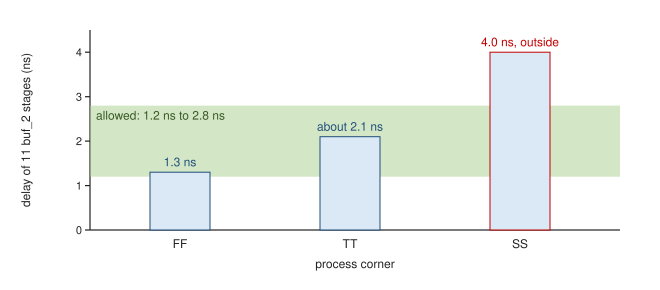
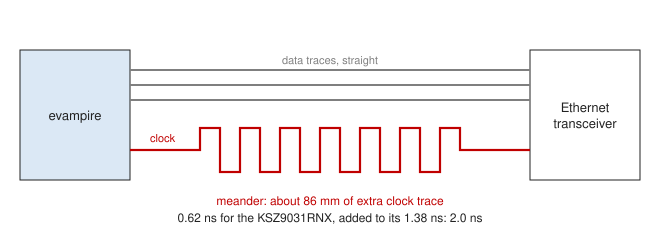

RGMII port logic
================

The logic behind each RGMII port: the double-data-rate output and input
stages, where the 2 ns clock delay comes from, the interface to the
forwarding logic and the clock domains. The pins and pad cells are on
:doc:`io-cells`.

.. _rgmii-tx-stage:

Transmit stage
--------------

The gf180mcu standard-cell libraries have flip-flops that load on the rising
edge (dffq) and on the falling edge (dffnq), and a two-input
:wikipedia:`multiplexer <Multiplexer>` (mux2) [RGMII-GF180SC]_. Each RGMII
output is built from them as in :numref:`fig-rgmii-tx-ddr`.

.. graphviz:: tx-ddr.dot
   :name: fig-rgmii-tx-ddr
   :caption: Output stage for one TXD bit, in which the clock selects one of
             two flip-flops.
   :alt: A byte register feeds bit n to flip-flop A, clocked on the falling
         edge, and bit n plus 4 to flip-flop B, clocked on the rising edge.
         A multiplexer selected by the transmit clock passes A while the
         clock is high and B while it is low, to the output pad and the
         TXD pin.
   :align: center

The byte register loads on the rising edge of the 125 MHz transmit clock.
Flip-flop A loads the low nibble on the falling edge, and stays stable for
the whole high phase that follows, while the multiplexer passes it. Flip-flop
B loads the high nibble on the rising edge, and stays stable for the low
phase that follows. Each flip-flop changes only while the multiplexer passes
the other one, so the output changes only when the clock changes and cannot
glitch.

:numref:`fig-rgmii-tx-ddr-timing` shows the sequence for the bytes 0x01,
0x23 and 0x45.

.. wavedrom::
   :name: fig-rgmii-tx-ddr-timing
   :alt: Timing diagram: the internal clock; the byte register loading 0x01,
         0x23, 0x45 and so on at each rising edge; flip-flop A loading the low
         nibbles 1, 3, 5 at each falling edge; flip-flop B loading the high
         nibbles 0, 2, 4 at each rising edge; and the pin, which carries A
         while the clock is high and B while it is low: 1, 0, 3, 2, 5, 4.
   :caption: The output stage of one TXD bit over time: each flip-flop changes
             only while the multiplexer passes the other one.

   { "signal": [
       { "name": "clock (internal)", "wave": "p....", "period": 2 },
       { "name": "byte register", "wave": "=.=.=.=.=.", "data": ["0x01", "0x23", "0x45", "0x67", "0x89"] },
       { "name": "flip-flop A (low)", "wave": "x=.=.=.=.=", "data": ["1", "3", "5", "7", "9"] },
       { "name": "flip-flop B (high)", "wave": "x.=.=.=.=.", "data": ["0", "2", "4", "6"] },
       { "name": "TXD pin (mux)", "wave": "x.========", "data": ["1", "0", "3", "2", "5", "4", "7", "6"] }
     ],
     "config": { "hscale": 1 }
   }

TXC comes from the same structure, with flip-flop A fed a constant 1 and
flip-flop B a constant 0. TXC then has the same delay from the internal clock
as every TXD bit, which keeps the skew at the pins within the ±0.5 ns of
TskewT (:numref:`tab-rgmii-timing`). The multiplexers and pads of the clock
and data are placed next to each other and routed alike.

The paths from the byte register to flip-flop A last half a cycle, 4 ns, and
are kept short. At the SS corner, 125 °C and 3.00 V, a
gf180mcu_fd_sc_mcu9t5v0 dffq_1 flip-flop has a clock-to-output delay of
about 1.4 ns to 1.5 ns with a light load [RGMII-GF180SC]_. The standard
cells and the I/O cells use different slow-corner supplies, 3.00 V and
2.97 V; their Liberty file names end in 3v00 and 2v97.

Another output stage uses one rising-edge and one falling-edge flip-flop
whose outputs are combined by an exclusive-or gate. It works too; the
multiplexer form gives every bit the same output delay.

.. _rgmii-rx-stage:

Receive stage
-------------

.. graphviz:: rx-ddr.dot
   :name: fig-rgmii-rx-ddr
   :caption: Input stage for one RXD bit, in which two flip-flops capture
             the two nibbles of each byte.
   :alt: The RXD pin feeds an input pad and then flip-flop R, clocked on
         the rising edge of RXC, and flip-flop F, clocked on the falling
         edge. Both feed a byte register clocked on the next rising edge,
         which feeds the rate-matching buffer. RXC passes through an input
         pad and a small local clock buffer to the three registers.
   :align: center

In :numref:`fig-rgmii-rx-ddr`, flip-flop R loads RXD[n] at the rising edge
of RXC, which is bit n of the byte. Flip-flop F loads RXD[n] at the falling
edge, which is bit n + 4. At the next rising edge the byte register loads
both. That edge also updates flip-flop R, but the byte register takes the
value from before the edge. The path from F to the byte register lasts half
a cycle. RX_CTL is captured the same way and decoded as on :doc:`data`.

The capture flip-flops sit next to their input pads. A small local
:wikipedia:`clock buffer <Clock_signal>` drives them from RXC, not the
chip's main clock tree. With the clock delayed inside the transceiver, the
data is valid only 1.0 ns before and 1.0 ns after each RXC edge (TsetupR,
TholdR).

Any delay on the clock path that the data path does not have moves the
sampling point later and uses up the hold time. One gf180mcu_fd_sc_mcu9t5v0
buf_2 stage takes about 0.36 ns at the SS corner [RGMII-GF180SC]_, so two
stages of clock buffering use most of the 1.0 ns. The clock buffer is
therefore matched by an equal delay in the data paths, or by a shorter delay
in the transceiver (see :ref:`rgmii-delay-choice`).

Static timing analysis checks the margins with RXC as a clock at its pin,
and RXD and RX_CTL valid from 1.0 ns before to 1.0 ns after each RXC
edge.

.. _rgmii-delay-choice:

Source of the clock delay
-------------------------

evampire adds no clock delay itself. The transceiver delays TXC inside
itself before it samples TXD, and delays RXC before it sends it. Of the
places in :numref:`fig-rgmii-delay-places`, this is "receiver delays TXC"
in the transmit direction and "transmitter delays RXC" in the receive
direction. evampire
sends TXC aligned with TXD, within TskewT, and receives RXC already centred
in RXD, within TsetupR and TholdR (:numref:`tab-rgmii-timing`). The
alternatives below show why, and what would change the choice.

An uncalibrated chain of standard cells
   The delay of a standard cell varies about three times across corners. A
   gf180mcu_fd_sc_mcu9t5v0 buf_2 with a light load takes about 0.12 ns at
   FF, 0.19 ns at TT and 0.36 ns at SS [RGMII-GF180SC]_. The arithmetic below
   shows that such a chain cannot hold 2 ns at every corner.
A delay line calibrated by software
   A chain of cells with a multiplexer that selects its length can be set
   at start-up. The software steps the length while the transceiver loops
   test data back, for example a
   :wikipedia:`pseudorandom binary sequence <Pseudorandom_binary_sequence>`.
   It then picks the middle of the settings that pass. The DP83867 can
   generate such a sequence and loop it back to RGMII
   [RGMII-SNLA243]_ section 5. This is an open option; its tap count, step
   size and calibration time are estimates to be confirmed by
   implementation.
A delay-locked loop
   A :wikipedia:`delay-locked loop <Delay-locked_loop>` adjusts a delay line
   until its delay matches a fraction of the clock period, so the delay
   follows the period across corners. This is also an open option.
A delay on the board
   About 280 mm of extra trace on each clock (see :doc:`timing`). Whether
   that fits is a board layout question; for reference, the DP83867
   guidelines recommend RGMII traces of at most 152 mm.

For reference, FPGAs use calibrated delay lines for this job. The AMD
7-series IDELAYE2 is a 31-tap input delay, and its taps are calibrated by an
IDELAYCTRL block against a reference clock [RGMII-UG953]_.

:numref:`fig-rgmii-delay-options` sketches the two on-chip options.

.. graphviz:: delay-options.dot
   :name: fig-rgmii-delay-options
   :caption: The two on-chip delay options: a delay line calibrated by software and
             a delay-locked loop.
   :alt: Top, a calibrated delay line: the clock passes a chain of delay
         stages, a multiplexer picks the output of one stage, and its
         setting comes from software, found by a loopback test.
         Bottom, a delay-locked loop: an adjustable delay line whose
         output is compared with a fraction of the clock period, and
         the result adjusts the line.
   :align: center

The uncalibrated chain needs enough stages for 2 ns at the TT corner:

.. math::

   N = \left\lceil \frac{t_\text{d}}{t_\text{TT}} \right\rceil

   t_\text{FF,chain} = N \times t_\text{FF}

   t_\text{SS,chain} = N \times t_\text{SS}

.. list-table::
   :header-rows: 1
   :widths: 20 65 15

   * - Symbol
     - Meaning
     - Unit
   * - :math:`N`
     - Number of buffer stages, rounded up
     - none
   * - :math:`t_\text{d}`
     - Target delay
     - ns
   * - :math:`t_\text{FF}`, :math:`t_\text{TT}`, :math:`t_\text{SS}`
     - Delay of one stage at each corner
     - ns
   * - :math:`t_\text{FF,chain}`, :math:`t_\text{SS,chain}`
     - Delay of the chain at the FF and SS corners
     - ns

The equations ignore wiring delay. With :math:`t_\text{d} = 2.0` ns,
:math:`t_\text{TT} = 0.19` ns, :math:`t_\text{FF} = 0.12` ns and
:math:`t_\text{SS} = 0.36` ns:

.. math::

   N &= \lceil 2.0 / 0.19 \rceil = 11

   t_\text{FF,chain} &= 11 \times 0.12 = 1.3\ \text{ns}

   t_\text{SS,chain} &= 11 \times 0.36 = 4.0\ \text{ns}

Used as a transmit delay, the chain must give at least 1.2 ns of setup and
1.2 ns of hold at evampire's pins (TsetupT, TholdT). In a 4 ns half period
that means a delay of 1.2 ns to 2.8 ns, and 4.0 ns is outside it.

:numref:`fig-rgmii-chain-delay` shows the three corners against the window.

         FF and about 2.1 ns at TT, both inside the shaded 1.2 ns to
         2.8 ns window, and 4.0 ns at SS, outside it.

   An uncalibrated 11-stage chain at three corners against the allowed
   transmit delay.

.. _rgmii-delay-transceivers:

Transceivers that fit the delay choice
--------------------------------------

Which transceivers fit without board changes depends on how much of the
2 ns delay each adds inside itself. The DP83867 adds the delay in both
directions (see :doc:`timing`). The KSZ9031RNX adds at most 1.38 ns on its transmit clock [RGMII-KSZ9031]_
section 3.9.3, so the board adds the rest of the transmit delay:

.. math::

   \Delta t = t_\text{d} - t_\text{max}

   l = \frac{\Delta t}{\tau}

.. list-table::
   :header-rows: 1
   :widths: 15 70 15

   * - Symbol
     - Meaning
     - Unit
   * - :math:`\Delta t`
     - Delay the board adds
     - ps
   * - :math:`t_\text{d}`
     - Target delay
     - ps
   * - :math:`t_\text{max}`
     - Largest transmit delay of the transceiver
     - ps
   * - :math:`l`
     - Extra length of the TXC trace
     - mm
   * - :math:`\tau`
     - Propagation delay of the trace per unit length
     - ps/mm

With :math:`t_\text{d} = 2000` ps, :math:`t_\text{max} = 1380` ps and
:math:`\tau = 7.2` ps/mm:

.. math::

   \Delta t &= 2000 - 1380 = 620\ \text{ps}

   l &= 620 / 7.2 \approx 86\ \text{mm}

More trace is needed if evampire's TXC-to-TXD skew or the board skew uses
part of the budget. The exact length follows from the board-level timing
analysis. The software sets the delay registers of the fitted transceiver
over MDIO, so the transceiver's power-up pin settings need not be right.

:numref:`fig-rgmii-meander-86` shows the KSZ9031RNX case.

         data traces and a clock trace with a meander of about 86 mm,
         which adds 0.62 ns to the KSZ9031RNX's 1.38 ns for 2.0 ns in
         all.

   The board delay for the KSZ9031RNX transmit clock (schematic, not to
   scale).

.. _rgmii-10-100-logic:

Logic at 10 and 100 Mbit/s
--------------------------

evampire supports 10 and 100 Mbit/s as well as 1000 Mbit/s (see
:ref:`the transceiver requirements <req-transceivers>`). The logic always runs from the 125 MHz transmit clock, and uses a clock
enable at the lower speeds.

On transmit, one nibble goes out every 5 cycles of 125 MHz at 100 Mbit/s
and every 50 cycles at 10 Mbit/s. TXC comes from the output stage of
:numref:`fig-rgmii-tx-ddr`. It stays high for 5 half cycles and low for 5
at 100 Mbit/s, or 50 and 50 at 10 Mbit/s. That gives 25 MHz or 2.5 MHz at
50 % duty cycle, inside the 40 % to 60 % limit. TXD changes only at the
start of each TXC cycle and is the same at both edges.

:numref:`fig-rgmii-tx-100` shows the transmit side at 100 Mbit/s.

.. wavedrom::
   :name: fig-rgmii-tx-100
   :alt: Timing diagram: the 125 MHz clock; a clock enable high for one cycle
         in every five; TXC high for five half cycles and low for five, which
         is 25 MHz at 50 % duty cycle; and TXD changing only at the start of
         each TXC cycle.
   :caption: Transmit at 100 Mbit/s: a clock enable every 5 cycles of 125 MHz, and
             TXC high for 5 half cycles and low for 5.

   { "signal": [
       { "name": "125 MHz clock", "wave": "p.........", "period": 2 },
       { "name": "clock enable", "wave": "1.0.......1.0......." },
       { "name": "TXC, 25 MHz", "wave": "1....0....1....0...." },
       { "name": "TXD[3:0]", "wave": "=.........=.........", "data": ["nibble 0", "nibble 1"] }
     ],
     "config": { "hscale": 1 }
   }

On receive, the same capture flip-flops are used, and a byte is built from
the rising-edge samples of two RXC cycles, low nibble first. The preamble may
arrive with an odd number of nibbles (see :doc:`frames`). The byte boundary
is found from the SFD: the first nibble D after a run of nibble 5 is the
high nibble of the SFD.

:numref:`fig-rgmii-rx-100` shows the bytes built from the nibbles.

.. wavedrom::
   :name: fig-rgmii-rx-100
   :alt: Timing diagram: RXC at 25 MHz; RXD carrying the nibbles 5, 5, 5, 5, D,
         1, 0 and 3; and the bytes built from them, 0xD5 after the D and then
         0x01, each from a low nibble followed by a high nibble.
   :caption: Receive at 100 Mbit/s: the byte boundary found from the D of the SFD.

   { "signal": [
       { "name": "RXC, 25 MHz", "wave": "p.......", "period": 1 },
       { "name": "RXD[3:0]", "wave": "========", "data": ["5", "5", "5", "5", "D", "1", "0", "3"] },
       { "name": "byte", "wave": "x....=.=", "data": ["0xD5", "0x01"] }
     ],
     "config": { "hscale": 2 }
   }

.. _rgmii-byte-interface:

Interface to the forwarding logic
---------------------------------

Behind the input and output stages, each port gives the rest of evampire one
byte per clock cycle in each direction, with a "data valid" flag and an
"error" flag. The receive side comes from the byte register of
:numref:`fig-rgmii-rx-ddr` and the decoded RX_CTL. The transmit side feeds
the byte register of :numref:`fig-rgmii-tx-ddr` and TX_CTL. This is the
same information as the GMII signals (see :doc:`signals`).

:numref:`fig-rgmii-byte-interface` compares the two configurations.

.. graphviz:: byte-interface.dot
   :name: fig-rgmii-byte-interface
   :caption: The byte interface with an external and with an integrated
             transceiver; dashed parts are needed only with an
             external one.
   :alt: Top, with an external transceiver: the forwarding logic, the byte
         interface of byte, valid and error, the double-data-rate
         stages and pads drawn dashed, RGMII drawn dashed, and the
         external transceiver. Bottom, with an integrated transceiver:
         the forwarding logic, the same byte interface and the
         integrated transceiver.
   :align: center

The byte interface is the boundary between the port and the
:term:`forwarding logic`. In the board configuration with integrated
transceivers (:numref:`tab-power-board-configs`), the integrated transceiver
connects through the same interface. The
:ref:`rate-matching buffers <arch-rate-matching>`,
:ref:`output selectors <arch-output-selectors>`,
:ref:`address filter <arch-address-filter>` and frame buffers are the same
in both configurations (see :doc:`../../architecture/index`).

With an integrated transceiver these parts of the RGMII pages are not
needed:

* the double-data-rate stages and their I/O pads;
* the 2 ns clock delay and the pin timing of :doc:`timing`;
* the in-band status on RXD;
* MDC and MDIO to an external chip, and its delay registers;
* the RGMII logic levels and board rules of :doc:`electrical`.

These parts are still needed:

* the link speeds the design supports, and the change between them;
* a receive clock recovered from the cable, and the crossing from it into
  the 125 MHz clock;
* rate matching between the receive and transmit clocks;
* finding the SFD, and sending a full preamble on transmit;
* keeping both ports at the same speed (see :doc:`speed-policy`), and the
  link status and speed that the processor reads.

.. _rgmii-clock-domains:

Clock domains
-------------

.. graphviz:: clock-domains.dot
   :name: fig-rgmii-clock-domains
   :caption: Clock domains of the two RGMII ports and the crossings between
             them.
   :alt: Each receive capture block runs on the RXC of its port. Crossings
         1 and 2 carry data from each port's RXC into evampire's 125 MHz
         clock, where the rate-matching buffers, transmitters, address
         filter and frame buffers run. Crossing 3 joins the frame buffers to
         the processor clock. The in-band link-up bit of each port crosses
         to the processor clock through a two-flip-flop synchroniser.
   :align: center

:numref:`fig-rgmii-clock-domains` shows three kinds of clock:

* the RXC of each port, recovered by its transceiver from the cable, which
  runs the capture flip-flops, the byte register and the write side of the
  rate-matching buffer;
* evampire's 125 MHz transmit clock, which runs both transmitters, the read
  side of both rate-matching buffers, the address filter and the frame
  buffers;
* the processor clock (see :ref:`microcontroller <arch-microcontroller>`),
  which also runs the MDC and MDIO controller. Its frequency is an open
  question (see :ref:`requirements-open-questions`).

The crossings from each RXC to the 125 MHz clock go through the
:ref:`rate-matching buffers <arch-rate-matching>`. These are small
:wikipedia:`first-in, first-out buffers <FIFO_(computing_and_electronics)>`
whose read and write positions cross between the clocks in
:wikipedia:`Gray code <Gray_code>`. In Gray code only one bit changes per
step, so a value sampled while it changes is off by at most one.

The receive clock may stop, slow down or have stretched pulses when the
link changes, so each buffer is emptied and restarted when its link goes
down. The 125 MHz clock and the processor clock, if different, meet at the
frame buffers.

The in-band status is captured from RXD in the RXC domain of its port.
Passing its four bits through separate two-flip-flop
:wikipedia:`synchronisers <Metastability_(electronics)>` could combine bits
sampled on different cycles into a value that never existed. Only the
link-up bit is synchronised into the processor clock, and the speed and
duplex are read over MDIO. A handshake that holds the nibble stable while
it is copied is the alternative if the whole nibble is needed.

The rate-matching buffer absorbs the difference of up to 200 ppm between
the receive and transmit clocks. :ref:`req-forwarding` relates the buffer's
slack to the longest frame it can forward. The buffer also holds up to
7 bytes more, because the transmitter sends a full preamble even when a
shorter one arrived (see :doc:`frames`).

.. _rgmii-logic-open-questions:

Open questions
--------------

* Whether evampire adds its own clock delay, with a software-calibrated
  delay line or a delay-locked loop, so that transceivers without a full
  internal delay fit without board changes.
