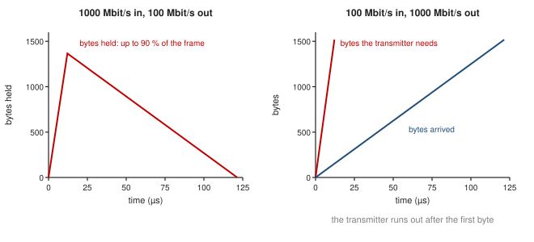

Port speed policy
=================

The processor sets up the two Ethernet transceivers so that ports A and B
run at the same speed in full duplex, which cut-through forwarding needs.
The registers it uses are on :doc:`mdio`.

.. _rgmii-same-speed:

Cut-through forwarding and link speed
-------------------------------------

evampire forwards frames
:term:`cut-through <cut-through forwarding>`: it sends each byte out of the
other port a few clock cycles after it arrives (see :ref:`req-forwarding`).
This works only if both ports run at the same speed.

A frame arriving at 1000 Mbit/s cannot leave at 100 Mbit/s without storing
almost all of it. A frame arriving at 100 Mbit/s cannot leave at
1000 Mbit/s, because the transmitter runs out of data after the first byte.
By requirement, evampire stores no full frame on the forwarding path (see
:ref:`req-memory`).

:numref:`fig-rgmii-speed-buffer` shows both cases.

         1000 Mbit/s in and 100 Mbit/s out: the bytes held rise to
         about 1366, 90 % of the frame, at 12 µs and fall to zero at
         about 121 µs. Right, 100 Mbit/s in and 1000 Mbit/s out: the
         bytes the transmitter needs rise ten times faster than the
         bytes that arrive, so it runs out after the first byte.

   Bytes held, and bytes needed against bytes arrived, when the two
   ports run at different speeds, for a 1518-byte frame.

.. _rgmii-policy:

Speed set-up
------------

Both ports link at the highest speed they share, in full duplex
(:numref:`fig-rgmii-speed-policy`). Every port supports 1000, 100 and 10 Mbit/s (see :ref:`the transceiver requirements <req-transceivers>`).
The processor sets up the transceivers as follows:

#. It sets both transceivers to advertise 1000 Mbit/s full duplex
   (register 9) and 100 and 10 Mbit/s full duplex (register 4), and no
   half-duplex mode. Half duplex needs the media access
   controller to detect collisions and send frames again (:clause:`4`),
   which a cut-through path without frame storage cannot do.
#. When both links are up, it reads the speed and duplex mode of each port
   (:doc:`mdio`). If both run at the same speed in full duplex, it turns on
   forwarding between them.
#. When a link goes down, it turns forwarding off, and both transceivers
   advertise every speed that evampire supports again.

A partner that does not autonegotiate still gets a link at 10 or
100 Mbit/s, through parallel detection (see
:ref:`autonegotiation <phy-autoneg-parallel>`).
Parallel detection finds only the speed, not the duplex mode, so
transceivers bring such a link up in half duplex. Forwarding stays off
while either link is in half duplex.

While forwarding is off, frames to and from the processor are still
received and sent on any port whose link is up.

.. _rgmii-slow-partner:

Slower link partners
--------------------

If the two ports come up at different speeds, forwarding stays off. The
processor removes the higher speeds from the faster port's advertisement
and restarts autonegotiation on that port. Both ports then run at the
slower speed, and forwarding resumes. A partner that offers only 10 or
100 Mbit/s on one port therefore sets the speed of both ports.

.. graphviz:: speed-policy.dot
   :name: fig-rgmii-speed-policy
   :caption: States of the two links and of forwarding.
   :alt: Four states. From "one or both links down", the second link
         coming up at the same speed in full duplex leads to "same speed,
         full duplex, forwarding on". A link coming up in half duplex leads
         to "a link in half duplex, forwarding off". Coming up at a different
         speed leads to
         "different speeds, forwarding off", where the faster port is
         restricted and renegotiates, and then to the same-speed state. A
         link going down returns to the first state.
   :align: center

:numref:`fig-rgmii-speed-policy` shows these states.

A restricted port keeps its lower speed only while the slower partner is
connected. When the other link goes down, step 3 restores the full
advertisement on both transceivers. If the other link then comes back up
faster than the restricted port, the processor restarts autonegotiation on
the restricted port, so both ports reach the highest speed they now share.

.. _rgmii-error-forwarding:

Error forwarding
----------------

A forwarded frame that arrives with RX_CTL showing an error is passed on
with TX_CTL showing an error on the same byte, that is high then low
(:std:`RGMII 2.0 <rgmii-2-0>` Table 3, :clause:`Table 35-1 <35>`). The
transceiver then sends an error on the cable, and the far end discards the
frame. The frame is already being sent when the error arrives, so it cannot
be dropped instead.

:numref:`fig-rgmii-error-forward` shows the error passed on.

.. wavedrom::
   :name: fig-rgmii-error-forward
   :alt: Timing diagram: RX_CTL is high except for one byte where it is high
         then low, marking an error. A few clock cycles later TX_CTL is high
         then low on the same byte.
   :caption: An error received on RX_CTL and passed on, a few cycles later, on
             TX_CTL.

   { "signal": [
       { "name": "RXC", "wave": "p.....", "period": 2, "phase": -0.5 },
       { "name": "RX_CTL", "wave": "1....01....." },
       {},
       { "name": "TXC", "wave": "p.....", "period": 2, "phase": -0.5 },
       { "name": "TX_CTL", "wave": "1........01." }
     ],
     "config": { "hscale": 1 }
   }

Open questions
--------------

* Whether the processor sends and receives frames on a half-duplex link,
  which needs its media access controller to detect collisions and send
  frames again (:clause:`4`).
