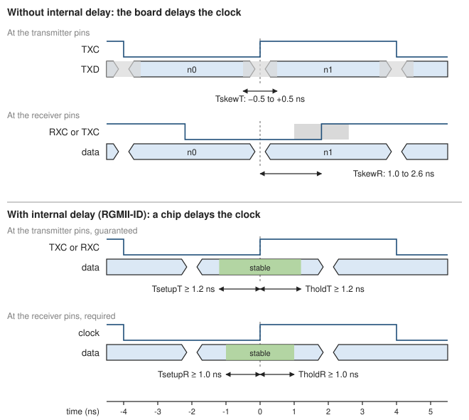
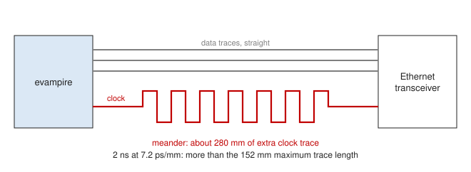
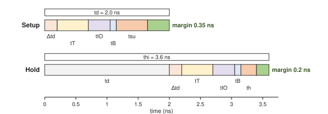
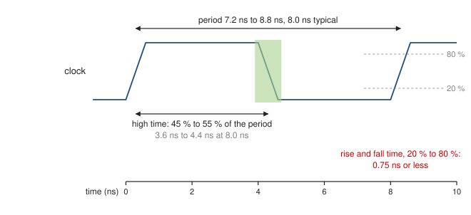

Timing and the clock delay
==========================

Why the RGMII clock must be delayed by about 2 ns, where that delay can be
added, and the timing limits of the interface. The signals are described on
:doc:`signals` and :doc:`data`.

.. _rgmii-why-delay:

Need for a clock delay
----------------------

The transmitting chip launches its clock and its data at the same moment,
so the data changes at every clock edge (:std:`RGMII 2.0 <rgmii-2-0>`
section 3.3). A receiver sampling with that clock unchanged would sample
while the data is changing. The clock is therefore delayed, somewhere
between the two chips' :wikipedia:`flip-flops <Flip-flop_(electronics)>`,
so that each clock edge falls in the middle of the data it samples.

At 1000 Mbit/s the data changes every half clock period, so the middle of
the data is a quarter period after the edge:

.. math::

   t_\text{d} = \frac{T}{4}

.. list-table::
   :header-rows: 1
   :widths: 15 70 15

   * - Symbol
     - Meaning
     - Unit
   * - :math:`t_\text{d}`
     - Clock delay that centres each clock edge in its data
     - ns
   * - :math:`T`
     - Clock period
     - ns

The equation applies at 1000 Mbit/s, where data changes at both clock edges
and the duty cycle is 50 %. For :math:`T = 8` ns it gives
:math:`t_\text{d} = 2` ns. :numref:`fig-rgmii-clock-delay` shows the effect.

.. wavedrom::
   :name: fig-rgmii-clock-delay
   :alt: Timing diagram: data changing at every edge of the clock at the
         transmitter, and a second copy of the clock delayed by 2 ns whose
         edges fall in the middle of each data value.
   :caption: Data and clock leave the transmitter together, and a 2 ns delay
             moves each clock edge to the middle of the data.

   { "signal": [
       { "name": "data",         "wave": "x====x",
         "data": ["n0", "n1", "n2", "n3"] },
       { "name": "clock sent",   "wave": "p..", "period": 2 },
       { "name": "clock + 2 ns", "wave": "p..", "period": 2,
         "phase": -1 }
     ],
     "config": { "hscale": 2 }
   }

.. _rgmii-versions:

Specification versions
----------------------

.. list-table:: Where each version of the RGMII specification adds the delay
   :name: tab-rgmii-versions
   :header-rows: 1
   :widths: 20 80

   * - Version
     - Where the delay is added
   * - 1.3
     - On the circuit board, by 1.5 ns to 2.0 ns of extra trace on each
       clock
   * - 2.0
     - On the board, or inside the transmitting chip
       (called RGMII-ID)

:numref:`tab-rgmii-versions` summarises the two versions. Version 1.3
has each chip send clock and data within ±0.5 ns of each other
(TskewT). The receiver needs the clock 1.0 ns to 2.6 ns after the data
(TskewR), and the specification says this implies extra board trace on the
clock (:std:`RGMII 1.3 <rgmii-1-3>` Table 2 and note 1).

Version 2.0 adds the option of a delay inside the transmitting chip. Such a
chip guarantees at least 1.2 ns of setup and 1.2 ns of hold time at its own
pins (TsetupT, TholdT). The receiver must accept as little as 1.0 ns of
setup and 1.0 ns of hold (TsetupR, TholdR). A device may offer both modes
(:std:`RGMII 2.0 <rgmii-2-0>` Table 2 and note 4).

.. list-table:: RGMII skew, setup and hold at 1000 Mbit/s
   :name: tab-rgmii-timing
   :header-rows: 1
   :widths: 40 20 20 20

   * - Parameter (ns)
     - Min
     - Typ
     - Max
   * - TskewT, data to clock at transmitter, no internal delay
     - −0.5
     - 0
     - 0.5
   * - TskewR, data to clock at receiver
     - 1.0
     - 1.8
     - 2.6
   * - TsetupT, setup at transmitter with internal delay
     - 1.2
     - 2.0
     -
   * - TholdT, hold at transmitter with internal delay
     - 1.2
     - 2.0
     -
   * - TsetupR, setup required at receiver
     - 1.0
     - 2.0
     -
   * - TholdR, hold required at receiver
     - 1.0
     - 2.0
     -

:numref:`tab-rgmii-timing` gives the values of :std:`RGMII 2.0 <rgmii-2-0>`
Table 2. The DP83867 datasheet repeats them [RGMII-DP83867]_ section 6.9.
An empty cell means no limit. Timing is measured at half the I/O supply
voltage (:std:`RGMII 2.0 <rgmii-2-0>` section 3.3).

:numref:`fig-rgmii-timing-params` shows what each parameter measures. Without
an internal delay, TskewT is the spread of the data changes around the clock
edge at the transmitter, and TskewR is how far after a data change the
clock edge must arrive at the receiver. With an internal delay, the setup
and hold times bound a window around the clock edge in which the data must
not change.

         internal delay, at the transmitter the data changes within −0.5 to
         +0.5 ns of each clock edge (TskewT); at the receiver the clock edge
         falls 1.0 to 2.6 ns after the data change (TskewR). With internal
         delay, at the transmitter the data is stable from at least 1.2 ns
         before to 1.2 ns after the clock edge (TsetupT, TholdT); at the
         receiver at least 1.0 ns each side is required (TsetupR, TholdR).

   The RGMII skew, setup and hold parameters of
   :numref:`tab-rgmii-timing`, as intervals between data changes and clock
   edges at 1000 Mbit/s.

The skew numbers are defined only for 1000 Mbit/s. At 10 and 100 Mbit/s the
clock period is 50 or 5 times longer. The KSZ9031RNX datasheet relaxes the
largest TskewR to 16 ns at 100 Mbit/s and 160 ns at 10 Mbit/s
[RGMII-KSZ9031]_ section 7.1.

.. _rgmii-delay-once:

Delay placement
---------------

The board, the transmitting chip or the receiving chip adds the delay, as
listed in :numref:`tab-rgmii-delay-places` and drawn in
:numref:`fig-rgmii-delay-places`. Adding it twice moves the clock edge onto
the next data change, which fails as badly as not adding it
(:numref:`fig-rgmii-delay-count`).

.. graphviz:: delay-places.dot
   :name: fig-rgmii-delay-places
   :caption: The three places where the 2 ns clock delay can be added in
             each direction, of which exactly one is used.
   :alt: evampire on the left and the Ethernet transceiver on the right, on
         a circuit board. In the transmit direction TXC and TXD pass from
         evampire through three dashed candidate boxes: transmitter delays
         TXC, board longer TXC trace, and receiver delays TXC. In the
         receive direction RXC and RXD pass the other way through:
         transmitter delays RXC, board longer RXC trace, and receiver
         delays RXC.
   :align: center

.. wavedrom::
   :name: fig-rgmii-delay-count
   :alt: Timing diagram with data changing every 4 ns and three copies of
         the clock. With no delay, every clock edge falls on a data change.
         With 2 ns of delay, every edge falls in the middle of the data.
         With 4 ns of delay, the delay added twice, every edge falls on the
         next data change.
   :caption: The clock edge at the receiver with the delay added never,
             once and twice, at 1000 Mbit/s.

   { "signal": [
       { "name": "data", "wave": "x====x",
         "data": ["n0", "n1", "n2", "n3"] },
       { "name": "no delay", "wave": "p..", "period": 2 },
       { "name": "+ 2 ns, once", "wave": "p..", "period": 2, "phase": -1 },
       { "name": "+ 4 ns, twice", "wave": "p..", "period": 2, "phase": -2 }
     ],
     "config": { "hscale": 2 }
   }

.. list-table:: Where the 2 ns delay can be added in each direction
   :name: tab-rgmii-delay-places
   :header-rows: 1
   :widths: 22 39 39

   * - Added by
     - Transmit, evampire to transceiver
     - Receive, transceiver to evampire
   * - Circuit board
     - Longer TXC trace
     - Longer RXC trace
   * - Transmitting chip
     - evampire delays TXC
     - Transceiver delays RXC
   * - Receiving chip
     - Transceiver delays TXC
     - evampire delays RXC

.. _rgmii-board-delay:

Board trace delay
-----------------

A delay added on the board is a longer clock trace:

.. math::

   l = \frac{t_\text{d}}{\tau}

.. list-table::
   :header-rows: 1
   :widths: 15 70 15

   * - Symbol
     - Meaning
     - Unit
   * - :math:`l`
     - Extra length of the clock trace
     - mm
   * - :math:`t_\text{d}`
     - Delay to add
     - ps
   * - :math:`\tau`
     - Propagation delay of the trace per unit length
     - ps/mm

The equation assumes a uniform trace. The DP83867 layout guidelines give
11 ps for 1.5 mm (60 mil) of trace on standard :wikipedia:`FR-4 <FR-4>`
board material, :math:`\tau \approx 7.2` ps/mm [RGMII-DP83867]_
section 9.2.2.1.1. For :math:`t_\text{d} = 2000` ps this gives:

.. math::

   l = \frac{2000\ \text{ps}}{7.2\ \text{ps/mm}} \approx 280\ \text{mm}

The extra trace is usually folded into a meander, a zig-zag path. For
reference, the same guidelines recommend RGMII traces shorter than 51 mm
(2 inches), and at most 152 mm (6 inches) (see :doc:`electrical`).

:numref:`fig-rgmii-meander-280` shows how such a trace looks beside the straight data traces.

         right. Three data traces run straight between them. The clock
         trace runs in a zig-zag meander that adds about 280 mm of
         extra length, 2 ns at 7.2 ps/mm, more than the 152 mm maximum
         trace length.

   A board delay as a meander on the clock trace; 280 mm is more than the
   152 mm maximum (schematic, not to scale).

.. _rgmii-transceiver-delays:

Transceiver internal delays
---------------------------

.. list-table:: Internal clock delay of two gigabit transceivers
   :name: tab-rgmii-phy-delays
   :header-rows: 1
   :widths: 30 35 35

   * - Transceiver
     - Delay on TXC (ns)
     - Delay on RXC (ns)
   * - TI DP83867
     - 0.25 to 4.00
     - 0.25 to 4.00
   * - Microchip KSZ9031RNX
     - 0 to 1.38
     - 1.2 to 2.58

In :numref:`tab-rgmii-phy-delays`, the DP83867 delays are set in 0.25 ns
steps with register 0x0086 and switched on with register 0x0032 bits 1 and
0. Pins sampled at power-up set the reset values [RGMII-DP83867]_ sections
7.4.1.1.2, 8.32 and 8.44.

The KSZ9031RNX adds no transmit delay by default and expects the media
access controller to delay TXC. Its pad-skew registers can add at most
1.38 ns. Its receive delay is 1.2 ns by default and can be raised to
2.58 ns [RGMII-KSZ9031]_ section 3.9.3.

.. _rgmii-budget:

Worked timing budget
--------------------

TI's application note SNLA243 works out the transmit timing into a DP83867
that delays the clock [RGMII-SNLA243]_ sections 3.2 and 3.3. The setup
margin is the delay minus every error and the receiver's setup time. The
hold margin is the shortest clock high time minus the same errors and the
receiver's hold time:

.. math::

   m_\text{s} = t_\text{d} - \Delta t_\text{d} - t_\text{T}
   - t_\text{IO} - t_\text{B} - t_\text{su}

   m_\text{h} = t_\text{hi} - t_\text{d} - \Delta t_\text{d}
   - t_\text{T} - t_\text{IO} - t_\text{B} - t_\text{h}

.. list-table::
   :header-rows: 1
   :widths: 15 70 15

   * - Symbol
     - Meaning
     - Unit
   * - :math:`m_\text{s}`, :math:`m_\text{h}`
     - Setup and hold margin
     - ns
   * - :math:`t_\text{d}`
     - Clock delay set in the transceiver
     - ns
   * - :math:`\Delta t_\text{d}`
     - Variation of that delay
     - ns
   * - :math:`t_\text{T}`
     - Data-to-clock skew at the transmitter (TskewT)
     - ns
   * - :math:`t_\text{IO}`
     - I/O buffer skew
     - ns
   * - :math:`t_\text{B}`
     - Skew added by the board
     - ns
   * - :math:`t_\text{su}`, :math:`t_\text{h}`
     - Setup and hold time required by the receiver
     - ns
   * - :math:`t_\text{hi}`
     - Shortest clock high time, at 45 % duty cycle
     - ns

The equations add the worst cases of every error, so they give the smallest
margin. SNLA243 uses :math:`t_\text{d} = 2.0` ns,
:math:`\Delta t_\text{d} = 0.2` ns, :math:`t_\text{T} = 0.5` ns,
:math:`t_\text{IO} = 0.35` ns, :math:`t_\text{B} = 0.1` ns,
:math:`t_\text{su} = 0.5` ns, :math:`t_\text{h} = 0.25` ns and
:math:`t_\text{hi} = 3.6` ns:

.. math::

   m_\text{s} &= 2.0 - 0.2 - 0.5 - 0.35 - 0.1 - 0.5 \\
   &= 0.35\ \text{ns}

   m_\text{h} &= 3.6 - 2.0 - 0.2 - 0.5 - 0.35 \\
   &\quad - 0.1 - 0.25 \\
   &= 0.2\ \text{ns}

Both margins are positive but small, with a transmitter that meets
TskewT. :numref:`fig-rgmii-timing-budget` shows how each error uses up part
of the delay and of the clock high time.

         divides td of 2.0 ns into Δtd 0.2, tT 0.5, tIO 0.35, tB 0.1 and tsu
         0.5 ns, leaving a margin of 0.35 ns. The hold bar divides thi of
         3.6 ns into td 2.0, Δtd 0.2, tT 0.5, tIO 0.35, tB 0.1 and th
         0.25 ns, leaving a margin of 0.2 ns.

   The worked setup and hold budgets, with each error as one segment and the
   margin left at the end.

.. _rgmii-clock-limits:

Clock limits
------------

.. list-table:: RGMII clock limits at 1000 Mbit/s
   :name: tab-rgmii-clock
   :header-rows: 1
   :widths: 40 20 20 20

   * - Parameter
     - Min
     - Typ
     - Max
   * - Period (ns)
     - 7.2
     - 8.0
     - 8.8
   * - Duty cycle (%)
     - 45
     - 50
     - 55
   * - Rise and fall time, 20 % to 80 % (ns)
     -
     -
     - 0.75

:numref:`tab-rgmii-clock` gives the limits of :std:`RGMII 2.0 <rgmii-2-0>`
Table 2. At 10 and 100 Mbit/s the period scales to 400 ns and 40 ns, each
±10 %, and the duty cycle may be 40 % to 60 %. The period limit applies to
each cycle, not to the average frequency.

:numref:`fig-rgmii-clock-cycle` marks what each limit measures.

         period, 7.2 ns to 8.8 ns and 8.0 ns typical. A second arrow
         spans the high time, 45 % to 55 % of the period, 3.6 ns to
         4.4 ns at 8.0 ns, and a shaded band marks where the falling
         edge may lie. Dashed lines at 20 % and 80 % of the swing mark
         the rise and fall time, at most 0.75 ns.

   One RGMII clock cycle with the limits of :numref:`tab-rgmii-clock`
   (edge slope schematic).

The RGMII specification gives TXC and RXC as ±50
:wikipedia:`parts per million (ppm) <Parts-per_notation>` from nominal
(:std:`RGMII 2.0 <rgmii-2-0>` Table 1). A 1000BASE-T transmitter times its
symbols from 125 MHz ± 0.01 %, that is ±100 ppm (:clause:`40.6.1.2.6`). The
DP83867 specifies its GMII transmit clock at ±100 ppm too [RGMII-DP83867]_
section 6.10, parameter T5.

RXC follows the :wikipedia:`crystal <Crystal_oscillator>` of the device at
the far end of the cable. evampire's receive and transmit clocks can
therefore differ by up to 200 ppm. The rate-matching buffers absorb that
difference (see :ref:`req-forwarding` and :doc:`port-logic`).
