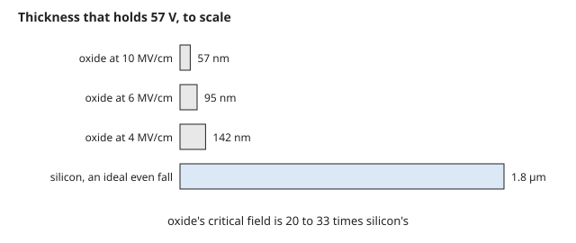
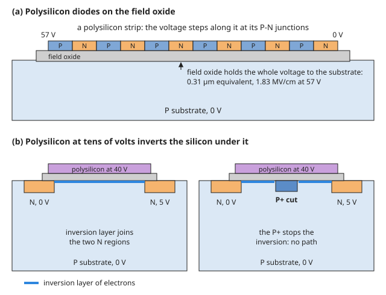
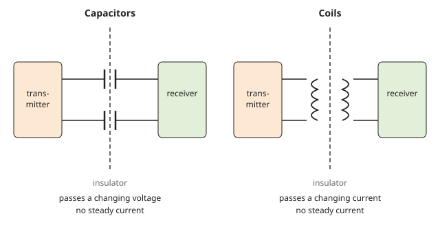
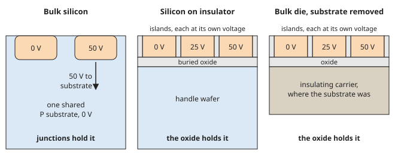

.. _hv-dielectric:

Insulator isolation
===================

This page describes isolating a circuit from the substrate with an
insulator instead of a junction, from devices built on the field oxide of
a standard process to separate silicon islands.

Oxide breakdown field
---------------------

Thin thermal silicon dioxide breaks down at fields of about 9 MV/cm to
11 MV/cm [HV-US4954189]_, and Park takes about 6 MV/cm for the thicker
buried oxide of a silicon-on-insulator wafer [HV-PARK]_ (Section 2.3.3).
Both are 20 to 33 times the critical field of silicon at the doping of the
gf180mcu substrate (:doc:`junctions`). An insulator therefore holds a given voltage
in a far thinner layer, and it has no depletion region that needs room to
spread. Its limit is long-term wear: a design keeps the continuous field in
an insulator well below its breakdown field. :numref:`tab-hv-oxide-thickness`
gives the thickness that holds 57 V and 100 V at each field, and
:numref:`fig-hv-oxide-silicon` compares it with silicon.

.. list-table:: Oxide thickness that holds a voltage at a given field
   :name: tab-hv-oxide-thickness
   :header-rows: 1
   :widths: 34 33 33

   * - Field in the oxide (MV/cm)
     - Thickness for 57 V (nm)
     - Thickness for 100 V (nm)
   * - 10, thin thermal oxide at breakdown
     - 57
     - 100
   * - 6, buried oxide at breakdown
     - 95
     - 167
   * - 4, an illustration of a derated field
     - 142
     - 250

The values are the voltage divided by the field
(:download:`calc.py <calc.py>`,
section 5).

         10 MV/cm, 95 nm at 6 MV/cm and 142 nm at 4 MV/cm. The shortest
         silicon that holds 57 V, with a perfectly even fall, is 1.8 µm.
         Oxide's critical field is 20 to 33 times silicon's.

   Thickness that holds 57 V in oxide and, for the even-fall ideal of
   :numref:`fig-hv-lmin`, in silicon.

Devices on the field oxide
--------------------------

Polysilicon lies on the :term:`field oxide`, the thick insulator between
transistors. A resistor, a diode or a transistor made in that polysilicon
has no junction to the substrate at all: the field oxide below it holds the
whole voltage. A polysilicon diode is a P-type and an N-type region side by
side in one polysilicon strip. A stack of them can therefore share a high
voltage evenly along the strip, as the discrete diodes on
:doc:`substrate` do, with only the field oxide facing the substrate.
Published charge pumps built this way are listed on :ref:`poe-limits`.
:numref:`fig-hv-poly-on-fox` shows such a strip, and the effect of the
polysilicon on the silicon below it, described next.

         field oxide over a P substrate at 0 V, at 57 V at one end and 0 V
         at the other; the alternating segments form diodes in back-to-back
         pairs. The field oxide holds the whole voltage to the
         substrate: 0.31 µm equivalent, 1.83 MV/cm at 57 V. (b) Two
         cross-sections with polysilicon at 40 V over field oxide between
         an N region at 0 V and one at 5 V. On the left an inversion layer
         under the polysilicon joins the two N regions. On the right a P+
         region between them cuts the inversion layer.

   Polysilicon diodes on the field oxide, and the inversion that polysilicon
   at a high voltage causes below it, with example voltages in (b).

The polysilicon is also a gate over the field oxide. The open extraction
rules give polysilicon 110.67 aF/µm² to the substrate
[HV-OPENPDKS-EXTRACT]_, the capacitance of 0.31 µm of oxide. At 57 V that
oxide holds 1.83 MV/cm, and at 100 V 3.2 MV/cm
(:download:`calc.py <calc.py>`,
section 8), close to the derated field in :numref:`tab-hv-oxide-thickness`.
The foundry publishes the threshold of a field transistor gated by
polysilicon in the 3.3 V area as 6.5 V minimum and 8.5 V typical
[HV-GF180-EP-1]_ (row 7). Polysilicon at tens of volts therefore inverts
the silicon under it and joins any N regions there, as a metal plate does
on :doc:`metal-gate`. N regions at different voltages must stay out from
under it, or a heavily doped P+ region must cut the surface between them.

Polysilicon devices conduct less well than devices in the silicon crystal,
because polysilicon is made of small crystal grains whose boundaries
scatter carriers. That suits voltage sensing, biasing and gradients better
than power switching. How much the gf180mcu field oxide and the dielectrics
above it hold to the substrate is an open question on :doc:`routes`.

Signals across an insulator
---------------------------

A circuit isolated by an insulator still has to exchange signals with the
rest of the chip. A capacitor passes a changing voltage across its
dielectric, and a pair of coils passes a changing current through its
magnetic field, while neither conducts at a steady voltage
(:numref:`fig-hv-barrier`). Commercial
digital isolators carry data across a capacitive silicon dioxide barrier in
this way [HV-ISO7741]_ (Description). The Ethernet isolation routes that use such
barriers are on :doc:`../ethernet/magnetics/isolation`.

         drives a receiver through two series capacitors, one in each wire:
         they pass a changing voltage. Right, a pair of facing coils: they
         pass a changing current. Neither carries a steady current.

   A signal crossing an insulator by capacitors or by coils.

Buried oxide
------------

In :term:`silicon on insulator` wafers, a layer of oxide lies under the thin
silicon in which the devices are built. Trenches filled with oxide cut that
silicon into islands, each surrounded by insulator on every side, so each
island can sit at its own voltage. Most of the voltage is then held by the
buried oxide [HV-PARK]_ (Section 2.3.3), and the isolation surrounds the
current path on all sides [HV-INFINEON-SOI]_ (Section 2). Stacks of low-voltage
transistors then share a high voltage with no junction to a common
substrate, which is how the stacked silicon-on-insulator results on
:ref:`poe-limits` work.

gf180mcu is built on bulk silicon, so its wafers have no buried oxide. A
bulk die can still be turned into islands after it is made, by removing the
substrate from behind the circuits down to the oxide and supporting the die
on an insulating carrier. That is wafer processing outside the foundry's
flow, and its cost and yield are open questions.
:numref:`fig-hv-oxide-isolation` compares the three structures.

         0 V and 50 V in one shared P substrate at 0 V, so junctions hold the
         voltage. Silicon on insulator: three silicon islands at 0 V, 25 V
         and 50 V, separated by oxide-filled trenches, on a buried oxide over
         a handle wafer; the oxide holds the voltage. Bulk die with its
         substrate removed: the same islands, separated by trench oxide,
         on a dielectric added after thinning, on an insulating carrier
         where the substrate was; the oxide holds the voltage.

   Junction isolation in bulk silicon against oxide isolation, in silicon on
   insulator and in a bulk die with its substrate removed, with example
   voltages.

Two dies in one package
-----------------------

Two separate dies in one package, each with its own substrate, isolate
completely: the simplest insulator is the gap between them. Signals cross between them through
capacitors or coils, as above. The second die can be a gf180mcu die of its
own, designed for the high-voltage side. The Ethernet pages describe this
as the route with a second die on the cable side
(:doc:`../ethernet/magnetics/isolation`, second row of
:numref:`fig-magnetics-isolation-routes`).
