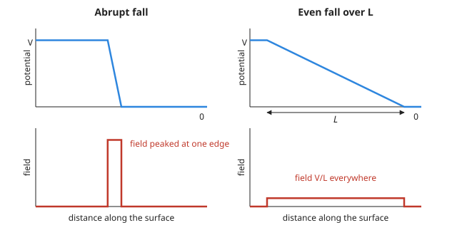
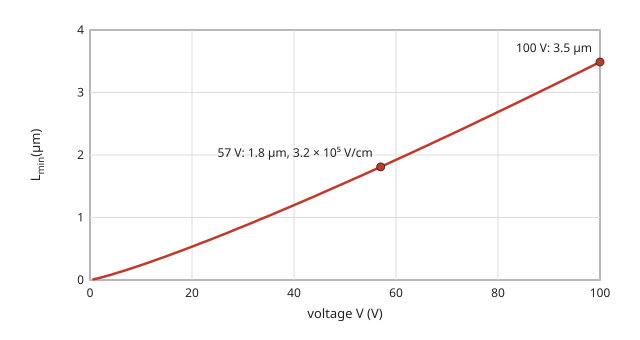
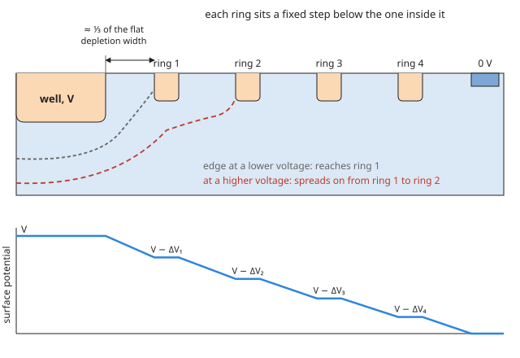
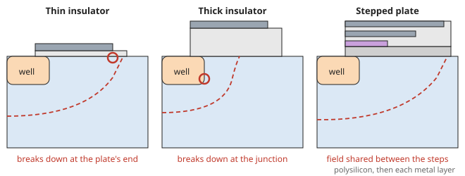
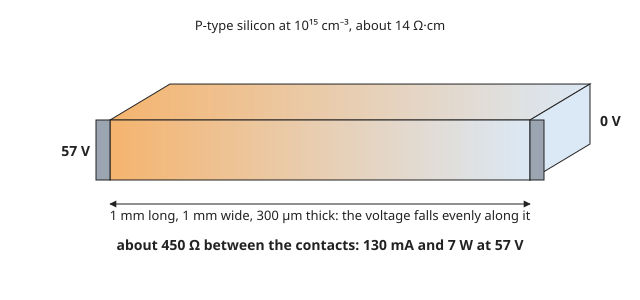
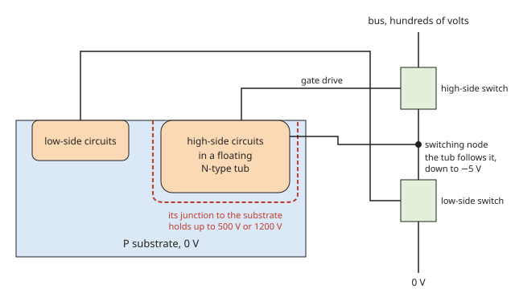

.. _hv-grading:

Surface voltage grading
=======================

This page describes ways to make the voltage between a high-voltage region
and the surrounding substrate fall gradually across the surface, instead of
all at one edge, so that no point reaches the critical field.

Even voltage fall
-----------------

The field at a point is how steeply the voltage changes there. A voltage
that falls evenly over a length :math:`L` has a field of :math:`V/L`
everywhere along it (:numref:`fig-hv-even-fall`). A carrier crossing a field frees new carriers at a
rate per centimetre :math:`\alpha`, which Fulop's fit gives as
:math:`a_\alpha E^7` [HV-PARK]_ (Equation 3.25). Avalanche runs away when
each carrier crossing the field frees one more, that is, when
:math:`\alpha L = 1` for a uniform field. Setting :math:`E = V/L` gives the
shortest length over which a voltage can fall:

.. math::

   L_\text{min} = \left(a_\alpha V^7\right)^{1/6}

.. list-table::
   :header-rows: 1
   :widths: 20 60 20

   * - Symbol
     - Meaning
     - Unit
   * - :math:`L_\text{min}`
     - Shortest distance for the voltage to fall over
     - cm
   * - :math:`V`
     - Voltage between the high-voltage region and the substrate
     - V
   * - :math:`a_\alpha`
     - Fulop's coefficient for silicon, :math:`1.8 \times 10^{-35}`
       [HV-PARK]_ (Section 3.1.5)
     - cm\ :sup:`6` V\ :sup:`-7`

For 57 V:

.. math::

   L_\text{min} &= \left(1.8 \times 10^{-35} \times 57^7\right)^{1/6} \\
     &= 1.8 \times 10^{-4}\ \text{cm} = 1.8\ \text{µm}

The field is then 3.2 × 10\ :sup:`5` V/cm, and holding 100 V takes 3.5 µm
(:download:`calc.py <calc.py>`,
section 4, :numref:`fig-hv-lmin`). The flat-junction fit on :doc:`junctions` comes from the same
coefficient: its triangular field gives an ionisation integral of 0.98.
The length does not depend on the doping, because a uniform field needs
the charge that would bend it to be absent or balanced.

         fall: the potential drops from V to 0 over a short distance, and the
         field is a tall narrow peak at one edge. An even fall over a length L:
         the potential falls in a straight line, and the field is V/L
         everywhere along it.

   Potential and field of an abrupt fall and of an even fall. Schematic.

         4 µm, against voltage from 0 to 100 V. It rises a little faster than
         linearly, through 1.8 µm at 57 V, where the field is 3.2 times 10 to
         the 5 V/cm, to 3.5 µm at 100 V.

   Shortest length for a voltage to fall over in silicon, for a perfectly
   even fall.

That is the ideal of a perfectly even fall. Real structures leave the field
peaked at their edges, so they need more length than this, by an amount
found by device simulation of each structure. The structures below are
ways of getting closer to the ideal (:numref:`fig-hv-grading`).

.. figure:: grading.svg
   :name: fig-hv-grading
   :alt: Four cross-sections of a high-voltage N-well in a P-type substrate.
         The first has floating rings beside the well. The second has a
         field plate over the edge. The third has a thin N layer depleted
         from below. The fourth has a resistor chain over the surface with
         taps at falling voltages.

   Four ways to spread the voltage of a high-voltage well across the
   surface: floating rings, a field plate, a depleted thin layer and a
   resistive chain.

Floating field rings
--------------------

Rings of N-type silicon drawn around the high-voltage well, and connected
to nothing, are called :term:`floating field rings <floating field ring>`.
As the voltage rises, the depletion region around the well spreads outward
until it reaches the first ring. The ring then rises with it, a fixed step
below the well, and the depletion region spreads on from the ring to the
next one [HV-KAO-WOLLEY]_ [HV-US4573066]_ (upper left of
:numref:`fig-hv-grading`). Each ring holds part of the
voltage, and the spacing between rings sets how large each step is
(:numref:`fig-hv-rings-steps`). Four or
five rings are usual [HV-SPIRITO]_ (slide 26).

The rings need nothing beyond the wells the process already has, and no
current. Their spacing is critical, because a gap too wide leaves the
whole voltage on one edge and a gap too narrow lets two rings share their
voltage. For one worked case, the best gap from the well to the first
ring is about a third of the flat depletion width [HV-SPIRITO]_ (slide 25).
Spacings are found by device simulation and checked on test structures.

         contact at 0 V. The gap from the well to ring 1 is about a third of
         the flat depletion width. A depletion edge at a lower voltage reaches
         ring 1; at a higher voltage it spreads on from ring 1 to ring 2. Below,
         the surface potential falls in a staircase: V at the well, then flat
         steps at V minus delta V1 to V minus delta V4 on the rings, sloping in
         the gaps, to 0 V.

   Floating rings take the voltage in steps. The step sizes are
   schematic.

Field plates
------------

A :term:`field plate` is a conductor, metal or polysilicon, connected to the
well and extending over the insulator beyond the well's edge. Its voltage
pulls the depletion region in the substrate below it further out, which
lowers the field at the curved edge (upper right of :numref:`fig-hv-grading`)
[HV-SPIRITO]_ (slide 27)
[HV-PARK]_ (Section 2.3.1). A thin insulator under the plate moves the
breakdown to the end of the plate, and a thick one leaves it at the
junction [HV-SPIRITO]_ (slide 28). A plate built in steps over different
thicknesses balances the two. In a standard process, polysilicon on the
:term:`field oxide` and then each metal layer over the dielectrics above it
give a set of steps (:numref:`fig-hv-plate-variants`).

         insulator the plate pulls the depletion edge out, and breakdown moves
         to the end of the plate. On a thick insulator breakdown stays at the
         junction. A stepped plate of polysilicon on the field oxide and then
         metal layers above shares the field between the steps.

   Field plates on a thin insulator, on a thick insulator and in steps.
   Schematic.

Depleted thin layers (RESURF)
-----------------------------

A thin, lightly doped N layer lying on a P substrate is depleted from two
sides at once: sideways from its edge, and upward from the junction with
the substrate below it. When the total charge in the layer is small
enough, it is fully depleted before the surface field reaches its critical
value, and the voltage then falls almost evenly along the surface. This is
:term:`RESURF`, for reduced surface field [HV-APPELS-VAES]_
[HV-PARK]_ (Section 2.3) (lower left of :numref:`fig-hv-grading`).

RESURF works only when the layer's dopant charge per area is close to a
value set by silicon's critical field. With a critical field of
:math:`3 \times 10^5` V/cm, the formula in [HV-PARK]_ (Equation 2.10)
gives at most about :math:`1.4 \times 10^{12}\ \text{cm}^{-2}`.
[HV-US5223919]_ gives about :math:`2 \times 10^{12}\ \text{cm}^{-2}`. Whether a gf180mcu N-well,
or an N-well with part of its area blocked from the implant, comes near
that value is a question for measurement on test structures.

Resistor chains
---------------

The rings and layers above find their own voltages. A resistor chain sets
them instead. A long polysilicon resistor, often drawn as a spiral, runs
over the field oxide from the high-voltage well to the substrate contact.
The current through it makes its voltage fall evenly along its length, and
through the oxide its voltage pulls the surface below it into the same
even gradient [HV-EP2779225]_ [HV-US10217861]_ (lower right of
:numref:`fig-hv-grading`). Taps along the chain can also drive a set of rings
directly, so that each ring sits at a chosen fraction of the voltage.

The cost is the current that flows down the chain all the time. A chain
holding 57 V with 1 µA flowing needs 57 MΩ and takes 57 µW; with 10 µA it
takes 570 µW
(:download:`calc.py <calc.py>`,
section 6). A high-resistance polysilicon resistor of that value is long, so
its area is part of the design.

Current through the substrate
-----------------------------

The substrate itself could be graded by driving a current through it
between two contacts, so that its voltage falls steadily from one to the
other, but only at high power. The substrate is a thick, fairly conductive slab. At
:math:`10^{15}\ \text{cm}^{-3}` P-type silicon has a resistivity of about
14 Ω·cm [HV-NBS]_ (Table 5), so a slab 1 mm long, 1 mm wide and 300 µm
thick has about 450 Ω between its ends (:numref:`fig-hv-substrate-slab`). Holding 57 V across it takes about
130 mA and 7 W
(:download:`calc.py <calc.py>`,
section 6). The thickness and resistivity are illustrations: thinning the
die or a lighter-doped substrate would raise the resistance.

         14 ohm centimetres, 1 mm long, 1 mm wide and 300 µm thick, with a
         contact at each end, one at 57 V and one at 0 V. The voltage falls
         evenly along it. About 450 ohm lies between the contacts, so it takes
         130 mA and 7 W at 57 V.

   Grading the substrate itself with a current: the illustrative slab
   of the text.

Floating wells in commercial chips
----------------------------------

Commercial gate-driver chips for half bridges are built on bulk silicon
with junction isolation. Their high-side circuits sit in a floating well that
rises to the full bus voltage above the grounded substrate,
in an isolation tub that International Rectifier describes as able to
float from 500 V or 1200 V down to −5 V [HV-IR-AN978]_ (Section 2.3)
(:numref:`fig-hv-floating-well`). That
is a reference example from a dedicated
high-voltage process, not evidence of what gf180mcu can hold. The gf180mcu
values depend on the doping and edges described on :doc:`junctions`, which
test structures would measure.

         circuits sit in the substrate; high-side circuits sit in a floating
         N-type tub whose junction to the substrate holds up to 500 V or
         1200 V. Outside the die two switches form a half bridge on a bus of
         hundreds of volts. The low-side circuits drive the low switch; the
         tub drives the high switch and follows the switching node, down to
         minus 5 V.

   A junction-isolated half-bridge gate driver: the high-side circuits
   float with the switching node. Schematic.
