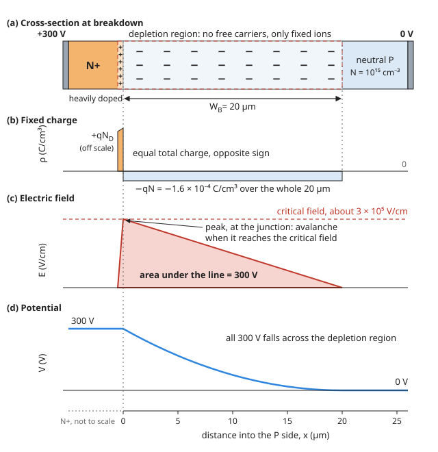
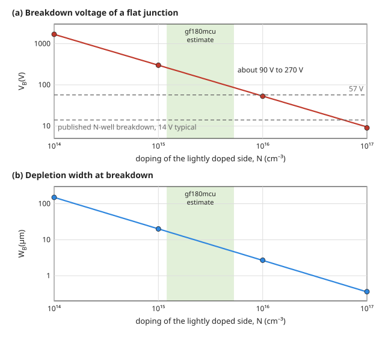
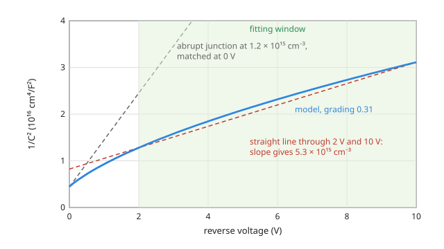
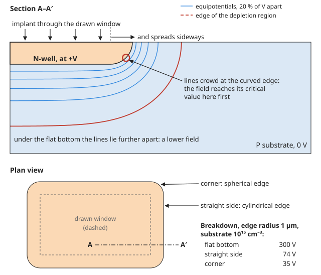
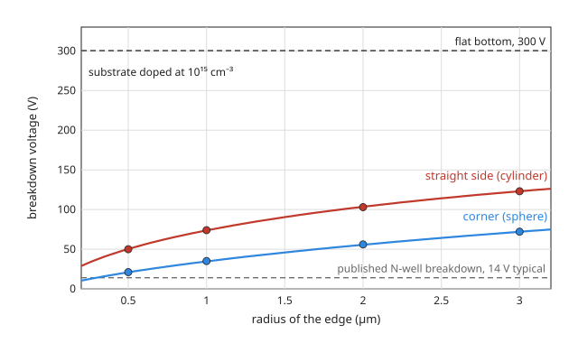
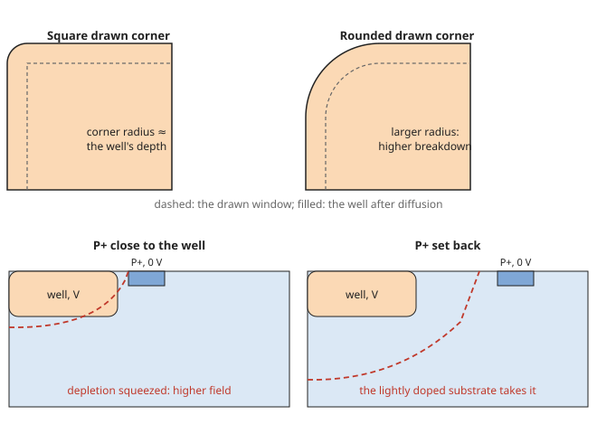

.. _hv-junctions:

Junction breakdown
==================

A reverse-biased P-N junction holds a voltage up to a limit set by the
doping on its lightly doped side. The curved edges of a well break down
long before its flat bottom.

The depletion region
--------------------

A reverse-biased junction holds its voltage across a
:term:`depletion region`, a layer on both sides of the junction emptied of
free carriers. The fixed charge of the dopant atoms left in that layer sets
up an electric field, strongest at the junction itself
[HV-PARK]_ (Section 3.2.1.2). When the strongest field reaches the critical
field of silicon, about :math:`3 \times 10^5` V/cm [HV-IOFFE]_, carriers
crossing the layer
gain enough energy to free more carriers, and the current runs away. This
is :term:`avalanche breakdown`. :numref:`fig-hv-depletion` shows the
charge, field and potential of a junction at that point.

         side is much thinner than drawn. (a) An N+ region at +300 V meets
         a P region doped at 10 to the 15 per cubic centimetre, at 0 V. A
         depletion region 20 µm wide, holding fixed ions only, lies almost
         entirely in the P side. (b) The fixed charge: a thin, tall positive
         block on the N+ side and a long, shallow negative block of
         −1.6 × 10⁻⁴ C/cm³ across the 20 µm, of equal total charge. (c) The
         field: a triangle peaking at the junction, where it reaches the
         critical field of about 3 × 10⁵ V/cm; its area is the 300 V. (d)
         The potential falls as a parabola from 300 V at the junction to
         0 V at the edge of the depletion region, and is flat outside it.

   A one-sided junction at breakdown for P-side doping of 10\ :sup:`15` cm\
   :sup:`-3`, with the P side to scale.

When one side of the junction is much more heavily doped than the other,
almost all of the depletion region lies in the lightly doped side, and that
side alone sets the breakdown voltage. For silicon, an empirical fit
by Baliga gives the breakdown voltage and the depletion width at breakdown
[HV-PARK]_ (Equations 3.30 and 3.31) [HV-US6344676]_ (Equation 1):

.. math::

   V_\text{B} &= 5.34 \times 10^{13} \times N^{-3/4} \\
   W_\text{B} &= 2.67 \times 10^{10} \times N^{-7/8}

.. list-table::
   :header-rows: 1
   :widths: 20 60 20

   * - Symbol
     - Meaning
     - Unit
   * - :math:`V_\text{B}`
     - Breakdown voltage of a flat junction
     - V
   * - :math:`W_\text{B}`
     - Width of the depletion region at breakdown
     - cm
   * - :math:`N`
     - Doping of the lightly doped side
     - cm\ :sup:`-3`

For :math:`N = 10^{15}\ \text{cm}^{-3}`:

.. math::

   V_\text{B} &= 5.34 \times 10^{13} \times (10^{15})^{-3/4} \\
     &= 5.34 \times 10^{13} \times 5.62 \times 10^{-12} \\
     &= 300\ \text{V} \\
   W_\text{B} &= 2.67 \times 10^{10} \times (10^{15})^{-7/8} \\
     &= 2.67 \times 10^{10} \times 7.50 \times 10^{-14} \\
     &= 2.0 \times 10^{-3}\ \text{cm} = 20\ \text{µm}

Doping and breakdown voltage
----------------------------

Lighter doping spreads the same charge over a wider layer, so the field
reaches its critical value only at a higher voltage. The price is width:
the depletion region needs room to spread
(:numref:`tab-hv-flat-breakdown`). A junction meant to hold a high voltage
needs that much lightly doped silicon on one side of it. In
:numref:`fig-hv-depletion`, lighter doping makes the field triangle
shallower and wider.

.. list-table:: Breakdown of a flat silicon junction against doping
   :name: tab-hv-flat-breakdown
   :header-rows: 1
   :widths: 34 33 33

   * - Doping of the lightly doped side (cm\ :sup:`-3`)
     - Breakdown voltage (V)
     - Depletion width at breakdown (µm)
   * - 10\ :sup:`14`
     - 1690
     - 150
   * - 10\ :sup:`15`
     - 300
     - 20
   * - 10\ :sup:`16`
     - 53
     - 2.7
   * - 10\ :sup:`17`
     - 9
     - 0.36

The values come from the two equations above
(:download:`calc.py <calc.py>`,
section 1). :numref:`fig-hv-doping-breakdown` plots both equations across
the range.

         17 per cubic centimetre. Top, breakdown voltage falls from 1690 V
         through 300 V and 53 V to 9 V; the gf180mcu estimate of 1.2 to 5.3
         times 10 to the 15 is shaded, where the flat junction holds about
         90 V to 270 V, above a line at 57 V, the most on an Ethernet
         cable, and far above the published N-well breakdown of 14 V
         typical. Bottom, the depletion width at
         breakdown falls from 150 µm through 20 µm and 2.7 µm to 0.36 µm.

   Breakdown voltage and depletion width of a flat junction against
   doping, with the gf180mcu substrate estimate shaded.

gf180mcu substrate doping
-------------------------

The gf180mcu substrate is lightly doped, but the gf180mcu documents give
only its type, not its doping. The doping can be estimated from the junction capacitance in the PDK's models,
because the width of a depletion region, and so its capacitance per area,
depends on the doping of its lightly doped side. For a junction much more
heavily doped on one side, the capacitance per area at zero bias is
:math:`C_0 = \sqrt{q \varepsilon_\text{Si} N / (2 V_\text{bi})}`
[HV-MIT-6012]_ (slide 6-13), which gives the doping:

.. math::

   N \approx \frac{2 \times V_\text{bi} \times C_0^2}
                  {q \times \varepsilon_\text{Si}}

.. list-table::
   :header-rows: 1
   :widths: 20 60 20

   * - Symbol
     - Meaning
     - Unit
   * - :math:`C_0`
     - Capacitance per area at zero bias, :math:`1.49 \times 10^{-8}`
       for the N-well to substrate junction [HV-GF180-MODELS]_
     - F/cm\ :sup:`2`
   * - :math:`V_\text{bi}`
     - Built-in voltage of the junction, 0.439 in the same model
     - V
   * - :math:`q`
     - Electron charge, :math:`1.602 \times 10^{-19}`
     - C
   * - :math:`\varepsilon_\text{Si}`
     - Permittivity of silicon, :math:`1.035 \times 10^{-12}`
     - F/cm

.. math::

   N &\approx \frac{2 \times 0.439 \times (1.49 \times 10^{-8})^2}
                   {1.602 \times 10^{-19} \times 1.035 \times 10^{-12}} \\
     &= 1.2 \times 10^{15}\ \text{cm}^{-3}

The equation assumes an abrupt junction with uniform doping, whose
capacitance falls as the inverse square root of the voltage. The model's
capacitance falls more slowly: its grading coefficient is 0.31, close to
the 1/3 of a junction whose doping changes linearly across it, not the 1/2
of an abrupt one. The model values are fits to measured capacitance, not a
doping profile, so the equation gives a rough figure only.

For an abrupt junction, :math:`1/C^2` rises in a straight line with reverse
voltage, with a slope of :math:`2/(q \varepsilon_\text{Si} N)`. Applied to
the model between 2 V and 10 V, that slope gives
:math:`5.3 \times 10^{15}\ \text{cm}^{-3}`. The models of other junctions
to the same substrate give other values (:numref:`tab-hv-doping-estimates`).
:numref:`fig-hv-cv-doping` shows the model's curve, the abrupt line
matched at zero bias, and the straight line fitted between 2 V and 10 V.

         6 V N-well model with grading 0.31. The model curve rises and bends
         over. A dashed abrupt-junction line for 1.2 times 10 to the 15 per
         cubic centimetre, matched at 0 V, rises far more steeply. A dashed
         straight line through the model at 2 V and 10 V, the shaded fitting
         window, has the slope of 5.3 times 10 to the 15.

   1/C² of the 6 V N-well junction model against reverse voltage, with
   the two abrupt-junction estimates of the doping.

.. list-table:: Substrate doping estimated from the junction models
               [HV-GF180-MODELS]_
   :name: tab-hv-doping-estimates
   :header-rows: 1
   :widths: 34 16 25 25

   * - Junction model
     - Grading
     - At zero bias (cm\ :sup:`-3`)
     - From 1/C² slope (cm\ :sup:`-3`)
   * - 6 V N-well, ``nwp_6p0``
     - 0.31
     - 1.2 × 10\ :sup:`15`
     - 5.3 × 10\ :sup:`15`
   * - 3.3 V N-well, ``nwp_3p3``
     - 0.34
     - 1.5 × 10\ :sup:`15`
     - 4.8 × 10\ :sup:`15`
   * - Deep N-well, ``dnwps``
     - 0.15
     - 2.2 × 10\ :sup:`15`
     - 5.3 × 10\ :sup:`16`

The values come from
:download:`calc.py <calc.py>`,
section 2. The deep N-well's grading of 0.15 is far from either simple
junction, so its slope value means little. The lowest value,
:math:`1.2 \times 10^{15}\ \text{cm}^{-3}`, is best read as a lower bound.
A measured threshold under the field oxide points to about
:math:`3 \times 10^{15}` to :math:`5 \times 10^{15}\ \text{cm}^{-3}` at the
surface in the 6 V area (:doc:`metal-gate`). A capacitance measurement on a
large N-well test structure would give the doping profile directly.

At :math:`1.2 \times 10^{15}` to :math:`5.3 \times 10^{15}\ \text{cm}^{-3}`,
a flat junction to the substrate would hold about 90 V to 270 V
(:numref:`fig-hv-doping-breakdown`). The
published breakdown of the N-well to the substrate is 10 V minimum and
14 V typical [HV-GF180-EP-5]_. The flat bottom of the well is not what
breaks down.

Breakdown at curved edges
-------------------------

A well is made by implanting dopant at the surface and letting it diffuse
down and sideways, so its edges are curved. Along a straight side the edge
is part of a cylinder, with a radius about equal to the well's depth. At a
corner it is part of a sphere. The field lines crowd together at a curved
edge, so the field there reaches the critical value at a lower voltage than
under the flat bottom [HV-SZE-GIBBONS]_ [HV-SPIRITO]_ (slide 21).
:numref:`fig-hv-curved-edge` shows the equipotentials around such a well,
solved for an edge radius equal to the well's depth, and where its
straight sides and corners lie.

         The implant enters through the drawn window and spreads down and
         sideways, so the well has a flat bottom and a quarter-circle edge
         whose radius equals its depth. Lines of equal potential lie flat
         and well apart under the bottom, and bend round the curved edge,
         where they crowd together; the field reaches its critical value
         there first. Bottom, a plan view of the well: its straight sides
         are cylindrical edges and its rounded corners spherical ones.
         Breakdown at 10 to the 15 per cubic centimetre with a 1 µm edge
         radius is 300 V for the flat bottom, 74 V along a side and 35 V at
         a corner.

   A diffused well in cross-section and in plan view.

Baliga and Ghandhi give the breakdown of cylindrical and spherical
junctions as a fraction of the flat value, as a function of the radius
divided by the flat depletion width [HV-BALIGA-GHANDHI]_, as printed in
[HV-US6344676]_ (Equations 3 and 4) (:numref:`tab-hv-curved-breakdown`).
A tighter radius breaks down sooner, and a corner sooner than a side. A
published example for the same doping gives about 160 V for a spherical
junction of 10 µm radius, against about 320 V for a flat one
[HV-US5912501]_.

.. list-table:: Breakdown of curved junction edges in a substrate doped at
               10\ :sup:`15` cm\ :sup:`-3`
   :name: tab-hv-curved-breakdown
   :header-rows: 1
   :widths: 34 33 33

   * - Radius of the edge (µm)
     - Along a side, cylinder (V)
     - At a corner, sphere (V)
   * - 0.5
     - 50
     - 21
   * - 1
     - 74
     - 35
   * - 2
     - 103
     - 56
   * - 3
     - 123
     - 72

The values come from
:download:`calc.py <calc.py>`,
section 3, and :numref:`fig-hv-edge-breakdown` plots them. The published
14 V is lower again than the corner values, so the
field at the edge of a gf180mcu N-well is higher than curvature alone
explains. A more heavily doped layer at the surface beside the well, or an
edge sharper than 0.5 µm, would do it. Breakdown measurements on test wells
with different corner shapes and spacings would show which.

         from 0.2 µm to 3.2 µm, for a substrate doped at 10 to the 15 per
         cubic centimetre. A straight side rises from 50 V at 0.5 µm to
         123 V at 3 µm; a corner from 21 V to 72 V. A dashed line marks the
         flat bottom at 300 V, and another the published N-well breakdown
         of 14 V typical, below both curves.

   Breakdown of the curved edges of a well against their radius, against
   the flat bottom and the published N-well breakdown.

Design consequences
-------------------

The substrate's light doping is enough, in principle, for a junction that
holds well over 57 V. What limits a drawn well is its edges. Three things
raise the breakdown of an edge:

* Rounding the corners of the drawn well, which removes the spherical
  corners and leaves the cylindrical sides.
* Keeping more heavily doped layers away from the edge, so the lightly doped
  substrate takes the depletion region.
* Spreading the voltage over a wider part of the surface, which is the
  subject of :doc:`grading`.

:numref:`fig-hv-edge-remedies` shows the first two.

         diffuses to a corner whose radius is about the well depth, while a
         rounded drawn corner gives a larger radius and a higher breakdown.
         Bottom, two cross-sections: a P+ region at 0 V close to the well
         squeezes the depletion region and raises the field, while a P+
         region set back lets the lightly doped substrate take the depletion.

   Two geometric remedies for early breakdown at a well edge, rounding the
   drawn corner and keeping P+ away from the edge, schematic.

