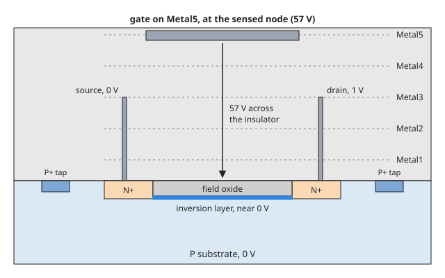
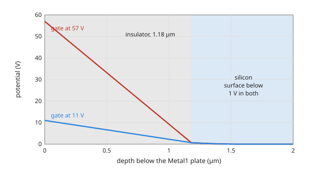
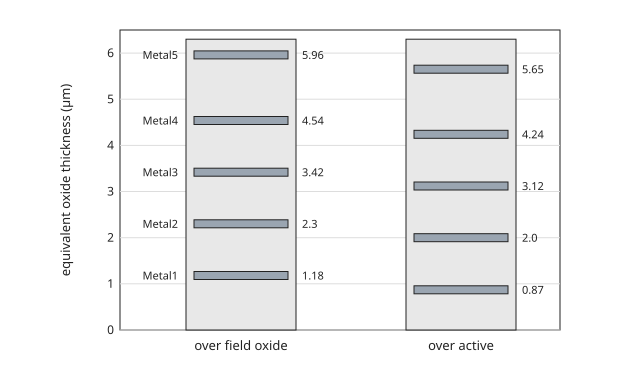
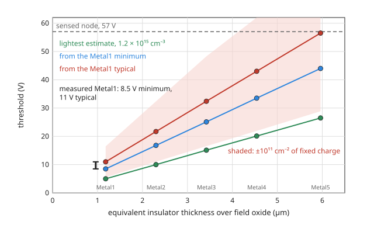
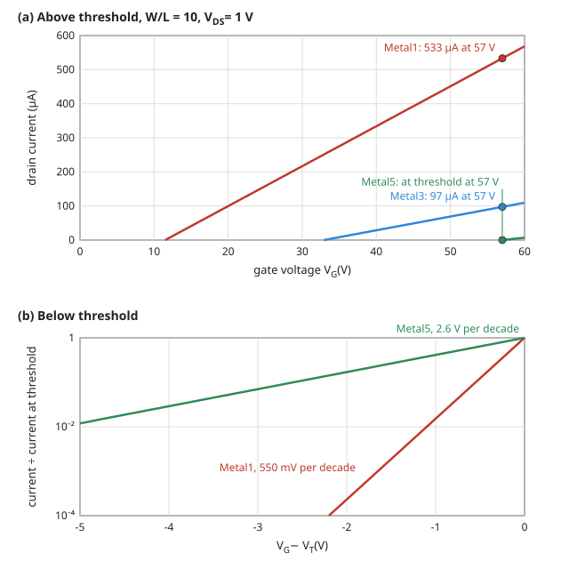
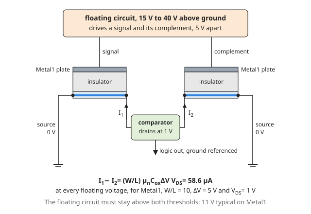
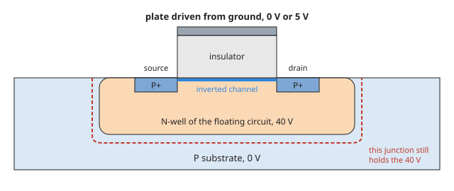
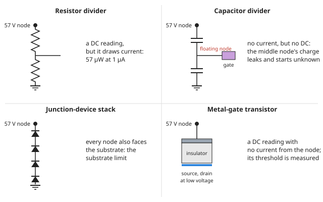

.. _hv-metal-gate:

Metal-gate transistors
======================

A transistor whose gate is one of the metal layers lets a high-voltage
node control low-voltage silicon with only insulator between them.

Metal as the gate
-----------------

A MOS transistor works because charge on its gate draws an equal and
opposite charge into the silicon below it. Above a threshold voltage that
charge includes a thin layer of free electrons at the surface of P-type
silicon, the inversion layer, which conducts between the source and drain
[HV-MIT-6012-L8]_ (slides 8-13 and 8-16). Nothing in that physics needs the
gate to be polysilicon or close to the silicon. A metal plate on any layer
does the same, with the whole insulator stack beneath it as the gate
insulator.

:numref:`fig-hv-metal-gate` shows such a transistor. Two N+ regions in the
substrate are its source and drain, the field oxide between them and the
dielectrics above it are its gate insulator, and a plate on a metal layer
is its gate. The plate connects to the high-voltage node being sensed. The
source and drain stay at low voltage.

         drain, separated by field oxide that reaches deeper into the
         silicon than the N+. Five dashed lines in the insulator above mark
         the metal levels. A plate on Metal3 above the field oxide is at
         57 V, and an arrow marks 57 V across the insulator. A thin
         inversion layer runs along the bottom of the field oxide and up its
         sidewalls to the source and drain. P+ taps sit outside the device.

   A transistor with its gate on Metal3, where the insulator holds the whole
   voltage of the sensed node and the silicon stays near the source voltage.

Voltage across the insulator
----------------------------

Once the gate is above threshold, the inversion layer connects to the
source and sits near the source voltage. The silicon surface then changes
little as the gate voltage rises further: the extra gate charge is matched
by extra electrons in the inversion layer, not by a wider depletion region
[HV-MIT-6012-L8]_ (slide 8-15). The gate voltage therefore falls almost
entirely across the insulator (:numref:`fig-hv-gate-potential`). No
junction holds the high voltage, so the limits on :doc:`junctions` do not
apply.

         from 0 to 2 µm. With the gate at 57 V and at 11 V, the potential falls
         in a straight line across the 1.18 µm of insulator to below 1 V at
         the silicon surface, then to 0 V within a fraction of a micrometre.
         The silicon surface is below 1 V in both cases.

   Potential through the insulator and silicon under a Metal1 plate, at the
   typical threshold and at 57 V, with the silicon part schematic.

At 57 V the field in the insulator is 0.48 MV/cm under Metal1 and
0.10 MV/cm under Metal5
(:download:`calc.py <calc.py>`,
section 7), far below the fields on :doc:`dielectric`. The breakdown of the
gf180mcu dielectrics is not published, but these fields leave a wide
margin. Low-voltage metal near the plate is closer. Metal1 under a Metal2
plate has 59.0 aF/µm² to it [HV-OPENPDKS-EXTRACT]_, the capacitance of
0.58 µm of oxide, which holds 0.97 MV/cm at 57 V. Low-voltage metal beside
the plate on the same layer is closer still, set by the spacing.

The plate inverts any P-type surface it covers, not only the channel. The
inversion layer would then join every N region under the plate. Heavily
doped P+ taps around the device stop it spreading
(:numref:`fig-hv-metal-gate`), because heavier doping raises the threshold
far above the sensed voltage, as the threshold equation below shows.

Metal layers as gate insulators
-------------------------------

The open gf180mcu extraction rules give the capacitance per area of each
metal layer to the substrate [HV-OPENPDKS-EXTRACT]_. A capacitance per area
:math:`C` is that of a silicon dioxide layer of thickness
:math:`\varepsilon_\text{ox}/C`, which gives each layer an equivalent
thickness (:numref:`tab-hv-metal-stack`, :numref:`fig-hv-metal-stack`). The layers further from the
silicon have less capacitance and act as thicker gate insulators.

.. list-table:: Capacitance of each metal layer to the substrate, and the
               equivalent oxide thickness
   :name: tab-hv-metal-stack
   :header-rows: 1
   :widths: 20 30 25 25

   * - Layer
     - C over field oxide (aF/µm²)
     - Thickness over field oxide (µm)
     - Thickness over active (µm)
   * - Metal1
     - 29.3
     - 1.18
     - 0.87
   * - Metal2
     - 15.0
     - 2.30
     - 2.00
   * - Metal3
     - 10.1
     - 3.42
     - 3.12
   * - Metal4
     - 7.60
     - 4.54
     - 4.24
   * - Metal5
     - 5.80
     - 5.96
     - 5.65

The capacitances are nominal. The same rules give minimum and maximum
corners 7 % to 13 % either side
(:download:`calc.py <calc.py>`,
section 7). Over active silicon, with no field oxide below, each layer
sits closer to the channel.

         equivalent oxide thickness. Over field oxide: Metal1 1.18 µm, Metal2
         2.3, Metal3 3.42, Metal4 4.54 and Metal5 5.96. Over active: 0.87, 2.0,
         3.12, 4.24 and 5.65.

   Equivalent oxide thickness under each metal layer, to scale.

Threshold voltage
-----------------

The threshold is the gate voltage at which the electron concentration at
the surface equals the doping. It is the sum of the voltage needed to bring
the silicon to flat band, the voltage across the depleted silicon, and the
voltage across the insulator needed to hold the depletion charge
[HV-MIT-6012-L8]_ (slide 8-12) [HV-MIT-6012-L7]_ (slide 7-11):

.. math::

   V_\text{T} &= V_\text{FB} + 2\phi_\text{F}
     + \frac{Q_\text{dep}}{C_\text{ox}} \\
   Q_\text{dep} &= \sqrt{2 q \varepsilon_\text{Si} N \times 2\phi_\text{F}}

.. list-table::
   :header-rows: 1
   :widths: 20 60 20

   * - Symbol
     - Meaning
     - Unit
   * - :math:`V_\text{T}`
     - Threshold voltage of the gate to the source
     - V
   * - :math:`V_\text{FB}`
     - Flat-band voltage: the gate voltage that leaves the silicon surface
       uncharged, set by the gate material and charge in the insulator.
       Taken as −0.9 V as an illustration. A titanium nitride barrier, usual
       at the bottom of aluminium lines, would give nearer −0.3 V, which
       changes little against tens of volts
     - V
   * - :math:`\phi_\text{F}`
     - :math:`(kT/q) \ln(N/n_\text{i})`, the depth of the Fermi level below
       the middle of the band gap. :math:`n_\text{i} = 10^{10}`
       cm\ :sup:`-3` gives 417 mV at :math:`10^{17}` cm\ :sup:`-3`, close
       to the 420 mV of [HV-MIT-6012-L7]_ (slide 7-12)
     - V
   * - :math:`Q_\text{dep}`
     - Charge per area in the depleted silicon at threshold
     - C/cm\ :sup:`2`
   * - :math:`q`
     - Electron charge, :math:`1.602 \times 10^{-19}`
     - C
   * - :math:`\varepsilon_\text{Si}`
     - Permittivity of silicon, :math:`1.035 \times 10^{-12}`
     - F/cm
   * - :math:`N`
     - Doping of the P-type silicon under the gate
     - cm\ :sup:`-3`
   * - :math:`C_\text{ox}`
     - Capacitance per area of the gate insulator, from
       :numref:`tab-hv-metal-stack`
     - F/cm\ :sup:`2`

For Metal5 over field oxide, :math:`C_\text{ox} = 5.798 \times 10^{-10}`
F/cm², on substrate doped at the lightest estimate on :doc:`junctions`,
:math:`1.2 \times 10^{15}` cm\ :sup:`-3`:

.. math::

   \phi_\text{F} &= 0.02585 \times \ln(1.2 \times 10^{5}) \\
     &= 0.302\ \text{V} \\
   Q_\text{dep} &= 1.553 \times 10^{-8}\ \text{C/cm}^2 \\
   V_\text{T} &= -0.9 + 0.60
     + \frac{1.553 \times 10^{-8}}{5.798 \times 10^{-10}} \\
     &= -0.9 + 0.60 + 26.8 \\
     &= 26.5\ \text{V}

The last term dominates for every metal layer, so the threshold rises
almost in proportion to the insulator thickness. It also rises with the
doping, and steeply.

Threshold calibration
---------------------

The foundry publishes the threshold of this very device with its gate on
Metal1: a field transistor in the 6 V area, NMOS, :math:`W/L = 200/0.36`,
8.5 V minimum and 11 V typical [HV-GF180-EP-2]_ (row 7). That is well above
the 5.0 V the lightest doping estimate gives for Metal1. The equation above
reaches 8.5 V with :math:`3.0 \times 10^{15}` cm\ :sup:`-3` under the
field oxide, and 11 V with :math:`4.8 \times 10^{15}` cm\ :sup:`-3`
(:download:`calc.py <calc.py>`,
section 7). Applying the same doping under the other layers gives
:numref:`tab-hv-metal-vt`.

.. list-table:: Threshold of a metal-gate transistor over field oxide in
               the 6 V area
   :name: tab-hv-metal-vt
   :header-rows: 1
   :widths: 25 25 25 25

   * - Gate layer
     - Lightest doping estimate (V)
     - From the Metal1 minimum (V)
     - From the Metal1 typical (V)
   * - Metal1
     - 5.0
     - 8.5
     - 11.0
   * - Metal2
     - 10.0
     - 16.8
     - 21.7
   * - Metal3
     - 15.1
     - 25.1
     - 32.4
   * - Metal4
     - 20.1
     - 33.5
     - 43.0
   * - Metal5
     - 26.5
     - 44.0
     - 56.5

The values come from
:download:`calc.py <calc.py>`,
section 7, and :numref:`fig-hv-metal-vt` plots them. The first column
is a lower bound. The other two are an
extrapolation from one measured layer, and four things limit it:

* The calibration lumps the doping and any charge at the silicon surface
  together. Both scale with :math:`1/C_\text{ox}`, so the extrapolation
  holds for them. Charge trapped between two metal levels acts only on the
  layers above it, and the extrapolation misses it.
* The published device is short, with a channel 0.36 µm long, and its
  threshold is measured in saturation. A drain that close lowers the
  threshold, so a long channel is likely to need a little more.
* The doping under the field oxide is not one value for the whole die. In
  the 3.3 V area the foundry gives a polysilicon-gated field threshold of
  6.5 V minimum and 8.5 V typical [HV-GF180-EP-1]_ (row 7). The doping
  that fits Metal1 in the 6 V area gives only 2.1 V to 2.8 V there
  (section 8), so the two areas differ.
* The equation treats the channel as flat. The next section explains why it
  is not.

Each layer and each area therefore needs its own test device before a
design relies on its threshold.

         thickness over field oxide, with Metal1 to Metal5 marked. Three
         straight lines rise with thickness: the lightest doping estimate from
         5.0 to 26.5 V, the fit to the Metal1 minimum from 8.5 to 44.0 V and
         the fit to the Metal1 typical from 11.0 to 56.5 V. A bar marks the
         measured Metal1 threshold, 8.5 V minimum and 11 V typical. A shaded
         band shows the shift from 10 to the 11 per square centimetre of fixed
         charge, 5.5 V on Metal1 growing to 27.6 V on Metal5. A dashed line
         marks the 57 V sensed node.

   Threshold of a metal-gate transistor against its gate layer.

Channel around the field oxide
------------------------------

The field oxide is recessed into the silicon, and it can reach deeper than
the N+ source and drain (:numref:`fig-hv-metal-gate`). The inversion layer
then forms along the bottom of the oxide and has to climb its sidewalls to
reach the N+. The plate couples to the sidewalls more weakly than to the
bottom, so the sidewalls may need more gate voltage than the flat channel
does. The silicon under the field oxide also carries any implant that stops
inversion between ordinary transistors, whose doping is not published. The
published Metal1 threshold already includes both effects for that layer.

Charge in the insulator
-----------------------

Fixed charge trapped in the insulator adds to the gate's charge. By
:math:`Q = CV`, a charge per area :math:`Q_\text{ox}` next to the silicon
shifts the threshold by :math:`Q_\text{ox}/C_\text{ox}`. A charge of
:math:`10^{11}` electron charges per cm² shifts it by 5.5 V under Metal1 and
by 27.6 V under Metal5
(:download:`calc.py <calc.py>`,
section 7), the shaded band of :numref:`fig-hv-metal-vt`. The charge in the gf180mcu dielectrics is not published, and
deposited dielectrics may hold more than grown oxide.

The charge can also change while the device is in use. A steady field of
0.1 MV/cm to 0.5 MV/cm across a deposited dielectric moves mobile ions in
it, faster when hot, so the threshold drifts with the voltage the plate has
held and for how long. Metal5 sits just under the passivation, so moisture
and charge on the passivation or the package moulding also act on it.

Two plates on the same layer, side by side, share the charge that was there
when the wafer was made, to the extent the dielectric is uniform. A circuit
that compares two such transistors cancels that common part, as the level
shifter below does. It does not cancel drift that differs between the
plates. In the level shifter the two plates hold opposite logic states, so
if one state lasts longer the plates drift apart.

Subthreshold current
--------------------

Below threshold the current does not stop. The electron concentration at
the surface is exponential in the surface potential
[HV-MIT-6012-L8]_ (slide 8-10), so the current falls tenfold for every
:math:`(kT/q) \ln 10`, 60 mV at room temperature, of change in that
potential. The gate reaches the surface through two capacitances in
series: the insulator, and the depletion region below it. The thick
insulator has the smaller capacitance, so the gate controls the surface
weakly. The gate voltage needed per tenfold change is therefore much
larger: 550 mV with Metal1 and 2.6 V with Metal5 at the doping that fits
the typical Metal1 threshold
(:download:`calc.py <calc.py>`,
section 7, :numref:`fig-hv-transfer`). A sensor whose output is a
current above threshold is not affected. A sensor that has to switch hard on and off within a small
voltage window needs gain after it.

Current above threshold
-----------------------

With its drain a volt or so above its source, the transistor works in its
linear region [HV-MIT-6012-L10]_ (slide 10-3):

.. math::

   I_\text{D} = \frac{W}{L} \mu_\text{n} C_\text{ox}
     \left(V_\text{G} - \frac{V_\text{DS}}{2} - V_\text{T}\right)
     V_\text{DS}

.. list-table::
   :header-rows: 1
   :widths: 20 60 20

   * - Symbol
     - Meaning
     - Unit
   * - :math:`I_\text{D}`
     - Drain current
     - A
   * - :math:`W/L`
     - Width of the channel divided by its length
     - —
   * - :math:`\mu_\text{n}`
     - Mobility of electrons in the inversion layer, taken as 400 as an
       illustration
     - cm²/(V·s)
   * - :math:`V_\text{G}`
     - Gate voltage above the source
     - V
   * - :math:`V_\text{DS}`
     - Drain voltage above the source
     - V

For Metal3, with the typical threshold of 32.4 V, :math:`W/L = 10`, the
gate at 57 V and the drain at 1 V:

.. math::

   I_\text{D} &= 10 \times 400 \times 1.009 \times 10^{-9} \\
     &\quad \times (57 - 0.5 - 32.4) \times 1 \\
     &= 97\ \mu\text{A}

The same transistor carries 533 µA with its gate on Metal1. On Metal5 it is
just at threshold at 57 V, and carries 29 µA only if the threshold is at
its minimum
(:download:`calc.py <calc.py>`,
section 7, :numref:`fig-hv-transfer`). The thick insulator weakens the gate, but the large gate
voltage makes up much of it, so currents of tens to hundreds of microamps
are available from a modest width. The channel needs to be long compared
with the insulator thickness, so that the gate rather than the drain
controls it. How long is a question for measurement.

         and 1 V on the drain, using the typical thresholds. Metal1 rises from
         11 V to 533 µA at 57 V, Metal3 from 32.4 V to 97 µA at 57 V, and
         Metal5 is at threshold at 57 V. (b) Current below threshold, as a
         fraction of its value at threshold, against gate voltage below
         threshold on a log scale: it falls tenfold every 550 mV on Metal1 and
         every 2.6 V on Metal5.

   Drain current of a metal-gate transistor above and below threshold.

The sensed node carries no DC current, since the gate is an insulator. It
carries only the charge of the plate's capacitance: 101 fF for a plate
100 µm square on Metal3, 293 fF on Metal1 and 58 fF on Metal5.

Applications
------------

Detecting a voltage
   The transistor turns on when the sensed node crosses its threshold, with
   no divider drawing current. Five layers give five thresholds, about
   8.5 V to 11 V on Metal1 up to 44 V to 57 V on Metal5
   (:numref:`tab-hv-metal-vt`, :numref:`fig-hv-metal-vt`), so a set of
   transistors forms a coarse
   ladder of trip points. Since the thresholds are known only once
   measured, each needs calibration.
Measuring a voltage
   Above threshold the current rises linearly with :math:`V_\text{G} -
   V_\text{T}`, so the transistor is a voltmeter that draws no current from
   the node. A calibration at two known voltages fixes the slope and the
   threshold. Mobility falls as the field across the channel rises, so a
   wide range needs more calibration points.
Shifting a signal down
   A circuit sitting tens of volts above the substrate can pass a logic
   signal down to ground-referenced circuits through two metal-gate
   transistors. One gate follows the signal and the other its complement,
   so the two gates differ by the signal's swing :math:`\Delta V`. Because
   the current in the linear region is linear in the gate voltage, the
   difference between the two currents is
   :math:`(W/L)\,\mu_\text{n} C_\text{ox}\,\Delta V\,V_\text{DS}`,
   whatever the floating circuit's voltage. With Metal1, a 5 V swing,
   :math:`W/L = 10` and 1 V on the drains, it is 58.6 µA at every floating
   voltage from 15 V to 40 V
   (:download:`calc.py <calc.py>`,
   section 7). Matched plates also cancel the charge they share. The
   floating circuit must stay above both thresholds, 11 V typical on
   Metal1. :numref:`fig-hv-level-shift` shows the circuit.

         its complement, 5 V apart, onto two Metal1 plates. Each plate sits
         over the insulator above the channel of an NMOS transistor whose
         source is at ground. The two drains, carrying currents I1 and I2,
         go to a ground-referenced comparator that holds them at 1 V. The
         difference I1 minus I2 is (W/L) times mobility times Cox times
         delta V times VDS, 58.6 µA at every floating voltage, for Metal1,
         W/L of 10, a 5 V swing and 1 V on the drains. The floating circuit
         must stay above both thresholds, 11 V typical on Metal1.

   Shifting a logic signal down from a floating circuit through two
   metal-gate transistors.

A signal travelling up, from ground to a floating circuit such as the
high-side gate driver on :ref:`conv-gate-drive`, needs the mirror image:
P+ source and drain in the floating circuit's N-well, under a plate driven
from ground. That transistor sits in the floating well, so the well's own
isolation from the substrate, the subject of :doc:`junctions` and
:doc:`grading`, still limits it. Capacitive coupling across an insulator
(:doc:`dielectric`) is the alternative in that direction.
:numref:`fig-hv-level-up` shows the transistor.

         substrate at 0 V. P+ source and drain sit in the well under an
         insulator and a metal plate driven from ground at 0 V or 5 V, which
         inverts the channel between them. The junction of the N-well with
         the substrate still holds the 40 V.

   The mirror-image transistor for a signal travelling up, with example
   voltages.

Alternative voltage sensors
---------------------------

A resistor divider sets a voltage proportional to the node, but draws
current all the time: 57 µW at 1 µA (:doc:`grading`). A capacitor divider
onto the polysilicon gate of a standard transistor draws no current but
holds no DC voltage, because the charge on the node between the
capacitors leaks away and its starting value is unknown. A stack of
junction devices meets the substrate limit on :doc:`substrate`. The
metal-gate transistor gives a DC reading with no current from the node, at
the cost of a threshold that has to be measured
(:numref:`fig-hv-sensors`). Its open questions are on
:doc:`routes`.

         reading but draws current, 57 µW at 1 µA. A capacitor divider onto a
         polysilicon gate draws no current but holds no DC, because its
         floating middle node leaks and starts unknown. A stack of junction
         devices meets the substrate limit. A metal-gate transistor gives a DC
         reading with no current from the node, but its threshold is measured.

   Four ways to sense a high voltage.
