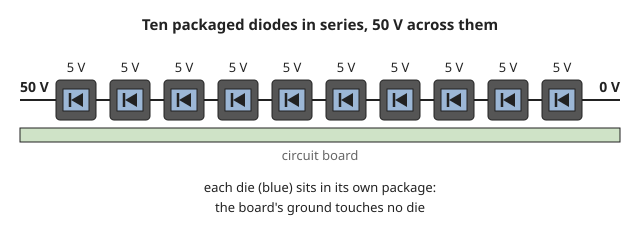
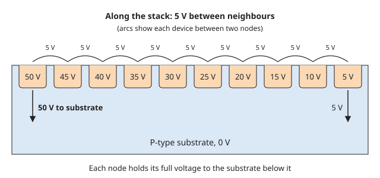
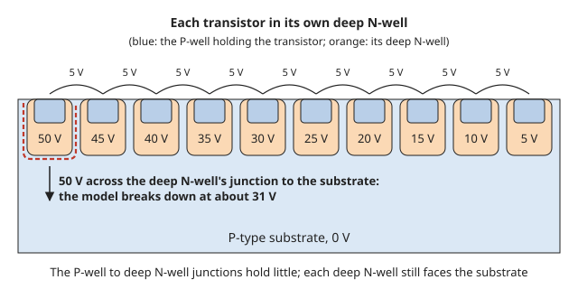

.. _hv-substrate:

Series stacks on one substrate
==============================

A stack of low-voltage devices in series does not, on its own, let a chip
hold a high voltage, because each node of the stack also forms a junction
with the shared substrate.

Voltage sharing in a series stack
---------------------------------

Ten identical diodes in series, carrying the same current, each take one
tenth of the voltage across the stack. With 50 V across the stack, each
diode has 5 V across it, below the 8.5 V minimum breakdown of a 6 V
gf180mcu junction [HV-GF180-EP-5]_. Ten discrete diodes soldered in series
on a board behave this way, because each one sits on its own piece of
silicon, insulated from the others by its package
(:numref:`fig-hv-discrete-stack`).

         and reverse biased from 50 V to 0 V, with 5 V across each. Each die sits in its own
         package, so the board ground touches no die. 5 V is below the 8.5 V
         minimum breakdown of a 6 V junction.

   Ten discrete diodes in series: each on its own silicon, so each holds
   only its share of the voltage.

The same stack built on one chip was simulated with ten 5 V gf180mcu NMOS
transistors, each connected as a diode, and a voltage swept from 0 V to
100 V across them [HV-SIM-STACK]_. With no connection to a substrate, the
ten transistors share the voltage exactly: 5.00 V each at 50 V.

Junctions to the substrate
--------------------------

On a chip, every device is built in one slab of P-type silicon, the
:term:`substrate`, held at the lowest voltage on the chip. Each N-type
region of the stack forms a P-N junction with that substrate
(:numref:`fig-hv-stack-section`). The voltage across each of those
junctions is the voltage of the node above ground, not the node's share of
the stack (:numref:`tab-hv-node-voltages`).

         P-type substrate at 0 V. The regions are labelled 50 V, 45 V and so
         on down to 5 V. Each region has 5 V to its neighbour but its full
         voltage to the substrate below.

   A series stack on a shared substrate: each node holds 5 V to its
   neighbour but its full voltage to the substrate.

.. list-table:: Voltages in a ten-device stack with 50 V across it
   :name: tab-hv-node-voltages
   :header-rows: 1
   :widths: 30 35 35

   * - Device, counted from the top
     - Across the device (V)
     - From its upper node to the substrate (V)
   * - 1
     - 5
     - 50
   * - 2
     - 5
     - 45
   * - 5
     - 5
     - 30
   * - 10
     - 5
     - 5

The stack divides the voltage along the string. Nothing divides the voltage
between the string and the substrate, so the junction under the top node
holds the full 50 V on its own.

Simulated stack breakdown
-------------------------

With the PDK's junction models added to the stack, current starts to flow
into the substrate at about 11.7 V across the stack, while each transistor
in the stack has about 1.3 V to 1.5 V across it [HV-SIM-STACK]_. The junction under
the top node has reached avalanche breakdown, described on
:doc:`junctions`.

Putting each transistor in its own :term:`deep N-well` moves the weak point
but does not remove it. Every deep N-well sits in the same substrate, so the
deep N-well of the top transistor holds the full voltage to the substrate.
In the simulation it breaks down at about 31 V, a value that comes only from
the model's fitted breakdown parameter [HV-SIM-STACK]_
(:numref:`fig-hv-dnw-stack`).

         transistor in a P-well inside its own deep N-well, in a P-type
         substrate at 0 V. The deep N-wells are at 50 V, 45 V and so on
         down to 5 V, 5 V apart. The junction of the top deep N-well with
         the substrate is outlined: it holds 50 V, and the model breaks
         down at about 31 V.

   The stack with each transistor in its own deep N-well: the top deep
   N-well still holds the full voltage to the substrate.

Routes to a higher voltage
--------------------------

Every circuit that sits above the substrate needs something between it and
the substrate that holds the full voltage continuously. The physics allows
three routes:

* A junction to the substrate designed to hold the voltage, by its doping
  and the shape of its edges (:doc:`junctions`).
* A structure that spreads the voltage gradually across the surface, so
  that no single edge holds it all (:doc:`grading`).
* An insulator in place of the junction (:doc:`dielectric`).

The routes are compared on :doc:`routes`.
