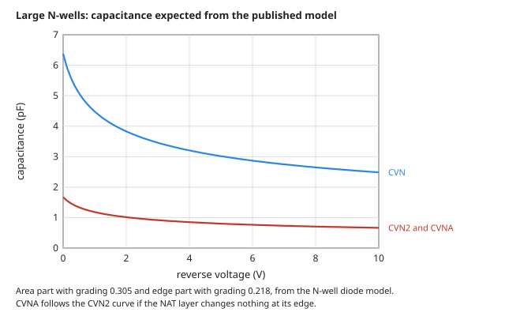
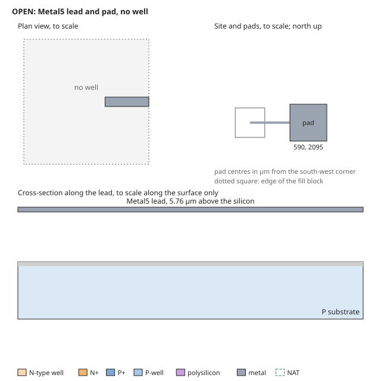
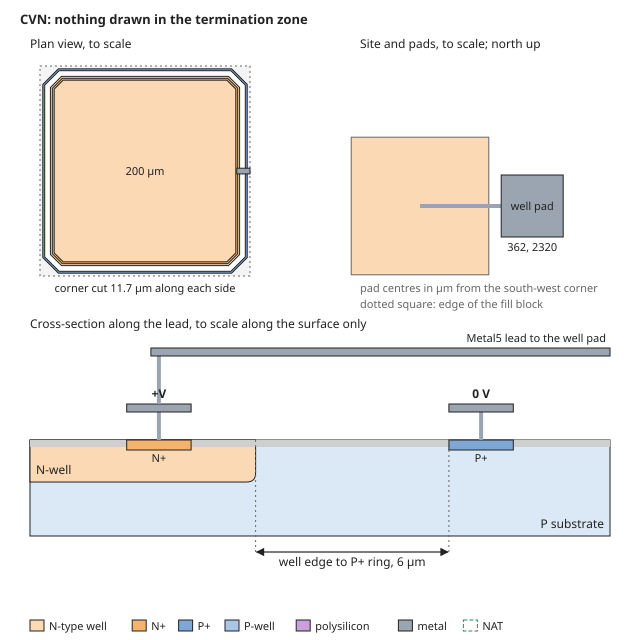
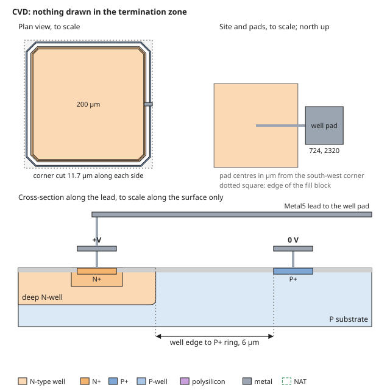
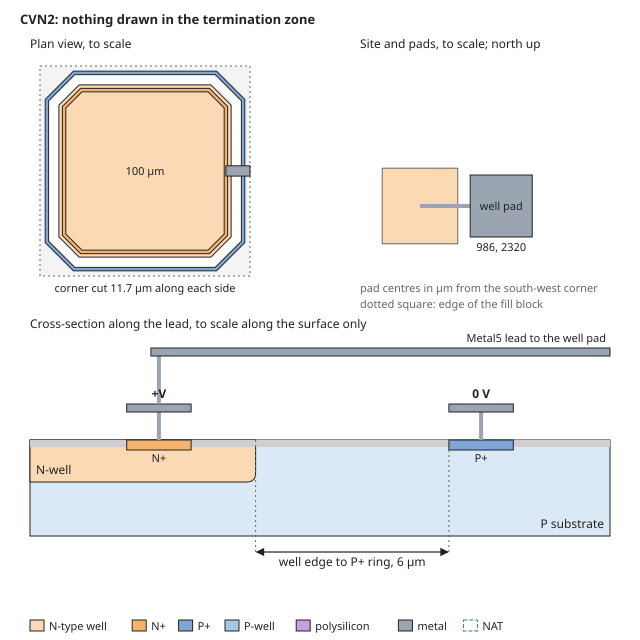
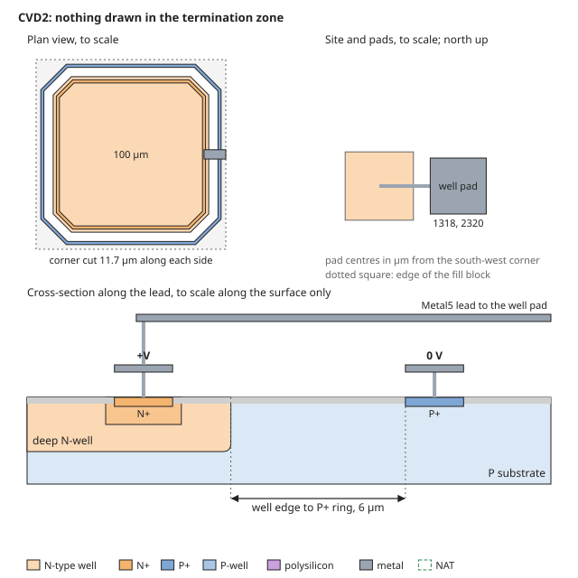
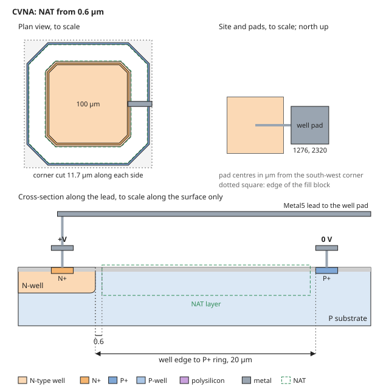

.. _hvt-g-capacitance-wells:

Capacitance wells and open reference
====================================

Five wells are large enough for their capacitance to be measured, and one
structure has a pad and a lead with no well. Together they give the doping
under the wells and the part of every reading that the pad contributes.

The group has 6 structures: :ref:`OPEN <hvt-s-open>`, :ref:`CVN
<hvt-s-cvn>`, :ref:`CVD <hvt-s-cvd>`, :ref:`CVN2 <hvt-s-cvn2>`, :ref:`CVD2
<hvt-s-cvd2>`, :ref:`CVNA <hvt-s-cvna>`.

Mechanism
---------

The capacitance of a reverse-biased junction is that of a slab of silicon as
thick as the depletion region. As the voltage rises the region widens and
the capacitance falls. How fast it falls at each voltage gives the doping at
the edge of the region, so a sweep reads the doping profile downwards from
the junction.

Expected results
----------------

A capacitance that keeps falling means lightly doped silicon continues below
the well. A capacitance that stops falling means the depletion region has
met a heavily doped layer. For an N-well that would be the deep P layer of
assumption D. :numref:`fig-hvt-g-capacitance-wells` shows the trend that the
simulation predicts.

         against reverse voltage from 0 V to 10 V, computed from the
         published junction model, falling from 6.4 pF to 2.5 pF and from
         1.7 pF to 0.7 pF. The structures of the group are OPEN, CVN, CVD,
         CVN2, CVD2, CVNA. The plotted values are those of the tables in the
         entries.

   Trend that the simulation predicts across the group.

Limits of the group
-------------------

The sweep cannot go beyond the breakdown voltage of the well's own edge. The
200 µm wells receive dummy fill inside the well. Series resistance in the
well and the substrate distorts the reading at high frequency.

.. _hvt-s-open:

OPEN
----

         100 µm square over bare substrate, with no well.

   OPEN in plan view and in cross-section.

.. list-table:: OPEN: drawn parameters and position
   :name: tab-hvt-s-open
   :header-rows: 1
   :widths: 35 65

   * - Parameter
     - Value
   * - Well
     - None
   * - Metal5 lead
     - 6 µm wide
   * - Site
     - Column 1 from the west, row 13 from the south
   * - Pad, centre x, y
     - 290, 2095 µm
   * - Substrate
     - Any of the seven SUB pads (:numref:`tab-hvt-pads`)

Purpose
   The part of every reading that is not the junction: a pad and a lead with
   no well. :numref:`fig-hvt-s-open` shows the structure and
   :numref:`tab-hvt-s-open` lists what is drawn.

How it works
   A Metal5 lead and a pad stand over bare substrate on a standard site.
   Whatever capacitance and leakage they show, every other structure shows
   too, and it is subtracted.

Compared with
   * :ref:`NT20 <hvt-s-nt20>`: no well under the lead in place of one.
   * :ref:`CVN2 <hvt-s-cvn2>`: no well in place of a large one.

Measurement
   Procedures :ref:`P1 <hvt-p1>` and :ref:`P2 <hvt-p2>` apply. The pad is at
   290, 2095 µm. Swept to the full 150 V on every die, which no junction
   structure may reach.

Predicted
   No breakdown voltage is simulated for this structure. Its current at each
   voltage is the floor below which no structure's current means anything.

Limits
   Its lead has the standard length, and those of the large wells differ by
   tens of micrometres. Dummy Metal4 lies under its pad as under every pad.

.. _hvt-s-cvn:

CVN
---

         with corners cut 11.7 µm along each side, an N+ contact ring inside
         its edge and a P+ ring 6 µm outside it; nothing drawn in the
         termination zone. A Metal5 lead joins the well to a pad at 372,
         2320 µm.

   CVN in plan view and in cross-section.

.. list-table:: CVN: drawn parameters and position
   :name: tab-hvt-s-cvn
   :header-rows: 1
   :widths: 35 65

   * - Parameter
     - Value
   * - Well
     - N-well
   * - Side of the well
     - 200 µm
   * - Corners
     - Cut of 11.7 µm along each side, for a nominal radius of 20 µm; eight vertices of 135°
   * - Area and perimeter
     - 39725 µm² and 772.5 µm
   * - N+ contact ring
     - 2 µm wide, 2 µm inside the well edge
   * - P+ ring
     - 2 µm wide, 6 µm from the well edge
   * - Fill block
     - None
   * - Metal5 lead
     - 6 µm wide
   * - Site
     - North band, position 1 from the west
   * - Well pad, centre x, y
     - 372, 2320 µm
   * - Substrate
     - Any of the seven SUB pads (:numref:`tab-hvt-pads`)

Purpose
   The large N-well: 200 µm across, for the doping profile under an N-well.
   :numref:`fig-hvt-s-cvn` shows the structure and :numref:`tab-hvt-s-cvn`
   lists what is drawn.

How it works
   Its flat bottom supplies more than nine tenths of its capacitance, so the
   reading is mostly that of a flat junction. Sweeping the reverse voltage
   moves the edge of the depletion region downwards and reads the doping
   there.

Compared with
   * :ref:`CVN2 <hvt-s-cvn2>`: 200 µm across in place of 100 µm.
   * :ref:`CVD <hvt-s-cvd>`: an N-well in place of a deep N-well.
   * :ref:`OPEN <hvt-s-open>`: a well under the lead in place of none.

Measurement
   Procedures :ref:`P1 <hvt-p1>` and :ref:`P2 <hvt-p2>` apply. The well pad
   is at 372, 2320 µm. :ref:`P1 <hvt-p1>` is run on one die only, to find
   the breakdown voltage that limits the bias of :ref:`P2 <hvt-p2>` on the
   others. The bias stays below 80 % of the breakdown voltage that :ref:`P1
   <hvt-p1>` gives for this well on another die.

Predicted
   No breakdown voltage is simulated for this structure. The published
   junction model gives its capacitance at zero bias
   (:numref:`tab-hvt-sp-cvn`). Its capacitance with that of :ref:`CVN2
   <hvt-s-cvn2>` gives the capacitance per area and per length of edge, and
   from the first the doping against depth.

Limits
   It has no fill block, so dummy fill lies inside the well. Its P+ ring is
   6 µm away, and if P-well surrounds it the sweep ends near 10 V.

.. list-table:: CVN: capacitance expected at zero bias from the published model
   :name: tab-hvt-sp-cvn
   :header-rows: 1
   :widths: 50 50

   * - Part
     - Capacitance (pF)
   * - Flat bottom
     - 5.925
   * - Edge
     - 0.454
   * - Total
     - 6.378

.. _hvt-s-cvd:

CVD
---

         across with corners cut 11.7 µm along each side, an N+ contact ring
         inside its edge and a P+ ring 6 µm outside it; nothing drawn in the
         termination zone. A Metal5 lead joins the well to a pad at 754,
         2320 µm.

   CVD in plan view and in cross-section.

.. list-table:: CVD: drawn parameters and position
   :name: tab-hvt-s-cvd
   :header-rows: 1
   :widths: 35 65

   * - Parameter
     - Value
   * - Well
     - Deep N-well, with an N-well band under its contact ring
   * - Side of the well
     - 200 µm
   * - Corners
     - Cut of 11.7 µm along each side, for a nominal radius of 20 µm; eight vertices of 135°
   * - Area and perimeter
     - 39725 µm² and 772.5 µm
   * - N+ contact ring
     - 2 µm wide, 2 µm inside the well edge
   * - P+ ring
     - 2 µm wide, 6 µm from the well edge
   * - Fill block
     - None
   * - Metal5 lead
     - 6 µm wide
   * - Site
     - North band, position 2 from the west
   * - Well pad, centre x, y
     - 754, 2320 µm
   * - Substrate
     - Any of the seven SUB pads (:numref:`tab-hvt-pads`)

Purpose
   The large deep N-well: 200 µm across, for the doping under a deep N-well.
   :numref:`fig-hvt-s-cvd` shows the structure and :numref:`tab-hvt-s-cvd`
   lists what is drawn.

How it works
   The published deep N-well capacitance falls unusually slowly with
   voltage. That is what a heavily doped layer close under the well would
   cause, because the depletion region has little room to widen. This well
   measures that curve on silicon.

Compared with
   * :ref:`CVD2 <hvt-s-cvd2>`: 200 µm across in place of 100 µm.
   * :ref:`CVN <hvt-s-cvn>`: a deep N-well in place of an N-well.

Measurement
   Procedures :ref:`P1 <hvt-p1>` and :ref:`P2 <hvt-p2>` apply. The well pad
   is at 754, 2320 µm. :ref:`P1 <hvt-p1>` is run on one die only, to find
   the breakdown voltage that limits the bias of :ref:`P2 <hvt-p2>` on the
   others. The bias stays below 80 % of this well's breakdown voltage, which
   is expected near 30 V.

Predicted
   No breakdown voltage is simulated for this structure. The published
   junction model gives its capacitance at zero bias
   (:numref:`tab-hvt-sp-cvd`). A capacitance that falls as slowly as the
   published model's confirms a heavily doped layer under the deep N-well.

Limits
   No fill block. The N-well band under its contact adds a little N-well
   capacitance at the perimeter.

.. list-table:: CVD: capacitance expected at zero bias from the published model
   :name: tab-hvt-sp-cvd
   :header-rows: 1
   :widths: 50 50

   * - Part
     - Capacitance (pF)
   * - Flat bottom
     - 9.136
   * - Edge
     - 0.559
   * - Total
     - 9.695

.. _hvt-s-cvn2:

CVN2
----

         with corners cut 11.7 µm along each side, an N+ contact ring inside
         its edge and a P+ ring 6 µm outside it; nothing drawn in the
         termination zone. A Metal5 lead joins the well to a pad at 1036,
         2320 µm.

   CVN2 in plan view and in cross-section.

.. list-table:: CVN2: drawn parameters and position
   :name: tab-hvt-s-cvn2
   :header-rows: 1
   :widths: 35 65

   * - Parameter
     - Value
   * - Well
     - N-well
   * - Side of the well
     - 100 µm
   * - Corners
     - Cut of 11.7 µm along each side, for a nominal radius of 20 µm; eight vertices of 135°
   * - Area and perimeter
     - 9725 µm² and 372.5 µm
   * - N+ contact ring
     - 2 µm wide, 2 µm inside the well edge
   * - P+ ring
     - 2 µm wide, 6 µm from the well edge
   * - Fill block
     - Whole structure
   * - Metal5 lead
     - 6 µm wide
   * - Site
     - North band, position 3 from the west
   * - Well pad, centre x, y
     - 1036, 2320 µm
   * - Substrate
     - Any of the seven SUB pads (:numref:`tab-hvt-pads`)

Purpose
   The small N-well: 100 µm across, to separate the capacitance of the edge
   from that of the bottom. :numref:`fig-hvt-s-cvn2` shows the structure and
   :numref:`tab-hvt-s-cvn2` lists what is drawn.

How it works
   Its area is a quarter of that of :ref:`CVN <hvt-s-cvn>` and its perimeter
   about half. The edge therefore supplies a larger share of its
   capacitance. Two wells of different size give two equations for the two
   unknowns.

Compared with
   * :ref:`CVN <hvt-s-cvn>`: 100 µm across in place of 200 µm.
   * :ref:`CVNA <hvt-s-cvna>`: no NAT and a ring at 6 µm in place of NAT and a ring at 20 µm.
   * :ref:`CVD2 <hvt-s-cvd2>`: an N-well in place of a deep N-well.

Measurement
   Procedures :ref:`P1 <hvt-p1>` and :ref:`P2 <hvt-p2>` apply. The well pad
   is at 1036, 2320 µm. :ref:`P1 <hvt-p1>` is run on one die only, to find
   the breakdown voltage that limits the bias of :ref:`P2 <hvt-p2>` on the
   others. As for :ref:`CVN <hvt-s-cvn>`.

Predicted
   No breakdown voltage is simulated for this structure. The published
   junction model gives its capacitance at zero bias
   (:numref:`tab-hvt-sp-cvn2`). With :ref:`CVN <hvt-s-cvn>`, the capacitance
   per area and per length of edge.

Limits
   It has a fill block, and :ref:`CVN <hvt-s-cvn>` has none. A difference
   caused by the fill would be read as edge capacitance.

.. list-table:: CVN2: capacitance expected at zero bias from the published model
   :name: tab-hvt-sp-cvn2
   :header-rows: 1
   :widths: 50 50

   * - Part
     - Capacitance (pF)
   * - Flat bottom
     - 1.450
   * - Edge
     - 0.219
   * - Total
     - 1.669

.. _hvt-s-cvd2:

CVD2
----

         across with corners cut 11.7 µm along each side, an N+ contact ring
         inside its edge and a P+ ring 6 µm outside it; nothing drawn in the
         termination zone. A Metal5 lead joins the well to a pad at 1318,
         2320 µm.

   CVD2 in plan view and in cross-section.

.. list-table:: CVD2: drawn parameters and position
   :name: tab-hvt-s-cvd2
   :header-rows: 1
   :widths: 35 65

   * - Parameter
     - Value
   * - Well
     - Deep N-well, with an N-well band under its contact ring
   * - Side of the well
     - 100 µm
   * - Corners
     - Cut of 11.7 µm along each side, for a nominal radius of 20 µm; eight vertices of 135°
   * - Area and perimeter
     - 9725 µm² and 372.5 µm
   * - N+ contact ring
     - 2 µm wide, 2 µm inside the well edge
   * - P+ ring
     - 2 µm wide, 6 µm from the well edge
   * - Fill block
     - Whole structure
   * - Metal5 lead
     - 6 µm wide
   * - Site
     - North band, position 4 from the west
   * - Well pad, centre x, y
     - 1318, 2320 µm
   * - Substrate
     - Any of the seven SUB pads (:numref:`tab-hvt-pads`)

Purpose
   The small deep N-well: 100 µm across, to separate edge from bottom for
   the deep N-well. :numref:`fig-hvt-s-cvd2` shows the structure and
   :numref:`tab-hvt-s-cvd2` lists what is drawn.

How it works
   As :ref:`CVN2 <hvt-s-cvn2>` is to :ref:`CVN <hvt-s-cvn>`. The edge of a
   deep N-well faces different silicon from its bottom, so the two parts may
   fall with voltage at different rates.

Compared with
   * :ref:`CVD <hvt-s-cvd>`: 100 µm across in place of 200 µm.
   * :ref:`CVN2 <hvt-s-cvn2>`: a deep N-well in place of an N-well.

Measurement
   Procedures :ref:`P1 <hvt-p1>` and :ref:`P2 <hvt-p2>` apply. The well pad
   is at 1318, 2320 µm. :ref:`P1 <hvt-p1>` is run on one die only, to find
   the breakdown voltage that limits the bias of :ref:`P2 <hvt-p2>` on the
   others. As for :ref:`CVD <hvt-s-cvd>`.

Predicted
   No breakdown voltage is simulated for this structure. The published
   junction model gives its capacitance at zero bias
   (:numref:`tab-hvt-sp-cvd2`). With :ref:`CVD <hvt-s-cvd>`, the capacitance
   per area and per length of edge of the deep N-well.

Limits
   As for :ref:`CVN2 <hvt-s-cvn2>`: it has a fill block and :ref:`CVD
   <hvt-s-cvd>` has none.

.. list-table:: CVD2: capacitance expected at zero bias from the published model
   :name: tab-hvt-sp-cvd2
   :header-rows: 1
   :widths: 50 50

   * - Part
     - Capacitance (pF)
   * - Flat bottom
     - 2.237
   * - Edge
     - 0.270
   * - Total
     - 2.506

.. _hvt-s-cvna:

CVNA
----

         with corners cut 11.7 µm along each side, an N+ contact ring inside
         its edge and a P+ ring 20 µm outside it; NAT from 0.6 µm. A Metal5
         lead joins the well to a pad at 1628, 2320 µm.

   CVNA in plan view and in cross-section.

.. list-table:: CVNA: drawn parameters and position
   :name: tab-hvt-s-cvna
   :header-rows: 1
   :widths: 35 65

   * - Parameter
     - Value
   * - Well
     - N-well
   * - Side of the well
     - 100 µm
   * - Corners
     - Cut of 11.7 µm along each side, for a nominal radius of 20 µm; eight vertices of 135°
   * - Area and perimeter
     - 9725 µm² and 372.5 µm
   * - N+ contact ring
     - 2 µm wide, 2 µm inside the well edge
   * - P+ ring
     - 2 µm wide, 20 µm from the well edge
   * - NAT layer
     - From 0.6 µm outside the well edge to 0.5 µm short of the P+ ring
   * - Fill block
     - Termination zone only
   * - Metal5 lead
     - 6 µm wide
   * - Site
     - North band, position 5 from the west
   * - Well pad, centre x, y
     - 1628, 2320 µm
   * - Substrate
     - Any of the seven SUB pads (:numref:`tab-hvt-pads`)

Purpose
   An N-well whose capacitance can be followed beyond the plain well's
   breakdown. That sweep shows whether a deep P layer lies under N-wells.
   :numref:`fig-hvt-s-cvna` shows the structure and :numref:`tab-hvt-s-cvna`
   lists what is drawn.

How it works
   NAT from 0.6 µm and a P+ ring 20 µm away let the well hold more voltage
   if NAT clears its edge. The depletion region under the bottom then
   reaches several micrometres down. If it meets a heavily doped P layer
   there, it stops widening and the capacitance stops falling.

Compared with
   * :ref:`CVN2 <hvt-s-cvn2>`: NAT and a ring at 20 µm in place of neither.
   * :ref:`NA0p6 <hvt-s-na0p6>`: a well 100 µm across in place of 30 µm.

Measurement
   Procedures :ref:`P1 <hvt-p1>` and :ref:`P2 <hvt-p2>` apply. The well pad
   is at 1628, 2320 µm. :ref:`P1 <hvt-p1>` is run on one die only, to find
   the breakdown voltage that limits the bias of :ref:`P2 <hvt-p2>` on the
   others. The bias follows the well's own breakdown voltage from :ref:`P1
   <hvt-p1>`, and may exceed the range of the meter's internal bias.

Predicted
   No breakdown voltage is simulated for this structure. The published
   junction model gives its capacitance at zero bias
   (:numref:`tab-hvt-sp-cvna`). Capacitance that flattens beyond about 15 V:
   a deep P layer under N-wells, assumption D. Capacitance that keeps
   falling: none within the depth reached.

Limits
   It works only if NAT clears the edge. Its ring distance differs from that
   of :ref:`CVN2 <hvt-s-cvn2>`, so the two do not differ in NAT alone.

.. list-table:: CVNA: capacitance expected at zero bias from the published model
   :name: tab-hvt-sp-cvna
   :header-rows: 1
   :widths: 50 50

   * - Part
     - Capacitance (pF)
   * - Flat bottom
     - 1.450
   * - Edge
     - 0.219
   * - Total
     - 1.669
