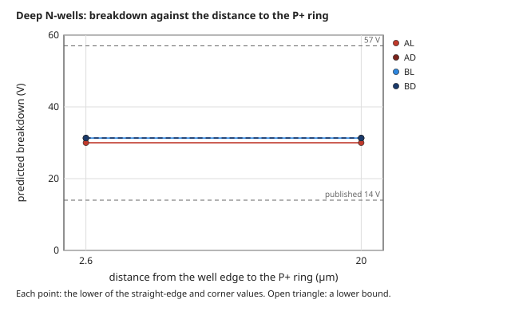
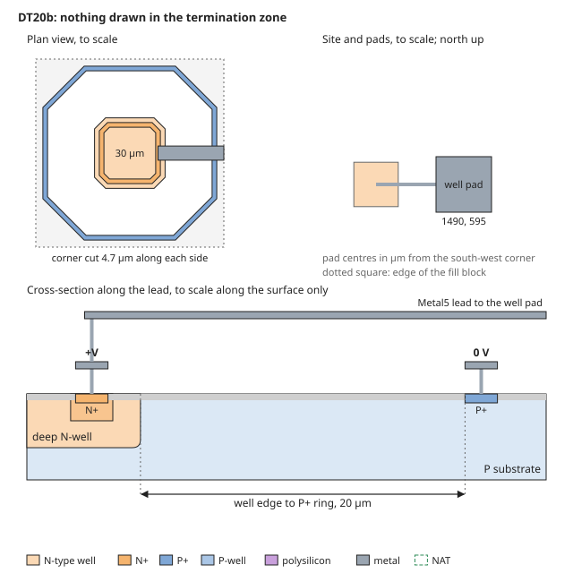
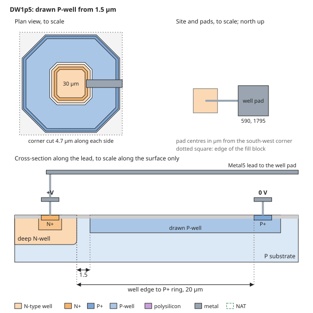
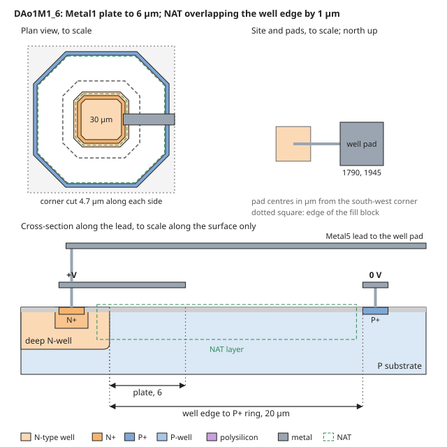

.. _hvt-g-deep-n-well:

Deep N-wells
============

The deep N-well structures are a reference group. They repeat the edge
variations of the other groups on a well that is expected to break down at
its bottom.

The group has 8 structures: :ref:`DT20b <hvt-s-dt20b>`, :ref:`DT2p6
<hvt-s-dt2p6>`, :ref:`DT20 <hvt-s-dt20>`, :ref:`DC0 <hvt-s-dc0>`,
:ref:`DW1p5 <hvt-s-dw1p5>`, :ref:`DAo1 <hvt-s-dao1>`, :ref:`DAo1C0
<hvt-s-dao1c0>`, :ref:`DAo1M1_6 <hvt-s-dao1m1-6>`.

Mechanism
---------

The published capacitance and breakdown of the deep N-well fit only if a
heavily doped P layer lies just under it. The depletion region under the
flat bottom is then held to a fraction of a micrometre, and the bottom
reaches the critical field near 30 V. That is below what any edge of the
well would hold, so nothing drawn at the edge changes the result.

Expected results
----------------

If the picture is right, every member breaks down near 30 V, the published
model value, whatever its ring distance, corner, P-well, NAT or plate. A
member that holds much more than the plain :ref:`DT20 <hvt-s-dt20>` shows
that the edge limits after all, and the deep-layer picture is wrong for it.
:numref:`fig-hvt-g-deep-n-well` shows the trend that the simulation
predicts.

         straight-edge and corner values, against the distance from the edge
         of the deep N-well to the P+ ring, 2.6 µm and 20 µm, one curve per
         process, with dashed lines at the published 14 V and at 57 V and an
         open triangle where a sweep ended without breakdown. The structures
         of the group are DT20b, DT2p6, DT20, DC0, DW1p5, DAo1, DAo1C0,
         DAo1M1_6. The plotted values are those of the tables in the
         entries.

   Trend that the simulation predicts across the group.

Limits of the group
-------------------

The simulated deep N-well is a buried layer with almost no donors at the
surface, so its indifference to the edge is partly built into the model. If
the real well is N-type up to the surface, the published value could be set
at the edge, and the members with a close ring, a P-well or NAT would then
differ. If the bottom does limit, the deep N-well is not a way to hold 57 V.

.. _hvt-s-dt20b:

DT20b
-----

         across with corners cut 4.7 µm along each side, an N+ contact ring
         inside its edge and a P+ ring 20 µm outside it; nothing drawn in
         the termination zone. A Metal5 lead joins the well to a pad at
         1490, 595 µm.

   DT20b in plan view and in cross-section.

.. list-table:: DT20b: drawn parameters and position
   :name: tab-hvt-s-dt20b
   :header-rows: 1
   :widths: 35 65

   * - Parameter
     - Value
   * - Well
     - Deep N-well, with an N-well band under its contact ring
   * - Side of the well
     - 30 µm
   * - Corners
     - Cut of 4.7 µm along each side, for a nominal radius of 8 µm; eight vertices of 135°
   * - Area and perimeter
     - 856 µm² and 109.0 µm
   * - N+ contact ring
     - 2 µm wide, 2 µm inside the well edge
   * - P+ ring
     - 2 µm wide, 20 µm from the well edge
   * - Fill block
     - Whole structure
   * - Metal5 lead
     - 6 µm wide
   * - Site
     - Column 5 from the west, row 3 from the south
   * - Well pad, centre x, y
     - 1490, 595 µm
   * - Substrate
     - Any of the seven SUB pads (:numref:`tab-hvt-pads`)

Purpose
   Gives the spread across the die for a deep N-well: a second copy of
   :ref:`DT20 <hvt-s-dt20>`. :numref:`fig-hvt-s-dt20b` shows the structure
   and :numref:`tab-hvt-s-dt20b` lists what is drawn.

How it works
   The drawing is identical to :ref:`DT20 <hvt-s-dt20>`. A breakdown at the
   flat bottom depends on implant doses and not on mask edges, so the two
   copies should agree more closely than the plain N-well pair.

Compared with
   * :ref:`DT20 <hvt-s-dt20>`: nothing but the position on the die: the two stand at opposite
     ends.
   * :ref:`NT20b <hvt-s-nt20b>`: the same check on an N-well.

Measurement
   Procedure :ref:`P1 <hvt-p1>` applies. The well pad is at 1490, 595 µm.
   Swept with the same settings as :ref:`DT20 <hvt-s-dt20>` and in the same
   session.

Predicted
   The simulated breakdown voltages are in :numref:`tab-hvt-sp-dt20b`. The
   row of each family's nominal process also gives the family's band, its
   agreement range and the predicted ratio to the reference structure. A
   spread smaller than that of :ref:`NT20 <hvt-s-nt20>` and :ref:`NT20b
   <hvt-s-nt20b>` supports a breakdown that does not depend on the edge.

Limits
   One pair, as for the plain well.

.. list-table:: DT20b: predicted breakdown voltage by process
   :name: tab-hvt-sp-dt20b
   :header-rows: 1
   :widths: 18 16 16 17 17 16

   * - Process
     - Straight edge (V)
     - Corner section (V)
     - Family band (V)
     - Agreement range (V)
     - Predicted ratio
   * - AL, AnL
     - 32.4
     - 30.0
     - 30.0 to 30.0
     - 21.0 to 34.5
     - 1.00 of :ref:`DT20 <hvt-s-dt20>`
   * - AD, AnD
     - 32.4
     - 31.3
     - 31.3 to 31.3
     - 21.9 to 36.0
     - 1.00 of :ref:`DT20 <hvt-s-dt20>`
   * - BL
     - 32.4
     - 31.3
     - 31.3 to 31.3
     - 21.9 to 36.0
     - 1.00 of :ref:`DT20 <hvt-s-dt20>`
   * - BLq
     - 32.3
     - 31.3
     - –
     - –
     - –
   * - BD
     - 32.4
     - 31.3
     - 31.3 to 31.3
     - 21.9 to 36.0
     - 1.00 of :ref:`DT20 <hvt-s-dt20>`

.. _hvt-s-dt2p6:

DT2p6
-----

.. figure:: hvt-s-DT2p6.svg
   :name: fig-hvt-s-dt2p6
   :alt: Plan view and cross-section of DT2p6: a deep N-well 30 µm
         across with corners cut 4.7 µm along each side, an N+ contact ring
         inside its edge and a P+ ring 2.6 µm outside it; nothing drawn in
         the termination zone. A Metal5 lead joins the well to a pad at
         1490, 1645 µm.

   DT2p6 in plan view and in cross-section.

.. list-table:: DT2p6: drawn parameters and position
   :name: tab-hvt-s-dt2p6
   :header-rows: 1
   :widths: 35 65

   * - Parameter
     - Value
   * - Well
     - Deep N-well, with an N-well band under its contact ring
   * - Side of the well
     - 30 µm
   * - Corners
     - Cut of 4.7 µm along each side, for a nominal radius of 8 µm; eight vertices of 135°
   * - Area and perimeter
     - 856 µm² and 109.0 µm
   * - N+ contact ring
     - 2 µm wide, 2 µm inside the well edge
   * - P+ ring
     - 2 µm wide, 2.6 µm from the well edge
   * - Fill block
     - Whole structure
   * - Metal5 lead
     - 6 µm wide
   * - Site
     - Column 5 from the west, row 10 from the south
   * - Well pad, centre x, y
     - 1490, 1645 µm
   * - Substrate
     - Any of the seven SUB pads (:numref:`tab-hvt-pads`)

Purpose
   A deep N-well with its P+ ring as close as the rules allow, 2.6 µm.
   :numref:`fig-hvt-s-dt2p6` shows the structure and
   :numref:`tab-hvt-s-dt2p6` lists what is drawn.

How it works
   At 2.6 µm the ring would cut the edge's depletion region short if the
   edge held the voltage. If the bottom fails first, the ring's distance is
   irrelevant.

Compared with
   * :ref:`DT20 <hvt-s-dt20>`: the ring is at 2.6 µm in place of 20 µm.
   * :ref:`NT1 <hvt-s-nt1>`: the nearest ring on a deep N-well in place of on an N-well.

Measurement
   Procedure :ref:`P1 <hvt-p1>` applies. The well pad is at 1490, 1645 µm.

Predicted
   The simulated breakdown voltages are in :numref:`tab-hvt-sp-dt2p6`. The
   row of each family's nominal process also gives the family's band, its
   agreement range and the predicted ratio to the reference structure. Equal
   to :ref:`DT20 <hvt-s-dt20>`: the bottom limits. Lower: the edge does, at
   least with the ring this close.

Limits
   Under assumption A a generated P-well would start 1.5 µm out, inside the
   ring, and would act before the ring.

.. list-table:: DT2p6: predicted breakdown voltage by process
   :name: tab-hvt-sp-dt2p6
   :header-rows: 1
   :widths: 18 16 16 17 17 16

   * - Process
     - Straight edge (V)
     - Corner section (V)
     - Family band (V)
     - Agreement range (V)
     - Predicted ratio
   * - AL, AnL
     - 32.4
     - 30.0
     - 30.0 to 30.0
     - 21.0 to 34.5
     - 1.00 of :ref:`DT20 <hvt-s-dt20>`
   * - AD, AnD
     - 32.3
     - 31.3
     - 31.3 to 31.3
     - 21.9 to 36.0
     - 1.00 of :ref:`DT20 <hvt-s-dt20>`
   * - BL
     - 32.4
     - 31.3
     - 31.3 to 31.3
     - 21.9 to 36.0
     - 1.00 of :ref:`DT20 <hvt-s-dt20>`
   * - BLq
     - 32.3
     - 31.3
     - –
     - –
     - –
   * - BD
     - 32.4
     - 31.3
     - 31.3 to 31.3
     - 21.9 to 36.0
     - 1.00 of :ref:`DT20 <hvt-s-dt20>`

.. _hvt-s-dt20:

DT20
----

         across with corners cut 4.7 µm along each side, an N+ contact ring
         inside its edge and a P+ ring 20 µm outside it; nothing drawn in
         the termination zone. A Metal5 lead joins the well to a pad at
         1790, 1645 µm.

   DT20 in plan view and in cross-section.

.. list-table:: DT20: drawn parameters and position
   :name: tab-hvt-s-dt20
   :header-rows: 1
   :widths: 35 65

   * - Parameter
     - Value
   * - Well
     - Deep N-well, with an N-well band under its contact ring
   * - Side of the well
     - 30 µm
   * - Corners
     - Cut of 4.7 µm along each side, for a nominal radius of 8 µm; eight vertices of 135°
   * - Area and perimeter
     - 856 µm² and 109.0 µm
   * - N+ contact ring
     - 2 µm wide, 2 µm inside the well edge
   * - P+ ring
     - 2 µm wide, 20 µm from the well edge
   * - Fill block
     - Whole structure
   * - Metal5 lead
     - 6 µm wide
   * - Site
     - Column 6 from the west, row 10 from the south
   * - Well pad, centre x, y
     - 1790, 1645 µm
   * - Substrate
     - Any of the seven SUB pads (:numref:`tab-hvt-pads`)

Purpose
   The reference deep N-well: default dimensions, nothing drawn round it.
   :numref:`fig-hvt-s-dt20` shows the structure and :numref:`tab-hvt-s-dt20`
   lists what is drawn.

How it works
   The deep N-well is implanted deep, with its peak about 2.5 µm down, and
   reaches the surface only through the N-well band under its contact. Its
   junction to a P layer just below it is the most heavily doped junction it
   has, and fails first.

Compared with
   * :ref:`NT20 <hvt-s-nt20>`: a deep N-well in place of an N-well.
   * :ref:`DT20b <hvt-s-dt20b>`: nothing: a second copy.
   * :ref:`DT2p6 <hvt-s-dt2p6>`: the ring is at 20 µm in place of 2.6 µm.

Measurement
   Procedure :ref:`P1 <hvt-p1>` applies. The well pad is at 1790, 1645 µm.
   Swept again at 85 °C.

Predicted
   The simulated breakdown voltages are in :numref:`tab-hvt-sp-dt20`. The
   row of each family's nominal process also gives the family's band, its
   agreement range and the predicted ratio to the reference structure. Near
   the published 30 V: the deep-layer picture holds. Far above it: the model
   value does not describe this well.

Limits
   A breakdown at the bottom cannot be told from one at the edge by this
   structure alone; the rest of the group does that.

.. list-table:: DT20: predicted breakdown voltage by process
   :name: tab-hvt-sp-dt20
   :header-rows: 1
   :widths: 18 16 16 17 17 16

   * - Process
     - Straight edge (V)
     - Corner section (V)
     - Family band (V)
     - Agreement range (V)
     - Predicted ratio
   * - AL, AnL
     - 32.4
     - 30.0
     - 30.0 to 30.3
     - 21.0 to 34.8
     - 1 (reference)
   * - ALhi
     - 32.4
     - 30.3
     - –
     - –
     - –
   * - AD, AnD
     - 32.4
     - 31.3
     - 31.3 to 31.3
     - 21.9 to 36.0
     - 1 (reference)
   * - BL
     - 32.4
     - 31.3
     - 30.3 to 31.3
     - 21.2 to 36.0
     - 1 (reference)
   * - BLhi
     - 32.4
     - 31.3
     - –
     - –
     - –
   * - BLlo
     - 32.2
     - 31.2
     - –
     - –
     - –
   * - BLq
     - 32.3
     - 31.3
     - –
     - –
     - –
   * - BLq3
     - 32.4
     - 30.3
     - –
     - –
     - –
   * - BD
     - 32.4
     - 31.3
     - 31.2 to 31.3
     - 21.8 to 36.0
     - 1 (reference)
   * - BDhi
     - 32.4
     - 31.3
     - –
     - –
     - –
   * - BDlo
     - 32.2
     - 31.2
     - –
     - –
     - –

.. _hvt-s-dc0:

DC0
---

.. figure:: hvt-s-DC0.svg
   :name: fig-hvt-s-dc0
   :alt: Plan view and cross-section of DC0: a deep N-well 30 µm
         across with square corners, an N+ contact ring inside its edge and
         a P+ ring 20 µm outside it; nothing drawn in the termination zone.
         A Metal5 lead joins the well to a pad at 290, 1795 µm.

   DC0 in plan view and in cross-section.

.. list-table:: DC0: drawn parameters and position
   :name: tab-hvt-s-dc0
   :header-rows: 1
   :widths: 35 65

   * - Parameter
     - Value
   * - Well
     - Deep N-well, with an N-well band under its contact ring
   * - Side of the well
     - 30 µm
   * - Corners
     - Square; four vertices of 90°
   * - Area and perimeter
     - 900 µm² and 120.0 µm
   * - N+ contact ring
     - 2 µm wide, 2 µm inside the well edge
   * - P+ ring
     - 2 µm wide, 20 µm from the well edge
   * - Fill block
     - Whole structure
   * - Metal5 lead
     - 6 µm wide
   * - Site
     - Column 1 from the west, row 11 from the south
   * - Well pad, centre x, y
     - 290, 1795 µm
   * - Substrate
     - Any of the seven SUB pads (:numref:`tab-hvt-pads`)

Purpose
   A deep N-well with square corners. :numref:`fig-hvt-s-dc0` shows the
   structure and :numref:`tab-hvt-s-dc0` lists what is drawn.

How it works
   A deep implant spreads sideways more than a shallow one, so its corners
   are rounder below the surface than the drawing. A square corner should
   cost a deep N-well less than it costs an N-well, and nothing if the
   bottom fails first.

Compared with
   * :ref:`DT20 <hvt-s-dt20>`: four 90° vertices in place of eight of 135°.
   * :ref:`NC0 <hvt-s-nc0>`: a deep N-well in place of an N-well.

Measurement
   Procedure :ref:`P1 <hvt-p1>` applies. The well pad is at 290, 1795 µm.

Predicted
   The simulated breakdown voltages are in :numref:`tab-hvt-sp-dc0`. The row
   of each family's nominal process also gives the family's band, its
   agreement range and the predicted ratio to the reference structure. Equal
   to :ref:`DT20 <hvt-s-dt20>`: corners do not matter for this well.

Limits
   The N-well band under the contact follows the square outline 2 µm inside
   the edge, and has sharp corners of its own.

.. list-table:: DC0: predicted breakdown voltage by process
   :name: tab-hvt-sp-dc0
   :header-rows: 1
   :widths: 18 16 16 17 17 16

   * - Process
     - Straight edge (V)
     - Corner section (V)
     - Family band (V)
     - Agreement range (V)
     - Predicted ratio
   * - AL, AnL
     - 32.4
     - > 32.6
     - 32.4 to 32.4
     - 22.7 to 37.3
     - 1.08 of :ref:`DT20 <hvt-s-dt20>`
   * - AD, AnD
     - 32.4
     - > 32.4
     - 32.4 to 32.4
     - 22.7 to 37.3
     - 1.04 of :ref:`DT20 <hvt-s-dt20>`
   * - BL
     - 32.4
     - 33.7
     - 32.3 to 32.4
     - 22.6 to 37.3
     - 1.04 of :ref:`DT20 <hvt-s-dt20>`
   * - BLq
     - 32.3
     - 32.9
     - –
     - –
     - –
   * - BD
     - 32.4
     - 33.5
     - 32.4 to 32.4
     - 22.7 to 37.3
     - 1.04 of :ref:`DT20 <hvt-s-dt20>`

.. _hvt-s-dw1p5:

DW1p5
-----

         across with corners cut 4.7 µm along each side, an N+ contact ring
         inside its edge and a P+ ring 20 µm outside it; drawn P-well from
         1.5 µm. A Metal5 lead joins the well to a pad at 590, 1795 µm.

   DW1p5 in plan view and in cross-section.

.. list-table:: DW1p5: drawn parameters and position
   :name: tab-hvt-s-dw1p5
   :header-rows: 1
   :widths: 35 65

   * - Parameter
     - Value
   * - Well
     - Deep N-well, with an N-well band under its contact ring
   * - Side of the well
     - 30 µm
   * - Corners
     - Cut of 4.7 µm along each side, for a nominal radius of 8 µm; eight vertices of 135°
   * - Area and perimeter
     - 856 µm² and 109.0 µm
   * - N+ contact ring
     - 2 µm wide, 2 µm inside the well edge
   * - P+ ring
     - 2 µm wide, 20 µm from the well edge
   * - Drawn P-well
     - From 1.5 µm outside the well edge to 1 µm beyond the P+ ring
   * - Fill block
     - Whole structure
   * - Metal5 lead
     - 6 µm wide
   * - Site
     - Column 2 from the west, row 11 from the south
   * - Well pad, centre x, y
     - 590, 1795 µm
   * - Substrate
     - Any of the seven SUB pads (:numref:`tab-hvt-pads`)

Purpose
   A deep N-well with a drawn P-well as close as the rules allow, 1.5 µm.
   :numref:`fig-hvt-s-dw1p5` shows the structure and
   :numref:`tab-hvt-s-dw1p5` lists what is drawn.

How it works
   This is the surrounding that assumption A gives every deep N-well without
   anyone drawing it. If the edge held the voltage, a P-well this close
   would cost part of it, as on :ref:`NW1p5 <hvt-s-nw1p5>`.

Compared with
   * :ref:`DT20 <hvt-s-dt20>`: a drawn P-well from 1.5 µm in place of none.
   * :ref:`NW1p5 <hvt-s-nw1p5>`: a deep N-well in place of an N-well.

Measurement
   Procedure :ref:`P1 <hvt-p1>` applies. The well pad is at 590, 1795 µm.

Predicted
   The simulated breakdown voltages are in :numref:`tab-hvt-sp-dw1p5`. The
   row of each family's nominal process also gives the family's band, its
   agreement range and the predicted ratio to the reference structure. Equal
   to :ref:`DT20 <hvt-s-dt20>`: either the bottom limits, or the foundry
   already generates this P-well round :ref:`DT20 <hvt-s-dt20>`.

Limits
   Those two readings cannot be separated here; :ref:`DAo1 <hvt-s-dao1>`
   separates them.

.. list-table:: DW1p5: predicted breakdown voltage by process
   :name: tab-hvt-sp-dw1p5
   :header-rows: 1
   :widths: 18 16 16 17 17 16

   * - Process
     - Straight edge (V)
     - Corner section (V)
     - Family band (V)
     - Agreement range (V)
     - Predicted ratio
   * - AL, AnL
     - 32.4
     - 30.0
     - 30.0 to 30.0
     - 21.0 to 34.5
     - 1.00 of :ref:`DT20 <hvt-s-dt20>`
   * - AD, AnD
     - 32.4
     - 31.3
     - 31.3 to 31.3
     - 21.9 to 36.0
     - 1.00 of :ref:`DT20 <hvt-s-dt20>`
   * - BL
     - 31.7
     - 30.7
     - 30.7 to 31.3
     - 21.5 to 36.0
     - 0.98 of :ref:`DT20 <hvt-s-dt20>`
   * - BLq
     - 31.7
     - 31.3
     - –
     - –
     - –
   * - BD
     - 31.7
     - 30.7
     - 30.7 to 30.7
     - 21.5 to 35.3
     - 0.98 of :ref:`DT20 <hvt-s-dt20>`

.. _hvt-s-dao1:

DAo1
----

.. figure:: hvt-s-DAo1.svg
   :name: fig-hvt-s-dao1
   :alt: Plan view and cross-section of DAo1: a deep N-well 30 µm
         across with corners cut 4.7 µm along each side, an N+ contact ring
         inside its edge and a P+ ring 20 µm outside it; NAT overlapping the
         well edge by 1 µm. A Metal5 lead joins the well to a pad at 1790,
         1795 µm.

   DAo1 in plan view and in cross-section.

.. list-table:: DAo1: drawn parameters and position
   :name: tab-hvt-s-dao1
   :header-rows: 1
   :widths: 35 65

   * - Parameter
     - Value
   * - Well
     - Deep N-well, with an N-well band under its contact ring
   * - Side of the well
     - 30 µm
   * - Corners
     - Cut of 4.7 µm along each side, for a nominal radius of 8 µm; eight vertices of 135°
   * - Area and perimeter
     - 856 µm² and 109.0 µm
   * - N+ contact ring
     - 2 µm wide, 2 µm inside the well edge
   * - P+ ring
     - 2 µm wide, 20 µm from the well edge
   * - NAT layer
     - From 1 µm inside the well edge to 0.5 µm short of the P+ ring
   * - Fill block
     - Whole structure
   * - Metal5 lead
     - 6 µm wide
   * - Site
     - Column 6 from the west, row 11 from the south
   * - Well pad, centre x, y
     - 1790, 1795 µm
   * - Substrate
     - Any of the seven SUB pads (:numref:`tab-hvt-pads`)

Purpose
   A deep N-well with NAT over its edge, so that no P-well can lie beside
   the junction. :numref:`fig-hvt-s-dao1` shows the structure and
   :numref:`tab-hvt-s-dao1` lists what is drawn.

How it works
   NAT starts 1 µm inside the well edge and covers the whole termination
   zone, which the rules allow on a deep N-well. If the edge limited a deep
   N-well because of nearby P-well, removing the P-well would raise the
   breakdown voltage.

Compared with
   * :ref:`DT20 <hvt-s-dt20>`: NAT over the edge in place of none.
   * :ref:`DW1p5 <hvt-s-dw1p5>`: no P-well possible in place of a drawn one at 1.5 µm.
   * :ref:`NA0p6 <hvt-s-na0p6>`: NAT overlapping the edge in place of 0.6 µm away.

Measurement
   Procedure :ref:`P1 <hvt-p1>` applies. The well pad is at 1790, 1795 µm.

Predicted
   The simulated breakdown voltages are in :numref:`tab-hvt-sp-dao1`. The
   row of each family's nominal process also gives the family's band, its
   agreement range and the predicted ratio to the reference structure. Equal
   to :ref:`DT20 <hvt-s-dt20>`: the bottom limits, with or without P-well at
   the edge. Much higher: P-well beside the edge was the limit, and NAT
   removes it.

Limits
   Whether the foundry accepts NAT here with no transistor is not known,
   although the rule check passes it.

.. list-table:: DAo1: predicted breakdown voltage by process
   :name: tab-hvt-sp-dao1
   :header-rows: 1
   :widths: 18 16 16 17 17 16

   * - Process
     - Straight edge (V)
     - Corner section (V)
     - Family band (V)
     - Agreement range (V)
     - Predicted ratio
   * - AL
     - 32.4
     - 31.1
     - 31.1 to 31.3
     - 21.8 to 36.0
     - 1.04 of :ref:`DT20 <hvt-s-dt20>`
   * - ALhi
     - 32.4
     - 31.3
     - –
     - –
     - –
   * - AD
     - 32.4
     - 31.3
     - 31.3 to 31.3
     - 21.9 to 36.0
     - 1.00 of :ref:`DT20 <hvt-s-dt20>`
   * - BL
     - 32.4
     - 31.3
     - 30.3 to 31.3
     - 21.2 to 36.0
     - 1.00 of :ref:`DT20 <hvt-s-dt20>`
   * - BLhi
     - 32.4
     - 31.3
     - –
     - –
     - –
   * - BLlo
     - 32.2
     - 31.2
     - –
     - –
     - –
   * - BLq
     - 32.3
     - 31.3
     - –
     - –
     - –
   * - BLq3
     - 32.4
     - 30.3
     - –
     - –
     - –
   * - BD
     - 32.4
     - 31.3
     - 31.2 to 31.3
     - 21.8 to 36.0
     - 1.00 of :ref:`DT20 <hvt-s-dt20>`
   * - BDhi
     - 32.4
     - 31.3
     - –
     - –
     - –
   * - BDlo
     - 32.2
     - 31.2
     - –
     - –
     - –

.. _hvt-s-dao1c0:

DAo1C0
------

         across with square corners, an N+ contact ring inside its edge and
         a P+ ring 20 µm outside it; NAT overlapping the well edge by 1 µm.
         A Metal5 lead joins the well to a pad at 290, 1945 µm.

   DAo1C0 in plan view and in cross-section.

.. list-table:: DAo1C0: drawn parameters and position
   :name: tab-hvt-s-dao1c0
   :header-rows: 1
   :widths: 35 65

   * - Parameter
     - Value
   * - Well
     - Deep N-well, with an N-well band under its contact ring
   * - Side of the well
     - 30 µm
   * - Corners
     - Square; four vertices of 90°
   * - Area and perimeter
     - 900 µm² and 120.0 µm
   * - N+ contact ring
     - 2 µm wide, 2 µm inside the well edge
   * - P+ ring
     - 2 µm wide, 20 µm from the well edge
   * - NAT layer
     - From 1 µm inside the well edge to 0.5 µm short of the P+ ring
   * - Fill block
     - Whole structure
   * - Metal5 lead
     - 6 µm wide
   * - Site
     - Column 1 from the west, row 12 from the south
   * - Well pad, centre x, y
     - 290, 1945 µm
   * - Substrate
     - Any of the seven SUB pads (:numref:`tab-hvt-pads`)

Purpose
   A deep N-well with NAT over its edge and square corners.
   :numref:`fig-hvt-s-dao1c0` shows the structure and
   :numref:`tab-hvt-s-dao1c0` lists what is drawn.

How it works
   If NAT frees the edge, the corners become the weak points, as on an
   N-well in bare substrate. This structure measures them at their sharpest.

Compared with
   * :ref:`DAo1 <hvt-s-dao1>`: four 90° vertices in place of eight of 135°.
   * :ref:`DC0 <hvt-s-dc0>`: NAT over the edge in place of none.

Measurement
   Procedure :ref:`P1 <hvt-p1>` applies. The well pad is at 290, 1945 µm.

Predicted
   The simulated breakdown voltages are in :numref:`tab-hvt-sp-dao1c0`. The
   row of each family's nominal process also gives the family's band, its
   agreement range and the predicted ratio to the reference structure. Equal
   to :ref:`DAo1 <hvt-s-dao1>`.

Limits
   Useful only if :ref:`DAo1 <hvt-s-dao1>` is much above :ref:`DT20
   <hvt-s-dt20>`.

.. list-table:: DAo1C0: predicted breakdown voltage by process
   :name: tab-hvt-sp-dao1c0
   :header-rows: 1
   :widths: 18 16 16 17 17 16

   * - Process
     - Straight edge (V)
     - Corner section (V)
     - Family band (V)
     - Agreement range (V)
     - Predicted ratio
   * - AL
     - 32.4
     - 33.8
     - 32.4 to 32.4
     - 22.7 to 37.3
     - 1.08 of :ref:`DT20 <hvt-s-dt20>`
   * - AD
     - 32.4
     - 33.5
     - 32.4 to 32.4
     - 22.7 to 37.3
     - 1.04 of :ref:`DT20 <hvt-s-dt20>`
   * - BL
     - 32.4
     - 33.7
     - 32.3 to 32.4
     - 22.6 to 37.3
     - 1.04 of :ref:`DT20 <hvt-s-dt20>`
   * - BLq
     - 32.3
     - 32.9
     - –
     - –
     - –
   * - BD
     - 32.4
     - 33.5
     - 32.4 to 32.4
     - 22.7 to 37.3
     - 1.04 of :ref:`DT20 <hvt-s-dt20>`

.. _hvt-s-dao1m1-6:

DAo1M1_6
--------

         across with corners cut 4.7 µm along each side, an N+ contact ring
         inside its edge and a P+ ring 20 µm outside it; Metal1 plate to 6
         µm; NAT overlapping the well edge by 1 µm. A Metal5 lead joins the
         well to a pad at 590, 1945 µm.

   DAo1M1_6 in plan view and in cross-section.

.. list-table:: DAo1M1_6: drawn parameters and position
   :name: tab-hvt-s-dao1m1-6
   :header-rows: 1
   :widths: 35 65

   * - Parameter
     - Value
   * - Well
     - Deep N-well, with an N-well band under its contact ring
   * - Side of the well
     - 30 µm
   * - Corners
     - Cut of 4.7 µm along each side, for a nominal radius of 8 µm; eight vertices of 135°
   * - Area and perimeter
     - 856 µm² and 109.0 µm
   * - N+ contact ring
     - 2 µm wide, 2 µm inside the well edge
   * - P+ ring
     - 2 µm wide, 20 µm from the well edge
   * - Metal1 plate
     - From the contact ring to 6 µm outside the edge; joined to the well
   * - NAT layer
     - From 1 µm inside the well edge to 0.5 µm short of the P+ ring
   * - Fill block
     - Whole structure
   * - Metal5 lead
     - 6 µm wide
   * - Site
     - Column 2 from the west, row 12 from the south
   * - Well pad, centre x, y
     - 590, 1945 µm
   * - Substrate
     - Any of the seven SUB pads (:numref:`tab-hvt-pads`)

Purpose
   A deep N-well with NAT over its edge and a Metal1 plate of 6 µm: every
   edge remedy the die has, on one well. :numref:`fig-hvt-s-dao1m1-6` shows
   the structure and :numref:`tab-hvt-s-dao1m1-6` lists what is drawn.

How it works
   NAT removes any P-well and the plate relieves the curved edge. If the
   edge were what limits a deep N-well, this structure would hold the most
   of the group.

Compared with
   * :ref:`DAo1 <hvt-s-dao1>`: a Metal1 plate of 6 µm in place of none.
   * :ref:`DM1_6 <hvt-s-dm1-6>`: NAT over the edge in place of none.
   * :ref:`NAM1_6 <hvt-s-nam1-6>`: a deep N-well in place of an N-well.

Measurement
   Procedure :ref:`P1 <hvt-p1>` applies. The well pad is at 590, 1945 µm.

Predicted
   The simulated breakdown voltages are in :numref:`tab-hvt-sp-dao1m1-6`.
   The row of each family's nominal process also gives the family's band,
   its agreement range and the predicted ratio to the reference structure.
   Equal to :ref:`DT20 <hvt-s-dt20>`: nothing at the edge matters, and the
   deep N-well's limit is its bottom. This is the decisive member of the
   group.

Limits
   None beyond those of the group.

.. list-table:: DAo1M1_6: predicted breakdown voltage by process
   :name: tab-hvt-sp-dao1m1-6
   :header-rows: 1
   :widths: 18 16 16 17 17 16

   * - Process
     - Straight edge (V)
     - Corner section (V)
     - Family band (V)
     - Agreement range (V)
     - Predicted ratio
   * - AL
     - 32.4
     - 30.3
     - 30.3 to 30.3
     - 21.2 to 34.8
     - 1.01 of :ref:`DT20 <hvt-s-dt20>`
   * - AD
     - 32.4
     - 31.3
     - 31.3 to 31.3
     - 21.9 to 36.0
     - 1.00 of :ref:`DT20 <hvt-s-dt20>`
   * - BL
     - 32.3
     - 30.3
     - 30.3 to 31.3
     - 21.2 to 36.0
     - 0.97 of :ref:`DT20 <hvt-s-dt20>`
   * - BLq
     - 32.3
     - 31.3
     - –
     - –
     - –
   * - BD
     - 32.4
     - 31.3
     - 31.3 to 31.3
     - 21.9 to 36.0
     - 1.00 of :ref:`DT20 <hvt-s-dt20>`
