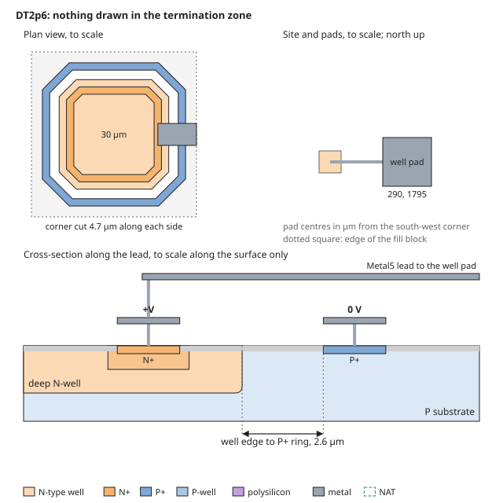
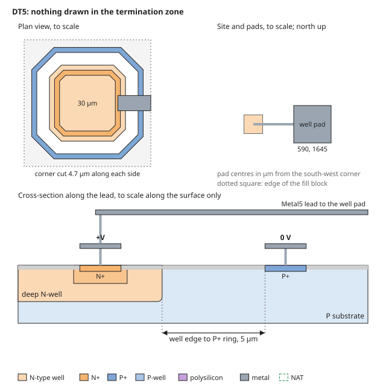
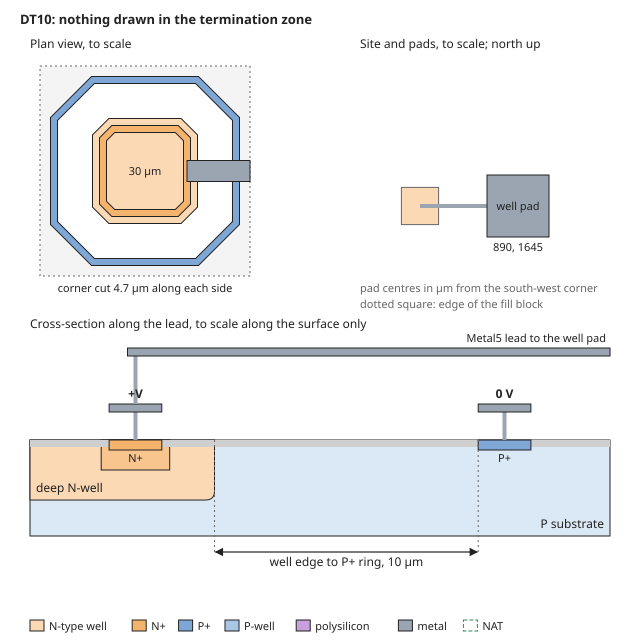
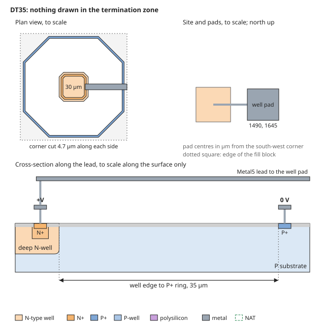
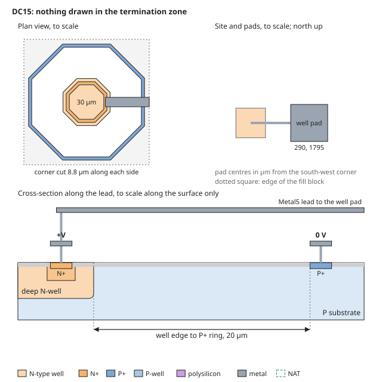
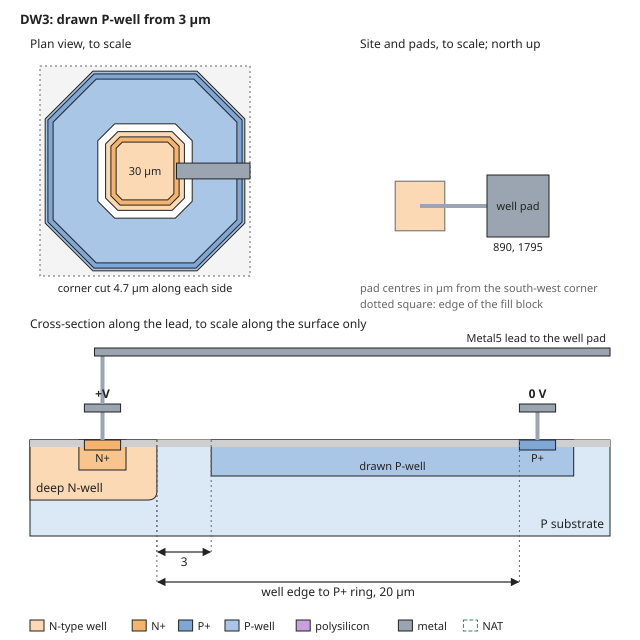
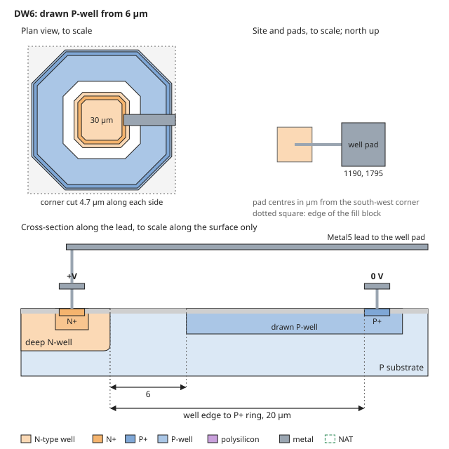
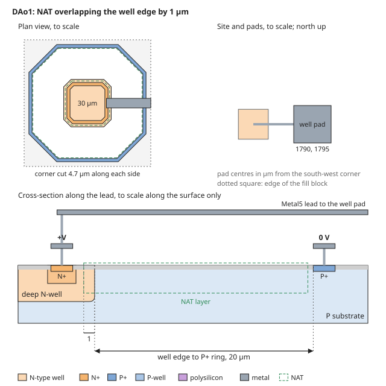

.. _hvt-g-deep-n-well:

Deep N-wells
============

The deep N-well structures are a reference group. They repeat the edge
variations of the other groups on a well that is expected to break down at
its bottom.

The group has 15 structures: :ref:`DT2p6 <hvt-s-dt2p6>`, :ref:`DT5
<hvt-s-dt5>`, :ref:`DT10 <hvt-s-dt10>`, :ref:`DT20 <hvt-s-dt20>`, :ref:`DT35
<hvt-s-dt35>`, :ref:`DC0 <hvt-s-dc0>`, :ref:`DC15 <hvt-s-dc15>`, :ref:`DW1p5
<hvt-s-dw1p5>`, :ref:`DW3 <hvt-s-dw3>`, :ref:`DW6 <hvt-s-dw6>`, :ref:`DAo1
<hvt-s-dao1>`, :ref:`DAo1T35 <hvt-s-dao1t35>`, :ref:`DAo1C0 <hvt-s-dao1c0>`,
:ref:`DAo1M1_6 <hvt-s-dao1m1-6>`, :ref:`DT20b <hvt-s-dt20b>`.

Mechanism
---------

The published capacitance and breakdown of the deep N-well fit only if a
heavily doped P layer lies just under it. The depletion region under the
flat bottom is then held to a fraction of a micrometre, and the bottom
reaches the critical field near 30 V. That is below what any edge of the
well would hold, so nothing drawn at the edge changes the result.

Expected results
----------------

If the picture is right, every member breaks down near 30 V, the published
model value, whatever its ring distance, corner, P-well, NAT or plate. A
member that holds much more than the plain :ref:`DT20 <hvt-s-dt20>` shows
that the edge limits after all, and the deep-layer picture is wrong for it.
:numref:`fig-hvt-g-deep-n-well` shows the trend that the simulation
predicts.

.. figure:: hvt-g-dnw.svg
   :name: fig-hvt-g-deep-n-well
   :alt: Graph of predicted breakdown voltage, the lower of the
         straight-edge and corner values, against the distance from the edge
         of the deep N-well to the P+ ring, from 2.6 µm to 35 µm, one curve
         per process, with dashed lines at the published 14 V and at 57 V
         and an open triangle where a sweep ended without breakdown. The
         structures of the group are DT2p6, DT5, DT10, DT20, DT35, DC0,
         DC15, DW1p5, DW3, DW6, DAo1, DAo1T35, DAo1C0, DAo1M1_6, DT20b. The
         plotted values are those of the tables in the entries.

   Trend that the simulation predicts across the group.

Limits of the group
-------------------

A group in which nothing changes cannot rank its terminations. If the bottom
does limit, the deep N-well is not a way to hold 57 V, and this group only
confirms that.

.. _hvt-s-dt2p6:

DT2p6
-----

         across with corners cut 4.7 µm along each side, an N+ contact ring
         inside its edge and a P+ ring 2.6 µm outside it; nothing drawn in
         the termination zone. A Metal5 lead joins the well to a pad at 290,
         1645 µm.

   DT2p6 in plan view and in cross-section.

.. list-table:: DT2p6: drawn parameters and position
   :name: tab-hvt-s-dt2p6
   :header-rows: 1
   :widths: 35 65

   * - Parameter
     - Value
   * - Well
     - Deep N-well, with an N-well band under its contact ring
   * - Side of the well
     - 30 µm
   * - Corners
     - Cut of 4.7 µm along each side, for a nominal radius of 8 µm; eight vertices of 135°
   * - Area and perimeter
     - 856 µm² and 109.0 µm
   * - N+ contact ring
     - 2 µm wide, 2 µm inside the well edge
   * - P+ ring
     - 2 µm wide, 2.6 µm from the well edge
   * - Fill block
     - Whole structure
   * - Metal5 lead
     - 6 µm wide
   * - Site
     - Column 1 from the west, row 10 from the south
   * - Well pad, centre x, y
     - 290, 1645 µm
   * - Substrate
     - Any of the seven SUB pads (:numref:`tab-hvt-pads`)

Purpose
   A deep N-well with its P+ ring as close as the rules allow, 2.6 µm.
   :numref:`fig-hvt-s-dt2p6` shows the structure and
   :numref:`tab-hvt-s-dt2p6` lists what is drawn.

How it works
   At 2.6 µm the ring would cut the edge's depletion region short if the
   edge held the voltage. If the bottom fails first, the ring's distance is
   irrelevant.

Compared with
   * :ref:`DT5 <hvt-s-dt5>`: the ring is at 2.6 µm in place of 5 µm.
   * :ref:`NT1 <hvt-s-nt1>`: the nearest ring on a deep N-well in place of on an N-well.

Measurement
   Procedure :ref:`P1 <hvt-p1>` applies. The well pad is at 290, 1645 µm.

Predicted
   The simulated breakdown voltages are in :numref:`tab-hvt-sp-dt2p6`, with
   the band and agreement range of each family on the row of its nominal
   process. Equal to :ref:`DT20 <hvt-s-dt20>`: the bottom limits. Lower: the
   edge does, at least with the ring this close.

Limits
   Under assumption A a generated P-well would start 1.5 µm out, inside the
   ring, and would act before the ring.

.. list-table:: DT2p6: predicted breakdown voltage by process
   :name: tab-hvt-sp-dt2p6
   :header-rows: 1
   :widths: 16 21 21 21 21

   * - Process
     - Straight edge (V)
     - Corner section (V)
     - Family band (V)
     - Agreement range (V)
   * - AL
     - 32.4
     - 30.0
     - 30.0 to 30.0
     - 25.5 to 34.5
   * - AD
     - 32.3
     - 31.3
     - 31.3 to 31.3
     - 26.6 to 36.0
   * - BL
     - 32.4
     - 31.3
     - 31.3 to 31.3
     - 26.6 to 36.0
   * - BLq
     - 32.3
     - 31.3
     - –
     - –
   * - BD
     - 32.4
     - 31.3
     - 31.3 to 31.3
     - 26.6 to 36.0

.. _hvt-s-dt5:

DT5
---

         across with corners cut 4.7 µm along each side, an N+ contact ring
         inside its edge and a P+ ring 5 µm outside it; nothing drawn in the
         termination zone. A Metal5 lead joins the well to a pad at 590,
         1645 µm.

   DT5 in plan view and in cross-section.

.. list-table:: DT5: drawn parameters and position
   :name: tab-hvt-s-dt5
   :header-rows: 1
   :widths: 35 65

   * - Parameter
     - Value
   * - Well
     - Deep N-well, with an N-well band under its contact ring
   * - Side of the well
     - 30 µm
   * - Corners
     - Cut of 4.7 µm along each side, for a nominal radius of 8 µm; eight vertices of 135°
   * - Area and perimeter
     - 856 µm² and 109.0 µm
   * - N+ contact ring
     - 2 µm wide, 2 µm inside the well edge
   * - P+ ring
     - 2 µm wide, 5 µm from the well edge
   * - Fill block
     - Whole structure
   * - Metal5 lead
     - 6 µm wide
   * - Site
     - Column 2 from the west, row 10 from the south
   * - Well pad, centre x, y
     - 590, 1645 µm
   * - Substrate
     - Any of the seven SUB pads (:numref:`tab-hvt-pads`)

Purpose
   A deep N-well with the P+ ring at 5 µm. :numref:`fig-hvt-s-dt5` shows the
   structure and :numref:`tab-hvt-s-dt5` lists what is drawn.

How it works
   The second point of the ring-distance series. It matters only if
   :ref:`DT2p6 <hvt-s-dt2p6>` differs from :ref:`DT20 <hvt-s-dt20>`, when it
   shows how fast the ring's effect dies away.

Compared with
   * :ref:`DT2p6 <hvt-s-dt2p6>`: the ring is at 5 µm in place of 2.6 µm.
   * :ref:`DT10 <hvt-s-dt10>`: the ring is at 5 µm in place of 10 µm.
   * :ref:`NT5 <hvt-s-nt5>`: a deep N-well in place of an N-well.

Measurement
   Procedure :ref:`P1 <hvt-p1>` applies. The well pad is at 590, 1645 µm.

Predicted
   The simulated breakdown voltages are in :numref:`tab-hvt-sp-dt5`, with
   the band and agreement range of each family on the row of its nominal
   process. Equal to :ref:`DT20 <hvt-s-dt20>`, as the whole series should
   be.

Limits
   Redundant if the bottom limits, which is the expected case.

.. list-table:: DT5: predicted breakdown voltage by process
   :name: tab-hvt-sp-dt5
   :header-rows: 1
   :widths: 16 21 21 21 21

   * - Process
     - Straight edge (V)
     - Corner section (V)
     - Family band (V)
     - Agreement range (V)
   * - AL
     - 32.4
     - 30.0
     - 30.0 to 30.0
     - 25.5 to 34.5
   * - AD
     - 32.4
     - 31.3
     - 31.3 to 31.3
     - 26.6 to 36.0
   * - BL
     - 32.4
     - 31.3
     - 31.3 to 31.3
     - 26.6 to 36.0
   * - BLq
     - 32.3
     - 31.3
     - –
     - –
   * - BD
     - 32.4
     - 31.3
     - 31.3 to 31.3
     - 26.6 to 36.0

.. _hvt-s-dt10:

DT10
----

         across with corners cut 4.7 µm along each side, an N+ contact ring
         inside its edge and a P+ ring 10 µm outside it; nothing drawn in
         the termination zone. A Metal5 lead joins the well to a pad at 890,
         1645 µm.

   DT10 in plan view and in cross-section.

.. list-table:: DT10: drawn parameters and position
   :name: tab-hvt-s-dt10
   :header-rows: 1
   :widths: 35 65

   * - Parameter
     - Value
   * - Well
     - Deep N-well, with an N-well band under its contact ring
   * - Side of the well
     - 30 µm
   * - Corners
     - Cut of 4.7 µm along each side, for a nominal radius of 8 µm; eight vertices of 135°
   * - Area and perimeter
     - 856 µm² and 109.0 µm
   * - N+ contact ring
     - 2 µm wide, 2 µm inside the well edge
   * - P+ ring
     - 2 µm wide, 10 µm from the well edge
   * - Fill block
     - Whole structure
   * - Metal5 lead
     - 6 µm wide
   * - Site
     - Column 3 from the west, row 10 from the south
   * - Well pad, centre x, y
     - 890, 1645 µm
   * - Substrate
     - Any of the seven SUB pads (:numref:`tab-hvt-pads`)

Purpose
   A deep N-well with the P+ ring at 10 µm. :numref:`fig-hvt-s-dt10` shows
   the structure and :numref:`tab-hvt-s-dt10` lists what is drawn.

How it works
   The middle of the ring-distance series, between the two points where a
   ring could matter and the two where it could not.

Compared with
   * :ref:`DT5 <hvt-s-dt5>`: the ring is at 10 µm in place of 5 µm.
   * :ref:`DT20 <hvt-s-dt20>`: the ring is at 10 µm in place of 20 µm.
   * :ref:`NT10 <hvt-s-nt10>`: a deep N-well in place of an N-well.

Measurement
   Procedure :ref:`P1 <hvt-p1>` applies. The well pad is at 890, 1645 µm.

Predicted
   The simulated breakdown voltages are in :numref:`tab-hvt-sp-dt10`, with
   the band and agreement range of each family on the row of its nominal
   process. Equal to :ref:`DT20 <hvt-s-dt20>`.

Limits
   Redundant if the bottom limits.

.. list-table:: DT10: predicted breakdown voltage by process
   :name: tab-hvt-sp-dt10
   :header-rows: 1
   :widths: 16 21 21 21 21

   * - Process
     - Straight edge (V)
     - Corner section (V)
     - Family band (V)
     - Agreement range (V)
   * - AL
     - 32.4
     - 30.0
     - 30.0 to 30.0
     - 25.5 to 34.5
   * - AD
     - 32.4
     - 31.0
     - 31.0 to 31.0
     - 26.3 to 35.6
   * - BL
     - 32.4
     - 31.3
     - 31.3 to 31.3
     - 26.6 to 36.0
   * - BLq
     - 32.3
     - 31.3
     - –
     - –
   * - BD
     - 32.4
     - 31.3
     - 31.3 to 31.3
     - 26.6 to 36.0

.. _hvt-s-dt20:

DT20
----

.. figure:: hvt-s-DT20.svg
   :name: fig-hvt-s-dt20
   :alt: Plan view and cross-section of DT20: a deep N-well 30 µm
         across with corners cut 4.7 µm along each side, an N+ contact ring
         inside its edge and a P+ ring 20 µm outside it; nothing drawn in
         the termination zone. A Metal5 lead joins the well to a pad at
         1190, 1645 µm.

   DT20 in plan view and in cross-section.

.. list-table:: DT20: drawn parameters and position
   :name: tab-hvt-s-dt20
   :header-rows: 1
   :widths: 35 65

   * - Parameter
     - Value
   * - Well
     - Deep N-well, with an N-well band under its contact ring
   * - Side of the well
     - 30 µm
   * - Corners
     - Cut of 4.7 µm along each side, for a nominal radius of 8 µm; eight vertices of 135°
   * - Area and perimeter
     - 856 µm² and 109.0 µm
   * - N+ contact ring
     - 2 µm wide, 2 µm inside the well edge
   * - P+ ring
     - 2 µm wide, 20 µm from the well edge
   * - Fill block
     - Whole structure
   * - Metal5 lead
     - 6 µm wide
   * - Site
     - Column 4 from the west, row 10 from the south
   * - Well pad, centre x, y
     - 1190, 1645 µm
   * - Substrate
     - Any of the seven SUB pads (:numref:`tab-hvt-pads`)

Purpose
   The reference deep N-well: default dimensions, nothing drawn round it.
   :numref:`fig-hvt-s-dt20` shows the structure and :numref:`tab-hvt-s-dt20`
   lists what is drawn.

How it works
   The deep N-well is implanted deep, with its peak about 2.5 µm down, and
   reaches the surface only through the N-well band under its contact. Its
   junction to a P layer just below it is the most heavily doped junction it
   has, and fails first.

Compared with
   * :ref:`NT20 <hvt-s-nt20>`: a deep N-well in place of an N-well.
   * :ref:`DT20b <hvt-s-dt20b>`: nothing: a second copy.
   * :ref:`DT10 <hvt-s-dt10>`: the ring is at 20 µm in place of 10 µm.

Measurement
   Procedure :ref:`P1 <hvt-p1>` applies. The well pad is at 1190, 1645 µm.
   Swept again at 85 °C.

Predicted
   The simulated breakdown voltages are in :numref:`tab-hvt-sp-dt20`, with
   the band and agreement range of each family on the row of its nominal
   process. Near the published 30 V: the deep-layer picture holds. Far above
   it: the model value does not describe this well.

Limits
   A breakdown at the bottom cannot be told from one at the edge by this
   structure alone; the rest of the group does that.

.. list-table:: DT20: predicted breakdown voltage by process
   :name: tab-hvt-sp-dt20
   :header-rows: 1
   :widths: 16 21 21 21 21

   * - Process
     - Straight edge (V)
     - Corner section (V)
     - Family band (V)
     - Agreement range (V)
   * - AL
     - 32.4
     - 30.0
     - 30.0 to 30.0
     - 25.5 to 34.5
   * - ALhi
     - failed
     - failed
     - –
     - –
   * - AD
     - 32.4
     - 31.3
     - 31.3 to 31.3
     - 26.6 to 36.0
   * - BL
     - 32.4
     - 31.3
     - 31.3 to 31.3
     - 26.6 to 36.0
   * - BLhi
     - failed
     - failed
     - –
     - –
   * - BLlo
     - failed
     - failed
     - –
     - –
   * - BLq
     - 32.3
     - 31.3
     - –
     - –
   * - BLq3
     - failed
     - failed
     - –
     - –
   * - BD
     - 32.4
     - 31.3
     - 31.3 to 31.3
     - 26.6 to 36.0
   * - BDhi
     - failed
     - failed
     - –
     - –
   * - BDlo
     - failed
     - failed
     - –
     - –

.. _hvt-s-dt35:

DT35
----

         across with corners cut 4.7 µm along each side, an N+ contact ring
         inside its edge and a P+ ring 35 µm outside it; nothing drawn in
         the termination zone. A Metal5 lead joins the well to a pad at
         1490, 1645 µm.

   DT35 in plan view and in cross-section.

.. list-table:: DT35: drawn parameters and position
   :name: tab-hvt-s-dt35
   :header-rows: 1
   :widths: 35 65

   * - Parameter
     - Value
   * - Well
     - Deep N-well, with an N-well band under its contact ring
   * - Side of the well
     - 30 µm
   * - Corners
     - Cut of 4.7 µm along each side, for a nominal radius of 8 µm; eight vertices of 135°
   * - Area and perimeter
     - 856 µm² and 109.0 µm
   * - N+ contact ring
     - 2 µm wide, 2 µm inside the well edge
   * - P+ ring
     - 2 µm wide, 35 µm from the well edge
   * - Fill block
     - Whole structure
   * - Metal5 lead
     - 6 µm wide
   * - Site
     - Column 5 from the west, row 10 from the south
   * - Well pad, centre x, y
     - 1490, 1645 µm
   * - Substrate
     - Any of the seven SUB pads (:numref:`tab-hvt-pads`)

Purpose
   A deep N-well with the P+ ring at 35 µm. :numref:`fig-hvt-s-dt35` shows
   the structure and :numref:`tab-hvt-s-dt35` lists what is drawn.

How it works
   The end of the ring-distance series. With the ring this far away, the
   substrate contact is at its most resistive, which shows in the slope of
   the current after breakdown and not in the breakdown voltage.

Compared with
   * :ref:`DT20 <hvt-s-dt20>`: the ring is at 35 µm in place of 20 µm.
   * :ref:`NT35 <hvt-s-nt35>`: a deep N-well in place of an N-well.

Measurement
   Procedure :ref:`P1 <hvt-p1>` applies. The well pad is at 1490, 1645 µm.

Predicted
   The simulated breakdown voltages are in :numref:`tab-hvt-sp-dt35`, with
   the band and agreement range of each family on the row of its nominal
   process. Equal to :ref:`DT20 <hvt-s-dt20>`.

Limits
   Redundant if the bottom limits.

.. list-table:: DT35: predicted breakdown voltage by process
   :name: tab-hvt-sp-dt35
   :header-rows: 1
   :widths: 16 21 21 21 21

   * - Process
     - Straight edge (V)
     - Corner section (V)
     - Family band (V)
     - Agreement range (V)
   * - AL
     - 32.4
     - 30.0
     - 30.0 to 30.0
     - 25.5 to 34.5
   * - AD
     - 32.4
     - 31.3
     - 31.3 to 31.3
     - 26.6 to 36.0
   * - BL
     - 32.4
     - 31.3
     - 31.3 to 31.3
     - 26.6 to 36.0
   * - BLq
     - 32.3
     - 31.3
     - –
     - –
   * - BD
     - 32.4
     - 31.3
     - 31.3 to 31.3
     - 26.6 to 36.0

.. _hvt-s-dc0:

DC0
---

         across with square corners, an N+ contact ring inside its edge and
         a P+ ring 20 µm outside it; nothing drawn in the termination zone.
         A Metal5 lead joins the well to a pad at 1790, 1645 µm.

   DC0 in plan view and in cross-section.

.. list-table:: DC0: drawn parameters and position
   :name: tab-hvt-s-dc0
   :header-rows: 1
   :widths: 35 65

   * - Parameter
     - Value
   * - Well
     - Deep N-well, with an N-well band under its contact ring
   * - Side of the well
     - 30 µm
   * - Corners
     - Square; four vertices of 90°
   * - Area and perimeter
     - 900 µm² and 120.0 µm
   * - N+ contact ring
     - 2 µm wide, 2 µm inside the well edge
   * - P+ ring
     - 2 µm wide, 20 µm from the well edge
   * - Fill block
     - Whole structure
   * - Metal5 lead
     - 6 µm wide
   * - Site
     - Column 6 from the west, row 10 from the south
   * - Well pad, centre x, y
     - 1790, 1645 µm
   * - Substrate
     - Any of the seven SUB pads (:numref:`tab-hvt-pads`)

Purpose
   A deep N-well with square corners. :numref:`fig-hvt-s-dc0` shows the
   structure and :numref:`tab-hvt-s-dc0` lists what is drawn.

How it works
   A deep implant spreads sideways more than a shallow one, so its corners
   are rounder below the surface than the drawing. A square corner should
   cost a deep N-well less than it costs an N-well, and nothing if the
   bottom fails first.

Compared with
   * :ref:`DT20 <hvt-s-dt20>`: four 90° vertices in place of eight of 135°.
   * :ref:`NC0 <hvt-s-nc0>`: a deep N-well in place of an N-well.

Measurement
   Procedure :ref:`P1 <hvt-p1>` applies. The well pad is at 1790, 1645 µm.

Predicted
   The simulated breakdown voltages are in :numref:`tab-hvt-sp-dc0`, with
   the band and agreement range of each family on the row of its nominal
   process. Equal to :ref:`DT20 <hvt-s-dt20>`: corners do not matter for
   this well.

Limits
   The N-well band under the contact follows the square outline 2 µm inside
   the edge, and has sharp corners of its own.

.. list-table:: DC0: predicted breakdown voltage by process
   :name: tab-hvt-sp-dc0
   :header-rows: 1
   :widths: 16 21 21 21 21

   * - Process
     - Straight edge (V)
     - Corner section (V)
     - Family band (V)
     - Agreement range (V)
   * - AL
     - 32.4
     - > 32.6
     - 32.4 to 32.4
     - 27.5 to 37.3
   * - AD
     - 32.4
     - > 32.4
     - 32.4 to 32.4
     - 27.5 to 37.3
   * - BL
     - 32.4
     - 33.7
     - 32.3 to 32.4
     - 27.5 to 37.3
   * - BLq
     - 32.3
     - 32.9
     - –
     - –
   * - BD
     - 32.4
     - 33.5
     - 32.4 to 32.4
     - 27.5 to 37.3

.. _hvt-s-dc15:

DC15
----

         across with corners cut 8.8 µm along each side, an N+ contact ring
         inside its edge and a P+ ring 20 µm outside it; nothing drawn in
         the termination zone. A Metal5 lead joins the well to a pad at 290,
         1795 µm.

   DC15 in plan view and in cross-section.

.. list-table:: DC15: drawn parameters and position
   :name: tab-hvt-s-dc15
   :header-rows: 1
   :widths: 35 65

   * - Parameter
     - Value
   * - Well
     - Deep N-well, with an N-well band under its contact ring
   * - Side of the well
     - 30 µm
   * - Corners
     - Cut of 8.8 µm along each side, for a nominal radius of 15 µm; eight vertices of 135°
   * - Area and perimeter
     - 745 µm² and 99.4 µm
   * - N+ contact ring
     - 2 µm wide, 2 µm inside the well edge
   * - P+ ring
     - 2 µm wide, 20 µm from the well edge
   * - Fill block
     - Whole structure
   * - Metal5 lead
     - 6 µm wide
   * - Site
     - Column 1 from the west, row 11 from the south
   * - Well pad, centre x, y
     - 290, 1795 µm
   * - Substrate
     - Any of the seven SUB pads (:numref:`tab-hvt-pads`)

Purpose
   A deep N-well with the longest corner cut. :numref:`fig-hvt-s-dc15` shows
   the structure and :numref:`tab-hvt-s-dc15` lists what is drawn.

How it works
   The counterpart of :ref:`NC15 <hvt-s-nc15>`. It can only matter if
   :ref:`DC0 <hvt-s-dc0>` shows that corners matter at all.

Compared with
   * :ref:`DT20 <hvt-s-dt20>`: a cut of 8.8 µm in place of 4.7 µm.
   * :ref:`DC0 <hvt-s-dc0>`: the longest cut in place of none.
   * :ref:`NC15 <hvt-s-nc15>`: a deep N-well in place of an N-well.

Measurement
   Procedure :ref:`P1 <hvt-p1>` applies. The well pad is at 290, 1795 µm.

Predicted
   The simulated breakdown voltages are in :numref:`tab-hvt-sp-dc15`, with
   the band and agreement range of each family on the row of its nominal
   process. Equal to :ref:`DT20 <hvt-s-dt20>`.

Limits
   Redundant if the bottom limits.

.. list-table:: DC15: predicted breakdown voltage by process
   :name: tab-hvt-sp-dc15
   :header-rows: 1
   :widths: 16 21 21 21 21

   * - Process
     - Straight edge (V)
     - Corner section (V)
     - Family band (V)
     - Agreement range (V)
   * - AL
     - 32.4
     - 31.3
     - 31.3 to 31.3
     - 26.6 to 36.0
   * - AD
     - 32.4
     - 30.8
     - 30.8 to 30.8
     - 26.2 to 35.4
   * - BL
     - 32.4
     - 31.3
     - 31.3 to 31.3
     - 26.6 to 36.0
   * - BLq
     - 32.3
     - failed
     - –
     - –
   * - BD
     - 32.4
     - 31.3
     - 31.3 to 31.3
     - 26.6 to 36.0

.. _hvt-s-dw1p5:

DW1p5
-----

.. figure:: hvt-s-DW1p5.svg
   :name: fig-hvt-s-dw1p5
   :alt: Plan view and cross-section of DW1p5: a deep N-well 30 µm
         across with corners cut 4.7 µm along each side, an N+ contact ring
         inside its edge and a P+ ring 20 µm outside it; drawn P-well from
         1.5 µm. A Metal5 lead joins the well to a pad at 590, 1795 µm.

   DW1p5 in plan view and in cross-section.

.. list-table:: DW1p5: drawn parameters and position
   :name: tab-hvt-s-dw1p5
   :header-rows: 1
   :widths: 35 65

   * - Parameter
     - Value
   * - Well
     - Deep N-well, with an N-well band under its contact ring
   * - Side of the well
     - 30 µm
   * - Corners
     - Cut of 4.7 µm along each side, for a nominal radius of 8 µm; eight vertices of 135°
   * - Area and perimeter
     - 856 µm² and 109.0 µm
   * - N+ contact ring
     - 2 µm wide, 2 µm inside the well edge
   * - P+ ring
     - 2 µm wide, 20 µm from the well edge
   * - Drawn P-well
     - From 1.5 µm outside the well edge to 1 µm beyond the P+ ring
   * - Fill block
     - Whole structure
   * - Metal5 lead
     - 6 µm wide
   * - Site
     - Column 2 from the west, row 11 from the south
   * - Well pad, centre x, y
     - 590, 1795 µm
   * - Substrate
     - Any of the seven SUB pads (:numref:`tab-hvt-pads`)

Purpose
   A deep N-well with a drawn P-well as close as the rules allow, 1.5 µm.
   :numref:`fig-hvt-s-dw1p5` shows the structure and
   :numref:`tab-hvt-s-dw1p5` lists what is drawn.

How it works
   This is the surrounding that assumption A gives every deep N-well without
   anyone drawing it. If the edge held the voltage, a P-well this close
   would cost part of it, as on :ref:`NW1p5 <hvt-s-nw1p5>`.

Compared with
   * :ref:`DT20 <hvt-s-dt20>`: a drawn P-well from 1.5 µm in place of none.
   * :ref:`DW3 <hvt-s-dw3>`: the P-well starts at 1.5 µm in place of 3 µm.
   * :ref:`NW1p5 <hvt-s-nw1p5>`: a deep N-well in place of an N-well.

Measurement
   Procedure :ref:`P1 <hvt-p1>` applies. The well pad is at 590, 1795 µm.

Predicted
   The simulated breakdown voltages are in :numref:`tab-hvt-sp-dw1p5`, with
   the band and agreement range of each family on the row of its nominal
   process. Equal to :ref:`DT20 <hvt-s-dt20>`: either the bottom limits, or
   the foundry already generates this P-well round :ref:`DT20 <hvt-s-dt20>`.

Limits
   Those two readings cannot be separated here; :ref:`DAo1 <hvt-s-dao1>`
   separates them.

.. list-table:: DW1p5: predicted breakdown voltage by process
   :name: tab-hvt-sp-dw1p5
   :header-rows: 1
   :widths: 16 21 21 21 21

   * - Process
     - Straight edge (V)
     - Corner section (V)
     - Family band (V)
     - Agreement range (V)
   * - AL
     - 32.4
     - 30.0
     - 30.0 to 30.0
     - 25.5 to 34.5
   * - AD
     - 32.4
     - 31.3
     - 31.3 to 31.3
     - 26.6 to 36.0
   * - BL
     - 32.4
     - 30.0
     - 30.0 to 31.3
     - 25.5 to 36.0
   * - BLq
     - 32.3
     - 31.3
     - –
     - –
   * - BD
     - 32.4
     - 31.3
     - 31.3 to 31.3
     - 26.6 to 36.0

.. _hvt-s-dw3:

DW3
---

         across with corners cut 4.7 µm along each side, an N+ contact ring
         inside its edge and a P+ ring 20 µm outside it; drawn P-well from 3
         µm. A Metal5 lead joins the well to a pad at 890, 1795 µm.

   DW3 in plan view and in cross-section.

.. list-table:: DW3: drawn parameters and position
   :name: tab-hvt-s-dw3
   :header-rows: 1
   :widths: 35 65

   * - Parameter
     - Value
   * - Well
     - Deep N-well, with an N-well band under its contact ring
   * - Side of the well
     - 30 µm
   * - Corners
     - Cut of 4.7 µm along each side, for a nominal radius of 8 µm; eight vertices of 135°
   * - Area and perimeter
     - 856 µm² and 109.0 µm
   * - N+ contact ring
     - 2 µm wide, 2 µm inside the well edge
   * - P+ ring
     - 2 µm wide, 20 µm from the well edge
   * - Drawn P-well
     - From 3 µm outside the well edge to 1 µm beyond the P+ ring
   * - Fill block
     - Whole structure
   * - Metal5 lead
     - 6 µm wide
   * - Site
     - Column 3 from the west, row 11 from the south
   * - Well pad, centre x, y
     - 890, 1795 µm
   * - Substrate
     - Any of the seven SUB pads (:numref:`tab-hvt-pads`)

Purpose
   A deep N-well with a drawn P-well from 3 µm. :numref:`fig-hvt-s-dw3`
   shows the structure and :numref:`tab-hvt-s-dw3` lists what is drawn.

How it works
   The middle of the P-well series on a deep N-well. It adds a point only if
   :ref:`DW1p5 <hvt-s-dw1p5>` is lower than :ref:`DT20 <hvt-s-dt20>`.

Compared with
   * :ref:`DW1p5 <hvt-s-dw1p5>`: the P-well starts at 3 µm in place of 1.5 µm.
   * :ref:`DW6 <hvt-s-dw6>`: the P-well starts at 3 µm in place of 6 µm.
   * :ref:`NW3 <hvt-s-nw3>`: a deep N-well in place of an N-well.

Measurement
   Procedure :ref:`P1 <hvt-p1>` applies. The well pad is at 890, 1795 µm.

Predicted
   The simulated breakdown voltages are in :numref:`tab-hvt-sp-dw3`, with
   the band and agreement range of each family on the row of its nominal
   process. Equal to :ref:`DT20 <hvt-s-dt20>`.

Limits
   Redundant if the bottom limits.

.. list-table:: DW3: predicted breakdown voltage by process
   :name: tab-hvt-sp-dw3
   :header-rows: 1
   :widths: 16 21 21 21 21

   * - Process
     - Straight edge (V)
     - Corner section (V)
     - Family band (V)
     - Agreement range (V)
   * - AL
     - 32.4
     - 30.0
     - 30.0 to 30.0
     - 25.5 to 34.5
   * - AD
     - 32.4
     - 31.3
     - 31.3 to 31.3
     - 26.6 to 36.0
   * - BL
     - 32.4
     - 31.3
     - 31.3 to 31.3
     - 26.6 to 36.0
   * - BLq
     - 32.3
     - 31.3
     - –
     - –
   * - BD
     - 32.4
     - 31.3
     - 31.3 to 31.3
     - 26.6 to 36.0

.. _hvt-s-dw6:

DW6
---

         across with corners cut 4.7 µm along each side, an N+ contact ring
         inside its edge and a P+ ring 20 µm outside it; drawn P-well from 6
         µm. A Metal5 lead joins the well to a pad at 1190, 1795 µm.

   DW6 in plan view and in cross-section.

.. list-table:: DW6: drawn parameters and position
   :name: tab-hvt-s-dw6
   :header-rows: 1
   :widths: 35 65

   * - Parameter
     - Value
   * - Well
     - Deep N-well, with an N-well band under its contact ring
   * - Side of the well
     - 30 µm
   * - Corners
     - Cut of 4.7 µm along each side, for a nominal radius of 8 µm; eight vertices of 135°
   * - Area and perimeter
     - 856 µm² and 109.0 µm
   * - N+ contact ring
     - 2 µm wide, 2 µm inside the well edge
   * - P+ ring
     - 2 µm wide, 20 µm from the well edge
   * - Drawn P-well
     - From 6 µm outside the well edge to 1 µm beyond the P+ ring
   * - Fill block
     - Whole structure
   * - Metal5 lead
     - 6 µm wide
   * - Site
     - Column 4 from the west, row 11 from the south
   * - Well pad, centre x, y
     - 1190, 1795 µm
   * - Substrate
     - Any of the seven SUB pads (:numref:`tab-hvt-pads`)

Purpose
   A deep N-well with a drawn P-well from 6 µm. :numref:`fig-hvt-s-dw6`
   shows the structure and :numref:`tab-hvt-s-dw6` lists what is drawn.

How it works
   The far end of the P-well series. On an N-well a P-well at this distance
   no longer matters, and the same is expected here for either reason: the
   distance, or the bottom.

Compared with
   * :ref:`DW3 <hvt-s-dw3>`: the P-well starts at 6 µm in place of 3 µm.
   * :ref:`NW6 <hvt-s-nw6>`: a deep N-well in place of an N-well.

Measurement
   Procedure :ref:`P1 <hvt-p1>` applies. The well pad is at 1190, 1795 µm.

Predicted
   The simulated breakdown voltages are in :numref:`tab-hvt-sp-dw6`, with
   the band and agreement range of each family on the row of its nominal
   process. Equal to :ref:`DT20 <hvt-s-dt20>`.

Limits
   Redundant if the bottom limits.

.. list-table:: DW6: predicted breakdown voltage by process
   :name: tab-hvt-sp-dw6
   :header-rows: 1
   :widths: 16 21 21 21 21

   * - Process
     - Straight edge (V)
     - Corner section (V)
     - Family band (V)
     - Agreement range (V)
   * - AL
     - 32.4
     - 30.0
     - 30.0 to 30.0
     - 25.5 to 34.5
   * - AD
     - 32.4
     - 31.3
     - 31.3 to 31.3
     - 26.6 to 36.0
   * - BL
     - 32.4
     - 31.3
     - 31.3 to 31.3
     - 26.6 to 36.0
   * - BLq
     - 32.3
     - 31.3
     - –
     - –
   * - BD
     - 32.4
     - 31.3
     - 31.3 to 31.3
     - 26.6 to 36.0

.. _hvt-s-dao1:

DAo1
----

         across with corners cut 4.7 µm along each side, an N+ contact ring
         inside its edge and a P+ ring 20 µm outside it; NAT overlapping the
         well edge by 1 µm. A Metal5 lead joins the well to a pad at 890,
         1945 µm.

   DAo1 in plan view and in cross-section.

.. list-table:: DAo1: drawn parameters and position
   :name: tab-hvt-s-dao1
   :header-rows: 1
   :widths: 35 65

   * - Parameter
     - Value
   * - Well
     - Deep N-well, with an N-well band under its contact ring
   * - Side of the well
     - 30 µm
   * - Corners
     - Cut of 4.7 µm along each side, for a nominal radius of 8 µm; eight vertices of 135°
   * - Area and perimeter
     - 856 µm² and 109.0 µm
   * - N+ contact ring
     - 2 µm wide, 2 µm inside the well edge
   * - P+ ring
     - 2 µm wide, 20 µm from the well edge
   * - NAT layer
     - From 1 µm inside the well edge to 0.5 µm short of the P+ ring
   * - Fill block
     - Whole structure
   * - Metal5 lead
     - 6 µm wide
   * - Site
     - Column 3 from the west, row 12 from the south
   * - Well pad, centre x, y
     - 890, 1945 µm
   * - Substrate
     - Any of the seven SUB pads (:numref:`tab-hvt-pads`)

Purpose
   A deep N-well with NAT over its edge, so that no P-well can lie beside
   the junction. :numref:`fig-hvt-s-dao1` shows the structure and
   :numref:`tab-hvt-s-dao1` lists what is drawn.

How it works
   NAT starts 1 µm inside the well edge and covers the whole termination
   zone, which the rules allow on a deep N-well. If the edge limited a deep
   N-well because of nearby P-well, removing the P-well would raise the
   breakdown voltage.

Compared with
   * :ref:`DT20 <hvt-s-dt20>`: NAT over the edge in place of none.
   * :ref:`DW1p5 <hvt-s-dw1p5>`: no P-well possible in place of a drawn one at 1.5 µm.
   * :ref:`NA0p6 <hvt-s-na0p6>`: NAT overlapping the edge in place of 0.6 µm away.

Measurement
   Procedure :ref:`P1 <hvt-p1>` applies. The well pad is at 890, 1945 µm.

Predicted
   The simulated breakdown voltages are in :numref:`tab-hvt-sp-dao1`, with
   the band and agreement range of each family on the row of its nominal
   process. Equal to :ref:`DT20 <hvt-s-dt20>`: the bottom limits, with or
   without P-well at the edge. Much higher: P-well beside the edge was the
   limit, and NAT removes it.

Limits
   Whether the foundry accepts NAT here with no transistor is not known,
   although the rule check passes it.

.. list-table:: DAo1: predicted breakdown voltage by process
   :name: tab-hvt-sp-dao1
   :header-rows: 1
   :widths: 16 21 21 21 21

   * - Process
     - Straight edge (V)
     - Corner section (V)
     - Family band (V)
     - Agreement range (V)
   * - AL
     - 32.4
     - 31.1
     - 31.1 to 31.1
     - 26.4 to 35.8
   * - ALhi
     - failed
     - failed
     - –
     - –
   * - AD
     - 32.4
     - 31.3
     - 31.3 to 31.3
     - 26.6 to 36.0
   * - BL
     - 32.4
     - 31.3
     - 31.3 to 31.3
     - 26.6 to 36.0
   * - BLhi
     - failed
     - failed
     - –
     - –
   * - BLlo
     - failed
     - failed
     - –
     - –
   * - BLq
     - 32.3
     - 31.3
     - –
     - –
   * - BLq3
     - failed
     - failed
     - –
     - –
   * - BD
     - 32.4
     - 31.3
     - 31.3 to 31.3
     - 26.6 to 36.0
   * - BDhi
     - failed
     - failed
     - –
     - –
   * - BDlo
     - failed
     - failed
     - –
     - –

.. _hvt-s-dao1t35:

DAo1T35
-------

         across with corners cut 4.7 µm along each side, an N+ contact ring
         inside its edge and a P+ ring 35 µm outside it; NAT overlapping the
         well edge by 1 µm. A Metal5 lead joins the well to a pad at 1190,
         1945 µm.

   DAo1T35 in plan view and in cross-section.

.. list-table:: DAo1T35: drawn parameters and position
   :name: tab-hvt-s-dao1t35
   :header-rows: 1
   :widths: 35 65

   * - Parameter
     - Value
   * - Well
     - Deep N-well, with an N-well band under its contact ring
   * - Side of the well
     - 30 µm
   * - Corners
     - Cut of 4.7 µm along each side, for a nominal radius of 8 µm; eight vertices of 135°
   * - Area and perimeter
     - 856 µm² and 109.0 µm
   * - N+ contact ring
     - 2 µm wide, 2 µm inside the well edge
   * - P+ ring
     - 2 µm wide, 35 µm from the well edge
   * - NAT layer
     - From 1 µm inside the well edge to 0.5 µm short of the P+ ring
   * - Fill block
     - Whole structure
   * - Metal5 lead
     - 6 µm wide
   * - Site
     - Column 4 from the west, row 12 from the south
   * - Well pad, centre x, y
     - 1190, 1945 µm
   * - Substrate
     - Any of the seven SUB pads (:numref:`tab-hvt-pads`)

Purpose
   A deep N-well with NAT over its edge and the P+ ring at 35 µm.
   :numref:`fig-hvt-s-dao1t35` shows the structure and
   :numref:`tab-hvt-s-dao1t35` lists what is drawn.

How it works
   If :ref:`DAo1 <hvt-s-dao1>` holds much more than :ref:`DT20
   <hvt-s-dt20>`, the edge is in bare substrate and its depletion region is
   wide. This structure then shows whether a ring at 20 µm was limiting it.

Compared with
   * :ref:`DAo1 <hvt-s-dao1>`: the ring is at 35 µm in place of 20 µm.
   * :ref:`DT35 <hvt-s-dt35>`: NAT over the edge in place of none.

Measurement
   Procedure :ref:`P1 <hvt-p1>` applies. The well pad is at 1190, 1945 µm.

Predicted
   The simulated breakdown voltages are in :numref:`tab-hvt-sp-dao1t35`,
   with the band and agreement range of each family on the row of its
   nominal process. Equal to :ref:`DAo1 <hvt-s-dao1>`.

Limits
   Useful only if :ref:`DAo1 <hvt-s-dao1>` is much above :ref:`DT20
   <hvt-s-dt20>`.

.. list-table:: DAo1T35: predicted breakdown voltage by process
   :name: tab-hvt-sp-dao1t35
   :header-rows: 1
   :widths: 16 21 21 21 21

   * - Process
     - Straight edge (V)
     - Corner section (V)
     - Family band (V)
     - Agreement range (V)
   * - AL
     - 32.4
     - 31.1
     - 31.1 to 31.1
     - 26.4 to 35.8
   * - AD
     - 32.4
     - 31.3
     - 31.3 to 31.3
     - 26.6 to 36.0
   * - BL
     - 32.4
     - 31.3
     - 31.3 to 31.3
     - 26.6 to 36.0
   * - BLq
     - 32.3
     - 31.3
     - –
     - –
   * - BD
     - 32.4
     - 31.3
     - 31.3 to 31.3
     - 26.6 to 36.0

.. _hvt-s-dao1c0:

DAo1C0
------

.. figure:: hvt-s-DAo1C0.svg
   :name: fig-hvt-s-dao1c0
   :alt: Plan view and cross-section of DAo1C0: a deep N-well 30 µm
         across with square corners, an N+ contact ring inside its edge and
         a P+ ring 20 µm outside it; NAT overlapping the well edge by 1 µm.
         A Metal5 lead joins the well to a pad at 1490, 1945 µm.

   DAo1C0 in plan view and in cross-section.

.. list-table:: DAo1C0: drawn parameters and position
   :name: tab-hvt-s-dao1c0
   :header-rows: 1
   :widths: 35 65

   * - Parameter
     - Value
   * - Well
     - Deep N-well, with an N-well band under its contact ring
   * - Side of the well
     - 30 µm
   * - Corners
     - Square; four vertices of 90°
   * - Area and perimeter
     - 900 µm² and 120.0 µm
   * - N+ contact ring
     - 2 µm wide, 2 µm inside the well edge
   * - P+ ring
     - 2 µm wide, 20 µm from the well edge
   * - NAT layer
     - From 1 µm inside the well edge to 0.5 µm short of the P+ ring
   * - Fill block
     - Whole structure
   * - Metal5 lead
     - 6 µm wide
   * - Site
     - Column 5 from the west, row 12 from the south
   * - Well pad, centre x, y
     - 1490, 1945 µm
   * - Substrate
     - Any of the seven SUB pads (:numref:`tab-hvt-pads`)

Purpose
   A deep N-well with NAT over its edge and square corners.
   :numref:`fig-hvt-s-dao1c0` shows the structure and
   :numref:`tab-hvt-s-dao1c0` lists what is drawn.

How it works
   If NAT frees the edge, the corners become the weak points, as on an
   N-well in bare substrate. This structure measures them at their sharpest.

Compared with
   * :ref:`DAo1 <hvt-s-dao1>`: four 90° vertices in place of eight of 135°.
   * :ref:`DC0 <hvt-s-dc0>`: NAT over the edge in place of none.

Measurement
   Procedure :ref:`P1 <hvt-p1>` applies. The well pad is at 1490, 1945 µm.

Predicted
   The simulated breakdown voltages are in :numref:`tab-hvt-sp-dao1c0`, with
   the band and agreement range of each family on the row of its nominal
   process. Equal to :ref:`DAo1 <hvt-s-dao1>`.

Limits
   Useful only if :ref:`DAo1 <hvt-s-dao1>` is much above :ref:`DT20
   <hvt-s-dt20>`.

.. list-table:: DAo1C0: predicted breakdown voltage by process
   :name: tab-hvt-sp-dao1c0
   :header-rows: 1
   :widths: 16 21 21 21 21

   * - Process
     - Straight edge (V)
     - Corner section (V)
     - Family band (V)
     - Agreement range (V)
   * - AL
     - 32.4
     - 33.8
     - 32.4 to 32.4
     - 27.5 to 37.3
   * - AD
     - 32.4
     - 33.5
     - 32.4 to 32.4
     - 27.5 to 37.3
   * - BL
     - 32.4
     - 33.7
     - 32.3 to 32.4
     - 27.5 to 37.3
   * - BLq
     - 32.3
     - 32.9
     - –
     - –
   * - BD
     - 32.4
     - 33.5
     - 32.4 to 32.4
     - 27.5 to 37.3

.. _hvt-s-dao1m1-6:

DAo1M1_6
--------

.. figure:: hvt-s-DAo1M1_6.svg
   :name: fig-hvt-s-dao1m1-6
   :alt: Plan view and cross-section of DAo1M1_6: a deep N-well 30 µm
         across with corners cut 4.7 µm along each side, an N+ contact ring
         inside its edge and a P+ ring 20 µm outside it; Metal1 plate to 6
         µm; NAT overlapping the well edge by 1 µm. A Metal5 lead joins the
         well to a pad at 1790, 1945 µm.

   DAo1M1_6 in plan view and in cross-section.

.. list-table:: DAo1M1_6: drawn parameters and position
   :name: tab-hvt-s-dao1m1-6
   :header-rows: 1
   :widths: 35 65

   * - Parameter
     - Value
   * - Well
     - Deep N-well, with an N-well band under its contact ring
   * - Side of the well
     - 30 µm
   * - Corners
     - Cut of 4.7 µm along each side, for a nominal radius of 8 µm; eight vertices of 135°
   * - Area and perimeter
     - 856 µm² and 109.0 µm
   * - N+ contact ring
     - 2 µm wide, 2 µm inside the well edge
   * - P+ ring
     - 2 µm wide, 20 µm from the well edge
   * - Metal1 plate
     - From the contact ring to 6 µm outside the edge; joined to the well
   * - NAT layer
     - From 1 µm inside the well edge to 0.5 µm short of the P+ ring
   * - Fill block
     - Whole structure
   * - Metal5 lead
     - 6 µm wide
   * - Site
     - Column 6 from the west, row 12 from the south
   * - Well pad, centre x, y
     - 1790, 1945 µm
   * - Substrate
     - Any of the seven SUB pads (:numref:`tab-hvt-pads`)

Purpose
   A deep N-well with NAT over its edge and a Metal1 plate of 6 µm: every
   edge remedy the die has, on one well. :numref:`fig-hvt-s-dao1m1-6` shows
   the structure and :numref:`tab-hvt-s-dao1m1-6` lists what is drawn.

How it works
   NAT removes any P-well and the plate relieves the curved edge. If the
   edge were what limits a deep N-well, this structure would hold the most
   of the group.

Compared with
   * :ref:`DAo1 <hvt-s-dao1>`: a Metal1 plate of 6 µm in place of none.
   * :ref:`DM1_6 <hvt-s-dm1-6>`: NAT over the edge in place of none.
   * :ref:`NAM1_6 <hvt-s-nam1-6>`: a deep N-well in place of an N-well.

Measurement
   Procedure :ref:`P1 <hvt-p1>` applies. The well pad is at 1790, 1945 µm.

Predicted
   The simulated breakdown voltages are in :numref:`tab-hvt-sp-dao1m1-6`,
   with the band and agreement range of each family on the row of its
   nominal process. Equal to :ref:`DT20 <hvt-s-dt20>`: nothing at the edge
   matters, and the deep N-well's limit is its bottom. This is the decisive
   member of the group.

Limits
   None beyond those of the group.

.. list-table:: DAo1M1_6: predicted breakdown voltage by process
   :name: tab-hvt-sp-dao1m1-6
   :header-rows: 1
   :widths: 16 21 21 21 21

   * - Process
     - Straight edge (V)
     - Corner section (V)
     - Family band (V)
     - Agreement range (V)
   * - AL
     - 32.4
     - 30.3
     - 30.3 to 30.3
     - 25.8 to 34.8
   * - AD
     - 32.4
     - 31.3
     - 31.3 to 31.3
     - 26.6 to 36.0
   * - BL
     - 32.3
     - 30.3
     - 30.3 to 31.3
     - 25.8 to 36.0
   * - BLq
     - 32.3
     - 31.3
     - –
     - –
   * - BD
     - 32.4
     - 31.3
     - 31.3 to 31.3
     - 26.6 to 36.0

.. _hvt-s-dt20b:

DT20b
-----

.. figure:: hvt-s-DT20b.svg
   :name: fig-hvt-s-dt20b
   :alt: Plan view and cross-section of DT20b: a deep N-well 30 µm
         across with corners cut 4.7 µm along each side, an N+ contact ring
         inside its edge and a P+ ring 20 µm outside it; nothing drawn in
         the termination zone. A Metal5 lead joins the well to a pad at 890,
         2095 µm.

   DT20b in plan view and in cross-section.

.. list-table:: DT20b: drawn parameters and position
   :name: tab-hvt-s-dt20b
   :header-rows: 1
   :widths: 35 65

   * - Parameter
     - Value
   * - Well
     - Deep N-well, with an N-well band under its contact ring
   * - Side of the well
     - 30 µm
   * - Corners
     - Cut of 4.7 µm along each side, for a nominal radius of 8 µm; eight vertices of 135°
   * - Area and perimeter
     - 856 µm² and 109.0 µm
   * - N+ contact ring
     - 2 µm wide, 2 µm inside the well edge
   * - P+ ring
     - 2 µm wide, 20 µm from the well edge
   * - Fill block
     - Whole structure
   * - Metal5 lead
     - 6 µm wide
   * - Site
     - Column 3 from the west, row 13 from the south
   * - Well pad, centre x, y
     - 890, 2095 µm
   * - Substrate
     - Any of the seven SUB pads (:numref:`tab-hvt-pads`)

Purpose
   Gives the spread across the die for a deep N-well: a second copy of
   :ref:`DT20 <hvt-s-dt20>`. :numref:`fig-hvt-s-dt20b` shows the structure
   and :numref:`tab-hvt-s-dt20b` lists what is drawn.

How it works
   The drawing is identical to :ref:`DT20 <hvt-s-dt20>`. A breakdown at the
   flat bottom depends on implant doses and not on mask edges, so the two
   copies should agree more closely than the plain N-well pair.

Compared with
   * :ref:`DT20 <hvt-s-dt20>`: nothing but the position on the die.
   * :ref:`NT20b <hvt-s-nt20b>`: the same check on an N-well.

Measurement
   Procedure :ref:`P1 <hvt-p1>` applies. The well pad is at 890, 2095 µm.
   Swept with the same settings as :ref:`DT20 <hvt-s-dt20>` and in the same
   session.

Predicted
   The simulated breakdown voltages are in :numref:`tab-hvt-sp-dt20b`, with
   the band and agreement range of each family on the row of its nominal
   process. A spread smaller than that of :ref:`NT20 <hvt-s-nt20>` and
   :ref:`NT20b <hvt-s-nt20b>` supports a breakdown that does not depend on
   the edge.

Limits
   One pair, as for the plain well.

.. list-table:: DT20b: predicted breakdown voltage by process
   :name: tab-hvt-sp-dt20b
   :header-rows: 1
   :widths: 16 21 21 21 21

   * - Process
     - Straight edge (V)
     - Corner section (V)
     - Family band (V)
     - Agreement range (V)
   * - AL
     - 32.4
     - 30.0
     - 30.0 to 30.0
     - 25.5 to 34.5
   * - AD
     - 32.4
     - 31.3
     - 31.3 to 31.3
     - 26.6 to 36.0
   * - BL
     - 32.4
     - 31.3
     - 31.3 to 31.3
     - 26.6 to 36.0
   * - BLq
     - 32.3
     - 31.3
     - –
     - –
   * - BD
     - 32.4
     - 31.3
     - 31.3 to 31.3
     - 26.6 to 36.0
