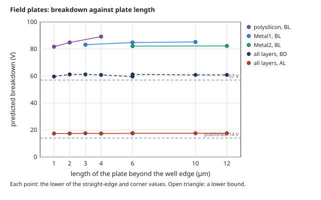
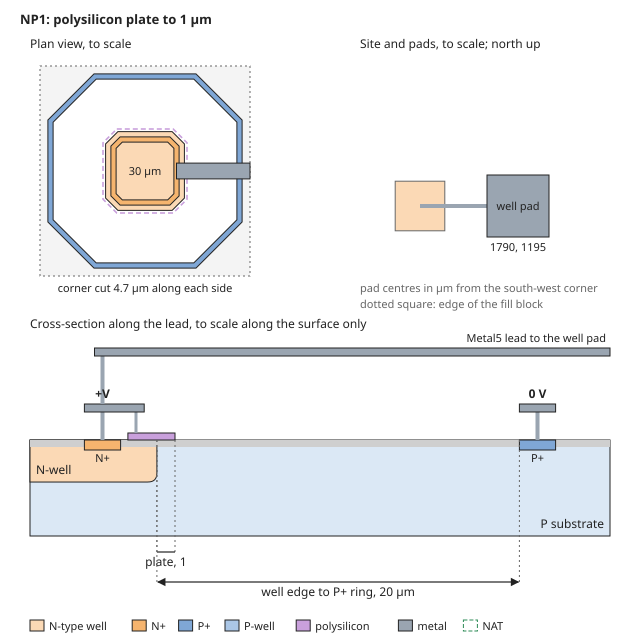
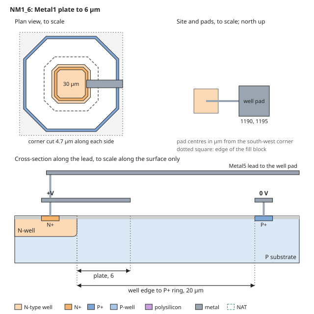
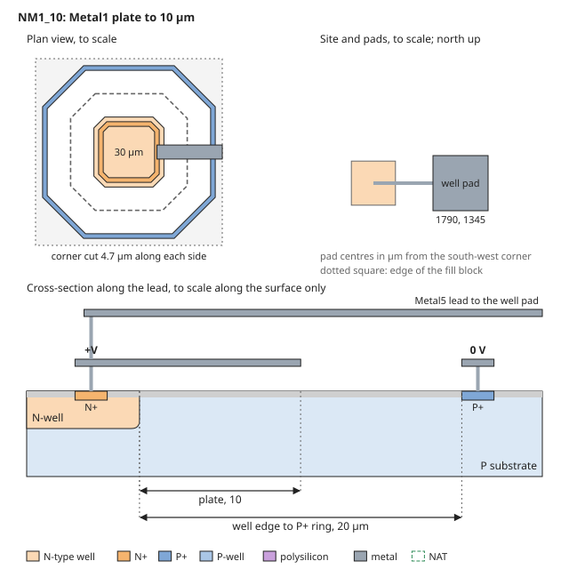
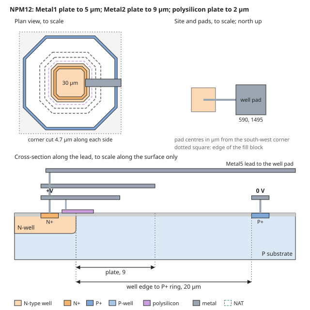
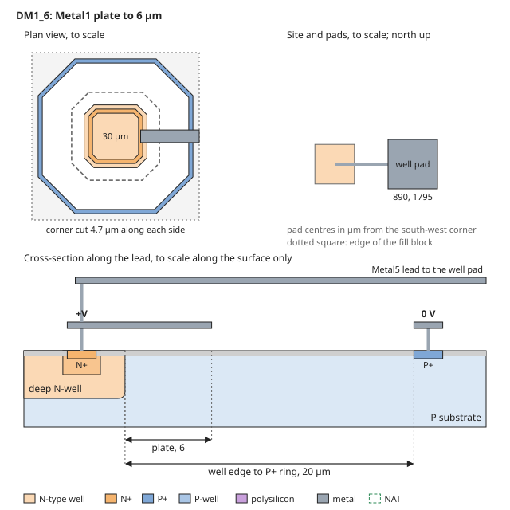
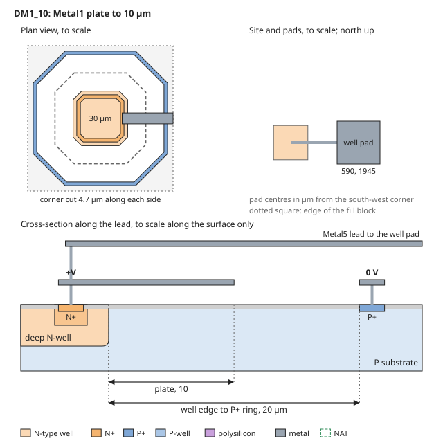
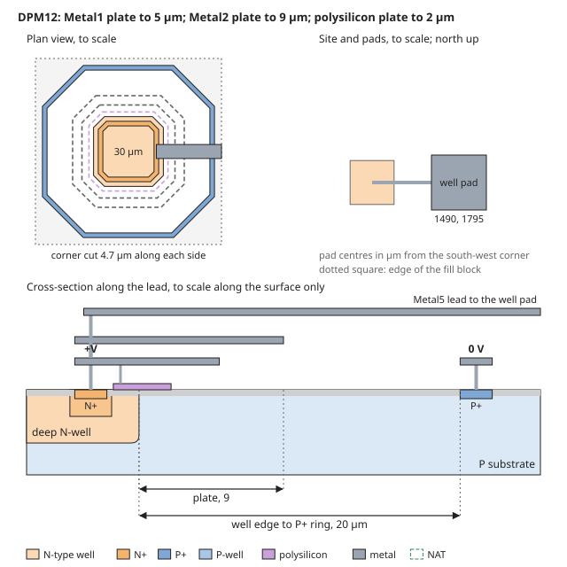
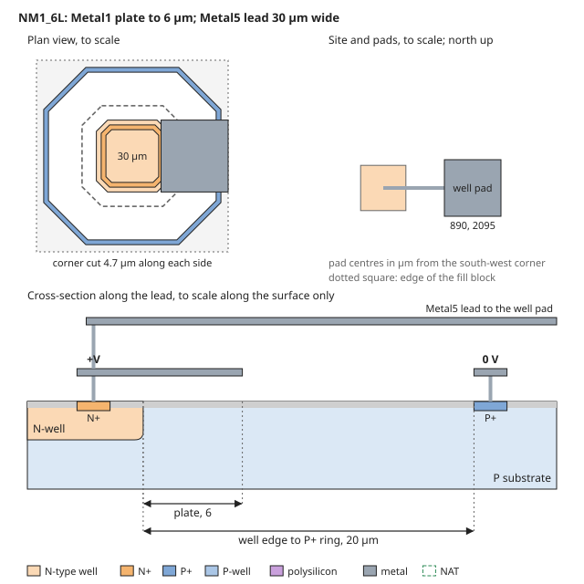

.. _hvt-g-field-plates:

Field plates
============

A field plate is a conductor joined to the well that extends over the oxide
beyond the well's edge. These structures measure what a plate of each layer
and length gains.

The group has 15 structures: :ref:`NP1 <hvt-s-np1>`, :ref:`NP2 <hvt-s-np2>`,
:ref:`NP4 <hvt-s-np4>`, :ref:`NM1_3 <hvt-s-nm1-3>`, :ref:`NM1_6
<hvt-s-nm1-6>`, :ref:`NM1_10 <hvt-s-nm1-10>`, :ref:`NM2_6 <hvt-s-nm2-6>`,
:ref:`NM2_12 <hvt-s-nm2-12>`, :ref:`NPM12 <hvt-s-npm12>`, :ref:`DM1_6
<hvt-s-dm1-6>`, :ref:`DM1_10 <hvt-s-dm1-10>`, :ref:`DPM12 <hvt-s-dpm12>`,
:ref:`NM1_6b <hvt-s-nm1-6b>`, :ref:`NM1_6L <hvt-s-nm1-6l>`, :ref:`NM1_6C0
<hvt-s-nm1-6c0>`.

Mechanism
---------

The plate is at the well's voltage, so it pushes holes away from the silicon
surface beneath it and widens the depletion region there. The field at the
well's curved edge falls, and a new peak forms under the plate's end. The
oxide under the plate sets the balance: 0.32 µm under polysilicon, 1.18 µm
under Metal1 and 2.33 µm under Metal2. Thin oxide acts strongly and puts a
high field at the plate's end; thick oxide acts weakly over a longer reach.

Expected results
----------------

Under assumption A no plate helps, because the junction to the P-well at the
surface fails first. Under B each plate raises the breakdown voltage above
:ref:`NT20 <hvt-s-nt20>` by an amount that depends on layer and length. With
a deep P layer under the well, every plate stops at the same voltage as the
plain well, since the bottom of the well fails first.
:numref:`fig-hvt-g-field-plates` shows the trend that the simulation
predicts.

         straight-edge and corner values, against plate length from 1 µm to
         12 µm, with separate curves for polysilicon, Metal1 and Metal2
         plates, one curve per process, with dashed lines at the published
         14 V and at 57 V and an open triangle where a sweep ended without
         breakdown. The structures of the group are NP1, NP2, NP4, NM1_3,
         NM1_6, NM1_10, NM2_6, NM2_12, NPM12, DM1_6, DM1_10, DPM12, NM1_6b,
         NM1_6L, NM1_6C0. The plotted values are those of the tables in the
         entries.

   Trend that the simulation predicts across the group.

Limits of the group
-------------------

A plate tied to the well cannot be biased separately; the gated diodes do
that. Oxide breakdown under a polysilicon plate would look like junction
breakdown on the first sweep and like a short on the second.

.. _hvt-s-np1:

NP1
---

         with corners cut 4.7 µm along each side, an N+ contact ring inside
         its edge and a P+ ring 20 µm outside it; polysilicon plate to 1 µm.
         A Metal5 lead joins the well to a pad at 1190, 1195 µm.

   NP1 in plan view and in cross-section.

.. list-table:: NP1: drawn parameters and position
   :name: tab-hvt-s-np1
   :header-rows: 1
   :widths: 35 65

   * - Parameter
     - Value
   * - Well
     - N-well
   * - Side of the well
     - 30 µm
   * - Corners
     - Cut of 4.7 µm along each side, for a nominal radius of 8 µm; eight vertices of 135°
   * - Area and perimeter
     - 856 µm² and 109.0 µm
   * - N+ contact ring
     - 2 µm wide, 2 µm inside the well edge
   * - P+ ring
     - 2 µm wide, 20 µm from the well edge
   * - Polysilicon plate
     - From the contact ring to 1 µm outside the edge; joined to the well
   * - Fill block
     - Whole structure
   * - Metal5 lead
     - 6 µm wide
   * - Site
     - Column 4 from the west, row 7 from the south
   * - Well pad, centre x, y
     - 1190, 1195 µm
   * - Substrate
     - Any of the seven SUB pads (:numref:`tab-hvt-pads`)

Purpose
   The shortest polysilicon plate: 1 µm beyond the well edge.
   :numref:`fig-hvt-s-np1` shows the structure and :numref:`tab-hvt-s-np1`
   lists what is drawn.

How it works
   Polysilicon lies on the trench oxide, 0.32 µm from the silicon, so it
   controls the surface almost as a gate would. One micrometre is much less
   than the depletion width, so the plate relieves only the innermost part
   of the curved edge.

Compared with
   * :ref:`NT20 <hvt-s-nt20>`: a polysilicon plate of 1 µm in place of none.
   * :ref:`NP2 <hvt-s-np2>`: a plate of 1 µm in place of 2 µm.

Measurement
   Procedure :ref:`P1 <hvt-p1>` applies. The well pad is at 1190, 1195 µm.

Predicted
   The simulated breakdown voltages are in :numref:`tab-hvt-sp-np1`. The row
   of each family's nominal process also gives the family's band, its
   agreement range and the predicted ratio to the reference structure. Above
   :ref:`NT20 <hvt-s-nt20>`: even a short plate over thin oxide helps.

Limits
   The plate carries the well's voltage over oxide thinner than any the
   foundry rates for it; the manual's advisory limit is 6 V.

.. list-table:: NP1: predicted breakdown voltage by process
   :name: tab-hvt-sp-np1
   :header-rows: 1
   :widths: 18 16 16 17 17 16

   * - Process
     - Straight edge (V)
     - Corner section (V)
     - Family band (V)
     - Agreement range (V)
     - Predicted ratio
   * - AL, AD, AnL, AnD
     - 17.4
     - –
     - 17.4 to 17.4
     - 12.2 to 20.0
     - 0.98 of :ref:`NW0 <hvt-s-nw0>`
   * - BL
     - 86.8
     - 81.7
     - 81.7 to 82.1
     - 57.2 to 94.4
     - 1.22 of :ref:`NT20 <hvt-s-nt20>`
   * - BLq
     - 87.3
     - 82.1
     - –
     - –
     - –
   * - BD
     - 62.9
     - 59.6
     - 59.6 to 59.6
     - 41.7 to 68.5
     - 0.97 of :ref:`NT20 <hvt-s-nt20>`

.. _hvt-s-np2:

NP2
---

         with corners cut 4.7 µm along each side, an N+ contact ring inside
         its edge and a P+ ring 20 µm outside it; polysilicon plate to 2 µm.
         A Metal5 lead joins the well to a pad at 1490, 1195 µm.

   NP2 in plan view and in cross-section.

.. list-table:: NP2: drawn parameters and position
   :name: tab-hvt-s-np2
   :header-rows: 1
   :widths: 35 65

   * - Parameter
     - Value
   * - Well
     - N-well
   * - Side of the well
     - 30 µm
   * - Corners
     - Cut of 4.7 µm along each side, for a nominal radius of 8 µm; eight vertices of 135°
   * - Area and perimeter
     - 856 µm² and 109.0 µm
   * - N+ contact ring
     - 2 µm wide, 2 µm inside the well edge
   * - P+ ring
     - 2 µm wide, 20 µm from the well edge
   * - Polysilicon plate
     - From the contact ring to 2 µm outside the edge; joined to the well
   * - Fill block
     - Whole structure
   * - Metal5 lead
     - 6 µm wide
   * - Site
     - Column 5 from the west, row 7 from the south
   * - Well pad, centre x, y
     - 1490, 1195 µm
   * - Substrate
     - Any of the seven SUB pads (:numref:`tab-hvt-pads`)

Purpose
   A polysilicon plate of 2 µm, the middle of the polysilicon series.
   :numref:`fig-hvt-s-np2` shows the structure and :numref:`tab-hvt-s-np2`
   lists what is drawn.

How it works
   The plate holds the first 2 µm of surface at nearly the well's potential.
   The voltage then has to fall in the silicon beyond the plate's end, where
   the field peak now sits.

Compared with
   * :ref:`NP1 <hvt-s-np1>`: a plate of 2 µm in place of 1 µm.
   * :ref:`NP4 <hvt-s-np4>`: a plate of 2 µm in place of 4 µm.
   * :ref:`NPM12 <hvt-s-npm12>`: polysilicon alone in place of three stepped layers.

Measurement
   Procedure :ref:`P1 <hvt-p1>` applies. The well pad is at 1490, 1195 µm.

Predicted
   The simulated breakdown voltages are in :numref:`tab-hvt-sp-np2`. The row
   of each family's nominal process also gives the family's band, its
   agreement range and the predicted ratio to the reference structure.
   Between :ref:`NP1 <hvt-s-np1>` and :ref:`NP4 <hvt-s-np4>`: the gain grows
   with length over this range.

Limits
   As for :ref:`NP1 <hvt-s-np1>`.

.. list-table:: NP2: predicted breakdown voltage by process
   :name: tab-hvt-sp-np2
   :header-rows: 1
   :widths: 18 16 16 17 17 16

   * - Process
     - Straight edge (V)
     - Corner section (V)
     - Family band (V)
     - Agreement range (V)
     - Predicted ratio
   * - AL, AD, AnL, AnD
     - 17.4
     - –
     - 17.4 to 17.4
     - 12.2 to 20.0
     - 0.98 of :ref:`NW0 <hvt-s-nw0>`
   * - ALhi
     - 17.4
     - –
     - –
     - –
     - –
   * - BL
     - 90.0
     - 84.8
     - 76.2 to 102.0
     - 53.3 to 117.3
     - 1.27 of :ref:`NT20 <hvt-s-nt20>`
   * - BLhi
     - 79.3
     - 76.2
     - –
     - –
     - –
   * - BLlo
     - 113.2
     - 102.0
     - –
     - –
     - –
   * - BLq
     - 90.4
     - 85.2
     - –
     - –
     - –
   * - BLq3
     - 91.3
     - 85.9
     - –
     - –
     - –
   * - BD
     - 62.9
     - 61.2
     - 60.0 to 61.2
     - 42.0 to 70.4
     - 1.00 of :ref:`NT20 <hvt-s-nt20>`
   * - BDhi
     - 62.9
     - 60.0
     - –
     - –
     - –
   * - BDlo
     - 62.5
     - 61.0
     - –
     - –
     - –

.. _hvt-s-np4:

NP4
---

         with corners cut 4.7 µm along each side, an N+ contact ring inside
         its edge and a P+ ring 20 µm outside it; polysilicon plate to 4 µm.
         A Metal5 lead joins the well to a pad at 1790, 1195 µm.

   NP4 in plan view and in cross-section.

.. list-table:: NP4: drawn parameters and position
   :name: tab-hvt-s-np4
   :header-rows: 1
   :widths: 35 65

   * - Parameter
     - Value
   * - Well
     - N-well
   * - Side of the well
     - 30 µm
   * - Corners
     - Cut of 4.7 µm along each side, for a nominal radius of 8 µm; eight vertices of 135°
   * - Area and perimeter
     - 856 µm² and 109.0 µm
   * - N+ contact ring
     - 2 µm wide, 2 µm inside the well edge
   * - P+ ring
     - 2 µm wide, 20 µm from the well edge
   * - Polysilicon plate
     - From the contact ring to 4 µm outside the edge; joined to the well
   * - Fill block
     - Whole structure
   * - Metal5 lead
     - 6 µm wide
   * - Site
     - Column 6 from the west, row 7 from the south
   * - Well pad, centre x, y
     - 1790, 1195 µm
   * - Substrate
     - Any of the seven SUB pads (:numref:`tab-hvt-pads`)

Purpose
   The longest polysilicon plate: 4 µm, most of the depletion width.
   :numref:`fig-hvt-s-np4` shows the structure and :numref:`tab-hvt-s-np4`
   lists what is drawn.

How it works
   The plate depletes nearly the whole width that the region would reach
   unaided. At its end, the silicon is near the substrate's potential while
   the plate is at the well's, so almost the full voltage stands across 0.32
   µm of oxide: about 2.8 MV/cm at 90 V.

Compared with
   * :ref:`NP2 <hvt-s-np2>`: a plate of 4 µm in place of 2 µm.
   * :ref:`NM1_6 <hvt-s-nm1-6>`: polysilicon over 0.32 µm in place of Metal1 over 1.18 µm.
   * :ref:`NGP4 <hvt-s-ngp4>`: the plate joined to the well in place of on its own pad.

Measurement
   Procedure :ref:`P1 <hvt-p1>` applies. The well pad is at 1790, 1195 µm. A
   second sweep straight after the first shows whether the oxide survived.

Predicted
   The simulated breakdown voltages are in :numref:`tab-hvt-sp-np4`. The row
   of each family's nominal process also gives the family's band, its
   agreement range and the predicted ratio to the reference structure. The
   highest value of the polysilicon series, if the oxide holds.

Limits
   The oxide may fail before the silicon does. A sweep that cannot be
   repeated is an oxide failure, not a junction breakdown.

.. list-table:: NP4: predicted breakdown voltage by process
   :name: tab-hvt-sp-np4
   :header-rows: 1
   :widths: 18 16 16 17 17 16

   * - Process
     - Straight edge (V)
     - Corner section (V)
     - Family band (V)
     - Agreement range (V)
     - Predicted ratio
   * - AL, AD, AnL, AnD
     - 17.4
     - –
     - 17.4 to 17.4
     - 12.2 to 20.0
     - 0.98 of :ref:`NW0 <hvt-s-nw0>`
   * - BL
     - 94.4
     - 89.2
     - 89.2 to 89.5
     - 62.4 to 102.9
     - 1.33 of :ref:`NT20 <hvt-s-nt20>`
   * - BLq
     - 94.7
     - 89.5
     - –
     - –
     - –
   * - BD
     - 62.9
     - 60.8
     - 60.8 to 60.8
     - 42.6 to 69.9
     - 0.99 of :ref:`NT20 <hvt-s-nt20>`

.. _hvt-s-nm1-3:

NM1_3
-----

         with corners cut 4.7 µm along each side, an N+ contact ring inside
         its edge and a P+ ring 20 µm outside it; Metal1 plate to 3 µm. A
         Metal5 lead joins the well to a pad at 290, 1345 µm.

   NM1_3 in plan view and in cross-section.

.. list-table:: NM1_3: drawn parameters and position
   :name: tab-hvt-s-nm1-3
   :header-rows: 1
   :widths: 35 65

   * - Parameter
     - Value
   * - Well
     - N-well
   * - Side of the well
     - 30 µm
   * - Corners
     - Cut of 4.7 µm along each side, for a nominal radius of 8 µm; eight vertices of 135°
   * - Area and perimeter
     - 856 µm² and 109.0 µm
   * - N+ contact ring
     - 2 µm wide, 2 µm inside the well edge
   * - P+ ring
     - 2 µm wide, 20 µm from the well edge
   * - Metal1 plate
     - From the contact ring to 3 µm outside the edge; joined to the well
   * - Fill block
     - Whole structure
   * - Metal5 lead
     - 6 µm wide
   * - Site
     - Column 1 from the west, row 8 from the south
   * - Well pad, centre x, y
     - 290, 1345 µm
   * - Substrate
     - Any of the seven SUB pads (:numref:`tab-hvt-pads`)

Purpose
   The shortest Metal1 plate: 3 µm beyond the well edge.
   :numref:`fig-hvt-s-nm1-3` shows the structure and
   :numref:`tab-hvt-s-nm1-3` lists what is drawn.

How it works
   Metal1 lies over 1.18 µm of oxide. Its hold on the surface is about a
   quarter of polysilicon's, so at 3 µm it widens the depletion region only
   a little beyond the curved edge.

Compared with
   * :ref:`NT20 <hvt-s-nt20>`: a Metal1 plate of 3 µm in place of none.
   * :ref:`NM1_6 <hvt-s-nm1-6>`: a plate of 3 µm in place of 6 µm.
   * :ref:`NP2 <hvt-s-np2>`: Metal1 in place of polysilicon at a similar length.

Measurement
   Procedure :ref:`P1 <hvt-p1>` applies. The well pad is at 290, 1345 µm.

Predicted
   The simulated breakdown voltages are in :numref:`tab-hvt-sp-nm1-3`. The
   row of each family's nominal process also gives the family's band, its
   agreement range and the predicted ratio to the reference structure. Above
   :ref:`NT20 <hvt-s-nt20>`: Metal1 alone is a usable plate.

Limits
   None beyond those of the group.

.. list-table:: NM1_3: predicted breakdown voltage by process
   :name: tab-hvt-sp-nm1-3
   :header-rows: 1
   :widths: 18 16 16 17 17 16

   * - Process
     - Straight edge (V)
     - Corner section (V)
     - Family band (V)
     - Agreement range (V)
     - Predicted ratio
   * - AL, AD, AnL, AnD
     - 17.6
     - –
     - 17.6 to 17.6
     - 12.3 to 20.2
     - 0.99 of :ref:`NW0 <hvt-s-nw0>`
   * - BL
     - 88.5
     - 83.2
     - 83.2 to 83.7
     - 58.2 to 96.3
     - 1.24 of :ref:`NT20 <hvt-s-nt20>`
   * - BLq
     - 89.0
     - 83.7
     - –
     - –
     - –
   * - BD
     - 62.9
     - 61.2
     - 61.2 to 61.2
     - 42.8 to 70.4
     - 1.00 of :ref:`NT20 <hvt-s-nt20>`

.. _hvt-s-nm1-6:

NM1_6
-----

         with corners cut 4.7 µm along each side, an N+ contact ring inside
         its edge and a P+ ring 20 µm outside it; Metal1 plate to 6 µm. A
         Metal5 lead joins the well to a pad at 590, 1345 µm.

   NM1_6 in plan view and in cross-section.

.. list-table:: NM1_6: drawn parameters and position
   :name: tab-hvt-s-nm1-6
   :header-rows: 1
   :widths: 35 65

   * - Parameter
     - Value
   * - Well
     - N-well
   * - Side of the well
     - 30 µm
   * - Corners
     - Cut of 4.7 µm along each side, for a nominal radius of 8 µm; eight vertices of 135°
   * - Area and perimeter
     - 856 µm² and 109.0 µm
   * - N+ contact ring
     - 2 µm wide, 2 µm inside the well edge
   * - P+ ring
     - 2 µm wide, 20 µm from the well edge
   * - Metal1 plate
     - From the contact ring to 6 µm outside the edge; joined to the well
   * - Fill block
     - Whole structure
   * - Metal5 lead
     - 6 µm wide
   * - Site
     - Column 2 from the west, row 8 from the south
   * - Well pad, centre x, y
     - 590, 1345 µm
   * - Substrate
     - Any of the seven SUB pads (:numref:`tab-hvt-pads`)

Purpose
   The Metal1 plate of middle length, 6 µm: the plate that every other
   Metal1 structure on the die repeats. :numref:`fig-hvt-s-nm1-6` shows the
   structure and :numref:`tab-hvt-s-nm1-6` lists what is drawn.

How it works
   The plate, at the well's voltage over 1.18 µm of oxide, depletes the
   surface out to its end, a little beyond the unaided depletion width. The
   peak field moves from the well's curved edge to under the plate's end.

Compared with
   * :ref:`NM1_3 <hvt-s-nm1-3>`: a plate of 6 µm in place of 3 µm.
   * :ref:`NM1_10 <hvt-s-nm1-10>`: a plate of 6 µm in place of 10 µm.
   * :ref:`NGM1 <hvt-s-ngm1>`: the plate joined to the well in place of on its own pad.
   * :ref:`NAM1_6 <hvt-s-nam1-6>`: no NAT in place of NAT under the plate.

Measurement
   Procedure :ref:`P1 <hvt-p1>` applies. The well pad is at 590, 1345 µm.
   Swept again at 85 °C.

Predicted
   The simulated breakdown voltages are in :numref:`tab-hvt-sp-nm1-6`. The
   row of each family's nominal process also gives the family's band, its
   agreement range and the predicted ratio to the reference structure. Above
   :ref:`NT20 <hvt-s-nt20>` by more than :ref:`NM1_3 <hvt-s-nm1-3>` is:
   length up to the depletion width is worth having.

Limits
   None beyond those of the group.

.. list-table:: NM1_6: predicted breakdown voltage by process
   :name: tab-hvt-sp-nm1-6
   :header-rows: 1
   :widths: 18 16 16 17 17 16

   * - Process
     - Straight edge (V)
     - Corner section (V)
     - Family band (V)
     - Agreement range (V)
     - Predicted ratio
   * - AL, AD, AnL, AnD
     - 17.6
     - –
     - 17.6 to 17.7
     - 12.3 to 20.4
     - 0.99 of :ref:`NW0 <hvt-s-nw0>`
   * - ALhi
     - 17.7
     - –
     - –
     - –
     - –
   * - BL
     - 90.2
     - 84.8
     - 75.7 to 105.8
     - 53.0 to 121.7
     - 1.27 of :ref:`NT20 <hvt-s-nt20>`
   * - BLhi
     - 78.8
     - 75.7
     - –
     - –
     - –
   * - BLlo
     - 117.7
     - 105.8
     - –
     - –
     - –
   * - BLq
     - 90.8
     - 85.4
     - –
     - –
     - –
   * - BLq3
     - 92.0
     - 86.6
     - –
     - –
     - –
   * - BD
     - 62.9
     - 59.6
     - 59.5 to 61.0
     - 41.6 to 70.1
     - 0.97 of :ref:`NT20 <hvt-s-nt20>`
   * - BDhi
     - 62.9
     - 59.5
     - –
     - –
     - –
   * - BDlo
     - 62.5
     - 61.0
     - –
     - –
     - –

.. _hvt-s-nm1-10:

NM1_10
------

         with corners cut 4.7 µm along each side, an N+ contact ring inside
         its edge and a P+ ring 20 µm outside it; Metal1 plate to 10 µm. A
         Metal5 lead joins the well to a pad at 890, 1345 µm.

   NM1_10 in plan view and in cross-section.

.. list-table:: NM1_10: drawn parameters and position
   :name: tab-hvt-s-nm1-10
   :header-rows: 1
   :widths: 35 65

   * - Parameter
     - Value
   * - Well
     - N-well
   * - Side of the well
     - 30 µm
   * - Corners
     - Cut of 4.7 µm along each side, for a nominal radius of 8 µm; eight vertices of 135°
   * - Area and perimeter
     - 856 µm² and 109.0 µm
   * - N+ contact ring
     - 2 µm wide, 2 µm inside the well edge
   * - P+ ring
     - 2 µm wide, 20 µm from the well edge
   * - Metal1 plate
     - From the contact ring to 10 µm outside the edge; joined to the well
   * - Fill block
     - Whole structure
   * - Metal5 lead
     - 6 µm wide
   * - Site
     - Column 3 from the west, row 8 from the south
   * - Well pad, centre x, y
     - 890, 1345 µm
   * - Substrate
     - Any of the seven SUB pads (:numref:`tab-hvt-pads`)

Purpose
   The longest Metal1 plate, 10 µm: shows whether the gain stops once the
   plate passes the depletion width. :numref:`fig-hvt-s-nm1-10` shows the
   structure and :numref:`tab-hvt-s-nm1-10` lists what is drawn.

How it works
   The surface under the first 5 µm to 6 µm is already depleted by the
   junction. Beyond that the plate adds depleted surface that holds little
   voltage, and brings its end nearer the P+ ring.

Compared with
   * :ref:`NM1_6 <hvt-s-nm1-6>`: a plate of 10 µm in place of 6 µm.

Measurement
   Procedure :ref:`P1 <hvt-p1>` applies. The well pad is at 890, 1345 µm.

Predicted
   The simulated breakdown voltages are in :numref:`tab-hvt-sp-nm1-10`. The
   row of each family's nominal process also gives the family's band, its
   agreement range and the predicted ratio to the reference structure. Equal
   to :ref:`NM1_6 <hvt-s-nm1-6>`: the gain has stopped, and area spent on a
   longer plate is wasted.

Limits
   The plate's end is 10 µm from the P+ ring, so a loss could come from that
   distance.

.. list-table:: NM1_10: predicted breakdown voltage by process
   :name: tab-hvt-sp-nm1-10
   :header-rows: 1
   :widths: 18 16 16 17 17 16

   * - Process
     - Straight edge (V)
     - Corner section (V)
     - Family band (V)
     - Agreement range (V)
     - Predicted ratio
   * - AL, AD, AnL, AnD
     - 17.6
     - –
     - 17.6 to 17.6
     - 12.3 to 20.2
     - 0.99 of :ref:`NW0 <hvt-s-nw0>`
   * - BL
     - 90.6
     - 85.2
     - 85.2 to 85.9
     - 59.6 to 98.8
     - 1.27 of :ref:`NT20 <hvt-s-nt20>`
   * - BLq
     - 91.3
     - 85.9
     - –
     - –
     - –
   * - BD
     - 62.9
     - 60.8
     - 60.8 to 60.8
     - 42.6 to 69.9
     - 0.99 of :ref:`NT20 <hvt-s-nt20>`

.. _hvt-s-nm2-6:

NM2_6
-----

         with corners cut 4.7 µm along each side, an N+ contact ring inside
         its edge and a P+ ring 20 µm outside it; Metal2 plate to 6 µm. A
         Metal5 lead joins the well to a pad at 1190, 1345 µm.

   NM2_6 in plan view and in cross-section.

.. list-table:: NM2_6: drawn parameters and position
   :name: tab-hvt-s-nm2-6
   :header-rows: 1
   :widths: 35 65

   * - Parameter
     - Value
   * - Well
     - N-well
   * - Side of the well
     - 30 µm
   * - Corners
     - Cut of 4.7 µm along each side, for a nominal radius of 8 µm; eight vertices of 135°
   * - Area and perimeter
     - 856 µm² and 109.0 µm
   * - N+ contact ring
     - 2 µm wide, 2 µm inside the well edge
   * - P+ ring
     - 2 µm wide, 20 µm from the well edge
   * - Metal2 plate
     - From the contact ring to 6 µm outside the edge; joined to the well
   * - Fill block
     - Whole structure
   * - Metal5 lead
     - 6 µm wide
   * - Site
     - Column 4 from the west, row 8 from the south
   * - Well pad, centre x, y
     - 1190, 1345 µm
   * - Substrate
     - Any of the seven SUB pads (:numref:`tab-hvt-pads`)

Purpose
   A Metal2 plate of 6 µm: the same length as :ref:`NM1_6 <hvt-s-nm1-6>`
   over twice the oxide. :numref:`fig-hvt-s-nm2-6` shows the structure and
   :numref:`tab-hvt-s-nm2-6` lists what is drawn.

How it works
   Over 2.33 µm of oxide the plate couples to the surface half as strongly
   as Metal1. It depletes the surface less, and leaves a lower field at its
   own end and in the oxide.

Compared with
   * :ref:`NM1_6 <hvt-s-nm1-6>`: Metal2 in place of Metal1 at the same length.
   * :ref:`NM2_12 <hvt-s-nm2-12>`: a plate of 6 µm in place of 12 µm.

Measurement
   Procedure :ref:`P1 <hvt-p1>` applies. The well pad is at 1190, 1345 µm.

Predicted
   The simulated breakdown voltages are in :numref:`tab-hvt-sp-nm2-6`. The
   row of each family's nominal process also gives the family's band, its
   agreement range and the predicted ratio to the reference structure. Below
   :ref:`NM1_6 <hvt-s-nm1-6>`: at this length the thinner oxide wins.

Limits
   The Metal2 plate needs a via from the well's Metal1, and its edge lies
   above Metal1 of the contact ring, which screens the innermost part.

.. list-table:: NM2_6: predicted breakdown voltage by process
   :name: tab-hvt-sp-nm2-6
   :header-rows: 1
   :widths: 18 16 16 17 17 16

   * - Process
     - Straight edge (V)
     - Corner section (V)
     - Family band (V)
     - Agreement range (V)
     - Predicted ratio
   * - AL, AD, AnL, AnD
     - 17.6
     - –
     - 17.6 to 17.6
     - 12.3 to 20.2
     - 0.99 of :ref:`NW0 <hvt-s-nw0>`
   * - BL
     - 87.4
     - 82.1
     - 82.1 to 82.8
     - 57.5 to 95.2
     - 1.23 of :ref:`NT20 <hvt-s-nt20>`
   * - BLq
     - 88.1
     - 82.8
     - –
     - –
     - –
   * - BD
     - 62.9
     - 61.2
     - 61.2 to 61.2
     - 42.8 to 70.4
     - 1.00 of :ref:`NT20 <hvt-s-nt20>`

.. _hvt-s-nm2-12:

NM2_12
------

         with corners cut 4.7 µm along each side, an N+ contact ring inside
         its edge and a P+ ring 20 µm outside it; Metal2 plate to 12 µm. A
         Metal5 lead joins the well to a pad at 1490, 1345 µm.

   NM2_12 in plan view and in cross-section.

.. list-table:: NM2_12: drawn parameters and position
   :name: tab-hvt-s-nm2-12
   :header-rows: 1
   :widths: 35 65

   * - Parameter
     - Value
   * - Well
     - N-well
   * - Side of the well
     - 30 µm
   * - Corners
     - Cut of 4.7 µm along each side, for a nominal radius of 8 µm; eight vertices of 135°
   * - Area and perimeter
     - 856 µm² and 109.0 µm
   * - N+ contact ring
     - 2 µm wide, 2 µm inside the well edge
   * - P+ ring
     - 2 µm wide, 20 µm from the well edge
   * - Metal2 plate
     - From the contact ring to 12 µm outside the edge; joined to the well
   * - Fill block
     - Whole structure
   * - Metal5 lead
     - 6 µm wide
   * - Site
     - Column 5 from the west, row 8 from the south
   * - Well pad, centre x, y
     - 1490, 1345 µm
   * - Substrate
     - Any of the seven SUB pads (:numref:`tab-hvt-pads`)

Purpose
   A Metal2 plate of 12 µm: tests whether length makes up for the thicker
   oxide. :numref:`fig-hvt-s-nm2-12` shows the structure and
   :numref:`tab-hvt-s-nm2-12` lists what is drawn.

How it works
   A weakly coupled plate spreads the surface potential over a longer
   distance. With twice the length of :ref:`NM2_6 <hvt-s-nm2-6>`, the
   voltage under the plate has room to fall more gradually before the
   plate's end.

Compared with
   * :ref:`NM2_6 <hvt-s-nm2-6>`: a plate of 12 µm in place of 6 µm.
   * :ref:`NM1_10 <hvt-s-nm1-10>`: Metal2 in place of Metal1 at a similar length.

Measurement
   Procedure :ref:`P1 <hvt-p1>` applies. The well pad is at 1490, 1345 µm.

Predicted
   The simulated breakdown voltages are in :numref:`tab-hvt-sp-nm2-12`. The
   row of each family's nominal process also gives the family's band, its
   agreement range and the predicted ratio to the reference structure. Above
   :ref:`NM2_6 <hvt-s-nm2-6>`: Metal2 wants more length than Metal1.

Limits
   The plate's end is 8 µm from the P+ ring, the closest of any plate.

.. list-table:: NM2_12: predicted breakdown voltage by process
   :name: tab-hvt-sp-nm2-12
   :header-rows: 1
   :widths: 18 16 16 17 17 16

   * - Process
     - Straight edge (V)
     - Corner section (V)
     - Family band (V)
     - Agreement range (V)
     - Predicted ratio
   * - AL, AD, AnL, AnD
     - 17.6
     - –
     - 17.6 to 17.6
     - 12.3 to 20.2
     - 0.99 of :ref:`NW0 <hvt-s-nw0>`
   * - BL
     - 87.6
     - 82.3
     - 82.3 to 83.0
     - 57.6 to 95.4
     - 1.23 of :ref:`NT20 <hvt-s-nt20>`
   * - BLq
     - 88.4
     - 83.0
     - –
     - –
     - –
   * - BD
     - 62.9
     - 60.8
     - 60.8 to 60.8
     - 42.6 to 69.9
     - 0.99 of :ref:`NT20 <hvt-s-nt20>`

.. _hvt-s-npm12:

NPM12
-----

         with corners cut 4.7 µm along each side, an N+ contact ring inside
         its edge and a P+ ring 20 µm outside it; Metal1 plate to 5 µm;
         Metal2 plate to 9 µm; polysilicon plate to 2 µm. A Metal5 lead
         joins the well to a pad at 1790, 1345 µm.

   NPM12 in plan view and in cross-section.

.. list-table:: NPM12: drawn parameters and position
   :name: tab-hvt-s-npm12
   :header-rows: 1
   :widths: 35 65

   * - Parameter
     - Value
   * - Well
     - N-well
   * - Side of the well
     - 30 µm
   * - Corners
     - Cut of 4.7 µm along each side, for a nominal radius of 8 µm; eight vertices of 135°
   * - Area and perimeter
     - 856 µm² and 109.0 µm
   * - N+ contact ring
     - 2 µm wide, 2 µm inside the well edge
   * - P+ ring
     - 2 µm wide, 20 µm from the well edge
   * - Metal1 plate
     - From the contact ring to 5 µm outside the edge; joined to the well
   * - Metal2 plate
     - From the contact ring to 9 µm outside the edge; joined to the well
   * - Polysilicon plate
     - From the contact ring to 2 µm outside the edge; joined to the well
   * - Fill block
     - Whole structure
   * - Metal5 lead
     - 6 µm wide
   * - Site
     - Column 6 from the west, row 8 from the south
   * - Well pad, centre x, y
     - 1790, 1345 µm
   * - Substrate
     - Any of the seven SUB pads (:numref:`tab-hvt-pads`)

Purpose
   A stepped plate of three layers: polysilicon to 2 µm, Metal1 to 5 µm and
   Metal2 to 9 µm. :numref:`fig-hvt-s-npm12` shows the structure and
   :numref:`tab-hvt-s-npm12` lists what is drawn.

How it works
   Each layer ends where the next, over thicker oxide, takes over. The
   surface potential is stepped down in three stages, so no single plate end
   carries the whole field peak, and the oxide under the polysilicon sees
   only the first part of the voltage.

Compared with
   * :ref:`NP2 <hvt-s-np2>`: three stepped layers in place of polysilicon alone.
   * :ref:`NM1_6 <hvt-s-nm1-6>`: three stepped layers in place of Metal1 alone.

Measurement
   Procedure :ref:`P1 <hvt-p1>` applies. The well pad is at 1790, 1345 µm.

Predicted
   The simulated breakdown voltages are in :numref:`tab-hvt-sp-npm12`. The
   row of each family's nominal process also gives the family's band, its
   agreement range and the predicted ratio to the reference structure. Above
   every single-layer plate: stepping is worth its complexity. Equal to the
   best single plate: it is not.

Limits
   It is the only stepped plate on an N-well, so the lengths of its steps
   are not varied.

.. list-table:: NPM12: predicted breakdown voltage by process
   :name: tab-hvt-sp-npm12
   :header-rows: 1
   :widths: 18 16 16 17 17 16

   * - Process
     - Straight edge (V)
     - Corner section (V)
     - Family band (V)
     - Agreement range (V)
     - Predicted ratio
   * - AL, AD, AnL, AnD
     - 17.4
     - –
     - 17.4 to 17.4
     - 12.2 to 20.0
     - 0.98 of :ref:`NW0 <hvt-s-nw0>`
   * - BL
     - 92.4
     - 87.1
     - 87.1 to 87.6
     - 61.0 to 100.7
     - 1.30 of :ref:`NT20 <hvt-s-nt20>`
   * - BLq
     - 92.9
     - 87.6
     - –
     - –
     - –
   * - BD
     - 62.9
     - 61.2
     - 61.2 to 61.2
     - 42.8 to 70.4
     - 1.00 of :ref:`NT20 <hvt-s-nt20>`

.. _hvt-s-dm1-6:

DM1_6
-----

         across with corners cut 4.7 µm along each side, an N+ contact ring
         inside its edge and a P+ ring 20 µm outside it; Metal1 plate to 6
         µm. A Metal5 lead joins the well to a pad at 890, 1795 µm.

   DM1_6 in plan view and in cross-section.

.. list-table:: DM1_6: drawn parameters and position
   :name: tab-hvt-s-dm1-6
   :header-rows: 1
   :widths: 35 65

   * - Parameter
     - Value
   * - Well
     - Deep N-well, with an N-well band under its contact ring
   * - Side of the well
     - 30 µm
   * - Corners
     - Cut of 4.7 µm along each side, for a nominal radius of 8 µm; eight vertices of 135°
   * - Area and perimeter
     - 856 µm² and 109.0 µm
   * - N+ contact ring
     - 2 µm wide, 2 µm inside the well edge
   * - P+ ring
     - 2 µm wide, 20 µm from the well edge
   * - Metal1 plate
     - From the contact ring to 6 µm outside the edge; joined to the well
   * - Fill block
     - Whole structure
   * - Metal5 lead
     - 6 µm wide
   * - Site
     - Column 3 from the west, row 11 from the south
   * - Well pad, centre x, y
     - 890, 1795 µm
   * - Substrate
     - Any of the seven SUB pads (:numref:`tab-hvt-pads`)

Purpose
   A deep N-well with a Metal1 plate of 6 µm: the deep-well counterpart of
   the plate that gains most among Metal1 plates on an N-well.
   :numref:`fig-hvt-s-dm1-6` shows the structure and
   :numref:`tab-hvt-s-dm1-6` lists what is drawn.

How it works
   If any plate could raise a deep N-well's breakdown, this one should. The
   comparison with :ref:`NM1_6 <hvt-s-nm1-6>` is the clearest single test of
   whether the edge or the bottom limits.

Compared with
   * :ref:`DT20 <hvt-s-dt20>`: a Metal1 plate of 6 µm in place of none.
   * :ref:`DM1_10 <hvt-s-dm1-10>`: a plate of 6 µm in place of 10 µm.
   * :ref:`NM1_6 <hvt-s-nm1-6>`: a deep N-well in place of an N-well.
   * :ref:`DGM1 <hvt-s-dgm1>`: the plate joined to the well in place of on its own pad.

Measurement
   Procedure :ref:`P1 <hvt-p1>` applies. The well pad is at 890, 1795 µm.

Predicted
   The simulated breakdown voltages are in :numref:`tab-hvt-sp-dm1-6`. The
   row of each family's nominal process also gives the family's band, its
   agreement range and the predicted ratio to the reference structure. Equal
   to :ref:`DT20 <hvt-s-dt20>` while :ref:`NM1_6 <hvt-s-nm1-6>` is above
   :ref:`NT20 <hvt-s-nt20>`: plates work on edges, and this well does not
   fail at its edge.

Limits
   None beyond those of the group.

.. list-table:: DM1_6: predicted breakdown voltage by process
   :name: tab-hvt-sp-dm1-6
   :header-rows: 1
   :widths: 18 16 16 17 17 16

   * - Process
     - Straight edge (V)
     - Corner section (V)
     - Family band (V)
     - Agreement range (V)
     - Predicted ratio
   * - AL, AnL
     - 32.4
     - 31.3
     - 30.4 to 31.3
     - 21.3 to 36.0
     - 1.04 of :ref:`DT20 <hvt-s-dt20>`
   * - ALhi
     - 32.4
     - 30.4
     - –
     - –
     - –
   * - AD, AnD
     - 32.4
     - 31.3
     - 31.3 to 31.3
     - 21.9 to 36.0
     - 1.00 of :ref:`DT20 <hvt-s-dt20>`
   * - BL
     - 32.3
     - 30.3
     - 30.3 to 31.3
     - 21.2 to 36.0
     - 0.97 of :ref:`DT20 <hvt-s-dt20>`
   * - BLhi
     - 32.4
     - 31.3
     - –
     - –
     - –
   * - BLlo
     - 32.2
     - 31.2
     - –
     - –
     - –
   * - BLq
     - 32.3
     - 31.3
     - –
     - –
     - –
   * - BLq3
     - 32.3
     - 30.8
     - –
     - –
     - –
   * - BD
     - 32.4
     - 31.3
     - 30.1 to 31.3
     - 21.1 to 36.0
     - 1.00 of :ref:`DT20 <hvt-s-dt20>`
   * - BDhi
     - 32.4
     - 30.1
     - –
     - –
     - –
   * - BDlo
     - 32.2
     - 30.2
     - –
     - –
     - –

.. _hvt-s-dm1-10:

DM1_10
------

         across with corners cut 4.7 µm along each side, an N+ contact ring
         inside its edge and a P+ ring 20 µm outside it; Metal1 plate to 10
         µm. A Metal5 lead joins the well to a pad at 1190, 1795 µm.

   DM1_10 in plan view and in cross-section.

.. list-table:: DM1_10: drawn parameters and position
   :name: tab-hvt-s-dm1-10
   :header-rows: 1
   :widths: 35 65

   * - Parameter
     - Value
   * - Well
     - Deep N-well, with an N-well band under its contact ring
   * - Side of the well
     - 30 µm
   * - Corners
     - Cut of 4.7 µm along each side, for a nominal radius of 8 µm; eight vertices of 135°
   * - Area and perimeter
     - 856 µm² and 109.0 µm
   * - N+ contact ring
     - 2 µm wide, 2 µm inside the well edge
   * - P+ ring
     - 2 µm wide, 20 µm from the well edge
   * - Metal1 plate
     - From the contact ring to 10 µm outside the edge; joined to the well
   * - Fill block
     - Whole structure
   * - Metal5 lead
     - 6 µm wide
   * - Site
     - Column 4 from the west, row 11 from the south
   * - Well pad, centre x, y
     - 1190, 1795 µm
   * - Substrate
     - Any of the seven SUB pads (:numref:`tab-hvt-pads`)

Purpose
   A deep N-well with a Metal1 plate of 10 µm. :numref:`fig-hvt-s-dm1-10`
   shows the structure and :numref:`tab-hvt-s-dm1-10` lists what is drawn.

How it works
   The long end of the plate series on a deep N-well, for the case that the
   shorter plates show an effect that has not yet stopped growing.

Compared with
   * :ref:`DM1_6 <hvt-s-dm1-6>`: a plate of 10 µm in place of 6 µm.
   * :ref:`NM1_10 <hvt-s-nm1-10>`: a deep N-well in place of an N-well.

Measurement
   Procedure :ref:`P1 <hvt-p1>` applies. The well pad is at 1190, 1795 µm.

Predicted
   The simulated breakdown voltages are in :numref:`tab-hvt-sp-dm1-10`. The
   row of each family's nominal process also gives the family's band, its
   agreement range and the predicted ratio to the reference structure. Equal
   to :ref:`DT20 <hvt-s-dt20>`.

Limits
   Redundant if the bottom limits.

.. list-table:: DM1_10: predicted breakdown voltage by process
   :name: tab-hvt-sp-dm1-10
   :header-rows: 1
   :widths: 18 16 16 17 17 16

   * - Process
     - Straight edge (V)
     - Corner section (V)
     - Family band (V)
     - Agreement range (V)
     - Predicted ratio
   * - AL, AnL
     - 32.4
     - 31.3
     - 31.3 to 31.3
     - 21.9 to 36.0
     - 1.04 of :ref:`DT20 <hvt-s-dt20>`
   * - AD, AnD
     - 32.4
     - 31.3
     - 31.3 to 31.3
     - 21.9 to 36.0
     - 1.00 of :ref:`DT20 <hvt-s-dt20>`
   * - BL
     - 32.4
     - 30.3
     - 30.3 to 31.3
     - 21.2 to 36.0
     - 0.97 of :ref:`DT20 <hvt-s-dt20>`
   * - BLq
     - 32.3
     - 31.3
     - –
     - –
     - –
   * - BD
     - 32.3
     - 29.6
     - 29.6 to 29.6
     - 20.7 to 34.0
     - 0.95 of :ref:`DT20 <hvt-s-dt20>`

.. _hvt-s-dpm12:

DPM12
-----

         across with corners cut 4.7 µm along each side, an N+ contact ring
         inside its edge and a P+ ring 20 µm outside it; Metal1 plate to 5
         µm; Metal2 plate to 9 µm; polysilicon plate to 2 µm. A Metal5 lead
         joins the well to a pad at 1490, 1795 µm.

   DPM12 in plan view and in cross-section.

.. list-table:: DPM12: drawn parameters and position
   :name: tab-hvt-s-dpm12
   :header-rows: 1
   :widths: 35 65

   * - Parameter
     - Value
   * - Well
     - Deep N-well, with an N-well band under its contact ring
   * - Side of the well
     - 30 µm
   * - Corners
     - Cut of 4.7 µm along each side, for a nominal radius of 8 µm; eight vertices of 135°
   * - Area and perimeter
     - 856 µm² and 109.0 µm
   * - N+ contact ring
     - 2 µm wide, 2 µm inside the well edge
   * - P+ ring
     - 2 µm wide, 20 µm from the well edge
   * - Metal1 plate
     - From the contact ring to 5 µm outside the edge; joined to the well
   * - Metal2 plate
     - From the contact ring to 9 µm outside the edge; joined to the well
   * - Polysilicon plate
     - From the contact ring to 2 µm outside the edge; joined to the well
   * - Fill block
     - Whole structure
   * - Metal5 lead
     - 6 µm wide
   * - Site
     - Column 5 from the west, row 11 from the south
   * - Well pad, centre x, y
     - 1490, 1795 µm
   * - Substrate
     - Any of the seven SUB pads (:numref:`tab-hvt-pads`)

Purpose
   A deep N-well with the stepped plate of three layers.
   :numref:`fig-hvt-s-dpm12` shows the structure and
   :numref:`tab-hvt-s-dpm12` lists what is drawn.

How it works
   The strongest edge termination on the die applied to a deep N-well. Its
   polysilicon step lies over the N-well band of the contact and the first 2
   µm outside the edge.

Compared with
   * :ref:`DT20 <hvt-s-dt20>`: a stepped plate in place of none.
   * :ref:`NPM12 <hvt-s-npm12>`: a deep N-well in place of an N-well.

Measurement
   Procedure :ref:`P1 <hvt-p1>` applies. The well pad is at 1490, 1795 µm. A
   second sweep shows whether the oxide under the polysilicon survived.

Predicted
   The simulated breakdown voltages are in :numref:`tab-hvt-sp-dpm12`. The
   row of each family's nominal process also gives the family's band, its
   agreement range and the predicted ratio to the reference structure. Equal
   to :ref:`DT20 <hvt-s-dt20>`: no edge termination helps this well.

Limits
   At about 30 V the oxide under the polysilicon sees under 1 MV/cm, so this
   structure does not test the oxide.

.. list-table:: DPM12: predicted breakdown voltage by process
   :name: tab-hvt-sp-dpm12
   :header-rows: 1
   :widths: 18 16 16 17 17 16

   * - Process
     - Straight edge (V)
     - Corner section (V)
     - Family band (V)
     - Agreement range (V)
     - Predicted ratio
   * - AL, AnL
     - 32.4
     - 31.0
     - 31.0 to 31.0
     - 21.7 to 35.6
     - 1.03 of :ref:`DT20 <hvt-s-dt20>`
   * - AD, AnD
     - 32.3
     - 31.3
     - 31.3 to 31.3
     - 21.9 to 36.0
     - 1.00 of :ref:`DT20 <hvt-s-dt20>`
   * - BL
     - 32.3
     - 31.3
     - 31.3 to 31.3
     - 21.9 to 36.0
     - 1.00 of :ref:`DT20 <hvt-s-dt20>`
   * - BLq
     - 32.3
     - 31.3
     - –
     - –
     - –
   * - BD
     - 32.4
     - 31.3
     - 31.3 to 31.3
     - 21.9 to 36.0
     - 1.00 of :ref:`DT20 <hvt-s-dt20>`

.. _hvt-s-nm1-6b:

NM1_6b
------

         with corners cut 4.7 µm along each side, an N+ contact ring inside
         its edge and a P+ ring 20 µm outside it; Metal1 plate to 6 µm. A
         Metal5 lead joins the well to a pad at 590, 2095 µm.

   NM1_6b in plan view and in cross-section.

.. list-table:: NM1_6b: drawn parameters and position
   :name: tab-hvt-s-nm1-6b
   :header-rows: 1
   :widths: 35 65

   * - Parameter
     - Value
   * - Well
     - N-well
   * - Side of the well
     - 30 µm
   * - Corners
     - Cut of 4.7 µm along each side, for a nominal radius of 8 µm; eight vertices of 135°
   * - Area and perimeter
     - 856 µm² and 109.0 µm
   * - N+ contact ring
     - 2 µm wide, 2 µm inside the well edge
   * - P+ ring
     - 2 µm wide, 20 µm from the well edge
   * - Metal1 plate
     - From the contact ring to 6 µm outside the edge; joined to the well
   * - Fill block
     - Whole structure
   * - Metal5 lead
     - 6 µm wide
   * - Site
     - Column 2 from the west, row 13 from the south
   * - Well pad, centre x, y
     - 590, 2095 µm
   * - Substrate
     - Any of the seven SUB pads (:numref:`tab-hvt-pads`)

Purpose
   A second copy of the Metal1 plate of 6 µm. It is the other half of the
   ratio that decides the deep-layer question. :numref:`fig-hvt-s-nm1-6b`
   shows the structure and :numref:`tab-hvt-s-nm1-6b` lists what is drawn.

How it works
   The drawing is identical to :ref:`NM1_6 <hvt-s-nm1-6>`. A plate raises
   the breakdown voltage of an edge and does nothing for a bottom. If a deep
   P layer makes the bottom fail first, the plated wells equal the plain
   ones; if not, they exceed them by an amount close to the agreement limit,
   so one pair is not enough.

Compared with
   * :ref:`NM1_6 <hvt-s-nm1-6>`: nothing but the position on the die.
   * :ref:`NT20c <hvt-s-nt20c>`: the plated half of the ratio, in place of the plain half.

Measurement
   Procedure :ref:`P1 <hvt-p1>` applies. The well pad is at 590, 2095 µm.
   Swept with the same settings as :ref:`NM1_6 <hvt-s-nm1-6>` and in the
   same session.

Predicted
   Not yet simulated: the results file has no entry for this structure. The
   mean of :ref:`NM1_6 <hvt-s-nm1-6>` and this copy, divided by the mean of
   the three plain wells, is compared with the predicted ratio.

Limits
   Two copies give a difference, not a distribution.

.. _hvt-s-nm1-6l:

NM1_6L
------

         with corners cut 4.7 µm along each side, an N+ contact ring inside
         its edge and a P+ ring 20 µm outside it; Metal1 plate to 6 µm;
         Metal5 lead 30 µm wide. A Metal5 lead joins the well to a pad at
         890, 2095 µm.

   NM1_6L in plan view and in cross-section.

.. list-table:: NM1_6L: drawn parameters and position
   :name: tab-hvt-s-nm1-6l
   :header-rows: 1
   :widths: 35 65

   * - Parameter
     - Value
   * - Well
     - N-well
   * - Side of the well
     - 30 µm
   * - Corners
     - Cut of 4.7 µm along each side, for a nominal radius of 8 µm; eight vertices of 135°
   * - Area and perimeter
     - 856 µm² and 109.0 µm
   * - N+ contact ring
     - 2 µm wide, 2 µm inside the well edge
   * - P+ ring
     - 2 µm wide, 20 µm from the well edge
   * - Metal1 plate
     - From the contact ring to 6 µm outside the edge; joined to the well
   * - Fill block
     - Whole structure
   * - Metal5 lead
     - 30 µm wide
   * - Site
     - Column 3 from the west, row 13 from the south
   * - Well pad, centre x, y
     - 890, 2095 µm
   * - Substrate
     - Any of the seven SUB pads (:numref:`tab-hvt-pads`)

Purpose
   Shows whether the Metal5 lead changes a well that has a Metal1 plate.
   :numref:`fig-hvt-s-nm1-6l` shows the structure and
   :numref:`tab-hvt-s-nm1-6l` lists what is drawn.

How it works
   The Metal1 plate lies between the lead and the silicon over the first 6
   µm and screens the surface there from the lead. Beyond the plate's end,
   where the field now peaks, a lead 30 µm wide covers the whole east side
   in place of a strip 6 µm wide.

Compared with
   * :ref:`NM1_6 <hvt-s-nm1-6>`: a lead 30 µm wide in place of 6 µm.
   * :ref:`NT20L <hvt-s-nt20l>`: a Metal1 plate under the lead in place of none.

Measurement
   Procedure :ref:`P1 <hvt-p1>` applies. The well pad is at 890, 2095 µm.

Predicted
   Not yet simulated: the results file has no entry for this structure.
   Equal to :ref:`NM1_6 <hvt-s-nm1-6>`: the lead does not disturb the
   plate's end. Lower: it does, on every plated structure.

Limits
   As for :ref:`NT20L <hvt-s-nt20l>`, a lead that helps is hidden by the
   three sides it does not cover. The simulation has no lead, so its
   prediction is that of :ref:`NM1_6 <hvt-s-nm1-6>`.

.. _hvt-s-nm1-6c0:

NM1_6C0
-------

         across with square corners, an N+ contact ring inside its edge and
         a P+ ring 20 µm outside it; Metal1 plate to 6 µm. A Metal5 lead
         joins the well to a pad at 1190, 2095 µm.

   NM1_6C0 in plan view and in cross-section.

.. list-table:: NM1_6C0: drawn parameters and position
   :name: tab-hvt-s-nm1-6c0
   :header-rows: 1
   :widths: 35 65

   * - Parameter
     - Value
   * - Well
     - N-well
   * - Side of the well
     - 30 µm
   * - Corners
     - Square; four vertices of 90°
   * - Area and perimeter
     - 900 µm² and 120.0 µm
   * - N+ contact ring
     - 2 µm wide, 2 µm inside the well edge
   * - P+ ring
     - 2 µm wide, 20 µm from the well edge
   * - Metal1 plate
     - From the contact ring to 6 µm outside the edge; joined to the well
   * - Fill block
     - Whole structure
   * - Metal5 lead
     - 6 µm wide
   * - Site
     - Column 4 from the west, row 13 from the south
   * - Well pad, centre x, y
     - 1190, 2095 µm
   * - Substrate
     - Any of the seven SUB pads (:numref:`tab-hvt-pads`)

Purpose
   Shows whether a field plate rescues a square corner. A product's wells
   must have vertices, so this is the practical form of the corner question.
   :numref:`fig-hvt-s-nm1-6c0` shows the structure and
   :numref:`tab-hvt-s-nm1-6c0` lists what is drawn.

How it works
   The Metal1 plate follows the square outline and extends 6 µm beyond each
   side and each 90° vertex. Over a vertex the plate spreads the depletion
   region outwards in every direction at once, which relieves exactly the
   crowding that makes a vertex weak.

Compared with
   * :ref:`NC0 <hvt-s-nc0>`: a Metal1 plate of 6 µm in place of none.
   * :ref:`NM1_6 <hvt-s-nm1-6>`: four 90° vertices in place of eight of 135°.

Measurement
   Procedure :ref:`P1 <hvt-p1>` applies. The well pad is at 1190, 2095 µm.
   The light of the avalanche, photographed at the current limit, shows
   whether the vertices still fail first.

Predicted
   Not yet simulated: the results file has no entry for this structure.
   Equal to :ref:`NM1_6 <hvt-s-nm1-6>`: under a plate the vertex no longer
   matters. Close to :ref:`NC0 <hvt-s-nc0>`: the plate does not reach the
   vertex's weak point.

Limits
   The plate's own outline has 90° corners over the oxide, where the field
   in the oxide is highest. The corner section of the simulation assumes an
   arc.
