.. _hvt-g-floating-rings:

Floating rings
==============

Floating rings are N-well rings round the well that connect to nothing.
These structures find the gap at which a ring starts to take voltage, and
what more rings add. Six of them bring ring 1 out to a pad. Five have one
ring of the same width at gaps of 2 µm, 3 µm, 5 µm, 8 µm and 12 µm, and the
sixth has four rings with ring 1 at 1.6 µm.

The group has 16 structures: :ref:`NR1S2 <hvt-s-nr1s2>`, :ref:`NR1S3
<hvt-s-nr1s3>`, :ref:`NR4S <hvt-s-nr4s>`, :ref:`NR1S5 <hvt-s-nr1s5>`,
:ref:`NR1S8 <hvt-s-nr1s8>`, :ref:`NR1S12 <hvt-s-nr1s12>`, :ref:`NR1_1p4
<hvt-s-nr1-1p4>`, :ref:`NR1_2 <hvt-s-nr1-2>`, :ref:`NR1_3 <hvt-s-nr1-3>`,
:ref:`NR3_1p5 <hvt-s-nr3-1p5>`, :ref:`NR3_2 <hvt-s-nr3-2>`, :ref:`NR3W1
<hvt-s-nr3w1>`, :ref:`NR3W3 <hvt-s-nr3w3>`, :ref:`NR5_1p4 <hvt-s-nr5-1p4>`,
:ref:`NR5_2 <hvt-s-nr5-2>`, :ref:`NR3M1 <hvt-s-nr3m1>`.

Mechanism
---------

The well's depletion region spreads outwards until it reaches ring 1. From
then on the ring's potential rises with the well's, a fixed step below it.
The well's own edge sees only that step. The rest of the voltage falls
between the ring's outer edge and the substrate, where the next ring repeats
the process.

Expected results
----------------

Under assumption A the P-well between well and ring fails before the ring
acts, and every member equals :ref:`NT20 <hvt-s-nt20>`. Under B a ring
raises the breakdown voltage by an amount set by the gap, and more rings
raise it further. With a deep P layer under the well, all stop at the plain
well's value. :numref:`fig-hvt-g-floating-rings` shows the trend that the
simulation predicts.

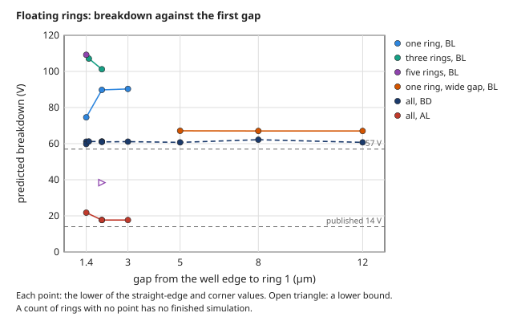
         straight-edge and corner values, against the gap from the well to
         ring 1, from 1.4 µm to 12 µm, with separate curves for one, three
         and five rings and for one ring at the wide gaps, one curve per
         process, with dashed lines at the published 14 V and at 57 V and an
         open triangle where a sweep ended without breakdown. The structures
         of the group are NR1S2, NR1S3, NR4S, NR1S5, NR1S8, NR1S12, NR1_1p4,
         NR1_2, NR1_3, NR3_1p5, NR3_2, NR3W1, NR3W3, NR5_1p4, NR5_2, NR3M1.
         The plotted values are those of the tables in the entries.

   Trend that the simulation predicts across the group.

Limits of the group
-------------------

Rule NW.2b forbids a gap below 1.4 µm. A contacted ring held at 0 V is a
neighbouring well, and the wide gaps give the spacing two wells need; a
floating ring at those gaps would never be reached. The simulation ends its
ionisation path at a ring, and several multi-ring cases have no finished
simulation, so their predictions are the weakest on the die.

.. _hvt-s-nr1s2:

NR1S2
-----

         with corners cut 4.7 µm along each side, an N+ contact ring inside
         its edge and a P+ ring 20 µm outside it; one floating ring 2 µm
         wide, gap 2 µm. A Metal5 lead joins the well to a pad at 290, 295
         µm. A Metal2 lead joins ring 1 to a second pad at 290, 445 µm.

   NR1S2 in plan view and in cross-section.

.. list-table:: NR1S2: drawn parameters and position
   :name: tab-hvt-s-nr1s2
   :header-rows: 1
   :widths: 35 65

   * - Parameter
     - Value
   * - Well
     - N-well
   * - Side of the well
     - 30 µm
   * - Corners
     - Cut of 4.7 µm along each side, for a nominal radius of 8 µm; eight vertices of 135°
   * - Area and perimeter
     - 856 µm² and 109.0 µm
   * - N+ contact ring
     - 2 µm wide, 2 µm inside the well edge
   * - P+ ring
     - 2 µm wide, 20 µm from the well edge
   * - Floating ring 1
     - 2 µm wide, after a gap of 2 µm
   * - Fill block
     - Whole structure
   * - Metal5 lead
     - 6 µm wide
   * - Site
     - Column 1 from the west, row 1 from the south
   * - Well pad, centre x, y
     - 290, 295 µm
   * - Ring 1 pad, centre x, y
     - 290, 445 µm
   * - Substrate
     - Any of the seven SUB pads (:numref:`tab-hvt-pads`)

Purpose
   Measures the potential of a floating ring directly: :ref:`NR1_2
   <hvt-s-nr1-2>` with a contact on the ring and a second pad.
   :numref:`fig-hvt-s-nr1s2` shows the structure and
   :numref:`tab-hvt-s-nr1s2` lists what is drawn.

How it works
   A small N+ contact on ring 1 leads on Metal2 to its own pad. A meter that
   draws no current reads the ring's potential while the well is swept. Held
   at 0 V instead, the ring is a second well 2 µm from the first, and the
   current between them is punch-through.

Compared with
   * :ref:`NR1_2 <hvt-s-nr1-2>`: a contact and lead on the ring in place of none.
   * :ref:`NR1S3 <hvt-s-nr1s3>`: a gap of 2 µm in place of 3 µm.

Measurement
   Procedures :ref:`P1 <hvt-p1>`, :ref:`P3 <hvt-p3>` and :ref:`P5 <hvt-p5>`
   apply. The well pad is at 290, 295 µm and the ring 1 pad at 290, 445 µm.
   The ring pad needs a meter whose input current is below 100 fA, and
   seconds of settling at each step. The ring is grounded through its pad
   before each sweep, and only the sweep upwards is read.

Predicted
   The simulated breakdown voltages are in :numref:`tab-hvt-sp-nr1s2`. The
   row of each family's nominal process also gives the family's band, its
   agreement range and the predicted ratio to the reference structure. The
   well voltage at which the ring starts to follow, and the step it then
   keeps, are compared with the predicted curve. :numref:`fig-hvt-sr-nr1s2`
   plots the predicted rise of ring 1.

Limits
   The pad, its lead and the meter's cable load the ring with capacitance
   and leakage that a floating ring does not have.

.. list-table:: NR1S2: predicted breakdown voltage by process
   :name: tab-hvt-sp-nr1s2
   :header-rows: 1
   :widths: 18 16 16 17 17 16

   * - Process
     - Straight edge (V)
     - Corner section (V)
     - Family band (V)
     - Agreement range (V)
     - Predicted ratio
   * - AL, AD, AnL, AnD
     - 17.7
     - –
     - 17.7 to 17.7
     - 12.4 to 20.4
     - 1.00 of :ref:`NW0 <hvt-s-nw0>`
   * - BL
     - 94.0
     - 89.8
     - 89.6 to 89.8
     - 62.7 to 103.3
     - 1.34 of :ref:`NT20 <hvt-s-nt20>`
   * - BLq
     - 94.8
     - 89.6
     - –
     - –
     - –
   * - BD
     - 62.9
     - 61.2
     - 61.2 to 61.2
     - 42.8 to 70.4
     - 1.00 of :ref:`NT20 <hvt-s-nt20>`

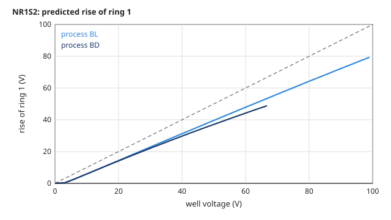
         voltage, one curve per process that has a result, with a diagonal
         marking ring voltage equal to well voltage. Each curve leaves zero
         after a few volts and then rises below the diagonal.

   Predicted rise of ring 1 of NR1S2.

.. _hvt-s-nr1s3:

NR1S3
-----

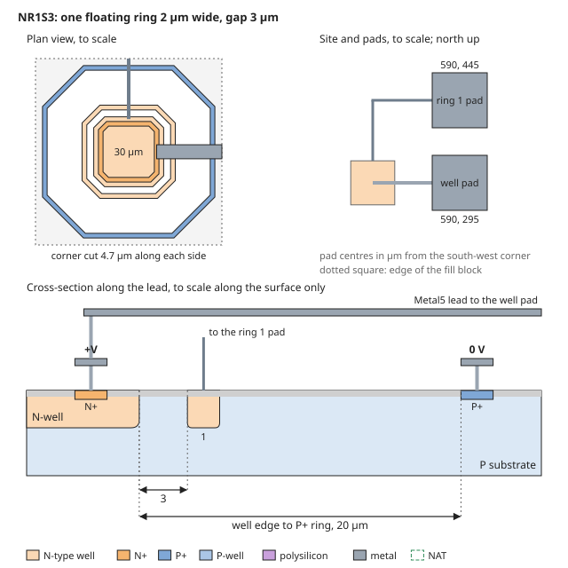
         with corners cut 4.7 µm along each side, an N+ contact ring inside
         its edge and a P+ ring 20 µm outside it; one floating ring 2 µm
         wide, gap 3 µm. A Metal5 lead joins the well to a pad at 590, 295
         µm. A Metal2 lead joins ring 1 to a second pad at 590, 445 µm.

   NR1S3 in plan view and in cross-section.

.. list-table:: NR1S3: drawn parameters and position
   :name: tab-hvt-s-nr1s3
   :header-rows: 1
   :widths: 35 65

   * - Parameter
     - Value
   * - Well
     - N-well
   * - Side of the well
     - 30 µm
   * - Corners
     - Cut of 4.7 µm along each side, for a nominal radius of 8 µm; eight vertices of 135°
   * - Area and perimeter
     - 856 µm² and 109.0 µm
   * - N+ contact ring
     - 2 µm wide, 2 µm inside the well edge
   * - P+ ring
     - 2 µm wide, 20 µm from the well edge
   * - Floating ring 1
     - 2 µm wide, after a gap of 3 µm
   * - Fill block
     - Whole structure
   * - Metal5 lead
     - 6 µm wide
   * - Site
     - Column 2 from the west, row 1 from the south
   * - Well pad, centre x, y
     - 590, 295 µm
   * - Ring 1 pad, centre x, y
     - 590, 445 µm
   * - Substrate
     - Any of the seven SUB pads (:numref:`tab-hvt-pads`)

Purpose
   Measures the potential of a ring at a gap of 3 µm.
   :numref:`fig-hvt-s-nr1s3` shows the structure and
   :numref:`tab-hvt-s-nr1s3` lists what is drawn.

How it works
   As in :ref:`NR1S2 <hvt-s-nr1s2>`, with the ring further out. The ring
   should start to follow at a higher well voltage and keep a larger step.
   With the ring at 0 V, it gives the punch-through voltage of two wells 3
   µm apart.

Compared with
   * :ref:`NR1S2 <hvt-s-nr1s2>`: a gap of 3 µm in place of 2 µm.
   * :ref:`NR1S5 <hvt-s-nr1s5>`: a gap of 3 µm in place of 5 µm.
   * :ref:`NR1_3 <hvt-s-nr1-3>`: a contact and lead on the ring in place of none.

Measurement
   Procedures :ref:`P1 <hvt-p1>`, :ref:`P3 <hvt-p3>` and :ref:`P5 <hvt-p5>`
   apply. The well pad is at 590, 295 µm and the ring 1 pad at 590, 445 µm.
   As for :ref:`NR1S2 <hvt-s-nr1s2>`.

Predicted
   The simulated breakdown voltages are in :numref:`tab-hvt-sp-nr1s3`. The
   row of each family's nominal process also gives the family's band, its
   agreement range and the predicted ratio to the reference structure. A
   later onset and a larger step than :ref:`NR1S2 <hvt-s-nr1s2>`, in the
   ratio the simulation gives. :numref:`fig-hvt-sr-nr1s3` plots the
   predicted rise of ring 1.

Limits
   As for :ref:`NR1S2 <hvt-s-nr1s2>`.

.. list-table:: NR1S3: predicted breakdown voltage by process
   :name: tab-hvt-sp-nr1s3
   :header-rows: 1
   :widths: 18 16 16 17 17 16

   * - Process
     - Straight edge (V)
     - Corner section (V)
     - Family band (V)
     - Agreement range (V)
     - Predicted ratio
   * - AL, AD, AnL, AnD
     - 17.7
     - –
     - 17.7 to 17.7
     - 12.4 to 20.4
     - 1.00 of :ref:`NW0 <hvt-s-nw0>`
   * - BL
     - 96.4
     - 90.3
     - 90.3 to 91.9
     - 63.2 to 105.7
     - 1.35 of :ref:`NT20 <hvt-s-nt20>`
   * - BLq
     - 97.7
     - 91.9
     - –
     - –
     - –
   * - BD
     - 62.9
     - 61.1
     - 61.1 to 61.1
     - 42.8 to 70.3
     - 1.00 of :ref:`NT20 <hvt-s-nt20>`

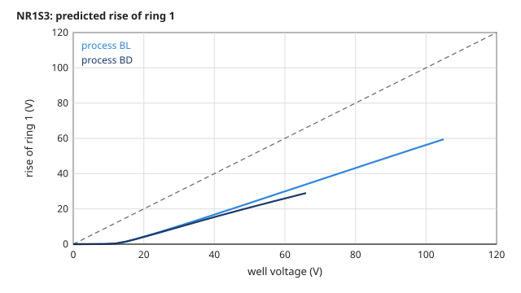
         voltage, one curve per process that has a result, with a diagonal
         marking ring voltage equal to well voltage. Each curve leaves zero
         after a few volts and then rises below the diagonal.

   Predicted rise of ring 1 of NR1S3.

.. _hvt-s-nr4s:

NR4S
----

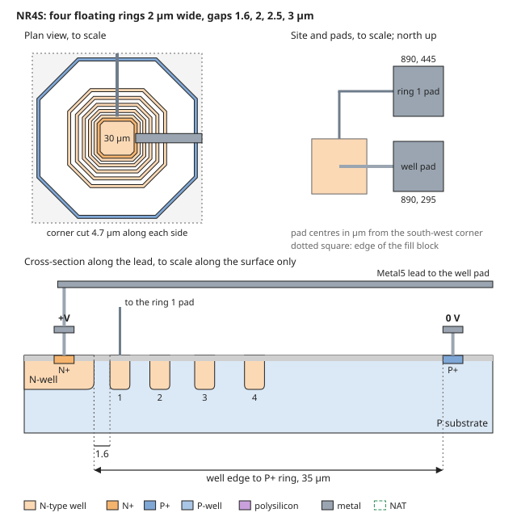
         with corners cut 4.7 µm along each side, an N+ contact ring inside
         its edge and a P+ ring 35 µm outside it; four floating rings 2 µm
         wide, gaps 1.6, 2, 2.5, 3 µm. A Metal5 lead joins the well to a pad
         at 890, 295 µm. A Metal2 lead joins ring 1 to a second pad at 890,
         445 µm.

   NR4S in plan view and in cross-section.

.. list-table:: NR4S: drawn parameters and position
   :name: tab-hvt-s-nr4s
   :header-rows: 1
   :widths: 35 65

   * - Parameter
     - Value
   * - Well
     - N-well
   * - Side of the well
     - 30 µm
   * - Corners
     - Cut of 4.7 µm along each side, for a nominal radius of 8 µm; eight vertices of 135°
   * - Area and perimeter
     - 856 µm² and 109.0 µm
   * - N+ contact ring
     - 2 µm wide, 2 µm inside the well edge
   * - P+ ring
     - 2 µm wide, 35 µm from the well edge
   * - Floating ring 1
     - 2 µm wide, after a gap of 1.6 µm
   * - Floating ring 2
     - 2 µm wide, after a gap of 2 µm
   * - Floating ring 3
     - 2 µm wide, after a gap of 2.5 µm
   * - Floating ring 4
     - 2 µm wide, after a gap of 3 µm
   * - Fill block
     - Whole structure
   * - Metal5 lead
     - 6 µm wide
   * - Site
     - Column 3 from the west, row 1 from the south
   * - Well pad, centre x, y
     - 890, 295 µm
   * - Ring 1 pad, centre x, y
     - 890, 445 µm
   * - Substrate
     - Any of the seven SUB pads (:numref:`tab-hvt-pads`)

Purpose
   Measures the potential of ring 1 when three more rings stand outside it.
   :numref:`fig-hvt-s-nr4s` shows the structure and :numref:`tab-hvt-s-nr4s`
   lists what is drawn.

How it works
   Four rings at gaps of 1.6 µm, 2 µm, 2.5 µm and 3 µm, with the contact on
   the innermost. The outer rings take up voltage that ring 1 would
   otherwise hold at its outer edge, so ring 1 can follow the well to a
   higher voltage before anything breaks down.

Compared with
   * :ref:`NR1S2 <hvt-s-nr1s2>`: four rings in place of one.
   * :ref:`NR3_2 <hvt-s-nr3-2>`: four rings with a contact in place of three without.

Measurement
   Procedures :ref:`P1 <hvt-p1>`, :ref:`P3 <hvt-p3>` and :ref:`P5 <hvt-p5>`
   apply. The well pad is at 890, 295 µm and the ring 1 pad at 890, 445 µm.
   As for :ref:`NR1S2 <hvt-s-nr1s2>`.

Predicted
   The simulated breakdown voltages are in :numref:`tab-hvt-sp-nr4s`. The
   row of each family's nominal process also gives the family's band, its
   agreement range and the predicted ratio to the reference structure. The
   ring curve runs to a higher well voltage than in :ref:`NR1S2
   <hvt-s-nr1s2>`. :numref:`fig-hvt-sr-nr4s` plots the predicted rise of
   ring 1.

Limits
   Only ring 1 has a pad, so how the voltage divides among the outer rings
   is not seen.

.. list-table:: NR4S: predicted breakdown voltage by process
   :name: tab-hvt-sp-nr4s
   :header-rows: 1
   :widths: 18 16 16 17 17 16

   * - Process
     - Straight edge (V)
     - Corner section (V)
     - Family band (V)
     - Agreement range (V)
     - Predicted ratio
   * - AL
     - failed
     - –
     - –
     - –
     - –
   * - BL
     - failed
     - failed
     - –
     - –
     - –
   * - BLq
     - failed
     - failed
     - –
     - –
     - –
   * - BD
     - 62.9
     - failed
     - –
     - –
     - –

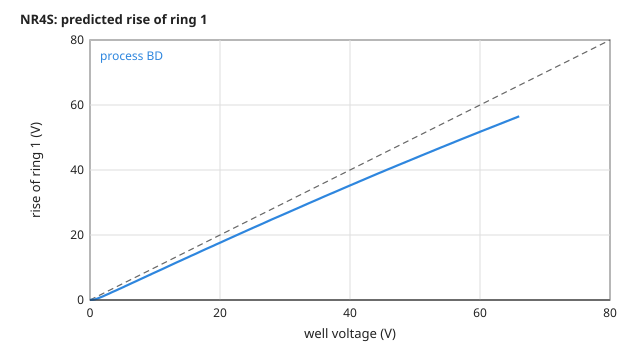
         voltage, one curve per process that has a result, with a diagonal
         marking ring voltage equal to well voltage. Each curve leaves zero
         after a few volts and then rises below the diagonal.

   Predicted rise of ring 1 of NR4S.

.. _hvt-s-nr1s5:

NR1S5
-----

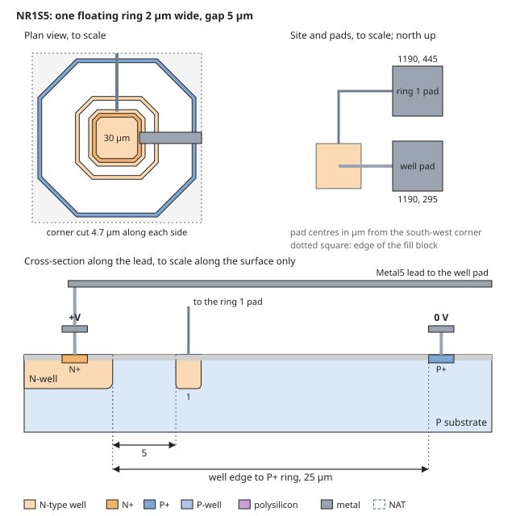
         with corners cut 4.7 µm along each side, an N+ contact ring inside
         its edge and a P+ ring 25 µm outside it; one floating ring 2 µm
         wide, gap 5 µm. A Metal5 lead joins the well to a pad at 1190, 295
         µm. A Metal2 lead joins ring 1 to a second pad at 1190, 445 µm.

   NR1S5 in plan view and in cross-section.

.. list-table:: NR1S5: drawn parameters and position
   :name: tab-hvt-s-nr1s5
   :header-rows: 1
   :widths: 35 65

   * - Parameter
     - Value
   * - Well
     - N-well
   * - Side of the well
     - 30 µm
   * - Corners
     - Cut of 4.7 µm along each side, for a nominal radius of 8 µm; eight vertices of 135°
   * - Area and perimeter
     - 856 µm² and 109.0 µm
   * - N+ contact ring
     - 2 µm wide, 2 µm inside the well edge
   * - P+ ring
     - 2 µm wide, 25 µm from the well edge
   * - Floating ring 1
     - 2 µm wide, after a gap of 5 µm
   * - Fill block
     - Whole structure
   * - Metal5 lead
     - 6 µm wide
   * - Site
     - Column 4 from the west, row 1 from the south
   * - Well pad, centre x, y
     - 1190, 295 µm
   * - Ring 1 pad, centre x, y
     - 1190, 445 µm
   * - Substrate
     - Any of the seven SUB pads (:numref:`tab-hvt-pads`)

Purpose
   Gives the spacing between two wells at different voltages: a contacted
   ring 5 µm from the well. :numref:`fig-hvt-s-nr1s5` shows the structure
   and :numref:`tab-hvt-s-nr1s5` lists what is drawn.

How it works
   With its pad at 0 V the ring is a neighbouring well at the substrate's
   potential. The well's depletion region crosses the 5 µm of substrate at a
   voltage that rises roughly with the square of the gap, and current then
   flows from well to ring.

Compared with
   * :ref:`NR1S3 <hvt-s-nr1s3>`: a gap of 5 µm in place of 3 µm.
   * :ref:`NR1S8 <hvt-s-nr1s8>`: a gap of 5 µm in place of 8 µm.
   * :ref:`NT5 <hvt-s-nt5>`: an N-well ring at 5 µm in place of a P+ ring.

Measurement
   Procedures :ref:`P1 <hvt-p1>` and :ref:`P5 <hvt-p5>` apply. The well pad
   is at 1190, 295 µm and the ring 1 pad at 1190, 445 µm. :ref:`P5 <hvt-p5>`
   is the main procedure here: the ring pad is held at 0 V and its current
   recorded.

Predicted
   The simulated breakdown voltages are in :numref:`tab-hvt-sp-nr1s5`. The
   row of each family's nominal process also gives the family's band, its
   agreement range and the predicted ratio to the reference structure. The
   well voltage at which ring current starts is what two wells 5 µm apart
   can differ by. :numref:`fig-hvt-sr-nr1s5` plots the predicted rise of
   ring 1.

Limits
   Under assumption A the P-well between well and ring fails first, and the
   structure shows only that.

.. list-table:: NR1S5: predicted breakdown voltage by process
   :name: tab-hvt-sp-nr1s5
   :header-rows: 1
   :widths: 18 16 16 17 17 16

   * - Process
     - Straight edge (V)
     - Corner section (V)
     - Family band (V)
     - Agreement range (V)
     - Predicted ratio
   * - AL
     - failed
     - –
     - –
     - –
     - –
   * - BL
     - 77.9
     - 67.1
     - 67.1 to 67.1
     - 47.0 to 77.2
     - 1.00 of :ref:`NT20 <hvt-s-nt20>`
   * - BLq
     - failed
     - failed
     - –
     - –
     - –
   * - BD
     - 62.9
     - 60.7
     - 60.7 to 60.7
     - 42.5 to 69.8
     - 0.99 of :ref:`NT20 <hvt-s-nt20>`

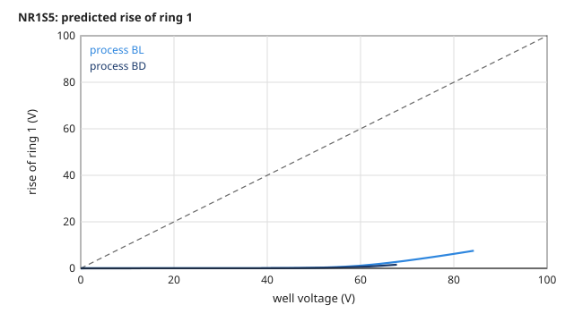
         voltage, one curve per process that has a result, with a diagonal
         marking ring voltage equal to well voltage. Each curve leaves zero
         after a few volts and then rises below the diagonal.

   Predicted rise of ring 1 of NR1S5.

.. _hvt-s-nr1s8:

NR1S8
-----

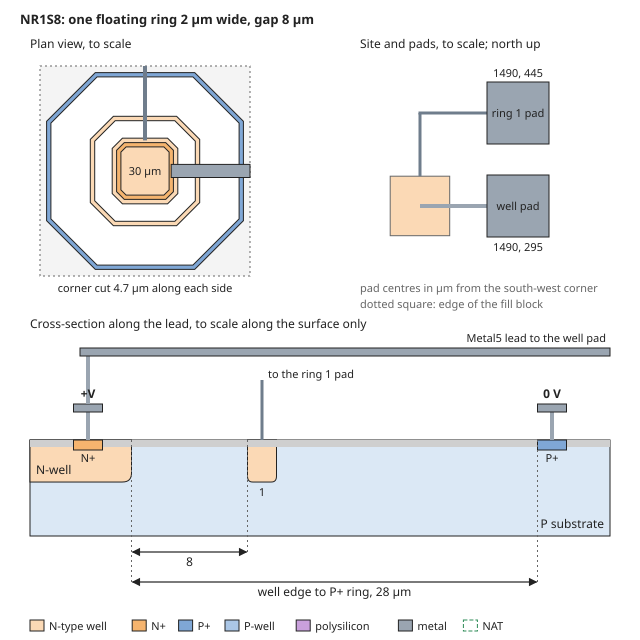
         with corners cut 4.7 µm along each side, an N+ contact ring inside
         its edge and a P+ ring 28 µm outside it; one floating ring 2 µm
         wide, gap 8 µm. A Metal5 lead joins the well to a pad at 1490, 295
         µm. A Metal2 lead joins ring 1 to a second pad at 1490, 445 µm.

   NR1S8 in plan view and in cross-section.

.. list-table:: NR1S8: drawn parameters and position
   :name: tab-hvt-s-nr1s8
   :header-rows: 1
   :widths: 35 65

   * - Parameter
     - Value
   * - Well
     - N-well
   * - Side of the well
     - 30 µm
   * - Corners
     - Cut of 4.7 µm along each side, for a nominal radius of 8 µm; eight vertices of 135°
   * - Area and perimeter
     - 856 µm² and 109.0 µm
   * - N+ contact ring
     - 2 µm wide, 2 µm inside the well edge
   * - P+ ring
     - 2 µm wide, 28 µm from the well edge
   * - Floating ring 1
     - 2 µm wide, after a gap of 8 µm
   * - Fill block
     - Whole structure
   * - Metal5 lead
     - 6 µm wide
   * - Site
     - Column 5 from the west, row 1 from the south
   * - Well pad, centre x, y
     - 1490, 295 µm
   * - Ring 1 pad, centre x, y
     - 1490, 445 µm
   * - Substrate
     - Any of the seven SUB pads (:numref:`tab-hvt-pads`)

Purpose
   The same measurement at a gap of 8 µm, wider than the depletion region of
   a plain well at its breakdown voltage. :numref:`fig-hvt-s-nr1s8` shows
   the structure and :numref:`tab-hvt-s-nr1s8` lists what is drawn.

How it works
   If the well breaks down before its depletion region has crossed 8 µm, no
   current reaches the ring, and the substrate current rises instead. The
   gap is then wide enough for any voltage the well itself can hold.

Compared with
   * :ref:`NR1S5 <hvt-s-nr1s5>`: a gap of 8 µm in place of 5 µm.
   * :ref:`NR1S12 <hvt-s-nr1s12>`: a gap of 8 µm in place of 12 µm.
   * :ref:`NT10 <hvt-s-nt10>`: an N-well ring at 8 µm in place of a P+ ring at 10 µm.

Measurement
   Procedures :ref:`P1 <hvt-p1>` and :ref:`P5 <hvt-p5>` apply. The well pad
   is at 1490, 295 µm and the ring 1 pad at 1490, 445 µm. As for :ref:`NR1S5
   <hvt-s-nr1s5>`. Which pad the current leaves by, ring or substrate, is
   the result.

Predicted
   The simulated breakdown voltages are in :numref:`tab-hvt-sp-nr1s8`. The
   row of each family's nominal process also gives the family's band, its
   agreement range and the predicted ratio to the reference structure.
   Substrate current first: 8 µm isolates two wells up to the breakdown
   voltage. Ring current first: it does not.

Limits
   As for :ref:`NR1S5 <hvt-s-nr1s5>`.

.. list-table:: NR1S8: predicted breakdown voltage by process
   :name: tab-hvt-sp-nr1s8
   :header-rows: 1
   :widths: 18 16 16 17 17 16

   * - Process
     - Straight edge (V)
     - Corner section (V)
     - Family band (V)
     - Agreement range (V)
     - Predicted ratio
   * - AL
     - failed
     - –
     - –
     - –
     - –
   * - BL
     - 76.0
     - 67.0
     - 67.0 to 67.0
     - 46.9 to 77.0
     - 1.00 of :ref:`NT20 <hvt-s-nt20>`
   * - BLq
     - failed
     - failed
     - –
     - –
     - –
   * - BD
     - 62.9
     - 62.2
     - 62.2 to 62.2
     - 43.5 to 71.5
     - 1.02 of :ref:`NT20 <hvt-s-nt20>`

.. _hvt-s-nr1s12:

NR1S12
------

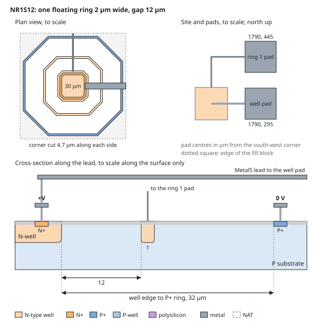
         with corners cut 4.7 µm along each side, an N+ contact ring inside
         its edge and a P+ ring 32 µm outside it; one floating ring 2 µm
         wide, gap 12 µm. A Metal5 lead joins the well to a pad at 1790, 295
         µm. A Metal2 lead joins ring 1 to a second pad at 1790, 445 µm.

   NR1S12 in plan view and in cross-section.

.. list-table:: NR1S12: drawn parameters and position
   :name: tab-hvt-s-nr1s12
   :header-rows: 1
   :widths: 35 65

   * - Parameter
     - Value
   * - Well
     - N-well
   * - Side of the well
     - 30 µm
   * - Corners
     - Cut of 4.7 µm along each side, for a nominal radius of 8 µm; eight vertices of 135°
   * - Area and perimeter
     - 856 µm² and 109.0 µm
   * - N+ contact ring
     - 2 µm wide, 2 µm inside the well edge
   * - P+ ring
     - 2 µm wide, 32 µm from the well edge
   * - Floating ring 1
     - 2 µm wide, after a gap of 12 µm
   * - Fill block
     - Whole structure
   * - Metal5 lead
     - 6 µm wide
   * - Site
     - Column 6 from the west, row 1 from the south
   * - Well pad, centre x, y
     - 1790, 295 µm
   * - Ring 1 pad, centre x, y
     - 1790, 445 µm
   * - Substrate
     - Any of the seven SUB pads (:numref:`tab-hvt-pads`)

Purpose
   The widest gap, 12 µm: the spacing expected to be safe at any voltage a
   well on this die holds. :numref:`fig-hvt-s-nr1s12` shows the structure
   and :numref:`tab-hvt-s-nr1s12` lists what is drawn.

How it works
   Twelve micrometres is more than twice the flat depletion width at the
   plain well's predicted breakdown. The ring should stay unreached, and the
   well should break down as :ref:`NT20 <hvt-s-nt20>` does.

Compared with
   * :ref:`NR1S8 <hvt-s-nr1s8>`: a gap of 12 µm in place of 8 µm.
   * :ref:`NT20 <hvt-s-nt20>`: an N-well ring at 12 µm in place of nothing.

Measurement
   Procedures :ref:`P1 <hvt-p1>` and :ref:`P5 <hvt-p5>` apply. The well pad
   is at 1790, 295 µm and the ring 1 pad at 1790, 445 µm. As for :ref:`NR1S5
   <hvt-s-nr1s5>`.

Predicted
   The simulated breakdown voltages are in :numref:`tab-hvt-sp-nr1s12`. The
   row of each family's nominal process also gives the family's band, its
   agreement range and the predicted ratio to the reference structure. A
   breakdown voltage equal to :ref:`NT20 <hvt-s-nt20>`, with no ring
   current: a neighbouring well 12 µm away changes nothing.

Limits
   If ring current still flows here, the die has no wider gap to show where
   it stops.

.. list-table:: NR1S12: predicted breakdown voltage by process
   :name: tab-hvt-sp-nr1s12
   :header-rows: 1
   :widths: 18 16 16 17 17 16

   * - Process
     - Straight edge (V)
     - Corner section (V)
     - Family band (V)
     - Agreement range (V)
     - Predicted ratio
   * - AL
     - failed
     - –
     - –
     - –
     - –
   * - BL
     - 76.0
     - 67.0
     - 67.0 to 67.0
     - 46.9 to 77.0
     - 1.00 of :ref:`NT20 <hvt-s-nt20>`
   * - BLq
     - failed
     - failed
     - –
     - –
     - –
   * - BD
     - 62.9
     - 60.7
     - 60.7 to 60.7
     - 42.5 to 69.8
     - 0.99 of :ref:`NT20 <hvt-s-nt20>`

.. _hvt-s-nr1-1p4:

NR1_1p4
-------

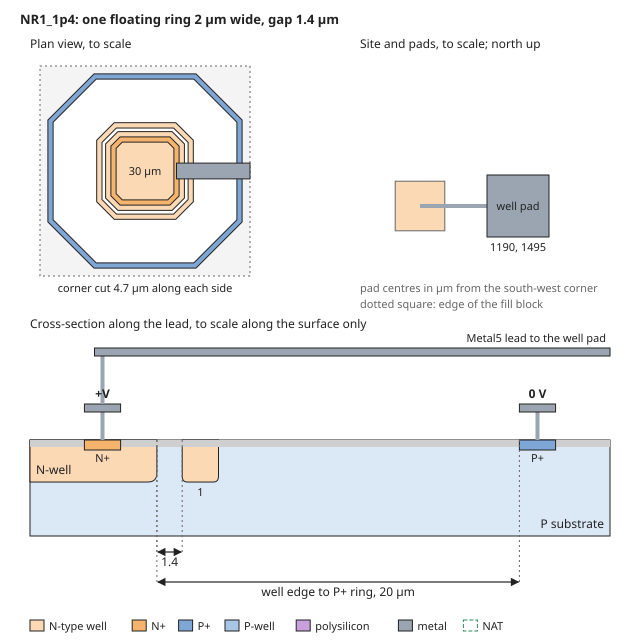
         across with corners cut 4.7 µm along each side, an N+ contact ring
         inside its edge and a P+ ring 20 µm outside it; one floating ring 2
         µm wide, gap 1.4 µm. A Metal5 lead joins the well to a pad at 1190,
         1495 µm.

   NR1_1p4 in plan view and in cross-section.

.. list-table:: NR1_1p4: drawn parameters and position
   :name: tab-hvt-s-nr1-1p4
   :header-rows: 1
   :widths: 35 65

   * - Parameter
     - Value
   * - Well
     - N-well
   * - Side of the well
     - 30 µm
   * - Corners
     - Cut of 4.7 µm along each side, for a nominal radius of 8 µm; eight vertices of 135°
   * - Area and perimeter
     - 856 µm² and 109.0 µm
   * - N+ contact ring
     - 2 µm wide, 2 µm inside the well edge
   * - P+ ring
     - 2 µm wide, 20 µm from the well edge
   * - Floating ring 1
     - 2 µm wide, after a gap of 1.4 µm
   * - Fill block
     - Whole structure
   * - Metal5 lead
     - 6 µm wide
   * - Site
     - Column 4 from the west, row 9 from the south
   * - Well pad, centre x, y
     - 1190, 1495 µm
   * - Substrate
     - Any of the seven SUB pads (:numref:`tab-hvt-pads`)

Purpose
   One ring at the smallest gap the rules allow, 1.4 µm.
   :numref:`fig-hvt-s-nr1-1p4` shows the structure and
   :numref:`tab-hvt-s-nr1-1p4` lists what is drawn.

How it works
   The depletion region crosses 1.4 µm within the first volts. The ring then
   follows the well so closely that the step between them is small. Its
   outer edge carries nearly the full voltage and is little better off than
   the well's own edge was.

Compared with
   * :ref:`NT20 <hvt-s-nt20>`: one ring at 1.4 µm in place of none.
   * :ref:`NR1_2 <hvt-s-nr1-2>`: a gap of 1.4 µm in place of 2 µm.

Measurement
   Procedure :ref:`P1 <hvt-p1>` applies. The well pad is at 1190, 1495 µm.

Predicted
   The simulated breakdown voltages are in :numref:`tab-hvt-sp-nr1-1p4`. The
   row of each family's nominal process also gives the family's band, its
   agreement range and the predicted ratio to the reference structure. Only
   a little above :ref:`NT20 <hvt-s-nt20>`: a ring this close moves the weak
   point outwards without relieving it.

Limits
   The gap is at the rule's minimum, so its width is the most sensitive of
   the series to how the two well edges print.

.. list-table:: NR1_1p4: predicted breakdown voltage by process
   :name: tab-hvt-sp-nr1-1p4
   :header-rows: 1
   :widths: 18 16 16 17 17 16

   * - Process
     - Straight edge (V)
     - Corner section (V)
     - Family band (V)
     - Agreement range (V)
     - Predicted ratio
   * - AL
     - failed
     - –
     - –
     - –
     - –
   * - BL
     - 80.8
     - 74.6
     - 74.6 to 76.1
     - 52.2 to 87.5
     - 1.11 of :ref:`NT20 <hvt-s-nt20>`
   * - BLq
     - 82.8
     - 76.1
     - –
     - –
     - –
   * - BD
     - 62.9
     - 61.1
     - 61.1 to 61.1
     - 42.8 to 70.3
     - 1.00 of :ref:`NT20 <hvt-s-nt20>`

.. _hvt-s-nr1-2:

NR1_2
-----

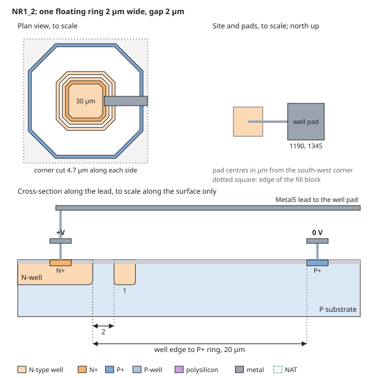
         with corners cut 4.7 µm along each side, an N+ contact ring inside
         its edge and a P+ ring 20 µm outside it; one floating ring 2 µm
         wide, gap 2 µm. A Metal5 lead joins the well to a pad at 1490, 1495
         µm.

   NR1_2 in plan view and in cross-section.

.. list-table:: NR1_2: drawn parameters and position
   :name: tab-hvt-s-nr1-2
   :header-rows: 1
   :widths: 35 65

   * - Parameter
     - Value
   * - Well
     - N-well
   * - Side of the well
     - 30 µm
   * - Corners
     - Cut of 4.7 µm along each side, for a nominal radius of 8 µm; eight vertices of 135°
   * - Area and perimeter
     - 856 µm² and 109.0 µm
   * - N+ contact ring
     - 2 µm wide, 2 µm inside the well edge
   * - P+ ring
     - 2 µm wide, 20 µm from the well edge
   * - Floating ring 1
     - 2 µm wide, after a gap of 2 µm
   * - Fill block
     - Whole structure
   * - Metal5 lead
     - 6 µm wide
   * - Site
     - Column 5 from the west, row 9 from the south
   * - Well pad, centre x, y
     - 1490, 1495 µm
   * - Substrate
     - Any of the seven SUB pads (:numref:`tab-hvt-pads`)

Purpose
   One ring at a gap of 2 µm: the reference for the ring series.
   :numref:`fig-hvt-s-nr1-2` shows the structure and
   :numref:`tab-hvt-s-nr1-2` lists what is drawn.

How it works
   The well's depletion region reaches the ring after a few volts. From then
   on the ring rises by most of every further volt on the well. The well's
   edge sees only the difference, and the ring's outer edge becomes the
   place that breaks down.

Compared with
   * :ref:`NR1_1p4 <hvt-s-nr1-1p4>`: a gap of 2 µm in place of 1.4 µm.
   * :ref:`NR1_3 <hvt-s-nr1-3>`: a gap of 2 µm in place of 3 µm.
   * :ref:`NR1S2 <hvt-s-nr1s2>`: no contact on the ring in place of one.

Measurement
   Procedure :ref:`P1 <hvt-p1>` applies. The well pad is at 1490, 1495 µm.

Predicted
   The simulated breakdown voltages are in :numref:`tab-hvt-sp-nr1-2`. The
   row of each family's nominal process also gives the family's band, its
   agreement range and the predicted ratio to the reference structure. Well
   above :ref:`NT20 <hvt-s-nt20>`: one ring is a real termination.

Limits
   The ring's potential is not measured here; :ref:`NR1S2 <hvt-s-nr1s2>`
   does that.

.. list-table:: NR1_2: predicted breakdown voltage by process
   :name: tab-hvt-sp-nr1-2
   :header-rows: 1
   :widths: 18 16 16 17 17 16

   * - Process
     - Straight edge (V)
     - Corner section (V)
     - Family band (V)
     - Agreement range (V)
     - Predicted ratio
   * - AL, AD, AnL, AnD
     - 17.7
     - –
     - 17.7 to 17.7
     - 12.4 to 20.4
     - 1.00 of :ref:`NW0 <hvt-s-nw0>`
   * - BL
     - 94.0
     - 89.8
     - 89.6 to 89.8
     - 62.7 to 103.3
     - 1.34 of :ref:`NT20 <hvt-s-nt20>`
   * - BLq
     - 94.8
     - 89.6
     - –
     - –
     - –
   * - BD
     - 62.9
     - 61.2
     - 61.2 to 61.2
     - 42.8 to 70.4
     - 1.00 of :ref:`NT20 <hvt-s-nt20>`

.. _hvt-s-nr1-3:

NR1_3
-----

         with corners cut 4.7 µm along each side, an N+ contact ring inside
         its edge and a P+ ring 20 µm outside it; one floating ring 2 µm
         wide, gap 3 µm. A Metal5 lead joins the well to a pad at 1790, 1495
         µm.

   NR1_3 in plan view and in cross-section.

.. list-table:: NR1_3: drawn parameters and position
   :name: tab-hvt-s-nr1-3
   :header-rows: 1
   :widths: 35 65

   * - Parameter
     - Value
   * - Well
     - N-well
   * - Side of the well
     - 30 µm
   * - Corners
     - Cut of 4.7 µm along each side, for a nominal radius of 8 µm; eight vertices of 135°
   * - Area and perimeter
     - 856 µm² and 109.0 µm
   * - N+ contact ring
     - 2 µm wide, 2 µm inside the well edge
   * - P+ ring
     - 2 µm wide, 20 µm from the well edge
   * - Floating ring 1
     - 2 µm wide, after a gap of 3 µm
   * - Fill block
     - Whole structure
   * - Metal5 lead
     - 6 µm wide
   * - Site
     - Column 6 from the west, row 9 from the south
   * - Well pad, centre x, y
     - 1790, 1495 µm
   * - Substrate
     - Any of the seven SUB pads (:numref:`tab-hvt-pads`)

Purpose
   One ring at a gap of 3 µm. :numref:`fig-hvt-s-nr1-3` shows the structure
   and :numref:`tab-hvt-s-nr1-3` lists what is drawn.

How it works
   The ring picks up later, so the step between well and ring is larger. The
   well's edge holds more of the voltage and the ring's outer edge less. The
   best gap is the one that makes both edges fail at the same voltage.

Compared with
   * :ref:`NR1_2 <hvt-s-nr1-2>`: a gap of 3 µm in place of 2 µm.
   * :ref:`NR1S3 <hvt-s-nr1s3>`: no contact on the ring in place of one.

Measurement
   Procedure :ref:`P1 <hvt-p1>` applies. The well pad is at 1790, 1495 µm.

Predicted
   The simulated breakdown voltages are in :numref:`tab-hvt-sp-nr1-3`. The
   row of each family's nominal process also gives the family's band, its
   agreement range and the predicted ratio to the reference structure. Above
   :ref:`NR1_2 <hvt-s-nr1-2>`: the best gap is 3 µm or more. Below: it lies
   between 2 µm and 3 µm.

Limits
   No single-ring structure has a wider gap, so a value still rising has no
   end point.

.. list-table:: NR1_3: predicted breakdown voltage by process
   :name: tab-hvt-sp-nr1-3
   :header-rows: 1
   :widths: 18 16 16 17 17 16

   * - Process
     - Straight edge (V)
     - Corner section (V)
     - Family band (V)
     - Agreement range (V)
     - Predicted ratio
   * - AL, AD, AnL, AnD
     - 17.7
     - –
     - 17.7 to 17.7
     - 12.4 to 20.4
     - 1.00 of :ref:`NW0 <hvt-s-nw0>`
   * - BL
     - 96.4
     - 90.3
     - 90.3 to 91.8
     - 63.2 to 105.6
     - 1.35 of :ref:`NT20 <hvt-s-nt20>`
   * - BLq
     - 97.7
     - 91.8
     - –
     - –
     - –
   * - BD
     - 62.9
     - 61.1
     - 61.1 to 61.1
     - 42.8 to 70.3
     - 1.00 of :ref:`NT20 <hvt-s-nt20>`

.. _hvt-s-nr3-1p5:

NR3_1p5
-------

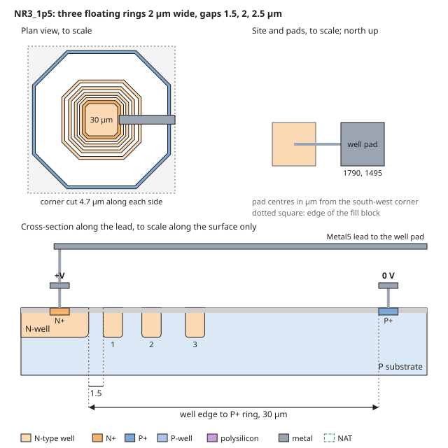
         across with corners cut 4.7 µm along each side, an N+ contact ring
         inside its edge and a P+ ring 30 µm outside it; three floating
         rings 2 µm wide, gaps 1.5, 2, 2.5 µm. A Metal5 lead joins the well
         to a pad at 290, 1645 µm.

   NR3_1p5 in plan view and in cross-section.

.. list-table:: NR3_1p5: drawn parameters and position
   :name: tab-hvt-s-nr3-1p5
   :header-rows: 1
   :widths: 35 65

   * - Parameter
     - Value
   * - Well
     - N-well
   * - Side of the well
     - 30 µm
   * - Corners
     - Cut of 4.7 µm along each side, for a nominal radius of 8 µm; eight vertices of 135°
   * - Area and perimeter
     - 856 µm² and 109.0 µm
   * - N+ contact ring
     - 2 µm wide, 2 µm inside the well edge
   * - P+ ring
     - 2 µm wide, 30 µm from the well edge
   * - Floating ring 1
     - 2 µm wide, after a gap of 1.5 µm
   * - Floating ring 2
     - 2 µm wide, after a gap of 2 µm
   * - Floating ring 3
     - 2 µm wide, after a gap of 2.5 µm
   * - Fill block
     - Whole structure
   * - Metal5 lead
     - 6 µm wide
   * - Site
     - Column 1 from the west, row 10 from the south
   * - Well pad, centre x, y
     - 290, 1645 µm
   * - Substrate
     - Any of the seven SUB pads (:numref:`tab-hvt-pads`)

Purpose
   Three rings with gaps of 1.5 µm, 2 µm and 2.5 µm.
   :numref:`fig-hvt-s-nr3-1p5` shows the structure and
   :numref:`tab-hvt-s-nr3-1p5` lists what is drawn.

How it works
   Each ring picks up from the one inside it and passes the rest of the
   voltage outwards. The gaps widen outwards because each successive ring
   sits at a lower potential and its depletion region needs more room to
   reach the next.

Compared with
   * :ref:`NR1_1p4 <hvt-s-nr1-1p4>`: three rings in place of one, from a similar first gap.
   * :ref:`NR3_2 <hvt-s-nr3-2>`: gaps from 1.5 µm in place of from 2 µm.

Measurement
   Procedure :ref:`P1 <hvt-p1>` applies. The well pad is at 290, 1645 µm.

Predicted
   The simulated breakdown voltages are in :numref:`tab-hvt-sp-nr3-1p5`. The
   row of each family's nominal process also gives the family's band, its
   agreement range and the predicted ratio to the reference structure. Above
   the single rings: more rings share the voltage further.

Limits
   Its P+ ring is 30 µm from the well, so it is compared with :ref:`NT35
   <hvt-s-nt35>` and not with :ref:`NT20 <hvt-s-nt20>` for ring distance.

.. list-table:: NR3_1p5: predicted breakdown voltage by process
   :name: tab-hvt-sp-nr3-1p5
   :header-rows: 1
   :widths: 18 16 16 17 17 16

   * - Process
     - Straight edge (V)
     - Corner section (V)
     - Family band (V)
     - Agreement range (V)
     - Predicted ratio
   * - AL, AD, AnL, AnD
     - failed
     - –
     - –
     - –
     - –
   * - BL
     - 110.4
     - 107.1
     - 107.1 to 108.2
     - 75.0 to 124.4
     - 1.60 of :ref:`NT20 <hvt-s-nt20>`
   * - BLq
     - 111.2
     - 108.2
     - –
     - –
     - –
   * - BD
     - 62.8
     - 61.2
     - 61.2 to 61.2
     - 42.8 to 70.4
     - 1.00 of :ref:`NT20 <hvt-s-nt20>`

.. _hvt-s-nr3-2:

NR3_2
-----

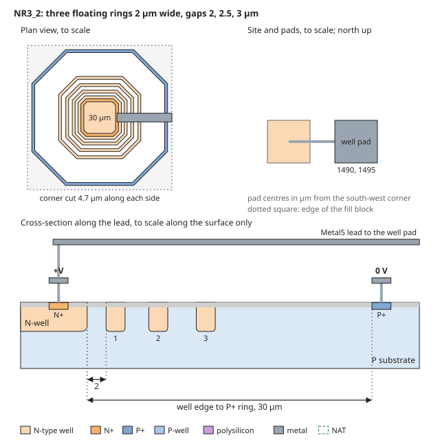
         with corners cut 4.7 µm along each side, an N+ contact ring inside
         its edge and a P+ ring 30 µm outside it; three floating rings 2 µm
         wide, gaps 2, 2.5, 3 µm. A Metal5 lead joins the well to a pad at
         590, 1645 µm.

   NR3_2 in plan view and in cross-section.

.. list-table:: NR3_2: drawn parameters and position
   :name: tab-hvt-s-nr3-2
   :header-rows: 1
   :widths: 35 65

   * - Parameter
     - Value
   * - Well
     - N-well
   * - Side of the well
     - 30 µm
   * - Corners
     - Cut of 4.7 µm along each side, for a nominal radius of 8 µm; eight vertices of 135°
   * - Area and perimeter
     - 856 µm² and 109.0 µm
   * - N+ contact ring
     - 2 µm wide, 2 µm inside the well edge
   * - P+ ring
     - 2 µm wide, 30 µm from the well edge
   * - Floating ring 1
     - 2 µm wide, after a gap of 2 µm
   * - Floating ring 2
     - 2 µm wide, after a gap of 2.5 µm
   * - Floating ring 3
     - 2 µm wide, after a gap of 3 µm
   * - Fill block
     - Whole structure
   * - Metal5 lead
     - 6 µm wide
   * - Site
     - Column 2 from the west, row 10 from the south
   * - Well pad, centre x, y
     - 590, 1645 µm
   * - Substrate
     - Any of the seven SUB pads (:numref:`tab-hvt-pads`)

Purpose
   Three rings with gaps of 2 µm, 2.5 µm and 3 µm: the reference for the
   multi-ring structures. :numref:`fig-hvt-s-nr3-2` shows the structure and
   :numref:`tab-hvt-s-nr3-2` lists what is drawn.

How it works
   The first gap is that of :ref:`NR1_2 <hvt-s-nr1-2>`, so ring 1 behaves as
   there. Rings 2 and 3 repeat its action at lower potentials, and the
   voltage falls in four steps between the well and the substrate.

Compared with
   * :ref:`NR1_2 <hvt-s-nr1-2>`: three rings in place of one.
   * :ref:`NR3_1p5 <hvt-s-nr3-1p5>`: gaps from 2 µm in place of from 1.5 µm.
   * :ref:`NR3W1 <hvt-s-nr3w1>`: rings 2 µm wide in place of 1 µm.
   * :ref:`NR3W3 <hvt-s-nr3w3>`: rings 2 µm wide in place of 3 µm.
   * :ref:`NR3M1 <hvt-s-nr3m1>`: no plate in place of a Metal1 plate.

Measurement
   Procedure :ref:`P1 <hvt-p1>` applies. The well pad is at 590, 1645 µm.
   Swept again at 85 °C.

Predicted
   The simulated breakdown voltages are in :numref:`tab-hvt-sp-nr3-2`. The
   row of each family's nominal process also gives the family's band, its
   agreement range and the predicted ratio to the reference structure. Above
   :ref:`NR1_2 <hvt-s-nr1-2>`: rings 2 and 3 take a share.

Limits
   As for :ref:`NR3_1p5 <hvt-s-nr3-1p5>`.

.. list-table:: NR3_2: predicted breakdown voltage by process
   :name: tab-hvt-sp-nr3-2
   :header-rows: 1
   :widths: 18 16 16 17 17 16

   * - Process
     - Straight edge (V)
     - Corner section (V)
     - Family band (V)
     - Agreement range (V)
     - Predicted ratio
   * - AL, AD, AnL, AnD
     - 17.7
     - –
     - 17.7 to 17.9
     - 12.4 to 20.6
     - 1.00 of :ref:`NW0 <hvt-s-nw0>`
   * - ALhi
     - 17.9
     - –
     - –
     - –
     - –
   * - BL
     - 105.7
     - 101.2
     - 84.0 to 142.9
     - 58.8 to 164.3
     - 1.51 of :ref:`NT20 <hvt-s-nt20>`
   * - BLhi
     - 87.0
     - 84.0
     - –
     - –
     - –
   * - BLlo
     - > 150.0
     - 142.9
     - –
     - –
     - –
   * - BLq
     - failed
     - 102.6
     - –
     - –
     - –
   * - BLq3
     - 108.6
     - 105.1
     - –
     - –
     - –
   * - BD
     - 62.9
     - 61.1
     - 59.4 to 61.1
     - 41.6 to 70.3
     - 1.00 of :ref:`NT20 <hvt-s-nt20>`
   * - BDhi
     - 62.9
     - 61.0
     - –
     - –
     - –
   * - BDlo
     - 62.5
     - 59.4
     - –
     - –
     - –

.. _hvt-s-nr3w1:

NR3W1
-----

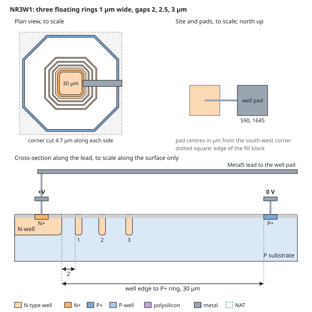
         with corners cut 4.7 µm along each side, an N+ contact ring inside
         its edge and a P+ ring 30 µm outside it; three floating rings 1 µm
         wide, gaps 2, 2.5, 3 µm. A Metal5 lead joins the well to a pad at
         890, 1645 µm.

   NR3W1 in plan view and in cross-section.

.. list-table:: NR3W1: drawn parameters and position
   :name: tab-hvt-s-nr3w1
   :header-rows: 1
   :widths: 35 65

   * - Parameter
     - Value
   * - Well
     - N-well
   * - Side of the well
     - 30 µm
   * - Corners
     - Cut of 4.7 µm along each side, for a nominal radius of 8 µm; eight vertices of 135°
   * - Area and perimeter
     - 856 µm² and 109.0 µm
   * - N+ contact ring
     - 2 µm wide, 2 µm inside the well edge
   * - P+ ring
     - 2 µm wide, 30 µm from the well edge
   * - Floating ring 1
     - 1 µm wide, after a gap of 2 µm
   * - Floating ring 2
     - 1 µm wide, after a gap of 2.5 µm
   * - Floating ring 3
     - 1 µm wide, after a gap of 3 µm
   * - Fill block
     - Whole structure
   * - Metal5 lead
     - 6 µm wide
   * - Site
     - Column 3 from the west, row 10 from the south
   * - Well pad, centre x, y
     - 890, 1645 µm
   * - Substrate
     - Any of the seven SUB pads (:numref:`tab-hvt-pads`)

Purpose
   Three rings only 1 µm wide: tests whether a ring needs width.
   :numref:`fig-hvt-s-nr3w1` shows the structure and
   :numref:`tab-hvt-s-nr3w1` lists what is drawn.

How it works
   A ring is depleted from both its edges. At 1 µm wide, close to the
   narrowest well the process prints, the two depletion regions may meet.
   The ring then no longer has a neutral core to hold one potential, and
   acts as lightly doped silicon instead.

Compared with
   * :ref:`NR3_2 <hvt-s-nr3-2>`: rings 1 µm wide in place of 2 µm.

Measurement
   Procedure :ref:`P1 <hvt-p1>` applies. The well pad is at 890, 1645 µm.

Predicted
   The simulated breakdown voltages are in :numref:`tab-hvt-sp-nr3w1`. The
   row of each family's nominal process also gives the family's band, its
   agreement range and the predicted ratio to the reference structure. Equal
   to :ref:`NR3_2 <hvt-s-nr3-2>`: narrow rings work and save area. Lower: a
   ring needs a neutral core.

Limits
   A ring this narrow may print narrower still, or not join up round the
   corners.

.. list-table:: NR3W1: predicted breakdown voltage by process
   :name: tab-hvt-sp-nr3w1
   :header-rows: 1
   :widths: 18 16 16 17 17 16

   * - Process
     - Straight edge (V)
     - Corner section (V)
     - Family band (V)
     - Agreement range (V)
     - Predicted ratio
   * - AL, AD, AnL, AnD
     - failed
     - –
     - –
     - –
     - –
   * - BL
     - 100.6
     - 95.3
     - 95.3 to 95.3
     - 66.7 to 109.6
     - 1.42 of :ref:`NT20 <hvt-s-nt20>`
   * - BLq
     - failed
     - failed
     - –
     - –
     - –
   * - BD
     - 62.9
     - 60.2
     - 60.2 to 60.2
     - 42.1 to 69.2
     - 0.98 of :ref:`NT20 <hvt-s-nt20>`

.. _hvt-s-nr3w3:

NR3W3
-----

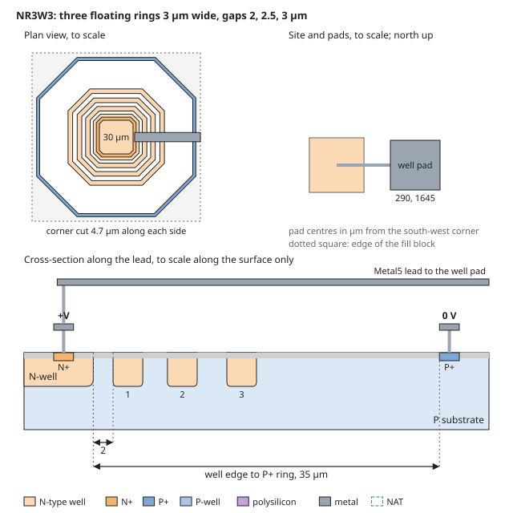
         with corners cut 4.7 µm along each side, an N+ contact ring inside
         its edge and a P+ ring 35 µm outside it; three floating rings 3 µm
         wide, gaps 2, 2.5, 3 µm. A Metal5 lead joins the well to a pad at
         1190, 1645 µm.

   NR3W3 in plan view and in cross-section.

.. list-table:: NR3W3: drawn parameters and position
   :name: tab-hvt-s-nr3w3
   :header-rows: 1
   :widths: 35 65

   * - Parameter
     - Value
   * - Well
     - N-well
   * - Side of the well
     - 30 µm
   * - Corners
     - Cut of 4.7 µm along each side, for a nominal radius of 8 µm; eight vertices of 135°
   * - Area and perimeter
     - 856 µm² and 109.0 µm
   * - N+ contact ring
     - 2 µm wide, 2 µm inside the well edge
   * - P+ ring
     - 2 µm wide, 35 µm from the well edge
   * - Floating ring 1
     - 3 µm wide, after a gap of 2 µm
   * - Floating ring 2
     - 3 µm wide, after a gap of 2.5 µm
   * - Floating ring 3
     - 3 µm wide, after a gap of 3 µm
   * - Fill block
     - Whole structure
   * - Metal5 lead
     - 6 µm wide
   * - Site
     - Column 4 from the west, row 10 from the south
   * - Well pad, centre x, y
     - 1190, 1645 µm
   * - Substrate
     - Any of the seven SUB pads (:numref:`tab-hvt-pads`)

Purpose
   Three rings 3 µm wide: the wide end of the ring-width check.
   :numref:`fig-hvt-s-nr3w3` shows the structure and
   :numref:`tab-hvt-s-nr3w3` lists what is drawn.

How it works
   A wide ring keeps a neutral core at any voltage, and is one potential all
   round. The price is length: each ring adds 3 µm over which no voltage
   falls.

Compared with
   * :ref:`NR3_2 <hvt-s-nr3-2>`: rings 3 µm wide in place of 2 µm.
   * :ref:`NR3W1 <hvt-s-nr3w1>`: rings 3 µm wide in place of 1 µm.

Measurement
   Procedure :ref:`P1 <hvt-p1>` applies. The well pad is at 1190, 1645 µm.

Predicted
   The simulated breakdown voltages are in :numref:`tab-hvt-sp-nr3w3`. The
   row of each family's nominal process also gives the family's band, its
   agreement range and the predicted ratio to the reference structure. Equal
   to :ref:`NR3_2 <hvt-s-nr3-2>`: 2 µm is wide enough.

Limits
   Its P+ ring is 35 µm from the well, further than that of :ref:`NR3_2
   <hvt-s-nr3-2>`.

.. list-table:: NR3W3: predicted breakdown voltage by process
   :name: tab-hvt-sp-nr3w3
   :header-rows: 1
   :widths: 18 16 16 17 17 16

   * - Process
     - Straight edge (V)
     - Corner section (V)
     - Family band (V)
     - Agreement range (V)
     - Predicted ratio
   * - AL, AD, AnL, AnD
     - 17.7
     - –
     - 17.7 to 17.7
     - 12.4 to 20.4
     - 1.00 of :ref:`NW0 <hvt-s-nw0>`
   * - BL
     - 107.5
     - 103.4
     - 103.4 to 103.4
     - 72.4 to 118.9
     - 1.54 of :ref:`NT20 <hvt-s-nt20>`
   * - BLq
     - 108.4
     - failed
     - –
     - –
     - –
   * - BD
     - 62.9
     - 60.6
     - 60.6 to 60.6
     - 42.4 to 69.7
     - 0.99 of :ref:`NT20 <hvt-s-nt20>`

.. _hvt-s-nr5-1p4:

NR5_1p4
-------

         across with corners cut 4.7 µm along each side, an N+ contact ring
         inside its edge and a P+ ring 36 µm outside it; five floating rings
         2 µm wide, gaps 1.4, 1.7, 2, 2.4, 2.8 µm. A Metal5 lead joins the
         well to a pad at 1490, 1645 µm.

   NR5_1p4 in plan view and in cross-section.

.. list-table:: NR5_1p4: drawn parameters and position
   :name: tab-hvt-s-nr5-1p4
   :header-rows: 1
   :widths: 35 65

   * - Parameter
     - Value
   * - Well
     - N-well
   * - Side of the well
     - 30 µm
   * - Corners
     - Cut of 4.7 µm along each side, for a nominal radius of 8 µm; eight vertices of 135°
   * - Area and perimeter
     - 856 µm² and 109.0 µm
   * - N+ contact ring
     - 2 µm wide, 2 µm inside the well edge
   * - P+ ring
     - 2 µm wide, 36 µm from the well edge
   * - Floating ring 1
     - 2 µm wide, after a gap of 1.4 µm
   * - Floating ring 2
     - 2 µm wide, after a gap of 1.7 µm
   * - Floating ring 3
     - 2 µm wide, after a gap of 2 µm
   * - Floating ring 4
     - 2 µm wide, after a gap of 2.4 µm
   * - Floating ring 5
     - 2 µm wide, after a gap of 2.8 µm
   * - Fill block
     - Whole structure
   * - Metal5 lead
     - 6 µm wide
   * - Site
     - Column 5 from the west, row 10 from the south
   * - Well pad, centre x, y
     - 1490, 1645 µm
   * - Substrate
     - Any of the seven SUB pads (:numref:`tab-hvt-pads`)

Purpose
   Five rings from the smallest gap: 1.4 µm, 1.7 µm, 2 µm, 2.4 µm and 2.8
   µm. :numref:`fig-hvt-s-nr5-1p4` shows the structure and
   :numref:`tab-hvt-s-nr5-1p4` lists what is drawn.

How it works
   Five small steps in place of three larger ones. Each edge holds less, so
   the structure tolerates gaps that are not ideal, at the cost of 20 µm of
   termination.

Compared with
   * :ref:`NR3_1p5 <hvt-s-nr3-1p5>`: five rings in place of three, from a similar first gap.
   * :ref:`NR5_2 <hvt-s-nr5-2>`: gaps from 1.4 µm in place of from 2 µm.

Measurement
   Procedure :ref:`P1 <hvt-p1>` applies. The well pad is at 1490, 1645 µm.

Predicted
   The simulated breakdown voltages are in :numref:`tab-hvt-sp-nr5-1p4`. The
   row of each family's nominal process also gives the family's band, its
   agreement range and the predicted ratio to the reference structure. Above
   the three-ring structures: the fourth and fifth rings still take voltage.

Limits
   Its length makes it the structure most exposed to charge on the oxide
   between rings. Its P+ ring is 36 µm from the well, 15 µm beyond the last
   ring.

.. list-table:: NR5_1p4: predicted breakdown voltage by process
   :name: tab-hvt-sp-nr5-1p4
   :header-rows: 1
   :widths: 18 16 16 17 17 16

   * - Process
     - Straight edge (V)
     - Corner section (V)
     - Family band (V)
     - Agreement range (V)
     - Predicted ratio
   * - AL
     - failed
     - –
     - –
     - –
     - –
   * - BL
     - failed
     - failed
     - –
     - –
     - –
   * - BLq
     - failed
     - failed
     - –
     - –
     - –
   * - BD
     - failed
     - 61.1
     - –
     - –
     - –

.. _hvt-s-nr5-2:

NR5_2
-----

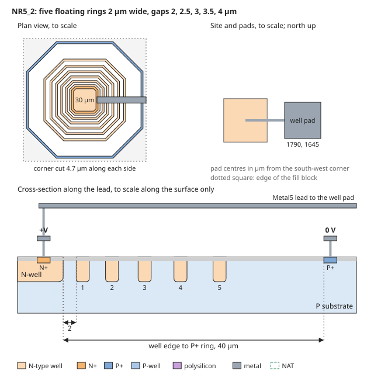
         with corners cut 4.7 µm along each side, an N+ contact ring inside
         its edge and a P+ ring 40 µm outside it; five floating rings 2 µm
         wide, gaps 2, 2.5, 3, 3.5, 4 µm. A Metal5 lead joins the well to a
         pad at 1790, 1645 µm.

   NR5_2 in plan view and in cross-section.

.. list-table:: NR5_2: drawn parameters and position
   :name: tab-hvt-s-nr5-2
   :header-rows: 1
   :widths: 35 65

   * - Parameter
     - Value
   * - Well
     - N-well
   * - Side of the well
     - 30 µm
   * - Corners
     - Cut of 4.7 µm along each side, for a nominal radius of 8 µm; eight vertices of 135°
   * - Area and perimeter
     - 856 µm² and 109.0 µm
   * - N+ contact ring
     - 2 µm wide, 2 µm inside the well edge
   * - P+ ring
     - 2 µm wide, 40 µm from the well edge
   * - Floating ring 1
     - 2 µm wide, after a gap of 2 µm
   * - Floating ring 2
     - 2 µm wide, after a gap of 2.5 µm
   * - Floating ring 3
     - 2 µm wide, after a gap of 3 µm
   * - Floating ring 4
     - 2 µm wide, after a gap of 3.5 µm
   * - Floating ring 5
     - 2 µm wide, after a gap of 4 µm
   * - Fill block
     - Whole structure
   * - Metal5 lead
     - 6 µm wide
   * - Site
     - Column 6 from the west, row 10 from the south
   * - Well pad, centre x, y
     - 1790, 1645 µm
   * - Substrate
     - Any of the seven SUB pads (:numref:`tab-hvt-pads`)

Purpose
   Five rings from a gap of 2 µm: the longest termination on the die, 25 µm
   of rings and gaps. :numref:`fig-hvt-s-nr5-2` shows the structure and
   :numref:`tab-hvt-s-nr5-2` lists what is drawn.

How it works
   The gaps widen from 2 µm to 4 µm. The outer rings sit at low potentials,
   where a gap of 4 µm may be too wide for the depletion region to cross. A
   ring that is never reached takes no part.

Compared with
   * :ref:`NR5_1p4 <hvt-s-nr5-1p4>`: gaps from 2 µm in place of from 1.4 µm.
   * :ref:`NR3_2 <hvt-s-nr3-2>`: five rings in place of three.

Measurement
   Procedure :ref:`P1 <hvt-p1>` applies. The well pad is at 1790, 1645 µm.

Predicted
   The simulated breakdown voltages are in :numref:`tab-hvt-sp-nr5-2`. The
   row of each family's nominal process also gives the family's band, its
   agreement range and the predicted ratio to the reference structure. Equal
   to :ref:`NR3_2 <hvt-s-nr3-2>`: the outer rings are never reached.

Limits
   Its P+ ring is 40 µm from the well, the furthest on the die.

.. list-table:: NR5_2: predicted breakdown voltage by process
   :name: tab-hvt-sp-nr5-2
   :header-rows: 1
   :widths: 18 16 16 17 17 16

   * - Process
     - Straight edge (V)
     - Corner section (V)
     - Family band (V)
     - Agreement range (V)
     - Predicted ratio
   * - AL
     - failed
     - –
     - –
     - –
     - –
   * - BL
     - failed
     - failed
     - –
     - –
     - –
   * - BLq
     - failed
     - failed
     - –
     - –
     - –
   * - BD
     - 62.9
     - failed
     - –
     - –
     - –

.. _hvt-s-nr3m1:

NR3M1
-----

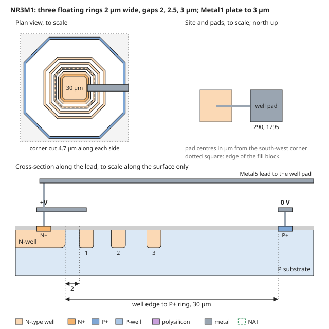
         with corners cut 4.7 µm along each side, an N+ contact ring inside
         its edge and a P+ ring 30 µm outside it; three floating rings 2 µm
         wide, gaps 2, 2.5, 3 µm; Metal1 plate to 3 µm. A Metal5 lead joins
         the well to a pad at 290, 1795 µm.

   NR3M1 in plan view and in cross-section.

.. list-table:: NR3M1: drawn parameters and position
   :name: tab-hvt-s-nr3m1
   :header-rows: 1
   :widths: 35 65

   * - Parameter
     - Value
   * - Well
     - N-well
   * - Side of the well
     - 30 µm
   * - Corners
     - Cut of 4.7 µm along each side, for a nominal radius of 8 µm; eight vertices of 135°
   * - Area and perimeter
     - 856 µm² and 109.0 µm
   * - N+ contact ring
     - 2 µm wide, 2 µm inside the well edge
   * - P+ ring
     - 2 µm wide, 30 µm from the well edge
   * - Floating ring 1
     - 2 µm wide, after a gap of 2 µm
   * - Floating ring 2
     - 2 µm wide, after a gap of 2.5 µm
   * - Floating ring 3
     - 2 µm wide, after a gap of 3 µm
   * - Metal1 plate
     - From the contact ring to 3 µm outside the edge; joined to the well
   * - Fill block
     - Whole structure
   * - Metal5 lead
     - 6 µm wide
   * - Site
     - Column 1 from the west, row 11 from the south
   * - Well pad, centre x, y
     - 290, 1795 µm
   * - Substrate
     - Any of the seven SUB pads (:numref:`tab-hvt-pads`)

Purpose
   Three rings with a Metal1 plate over the first gap: rings and a plate
   combined. :numref:`fig-hvt-s-nr3m1` shows the structure and
   :numref:`tab-hvt-s-nr3m1` lists what is drawn.

How it works
   The plate, joined to the well, extends 3 µm and covers the 2 µm gap and
   half of ring 1. It holds the surface of the first gap at a known
   potential, so charge on the oxide there cannot change when ring 1 picks
   up.

Compared with
   * :ref:`NR3_2 <hvt-s-nr3-2>`: a Metal1 plate of 3 µm in place of none.
   * :ref:`NM1_3 <hvt-s-nm1-3>`: three rings under and beyond the plate in place of none.

Measurement
   Procedure :ref:`P1 <hvt-p1>` applies. The well pad is at 290, 1795 µm.
   Three sweeps matter here: less walk-out than :ref:`NR3_2 <hvt-s-nr3-2>`
   is the plate's benefit.

Predicted
   The simulated breakdown voltages are in :numref:`tab-hvt-sp-nr3m1`. The
   row of each family's nominal process also gives the family's band, its
   agreement range and the predicted ratio to the reference structure. Equal
   to :ref:`NR3_2 <hvt-s-nr3-2>` with less walk-out: the plate stabilises
   the first gap without changing the breakdown.

Limits
   Only the first gap is covered, so charge over the outer gaps still acts.

.. list-table:: NR3M1: predicted breakdown voltage by process
   :name: tab-hvt-sp-nr3m1
   :header-rows: 1
   :widths: 18 16 16 17 17 16

   * - Process
     - Straight edge (V)
     - Corner section (V)
     - Family band (V)
     - Agreement range (V)
     - Predicted ratio
   * - AL, AD, AnL, AnD
     - failed
     - –
     - –
     - –
     - –
   * - BL
     - 107.2
     - 103.4
     - 103.4 to 104.3
     - 72.4 to 119.9
     - 1.54 of :ref:`NT20 <hvt-s-nt20>`
   * - BLq
     - 108.0
     - 104.3
     - –
     - –
     - –
   * - BD
     - 62.9
     - 61.2
     - 61.2 to 61.2
     - 42.8 to 70.4
     - 1.00 of :ref:`NT20 <hvt-s-nt20>`
