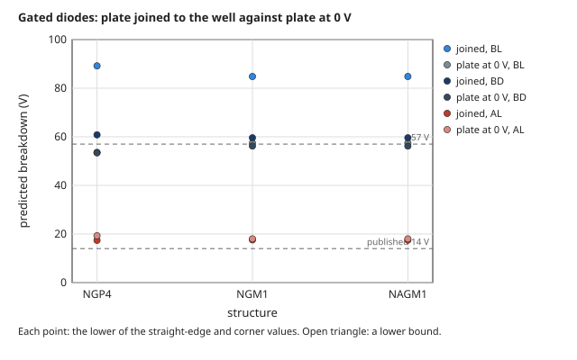
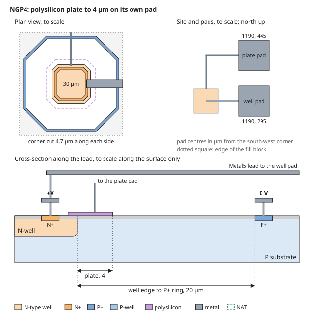
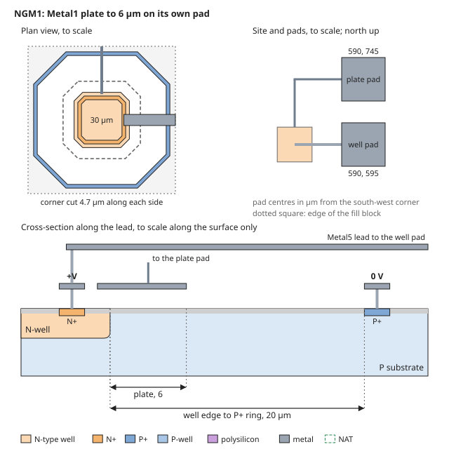
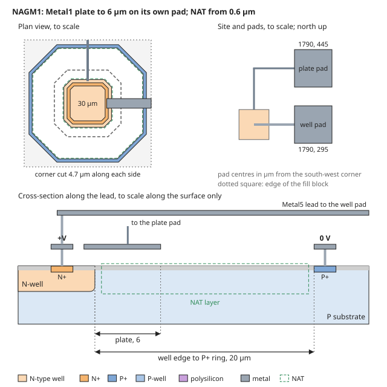

.. _hvt-g-gated-diodes:

Gated diodes
============

A gated diode has a plate over the well edge that is not joined to the well
and has its own pad. The plate's voltage sets the state of the silicon
surface while the junction is measured.

The group has 3 structures: :ref:`NGP4 <hvt-s-ngp4>`, :ref:`NGM1
<hvt-s-ngm1>`, :ref:`NAGM1 <hvt-s-nagm1>`.

Mechanism
---------

A negative plate attracts holes to the surface beside the well and
strengthens the field at the edge. A positive plate first depletes that
surface, then inverts it. The plate voltages at which the well current steps
up and falls back give the flat-band voltage and the field threshold, and
from them the oxide charge and the surface doping.

Expected results
----------------

A surface of bare substrate inverts at a few tens of volts under Metal1. A
surface of P-well does not invert within the plate's range, because its
threshold is several times higher. The threshold therefore shows what
silicon lies beside the well, without breaking the junction down.
:numref:`fig-hvt-g-gated-diodes` shows the trend that the simulation
predicts.

         straight-edge and corner values, against the three gated diodes,
         with the plate joined to the well and with the plate at 0 V, one
         curve per process, with dashed lines at the published 14 V and at
         57 V and an open triangle where a sweep ended without breakdown.
         The structures of the group are NGP4, NGM1, NAGM1. The plotted
         values are those of the tables in the entries.

   Trend that the simulation predicts across the group.

Limits of the group
-------------------

The plate starts 0.5 µm inside the well edge. Its Metal1 is 1.2 µm from the
Metal1 of the well's via stack and 1.5 µm from the well's Metal1 ring, so
the voltage between plate and well stays within 80 V, which is 0.67 MV/cm
across the narrower gap. On the polysilicon plate it stays within 60 V, 1.92
MV/cm across the 0.312 µm of oxide that the extraction capacitance gives.
The current step of the first part may be only tens of femtoamperes. Over
P-well the first part gives the flat-band voltage only.

.. _hvt-s-ngp4:

NGP4
----

         with corners cut 4.7 µm along each side, an N+ contact ring inside
         its edge and a P+ ring 20 µm outside it; polysilicon plate to 4 µm
         on its own pad. A Metal5 lead joins the well to a pad at 290, 595
         µm. A Metal2 lead joins the plate to a second pad at 290, 745 µm.

   NGP4 in plan view and in cross-section.

.. list-table:: NGP4: drawn parameters and position
   :name: tab-hvt-s-ngp4
   :header-rows: 1
   :widths: 35 65

   * - Parameter
     - Value
   * - Well
     - N-well
   * - Side of the well
     - 30 µm
   * - Corners
     - Cut of 4.7 µm along each side, for a nominal radius of 8 µm; eight vertices of 135°
   * - Area and perimeter
     - 856 µm² and 109.0 µm
   * - N+ contact ring
     - 2 µm wide, 2 µm inside the well edge
   * - P+ ring
     - 2 µm wide, 20 µm from the well edge
   * - Polysilicon plate
     - From 0.5 µm inside the well edge to 4 µm outside the edge; on its own pad
   * - Fill block
     - Whole structure
   * - Metal5 lead
     - 6 µm wide
   * - Site
     - Column 1 from the west, row 3 from the south
   * - Well pad, centre x, y
     - 290, 595 µm
   * - Plate pad, centre x, y
     - 290, 745 µm
   * - Substrate
     - Any of the seven SUB pads (:numref:`tab-hvt-pads`)

Purpose
   A polysilicon plate on its own pad: the most sensitive probe of the
   surface beside a plain N-well. :numref:`fig-hvt-s-ngp4` shows the
   structure and :numref:`tab-hvt-s-ngp4` lists what is drawn.

How it works
   The plate lies on 0.32 µm of trench oxide, from 0.5 µm inside the well
   edge to 4 µm outside it. Over oxide that thin, bare substrate inverts at
   a few volts. P-well at 4 × 10\ :sup:`17` cm\ :sup:`-3` inverts at about
   31 V with the well at 0 V and about 58 V with it at 2 V, by the threshold
   equation of the method.

Compared with
   * :ref:`NP4 <hvt-s-np4>`: the plate on its own pad in place of joined to the well.
   * :ref:`NGM1 <hvt-s-ngm1>`: polysilicon over 0.32 µm in place of Metal1 over 1.18 µm.

Measurement
   Procedures :ref:`P1 <hvt-p1>` and :ref:`P4 <hvt-p4>` apply. The well pad
   is at 290, 595 µm and the plate pad at 290, 745 µm. For :ref:`P1
   <hvt-p1>` the two pads are shorted at the probes. In :ref:`P4 <hvt-p4>`
   the voltage between well and plate stays within 60 V. On each die
   :ref:`P1 <hvt-p1>` on this structure comes after every other breakdown
   sweep, because the oxide under its polysilicon plate may fail first. A
   failure that looks like a hard short is recorded apart from avalanche.
   The plate is swept to +60 V with the well at 0 V and at 2 V, so that a
   threshold over P-well falls inside the sweep. The oxide under the plate
   sees the whole voltage between plate and well, which stays within 60 V:
   1.92 MV/cm across the 0.312 µm that the oxide's extraction capacitance
   gives.

Predicted
   The simulated breakdown voltages are in :numref:`tab-hvt-sp-ngp4`. The
   row of each family's nominal process also gives the family's band, its
   agreement range and the predicted ratio to the reference structure. A
   threshold of a few volts: bare substrate beside the well. A threshold
   near 30 V with the well at 0 V: P-well.

Limits
   The threshold over P-well lies close to the 60 V limit once the well is
   at 2 V, so the second point may be out of reach.

.. list-table:: NGP4: predicted breakdown voltage by process
   :name: tab-hvt-sp-ngp4
   :header-rows: 1
   :widths: 18 16 16 17 17 16

   * - Process
     - Straight edge (V)
     - Corner section (V)
     - Family band (V)
     - Agreement range (V)
     - Predicted ratio
   * - AL, AD, AnL, AnD
     - 17.3
     - –
     - 17.3 to 17.3
     - 12.1 to 19.9
     - 0.98 of :ref:`NW0 <hvt-s-nw0>`
   * - BL
     - 94.4
     - 89.2
     - 89.2 to 89.5
     - 75.8 to 111.9
     - 1.33 of :ref:`NT20 <hvt-s-nt20>`
   * - BLq
     - 94.7
     - 89.5
     - –
     - –
     - –
   * - BD
     - 62.9
     - 60.3
     - 60.3 to 60.3
     - 51.3 to 75.4
     - 0.99 of :ref:`NT20 <hvt-s-nt20>`
   * - GAL
     - 19.2
     - –
     - –
     - –
     - –
   * - GBL
     - 51.8
     - 50.3
     - –
     - –
     - –
   * - GBLq
     - 52.9
     - 51.4
     - –
     - –
     - –
   * - GBD
     - 51.3
     - 50.0
     - –
     - –
     - –

.. _hvt-s-ngm1:

NGM1
----

         with corners cut 4.7 µm along each side, an N+ contact ring inside
         its edge and a P+ ring 20 µm outside it; Metal1 plate to 6 µm on
         its own pad. A Metal5 lead joins the well to a pad at 590, 595 µm.
         A Metal2 lead joins the plate to a second pad at 590, 745 µm.

   NGM1 in plan view and in cross-section.

.. list-table:: NGM1: drawn parameters and position
   :name: tab-hvt-s-ngm1
   :header-rows: 1
   :widths: 35 65

   * - Parameter
     - Value
   * - Well
     - N-well
   * - Side of the well
     - 30 µm
   * - Corners
     - Cut of 4.7 µm along each side, for a nominal radius of 8 µm; eight vertices of 135°
   * - Area and perimeter
     - 856 µm² and 109.0 µm
   * - N+ contact ring
     - 2 µm wide, 2 µm inside the well edge
   * - P+ ring
     - 2 µm wide, 20 µm from the well edge
   * - Metal1 plate
     - From 0.5 µm inside the well edge to 6 µm outside the edge; on its own pad
   * - Fill block
     - Whole structure
   * - Metal5 lead
     - 6 µm wide
   * - Site
     - Column 2 from the west, row 3 from the south
   * - Well pad, centre x, y
     - 590, 595 µm
   * - Plate pad, centre x, y
     - 590, 745 µm
   * - Substrate
     - Any of the seven SUB pads (:numref:`tab-hvt-pads`)

Purpose
   A Metal1 plate on its own pad beside a plain N-well: :ref:`NM1_6
   <hvt-s-nm1-6>` with the plate under separate control.
   :numref:`fig-hvt-s-ngm1` shows the structure and :numref:`tab-hvt-s-ngm1`
   lists what is drawn.

How it works
   The plate lies over 1.18 µm of oxide. With the plate at the well's
   voltage it is :ref:`NM1_6 <hvt-s-nm1-6>`. With it at 0 V it holds the
   surface at the substrate's potential, the depletion region cannot spread
   along the surface, and the edge breaks down earlier.

Compared with
   * :ref:`NM1_6 <hvt-s-nm1-6>`: the plate on its own pad in place of joined to the well.
   * :ref:`NAGM1 <hvt-s-nagm1>`: no NAT in place of NAT under the plate.
   * :ref:`NGP4 <hvt-s-ngp4>`: Metal1 over 1.18 µm in place of polysilicon over 0.32 µm.

Measurement
   Procedures :ref:`P1 <hvt-p1>` and :ref:`P4 <hvt-p4>` apply. The well pad
   is at 590, 595 µm and the plate pad at 590, 745 µm. For :ref:`P1
   <hvt-p1>` the two pads are shorted at the probes. In :ref:`P4 <hvt-p4>`
   the voltage between well and plate stays within 80 V. A plate at 0 V lets
   the well reach 80 V, which covers the breakdown voltage predicted for
   that case.

Predicted
   The simulated breakdown voltages are in :numref:`tab-hvt-sp-ngm1`. The
   row of each family's nominal process also gives the family's band, its
   agreement range and the predicted ratio to the reference structure. A
   threshold near the published Metal1 field threshold: bare substrate. No
   threshold within the range: a surface as heavily doped as P-well.

Limits
   Over P-well the threshold is above 100 V, outside the plate's range. The
   first part then gives the flat-band voltage only, and the doping is
   bounded from below but not measured.

.. list-table:: NGM1: predicted breakdown voltage by process
   :name: tab-hvt-sp-ngm1
   :header-rows: 1
   :widths: 18 16 16 17 17 16

   * - Process
     - Straight edge (V)
     - Corner section (V)
     - Family band (V)
     - Agreement range (V)
     - Predicted ratio
   * - AL, AD, AnL, AnD
     - 17.5
     - –
     - 17.5 to 17.5
     - 12.2 to 20.1
     - 0.99 of :ref:`NW0 <hvt-s-nw0>`
   * - BL
     - 90.2
     - 84.8
     - 84.8 to 85.4
     - 72.1 to 106.8
     - 1.27 of :ref:`NT20 <hvt-s-nt20>`
   * - BLq
     - 90.8
     - 85.4
     - –
     - –
     - –
   * - BD
     - 62.9
     - 60.1
     - 60.1 to 60.1
     - 51.1 to 75.1
     - 0.98 of :ref:`NT20 <hvt-s-nt20>`
   * - GAL
     - 18.0
     - –
     - –
     - –
     - –
   * - GBL
     - 61.7
     - 57.2
     - –
     - –
     - –
   * - GBLq
     - 64.0
     - 59.1
     - –
     - –
     - –
   * - GBD
     - 59.7
     - 56.0
     - –
     - –
     - –

.. _hvt-s-nagm1:

NAGM1
-----

         with corners cut 4.7 µm along each side, an N+ contact ring inside
         its edge and a P+ ring 20 µm outside it; Metal1 plate to 6 µm on
         its own pad; NAT from 0.6 µm. A Metal5 lead joins the well to a pad
         at 890, 595 µm. A Metal2 lead joins the plate to a second pad at
         890, 745 µm.

   NAGM1 in plan view and in cross-section.

.. list-table:: NAGM1: drawn parameters and position
   :name: tab-hvt-s-nagm1
   :header-rows: 1
   :widths: 35 65

   * - Parameter
     - Value
   * - Well
     - N-well
   * - Side of the well
     - 30 µm
   * - Corners
     - Cut of 4.7 µm along each side, for a nominal radius of 8 µm; eight vertices of 135°
   * - Area and perimeter
     - 856 µm² and 109.0 µm
   * - N+ contact ring
     - 2 µm wide, 2 µm inside the well edge
   * - P+ ring
     - 2 µm wide, 20 µm from the well edge
   * - Metal1 plate
     - From 0.5 µm inside the well edge to 6 µm outside the edge; on its own pad
   * - NAT layer
     - From 0.6 µm outside the well edge to 0.5 µm short of the P+ ring
   * - Fill block
     - Whole structure
   * - Metal5 lead
     - 6 µm wide
   * - Site
     - Column 3 from the west, row 3 from the south
   * - Well pad, centre x, y
     - 890, 595 µm
   * - Plate pad, centre x, y
     - 890, 745 µm
   * - Substrate
     - Any of the seven SUB pads (:numref:`tab-hvt-pads`)

Purpose
   A Metal1 plate on its own pad over NAT: reads directly whether P-well
   lies under the NAT layer. :numref:`fig-hvt-s-nagm1` shows the structure
   and :numref:`tab-hvt-s-nagm1` lists what is drawn.

How it works
   The plate covers the 0.6 µm strip and 5.4 µm of NAT. The plate voltage at
   which the surface under it inverts depends on the doping there. Bare
   substrate under NAT inverts at a far lower voltage than P-well would.

Compared with
   * :ref:`NGM1 <hvt-s-ngm1>`: NAT under the plate in place of none.
   * :ref:`NAM1_6 <hvt-s-nam1-6>`: the plate on its own pad in place of joined to the well.

Measurement
   Procedures :ref:`P1 <hvt-p1>` and :ref:`P4 <hvt-p4>` apply. The well pad
   is at 890, 595 µm and the plate pad at 890, 745 µm. For :ref:`P1
   <hvt-p1>` the two pads are shorted at the probes. In :ref:`P4 <hvt-p4>`
   the voltage between well and plate stays within 80 V. As for :ref:`NGM1
   <hvt-s-ngm1>`.

Predicted
   The simulated breakdown voltages are in :numref:`tab-hvt-sp-nagm1`. The
   row of each family's nominal process also gives the family's band, its
   agreement range and the predicted ratio to the reference structure. A
   lower threshold than :ref:`NGM1 <hvt-s-ngm1>`: NAT removes P-well that is
   present beside a plain well. Equal thresholds: the two surfaces are the
   same silicon.

Limits
   The plate also covers the strip beside the well, whose doping may differ
   from that under NAT; the reading mixes the two.

.. list-table:: NAGM1: predicted breakdown voltage by process
   :name: tab-hvt-sp-nagm1
   :header-rows: 1
   :widths: 18 16 16 17 17 16

   * - Process
     - Straight edge (V)
     - Corner section (V)
     - Family band (V)
     - Agreement range (V)
     - Predicted ratio
   * - AL, AD
     - 17.5
     - –
     - 17.5 to 17.5
     - 12.2 to 20.1
     - 0.99 of :ref:`NW0 <hvt-s-nw0>`
   * - AnL
     - 90.2
     - 84.8
     - 84.8 to 84.8
     - 72.1 to 106.0
     - 1.27 of :ref:`NA0p6 <hvt-s-na0p6>`
   * - AnD
     - 62.9
     - 60.1
     - 60.1 to 60.1
     - 51.1 to 75.1
     - 0.97 of :ref:`NA0p6 <hvt-s-na0p6>`
   * - BL
     - 90.2
     - 84.8
     - 84.8 to 85.4
     - 72.1 to 106.8
     - 1.27 of :ref:`NT20 <hvt-s-nt20>`
   * - BLq
     - 90.8
     - 85.4
     - –
     - –
     - –
   * - BD
     - 62.9
     - 60.1
     - 60.1 to 60.1
     - 51.1 to 75.1
     - 0.98 of :ref:`NT20 <hvt-s-nt20>`
   * - GAL
     - 17.9
     - –
     - –
     - –
     - –
   * - GAnL
     - 61.7
     - 57.2
     - –
     - –
     - –
   * - GAnD
     - 59.7
     - 56.0
     - –
     - –
     - –
   * - GBL
     - 61.7
     - 57.2
     - –
     - –
     - –
   * - GBLq
     - 64.0
     - 59.1
     - –
     - –
     - –
   * - GBD
     - 59.7
     - 56.0
     - –
     - –
     - –
