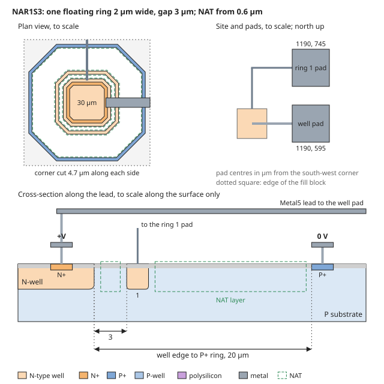
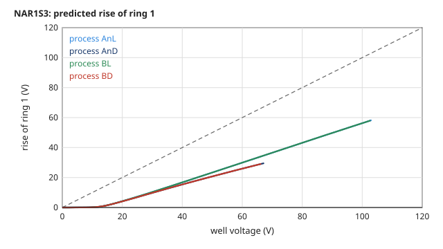
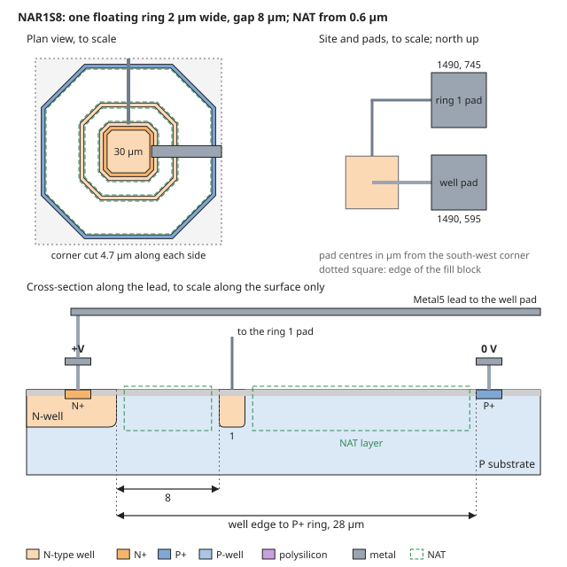
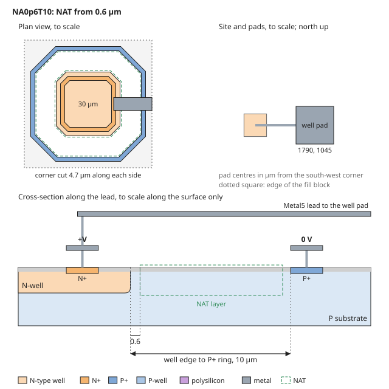
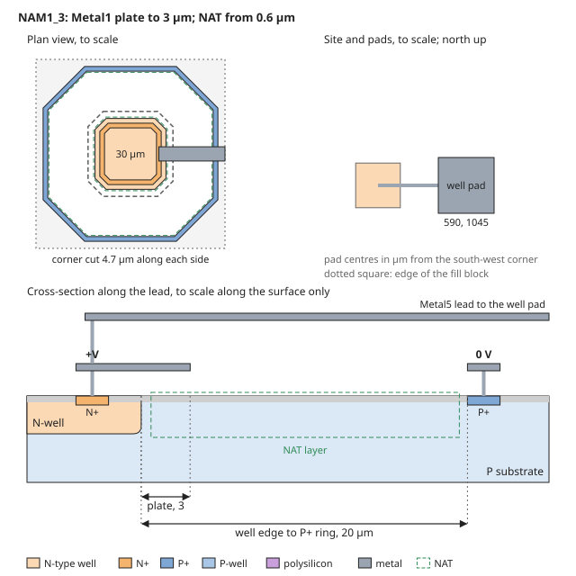
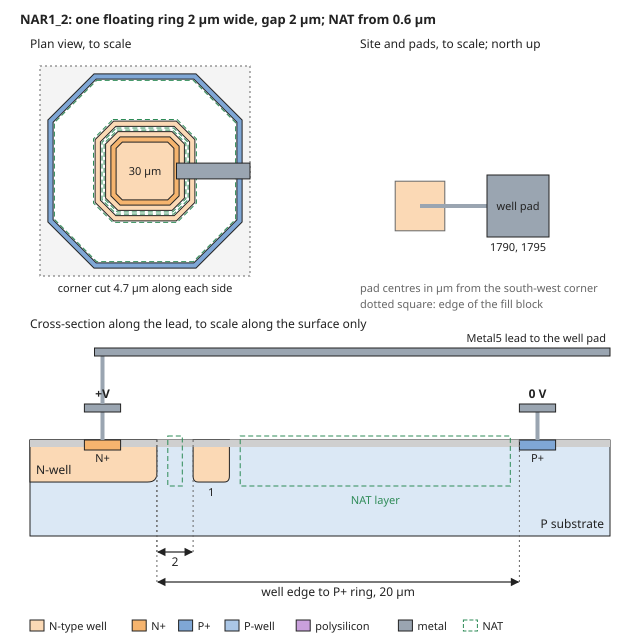
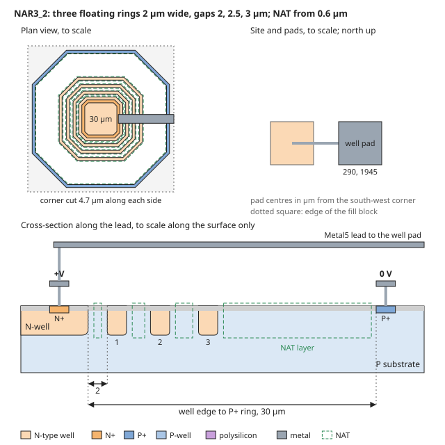
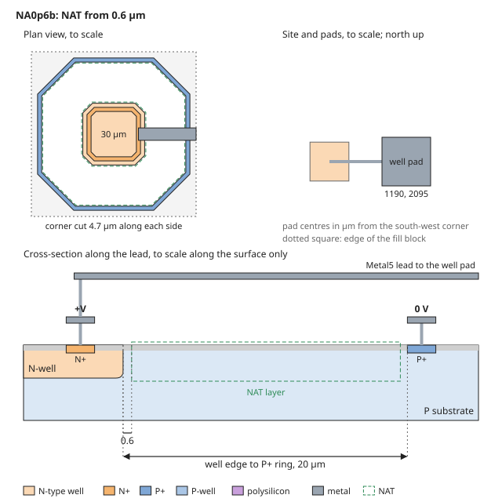

.. _hvt-g-nat:

NAT layer
=========

The NAT layer marks where a native transistor keeps the bare substrate as
its channel. These structures test whether it also keeps a generated P-well
away from an N-well edge, and measure floating and contacted rings under it.

The group has 12 structures: :ref:`NAR1S3 <hvt-s-nar1s3>`, :ref:`NAR1S8
<hvt-s-nar1s8>`, :ref:`NA0p6 <hvt-s-na0p6>`, :ref:`NA0p6T10
<hvt-s-na0p6t10>`, :ref:`NA0p6C0 <hvt-s-na0p6c0>`, :ref:`NAM1_3
<hvt-s-nam1-3>`, :ref:`NAM1_6 <hvt-s-nam1-6>`, :ref:`NAM1_10
<hvt-s-nam1-10>`, :ref:`NAM2_12 <hvt-s-nam2-12>`, :ref:`NAR1_2
<hvt-s-nar1-2>`, :ref:`NAR3_2 <hvt-s-nar3-2>`, :ref:`NA0p6b <hvt-s-na0p6b>`.

Mechanism
---------

The design manual says the P-well implant is blocked under NAT. If that
holds with no transistor present, the silicon under NAT is bare substrate,
and the well's depletion region can spread through it as under assumption B.
Rule NAT.3 keeps NAT at least 0.5 µm from an N-well, so a strip of
unprotected silicon always remains beside the edge. Rings are N-well too, so
round :ref:`NAR1_2 <hvt-s-nar1-2>`, :ref:`NAR3_2 <hvt-s-nar3-2>`,
:ref:`NAR1S3 <hvt-s-nar1s3>` and :ref:`NAR1S8 <hvt-s-nar1s8>` the layer is
cut into strips that keep 0.6 µm from the well and from each side of every
ring. If NAT is what clears an edge, the ordinary ring structures are still
limited by P-well, and these four are the only ones that measure rings and
the spacing to a neighbouring well there.

Expected results
----------------

If NAT blocks the P-well and the strip stays empty, the members equal their
counterparts without NAT under assumption B. If P-well fills the strip, or
NAT blocks nothing, they equal :ref:`NT20 <hvt-s-nt20>` under assumption A,
rings included, because P-well in the strips limits them as it limits the
plain well. Under An and under B the rings under NAT behave as rings in bare
substrate. :numref:`fig-hvt-g-nat` shows the trend that the simulation
predicts.

.. figure:: hvt-g-nat.svg
   :name: fig-hvt-g-nat
   :alt: Graph of predicted breakdown voltage, the lower of the
         straight-edge and corner values, against seven structures under
         NAT: NA0p6, NA0p6T10, NA0p6C0, NAR1_2, NAR3_2, NAR1S3 and NAR1S8,
         one curve per process, with dashed lines at the published 14 V and
         at 57 V and an open triangle where a sweep ended without breakdown.
         The structures of the group are NAR1S3, NAR1S8, NA0p6, NA0p6T10,
         NA0p6C0, NAM1_3, NAM1_6, NAM1_10, NAM2_12, NAR1_2, NAR3_2, NA0p6b.
         The plotted values are those of the tables in the entries.

   Trend that the simulation predicts across the group.

Limits of the group
-------------------

No member has NAT touching the N-well or a ring, because the rules forbid
it, and every strip left beside them is 0.6 µm wide; no member has a wider
strip. The group cannot tell a filled strip from a NAT layer that blocks
nothing. No polysilicon may lie under NAT.

.. _hvt-s-nar1s3:

NAR1S3
------

         with corners cut 4.7 µm along each side, an N+ contact ring inside
         its edge and a P+ ring 20 µm outside it; one floating ring 2 µm
         wide, gap 3 µm; NAT from 0.6 µm. A Metal5 lead joins the well to a
         pad at 1190, 595 µm. A Metal2 lead joins ring 1 to a second pad at
         1190, 745 µm.

   NAR1S3 in plan view and in cross-section.

.. list-table:: NAR1S3: drawn parameters and position
   :name: tab-hvt-s-nar1s3
   :header-rows: 1
   :widths: 35 65

   * - Parameter
     - Value
   * - Well
     - N-well
   * - Side of the well
     - 30 µm
   * - Corners
     - Cut of 4.7 µm along each side, for a nominal radius of 8 µm; eight vertices of 135°
   * - Area and perimeter
     - 856 µm² and 109.0 µm
   * - N+ contact ring
     - 2 µm wide, 2 µm inside the well edge
   * - P+ ring
     - 2 µm wide, 20 µm from the well edge
   * - Floating ring 1
     - 2 µm wide, after a gap of 3 µm
   * - NAT layer
     - From 0.6 µm outside the well edge to 0.5 µm short of the P+ ring, cut into strips that keep 0.6 µm clear of each ring
   * - Fill block
     - Whole structure
   * - Metal5 lead
     - 6 µm wide
   * - Site
     - Column 4 from the west, row 3 from the south
   * - Well pad, centre x, y
     - 1190, 595 µm
   * - Ring 1 pad, centre x, y
     - 1190, 745 µm
   * - Substrate
     - Any of the seven SUB pads (:numref:`tab-hvt-pads`)

Purpose
   A contacted ring under NAT 3 µm from the well: the spacing between two
   wells where no P-well lies between them. :numref:`fig-hvt-s-nar1s3` shows
   the structure and :numref:`tab-hvt-s-nar1s3` lists what is drawn.

How it works
   It is :ref:`NR1S3 <hvt-s-nr1s3>` with NAT over the gap and the
   termination zone, cut 0.6 µm clear of the ring and the well. If NAT
   clears the P-well, the depletion region crosses the gap in bare
   substrate, and with the ring pad at 0 V the ring is a neighbouring well.

Compared with
   * :ref:`NR1S3 <hvt-s-nr1s3>`: NAT over the gap in place of none.
   * :ref:`NAR1S8 <hvt-s-nar1s8>`: a gap of 3 µm in place of 8 µm.
   * :ref:`NAR1_2 <hvt-s-nar1-2>`: a contact on the ring, at 3 µm in place of 2 µm.

Measurement
   Procedures :ref:`P1 <hvt-p1>`, :ref:`P3 <hvt-p3>` and :ref:`P5 <hvt-p5>`
   apply. The well pad is at 1190, 595 µm and the ring 1 pad at 1190, 745
   µm. As for :ref:`NR1S3 <hvt-s-nr1s3>`.

Predicted
   The simulated breakdown voltages are in :numref:`tab-hvt-sp-nar1s3`. The
   row of each family's nominal process also gives the family's band, its
   agreement range and the predicted ratio to the reference structure. Under
   An the punch-through and the ring's rise follow :ref:`NR1S3
   <hvt-s-nr1s3>` under B. Under A both are limited by P-well in the strips,
   as for :ref:`NR1S3 <hvt-s-nr1s3>`. The prediction with ring 1 held at 0
   V, as in :ref:`P5 <hvt-p5>`, is in :numref:`tab-hvt-p5`.
   :numref:`fig-hvt-sr-nar1s3` plots the predicted rise of ring 1.

Limits
   As for :ref:`NR1S2 <hvt-s-nr1s2>`. The strips beside the ring are only
   0.6 µm wide, so a P-well that fills them would cut the gap short.

.. list-table:: NAR1S3: predicted breakdown voltage by process
   :name: tab-hvt-sp-nar1s3
   :header-rows: 1
   :widths: 18 16 16 17 17 16

   * - Process
     - Straight edge (V)
     - Corner section (V)
     - Family band (V)
     - Agreement range (V)
     - Predicted ratio
   * - AL, AD
     - 17.7
     - –
     - 17.7 to 17.7
     - 12.4 to 20.4
     - 1.00 of :ref:`NW0 <hvt-s-nw0>`
   * - AnL
     - 96.4
     - 90.4
     - 90.4 to 90.4
     - 76.8 to 113.0
     - 1.35 of :ref:`NA0p6 <hvt-s-na0p6>`
   * - AnD
     - 62.9
     - 61.1
     - 61.1 to 61.1
     - 51.9 to 76.4
     - 0.99 of :ref:`NA0p6 <hvt-s-na0p6>`
   * - BL
     - 96.4
     - 90.3
     - 90.3 to 91.8
     - 76.8 to 114.8
     - 1.35 of :ref:`NT20 <hvt-s-nt20>`
   * - BLq
     - 97.6
     - 91.8
     - –
     - –
     - –
   * - BD
     - 62.9
     - 60.7
     - 60.7 to 60.7
     - 51.6 to 75.9
     - 0.99 of :ref:`NT20 <hvt-s-nt20>`

         voltage, one curve per process that has a result, with a diagonal
         marking ring voltage equal to well voltage. Each curve leaves zero
         after a few volts and then rises below the diagonal.

   Predicted rise of ring 1 of NAR1S3.

.. _hvt-s-nar1s8:

NAR1S8
------

         with corners cut 4.7 µm along each side, an N+ contact ring inside
         its edge and a P+ ring 28 µm outside it; one floating ring 2 µm
         wide, gap 8 µm; NAT from 0.6 µm. A Metal5 lead joins the well to a
         pad at 1490, 595 µm. A Metal2 lead joins ring 1 to a second pad at
         1490, 745 µm.

   NAR1S8 in plan view and in cross-section.

.. list-table:: NAR1S8: drawn parameters and position
   :name: tab-hvt-s-nar1s8
   :header-rows: 1
   :widths: 35 65

   * - Parameter
     - Value
   * - Well
     - N-well
   * - Side of the well
     - 30 µm
   * - Corners
     - Cut of 4.7 µm along each side, for a nominal radius of 8 µm; eight vertices of 135°
   * - Area and perimeter
     - 856 µm² and 109.0 µm
   * - N+ contact ring
     - 2 µm wide, 2 µm inside the well edge
   * - P+ ring
     - 2 µm wide, 28 µm from the well edge
   * - Floating ring 1
     - 2 µm wide, after a gap of 8 µm
   * - NAT layer
     - From 0.6 µm outside the well edge to 0.5 µm short of the P+ ring, cut into strips that keep 0.6 µm clear of each ring
   * - Fill block
     - Whole structure
   * - Metal5 lead
     - 6 µm wide
   * - Site
     - Column 5 from the west, row 3 from the south
   * - Well pad, centre x, y
     - 1490, 595 µm
   * - Ring 1 pad, centre x, y
     - 1490, 745 µm
   * - Substrate
     - Any of the seven SUB pads (:numref:`tab-hvt-pads`)

Purpose
   A contacted ring under NAT 8 µm from the well: whether that spacing
   isolates two wells where NAT clears the P-well.
   :numref:`fig-hvt-s-nar1s8` shows the structure and
   :numref:`tab-hvt-s-nar1s8` lists what is drawn.

How it works
   It is :ref:`NR1S8 <hvt-s-nr1s8>` with NAT over the gap. If the well
   breaks down before its depletion region has crossed 8 µm of bare
   substrate, no current reaches the ring, and the substrate current rises
   instead.

Compared with
   * :ref:`NR1S8 <hvt-s-nr1s8>`: NAT over the gap in place of none.
   * :ref:`NAR1S3 <hvt-s-nar1s3>`: a gap of 8 µm in place of 3 µm.

Measurement
   Procedures :ref:`P1 <hvt-p1>`, :ref:`P3 <hvt-p3>` and :ref:`P5 <hvt-p5>`
   apply. The well pad is at 1490, 595 µm and the ring 1 pad at 1490, 745
   µm. As for :ref:`NR1S5 <hvt-s-nr1s5>`. Which pad the current leaves by,
   ring or substrate, is the result.

Predicted
   The simulated breakdown voltages are in :numref:`tab-hvt-sp-nar1s8`. The
   row of each family's nominal process also gives the family's band, its
   agreement range and the predicted ratio to the reference structure.
   Substrate current first: 8 µm isolates two wells under NAT up to the
   breakdown voltage. Ring current first: it does not. The prediction with
   ring 1 held at 0 V, as in :ref:`P5 <hvt-p5>`, is in :numref:`tab-hvt-p5`.

Limits
   As for :ref:`NAR1S3 <hvt-s-nar1s3>`. No contacted ring under NAT lies
   between 3 µm and 8 µm, so a spacing that fails at 3 µm and holds at 8 µm
   is bracketed, not found.

.. list-table:: NAR1S8: predicted breakdown voltage by process
   :name: tab-hvt-sp-nar1s8
   :header-rows: 1
   :widths: 18 16 16 17 17 16

   * - Process
     - Straight edge (V)
     - Corner section (V)
     - Family band (V)
     - Agreement range (V)
     - Predicted ratio
   * - AL, AD
     - 17.7
     - –
     - 17.7 to 17.7
     - 12.4 to 20.4
     - 1.00 of :ref:`NW0 <hvt-s-nw0>`
   * - AnL
     - 76.0
     - 67.0
     - 67.0 to 67.0
     - 56.9 to 83.8
     - 1.00 of :ref:`NA0p6 <hvt-s-na0p6>`
   * - AnD
     - 62.9
     - 62.2
     - 62.2 to 62.2
     - 52.9 to 77.8
     - 1.01 of :ref:`NA0p6 <hvt-s-na0p6>`
   * - BL
     - 76.0
     - 67.0
     - 67.0 to 70.3
     - 56.9 to 87.9
     - 1.00 of :ref:`NT20 <hvt-s-nt20>`
   * - BLq
     - 79.8
     - 70.3
     - –
     - –
     - –
   * - BD
     - 62.9
     - 62.2
     - 62.2 to 62.2
     - 52.9 to 77.8
     - 1.02 of :ref:`NT20 <hvt-s-nt20>`

.. _hvt-s-na0p6:

NA0p6
-----

.. figure:: hvt-s-NA0p6.svg
   :name: fig-hvt-s-na0p6
   :alt: Plan view and cross-section of NA0p6: an N-well 30 µm across
         with corners cut 4.7 µm along each side, an N+ contact ring inside
         its edge and a P+ ring 20 µm outside it; NAT from 0.6 µm. A Metal5
         lead joins the well to a pad at 1190, 1045 µm.

   NA0p6 in plan view and in cross-section.

.. list-table:: NA0p6: drawn parameters and position
   :name: tab-hvt-s-na0p6
   :header-rows: 1
   :widths: 35 65

   * - Parameter
     - Value
   * - Well
     - N-well
   * - Side of the well
     - 30 µm
   * - Corners
     - Cut of 4.7 µm along each side, for a nominal radius of 8 µm; eight vertices of 135°
   * - Area and perimeter
     - 856 µm² and 109.0 µm
   * - N+ contact ring
     - 2 µm wide, 2 µm inside the well edge
   * - P+ ring
     - 2 µm wide, 20 µm from the well edge
   * - NAT layer
     - From 0.6 µm outside the well edge to 0.5 µm short of the P+ ring
   * - Fill block
     - Whole structure
   * - Metal5 lead
     - 6 µm wide
   * - Site
     - Column 4 from the west, row 6 from the south
   * - Well pad, centre x, y
     - 1190, 1045 µm
   * - Substrate
     - Any of the seven SUB pads (:numref:`tab-hvt-pads`)

Purpose
   The main test of the NAT layer: NAT as close to an N-well as the rules
   allow. :numref:`fig-hvt-s-na0p6` shows the structure and
   :numref:`tab-hvt-s-na0p6` lists what is drawn.

How it works
   NAT covers the termination zone from 0.6 µm outwards. If it blocks the
   P-well, bare substrate lies beside the well except in a strip 0.6 µm
   wide. That strip is at the foundry's minimum P-well width, so the
   generated mask may leave it out.

Compared with
   * :ref:`NT20 <hvt-s-nt20>`: NAT over the termination zone in place of none.
   * :ref:`NAR1_2 <hvt-s-nar1-2>`: no ring in place of one floating ring under NAT.
   * :ref:`NA0p6b <hvt-s-na0p6b>`: nothing: a second copy.

Measurement
   Procedure :ref:`P1 <hvt-p1>` applies. The well pad is at 1190, 1045 µm.
   Swept again at 85 °C.

Predicted
   The simulated breakdown voltages are in :numref:`tab-hvt-sp-na0p6`. The
   row of each family's nominal process also gives the family's band, its
   agreement range and the predicted ratio to the reference structure. Much
   higher than :ref:`NT20 <hvt-s-nt20>` while :ref:`NT20 <hvt-s-nt20>` is
   near 14 V: NAT clears the edge (assumption An), and the plates and rings
   under NAT show what can be built on it. Equal to :ref:`NT20 <hvt-s-nt20>`
   at a low value: either the strip is filled or NAT blocks nothing (A).
   Equal to :ref:`NT20 <hvt-s-nt20>` at a high value: no P-well is generated
   anywhere (B), so NAT has nothing to block, which the simulation gives as
   well.

Limits
   A strip always remains, so the structure never has NAT against the
   junction.

.. list-table:: NA0p6: predicted breakdown voltage by process
   :name: tab-hvt-sp-na0p6
   :header-rows: 1
   :widths: 18 16 16 17 17 16

   * - Process
     - Straight edge (V)
     - Corner section (V)
     - Family band (V)
     - Agreement range (V)
     - Predicted ratio
   * - AL, AD
     - 17.7
     - –
     - 17.7 to 17.8
     - 12.4 to 20.5
     - 1.00 of :ref:`NW0 <hvt-s-nw0>`
   * - ALhi
     - 17.8
     - –
     - –
     - –
     - –
   * - AnL
     - 76.0
     - 67.0
     - 67.0 to 67.0
     - 56.9 to 83.8
     - 3.79, across regimes: not a test of :ref:`NT20 <hvt-s-nt20>`
   * - AnD
     - 62.9
     - 61.7
     - 61.7 to 61.7
     - 52.4 to 77.1
     - 3.49, across regimes: not a test of :ref:`NT20 <hvt-s-nt20>`
   * - BL
     - 76.0
     - 67.0
     - 60.2 to 79.4
     - 51.2 to 99.2
     - 1.00 of :ref:`NT20 <hvt-s-nt20>`
   * - BLhi
     - 66.7
     - 60.2
     - –
     - –
     - –
   * - BLlo
     - 94.4
     - 79.4
     - –
     - –
     - –
   * - BLq
     - 79.9
     - 70.3
     - –
     - –
     - –
   * - BLq3
     - 86.2
     - 77.0
     - –
     - –
     - –
   * - BD
     - 62.9
     - 61.2
     - 59.2 to 61.2
     - 50.3 to 76.5
     - 1.00 of :ref:`NT20 <hvt-s-nt20>`
   * - BDhi
     - 62.9
     - 59.2
     - –
     - –
     - –
   * - BDlo
     - 62.5
     - 61.0
     - –
     - –
     - –

.. _hvt-s-na0p6t10:

NA0p6T10
--------

         across with corners cut 4.7 µm along each side, an N+ contact ring
         inside its edge and a P+ ring 10 µm outside it; NAT from 0.6 µm. A
         Metal5 lead joins the well to a pad at 1790, 1045 µm.

   NA0p6T10 in plan view and in cross-section.

.. list-table:: NA0p6T10: drawn parameters and position
   :name: tab-hvt-s-na0p6t10
   :header-rows: 1
   :widths: 35 65

   * - Parameter
     - Value
   * - Well
     - N-well
   * - Side of the well
     - 30 µm
   * - Corners
     - Cut of 4.7 µm along each side, for a nominal radius of 8 µm; eight vertices of 135°
   * - Area and perimeter
     - 856 µm² and 109.0 µm
   * - N+ contact ring
     - 2 µm wide, 2 µm inside the well edge
   * - P+ ring
     - 2 µm wide, 10 µm from the well edge
   * - NAT layer
     - From 0.6 µm outside the well edge to 0.5 µm short of the P+ ring
   * - Fill block
     - Whole structure
   * - Metal5 lead
     - 6 µm wide
   * - Site
     - Column 6 from the west, row 6 from the south
   * - Well pad, centre x, y
     - 1790, 1045 µm
   * - Substrate
     - Any of the seven SUB pads (:numref:`tab-hvt-pads`)

Purpose
   Repeats the ring-distance check under NAT with the P+ ring at 10 µm.
   :numref:`fig-hvt-s-na0p6t10` shows the structure and
   :numref:`tab-hvt-s-na0p6t10` lists what is drawn.

How it works
   NAT ends 0.5 µm short of the P+ ring, so here it is 8.9 µm wide. If NAT
   clears the P-well, the depletion region spreads through that width and
   the P+ ring is the first heavily doped region it can meet.

Compared with
   * :ref:`NA0p6 <hvt-s-na0p6>`: the ring is at 10 µm in place of 20 µm.
   * :ref:`NT5 <hvt-s-nt5>`: NAT and a ring at 10 µm in place of no NAT and a ring at 5 µm.

Measurement
   Procedure :ref:`P1 <hvt-p1>` applies. The well pad is at 1790, 1045 µm.

Predicted
   The simulated breakdown voltages are in :numref:`tab-hvt-sp-na0p6t10`.
   The row of each family's nominal process also gives the family's band,
   its agreement range and the predicted ratio to the reference structure.
   Equal to :ref:`NA0p6 <hvt-s-na0p6>`: a NAT region 9 µm wide is enough.

Limits
   It tests the ring distance only if NAT clears the edge. Otherwise P-well
   limits it as it limits :ref:`NT20 <hvt-s-nt20>`.

.. list-table:: NA0p6T10: predicted breakdown voltage by process
   :name: tab-hvt-sp-na0p6t10
   :header-rows: 1
   :widths: 18 16 16 17 17 16

   * - Process
     - Straight edge (V)
     - Corner section (V)
     - Family band (V)
     - Agreement range (V)
     - Predicted ratio
   * - AL, AD
     - 17.7
     - –
     - 17.7 to 17.7
     - 12.4 to 20.4
     - 1.00 of :ref:`NW0 <hvt-s-nw0>`
   * - AnL
     - 76.0
     - 67.0
     - 67.0 to 67.0
     - 56.9 to 83.8
     - 1.00 of :ref:`NA0p6 <hvt-s-na0p6>`
   * - AnD
     - 62.9
     - 61.7
     - 61.7 to 61.7
     - 52.4 to 77.1
     - 1.00 of :ref:`NA0p6 <hvt-s-na0p6>`
   * - BL
     - 76.0
     - 67.0
     - 67.0 to 70.3
     - 56.9 to 87.9
     - 1.00 of :ref:`NT20 <hvt-s-nt20>`
   * - BLq
     - 79.9
     - 70.3
     - –
     - –
     - –
   * - BD
     - 62.9
     - 61.2
     - 61.2 to 61.2
     - 52.0 to 76.5
     - 1.00 of :ref:`NT20 <hvt-s-nt20>`

.. _hvt-s-na0p6c0:

NA0p6C0
-------

.. figure:: hvt-s-NA0p6C0.svg
   :name: fig-hvt-s-na0p6c0
   :alt: Plan view and cross-section of NA0p6C0: an N-well 30 µm
         across with square corners, an N+ contact ring inside its edge and
         a P+ ring 20 µm outside it; NAT from 0.6 µm. A Metal5 lead joins
         the well to a pad at 290, 1195 µm.

   NA0p6C0 in plan view and in cross-section.

.. list-table:: NA0p6C0: drawn parameters and position
   :name: tab-hvt-s-na0p6c0
   :header-rows: 1
   :widths: 35 65

   * - Parameter
     - Value
   * - Well
     - N-well
   * - Side of the well
     - 30 µm
   * - Corners
     - Square; four vertices of 90°
   * - Area and perimeter
     - 900 µm² and 120.0 µm
   * - N+ contact ring
     - 2 µm wide, 2 µm inside the well edge
   * - P+ ring
     - 2 µm wide, 20 µm from the well edge
   * - NAT layer
     - From 0.6 µm outside the well edge to 0.5 µm short of the P+ ring
   * - Fill block
     - Whole structure
   * - Metal5 lead
     - 6 µm wide
   * - Site
     - Column 1 from the west, row 7 from the south
   * - Well pad, centre x, y
     - 290, 1195 µm
   * - Substrate
     - Any of the seven SUB pads (:numref:`tab-hvt-pads`)

Purpose
   Measures the cost of a square corner when NAT, not P-well, lies beside
   the well. :numref:`fig-hvt-s-na0p6c0` shows the structure and
   :numref:`tab-hvt-s-na0p6c0` lists what is drawn.

How it works
   The well has four 90° vertices and the NAT outline follows them at 0.6
   µm. If NAT clears the edge, the vertices carry the highest field, as in
   :ref:`NC0 <hvt-s-nc0>`.

Compared with
   * :ref:`NA0p6 <hvt-s-na0p6>`: four 90° vertices in place of eight of 135°.
   * :ref:`NC0 <hvt-s-nc0>`: NAT over the termination zone in place of none.

Measurement
   Procedure :ref:`P1 <hvt-p1>` applies. The well pad is at 290, 1195 µm.

Predicted
   The simulated breakdown voltages are in :numref:`tab-hvt-sp-na0p6c0`. The
   row of each family's nominal process also gives the family's band, its
   agreement range and the predicted ratio to the reference structure. Below
   :ref:`NA0p6 <hvt-s-na0p6>` by the same amount as :ref:`NC0 <hvt-s-nc0>`
   is below :ref:`NT20 <hvt-s-nt20>`: the silicon under NAT behaves as bare
   substrate does.

Limits
   The corner section is a cylinder of 1 µm radius, as for :ref:`NC0
   <hvt-s-nc0>`, so the corner prediction is probably pessimistic: the
   measured value may be higher.

.. list-table:: NA0p6C0: predicted breakdown voltage by process
   :name: tab-hvt-sp-na0p6c0
   :header-rows: 1
   :widths: 18 16 16 17 17 16

   * - Process
     - Straight edge (V)
     - Corner section (V)
     - Family band (V)
     - Agreement range (V)
     - Predicted ratio
   * - AL, AD
     - 17.7
     - –
     - 17.7 to 17.7
     - 12.4 to 20.4
     - 1.00 of :ref:`NW0 <hvt-s-nw0>`
   * - AnL
     - 76.0
     - 46.1
     - 46.1 to 46.1
     - 39.2 to 57.6
     - 0.69 of :ref:`NA0p6 <hvt-s-na0p6>`
   * - AnD
     - 62.9
     - 46.0
     - 46.0 to 46.0
     - 39.1 to 57.5
     - 0.75 of :ref:`NA0p6 <hvt-s-na0p6>`
   * - BL
     - 76.0
     - 46.1
     - 46.1 to 48.0
     - 39.2 to 60.0
     - 0.69 of :ref:`NT20 <hvt-s-nt20>`
   * - BLq
     - 79.9
     - 48.0
     - –
     - –
     - –
   * - BD
     - 62.9
     - 46.0
     - 46.0 to 46.0
     - 39.1 to 57.5
     - 0.75 of :ref:`NT20 <hvt-s-nt20>`

.. _hvt-s-nam1-3:

NAM1_3
------

         with corners cut 4.7 µm along each side, an N+ contact ring inside
         its edge and a P+ ring 20 µm outside it; Metal1 plate to 3 µm; NAT
         from 0.6 µm. A Metal5 lead joins the well to a pad at 590, 1195 µm.

   NAM1_3 in plan view and in cross-section.

.. list-table:: NAM1_3: drawn parameters and position
   :name: tab-hvt-s-nam1-3
   :header-rows: 1
   :widths: 35 65

   * - Parameter
     - Value
   * - Well
     - N-well
   * - Side of the well
     - 30 µm
   * - Corners
     - Cut of 4.7 µm along each side, for a nominal radius of 8 µm; eight vertices of 135°
   * - Area and perimeter
     - 856 µm² and 109.0 µm
   * - N+ contact ring
     - 2 µm wide, 2 µm inside the well edge
   * - P+ ring
     - 2 µm wide, 20 µm from the well edge
   * - Metal1 plate
     - From the contact ring to 3 µm outside the edge; joined to the well
   * - NAT layer
     - From 0.6 µm outside the well edge to 0.5 µm short of the P+ ring
   * - Fill block
     - Whole structure
   * - Metal5 lead
     - 6 µm wide
   * - Site
     - Column 2 from the west, row 7 from the south
   * - Well pad, centre x, y
     - 590, 1195 µm
   * - Substrate
     - Any of the seven SUB pads (:numref:`tab-hvt-pads`)

Purpose
   The shortest Metal1 plate over NAT: 3 µm beyond the edge.
   :numref:`fig-hvt-s-nam1-3` shows the structure and
   :numref:`tab-hvt-s-nam1-3` lists what is drawn.

How it works
   The plate crosses the 0.6 µm strip and 2.4 µm of NAT. It widens the
   depletion region under itself, but ends inside the width that the region
   would reach unaided, so it moves the field peak only part of the way.

Compared with
   * :ref:`NA0p6 <hvt-s-na0p6>`: a Metal1 plate of 3 µm in place of none.
   * :ref:`NAM1_6 <hvt-s-nam1-6>`: a plate of 3 µm in place of 6 µm.
   * :ref:`NM1_3 <hvt-s-nm1-3>`: NAT under the plate in place of none.

Measurement
   Procedure :ref:`P1 <hvt-p1>` applies. The well pad is at 590, 1195 µm.

Predicted
   The simulated breakdown voltages are in :numref:`tab-hvt-sp-nam1-3`. The
   row of each family's nominal process also gives the family's band, its
   agreement range and the predicted ratio to the reference structure. Above
   :ref:`NA0p6 <hvt-s-na0p6>`: a plate works on the silicon under NAT.

Limits
   If the strip beside the well holds P-well, the plate covers it and cannot
   help, as under assumption A.

.. list-table:: NAM1_3: predicted breakdown voltage by process
   :name: tab-hvt-sp-nam1-3
   :header-rows: 1
   :widths: 18 16 16 17 17 16

   * - Process
     - Straight edge (V)
     - Corner section (V)
     - Family band (V)
     - Agreement range (V)
     - Predicted ratio
   * - AL, AD
     - 17.5
     - –
     - 17.5 to 17.5
     - 12.2 to 20.1
     - 0.99 of :ref:`NW0 <hvt-s-nw0>`
   * - AnL
     - 88.5
     - 83.2
     - 83.2 to 83.2
     - 70.7 to 104.0
     - 1.24 of :ref:`NA0p6 <hvt-s-na0p6>`
   * - AnD
     - 62.9
     - 61.2
     - 61.2 to 61.2
     - 52.0 to 76.5
     - 0.99 of :ref:`NA0p6 <hvt-s-na0p6>`
   * - BL
     - 88.5
     - 83.2
     - 83.2 to 83.7
     - 70.7 to 104.6
     - 1.24 of :ref:`NT20 <hvt-s-nt20>`
   * - BLq
     - 89.0
     - 83.7
     - –
     - –
     - –
   * - BD
     - 62.9
     - 61.2
     - 61.2 to 61.2
     - 52.0 to 76.5
     - 1.00 of :ref:`NT20 <hvt-s-nt20>`

.. _hvt-s-nam1-6:

NAM1_6
------

.. figure:: hvt-s-NAM1_6.svg
   :name: fig-hvt-s-nam1-6
   :alt: Plan view and cross-section of NAM1_6: an N-well 30 µm across
         with corners cut 4.7 µm along each side, an N+ contact ring inside
         its edge and a P+ ring 20 µm outside it; Metal1 plate to 6 µm; NAT
         from 0.6 µm. A Metal5 lead joins the well to a pad at 890, 1195 µm.

   NAM1_6 in plan view and in cross-section.

.. list-table:: NAM1_6: drawn parameters and position
   :name: tab-hvt-s-nam1-6
   :header-rows: 1
   :widths: 35 65

   * - Parameter
     - Value
   * - Well
     - N-well
   * - Side of the well
     - 30 µm
   * - Corners
     - Cut of 4.7 µm along each side, for a nominal radius of 8 µm; eight vertices of 135°
   * - Area and perimeter
     - 856 µm² and 109.0 µm
   * - N+ contact ring
     - 2 µm wide, 2 µm inside the well edge
   * - P+ ring
     - 2 µm wide, 20 µm from the well edge
   * - Metal1 plate
     - From the contact ring to 6 µm outside the edge; joined to the well
   * - NAT layer
     - From 0.6 µm outside the well edge to 0.5 µm short of the P+ ring
   * - Fill block
     - Whole structure
   * - Metal5 lead
     - 6 µm wide
   * - Site
     - Column 3 from the west, row 7 from the south
   * - Well pad, centre x, y
     - 890, 1195 µm
   * - Substrate
     - Any of the seven SUB pads (:numref:`tab-hvt-pads`)

Purpose
   The Metal1 plate of middle length over NAT. If NAT is what clears an
   N-well edge, this is the termination a circuit would use.
   :numref:`fig-hvt-s-nam1-6` shows the structure and
   :numref:`tab-hvt-s-nam1-6` lists what is drawn.

How it works
   The plate ends 6 µm out, a little beyond the unaided depletion width. The
   surface under it is depleted to its end, the field at the well's curved
   edge is relieved, and the peak moves to the plate's end, where 1.18 µm of
   oxide keeps it moderate.

Compared with
   * :ref:`NAM1_3 <hvt-s-nam1-3>`: a plate of 6 µm in place of 3 µm.
   * :ref:`NAM1_10 <hvt-s-nam1-10>`: a plate of 6 µm in place of 10 µm.
   * :ref:`NM1_6 <hvt-s-nm1-6>`: NAT under the plate in place of none.

Measurement
   Procedure :ref:`P1 <hvt-p1>` applies. The well pad is at 890, 1195 µm.

Predicted
   The simulated breakdown voltages are in :numref:`tab-hvt-sp-nam1-6`. The
   row of each family's nominal process also gives the family's band, its
   agreement range and the predicted ratio to the reference structure. Equal
   to :ref:`NM1_6 <hvt-s-nm1-6>` under assumption B: NAT changes nothing
   that a plate cares about.

Limits
   Polysilicon may not lie under NAT, so the thinner-oxide plate that gains
   most elsewhere cannot be combined with it.

.. list-table:: NAM1_6: predicted breakdown voltage by process
   :name: tab-hvt-sp-nam1-6
   :header-rows: 1
   :widths: 18 16 16 17 17 16

   * - Process
     - Straight edge (V)
     - Corner section (V)
     - Family band (V)
     - Agreement range (V)
     - Predicted ratio
   * - AL, AD
     - 17.5
     - –
     - 17.5 to 17.6
     - 12.2 to 20.2
     - 0.99 of :ref:`NW0 <hvt-s-nw0>`
   * - ALhi
     - 17.6
     - –
     - –
     - –
     - –
   * - AnL
     - 90.2
     - 84.8
     - 84.8 to 84.8
     - 72.1 to 106.0
     - 1.27 of :ref:`NA0p6 <hvt-s-na0p6>`
   * - AnD
     - 62.9
     - 59.6
     - 59.6 to 59.6
     - 50.7 to 74.5
     - 0.97 of :ref:`NA0p6 <hvt-s-na0p6>`
   * - BL
     - 90.2
     - 84.8
     - 75.7 to 105.8
     - 64.3 to 132.2
     - 1.27 of :ref:`NT20 <hvt-s-nt20>`
   * - BLhi
     - 78.8
     - 75.7
     - –
     - –
     - –
   * - BLlo
     - 117.7
     - 105.8
     - –
     - –
     - –
   * - BLq
     - 90.8
     - 85.4
     - –
     - –
     - –
   * - BLq3
     - 92.0
     - 86.6
     - –
     - –
     - –
   * - BD
     - 62.9
     - 59.6
     - 59.5 to 61.0
     - 50.6 to 76.2
     - 0.97 of :ref:`NT20 <hvt-s-nt20>`
   * - BDhi
     - 62.9
     - 59.5
     - –
     - –
     - –
   * - BDlo
     - 62.5
     - 61.0
     - –
     - –
     - –

.. _hvt-s-nam1-10:

NAM1_10
-------

.. figure:: hvt-s-NAM1_10.svg
   :name: fig-hvt-s-nam1-10
   :alt: Plan view and cross-section of NAM1_10: an N-well 30 µm
         across with corners cut 4.7 µm along each side, an N+ contact ring
         inside its edge and a P+ ring 20 µm outside it; Metal1 plate to 10
         µm; NAT from 0.6 µm. A Metal5 lead joins the well to a pad at 1190,
         1195 µm.

   NAM1_10 in plan view and in cross-section.

.. list-table:: NAM1_10: drawn parameters and position
   :name: tab-hvt-s-nam1-10
   :header-rows: 1
   :widths: 35 65

   * - Parameter
     - Value
   * - Well
     - N-well
   * - Side of the well
     - 30 µm
   * - Corners
     - Cut of 4.7 µm along each side, for a nominal radius of 8 µm; eight vertices of 135°
   * - Area and perimeter
     - 856 µm² and 109.0 µm
   * - N+ contact ring
     - 2 µm wide, 2 µm inside the well edge
   * - P+ ring
     - 2 µm wide, 20 µm from the well edge
   * - Metal1 plate
     - From the contact ring to 10 µm outside the edge; joined to the well
   * - NAT layer
     - From 0.6 µm outside the well edge to 0.5 µm short of the P+ ring
   * - Fill block
     - Whole structure
   * - Metal5 lead
     - 6 µm wide
   * - Site
     - Column 4 from the west, row 7 from the south
   * - Well pad, centre x, y
     - 1190, 1195 µm
   * - Substrate
     - Any of the seven SUB pads (:numref:`tab-hvt-pads`)

Purpose
   The longest Metal1 plate over NAT: 10 µm, to see whether length beyond 6
   µm adds anything. :numref:`fig-hvt-s-nam1-10` shows the structure and
   :numref:`tab-hvt-s-nam1-10` lists what is drawn.

How it works
   Once the plate reaches past the depletion region it has nothing more to
   deplete. The extra length only moves the plate's end towards the P+ ring,
   which shortens the silicon left to hold the voltage.

Compared with
   * :ref:`NAM1_6 <hvt-s-nam1-6>`: a plate of 10 µm in place of 6 µm.
   * :ref:`NM1_10 <hvt-s-nm1-10>`: NAT under the plate in place of none.

Measurement
   Procedure :ref:`P1 <hvt-p1>` applies. The well pad is at 1190, 1195 µm.

Predicted
   The simulated breakdown voltages are in :numref:`tab-hvt-sp-nam1-10`. The
   row of each family's nominal process also gives the family's band, its
   agreement range and the predicted ratio to the reference structure. Equal
   to :ref:`NAM1_6 <hvt-s-nam1-6>`: 6 µm is long enough.

Limits
   The plate's end is 10 µm from the P+ ring. A lower value than
   :ref:`NAM1_6 <hvt-s-nam1-6>` could come from that distance and not from
   the plate.

.. list-table:: NAM1_10: predicted breakdown voltage by process
   :name: tab-hvt-sp-nam1-10
   :header-rows: 1
   :widths: 18 16 16 17 17 16

   * - Process
     - Straight edge (V)
     - Corner section (V)
     - Family band (V)
     - Agreement range (V)
     - Predicted ratio
   * - AL, AD
     - 17.5
     - –
     - 17.5 to 17.5
     - 12.2 to 20.1
     - 0.99 of :ref:`NW0 <hvt-s-nw0>`
   * - AnL
     - 90.6
     - 85.2
     - 85.2 to 85.2
     - 72.4 to 106.5
     - 1.27 of :ref:`NA0p6 <hvt-s-na0p6>`
   * - AnD
     - 62.9
     - 60.8
     - 60.8 to 60.8
     - 51.7 to 76.0
     - 0.99 of :ref:`NA0p6 <hvt-s-na0p6>`
   * - BL
     - 90.6
     - 85.2
     - 85.2 to 85.9
     - 72.4 to 107.4
     - 1.27 of :ref:`NT20 <hvt-s-nt20>`
   * - BLq
     - 91.3
     - 85.9
     - –
     - –
     - –
   * - BD
     - 62.9
     - 60.8
     - 60.8 to 60.8
     - 51.7 to 76.0
     - 0.99 of :ref:`NT20 <hvt-s-nt20>`

.. _hvt-s-nam2-12:

NAM2_12
-------

         across with corners cut 4.7 µm along each side, an N+ contact ring
         inside its edge and a P+ ring 20 µm outside it; Metal2 plate to 12
         µm; NAT from 0.6 µm. A Metal5 lead joins the well to a pad at 1490,
         1195 µm.

   NAM2_12 in plan view and in cross-section.

.. list-table:: NAM2_12: drawn parameters and position
   :name: tab-hvt-s-nam2-12
   :header-rows: 1
   :widths: 35 65

   * - Parameter
     - Value
   * - Well
     - N-well
   * - Side of the well
     - 30 µm
   * - Corners
     - Cut of 4.7 µm along each side, for a nominal radius of 8 µm; eight vertices of 135°
   * - Area and perimeter
     - 856 µm² and 109.0 µm
   * - N+ contact ring
     - 2 µm wide, 2 µm inside the well edge
   * - P+ ring
     - 2 µm wide, 20 µm from the well edge
   * - Metal2 plate
     - From the contact ring to 12 µm outside the edge; joined to the well
   * - NAT layer
     - From 0.6 µm outside the well edge to 0.5 µm short of the P+ ring
   * - Fill block
     - Whole structure
   * - Metal5 lead
     - 6 µm wide
   * - Site
     - Column 5 from the west, row 7 from the south
   * - Well pad, centre x, y
     - 1490, 1195 µm
   * - Substrate
     - Any of the seven SUB pads (:numref:`tab-hvt-pads`)

Purpose
   A Metal2 plate over NAT, 12 µm long: the thick-oxide alternative to
   Metal1. :numref:`fig-hvt-s-nam2-12` shows the structure and
   :numref:`tab-hvt-s-nam2-12` lists what is drawn.

How it works
   Metal2 lies over 2.33 µm of oxide, so it draws the depletion region out
   more weakly than Metal1 and leaves a lower field at its own end. It needs
   more length for the same effect.

Compared with
   * :ref:`NAM1_6 <hvt-s-nam1-6>`: Metal2 to 12 µm in place of Metal1 to 6 µm.
   * :ref:`NM2_12 <hvt-s-nm2-12>`: NAT under the plate in place of none.

Measurement
   Procedure :ref:`P1 <hvt-p1>` applies. The well pad is at 1490, 1195 µm.

Predicted
   The simulated breakdown voltages are in :numref:`tab-hvt-sp-nam2-12`. The
   row of each family's nominal process also gives the family's band, its
   agreement range and the predicted ratio to the reference structure. Above
   :ref:`NAM1_10 <hvt-s-nam1-10>`: thicker oxide is the better trade under
   NAT. Below: Metal1 is.

Limits
   It is the only Metal2 plate under NAT, so length and layer cannot be
   separated within this group.

.. list-table:: NAM2_12: predicted breakdown voltage by process
   :name: tab-hvt-sp-nam2-12
   :header-rows: 1
   :widths: 18 16 16 17 17 16

   * - Process
     - Straight edge (V)
     - Corner section (V)
     - Family band (V)
     - Agreement range (V)
     - Predicted ratio
   * - AL, AD
     - 17.6
     - –
     - 17.6 to 17.6
     - 12.3 to 20.2
     - 0.99 of :ref:`NW0 <hvt-s-nw0>`
   * - AnL
     - 87.6
     - 82.3
     - 82.3 to 82.3
     - 70.0 to 102.9
     - 1.23 of :ref:`NA0p6 <hvt-s-na0p6>`
   * - AnD
     - 62.9
     - 60.8
     - 60.8 to 60.8
     - 51.7 to 76.0
     - 0.99 of :ref:`NA0p6 <hvt-s-na0p6>`
   * - BL
     - 87.6
     - 82.3
     - 82.3 to 83.0
     - 70.0 to 103.8
     - 1.23 of :ref:`NT20 <hvt-s-nt20>`
   * - BLq
     - 88.4
     - 83.0
     - –
     - –
     - –
   * - BD
     - 62.9
     - 60.8
     - 60.8 to 60.8
     - 51.7 to 76.0
     - 0.99 of :ref:`NT20 <hvt-s-nt20>`

.. _hvt-s-nar1-2:

NAR1_2
------

         with corners cut 4.7 µm along each side, an N+ contact ring inside
         its edge and a P+ ring 20 µm outside it; one floating ring 2 µm
         wide, gap 2 µm; NAT from 0.6 µm. A Metal5 lead joins the well to a
         pad at 1790, 1795 µm.

   NAR1_2 in plan view and in cross-section.

.. list-table:: NAR1_2: drawn parameters and position
   :name: tab-hvt-s-nar1-2
   :header-rows: 1
   :widths: 35 65

   * - Parameter
     - Value
   * - Well
     - N-well
   * - Side of the well
     - 30 µm
   * - Corners
     - Cut of 4.7 µm along each side, for a nominal radius of 8 µm; eight vertices of 135°
   * - Area and perimeter
     - 856 µm² and 109.0 µm
   * - N+ contact ring
     - 2 µm wide, 2 µm inside the well edge
   * - P+ ring
     - 2 µm wide, 20 µm from the well edge
   * - Floating ring 1
     - 2 µm wide, after a gap of 2 µm
   * - NAT layer
     - From 0.6 µm outside the well edge to 0.5 µm short of the P+ ring, cut into strips that keep 0.6 µm clear of each ring
   * - Fill block
     - Whole structure
   * - Metal5 lead
     - 6 µm wide
   * - Site
     - Column 6 from the west, row 11 from the south
   * - Well pad, centre x, y
     - 1790, 1795 µm
   * - Substrate
     - Any of the seven SUB pads (:numref:`tab-hvt-pads`)

Purpose
   One floating ring under NAT: what a ring gains where no P-well lies
   between it and the well. :numref:`fig-hvt-s-nar1-2` shows the structure
   and :numref:`tab-hvt-s-nar1-2` lists what is drawn.

How it works
   The ring is 2 µm wide at a gap of 2 µm. NAT is cut into strips that keep
   0.6 µm from the well and from each side of the ring, as rule NAT.3
   requires. If NAT clears the P-well and the strips stay empty, the ring
   sits in bare substrate and acts as in :ref:`NR1_2 <hvt-s-nr1-2>` under
   assumption B.

Compared with
   * :ref:`NR1_2 <hvt-s-nr1-2>`: NAT round the ring in place of none.
   * :ref:`NA0p6 <hvt-s-na0p6>`: one floating ring in place of none.
   * :ref:`NAR3_2 <hvt-s-nar3-2>`: one ring in place of three.

Measurement
   Procedure :ref:`P1 <hvt-p1>` applies. The well pad is at 1790, 1795 µm.

Predicted
   The simulated breakdown voltages are in :numref:`tab-hvt-sp-nar1-2`. The
   row of each family's nominal process also gives the family's band, its
   agreement range and the predicted ratio to the reference structure. Above
   :ref:`NA0p6 <hvt-s-na0p6>` by the predicted ratio: a ring works under
   NAT, and the die's route to the working voltage can use rings. Equal to
   :ref:`NA0p6 <hvt-s-na0p6>` and :ref:`NT20 <hvt-s-nt20>` at a low value:
   P-well fills the strips.

Limits
   Three uncovered strips lie beside the ring and the well, each 0.6 µm
   wide. A narrow strip may hold P-well even where NAT clears the wide
   parts, and the structure cannot tell which strip failed.

.. list-table:: NAR1_2: predicted breakdown voltage by process
   :name: tab-hvt-sp-nar1-2
   :header-rows: 1
   :widths: 18 16 16 17 17 16

   * - Process
     - Straight edge (V)
     - Corner section (V)
     - Family band (V)
     - Agreement range (V)
     - Predicted ratio
   * - AL, AD
     - 17.7
     - –
     - 17.7 to 17.7
     - 12.4 to 20.4
     - 1.00 of :ref:`NW0 <hvt-s-nw0>`
   * - AnL
     - 94.0
     - 89.8
     - 89.8 to 89.8
     - 76.3 to 112.2
     - 1.34 of :ref:`NA0p6 <hvt-s-na0p6>`
   * - AnD
     - 62.9
     - 61.2
     - 61.2 to 61.2
     - 52.0 to 76.5
     - 0.99 of :ref:`NA0p6 <hvt-s-na0p6>`
   * - BL
     - 94.0
     - 89.8
     - 89.6 to 89.8
     - 76.2 to 112.2
     - 1.34 of :ref:`NT20 <hvt-s-nt20>`
   * - BLq
     - 94.8
     - 89.6
     - –
     - –
     - –
   * - BD
     - 62.9
     - 61.2
     - 61.2 to 61.2
     - 52.0 to 76.5
     - 1.00 of :ref:`NT20 <hvt-s-nt20>`

.. _hvt-s-nar3-2:

NAR3_2
------

         with corners cut 4.7 µm along each side, an N+ contact ring inside
         its edge and a P+ ring 30 µm outside it; three floating rings 2 µm
         wide, gaps 2, 2.5, 3 µm; NAT from 0.6 µm. A Metal5 lead joins the
         well to a pad at 290, 1945 µm.

   NAR3_2 in plan view and in cross-section.

.. list-table:: NAR3_2: drawn parameters and position
   :name: tab-hvt-s-nar3-2
   :header-rows: 1
   :widths: 35 65

   * - Parameter
     - Value
   * - Well
     - N-well
   * - Side of the well
     - 30 µm
   * - Corners
     - Cut of 4.7 µm along each side, for a nominal radius of 8 µm; eight vertices of 135°
   * - Area and perimeter
     - 856 µm² and 109.0 µm
   * - N+ contact ring
     - 2 µm wide, 2 µm inside the well edge
   * - P+ ring
     - 2 µm wide, 30 µm from the well edge
   * - Floating ring 1
     - 2 µm wide, after a gap of 2 µm
   * - Floating ring 2
     - 2 µm wide, after a gap of 2.5 µm
   * - Floating ring 3
     - 2 µm wide, after a gap of 3 µm
   * - NAT layer
     - From 0.6 µm outside the well edge to 0.5 µm short of the P+ ring, cut into strips that keep 0.6 µm clear of each ring
   * - Fill block
     - Whole structure
   * - Metal5 lead
     - 6 µm wide
   * - Site
     - Column 1 from the west, row 12 from the south
   * - Well pad, centre x, y
     - 290, 1945 µm
   * - Substrate
     - Any of the seven SUB pads (:numref:`tab-hvt-pads`)

Purpose
   Three floating rings under NAT, at gaps of 2 µm, 2.5 µm and 3 µm: the
   multi-ring termination where no P-well lies between the rings.
   :numref:`fig-hvt-s-nar3-2` shows the structure and
   :numref:`tab-hvt-s-nar3-2` lists what is drawn.

How it works
   The rings repeat those of :ref:`NR3_2 <hvt-s-nr3-2>`, with the P+ ring 30
   µm out. NAT covers the gaps and the zone beyond the last ring, in strips
   that keep 0.6 µm from every ring. With the strips empty, each ring picks
   up from the one inside it in bare substrate.

Compared with
   * :ref:`NR3_2 <hvt-s-nr3-2>`: NAT round the rings in place of none.
   * :ref:`NAR1_2 <hvt-s-nar1-2>`: three rings in place of one.

Measurement
   Procedure :ref:`P1 <hvt-p1>` applies. The well pad is at 290, 1945 µm.

Predicted
   The simulated breakdown voltages are in :numref:`tab-hvt-sp-nar3-2`. The
   row of each family's nominal process also gives the family's band, its
   agreement range and the predicted ratio to the reference structure. Above
   :ref:`NAR1_2 <hvt-s-nar1-2>`: rings 2 and 3 take a share under NAT as
   they do in bare substrate.

Limits
   Seven uncovered strips lie beside the rings and the well. The multi-ring
   simulations take hours each, so this prediction may come late or not
   converge.

.. list-table:: NAR3_2: predicted breakdown voltage by process
   :name: tab-hvt-sp-nar3-2
   :header-rows: 1
   :widths: 18 16 16 17 17 16

   * - Process
     - Straight edge (V)
     - Corner section (V)
     - Family band (V)
     - Agreement range (V)
     - Predicted ratio
   * - AL, AD
     - 17.7
     - –
     - 17.7 to 17.7
     - 12.4 to 20.4
     - 1.00 of :ref:`NW0 <hvt-s-nw0>`
   * - AnL
     - 105.7
     - 101.2
     - 101.2 to 101.2
     - 86.0 to 126.5
     - 1.51 of :ref:`NA0p6 <hvt-s-na0p6>`
   * - AnD
     - 62.9
     - 60.1
     - 60.1 to 60.1
     - 51.1 to 75.1
     - 0.97 of :ref:`NA0p6 <hvt-s-na0p6>`
   * - BL
     - 105.7
     - 101.2
     - 101.2 to 102.6
     - 86.0 to 128.2
     - 1.51 of :ref:`NT20 <hvt-s-nt20>`
   * - BLq
     - 106.7
     - 102.6
     - –
     - –
     - –
   * - BD
     - 62.9
     - 61.1
     - 61.1 to 61.1
     - 51.9 to 76.4
     - 1.00 of :ref:`NT20 <hvt-s-nt20>`

.. _hvt-s-na0p6b:

NA0p6b
------

         with corners cut 4.7 µm along each side, an N+ contact ring inside
         its edge and a P+ ring 20 µm outside it; NAT from 0.6 µm. A Metal5
         lead joins the well to a pad at 1490, 1945 µm.

   NA0p6b in plan view and in cross-section.

.. list-table:: NA0p6b: drawn parameters and position
   :name: tab-hvt-s-na0p6b
   :header-rows: 1
   :widths: 35 65

   * - Parameter
     - Value
   * - Well
     - N-well
   * - Side of the well
     - 30 µm
   * - Corners
     - Cut of 4.7 µm along each side, for a nominal radius of 8 µm; eight vertices of 135°
   * - Area and perimeter
     - 856 µm² and 109.0 µm
   * - N+ contact ring
     - 2 µm wide, 2 µm inside the well edge
   * - P+ ring
     - 2 µm wide, 20 µm from the well edge
   * - NAT layer
     - From 0.6 µm outside the well edge to 0.5 µm short of the P+ ring
   * - Fill block
     - Whole structure
   * - Metal5 lead
     - 6 µm wide
   * - Site
     - Column 5 from the west, row 12 from the south
   * - Well pad, centre x, y
     - 1490, 1945 µm
   * - Substrate
     - Any of the seven SUB pads (:numref:`tab-hvt-pads`)

Purpose
   Gives the spread across the die for a well under NAT: a second copy of
   :ref:`NA0p6 <hvt-s-na0p6>`. :numref:`fig-hvt-s-na0p6b` shows the
   structure and :numref:`tab-hvt-s-na0p6b` lists what is drawn.

How it works
   The drawing is identical to :ref:`NA0p6 <hvt-s-na0p6>`. A well whose edge
   is cleared by NAT depends on the alignment of the NAT mask to the well,
   which a plain well does not, so its spread may be larger.

Compared with
   * :ref:`NA0p6 <hvt-s-na0p6>`: nothing but the position on the die.
   * :ref:`NT20b <hvt-s-nt20b>`: the same check on a plain well.

Measurement
   Procedure :ref:`P1 <hvt-p1>` applies. The well pad is at 1490, 1945 µm.
   Swept with the same settings as :ref:`NA0p6 <hvt-s-na0p6>` and in the
   same session.

Predicted
   The simulated breakdown voltages are in :numref:`tab-hvt-sp-na0p6b`. The
   row of each family's nominal process also gives the family's band, its
   agreement range and the predicted ratio to the reference structure. A
   spread larger than that of the plain pair points to the 0.6 µm strip,
   whose width is set by two masks.

Limits
   One pair, as for the plain well.

.. list-table:: NA0p6b: predicted breakdown voltage by process
   :name: tab-hvt-sp-na0p6b
   :header-rows: 1
   :widths: 18 16 16 17 17 16

   * - Process
     - Straight edge (V)
     - Corner section (V)
     - Family band (V)
     - Agreement range (V)
     - Predicted ratio
   * - AL, AD
     - 17.7
     - –
     - 17.7 to 17.7
     - 12.4 to 20.4
     - 1.00 of :ref:`NW0 <hvt-s-nw0>`
   * - AnL
     - 76.0
     - 67.0
     - 67.0 to 67.0
     - 56.9 to 83.8
     - 3.79, across regimes: not a test of :ref:`NT20 <hvt-s-nt20>`
   * - AnD
     - 62.9
     - 61.7
     - 61.7 to 61.7
     - 52.4 to 77.1
     - 3.49, across regimes: not a test of :ref:`NT20 <hvt-s-nt20>`
   * - BL
     - 76.0
     - 67.0
     - 67.0 to 70.3
     - 56.9 to 87.9
     - 1.00 of :ref:`NT20 <hvt-s-nt20>`
   * - BLq
     - 79.9
     - 70.3
     - –
     - –
     - –
   * - BD
     - 62.9
     - 61.2
     - 61.2 to 61.2
     - 52.0 to 76.5
     - 1.00 of :ref:`NT20 <hvt-s-nt20>`
