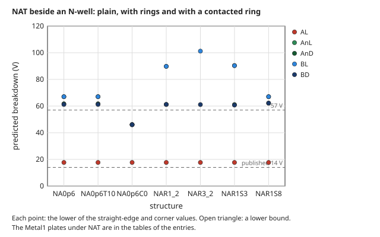
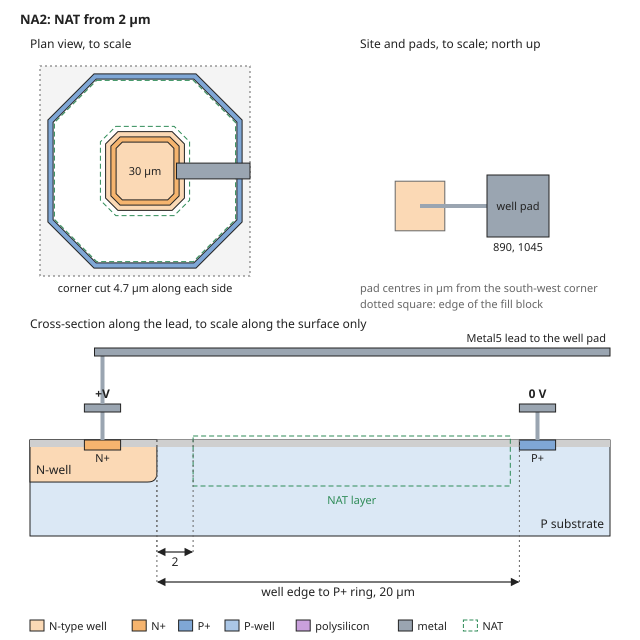
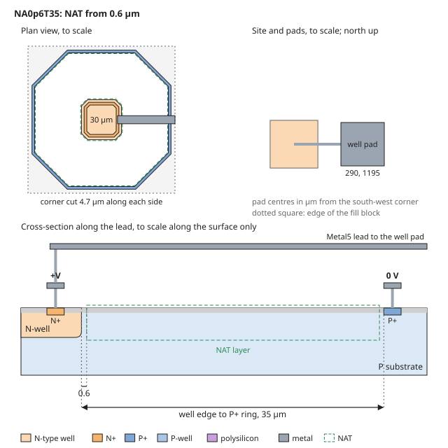
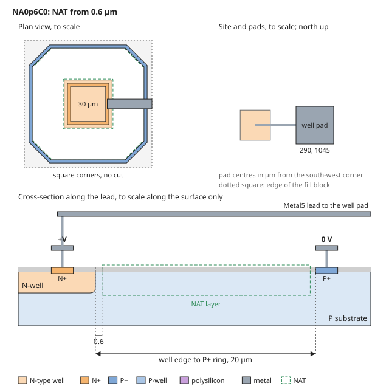
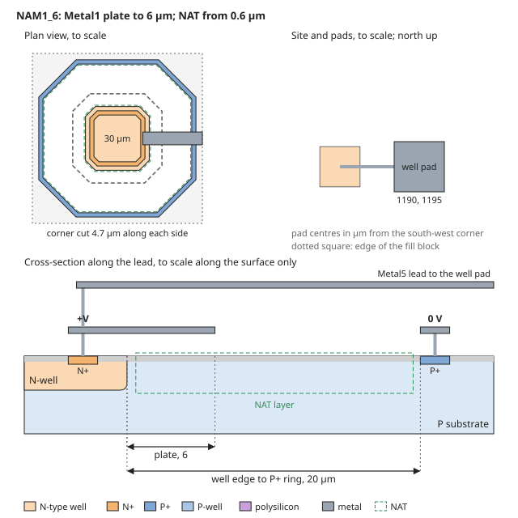
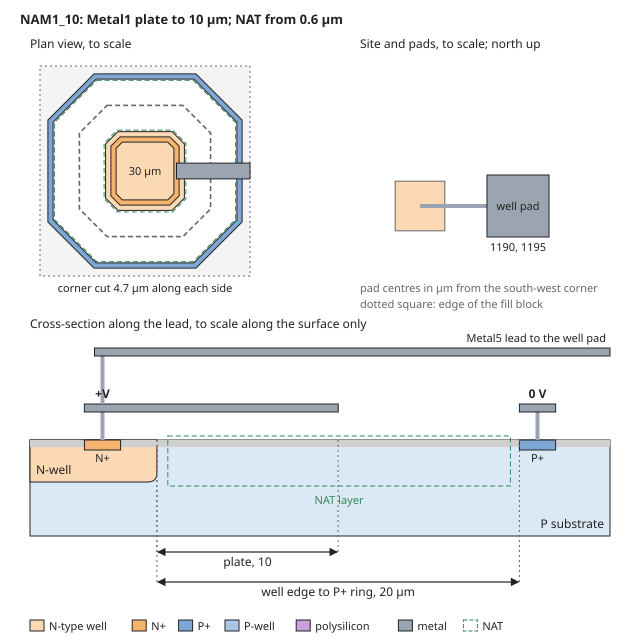

.. _hvt-g-nat:

NAT layer
=========

The NAT layer marks where a native transistor keeps the bare substrate as
its channel. These structures test whether it also keeps a generated P-well
away from an N-well edge.

The group has 11 structures: :ref:`NA0p6 <hvt-s-na0p6>`, :ref:`NA2
<hvt-s-na2>`, :ref:`NA0p6T10 <hvt-s-na0p6t10>`, :ref:`NA4 <hvt-s-na4>`,
:ref:`NA0p6T35 <hvt-s-na0p6t35>`, :ref:`NA0p6C0 <hvt-s-na0p6c0>`,
:ref:`NAM1_3 <hvt-s-nam1-3>`, :ref:`NAM1_6 <hvt-s-nam1-6>`, :ref:`NAM1_10
<hvt-s-nam1-10>`, :ref:`NAM2_12 <hvt-s-nam2-12>`, :ref:`NA0p6b
<hvt-s-na0p6b>`.

Mechanism
---------

The design manual says the P-well implant is blocked under NAT. If that
holds with no transistor present, the silicon under NAT is bare substrate,
and the well's depletion region can spread through it as under assumption B.
Rule NAT.3 keeps NAT at least 0.5 µm from an N-well, so a strip of
unprotected silicon always remains beside the edge.

Expected results
----------------

If NAT blocks the P-well and the strip stays empty, the members equal their
counterparts without NAT under assumption B. If P-well fills the strip, or
NAT blocks nothing, they equal :ref:`NT20 <hvt-s-nt20>` under assumption A.
A result that depends on where NAT starts means the foundry fills a wide
strip and not a narrow one. :numref:`fig-hvt-g-nat` shows the trend that the
simulation predicts.

         straight-edge and corner values, against the distance at which the
         NAT layer starts, from 0.6 µm to 4 µm, one curve per process, with
         dashed lines at the published 14 V and at 57 V and an open triangle
         where a sweep ended without breakdown. The structures of the group
         are NA0p6, NA2, NA0p6T10, NA4, NA0p6T35, NA0p6C0, NAM1_3, NAM1_6,
         NAM1_10, NAM2_12, NA0p6b. The plotted values are those of the
         tables in the entries.

   Trend that the simulation predicts across the group.

Limits of the group
-------------------

No member has NAT touching the N-well, because the rules forbid it. The
group cannot tell a filled strip from a NAT layer that blocks nothing. No
polysilicon and no floating ring may lie under NAT.

.. _hvt-s-na0p6:

NA0p6
-----

         with corners cut 4.7 µm along each side, an N+ contact ring inside
         its edge and a P+ ring 20 µm outside it; NAT from 0.6 µm. A Metal5
         lead joins the well to a pad at 890, 1045 µm.

   NA0p6 in plan view and in cross-section.

.. list-table:: NA0p6: drawn parameters and position
   :name: tab-hvt-s-na0p6
   :header-rows: 1
   :widths: 35 65

   * - Parameter
     - Value
   * - Well
     - N-well
   * - Side of the well
     - 30 µm
   * - Corners
     - Cut of 4.7 µm along each side, for a nominal radius of 8 µm; eight vertices of 135°
   * - Area and perimeter
     - 856 µm² and 109.0 µm
   * - N+ contact ring
     - 2 µm wide, 2 µm inside the well edge
   * - P+ ring
     - 2 µm wide, 20 µm from the well edge
   * - NAT layer
     - From 0.6 µm outside the well edge to 0.5 µm short of the P+ ring
   * - Fill block
     - Whole structure
   * - Metal5 lead
     - 6 µm wide
   * - Site
     - Column 3 from the west, row 6 from the south
   * - Well pad, centre x, y
     - 890, 1045 µm
   * - Substrate
     - Any of the seven SUB pads (:numref:`tab-hvt-pads`)

Purpose
   The main test of the NAT layer: NAT as close to an N-well as the rules
   allow. :numref:`fig-hvt-s-na0p6` shows the structure and
   :numref:`tab-hvt-s-na0p6` lists what is drawn.

How it works
   NAT covers the termination zone from 0.6 µm outwards. If it blocks the
   P-well, bare substrate lies beside the well except in a strip 0.6 µm
   wide. That strip is at the foundry's minimum P-well width, so the
   generated mask may leave it out.

Compared with
   * :ref:`NT20 <hvt-s-nt20>`: NAT over the termination zone in place of none.
   * :ref:`NA2 <hvt-s-na2>`: NAT starts at 0.6 µm in place of 2 µm.
   * :ref:`NA0p6b <hvt-s-na0p6b>`: nothing: a second copy.

Measurement
   Procedure :ref:`P1 <hvt-p1>` applies. The well pad is at 890, 1045 µm.
   Swept again at 85 °C.

Predicted
   The simulated breakdown voltages are in :numref:`tab-hvt-sp-na0p6`. The
   row of each family's nominal process also gives the family's band, its
   agreement range and the predicted ratio to the reference structure. Much
   higher than :ref:`NT20 <hvt-s-nt20>`: NAT clears the edge, and the Metal1
   plates under NAT show what can be built on it. Equal to :ref:`NT20
   <hvt-s-nt20>`: either the strip is filled or NAT blocks nothing.

Limits
   A strip always remains, so the structure never has NAT against the
   junction.

.. list-table:: NA0p6: predicted breakdown voltage by process
   :name: tab-hvt-sp-na0p6
   :header-rows: 1
   :widths: 18 16 16 17 17 16

   * - Process
     - Straight edge (V)
     - Corner section (V)
     - Family band (V)
     - Agreement range (V)
     - Predicted ratio
   * - AL, AD
     - 17.7
     - –
     - 17.7 to 17.8
     - 12.4 to 20.5
     - 1.00 of :ref:`NW0 <hvt-s-nw0>`
   * - ALhi
     - 17.8
     - –
     - –
     - –
     - –
   * - AnL
     - 76.0
     - 67.0
     - 67.0 to 67.0
     - 46.9 to 77.0
     - 3.79 of :ref:`NT20 <hvt-s-nt20>`
   * - AnD
     - 62.9
     - 61.7
     - 61.7 to 61.7
     - 43.2 to 71.0
     - 3.49 of :ref:`NT20 <hvt-s-nt20>`
   * - BL
     - 76.0
     - 67.0
     - 60.2 to 79.4
     - 42.1 to 91.3
     - 1.00 of :ref:`NT20 <hvt-s-nt20>`
   * - BLhi
     - 66.7
     - 60.2
     - –
     - –
     - –
   * - BLlo
     - 94.4
     - 79.4
     - –
     - –
     - –
   * - BLq
     - 79.9
     - 70.3
     - –
     - –
     - –
   * - BLq3
     - 86.2
     - 77.0
     - –
     - –
     - –
   * - BD
     - 62.9
     - 61.2
     - 59.2 to 61.2
     - 41.4 to 70.4
     - 1.00 of :ref:`NT20 <hvt-s-nt20>`
   * - BDhi
     - 62.9
     - 59.2
     - –
     - –
     - –
   * - BDlo
     - 62.5
     - 61.0
     - –
     - –
     - –

.. _hvt-s-na2:

NA2
---

         with corners cut 4.7 µm along each side, an N+ contact ring inside
         its edge and a P+ ring 20 µm outside it; NAT from 2 µm. A Metal5
         lead joins the well to a pad at 1190, 1045 µm.

   NA2 in plan view and in cross-section.

.. list-table:: NA2: drawn parameters and position
   :name: tab-hvt-s-na2
   :header-rows: 1
   :widths: 35 65

   * - Parameter
     - Value
   * - Well
     - N-well
   * - Side of the well
     - 30 µm
   * - Corners
     - Cut of 4.7 µm along each side, for a nominal radius of 8 µm; eight vertices of 135°
   * - Area and perimeter
     - 856 µm² and 109.0 µm
   * - N+ contact ring
     - 2 µm wide, 2 µm inside the well edge
   * - P+ ring
     - 2 µm wide, 20 µm from the well edge
   * - NAT layer
     - From 2 µm outside the well edge to 0.5 µm short of the P+ ring
   * - Fill block
     - Whole structure
   * - Metal5 lead
     - 6 µm wide
   * - Site
     - Column 4 from the west, row 6 from the south
   * - Well pad, centre x, y
     - 1190, 1045 µm
   * - Substrate
     - Any of the seven SUB pads (:numref:`tab-hvt-pads`)

Purpose
   Tests a strip of 2 µm between the well and NAT, wide enough for the
   foundry to fill with P-well. :numref:`fig-hvt-s-na2` shows the structure
   and :numref:`tab-hvt-s-na2` lists what is drawn.

How it works
   A strip of 2 µm is well above the minimum P-well width. If the foundry
   generates P-well wherever NAT is absent, this strip receives it, and the
   junction to it fails as in :ref:`NW0 <hvt-s-nw0>`.

Compared with
   * :ref:`NA0p6 <hvt-s-na0p6>`: NAT starts at 2 µm in place of 0.6 µm.
   * :ref:`NA4 <hvt-s-na4>`: NAT starts at 2 µm in place of 4 µm.

Measurement
   Procedure :ref:`P1 <hvt-p1>` applies. The well pad is at 1190, 1045 µm.

Predicted
   The simulated breakdown voltages are in :numref:`tab-hvt-sp-na2`. The row
   of each family's nominal process also gives the family's band, its
   agreement range and the predicted ratio to the reference structure. Near
   14 V while :ref:`NA0p6 <hvt-s-na0p6>` is much higher: the foundry fills a
   wide strip and drops a narrow one.

Limits
   Equal to :ref:`NA0p6 <hvt-s-na0p6>` at a high value, it cannot say
   whether the strip is empty or simply too lightly doped to matter.

.. list-table:: NA2: predicted breakdown voltage by process
   :name: tab-hvt-sp-na2
   :header-rows: 1
   :widths: 18 16 16 17 17 16

   * - Process
     - Straight edge (V)
     - Corner section (V)
     - Family band (V)
     - Agreement range (V)
     - Predicted ratio
   * - AL, AD
     - 17.7
     - –
     - 17.7 to 17.7
     - 12.4 to 20.4
     - 1.00 of :ref:`NW0 <hvt-s-nw0>`
   * - AnL
     - 76.0
     - 67.0
     - 67.0 to 67.0
     - 46.9 to 77.0
     - 3.79 of :ref:`NT20 <hvt-s-nt20>`
   * - AnD
     - 62.9
     - 61.7
     - 61.7 to 61.7
     - 43.2 to 71.0
     - 3.49 of :ref:`NT20 <hvt-s-nt20>`
   * - BL
     - 76.0
     - 67.0
     - 67.0 to 70.3
     - 46.9 to 80.8
     - 1.00 of :ref:`NT20 <hvt-s-nt20>`
   * - BLq
     - 79.9
     - 70.3
     - –
     - –
     - –
   * - BD
     - 62.9
     - 61.2
     - 61.2 to 61.2
     - 42.8 to 70.4
     - 1.00 of :ref:`NT20 <hvt-s-nt20>`

.. _hvt-s-na0p6t10:

NA0p6T10
--------

.. figure:: hvt-s-NA0p6T10.svg
   :name: fig-hvt-s-na0p6t10
   :alt: Plan view and cross-section of NA0p6T10: an N-well 30 µm
         across with corners cut 4.7 µm along each side, an N+ contact ring
         inside its edge and a P+ ring 10 µm outside it; NAT from 0.6 µm. A
         Metal5 lead joins the well to a pad at 1490, 1045 µm.

   NA0p6T10 in plan view and in cross-section.

.. list-table:: NA0p6T10: drawn parameters and position
   :name: tab-hvt-s-na0p6t10
   :header-rows: 1
   :widths: 35 65

   * - Parameter
     - Value
   * - Well
     - N-well
   * - Side of the well
     - 30 µm
   * - Corners
     - Cut of 4.7 µm along each side, for a nominal radius of 8 µm; eight vertices of 135°
   * - Area and perimeter
     - 856 µm² and 109.0 µm
   * - N+ contact ring
     - 2 µm wide, 2 µm inside the well edge
   * - P+ ring
     - 2 µm wide, 10 µm from the well edge
   * - NAT layer
     - From 0.6 µm outside the well edge to 0.5 µm short of the P+ ring
   * - Fill block
     - Whole structure
   * - Metal5 lead
     - 6 µm wide
   * - Site
     - Column 5 from the west, row 6 from the south
   * - Well pad, centre x, y
     - 1490, 1045 µm
   * - Substrate
     - Any of the seven SUB pads (:numref:`tab-hvt-pads`)

Purpose
   Repeats the ring-distance check under NAT with the P+ ring at 10 µm.
   :numref:`fig-hvt-s-na0p6t10` shows the structure and
   :numref:`tab-hvt-s-na0p6t10` lists what is drawn.

How it works
   NAT ends 0.5 µm short of the P+ ring, so here it is 8.9 µm wide. If NAT
   clears the P-well, the depletion region spreads through that width and
   the P+ ring is the first heavily doped region it can meet.

Compared with
   * :ref:`NA0p6 <hvt-s-na0p6>`: the ring is at 10 µm in place of 20 µm.
   * :ref:`NT10 <hvt-s-nt10>`: NAT over the termination zone in place of none.

Measurement
   Procedure :ref:`P1 <hvt-p1>` applies. The well pad is at 1490, 1045 µm.

Predicted
   The simulated breakdown voltages are in :numref:`tab-hvt-sp-na0p6t10`.
   The row of each family's nominal process also gives the family's band,
   its agreement range and the predicted ratio to the reference structure.
   Equal to :ref:`NA0p6 <hvt-s-na0p6>`: a NAT region 9 µm wide is enough.

Limits
   It tests the ring distance only if NAT clears the edge. Otherwise it
   repeats :ref:`NT10 <hvt-s-nt10>`.

.. list-table:: NA0p6T10: predicted breakdown voltage by process
   :name: tab-hvt-sp-na0p6t10
   :header-rows: 1
   :widths: 18 16 16 17 17 16

   * - Process
     - Straight edge (V)
     - Corner section (V)
     - Family band (V)
     - Agreement range (V)
     - Predicted ratio
   * - AL, AD
     - 17.7
     - –
     - 17.7 to 17.7
     - 12.4 to 20.4
     - 1.00 of :ref:`NW0 <hvt-s-nw0>`
   * - AnL
     - 76.0
     - 67.0
     - 67.0 to 67.0
     - 46.9 to 77.0
     - 3.79 of :ref:`NT20 <hvt-s-nt20>`
   * - AnD
     - 62.9
     - 61.7
     - 61.7 to 61.7
     - 43.2 to 71.0
     - 3.49 of :ref:`NT20 <hvt-s-nt20>`
   * - BL
     - 76.0
     - 67.0
     - 67.0 to 70.3
     - 46.9 to 80.8
     - 1.00 of :ref:`NT20 <hvt-s-nt20>`
   * - BLq
     - 79.9
     - 70.3
     - –
     - –
     - –
   * - BD
     - 62.9
     - 61.2
     - 61.2 to 61.2
     - 42.8 to 70.4
     - 1.00 of :ref:`NT20 <hvt-s-nt20>`

.. _hvt-s-na4:

NA4
---

         with corners cut 4.7 µm along each side, an N+ contact ring inside
         its edge and a P+ ring 20 µm outside it; NAT from 4 µm. A Metal5
         lead joins the well to a pad at 1790, 1045 µm.

   NA4 in plan view and in cross-section.

.. list-table:: NA4: drawn parameters and position
   :name: tab-hvt-s-na4
   :header-rows: 1
   :widths: 35 65

   * - Parameter
     - Value
   * - Well
     - N-well
   * - Side of the well
     - 30 µm
   * - Corners
     - Cut of 4.7 µm along each side, for a nominal radius of 8 µm; eight vertices of 135°
   * - Area and perimeter
     - 856 µm² and 109.0 µm
   * - N+ contact ring
     - 2 µm wide, 2 µm inside the well edge
   * - P+ ring
     - 2 µm wide, 20 µm from the well edge
   * - NAT layer
     - From 4 µm outside the well edge to 0.5 µm short of the P+ ring
   * - Fill block
     - Whole structure
   * - Metal5 lead
     - 6 µm wide
   * - Site
     - Column 6 from the west, row 6 from the south
   * - Well pad, centre x, y
     - 1790, 1045 µm
   * - Substrate
     - Any of the seven SUB pads (:numref:`tab-hvt-pads`)

Purpose
   The widest strip: NAT starts 4 µm from the well, leaving room for a
   full-width P-well beside the edge. :numref:`fig-hvt-s-na4` shows the
   structure and :numref:`tab-hvt-s-na4` lists what is drawn.

How it works
   Four micrometres is several times the minimum P-well width. Any rule that
   generates P-well outside NAT fills this strip. If the strip stays empty
   here, it stays empty everywhere.

Compared with
   * :ref:`NA2 <hvt-s-na2>`: NAT starts at 4 µm in place of 2 µm.
   * :ref:`NW0 <hvt-s-nw0>`: a strip that may hold generated P-well in place of a drawn one.

Measurement
   Procedure :ref:`P1 <hvt-p1>` applies. The well pad is at 1790, 1045 µm.

Predicted
   The simulated breakdown voltages are in :numref:`tab-hvt-sp-na4`. The row
   of each family's nominal process also gives the family's band, its
   agreement range and the predicted ratio to the reference structure. Much
   higher than :ref:`NT20 <hvt-s-nt20>`: no P-well is generated near NAT at
   all, whatever the strip's width.

Limits
   With :ref:`NA0p6 <hvt-s-na0p6>` and :ref:`NA2 <hvt-s-na2>` it gives only
   three widths, so the width at which the foundry starts to fill a strip is
   bracketed, not found.

.. list-table:: NA4: predicted breakdown voltage by process
   :name: tab-hvt-sp-na4
   :header-rows: 1
   :widths: 18 16 16 17 17 16

   * - Process
     - Straight edge (V)
     - Corner section (V)
     - Family band (V)
     - Agreement range (V)
     - Predicted ratio
   * - AL, AD
     - 17.7
     - –
     - 17.7 to 17.7
     - 12.4 to 20.4
     - 1.00 of :ref:`NW0 <hvt-s-nw0>`
   * - AnL
     - 76.0
     - 67.0
     - 67.0 to 67.0
     - 46.9 to 77.0
     - 3.79 of :ref:`NT20 <hvt-s-nt20>`
   * - AnD
     - 62.9
     - 61.7
     - 61.7 to 61.7
     - 43.2 to 71.0
     - 3.49 of :ref:`NT20 <hvt-s-nt20>`
   * - BL
     - 76.0
     - 67.0
     - 67.0 to 70.3
     - 46.9 to 80.8
     - 1.00 of :ref:`NT20 <hvt-s-nt20>`
   * - BLq
     - 79.9
     - 70.3
     - –
     - –
     - –
   * - BD
     - 62.9
     - 61.2
     - 61.2 to 61.2
     - 42.8 to 70.4
     - 1.00 of :ref:`NT20 <hvt-s-nt20>`

.. _hvt-s-na0p6t35:

NA0p6T35
--------

         across with corners cut 4.7 µm along each side, an N+ contact ring
         inside its edge and a P+ ring 35 µm outside it; NAT from 0.6 µm. A
         Metal5 lead joins the well to a pad at 290, 1195 µm.

   NA0p6T35 in plan view and in cross-section.

.. list-table:: NA0p6T35: drawn parameters and position
   :name: tab-hvt-s-na0p6t35
   :header-rows: 1
   :widths: 35 65

   * - Parameter
     - Value
   * - Well
     - N-well
   * - Side of the well
     - 30 µm
   * - Corners
     - Cut of 4.7 µm along each side, for a nominal radius of 8 µm; eight vertices of 135°
   * - Area and perimeter
     - 856 µm² and 109.0 µm
   * - N+ contact ring
     - 2 µm wide, 2 µm inside the well edge
   * - P+ ring
     - 2 µm wide, 35 µm from the well edge
   * - NAT layer
     - From 0.6 µm outside the well edge to 0.5 µm short of the P+ ring
   * - Fill block
     - Whole structure
   * - Metal5 lead
     - 6 µm wide
   * - Site
     - Column 1 from the west, row 7 from the south
   * - Well pad, centre x, y
     - 290, 1195 µm
   * - Substrate
     - Any of the seven SUB pads (:numref:`tab-hvt-pads`)

Purpose
   Repeats the ring-distance check under NAT with the P+ ring at 35 µm, the
   widest NAT region on the die. :numref:`fig-hvt-s-na0p6t35` shows the
   structure and :numref:`tab-hvt-s-na0p6t35` lists what is drawn.

How it works
   NAT is 33.9 µm wide here. If the breakdown voltage is higher than with
   the ring at 20 µm, the depletion region under NAT reaches further than
   under a plain well, as it would in lighter silicon.

Compared with
   * :ref:`NA0p6 <hvt-s-na0p6>`: the ring is at 35 µm in place of 20 µm.
   * :ref:`NT35 <hvt-s-nt35>`: NAT over the termination zone in place of none.

Measurement
   Procedure :ref:`P1 <hvt-p1>` applies. The well pad is at 290, 1195 µm.

Predicted
   The simulated breakdown voltages are in :numref:`tab-hvt-sp-na0p6t35`.
   The row of each family's nominal process also gives the family's band,
   its agreement range and the predicted ratio to the reference structure.
   Equal to :ref:`NA0p6 <hvt-s-na0p6>`: the default distance is enough under
   NAT too.

Limits
   A wide NAT region has no P+ nearby to hold the surface at the substrate's
   potential, so charge on the oxide can act on it more than on a narrow
   one.

.. list-table:: NA0p6T35: predicted breakdown voltage by process
   :name: tab-hvt-sp-na0p6t35
   :header-rows: 1
   :widths: 18 16 16 17 17 16

   * - Process
     - Straight edge (V)
     - Corner section (V)
     - Family band (V)
     - Agreement range (V)
     - Predicted ratio
   * - AL, AD
     - 17.7
     - –
     - 17.7 to 17.7
     - 12.4 to 20.4
     - 1.00 of :ref:`NW0 <hvt-s-nw0>`
   * - AnL
     - 76.0
     - 67.0
     - 67.0 to 67.0
     - 46.9 to 77.0
     - 3.79 of :ref:`NT20 <hvt-s-nt20>`
   * - AnD
     - 62.9
     - 61.7
     - 61.7 to 61.7
     - 43.2 to 71.0
     - 3.49 of :ref:`NT20 <hvt-s-nt20>`
   * - BL
     - 76.0
     - 67.0
     - 67.0 to 70.3
     - 46.9 to 80.8
     - 1.00 of :ref:`NT20 <hvt-s-nt20>`
   * - BLq
     - 79.9
     - 70.3
     - –
     - –
     - –
   * - BD
     - 62.9
     - 61.2
     - 61.2 to 61.2
     - 42.8 to 70.4
     - 1.00 of :ref:`NT20 <hvt-s-nt20>`

.. _hvt-s-na0p6c0:

NA0p6C0
-------

         across with square corners, an N+ contact ring inside its edge and
         a P+ ring 20 µm outside it; NAT from 0.6 µm. A Metal5 lead joins
         the well to a pad at 590, 1195 µm.

   NA0p6C0 in plan view and in cross-section.

.. list-table:: NA0p6C0: drawn parameters and position
   :name: tab-hvt-s-na0p6c0
   :header-rows: 1
   :widths: 35 65

   * - Parameter
     - Value
   * - Well
     - N-well
   * - Side of the well
     - 30 µm
   * - Corners
     - Square; four vertices of 90°
   * - Area and perimeter
     - 900 µm² and 120.0 µm
   * - N+ contact ring
     - 2 µm wide, 2 µm inside the well edge
   * - P+ ring
     - 2 µm wide, 20 µm from the well edge
   * - NAT layer
     - From 0.6 µm outside the well edge to 0.5 µm short of the P+ ring
   * - Fill block
     - Whole structure
   * - Metal5 lead
     - 6 µm wide
   * - Site
     - Column 2 from the west, row 7 from the south
   * - Well pad, centre x, y
     - 590, 1195 µm
   * - Substrate
     - Any of the seven SUB pads (:numref:`tab-hvt-pads`)

Purpose
   Measures the cost of a square corner when NAT, not P-well, lies beside
   the well. :numref:`fig-hvt-s-na0p6c0` shows the structure and
   :numref:`tab-hvt-s-na0p6c0` lists what is drawn.

How it works
   The well has four 90° vertices and the NAT outline follows them at 0.6
   µm. If NAT clears the edge, the vertices carry the highest field, as in
   :ref:`NC0 <hvt-s-nc0>`.

Compared with
   * :ref:`NA0p6 <hvt-s-na0p6>`: four 90° vertices in place of eight of 135°.
   * :ref:`NC0 <hvt-s-nc0>`: NAT over the termination zone in place of none.

Measurement
   Procedure :ref:`P1 <hvt-p1>` applies. The well pad is at 590, 1195 µm.

Predicted
   The simulated breakdown voltages are in :numref:`tab-hvt-sp-na0p6c0`. The
   row of each family's nominal process also gives the family's band, its
   agreement range and the predicted ratio to the reference structure. Below
   :ref:`NA0p6 <hvt-s-na0p6>` by the same amount as :ref:`NC0 <hvt-s-nc0>`
   is below :ref:`NT20 <hvt-s-nt20>`: the silicon under NAT behaves as bare
   substrate does.

Limits
   The simulation of this corner did not reach breakdown, so only a lower
   bound is predicted.

.. list-table:: NA0p6C0: predicted breakdown voltage by process
   :name: tab-hvt-sp-na0p6c0
   :header-rows: 1
   :widths: 18 16 16 17 17 16

   * - Process
     - Straight edge (V)
     - Corner section (V)
     - Family band (V)
     - Agreement range (V)
     - Predicted ratio
   * - AL, AD
     - 17.7
     - –
     - 17.7 to 17.7
     - 12.4 to 20.4
     - 1.00 of :ref:`NW0 <hvt-s-nw0>`
   * - AnL
     - 76.0
     - > 36.3
     - –
     - –
     - –
   * - AnD
     - 62.9
     - > 37.0
     - –
     - –
     - –
   * - BL
     - 76.0
     - > 36.3
     - –
     - –
     - –
   * - BLq
     - 79.9
     - > 37.7
     - –
     - –
     - –
   * - BD
     - 62.9
     - > 36.0
     - –
     - –
     - –

.. _hvt-s-nam1-3:

NAM1_3
------

.. figure:: hvt-s-NAM1_3.svg
   :name: fig-hvt-s-nam1-3
   :alt: Plan view and cross-section of NAM1_3: an N-well 30 µm across
         with corners cut 4.7 µm along each side, an N+ contact ring inside
         its edge and a P+ ring 20 µm outside it; Metal1 plate to 3 µm; NAT
         from 0.6 µm. A Metal5 lead joins the well to a pad at 890, 1195 µm.

   NAM1_3 in plan view and in cross-section.

.. list-table:: NAM1_3: drawn parameters and position
   :name: tab-hvt-s-nam1-3
   :header-rows: 1
   :widths: 35 65

   * - Parameter
     - Value
   * - Well
     - N-well
   * - Side of the well
     - 30 µm
   * - Corners
     - Cut of 4.7 µm along each side, for a nominal radius of 8 µm; eight vertices of 135°
   * - Area and perimeter
     - 856 µm² and 109.0 µm
   * - N+ contact ring
     - 2 µm wide, 2 µm inside the well edge
   * - P+ ring
     - 2 µm wide, 20 µm from the well edge
   * - Metal1 plate
     - From the contact ring to 3 µm outside the edge; joined to the well
   * - NAT layer
     - From 0.6 µm outside the well edge to 0.5 µm short of the P+ ring
   * - Fill block
     - Whole structure
   * - Metal5 lead
     - 6 µm wide
   * - Site
     - Column 3 from the west, row 7 from the south
   * - Well pad, centre x, y
     - 890, 1195 µm
   * - Substrate
     - Any of the seven SUB pads (:numref:`tab-hvt-pads`)

Purpose
   The shortest Metal1 plate over NAT: 3 µm beyond the edge.
   :numref:`fig-hvt-s-nam1-3` shows the structure and
   :numref:`tab-hvt-s-nam1-3` lists what is drawn.

How it works
   The plate crosses the 0.6 µm strip and 2.4 µm of NAT. It widens the
   depletion region under itself, but ends inside the width that the region
   would reach unaided, so it moves the field peak only part of the way.

Compared with
   * :ref:`NA0p6 <hvt-s-na0p6>`: a Metal1 plate of 3 µm in place of none.
   * :ref:`NAM1_6 <hvt-s-nam1-6>`: a plate of 3 µm in place of 6 µm.
   * :ref:`NM1_3 <hvt-s-nm1-3>`: NAT under the plate in place of none.

Measurement
   Procedure :ref:`P1 <hvt-p1>` applies. The well pad is at 890, 1195 µm.

Predicted
   The simulated breakdown voltages are in :numref:`tab-hvt-sp-nam1-3`. The
   row of each family's nominal process also gives the family's band, its
   agreement range and the predicted ratio to the reference structure. Above
   :ref:`NA0p6 <hvt-s-na0p6>`: a plate works on the silicon under NAT.

Limits
   If the strip beside the well holds P-well, the plate covers it and cannot
   help, as under assumption A.

.. list-table:: NAM1_3: predicted breakdown voltage by process
   :name: tab-hvt-sp-nam1-3
   :header-rows: 1
   :widths: 18 16 16 17 17 16

   * - Process
     - Straight edge (V)
     - Corner section (V)
     - Family band (V)
     - Agreement range (V)
     - Predicted ratio
   * - AL, AD
     - 17.5
     - –
     - 17.5 to 17.5
     - 12.2 to 20.1
     - 0.99 of :ref:`NW0 <hvt-s-nw0>`
   * - AnL
     - 88.5
     - 83.2
     - 83.2 to 83.2
     - 58.2 to 95.7
     - 1.24 of :ref:`NA0p6 <hvt-s-na0p6>`
   * - AnD
     - 62.9
     - 61.2
     - 61.2 to 61.2
     - 42.8 to 70.4
     - 0.99 of :ref:`NA0p6 <hvt-s-na0p6>`
   * - BL
     - 88.5
     - 83.2
     - 83.2 to 83.7
     - 58.2 to 96.3
     - 1.24 of :ref:`NT20 <hvt-s-nt20>`
   * - BLq
     - 89.0
     - 83.7
     - –
     - –
     - –
   * - BD
     - 62.9
     - 61.2
     - 61.2 to 61.2
     - 42.8 to 70.4
     - 1.00 of :ref:`NT20 <hvt-s-nt20>`

.. _hvt-s-nam1-6:

NAM1_6
------

         with corners cut 4.7 µm along each side, an N+ contact ring inside
         its edge and a P+ ring 20 µm outside it; Metal1 plate to 6 µm; NAT
         from 0.6 µm. A Metal5 lead joins the well to a pad at 1190, 1195
         µm.

   NAM1_6 in plan view and in cross-section.

.. list-table:: NAM1_6: drawn parameters and position
   :name: tab-hvt-s-nam1-6
   :header-rows: 1
   :widths: 35 65

   * - Parameter
     - Value
   * - Well
     - N-well
   * - Side of the well
     - 30 µm
   * - Corners
     - Cut of 4.7 µm along each side, for a nominal radius of 8 µm; eight vertices of 135°
   * - Area and perimeter
     - 856 µm² and 109.0 µm
   * - N+ contact ring
     - 2 µm wide, 2 µm inside the well edge
   * - P+ ring
     - 2 µm wide, 20 µm from the well edge
   * - Metal1 plate
     - From the contact ring to 6 µm outside the edge; joined to the well
   * - NAT layer
     - From 0.6 µm outside the well edge to 0.5 µm short of the P+ ring
   * - Fill block
     - Whole structure
   * - Metal5 lead
     - 6 µm wide
   * - Site
     - Column 4 from the west, row 7 from the south
   * - Well pad, centre x, y
     - 1190, 1195 µm
   * - Substrate
     - Any of the seven SUB pads (:numref:`tab-hvt-pads`)

Purpose
   The Metal1 plate of middle length over NAT. If NAT is what clears an
   N-well edge, this is the termination a circuit would use.
   :numref:`fig-hvt-s-nam1-6` shows the structure and
   :numref:`tab-hvt-s-nam1-6` lists what is drawn.

How it works
   The plate ends 6 µm out, a little beyond the unaided depletion width. The
   surface under it is depleted to its end, the field at the well's curved
   edge is relieved, and the peak moves to the plate's end, where 1.18 µm of
   oxide keeps it moderate.

Compared with
   * :ref:`NAM1_3 <hvt-s-nam1-3>`: a plate of 6 µm in place of 3 µm.
   * :ref:`NAM1_10 <hvt-s-nam1-10>`: a plate of 6 µm in place of 10 µm.
   * :ref:`NM1_6 <hvt-s-nm1-6>`: NAT under the plate in place of none.

Measurement
   Procedure :ref:`P1 <hvt-p1>` applies. The well pad is at 1190, 1195 µm.

Predicted
   The simulated breakdown voltages are in :numref:`tab-hvt-sp-nam1-6`. The
   row of each family's nominal process also gives the family's band, its
   agreement range and the predicted ratio to the reference structure. Equal
   to :ref:`NM1_6 <hvt-s-nm1-6>` under assumption B: NAT changes nothing
   that a plate cares about.

Limits
   Polysilicon may not lie under NAT, so the thinner-oxide plate that gains
   most elsewhere cannot be combined with it.

.. list-table:: NAM1_6: predicted breakdown voltage by process
   :name: tab-hvt-sp-nam1-6
   :header-rows: 1
   :widths: 18 16 16 17 17 16

   * - Process
     - Straight edge (V)
     - Corner section (V)
     - Family band (V)
     - Agreement range (V)
     - Predicted ratio
   * - AL, AD
     - > 15.0
     - –
     - –
     - –
     - –
   * - ALhi
     - failed
     - –
     - –
     - –
     - –
   * - AnL
     - 90.2
     - 84.8
     - 84.8 to 84.8
     - 59.4 to 97.5
     - 1.27 of :ref:`NA0p6 <hvt-s-na0p6>`
   * - AnD
     - 62.9
     - 59.6
     - 59.6 to 59.6
     - 41.7 to 68.5
     - 0.97 of :ref:`NA0p6 <hvt-s-na0p6>`
   * - BL
     - 90.2
     - 84.8
     - 75.7 to 105.8
     - 53.0 to 121.7
     - 1.27 of :ref:`NT20 <hvt-s-nt20>`
   * - BLhi
     - 78.8
     - 75.7
     - –
     - –
     - –
   * - BLlo
     - 117.7
     - 105.8
     - –
     - –
     - –
   * - BLq
     - 90.8
     - 85.4
     - –
     - –
     - –
   * - BLq3
     - 92.0
     - 86.6
     - –
     - –
     - –
   * - BD
     - 62.9
     - 59.6
     - 59.5 to 61.0
     - 41.6 to 70.1
     - 0.97 of :ref:`NT20 <hvt-s-nt20>`
   * - BDhi
     - 62.9
     - 59.5
     - –
     - –
     - –
   * - BDlo
     - 62.5
     - 61.0
     - –
     - –
     - –

.. _hvt-s-nam1-10:

NAM1_10
-------

         across with corners cut 4.7 µm along each side, an N+ contact ring
         inside its edge and a P+ ring 20 µm outside it; Metal1 plate to 10
         µm; NAT from 0.6 µm. A Metal5 lead joins the well to a pad at 1490,
         1195 µm.

   NAM1_10 in plan view and in cross-section.

.. list-table:: NAM1_10: drawn parameters and position
   :name: tab-hvt-s-nam1-10
   :header-rows: 1
   :widths: 35 65

   * - Parameter
     - Value
   * - Well
     - N-well
   * - Side of the well
     - 30 µm
   * - Corners
     - Cut of 4.7 µm along each side, for a nominal radius of 8 µm; eight vertices of 135°
   * - Area and perimeter
     - 856 µm² and 109.0 µm
   * - N+ contact ring
     - 2 µm wide, 2 µm inside the well edge
   * - P+ ring
     - 2 µm wide, 20 µm from the well edge
   * - Metal1 plate
     - From the contact ring to 10 µm outside the edge; joined to the well
   * - NAT layer
     - From 0.6 µm outside the well edge to 0.5 µm short of the P+ ring
   * - Fill block
     - Whole structure
   * - Metal5 lead
     - 6 µm wide
   * - Site
     - Column 5 from the west, row 7 from the south
   * - Well pad, centre x, y
     - 1490, 1195 µm
   * - Substrate
     - Any of the seven SUB pads (:numref:`tab-hvt-pads`)

Purpose
   The longest Metal1 plate over NAT: 10 µm, to see whether length beyond 6
   µm adds anything. :numref:`fig-hvt-s-nam1-10` shows the structure and
   :numref:`tab-hvt-s-nam1-10` lists what is drawn.

How it works
   Once the plate reaches past the depletion region it has nothing more to
   deplete. The extra length only moves the plate's end towards the P+ ring,
   which shortens the silicon left to hold the voltage.

Compared with
   * :ref:`NAM1_6 <hvt-s-nam1-6>`: a plate of 10 µm in place of 6 µm.
   * :ref:`NM1_10 <hvt-s-nm1-10>`: NAT under the plate in place of none.

Measurement
   Procedure :ref:`P1 <hvt-p1>` applies. The well pad is at 1490, 1195 µm.

Predicted
   The simulated breakdown voltages are in :numref:`tab-hvt-sp-nam1-10`. The
   row of each family's nominal process also gives the family's band, its
   agreement range and the predicted ratio to the reference structure. Equal
   to :ref:`NAM1_6 <hvt-s-nam1-6>`: 6 µm is long enough.

Limits
   The plate's end is 10 µm from the P+ ring. A lower value than
   :ref:`NAM1_6 <hvt-s-nam1-6>` could come from that distance and not from
   the plate.

.. list-table:: NAM1_10: predicted breakdown voltage by process
   :name: tab-hvt-sp-nam1-10
   :header-rows: 1
   :widths: 18 16 16 17 17 16

   * - Process
     - Straight edge (V)
     - Corner section (V)
     - Family band (V)
     - Agreement range (V)
     - Predicted ratio
   * - AL, AD
     - 17.5
     - –
     - 17.5 to 17.5
     - 12.2 to 20.1
     - 0.99 of :ref:`NW0 <hvt-s-nw0>`
   * - AnL
     - 90.6
     - 85.2
     - 85.2 to 85.2
     - 59.6 to 98.0
     - 1.27 of :ref:`NA0p6 <hvt-s-na0p6>`
   * - AnD
     - 62.9
     - 60.8
     - 60.8 to 60.8
     - 42.6 to 69.9
     - 0.99 of :ref:`NA0p6 <hvt-s-na0p6>`
   * - BL
     - 90.6
     - 85.2
     - 85.2 to 85.9
     - 59.6 to 98.8
     - 1.27 of :ref:`NT20 <hvt-s-nt20>`
   * - BLq
     - 91.3
     - 85.9
     - –
     - –
     - –
   * - BD
     - 62.9
     - 60.8
     - 60.8 to 60.8
     - 42.6 to 69.9
     - 0.99 of :ref:`NT20 <hvt-s-nt20>`

.. _hvt-s-nam2-12:

NAM2_12
-------

.. figure:: hvt-s-NAM2_12.svg
   :name: fig-hvt-s-nam2-12
   :alt: Plan view and cross-section of NAM2_12: an N-well 30 µm
         across with corners cut 4.7 µm along each side, an N+ contact ring
         inside its edge and a P+ ring 20 µm outside it; Metal2 plate to 12
         µm; NAT from 0.6 µm. A Metal5 lead joins the well to a pad at 1790,
         1195 µm.

   NAM2_12 in plan view and in cross-section.

.. list-table:: NAM2_12: drawn parameters and position
   :name: tab-hvt-s-nam2-12
   :header-rows: 1
   :widths: 35 65

   * - Parameter
     - Value
   * - Well
     - N-well
   * - Side of the well
     - 30 µm
   * - Corners
     - Cut of 4.7 µm along each side, for a nominal radius of 8 µm; eight vertices of 135°
   * - Area and perimeter
     - 856 µm² and 109.0 µm
   * - N+ contact ring
     - 2 µm wide, 2 µm inside the well edge
   * - P+ ring
     - 2 µm wide, 20 µm from the well edge
   * - Metal2 plate
     - From the contact ring to 12 µm outside the edge; joined to the well
   * - NAT layer
     - From 0.6 µm outside the well edge to 0.5 µm short of the P+ ring
   * - Fill block
     - Whole structure
   * - Metal5 lead
     - 6 µm wide
   * - Site
     - Column 6 from the west, row 7 from the south
   * - Well pad, centre x, y
     - 1790, 1195 µm
   * - Substrate
     - Any of the seven SUB pads (:numref:`tab-hvt-pads`)

Purpose
   A Metal2 plate over NAT, 12 µm long: the thick-oxide alternative to
   Metal1. :numref:`fig-hvt-s-nam2-12` shows the structure and
   :numref:`tab-hvt-s-nam2-12` lists what is drawn.

How it works
   Metal2 lies over 2.33 µm of oxide, so it draws the depletion region out
   more weakly than Metal1 and leaves a lower field at its own end. It needs
   more length for the same effect.

Compared with
   * :ref:`NAM1_6 <hvt-s-nam1-6>`: Metal2 to 12 µm in place of Metal1 to 6 µm.
   * :ref:`NM2_12 <hvt-s-nm2-12>`: NAT under the plate in place of none.

Measurement
   Procedure :ref:`P1 <hvt-p1>` applies. The well pad is at 1790, 1195 µm.

Predicted
   The simulated breakdown voltages are in :numref:`tab-hvt-sp-nam2-12`. The
   row of each family's nominal process also gives the family's band, its
   agreement range and the predicted ratio to the reference structure. Above
   :ref:`NAM1_10 <hvt-s-nam1-10>`: thicker oxide is the better trade under
   NAT. Below: Metal1 is.

Limits
   It is the only Metal2 plate under NAT, so length and layer cannot be
   separated within this group.

.. list-table:: NAM2_12: predicted breakdown voltage by process
   :name: tab-hvt-sp-nam2-12
   :header-rows: 1
   :widths: 18 16 16 17 17 16

   * - Process
     - Straight edge (V)
     - Corner section (V)
     - Family band (V)
     - Agreement range (V)
     - Predicted ratio
   * - AL, AD
     - 17.6
     - –
     - 17.6 to 17.6
     - 12.3 to 20.2
     - 0.99 of :ref:`NW0 <hvt-s-nw0>`
   * - AnL
     - 87.6
     - 82.3
     - 82.3 to 82.3
     - 57.6 to 94.6
     - 1.23 of :ref:`NA0p6 <hvt-s-na0p6>`
   * - AnD
     - 62.9
     - 60.8
     - 60.8 to 60.8
     - 42.6 to 69.9
     - 0.99 of :ref:`NA0p6 <hvt-s-na0p6>`
   * - BL
     - 87.6
     - 82.3
     - 82.3 to 83.0
     - 57.6 to 95.4
     - 1.23 of :ref:`NT20 <hvt-s-nt20>`
   * - BLq
     - 88.4
     - 83.0
     - –
     - –
     - –
   * - BD
     - 62.9
     - 60.8
     - 60.8 to 60.8
     - 42.6 to 69.9
     - 0.99 of :ref:`NT20 <hvt-s-nt20>`

.. _hvt-s-na0p6b:

NA0p6b
------

.. figure:: hvt-s-NA0p6b.svg
   :name: fig-hvt-s-na0p6b
   :alt: Plan view and cross-section of NA0p6b: an N-well 30 µm across
         with corners cut 4.7 µm along each side, an N+ contact ring inside
         its edge and a P+ ring 20 µm outside it; NAT from 0.6 µm. A Metal5
         lead joins the well to a pad at 1190, 2095 µm.

   NA0p6b in plan view and in cross-section.

.. list-table:: NA0p6b: drawn parameters and position
   :name: tab-hvt-s-na0p6b
   :header-rows: 1
   :widths: 35 65

   * - Parameter
     - Value
   * - Well
     - N-well
   * - Side of the well
     - 30 µm
   * - Corners
     - Cut of 4.7 µm along each side, for a nominal radius of 8 µm; eight vertices of 135°
   * - Area and perimeter
     - 856 µm² and 109.0 µm
   * - N+ contact ring
     - 2 µm wide, 2 µm inside the well edge
   * - P+ ring
     - 2 µm wide, 20 µm from the well edge
   * - NAT layer
     - From 0.6 µm outside the well edge to 0.5 µm short of the P+ ring
   * - Fill block
     - Whole structure
   * - Metal5 lead
     - 6 µm wide
   * - Site
     - Column 4 from the west, row 13 from the south
   * - Well pad, centre x, y
     - 1190, 2095 µm
   * - Substrate
     - Any of the seven SUB pads (:numref:`tab-hvt-pads`)

Purpose
   Gives the spread across the die for a well under NAT: a second copy of
   :ref:`NA0p6 <hvt-s-na0p6>`. :numref:`fig-hvt-s-na0p6b` shows the
   structure and :numref:`tab-hvt-s-na0p6b` lists what is drawn.

How it works
   The drawing is identical to :ref:`NA0p6 <hvt-s-na0p6>`. A well whose edge
   is cleared by NAT depends on the alignment of the NAT mask to the well,
   which a plain well does not, so its spread may be larger.

Compared with
   * :ref:`NA0p6 <hvt-s-na0p6>`: nothing but the position on the die.
   * :ref:`NT20b <hvt-s-nt20b>`: the same check on a plain well.

Measurement
   Procedure :ref:`P1 <hvt-p1>` applies. The well pad is at 1190, 2095 µm.
   Swept with the same settings as :ref:`NA0p6 <hvt-s-na0p6>` and in the
   same session.

Predicted
   The simulated breakdown voltages are in :numref:`tab-hvt-sp-na0p6b`. The
   row of each family's nominal process also gives the family's band, its
   agreement range and the predicted ratio to the reference structure. A
   spread larger than that of the plain pair points to the 0.6 µm strip,
   whose width is set by two masks.

Limits
   One pair, as for the plain well.

.. list-table:: NA0p6b: predicted breakdown voltage by process
   :name: tab-hvt-sp-na0p6b
   :header-rows: 1
   :widths: 18 16 16 17 17 16

   * - Process
     - Straight edge (V)
     - Corner section (V)
     - Family band (V)
     - Agreement range (V)
     - Predicted ratio
   * - AL, AD
     - 17.7
     - –
     - 17.7 to 17.7
     - 12.4 to 20.4
     - 1.00 of :ref:`NW0 <hvt-s-nw0>`
   * - AnL
     - 76.0
     - 67.0
     - 67.0 to 67.0
     - 46.9 to 77.0
     - 3.79 of :ref:`NT20 <hvt-s-nt20>`
   * - AnD
     - 62.9
     - 61.7
     - 61.7 to 61.7
     - 43.2 to 71.0
     - 3.49 of :ref:`NT20 <hvt-s-nt20>`
   * - BL
     - 76.0
     - 67.0
     - 67.0 to 70.3
     - 46.9 to 80.8
     - 1.00 of :ref:`NT20 <hvt-s-nt20>`
   * - BLq
     - 79.9
     - 70.3
     - –
     - –
     - –
   * - BD
     - 62.9
     - 61.2
     - 61.2 to 61.2
     - 42.8 to 70.4
     - 1.00 of :ref:`NT20 <hvt-s-nt20>`
