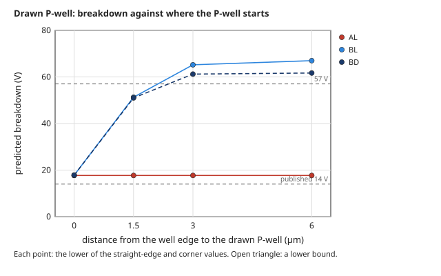
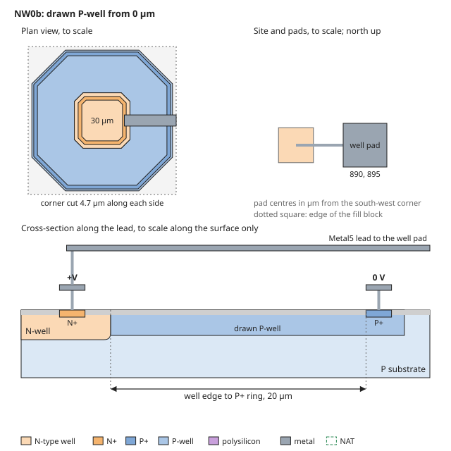
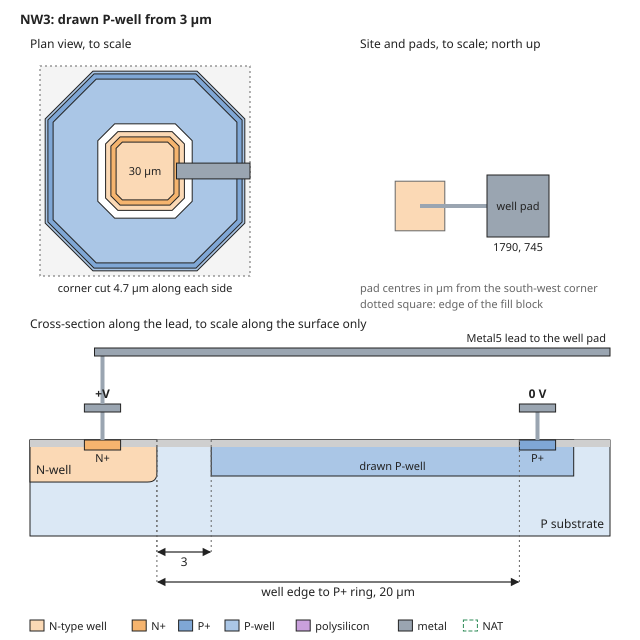
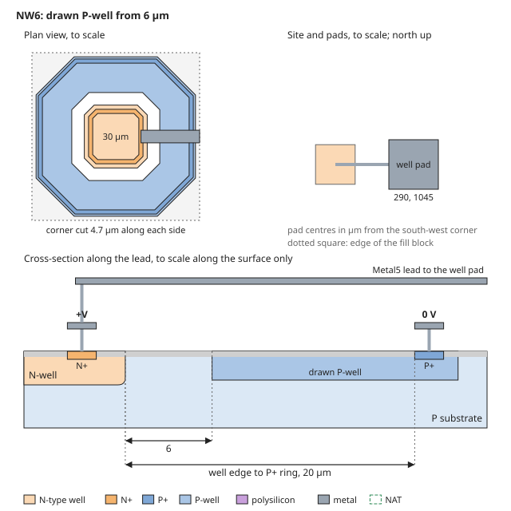

.. _hvt-g-p-well:

Drawn P-well
============

A drawn P-well stands in for the P-well that the foundry may generate, at a
distance that the layout sets.

The group has 5 structures: :ref:`NW0b <hvt-s-nw0b>`, :ref:`NW0
<hvt-s-nw0>`, :ref:`NW1p5 <hvt-s-nw1p5>`, :ref:`NW3 <hvt-s-nw3>`, :ref:`NW6
<hvt-s-nw6>`.

Mechanism
---------

A P-well is assumed to be about a hundred times more heavily doped than the
substrate, so the depletion region enters it by only a fraction of a
micrometre. A P-well at a distance from the well edge therefore holds the
depletion region to about that distance, and the field at the edge rises to
its limit at a lower voltage.

Expected results
----------------

If the foundry already generates P-well against every N-well, the drawn one
changes nothing and all four equal :ref:`NT20 <hvt-s-nt20>`. If it does not,
the breakdown voltage rises with the distance and reaches the :ref:`NT20
<hvt-s-nt20>` value where the P-well stops mattering.
:numref:`fig-hvt-g-p-well` shows the trend that the simulation predicts.

         straight-edge and corner values, against the distance at which the
         drawn P-well starts, from 0 µm to 6 µm, one curve per process, with
         dashed lines at the published 14 V and at 57 V and an open triangle
         where a sweep ended without breakdown. The structures of the group
         are NW0b, NW0, NW1p5, NW3, NW6. The plotted values are those of the
         tables in the entries.

   Trend that the simulation predicts across the group.

Limits of the group
-------------------

Under assumption A the group shows nothing beyond :ref:`NT20 <hvt-s-nt20>`,
and :ref:`NW0 <hvt-s-nw0>` with its copy :ref:`NW0b <hvt-s-nw0b>` becomes
the reference that every N-well is divided by. The doping of the drawn
P-well is not published, so the distance at which it stops mattering is
known only from the simulation's assumed profile.

.. _hvt-s-nw0b:

NW0b
----

         with corners cut 4.7 µm along each side, an N+ contact ring inside
         its edge and a P+ ring 20 µm outside it; drawn P-well from 0 µm. A
         Metal5 lead joins the well to a pad at 890, 895 µm.

   NW0b in plan view and in cross-section.

.. list-table:: NW0b: drawn parameters and position
   :name: tab-hvt-s-nw0b
   :header-rows: 1
   :widths: 35 65

   * - Parameter
     - Value
   * - Well
     - N-well
   * - Side of the well
     - 30 µm
   * - Corners
     - Cut of 4.7 µm along each side, for a nominal radius of 8 µm; eight vertices of 135°
   * - Area and perimeter
     - 856 µm² and 109.0 µm
   * - N+ contact ring
     - 2 µm wide, 2 µm inside the well edge
   * - P+ ring
     - 2 µm wide, 20 µm from the well edge
   * - Drawn P-well
     - From 0 µm outside the well edge to 1 µm beyond the P+ ring
   * - Fill block
     - Whole structure
   * - Metal5 lead
     - 6 µm wide
   * - Site
     - Column 3 from the west, row 5 from the south
   * - Well pad, centre x, y
     - 890, 895 µm
   * - Substrate
     - Any of the seven SUB pads (:numref:`tab-hvt-pads`)

Purpose
   A second copy of :ref:`NW0 <hvt-s-nw0>`, the reference of the ratios when
   P-well lies against every N-well. :numref:`fig-hvt-s-nw0b` shows the
   structure and :numref:`tab-hvt-s-nw0b` lists what is drawn.

How it works
   The drawing is identical to :ref:`NW0 <hvt-s-nw0>`. Under assumption A
   every N-well structure is divided by the mean of :ref:`NW0 <hvt-s-nw0>`
   and this copy, so the reference carries the spread of two sites, not one.

Compared with
   * :ref:`NW0 <hvt-s-nw0>`: nothing but the position on the die.
   * :ref:`NT20b <hvt-s-nt20b>`: the same check on a plain well.

Measurement
   Procedure :ref:`P1 <hvt-p1>` applies. The well pad is at 890, 895 µm.
   Swept with the same settings as :ref:`NW0 <hvt-s-nw0>` and in the same
   session.

Predicted
   Not yet simulated: the results file has no entry for this structure. The
   mean of :ref:`NW0 <hvt-s-nw0>` and this copy is the reference under A.
   Under B it is not a reference: :ref:`NW0 <hvt-s-nw0>` then lies in the
   other regime from the wells it would divide.

Limits
   Two copies give a difference, not a distribution.

.. _hvt-s-nw0:

NW0
---

         with corners cut 4.7 µm along each side, an N+ contact ring inside
         its edge and a P+ ring 20 µm outside it; drawn P-well from 0 µm. A
         Metal5 lead joins the well to a pad at 1790, 895 µm.

   NW0 in plan view and in cross-section.

.. list-table:: NW0: drawn parameters and position
   :name: tab-hvt-s-nw0
   :header-rows: 1
   :widths: 35 65

   * - Parameter
     - Value
   * - Well
     - N-well
   * - Side of the well
     - 30 µm
   * - Corners
     - Cut of 4.7 µm along each side, for a nominal radius of 8 µm; eight vertices of 135°
   * - Area and perimeter
     - 856 µm² and 109.0 µm
   * - N+ contact ring
     - 2 µm wide, 2 µm inside the well edge
   * - P+ ring
     - 2 µm wide, 20 µm from the well edge
   * - Drawn P-well
     - From 0 µm outside the well edge to 1 µm beyond the P+ ring
   * - Fill block
     - Whole structure
   * - Metal5 lead
     - 6 µm wide
   * - Site
     - Column 6 from the west, row 5 from the south
   * - Well pad, centre x, y
     - 1790, 895 µm
   * - Substrate
     - Any of the seven SUB pads (:numref:`tab-hvt-pads`)

Purpose
   Reproduces on purpose the junction suspected of setting the published 14
   V: an N-well touching a P-well. :numref:`fig-hvt-s-nw0` shows the
   structure and :numref:`tab-hvt-s-nw0` lists what is drawn.

How it works
   Both sides of the junction are heavily doped at the surface, so the
   depletion region is a fraction of a micrometre wide on each side. The
   field reaches its limit after a few volts, at the surface, along the
   whole edge.

Compared with
   * :ref:`NT20 <hvt-s-nt20>`: a drawn P-well against the edge in place of none.
   * :ref:`NW1p5 <hvt-s-nw1p5>`: the P-well starts at 0 µm in place of 1.5 µm.
   * :ref:`NW0b <hvt-s-nw0b>`: nothing: a second copy.

Measurement
   Procedure :ref:`P1 <hvt-p1>` applies. The well pad is at 1790, 895 µm.
   Swept again at 85 °C. The knee is expected early and sharp.

Predicted
   The simulated breakdown voltages are in :numref:`tab-hvt-sp-nw0`. The row
   of each family's nominal process also gives the family's band, its
   agreement range and the predicted ratio to the reference structure. Equal
   to :ref:`NT20 <hvt-s-nt20>`: the foundry already puts P-well against a
   plain well. Far below :ref:`NT20 <hvt-s-nt20>`: it does not, and this
   junction is what the published value describes.

Limits
   If the drawn and a generated P-well overlap, the layout cannot tell
   whether the implant is applied once or the doping is the same.

.. list-table:: NW0: predicted breakdown voltage by process
   :name: tab-hvt-sp-nw0
   :header-rows: 1
   :widths: 18 16 16 17 17 16

   * - Process
     - Straight edge (V)
     - Corner section (V)
     - Family band (V)
     - Agreement range (V)
     - Predicted ratio
   * - AL, AD, AnL, AnD
     - 17.7
     - –
     - 17.7 to 17.7
     - 12.4 to 20.4
     - 1 (reference)
   * - BL
     - 17.8
     - 18.0
     - 17.7 to 17.8
     - 12.4 to 20.5
     - 0.27, across regimes: not a test of :ref:`NT20 <hvt-s-nt20>`
   * - BLq
     - 17.7
     - 17.9
     - –
     - –
     - –
   * - BD
     - 17.8
     - 18.0
     - 17.8 to 17.8
     - 12.5 to 20.5
     - 0.29, across regimes: not a test of :ref:`NT20 <hvt-s-nt20>`

.. _hvt-s-nw1p5:

NW1p5
-----

         with corners cut 4.7 µm along each side, an N+ contact ring inside
         its edge and a P+ ring 20 µm outside it; drawn P-well from 1.5 µm.
         A Metal5 lead joins the well to a pad at 290, 1045 µm.

   NW1p5 in plan view and in cross-section.

.. list-table:: NW1p5: drawn parameters and position
   :name: tab-hvt-s-nw1p5
   :header-rows: 1
   :widths: 35 65

   * - Parameter
     - Value
   * - Well
     - N-well
   * - Side of the well
     - 30 µm
   * - Corners
     - Cut of 4.7 µm along each side, for a nominal radius of 8 µm; eight vertices of 135°
   * - Area and perimeter
     - 856 µm² and 109.0 µm
   * - N+ contact ring
     - 2 µm wide, 2 µm inside the well edge
   * - P+ ring
     - 2 µm wide, 20 µm from the well edge
   * - Drawn P-well
     - From 1.5 µm outside the well edge to 1 µm beyond the P+ ring
   * - Fill block
     - Whole structure
   * - Metal5 lead
     - 6 µm wide
   * - Site
     - Column 1 from the west, row 6 from the south
   * - Well pad, centre x, y
     - 290, 1045 µm
   * - Substrate
     - Any of the seven SUB pads (:numref:`tab-hvt-pads`)

Purpose
   Tests whether 1.5 µm of clearance from a P-well is enough for an N-well.
   It is the clearance the rules give a deep N-well.
   :numref:`fig-hvt-s-nw1p5` shows the structure and
   :numref:`tab-hvt-s-nw1p5` lists what is drawn.

How it works
   The depletion region crosses the 1.5 µm of substrate at a moderate
   voltage and then meets the P-well, where it stops. From there the field
   at the well edge rises with every further volt as it would against a
   wall.

Compared with
   * :ref:`NW0 <hvt-s-nw0>`: the P-well starts at 1.5 µm in place of 0 µm.
   * :ref:`NW3 <hvt-s-nw3>`: the P-well starts at 1.5 µm in place of 3 µm.
   * :ref:`NT1 <hvt-s-nt1>`: a P-well in place of a P+ ring at a similar distance.

Measurement
   Procedure :ref:`P1 <hvt-p1>` applies. The well pad is at 290, 1045 µm.

Predicted
   The simulated breakdown voltages are in :numref:`tab-hvt-sp-nw1p5`. The
   row of each family's nominal process also gives the family's band, its
   agreement range and the predicted ratio to the reference structure. Well
   above :ref:`NW0 <hvt-s-nw0>` and below :ref:`NT20 <hvt-s-nt20>`: a P-well
   this close costs part of the voltage, and a generated P-well kept 1.5 µm
   away would too.

Limits
   The gap is set by two mask edges that are aligned separately, so its true
   width varies from die to die by the alignment error.

.. list-table:: NW1p5: predicted breakdown voltage by process
   :name: tab-hvt-sp-nw1p5
   :header-rows: 1
   :widths: 18 16 16 17 17 16

   * - Process
     - Straight edge (V)
     - Corner section (V)
     - Family band (V)
     - Agreement range (V)
     - Predicted ratio
   * - AL, AD, AnL, AnD
     - 17.7
     - –
     - 17.7 to 17.7
     - 12.4 to 20.4
     - 1.00 of :ref:`NW0 <hvt-s-nw0>`
   * - BL
     - 52.4
     - 51.3
     - 51.3 to 51.9
     - 43.6 to 64.9
     - 0.77 of :ref:`NT20 <hvt-s-nt20>`
   * - BLq
     - 52.6
     - 51.9
     - –
     - –
     - –
   * - BD
     - 52.3
     - 51.0
     - 51.0 to 51.0
     - 43.4 to 63.8
     - 0.83 of :ref:`NT20 <hvt-s-nt20>`

.. _hvt-s-nw3:

NW3
---

         with corners cut 4.7 µm along each side, an N+ contact ring inside
         its edge and a P+ ring 20 µm outside it; drawn P-well from 3 µm. A
         Metal5 lead joins the well to a pad at 590, 1045 µm.

   NW3 in plan view and in cross-section.

.. list-table:: NW3: drawn parameters and position
   :name: tab-hvt-s-nw3
   :header-rows: 1
   :widths: 35 65

   * - Parameter
     - Value
   * - Well
     - N-well
   * - Side of the well
     - 30 µm
   * - Corners
     - Cut of 4.7 µm along each side, for a nominal radius of 8 µm; eight vertices of 135°
   * - Area and perimeter
     - 856 µm² and 109.0 µm
   * - N+ contact ring
     - 2 µm wide, 2 µm inside the well edge
   * - P+ ring
     - 2 µm wide, 20 µm from the well edge
   * - Drawn P-well
     - From 3 µm outside the well edge to 1 µm beyond the P+ ring
   * - Fill block
     - Whole structure
   * - Metal5 lead
     - 6 µm wide
   * - Site
     - Column 2 from the west, row 6 from the south
   * - Well pad, centre x, y
     - 590, 1045 µm
   * - Substrate
     - Any of the seven SUB pads (:numref:`tab-hvt-pads`)

Purpose
   Locates the distance at which a P-well stops lowering the breakdown
   voltage. :numref:`fig-hvt-s-nw3` shows the structure and
   :numref:`tab-hvt-s-nw3` lists what is drawn.

How it works
   Three micrometres is a little less than the width the depletion region
   needs at the plain well's breakdown voltage. The P-well stops the region
   only near the end of the sweep, so little of the voltage is lost.

Compared with
   * :ref:`NW1p5 <hvt-s-nw1p5>`: the P-well starts at 3 µm in place of 1.5 µm.
   * :ref:`NW6 <hvt-s-nw6>`: the P-well starts at 3 µm in place of 6 µm.

Measurement
   Procedure :ref:`P1 <hvt-p1>` applies. The well pad is at 590, 1045 µm.

Predicted
   The simulated breakdown voltages are in :numref:`tab-hvt-sp-nw3`. The row
   of each family's nominal process also gives the family's band, its
   agreement range and the predicted ratio to the reference structure. Close
   to :ref:`NT20 <hvt-s-nt20>`: a clearance of 3 µm recovers most of the
   plain well's voltage.

Limits
   Its difference from :ref:`NW6 <hvt-s-nw6>` is expected to be small, of
   the order of the spread between dies.

.. list-table:: NW3: predicted breakdown voltage by process
   :name: tab-hvt-sp-nw3
   :header-rows: 1
   :widths: 18 16 16 17 17 16

   * - Process
     - Straight edge (V)
     - Corner section (V)
     - Family band (V)
     - Agreement range (V)
     - Predicted ratio
   * - AL, AD, AnL, AnD
     - 17.7
     - –
     - 17.7 to 17.9
     - 12.4 to 20.6
     - 1.00 of :ref:`NW0 <hvt-s-nw0>`
   * - ALhi
     - 17.9
     - –
     - –
     - –
     - –
   * - BL
     - 72.1
     - 65.2
     - 59.7 to 72.9
     - 50.7 to 91.1
     - 0.97 of :ref:`NT20 <hvt-s-nt20>`
   * - BLhi
     - 65.5
     - 59.7
     - –
     - –
     - –
   * - BLlo
     - 81.2
     - 72.9
     - –
     - –
     - –
   * - BLq
     - 74.5
     - 67.5
     - –
     - –
     - –
   * - BLq3
     - 78.7
     - 71.6
     - –
     - –
     - –
   * - BD
     - 62.9
     - 61.2
     - 58.8 to 61.2
     - 50.0 to 76.5
     - 1.00 of :ref:`NT20 <hvt-s-nt20>`
   * - BDhi
     - 62.9
     - 58.8
     - –
     - –
     - –
   * - BDlo
     - 62.5
     - 59.2
     - –
     - –
     - –

.. _hvt-s-nw6:

NW6
---

         with corners cut 4.7 µm along each side, an N+ contact ring inside
         its edge and a P+ ring 20 µm outside it; drawn P-well from 6 µm. A
         Metal5 lead joins the well to a pad at 890, 1045 µm.

   NW6 in plan view and in cross-section.

.. list-table:: NW6: drawn parameters and position
   :name: tab-hvt-s-nw6
   :header-rows: 1
   :widths: 35 65

   * - Parameter
     - Value
   * - Well
     - N-well
   * - Side of the well
     - 30 µm
   * - Corners
     - Cut of 4.7 µm along each side, for a nominal radius of 8 µm; eight vertices of 135°
   * - Area and perimeter
     - 856 µm² and 109.0 µm
   * - N+ contact ring
     - 2 µm wide, 2 µm inside the well edge
   * - P+ ring
     - 2 µm wide, 20 µm from the well edge
   * - Drawn P-well
     - From 6 µm outside the well edge to 1 µm beyond the P+ ring
   * - Fill block
     - Whole structure
   * - Metal5 lead
     - 6 µm wide
   * - Site
     - Column 3 from the west, row 6 from the south
   * - Well pad, centre x, y
     - 890, 1045 µm
   * - Substrate
     - Any of the seven SUB pads (:numref:`tab-hvt-pads`)

Purpose
   Confirms that a P-well 6 µm away no longer matters.
   :numref:`fig-hvt-s-nw6` shows the structure and :numref:`tab-hvt-s-nw6`
   lists what is drawn.

How it works
   Six micrometres is wider than the depletion region at the plain well's
   breakdown voltage. The region never reaches the P-well, and the well
   breaks down as if the P-well were absent.

Compared with
   * :ref:`NW3 <hvt-s-nw3>`: the P-well starts at 6 µm in place of 3 µm.
   * :ref:`NT20 <hvt-s-nt20>`: a P-well from 6 µm in place of none.

Measurement
   Procedure :ref:`P1 <hvt-p1>` applies. The well pad is at 890, 1045 µm.

Predicted
   The simulated breakdown voltages are in :numref:`tab-hvt-sp-nw6`. The row
   of each family's nominal process also gives the family's band, its
   agreement range and the predicted ratio to the reference structure. Equal
   to :ref:`NT20 <hvt-s-nt20>`: 6 µm is a safe clearance. Higher than
   :ref:`NT20 <hvt-s-nt20>` while :ref:`NT20 <hvt-s-nt20>` is near 14 V:
   drawing a P-well keeps the generated one away, and a distant drawn P-well
   is itself a remedy.

Limits
   No structure has a P-well further away, so a value still below :ref:`NT20
   <hvt-s-nt20>` has no end point.

.. list-table:: NW6: predicted breakdown voltage by process
   :name: tab-hvt-sp-nw6
   :header-rows: 1
   :widths: 18 16 16 17 17 16

   * - Process
     - Straight edge (V)
     - Corner section (V)
     - Family band (V)
     - Agreement range (V)
     - Predicted ratio
   * - AL, AD, AnL, AnD
     - 17.7
     - –
     - 17.7 to 17.7
     - 12.4 to 20.4
     - 1.00 of :ref:`NW0 <hvt-s-nw0>`
   * - BL
     - 76.0
     - 67.0
     - 67.0 to 70.3
     - 56.9 to 87.9
     - 1.00 of :ref:`NT20 <hvt-s-nt20>`
   * - BLq
     - 79.8
     - 70.3
     - –
     - –
     - –
   * - BD
     - 62.9
     - 61.7
     - 61.7 to 61.7
     - 52.4 to 77.1
     - 1.01 of :ref:`NT20 <hvt-s-nt20>`
