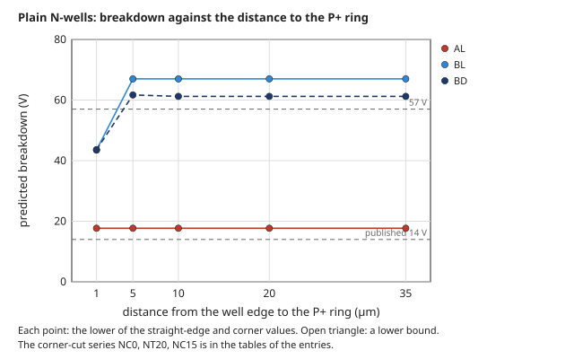
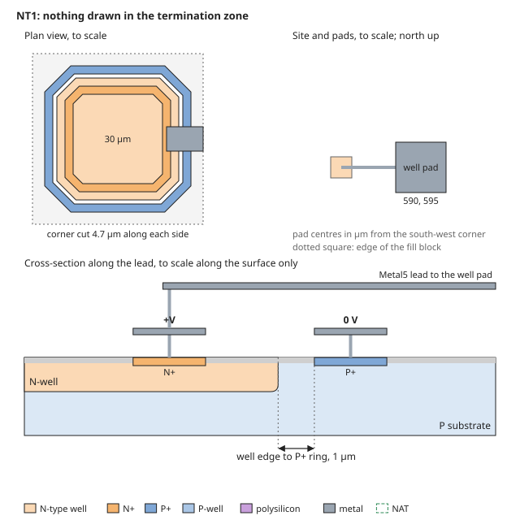
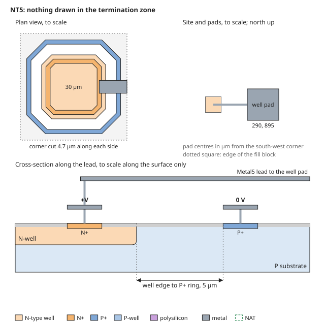
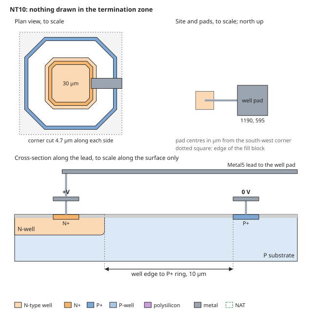
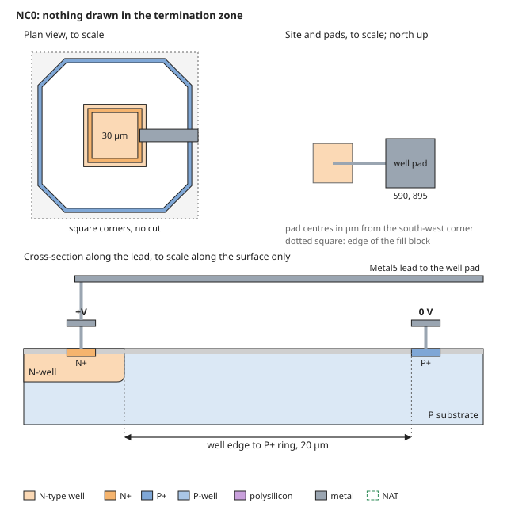
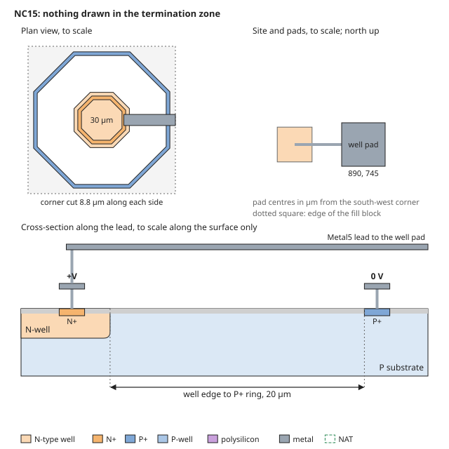
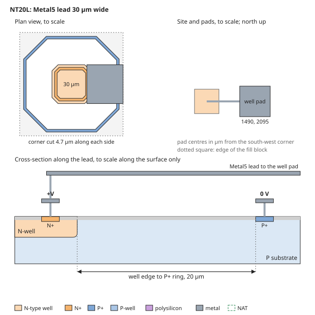
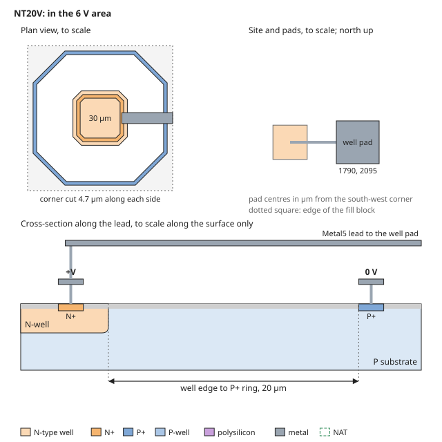

.. _hvt-g-plain:

Plain N-wells
=============

The plain wells have nothing drawn between the well and the P+ ring. They
show what the process itself puts beside an N-well, and every other group is
read against them.

The group has 10 structures: :ref:`NT1 <hvt-s-nt1>`, :ref:`NT5 <hvt-s-nt5>`,
:ref:`NT10 <hvt-s-nt10>`, :ref:`NT20 <hvt-s-nt20>`, :ref:`NC0 <hvt-s-nc0>`,
:ref:`NC15 <hvt-s-nc15>`, :ref:`NT20b <hvt-s-nt20b>`, :ref:`NT20L
<hvt-s-nt20l>`, :ref:`NT20c <hvt-s-nt20c>`, :ref:`NT20V <hvt-s-nt20v>`.

Mechanism
---------

A reverse-biased well empties the more lightly doped silicon beside it of
carriers. That depletion region widens with voltage, and the field at the
well's edge rises with it until avalanche starts. Anything that stops the
depletion region early forces the same voltage across less silicon, so the
field reaches its limit sooner.

Expected results
----------------

If the foundry generates P-well against the well, every member breaks down
near the published 14 V, whatever its ring distance or corner. If only
substrate lies beside the well, the values are much higher and fall only
when the P+ ring comes within reach. If a deep P layer lies under the well,
the values with a distant ring all stop at the breakdown of the well's flat
bottom. :numref:`fig-hvt-g-plain` shows the trend that the simulation
predicts.

         straight-edge and corner values, against the distance from the well
         edge to the P+ ring, from 1 µm to 20 µm, one curve per process,
         with dashed lines at the published 14 V and at 57 V and an open
         triangle where a sweep ended without breakdown. The structures of
         the group are NT1, NT5, NT10, NT20, NC0, NC15, NT20b, NT20L, NT20c,
         NT20V. The plotted values are those of the tables in the entries.

   Trend that the simulation predicts across the group.

Limits of the group
-------------------

Every corner on the die is a 45° cut, because the design rules allow no
other angle on a well. The corner sections of the simulation assume an arc
and are upper bounds. The Metal5 lead crosses the termination zone of every
member, and only :ref:`NT20L <hvt-s-nt20l>` varies it. The copies and the
lead control have the simulated section of :ref:`NT20 <hvt-s-nt20>`, because
a two-dimensional section cannot contain the lead.

.. _hvt-s-nt1:

NT1
---

         with corners cut 4.7 µm along each side, an N+ contact ring inside
         its edge and a P+ ring 1 µm outside it; nothing drawn in the
         termination zone. A Metal5 lead joins the well to a pad at 1790,
         595 µm.

   NT1 in plan view and in cross-section.

.. list-table:: NT1: drawn parameters and position
   :name: tab-hvt-s-nt1
   :header-rows: 1
   :widths: 35 65

   * - Parameter
     - Value
   * - Well
     - N-well
   * - Side of the well
     - 30 µm
   * - Corners
     - Cut of 4.7 µm along each side, for a nominal radius of 8 µm; eight vertices of 135°
   * - Area and perimeter
     - 856 µm² and 109.0 µm
   * - N+ contact ring
     - 2 µm wide, 2 µm inside the well edge
   * - P+ ring
     - 2 µm wide, 1 µm from the well edge
   * - Fill block
     - Whole structure
   * - Metal5 lead
     - 6 µm wide
   * - Site
     - Column 6 from the west, row 3 from the south
   * - Well pad, centre x, y
     - 1790, 595 µm
   * - Substrate
     - Any of the seven SUB pads (:numref:`tab-hvt-pads`)

Purpose
   Tests whether a P+ region 1 µm from an N-well, with no P-well, is enough
   to explain the published 14 V. :numref:`fig-hvt-s-nt1` shows the
   structure and :numref:`tab-hvt-s-nt1` lists what is drawn.

How it works
   The P+ ring is so heavily doped that the depletion region cannot enter
   it. With the ring 1 µm from the edge, the whole voltage falls across 1 µm
   of substrate, and the field reaches its limit at a far lower voltage than
   with a distant ring.

Compared with
   * :ref:`NT5 <hvt-s-nt5>`: the P+ ring is at 1 µm in place of 5 µm.
   * :ref:`NW1p5 <hvt-s-nw1p5>`: a P+ ring in place of a P-well at a similar distance.

Measurement
   Procedure :ref:`P1 <hvt-p1>` applies. The well pad is at 1790, 595 µm.
   The knee is expected well below that of the other plain wells, so a sweep
   that ends early is not a fault.

Predicted
   The simulated breakdown voltages are in :numref:`tab-hvt-sp-nt1`. The row
   of each family's nominal process also gives the family's band, its
   agreement range and the predicted ratio to the reference structure. A
   value near 14 V here, with the other plain wells much higher, means a
   nearby P+ region can produce the published value without any P-well. If
   every plain well is near 14 V, this structure adds nothing.

Limits
   Under assumption A the P-well reaches the well edge before the P+ ring
   does and hides the ring's effect.

.. list-table:: NT1: predicted breakdown voltage by process
   :name: tab-hvt-sp-nt1
   :header-rows: 1
   :widths: 18 16 16 17 17 16

   * - Process
     - Straight edge (V)
     - Corner section (V)
     - Family band (V)
     - Agreement range (V)
     - Predicted ratio
   * - AL, AD, AnL, AnD
     - 17.7
     - –
     - 17.7 to 17.7
     - 12.4 to 20.4
     - 1.00 of :ref:`NW0 <hvt-s-nw0>`
   * - BL
     - 40.5
     - 41.8
     - 39.8 to 40.5
     - 27.9 to 46.6
     - 0.60 of :ref:`NT20 <hvt-s-nt20>`
   * - BLq
     - 39.8
     - 41.1
     - –
     - –
     - –
   * - BD
     - 40.7
     - 41.9
     - 40.7 to 40.7
     - 28.5 to 46.8
     - 0.67 of :ref:`NT20 <hvt-s-nt20>`

.. _hvt-s-nt5:

NT5
---

         with corners cut 4.7 µm along each side, an N+ contact ring inside
         its edge and a P+ ring 5 µm outside it; nothing drawn in the
         termination zone. A Metal5 lead joins the well to a pad at 1490,
         745 µm.

   NT5 in plan view and in cross-section.

.. list-table:: NT5: drawn parameters and position
   :name: tab-hvt-s-nt5
   :header-rows: 1
   :widths: 35 65

   * - Parameter
     - Value
   * - Well
     - N-well
   * - Side of the well
     - 30 µm
   * - Corners
     - Cut of 4.7 µm along each side, for a nominal radius of 8 µm; eight vertices of 135°
   * - Area and perimeter
     - 856 µm² and 109.0 µm
   * - N+ contact ring
     - 2 µm wide, 2 µm inside the well edge
   * - P+ ring
     - 2 µm wide, 5 µm from the well edge
   * - Fill block
     - Whole structure
   * - Metal5 lead
     - 6 µm wide
   * - Site
     - Column 5 from the west, row 4 from the south
   * - Well pad, centre x, y
     - 1490, 745 µm
   * - Substrate
     - Any of the seven SUB pads (:numref:`tab-hvt-pads`)

Purpose
   Finds whether a P+ ring 5 µm away already limits the well.
   :numref:`fig-hvt-s-nt5` shows the structure and :numref:`tab-hvt-s-nt5`
   lists what is drawn.

How it works
   In substrate doped at 3.5 × 10\ :sup:`15` cm\ :sup:`-3` a flat depletion
   region is about 5 µm wide at 70 V. If the region reaches the ring before
   avalanche, it can spread no further and the field rises faster from then
   on.

Compared with
   * :ref:`NT1 <hvt-s-nt1>`: the ring is at 5 µm in place of 1 µm.
   * :ref:`NT10 <hvt-s-nt10>`: the ring is at 5 µm in place of 10 µm.

Measurement
   Procedure :ref:`P1 <hvt-p1>` applies. The well pad is at 1490, 745 µm.

Predicted
   The simulated breakdown voltages are in :numref:`tab-hvt-sp-nt5`. The row
   of each family's nominal process also gives the family's band, its
   agreement range and the predicted ratio to the reference structure. A
   value below :ref:`NT10 <hvt-s-nt10>` means the depletion region reaches 5
   µm before breakdown. An equal value means the region at the surface is
   shorter than under a flat junction.

Limits
   The simulation predicts no difference from :ref:`NT10 <hvt-s-nt10>`, so a
   measured difference would count against the model and not only against
   the structure.

.. list-table:: NT5: predicted breakdown voltage by process
   :name: tab-hvt-sp-nt5
   :header-rows: 1
   :widths: 18 16 16 17 17 16

   * - Process
     - Straight edge (V)
     - Corner section (V)
     - Family band (V)
     - Agreement range (V)
     - Predicted ratio
   * - AL, AD, AnL, AnD
     - 17.7
     - –
     - 17.7 to 17.7
     - 12.4 to 20.4
     - 1.00 of :ref:`NW0 <hvt-s-nw0>`
   * - BL
     - 76.0
     - 67.0
     - 67.0 to 70.3
     - 46.9 to 80.8
     - 1.00 of :ref:`NT20 <hvt-s-nt20>`
   * - BLq
     - 79.9
     - 70.3
     - –
     - –
     - –
   * - BD
     - 62.9
     - 61.7
     - 61.7 to 61.7
     - 43.2 to 71.0
     - 1.01 of :ref:`NT20 <hvt-s-nt20>`

.. _hvt-s-nt10:

NT10
----

         with corners cut 4.7 µm along each side, an N+ contact ring inside
         its edge and a P+ ring 10 µm outside it; nothing drawn in the
         termination zone. A Metal5 lead joins the well to a pad at 1790,
         745 µm.

   NT10 in plan view and in cross-section.

.. list-table:: NT10: drawn parameters and position
   :name: tab-hvt-s-nt10
   :header-rows: 1
   :widths: 35 65

   * - Parameter
     - Value
   * - Well
     - N-well
   * - Side of the well
     - 30 µm
   * - Corners
     - Cut of 4.7 µm along each side, for a nominal radius of 8 µm; eight vertices of 135°
   * - Area and perimeter
     - 856 µm² and 109.0 µm
   * - N+ contact ring
     - 2 µm wide, 2 µm inside the well edge
   * - P+ ring
     - 2 µm wide, 10 µm from the well edge
   * - Fill block
     - Whole structure
   * - Metal5 lead
     - 6 µm wide
   * - Site
     - Column 6 from the west, row 4 from the south
   * - Well pad, centre x, y
     - 1790, 745 µm
   * - Substrate
     - Any of the seven SUB pads (:numref:`tab-hvt-pads`)

Purpose
   Shows whether the breakdown voltage has stopped rising by a ring distance
   of 10 µm. :numref:`fig-hvt-s-nt10` shows the structure and
   :numref:`tab-hvt-s-nt10` lists what is drawn.

How it works
   Ten micrometres is about twice the flat depletion width at the voltage
   that bare substrate allows. Under assumption B the ring should therefore
   be out of reach, and the well should behave as if it stood alone.

Compared with
   * :ref:`NT5 <hvt-s-nt5>`: the ring is at 10 µm in place of 5 µm.
   * :ref:`NT20 <hvt-s-nt20>`: the ring is at 10 µm in place of 20 µm.

Measurement
   Procedure :ref:`P1 <hvt-p1>` applies. The well pad is at 1790, 745 µm.

Predicted
   The simulated breakdown voltages are in :numref:`tab-hvt-sp-nt10`. The
   row of each family's nominal process also gives the family's band, its
   agreement range and the predicted ratio to the reference structure. Equal
   to :ref:`NT20 <hvt-s-nt20>`: the breakdown voltage stopped rising before
   10 µm, and the default ring distance of 20 µm is safely large.

Limits
   None beyond those of the group.

.. list-table:: NT10: predicted breakdown voltage by process
   :name: tab-hvt-sp-nt10
   :header-rows: 1
   :widths: 18 16 16 17 17 16

   * - Process
     - Straight edge (V)
     - Corner section (V)
     - Family band (V)
     - Agreement range (V)
     - Predicted ratio
   * - AL, AD, AnL, AnD
     - 17.7
     - –
     - 17.7 to 17.7
     - 12.4 to 20.4
     - 1.00 of :ref:`NW0 <hvt-s-nw0>`
   * - BL
     - 76.0
     - 67.0
     - 67.0 to 70.3
     - 46.9 to 80.8
     - 1.00 of :ref:`NT20 <hvt-s-nt20>`
   * - BLq
     - 79.9
     - 70.3
     - –
     - –
     - –
   * - BD
     - 62.9
     - 61.2
     - 61.2 to 61.2
     - 42.8 to 70.4
     - 1.00 of :ref:`NT20 <hvt-s-nt20>`

.. _hvt-s-nt20:

NT20
----

         with corners cut 4.7 µm along each side, an N+ contact ring inside
         its edge and a P+ ring 20 µm outside it; nothing drawn in the
         termination zone. A Metal5 lead joins the well to a pad at 290, 895
         µm.

   NT20 in plan view and in cross-section.

.. list-table:: NT20: drawn parameters and position
   :name: tab-hvt-s-nt20
   :header-rows: 1
   :widths: 35 65

   * - Parameter
     - Value
   * - Well
     - N-well
   * - Side of the well
     - 30 µm
   * - Corners
     - Cut of 4.7 µm along each side, for a nominal radius of 8 µm; eight vertices of 135°
   * - Area and perimeter
     - 856 µm² and 109.0 µm
   * - N+ contact ring
     - 2 µm wide, 2 µm inside the well edge
   * - P+ ring
     - 2 µm wide, 20 µm from the well edge
   * - Fill block
     - Whole structure
   * - Metal5 lead
     - 6 µm wide
   * - Site
     - Column 1 from the west, row 5 from the south
   * - Well pad, centre x, y
     - 290, 895 µm
   * - Substrate
     - Any of the seven SUB pads (:numref:`tab-hvt-pads`)

Purpose
   The reference structure of the die: a plain N-well with the default
   dimensions, against which every termination is read.
   :numref:`fig-hvt-s-nt20` shows the structure and :numref:`tab-hvt-s-nt20`
   lists what is drawn.

How it works
   Nothing is drawn in its 20 µm of termination zone, so what the process
   puts there decides the result: P-well against the edge, or bare
   substrate. In bare substrate the curved edge and the vertices concentrate
   the field and break down before the flat bottom, unless a deep P layer
   makes the bottom fail first.

Compared with
   * :ref:`NT20b <hvt-s-nt20b>`: nothing: a second copy elsewhere on the die.
   * :ref:`NT20L <hvt-s-nt20l>`: the Metal5 lead is 6 µm wide in place of 30 µm.
   * :ref:`NT20V <hvt-s-nt20v>`: the 3.3 V area in place of the 6 V area.
   * :ref:`NT20c <hvt-s-nt20c>`: nothing: a third copy.
   * :ref:`NT10 <hvt-s-nt10>`: the ring is at 20 µm in place of 10 µm.

Measurement
   Procedure :ref:`P1 <hvt-p1>` applies. The well pad is at 290, 895 µm. It
   is the first structure swept on each die, and is swept again at 85 °C. It
   is one of the three on which the light of the avalanche is always
   photographed at the current limit.

Predicted
   The simulated breakdown voltages are in :numref:`tab-hvt-sp-nt20`. The
   row of each family's nominal process also gives the family's band, its
   agreement range and the predicted ratio to the reference structure. Near
   14 V: P-well lies against the well. Much higher: it does not, and the
   other groups then show what each termination gains.

Limits
   A single plain well cannot tell an edge that fails from a bottom that
   fails; the plates and rings do that, and the capacitance of :ref:`CVNA
   <hvt-s-cvna>` shows the deep layer directly.

.. list-table:: NT20: predicted breakdown voltage by process
   :name: tab-hvt-sp-nt20
   :header-rows: 1
   :widths: 18 16 16 17 17 16

   * - Process
     - Straight edge (V)
     - Corner section (V)
     - Family band (V)
     - Agreement range (V)
     - Predicted ratio
   * - AL, AD, AnL, AnD
     - 17.7
     - –
     - 17.7 to 17.9
     - 12.4 to 20.6
     - 1.00 of :ref:`NW0 <hvt-s-nw0>`
   * - ALhi
     - 17.9
     - –
     - –
     - –
     - –
   * - BL
     - 76.0
     - 67.0
     - 60.2 to 79.4
     - 42.1 to 91.3
     - 1 (reference)
   * - BLhi
     - 66.7
     - 60.2
     - –
     - –
     - –
   * - BLlo
     - 94.4
     - 79.4
     - –
     - –
     - –
   * - BLq
     - 79.9
     - 70.3
     - –
     - –
     - –
   * - BLq3
     - 86.2
     - 77.0
     - –
     - –
     - –
   * - BD
     - 62.9
     - 61.2
     - 59.2 to 61.2
     - 41.4 to 70.4
     - 1 (reference)
   * - BDhi
     - 62.9
     - 59.2
     - –
     - –
     - –
   * - BDlo
     - 62.5
     - 61.0
     - –
     - –
     - –

.. _hvt-s-nc0:

NC0
---

         with square corners, an N+ contact ring inside its edge and a P+
         ring 20 µm outside it; nothing drawn in the termination zone. A
         Metal5 lead joins the well to a pad at 590, 895 µm.

   NC0 in plan view and in cross-section.

.. list-table:: NC0: drawn parameters and position
   :name: tab-hvt-s-nc0
   :header-rows: 1
   :widths: 35 65

   * - Parameter
     - Value
   * - Well
     - N-well
   * - Side of the well
     - 30 µm
   * - Corners
     - Square; four vertices of 90°
   * - Area and perimeter
     - 900 µm² and 120.0 µm
   * - N+ contact ring
     - 2 µm wide, 2 µm inside the well edge
   * - P+ ring
     - 2 µm wide, 20 µm from the well edge
   * - Fill block
     - Whole structure
   * - Metal5 lead
     - 6 µm wide
   * - Site
     - Column 2 from the west, row 5 from the south
   * - Well pad, centre x, y
     - 590, 895 µm
   * - Substrate
     - Any of the seven SUB pads (:numref:`tab-hvt-pads`)

Purpose
   Measures what a square corner costs against a corner cut at 45°.
   :numref:`fig-hvt-s-nc0` shows the structure and :numref:`tab-hvt-s-nc0`
   lists what is drawn.

How it works
   At a vertex the depletion region wraps round a point, so field lines
   converge from more directions than along a straight side and the field is
   higher at the same voltage. A 90° vertex is the sharpest the layout can
   draw. Diffusion of the implant rounds it to a radius of about the well's
   lateral spread.

Compared with
   * :ref:`NT20 <hvt-s-nt20>`: four 90° vertices in place of eight of 135°.
   * :ref:`NC15 <hvt-s-nc15>`: no cut in place of the longest cut.
   * :ref:`NM1_6C0 <hvt-s-nm1-6c0>`: no plate in place of a Metal1 plate.

Measurement
   Procedure :ref:`P1 <hvt-p1>` applies. The well pad is at 590, 895 µm.
   Swept again at 85 °C. The light of the avalanche is always photographed
   at the current limit; the four vertices should light first.

Predicted
   The simulated breakdown voltages are in :numref:`tab-hvt-sp-nc0`. The row
   of each family's nominal process also gives the family's band, its
   agreement range and the predicted ratio to the reference structure. Below
   :ref:`NT20 <hvt-s-nt20>`: the vertices set the breakdown, and a cut is
   worth having. Equal: something other than the corner limits both.

Limits
   The simulated corner is an arc of 1 µm radius standing in for the vertex;
   under BL it breaks down below the 57 V working voltage. Under assumption
   A the surface junction fails first and hides the corner.

.. list-table:: NC0: predicted breakdown voltage by process
   :name: tab-hvt-sp-nc0
   :header-rows: 1
   :widths: 18 16 16 17 17 16

   * - Process
     - Straight edge (V)
     - Corner section (V)
     - Family band (V)
     - Agreement range (V)
     - Predicted ratio
   * - AL, AD, AnL, AnD
     - 17.7
     - –
     - 17.7 to 17.9
     - 12.4 to 20.6
     - 1.00 of :ref:`NW0 <hvt-s-nw0>`
   * - ALhi
     - 17.9
     - –
     - –
     - –
     - –
   * - BL
     - 76.0
     - 46.1
     - 46.1 to 48.0
     - 32.3 to 55.2
     - 0.69 of :ref:`NT20 <hvt-s-nt20>`
   * - BLhi
     - 66.7
     - > 34.5
     - –
     - –
     - –
   * - BLlo
     - 94.4
     - > 38.7
     - –
     - –
     - –
   * - BLq
     - 79.9
     - 48.0
     - –
     - –
     - –
   * - BLq3
     - 86.2
     - > 42.0
     - –
     - –
     - –
   * - BD
     - 62.9
     - 46.0
     - 46.0 to 46.0
     - 32.2 to 52.9
     - 0.75 of :ref:`NT20 <hvt-s-nt20>`
   * - BDhi
     - 62.9
     - > 34.7
     - –
     - –
     - –
   * - BDlo
     - 62.5
     - > 38.6
     - –
     - –
     - –

.. _hvt-s-nc15:

NC15
----

         with corners cut 8.8 µm along each side, an N+ contact ring inside
         its edge and a P+ ring 20 µm outside it; nothing drawn in the
         termination zone. A Metal5 lead joins the well to a pad at 890, 895
         µm.

   NC15 in plan view and in cross-section.

.. list-table:: NC15: drawn parameters and position
   :name: tab-hvt-s-nc15
   :header-rows: 1
   :widths: 35 65

   * - Parameter
     - Value
   * - Well
     - N-well
   * - Side of the well
     - 30 µm
   * - Corners
     - Cut of 8.8 µm along each side, for a nominal radius of 15 µm; eight vertices of 135°
   * - Area and perimeter
     - 745 µm² and 99.4 µm
   * - N+ contact ring
     - 2 µm wide, 2 µm inside the well edge
   * - P+ ring
     - 2 µm wide, 20 µm from the well edge
   * - Fill block
     - Whole structure
   * - Metal5 lead
     - 6 µm wide
   * - Site
     - Column 3 from the west, row 5 from the south
   * - Well pad, centre x, y
     - 890, 895 µm
   * - Substrate
     - Any of the seven SUB pads (:numref:`tab-hvt-pads`)

Purpose
   Tells whether the length of the corner cut matters once the vertex is
   135°. :numref:`fig-hvt-s-nc15` shows the structure and
   :numref:`tab-hvt-s-nc15` lists what is drawn.

How it works
   The cut for a 15 µm radius takes 8.8 µm off each side and leaves an
   almost regular octagon. Its vertices have the same angle as those of
   :ref:`NT20 <hvt-s-nt20>` and stand further apart. If the corners behaved
   like arcs of the nominal radius, a larger radius would hold more.

Compared with
   * :ref:`NT20 <hvt-s-nt20>`: a cut of 8.8 µm in place of 4.7 µm.
   * :ref:`NC0 <hvt-s-nc0>`: the longest cut in place of none.

Measurement
   Procedure :ref:`P1 <hvt-p1>` applies. The well pad is at 890, 895 µm. The
   light of the avalanche is always photographed at the current limit, to
   see whether it sits at the eight vertices.

Predicted
   The simulated breakdown voltages are in :numref:`tab-hvt-sp-nc15`. The
   row of each family's nominal process also gives the family's band, its
   agreement range and the predicted ratio to the reference structure. Equal
   to :ref:`NT20 <hvt-s-nt20>`: the vertex angle decides and the nominal
   radius means little. Higher: the cut length matters as a radius would.

Limits
   The well cannot be rounder than this at 30 µm across, so a trend that
   continues has no further point.

.. list-table:: NC15: predicted breakdown voltage by process
   :name: tab-hvt-sp-nc15
   :header-rows: 1
   :widths: 18 16 16 17 17 16

   * - Process
     - Straight edge (V)
     - Corner section (V)
     - Family band (V)
     - Agreement range (V)
     - Predicted ratio
   * - AL, AD, AnL, AnD
     - 17.7
     - –
     - 17.7 to 17.7
     - 12.4 to 20.4
     - 1.00 of :ref:`NW0 <hvt-s-nw0>`
   * - BL
     - 76.0
     - 70.6
     - 70.6 to 74.1
     - 49.4 to 85.2
     - 1.05 of :ref:`NT20 <hvt-s-nt20>`
   * - BLq
     - 79.9
     - 74.1
     - –
     - –
     - –
   * - BD
     - 62.9
     - 59.6
     - 59.6 to 59.6
     - 41.7 to 68.5
     - 0.97 of :ref:`NT20 <hvt-s-nt20>`

.. _hvt-s-nt20b:

NT20b
-----

         with corners cut 4.7 µm along each side, an N+ contact ring inside
         its edge and a P+ ring 20 µm outside it; nothing drawn in the
         termination zone. A Metal5 lead joins the well to a pad at 1190,
         1945 µm.

   NT20b in plan view and in cross-section.

.. list-table:: NT20b: drawn parameters and position
   :name: tab-hvt-s-nt20b
   :header-rows: 1
   :widths: 35 65

   * - Parameter
     - Value
   * - Well
     - N-well
   * - Side of the well
     - 30 µm
   * - Corners
     - Cut of 4.7 µm along each side, for a nominal radius of 8 µm; eight vertices of 135°
   * - Area and perimeter
     - 856 µm² and 109.0 µm
   * - N+ contact ring
     - 2 µm wide, 2 µm inside the well edge
   * - P+ ring
     - 2 µm wide, 20 µm from the well edge
   * - Fill block
     - Whole structure
   * - Metal5 lead
     - 6 µm wide
   * - Site
     - Column 4 from the west, row 12 from the south
   * - Well pad, centre x, y
     - 1190, 1945 µm
   * - Substrate
     - Any of the seven SUB pads (:numref:`tab-hvt-pads`)

Purpose
   Gives the spread across one die: a second copy of the reference well,
   1750 µm from the first. :numref:`fig-hvt-s-nt20b` shows the structure and
   :numref:`tab-hvt-s-nt20b` lists what is drawn.

How it works
   The drawing is identical to :ref:`NT20 <hvt-s-nt20>`. Any difference
   between the two comes from the process varying across the die, or from
   the measurement not repeating.

Compared with
   * :ref:`NT20 <hvt-s-nt20>`: nothing but the position on the die.

Measurement
   Procedure :ref:`P1 <hvt-p1>` applies. The well pad is at 1190, 1945 µm.
   Swept with the same settings as :ref:`NT20 <hvt-s-nt20>` and in the same
   session.

Predicted
   The simulated breakdown voltages are in :numref:`tab-hvt-sp-nt20b`. The
   row of each family's nominal process also gives the family's band, its
   agreement range and the predicted ratio to the reference structure. The
   difference between the two copies is the smallest difference between any
   two structures that can be called real.

Limits
   Two copies sample two points on the die; :ref:`NT20c <hvt-s-nt20c>` adds
   a third.

.. list-table:: NT20b: predicted breakdown voltage by process
   :name: tab-hvt-sp-nt20b
   :header-rows: 1
   :widths: 18 16 16 17 17 16

   * - Process
     - Straight edge (V)
     - Corner section (V)
     - Family band (V)
     - Agreement range (V)
     - Predicted ratio
   * - AL, AD, AnL, AnD
     - 17.7
     - –
     - 17.7 to 17.7
     - 12.4 to 20.4
     - 1.00 of :ref:`NW0 <hvt-s-nw0>`
   * - BL
     - 76.0
     - 67.0
     - 67.0 to 70.3
     - 46.9 to 80.8
     - 1.00 of :ref:`NT20 <hvt-s-nt20>`
   * - BLq
     - 79.9
     - 70.3
     - –
     - –
     - –
   * - BD
     - 62.9
     - 61.2
     - 61.2 to 61.2
     - 42.8 to 70.4
     - 1.00 of :ref:`NT20 <hvt-s-nt20>`

.. _hvt-s-nt20l:

NT20L
-----

         with corners cut 4.7 µm along each side, an N+ contact ring inside
         its edge and a P+ ring 20 µm outside it; Metal5 lead 30 µm wide. A
         Metal5 lead joins the well to a pad at 1790, 1945 µm.

   NT20L in plan view and in cross-section.

.. list-table:: NT20L: drawn parameters and position
   :name: tab-hvt-s-nt20l
   :header-rows: 1
   :widths: 35 65

   * - Parameter
     - Value
   * - Well
     - N-well
   * - Side of the well
     - 30 µm
   * - Corners
     - Cut of 4.7 µm along each side, for a nominal radius of 8 µm; eight vertices of 135°
   * - Area and perimeter
     - 856 µm² and 109.0 µm
   * - N+ contact ring
     - 2 µm wide, 2 µm inside the well edge
   * - P+ ring
     - 2 µm wide, 20 µm from the well edge
   * - Fill block
     - Whole structure
   * - Metal5 lead
     - 30 µm wide
   * - Site
     - Column 6 from the west, row 12 from the south
   * - Well pad, centre x, y
     - 1790, 1945 µm
   * - Substrate
     - Any of the seven SUB pads (:numref:`tab-hvt-pads`)

Purpose
   Shows whether the Metal5 lead changes the junction it crosses.
   :numref:`fig-hvt-s-nt20l` shows the structure and
   :numref:`tab-hvt-s-nt20l` lists what is drawn.

How it works
   The lead is at the well's voltage, 5.76 µm above the silicon, and acts as
   a weak field plate over the strip it crosses. Here it is 30 µm wide in
   place of 6 µm, so it covers the whole east side of the well and both of
   that side's vertices.

Compared with
   * :ref:`NT20 <hvt-s-nt20>`: a lead 30 µm wide in place of 6 µm.

Measurement
   Procedure :ref:`P1 <hvt-p1>` applies. The well pad is at 1790, 1945 µm.

Predicted
   The simulated breakdown voltages are in :numref:`tab-hvt-sp-nt20l`. The
   row of each family's nominal process also gives the family's band, its
   agreement range and the predicted ratio to the reference structure. Equal
   to :ref:`NT20 <hvt-s-nt20>`: leaving the lead out of the simulation costs
   nothing. Lower: the lead harms the junction, and every structure carries
   that harm over 6 µm.

Limits
   A lead that helps cannot show here, because the three sides it does not
   cover still break down at the unchanged voltage. The structure bounds the
   effect on a plain well only.

.. list-table:: NT20L: predicted breakdown voltage by process
   :name: tab-hvt-sp-nt20l
   :header-rows: 1
   :widths: 18 16 16 17 17 16

   * - Process
     - Straight edge (V)
     - Corner section (V)
     - Family band (V)
     - Agreement range (V)
     - Predicted ratio
   * - AL, AD, AnL, AnD
     - 17.7
     - –
     - 17.7 to 17.7
     - 12.4 to 20.4
     - 1.00 of :ref:`NW0 <hvt-s-nw0>`
   * - BL
     - 76.0
     - 67.0
     - 67.0 to 70.3
     - 46.9 to 80.8
     - 1.00 of :ref:`NT20 <hvt-s-nt20>`
   * - BLq
     - 79.9
     - 70.3
     - –
     - –
     - –
   * - BD
     - 62.9
     - 61.2
     - 61.2 to 61.2
     - 42.8 to 70.4
     - 1.00 of :ref:`NT20 <hvt-s-nt20>`

.. _hvt-s-nt20c:

NT20c
-----

         with corners cut 4.7 µm along each side, an N+ contact ring inside
         its edge and a P+ ring 20 µm outside it; nothing drawn in the
         termination zone. A Metal5 lead joins the well to a pad at 290,
         2095 µm.

   NT20c in plan view and in cross-section.

.. list-table:: NT20c: drawn parameters and position
   :name: tab-hvt-s-nt20c
   :header-rows: 1
   :widths: 35 65

   * - Parameter
     - Value
   * - Well
     - N-well
   * - Side of the well
     - 30 µm
   * - Corners
     - Cut of 4.7 µm along each side, for a nominal radius of 8 µm; eight vertices of 135°
   * - Area and perimeter
     - 856 µm² and 109.0 µm
   * - N+ contact ring
     - 2 µm wide, 2 µm inside the well edge
   * - P+ ring
     - 2 µm wide, 20 µm from the well edge
   * - Fill block
     - Whole structure
   * - Metal5 lead
     - 6 µm wide
   * - Site
     - Column 1 from the west, row 13 from the south
   * - Well pad, centre x, y
     - 290, 2095 µm
   * - Substrate
     - Any of the seven SUB pads (:numref:`tab-hvt-pads`)

Purpose
   A third copy of the reference well. The plain well is one half of the
   ratio that decides whether a deep P layer lies under N-wells.
   :numref:`fig-hvt-s-nt20c` shows the structure and
   :numref:`tab-hvt-s-nt20c` lists what is drawn.

How it works
   The drawing is identical to :ref:`NT20 <hvt-s-nt20>`. Whether a plate
   raises the breakdown voltage is read from the plated wells divided by the
   plain ones. Three plain wells give a mean, and a spread to set against a
   predicted difference that is not much larger than the agreement limit.

Compared with
   * :ref:`NT20 <hvt-s-nt20>`: nothing but the position on the die.
   * :ref:`NT20b <hvt-s-nt20b>`: nothing but the position on the die.
   * :ref:`NM1_6b <hvt-s-nm1-6b>`: the plain half of the ratio, in place of the plated half.

Measurement
   Procedure :ref:`P1 <hvt-p1>` applies. The well pad is at 290, 2095 µm.
   Swept with the same settings as :ref:`NT20 <hvt-s-nt20>` and in the same
   session.

Predicted
   The simulated breakdown voltages are in :numref:`tab-hvt-sp-nt20c`. The
   row of each family's nominal process also gives the family's band, its
   agreement range and the predicted ratio to the reference structure. The
   mean of the three plain wells is the denominator of the plate ratio.

Limits
   Three points on one die still cannot separate a gradient from random
   variation.

.. list-table:: NT20c: predicted breakdown voltage by process
   :name: tab-hvt-sp-nt20c
   :header-rows: 1
   :widths: 18 16 16 17 17 16

   * - Process
     - Straight edge (V)
     - Corner section (V)
     - Family band (V)
     - Agreement range (V)
     - Predicted ratio
   * - AL, AD, AnL, AnD
     - 17.7
     - –
     - 17.7 to 17.7
     - 12.4 to 20.4
     - 1.00 of :ref:`NW0 <hvt-s-nw0>`
   * - BL
     - 76.0
     - 67.0
     - 67.0 to 70.2
     - 46.9 to 80.7
     - 1.00 of :ref:`NT20 <hvt-s-nt20>`
   * - BLq
     - 79.8
     - 70.2
     - –
     - –
     - –
   * - BD
     - 62.9
     - 62.2
     - 62.2 to 62.2
     - 43.5 to 71.5
     - 1.02 of :ref:`NT20 <hvt-s-nt20>`

.. _hvt-s-nt20v:

NT20V
-----

         with corners cut 4.7 µm along each side, an N+ contact ring inside
         its edge and a P+ ring 20 µm outside it; in the 6 V area. A Metal5
         lead joins the well to a pad at 1790, 2095 µm.

   NT20V in plan view and in cross-section.

.. list-table:: NT20V: drawn parameters and position
   :name: tab-hvt-s-nt20v
   :header-rows: 1
   :widths: 35 65

   * - Parameter
     - Value
   * - Well
     - N-well
   * - Side of the well
     - 30 µm
   * - Corners
     - Cut of 4.7 µm along each side, for a nominal radius of 8 µm; eight vertices of 135°
   * - Area and perimeter
     - 856 µm² and 109.0 µm
   * - N+ contact ring
     - 2 µm wide, 2 µm inside the well edge
   * - P+ ring
     - 2 µm wide, 20 µm from the well edge
   * - Area
     - 6 V: the thick-oxide layer covers the structure
   * - Fill block
     - Whole structure
   * - Metal5 lead
     - 6 µm wide
   * - Site
     - Column 6 from the west, row 13 from the south
   * - Well pad, centre x, y
     - 1790, 2095 µm
   * - Substrate
     - Any of the seven SUB pads (:numref:`tab-hvt-pads`)

Purpose
   Shows whether an N-well in the 6 V area breaks down differently from one
   in the 3.3 V area. :numref:`fig-hvt-s-nt20v` shows the structure and
   :numref:`tab-hvt-s-nt20v` lists what is drawn.

How it works
   The layer that selects the thick gate oxide covers the whole structure.
   The foundry's two N-well diode models have the same capacitance and
   different breakdown voltages, 11 V for the 3.3 V area and 14 V for the 6
   V area. Equal capacitance suggests the same well, so the difference would
   lie in what surrounds it.

Compared with
   * :ref:`NT20 <hvt-s-nt20>`: the 6 V area in place of the 3.3 V area.

Measurement
   Procedure :ref:`P1 <hvt-p1>` applies. The well pad is at 1790, 2095 µm.

Predicted
   The simulated breakdown voltages are in :numref:`tab-hvt-sp-nt20v`. The
   row of each family's nominal process also gives the family's band, its
   agreement range and the predicted ratio to the reference structure. A
   difference of about 3 V in the direction of the models confirms that the
   surroundings of the well differ between the two areas.

Limits
   The layer covers the termination zone as well as the well, so a
   difference cannot be assigned to one of them. Only this one structure is
   in the 6 V area.

.. list-table:: NT20V: predicted breakdown voltage by process
   :name: tab-hvt-sp-nt20v
   :header-rows: 1
   :widths: 18 16 16 17 17 16

   * - Process
     - Straight edge (V)
     - Corner section (V)
     - Family band (V)
     - Agreement range (V)
     - Predicted ratio
   * - AL, AD, AnL, AnD
     - 17.7
     - –
     - 17.7 to 17.7
     - 12.4 to 20.4
     - 1.00 of :ref:`NW0 <hvt-s-nw0>`
   * - BL
     - 76.0
     - 67.0
     - 67.0 to 70.3
     - 46.9 to 80.8
     - 1.00 of :ref:`NT20 <hvt-s-nt20>`
   * - BLq
     - 79.9
     - 70.3
     - –
     - –
     - –
   * - BD
     - 62.9
     - 61.2
     - 61.2 to 61.2
     - 42.8 to 70.4
     - 1.00 of :ref:`NT20 <hvt-s-nt20>`
