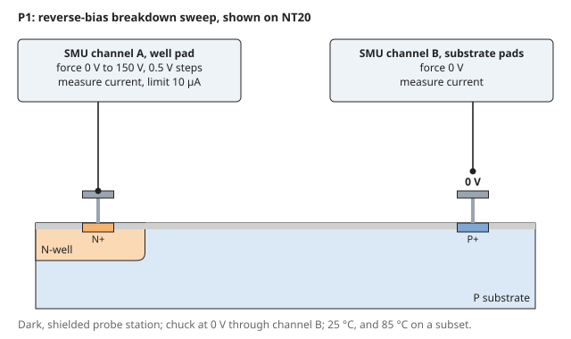
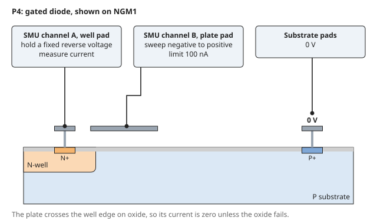
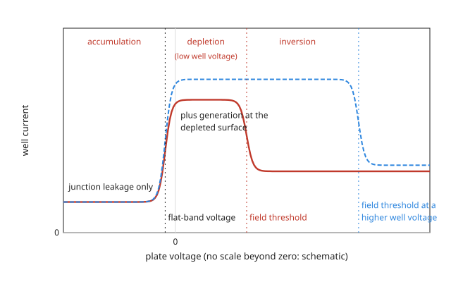
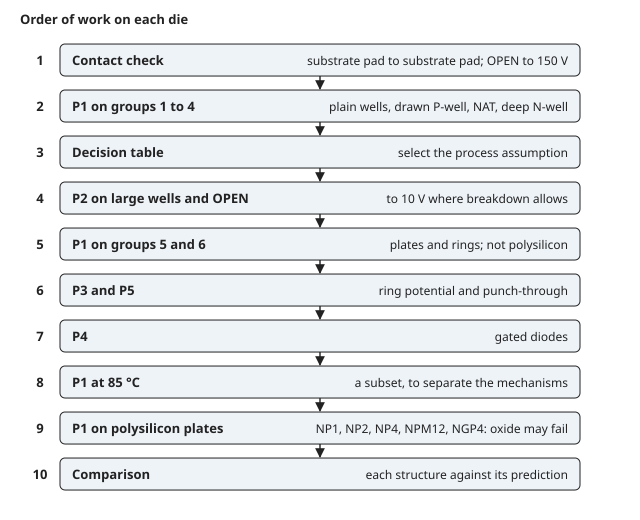

.. _hv-test-method:

Measurement method
==================

Five procedures measure the test die: a breakdown sweep on every
structure, capacitance against voltage on the large wells, and three
procedures on the structures that have a second pad. Their results select
one of the assumptions about the process, and are then compared with the
simulated values (:ref:`hv-test-predictions`). The structures and their pad
positions are listed on :ref:`hv-test-structures`.

Equipment and conditions
------------------------

The procedures need a probe station or wire-bonded dies, and the
instruments in :numref:`tab-hvt-equipment`. Every measurement is made in
the dark, because light generates carriers in a depletion region and adds
a current that hides leakage. The die sits in a shielded enclosure at
25 °C unless a procedure says otherwise.

All seven substrate pads are one net, and at least two are probed. The
resistance between two of them is measured before anything else. The pads
are joined by a metal bus, so two probes in good contact read a few ohms.
The back of the die also connects to the substrate, so the chuck is held
at 0 V.

.. list-table:: Instruments
   :name: tab-hvt-equipment
   :header-rows: 1
   :widths: 30 40 30

   * - Instrument
     - Requirement
     - Used in
   * - :term:`Source-measure unit`, two channels
     - One channel to 150 V. Current resolution of 1 pA or finer for P1
       and P5, and of 10 fA for P4
     - P1, P3, P4, P5
   * - :term:`Electrometer`, or a third channel forcing 0 A
     - Input current below 100 fA, voltage range to 150 V, guarded input
     - P3
   * - :term:`LCR meter`
     - 100 kHz and 1 MHz, DC bias to 10 V or more, resolution of 10 fF
     - P2
   * - Probe station
     - Dark and shielded, three or more probes, guarded cables, chuck
       heated to 85 °C
     - All

.. _hvt-p1:

Breakdown sweep (P1)
--------------------

The breakdown sweep raises the well's voltage until the junction conducts
(:numref:`fig-hvt-conn-p1`), with the settings of :numref:`tab-hvt-p1`.
It applies to every structure and to OPEN. On a gated diode the plate pad
is shorted to the well pad at the probes for this procedure, so that the
plate acts as a field plate.

         A of the source-measure unit connects to the well pad, forces 0 V
         to 150 V in 0.5 V steps and measures current with a limit of
         10 µA. Channel B connects to the substrate pads, forces 0 V and
         measures current. The probe station is dark and shielded, and the
         chuck is at 0 V.

   Connections for the breakdown sweep.

.. list-table:: Settings of the breakdown sweep
   :name: tab-hvt-p1
   :header-rows: 1
   :widths: 35 65

   * - Setting
     - Value
   * - Well pad
     - 0 V to +150 V in steps of 0.5 V, with 100 ms of settling at each
       step
   * - Substrate pads and chuck
     - 0 V, with the substrate current recorded
   * - Current limit
     - 10 µA. The sweep ends when the well current reaches it
   * - Repeats
     - Three sweeps in succession on the same structure
   * - Temperature
     - 25 °C on every structure. 85 °C as well on one structure of each
       group: NT20, NC0, NW0, NA0p6, DT20, NM1_6 and NR3_2

The current limit keeps the junction from damage. At the end of the sweep
the junction dissipates at most 150 V × 10 µA = 1.5 mW, spread along an
edge of about 109 µm on a standard well
(:download:`calc.py <calc.py>`, section 4).

The breakdown voltage is the well voltage at which the well current first
reaches 1 µA, interpolated between steps. The voltage at 100 nA is
recorded too. A junction in :term:`avalanche breakdown` passes both levels
within a volt or two of each other. A wider spacing means the current rose
gradually, which is leakage and not avalanche (:numref:`fig-hvt-iv`).

.. figure:: hvt-iv.svg
   :name: fig-hvt-iv
   :alt: Schematic graph of well current on a logarithmic axis from 0.1 pA
         to 100 µA against well voltage. Dashed lines mark 100 nA, 1 µA
         and the current limit of 10 µA. An avalanche curve stays near
         1 pA and then rises almost vertically through all three lines. A
         dashed copy, the third sweep after walk-out, has its knee at a
         slightly higher voltage. A surface-leakage curve rises steadily
         from the start with no knee and crosses the lines far apart.

   Shapes of the reverse current: avalanche, the same after walk-out, and
   surface leakage.

Three sweeps detect :term:`walk-out`. Carriers from the avalanche lodge in
the oxide beside the junction, change the field there, and move the
breakdown voltage on the next sweep. The first and third values are both
recorded. A difference larger than one step of 0.5 V counts as walk-out.

Where a structure breaks down can be seen as well as measured. A junction
in avalanche emits light, and a microscope with a sensitive camera shows
it with the well held at the current limit of 10 µA. Light along the
whole edge, at the vertices or under the Metal5 lead names the weakest
place. The step is optional and uses the P1 connections.

The second temperature separates the mechanisms. The avalanche breakdown
voltage rises with temperature, because hotter carriers lose more energy
to the lattice between collisions [HV-SZE-NG]_. A current
from tunnelling changes little, and a leakage current along the surface
rises steeply and has no knee. A knee that moves up at 85 °C is therefore
avalanche.

The well current and the substrate current are equal and opposite when the
junction is the only path. A well current that exceeds the substrate
current flows somewhere else: through the chuck, a probe, or the second
pad.

.. _hvt-p2:

Capacitance against voltage (P2)
--------------------------------

The capacitance of a reverse-biased junction gives the doping on its
lightly doped side, here the substrate under the well. The procedure
applies to the large wells CVN, CVN2, CVD, CVD2 and CVNA, and to OPEN
(:numref:`fig-hvt-conn-p2`).

.. figure:: hvt-conn-p2.svg
   :name: fig-hvt-conn-p2
   :alt: Connection diagram on a cross-section of a large well. The low
         terminal of the LCR meter connects to the well pad. The high
         terminal connects to the substrate pads and carries a DC bias of
         0 V to minus 10 V, which reverse-biases the junction. The
         measuring signal is 30 mV at 100 kHz and at 1 MHz. The same
         measurement is repeated on OPEN and subtracted.

   Connections for capacitance against voltage.

The meter's low terminal goes to the well pad, because that node has the
least stray capacitance to the chuck. The bias makes the substrate
negative of the well, from 0 V to 10 V of reverse bias in steps of 0.25 V.
The bias stays below 80 % of the breakdown voltage that P1 gives for the
same well on another die. The capacitance is read at 100 kHz and at 1 MHz.
The two readings agree, and the dissipation factor is below 0.1, when the
series resistance of the well and substrate is negligible.

The same sweep on OPEN gives the capacitance of a pad, its lead and the
probe, which is subtracted at each bias. A Metal5 pad of 100 µm by 100 µm
directly over the substrate would have about 58 fF. Dummy Metal4 fill lies
under every pad, which raises that value by an amount the layout does not
fix. OPEN carries the same fill, so the subtraction removes it. The two
N-wells are expected to have 1.7 pF and 6.4 pF
(:download:`calc.py <calc.py>`, section 2).

A well's capacitance has a part from its flat bottom, in proportion to its
area, and a part from its edge, in proportion to its perimeter. Two wells
of different size separate them:

.. math::

   C_1 &= C_\text{a} A_1 + C_\text{p} P_1 \\
   C_2 &= C_\text{a} A_2 + C_\text{p} P_2 \\
   C_\text{a} &= \frac{C_1 P_2 - C_2 P_1}{A_1 P_2 - A_2 P_1} \\
   C_\text{p} &= \frac{C_2 A_1 - C_1 A_2}{A_1 P_2 - A_2 P_1}

.. list-table::
   :header-rows: 1
   :widths: 20 60 20

   * - Symbol
     - Meaning
     - Unit
   * - :math:`C_1`, :math:`C_2`
     - Capacitance of the large and the small well at one bias, after
       OPEN is subtracted
     - F
   * - :math:`A_1`, :math:`A_2`
     - Area of each well, from :numref:`tab-hvt-large`
     - µm\ :sup:`2`
   * - :math:`P_1`, :math:`P_2`
     - Perimeter of each well, from :numref:`tab-hvt-large`
     - µm
   * - :math:`C_\text{a}`
     - Capacitance per area of the flat bottom
     - F/µm\ :sup:`2`
   * - :math:`C_\text{p}`
     - Capacitance per length of the edge
     - F/µm

As a worked example, the published N-well model has
:math:`1.4914 \times 10^{-4}` F/m² and :math:`5.8719 \times 10^{-10}` F/m
at zero bias [HV-GF180-MODELS]_. Those values predict 6.378 pF for CVN and
1.669 pF for CVN2. Putting the two capacitances back into the equations
recovers the model:

.. math::

   C_\text{a} &= \frac{6.378 \times 372.5 - 1.669 \times 772.5}
                      {39725 \times 372.5 - 9725 \times 772.5} \\
     &= \frac{1086.5}{7.285 \times 10^{6}}
      = 1.491 \times 10^{-4}\ \text{pF/µm}^2 \\
   C_\text{p} &= \frac{1.669 \times 39725 - 6.378 \times 9725}
                      {7.285 \times 10^{6}} \\
     &= \frac{4275}{7.285 \times 10^{6}}
      = 5.87 \times 10^{-4}\ \text{pF/µm}

The edge supplies 0.45 pF of the 6.38 pF of CVN, about 7 %, so the
correction matters.

The doping follows from how the area capacitance changes with bias. For a
junction far more heavily doped on one side, each bias gives the doping at
the edge of the depletion region and the depth of that edge
[HV-SZE-NG]_:

.. math::

   N(W) &= \frac{2}{q \, \varepsilon_\text{Si} \, A^2 \,
           \dfrac{d(1/C^2)}{dV}} \\
   W &= \frac{\varepsilon_\text{Si} \, A}{C}

.. list-table::
   :header-rows: 1
   :widths: 20 60 20

   * - Symbol
     - Meaning
     - Unit
   * - :math:`N(W)`
     - Doping of the lightly doped side at depth :math:`W`
     - cm\ :sup:`-3`
   * - :math:`W`
     - Width of the depletion region, measured from the junction
     - cm
   * - :math:`C`
     - Capacitance of the flat bottom alone, :math:`C_\text{a} A`
     - F
   * - :math:`A`
     - Area of the well
     - cm\ :sup:`2`
   * - :math:`V`
     - Reverse voltage
     - V
   * - :math:`q`
     - Electron charge, :math:`1.602 \times 10^{-19}`
     - C
   * - :math:`\varepsilon_\text{Si}`
     - Permittivity of silicon, :math:`1.035 \times 10^{-12}`
     - F/cm

For CVN, :math:`A = 39725\ \text{µm}^2 = 3.9725 \times 10^{-4}\
\text{cm}^2`. The published model gives its flat bottom 3.510 pF at 2 V
and 2.252 pF at 10 V, so :math:`1/C^2` rises by
:math:`1.450 \times 10^{22}\ \text{F}^{-2}` per volt:

.. math::

   q \, \varepsilon_\text{Si} \, A^2
     &= 1.602 \times 10^{-19} \times 1.035 \times 10^{-12} \\
     &\quad \times (3.9725 \times 10^{-4})^2 \\
     &= 2.617 \times 10^{-38} \\
   N &= \frac{2}{2.617 \times 10^{-38} \times 1.450 \times 10^{22}} \\
     &= 5.3 \times 10^{15}\ \text{cm}^{-3} \\
   W(10\ \text{V}) &= \frac{1.035 \times 10^{-12} \times
        3.9725 \times 10^{-4}}{2.252 \times 10^{-12}} \\
     &= 1.83 \times 10^{-4}\ \text{cm} = 1.83\ \text{µm}

That is the estimate already drawn from the model on :ref:`hv-junctions`,
where :numref:`fig-hv-cv-doping` plots :math:`1/C^2` against voltage. The
measurement replaces the model with silicon, and gives the doping at each
depth instead of one value. The profile reaches only as deep as the bias
can push the depletion region, about 1.8 µm at 10 V in this example. A
large well that breaks down early limits the bias, and so the depth. CVNA
has NAT round it for that reason: if NAT clears the P-well from its edge,
its bias can go several times higher. Its area and perimeter equal those
of CVN2, so the two together also show what the NAT layer changes.

A sweep that goes beyond about 15 V also answers a second question. If a
heavily doped P layer lies a few micrometres under the N-well, the
depletion region stops spreading when it reaches that layer. The
capacitance then stops falling, and the doping profile shows a steep rise
at that depth. A profile that stays flat means no such layer lies within
the depth reached.

.. _hvt-p3:

Floating-ring potential (P3)
----------------------------

A floating ring stays near 0 V until the depletion region of the well
reaches it, and then follows the well at a fixed step below it
(:ref:`hv-grading`). The well voltage at which the ring starts to follow is
the :term:`punch-through` voltage of the gap. The procedure applies to
NR1S2, NR1S3 and NR4S, whose ring 1 has a pad
(:numref:`fig-hvt-conn-p3`).

.. figure:: hvt-conn-p3.svg
   :name: fig-hvt-conn-p3
   :alt: Connection diagram on a cross-section of structure NR1S2, an
         N-well with one floating ring. Channel A of the source-measure
         unit connects to the well pad and forces 0 V to 150 V with a
         limit of 10 µA. An electrometer connects to the pad of ring 1
         through a guarded cable, forces zero current and reads the
         voltage. The substrate pads are at 0 V.

   Connections for the floating-ring potential.

The well is swept as in P1, to the breakdown voltage that P1 gave for the
same structure on another die. The ring pad goes to an electrometer, or to
a source-measure channel that forces 0 A and reads voltage. The ring
voltage is recorded at each step, on a sweep up and a sweep back down.

The meter must draw almost nothing. The ring's own junction leaks about
0.4 fA, from the published saturation current of the N-well junction and
the ring's area of 258 µm² (:download:`calc.py <calc.py>`, section 4). Any
meter draws more than that, so the reading below punch-through is set by
the meter and has no meaning (:numref:`fig-hvt-ring-follow`). Above
punch-through the well supplies the ring through the depleted gap, with a
current that P5 measures. The reading is valid once that current is far
above the meter's input current, which is why the input current must stay
below 100 fA.

.. figure:: hvt-ring-follow.svg
   :name: fig-hvt-ring-follow
   :alt: Schematic graph of ring 1 voltage against well voltage. A dashed
         diagonal marks ring voltage equal to well voltage. The ring's
         curve lies on zero up to the punch-through voltage, then bends
         and rises parallel to the diagonal, a fixed step below it. Below
         the punch-through voltage the reading is set by the meter and by
         leakage.

   Ring potential against well voltage: flat, then following the well.

The ring and its cable are a capacitance that this small current must
charge. A cable of 10 pF charged through 0.5 V by 1 pA takes 5 s, so each
step needs seconds, and a guarded cable cuts the capacitance that counts.
A sweep down that retraces the sweep up shows that the steps were long
enough.

The punch-through voltage is the well voltage at which the ring reaches
1 V. The step is the well voltage minus the ring voltage at the highest
well voltage reached. Both are compared with the simulated ring potential
(:numref:`fig-hvt-pred-ring`).

.. _hvt-p4:

Gated diode (P4)
----------------

In a gated diode the plate's voltage sets the state of the silicon surface
beside the well, and the well's current and breakdown voltage report that
state [HV-GROVE-FITZGERALD]_. The procedure applies to NGP4, NGM1, NAGM1
and DGM1 (:numref:`fig-hvt-conn-p4`).

         N-well with a separate Metal1 plate over its edge. Channel A of
         the source-measure unit holds the well pad at a fixed reverse
         voltage and measures current. Channel B sweeps the plate pad
         from negative to positive with a current limit of 100 nA. The
         substrate pads are at 0 V.

   Connections for the gated diode.

The first part holds the well at a fixed reverse voltage and sweeps the
plate from negative to positive (:numref:`tab-hvt-p4`). With the plate
negative, holes gather at the surface under it, and the well passes only
the leakage of its junction. Above the :term:`flat-band voltage` the
surface is depleted, and carriers generated at the depleted surface add to
the well current. At the field threshold an inversion layer of electrons
forms and joins the well. The surface generation stops, and the current
falls to a level between the two (:numref:`fig-hvt-gated-iv`).

         plate negative, in accumulation, the current is low: junction
         leakage only. At the flat-band voltage it steps up, as generation
         at the depleted surface adds to it. At the field threshold it
         falls to an intermediate level, in inversion. A dashed curve for
         a higher well voltage has the same step up but falls at a much
         higher plate voltage.

   Well current of a gated diode against plate voltage, at two well
   voltages.

.. list-table:: Settings of the gated-diode procedure
   :name: tab-hvt-p4
   :header-rows: 1
   :widths: 35 65

   * - Setting
     - Value
   * - Well pad, first part
     - Held at 2 V, then at 5 V, with the current recorded at 10 fA
       resolution
   * - Plate pad, Metal1
     - −20 V to +60 V in steps of 0.25 V
   * - Plate pad, polysilicon
     - −10 V to +30 V in steps of 0.25 V
   * - Plate current limit
     - 100 nA. Any plate current means the oxide conducts, and ends the
       sweep
   * - Voltage between well and plate
     - At most 80 V in either direction, in both parts; 64 V on the
       polysilicon plate
   * - Well pad, second part
     - P1, repeated with the plate at −10 V, 0 V, +10 V and +20 V. Each
       sweep ends when the well is 80 V above the plate

The field threshold rises with the well voltage, because the inversion
layer sits at the well's potential and the plate must deplete the silicon
further to reach it. The threshold equation of :ref:`hv-metal-gate`
becomes:

.. math::

   V_\text{T}(V_\text{R}) &= V_\text{FB} + 2\phi_\text{F} + V_\text{R}
       + \frac{Q_\text{dep}}{C_\text{ox}} \\
   Q_\text{dep} &= \sqrt{2 \, \varepsilon_\text{Si} \, q \, N \,
       (2\phi_\text{F} + V_\text{R})}

.. list-table::
   :header-rows: 1
   :widths: 20 60 20

   * - Symbol
     - Meaning
     - Unit
   * - :math:`V_\text{T}(V_\text{R})`
     - Plate voltage, measured to the substrate, at which the surface
       inverts
     - V
   * - :math:`V_\text{R}`
     - Reverse voltage on the well
     - V
   * - :math:`V_\text{FB}`
     - Flat-band voltage, where the current steps up
     - V
   * - :math:`\phi_\text{F}`
     - :math:`(kT/q) \ln(N/n_\text{i})`, as on :ref:`hv-metal-gate`
     - V
   * - :math:`Q_\text{dep}`
     - Charge per area in the depleted silicon at the threshold
     - C/cm\ :sup:`2`
   * - :math:`N`
     - Doping of the P-type silicon under the plate
     - cm\ :sup:`-3`
   * - :math:`C_\text{ox}`
     - Capacitance per area under the plate: :math:`2.93 \times 10^{-9}`
       for Metal1 and :math:`1.107 \times 10^{-8}` for polysilicon
       [HV-OPENPDKS-EXTRACT]_
     - F/cm\ :sup:`2`
   * - :math:`q`, :math:`\varepsilon_\text{Si}`
     - As in the doping equation above
     - C, F/cm

For a Metal1 plate over silicon doped at :math:`3.0 \times 10^{15}`
cm\ :sup:`-3`, with :math:`V_\text{FB} = -0.9` V as on
:ref:`hv-metal-gate`, :math:`2\phi_\text{F}` is 0.652 V. At
:math:`V_\text{R} = 5` V:

.. math::

   Q_\text{dep}^2 &= 2 \times 1.035 \times 10^{-12}
       \times 1.602 \times 10^{-19} \\
     &\quad \times 3.0 \times 10^{15} \times 5.652 \\
     &= 5.62 \times 10^{-15} \\
   Q_\text{dep} &= 7.50 \times 10^{-8}\ \text{C/cm}^2 \\
   V_\text{T} &= -0.9 + 0.652 + 5
       + \frac{7.50 \times 10^{-8}}{2.93 \times 10^{-9}} \\
     &= 4.75 + 25.6 = 30.3\ \text{V}

At :math:`V_\text{R} = 0` the same equation gives 8.4 V
(:download:`calc.py <calc.py>`, section 3). The flat-band voltage is common
to both, so the difference between the thresholds at two well voltages
depends on the doping alone, and gives it. The flat-band voltage then gives
the charge in the oxide: each :math:`10^{11}` charges per cm² moves it by
5.5 V under Metal1 and by 1.4 V under polysilicon.

The current step is small. Surface generation supplies
:math:`q \, n_\text{i} \, s_0` per area of depleted surface, where the
surface generation velocity :math:`s_0` is not known for this oxide. For
the 773 µm² of the NGM1 plate beyond the well, 1 cm/s gives 12 fA and
100 cm/s gives 1.2 pA (:download:`calc.py <calc.py>`, section 4). The
first part therefore needs 10 fA resolution and long integration. It is
repeated at 85 °C, where the intrinsic carrier density, and the step with
it, is about forty times larger.

The second part does not depend on small currents. It repeats the
breakdown sweep at several plate voltages. A negative plate strengthens
the field at the well edge and lowers the breakdown voltage, and a
positive plate relieves it. The breakdown voltage against plate voltage is
compared with the simulation of the same structure with its plate at 0 V
(:numref:`tab-hvt-pred-g`).

The voltage between the well and the plate stays within 80 V. The
plate's Metal1 lies 1 µm from the well's own Metal1, and 80 V across that
gap is a field of 0.8 MV/cm, well below what deposited oxide withstands.
On the polysilicon plate the limit is 64 V, because the 0.32 µm of trench
oxide between that plate and the well then sees 2 MV/cm. Both limits are
choices: no strength is published for either oxide. A sweep with the
plate at 0 V therefore ends at 80 V on the well, which is above the
breakdown voltage predicted for that case (:numref:`tab-hvt-pred-g`). The
sweep with the plate joined to the well has no such limit, because plate
and well are shorted at the probes and stay at one voltage.

.. _hvt-p5:

Punch-through to a contacted ring (P5)
--------------------------------------

With ring 1 held at 0 V, the ring is a second N-well at the substrate's
potential, a known gap from the well. The well voltage at which current
flows between them is the punch-through voltage of two N-wells at that
gap. The procedure applies to NR1S2, NR1S3 and NR4S
(:numref:`fig-hvt-conn-p5`).

.. figure:: hvt-conn-p5.svg
   :name: fig-hvt-conn-p5
   :alt: Connection diagram on a cross-section of structure NR1S2.
         Channel A of the source-measure unit connects to the well pad
         and forces a rising voltage with a limit of 10 µA. Channel B
         holds the pad of ring 1 at 0 V and measures its current. The
         substrate pads are at 0 V and their current is measured too.
         Current into the ring pad is punch-through, and current into the
         substrate pads is avalanche.

   Connections for punch-through to a contacted ring.

The well is swept as in P1, with the ring current and the substrate
current both recorded. The punch-through voltage is the well voltage at
which the ring current reaches 1 nA. Where the current goes names the
mechanism: punch-through current leaves by the ring pad, and avalanche
current leaves by the substrate pads. The ring current against well
voltage also gives the current available to the meter in P3 at each
voltage.

The result is the spacing rule for wells at different voltages. Rule NW.2b
allows 1.4 µm, for circuits at 6 V or less (:numref:`tab-hvt-rules`). Gaps
of 2 µm and 3 µm show what a wider gap holds. The onset in P3 and the
punch-through voltage here describe the same event, and agree within a
volt when both are measured correctly.

Order of work
-------------

The procedures run in an order that puts the least stressful first and
decides early what the later ones are compared with
(:numref:`fig-hvt-order`). The breakdown sweeps of groups 1 to 4 come
first, because they select the process assumption. The capacitance of a
large well is measured before its breakdown sweep on that die, and at a
bias taken from another die. The gated-diode current is measured before
any sweep takes those structures to breakdown, since avalanche can charge
the oxide.

         substrate pads, and OPEN swept to 150 V. 2, P1 on groups 1 to 4.
         3, the decision table selects the process assumption. 4, P2 on
         the large wells. 5, P1 on groups 5 and 6. 6, P3 and P5 on the
         ring-sense structures. 7, P4 on the gated diodes. 8, P1 at 85 °C
         on a subset. 9, comparison of each structure with its
         prediction.

   Order of work on each die.

Process assumption decision
---------------------------

Two questions about the process decide what a termination can do, and the
simulations cover each answer (:numref:`fig-hvt-assumptions`). The first
is where the foundry places P-well at the surface: everywhere (A),
everywhere except beside NAT (An), or only where drawn (B). The second is
whether a heavily doped P layer lies a few micrometres under the N-wells
(D) or only under deep N-wells (L).

Three terms have fixed meanings. "Near 14 V" is a breakdown voltage
between 8 V and 25 V, around the published 10 V minimum and 14 V typical
[HV-GF180-EP-5]_. "Much higher" is above 40 V. Two values are "the same"
when they differ by less than 15 % or 3 V, whichever is larger. These
limits are choices. The second copies NT20b, NA0p6b and DT20b show whether
the spread across a die fits inside them.

The pattern across groups 1 to 3 answers the first question
(:numref:`tab-hvt-decision`).

.. list-table:: Measured patterns and the surface P-well each selects
   :name: tab-hvt-decision
   :header-rows: 1
   :widths: 22 22 22 34

   * - Group 1, plain N-wells
     - Group 2, drawn P-well
     - Group 3, NAT beside an N-well
     - Conclusion
   * - Near 14 V at every ring distance
     - The same as group 1 at every distance
     - Much higher
     - An: the foundry generates P-well everywhere, and NAT blocks it,
       also in the strip beside an N-well
   * - Near 14 V at every ring distance
     - The same as group 1 at every distance
     - The same as group 1
     - A: P-well everywhere, and either it fills the strip between an
       N-well and NAT, or NAT does not block it without a transistor. The
       die cannot tell these two apart
   * - Much higher from 5 µm of ring distance
     - Near 14 V at 0 µm. Rises with distance to the group 1 value
     - The same as group 1
     - B: only drawn P-well exists
   * - Near 14 V at every ring distance
     - Rises with distance
     - Any
     - Drawing any P-well stops the generation in that structure. A
       distant drawn P-well is then itself a way to clear the edge
   * - No knee, or a value still rising between ring distances of 20 µm
       and 35 µm
     - Any
     - Any
     - Not avalanche, or the P+ ring is reached first: see
       :numref:`tab-hvt-inconclusive`

Three structures of group 1 refine the result. If NT1 is near 14 V while
the wells with a distant ring are much higher, a P+ region close to the
well can explain the published value. NT20V against NT20 shows whether
the 6 V area differs. NT20L against NT20 shows how far the lead moves a
result. Within group 3, a breakdown voltage that is near 14 V at 4 µm and
much higher at 0.6 µm means the foundry generates P-well in a wide strip
beside the well but not in a narrow one.

The second question has an answer only if some N-well edge is clear of
P-well, under An or B (:numref:`tab-hvt-deep`). Under A every N-well
breaks down at its surface first, and only the capacitance sweep of the
large wells reaches the depth of the layer, as far as their own breakdown
allows.

.. list-table:: Measurements that show a deep P layer under the N-wells
   :name: tab-hvt-deep
   :header-rows: 1
   :widths: 34 33 33

   * - Measurement
     - Layer under deep N-well only (L)
     - Layer under the whole wafer (D)
   * - Breakdown of N-wells with plates or rings, against the plain well
     - Higher than the plain well, by different amounts
     - The same as the plain well: all stop at one voltage, set at the
       bottom of the well
   * - Any N-well structure above the agreement range of its D
       prediction (:numref:`tab-hvt-pred-band`)
     - Possible
     - Not possible
   * - Capacitance of CVNA and CVN beyond about 15 V
     - Keeps falling
     - Stops falling at the depth of the layer

Group 4 checks the picture of the deep layer itself. Every deep N-well
structure is predicted to break down near 30 V, at the bottom of the
well, under every assumption. Values that are the same across the group
confirm it. A deep N-well with NAT over its edge or with a plate that
holds much more than the plain one contradicts it, and the deep N-well
predictions are then wrong.

Comparison with predictions
---------------------------

Once the two answers select a family of processes, such as BL, each
remaining structure is compared with its prediction under that family.
:numref:`tab-hvt-pred-band` gives each structure a band, the range of its
predictions over the family, and an agreement range, the band widened by
15 % at each end. A structure agrees when its measured breakdown voltage
lies within the agreement range. The 15 % stands for the uncertainty of
the ionisation coefficients, and is a choice
(:ref:`hv-test-predictions`).

The measured value used is the median over the dies, from the first
sweep, at 1 µA. A structure outside its range is reported with the
direction and size of the difference. Differences in one direction across
a group point to a wrong profile or oxide charge, which the capacitance
and gated-diode results then correct. A difference on one structure alone
points to that termination. A structure whose simulation did not finish
has no range, and its measurement stands alone.

The corner sections of the simulation assume a smooth arc, and the die
has vertices. A measured value below the corner prediction but within
reach of it is therefore expected, and the C series shows how large that
difference is.

Sample size and records
-----------------------

At least five dies are measured, taken from different positions along the
reel on which the bare dies arrive [HV-WS-SITE]_. Dies from one position
may be neighbours on the wafer, and would understate the spread.

Each bias point is one row of a CSV file with the columns of
:numref:`tab-hvt-record`. One file holds one sweep. A separate file per
session records the instruments, their settings and the probe positions.

.. list-table:: Columns of a measurement record
   :name: tab-hvt-record
   :header-rows: 1
   :widths: 28 72

   * - Column
     - Content
   * - ``die``
     - Identifier of the die, and its position on the reel
   * - ``structure``
     - Name of the structure, as on the die
   * - ``procedure``
     - P1 to P5
   * - ``sweep``
     - Index of the sweep on that structure, from 1, and its direction
   * - ``temperature_c``
     - Chuck temperature
   * - ``v_well_v``, ``i_well_a``
     - Voltage and current at the well pad
   * - ``i_sub_a``
     - Current at the substrate pads
   * - ``v_aux_v``, ``i_aux_a``
     - Voltage and current at the second pad, if any
   * - ``c_f``, ``d``, ``freq_hz``
     - Capacitance, dissipation factor and frequency, for P2
   * - ``time_s``
     - Time since the start of the sweep

Safety
------

The well probe carries up to 150 V and is bare metal. The current limit of
10 µA protects the die, not the operator: it is a setting, and the
instrument can supply far more. The source-measure unit's interlock is
wired to the cover of the probe station, so that the output is off
whenever the cover is open. Probes are moved only with the output off and
the well pad at 0 V.

Inconclusive results
--------------------

Some results cannot be read as a breakdown voltage, and the die has a
check for each (:numref:`tab-hvt-inconclusive`).

.. list-table:: Results that make a measurement inconclusive
   :name: tab-hvt-inconclusive
   :header-rows: 1
   :widths: 30 35 35

   * - Cause
     - Sign
     - Check
   * - Leakage along the surface before avalanche
     - No knee: the voltages at 100 nA and 1 µA are far apart
     - The T series. Surface leakage at a fixed voltage falls as the ring
       moves away, and rises steeply at 85 °C
   * - Leakage of a pad, a lead or a probe
     - Current on a structure no larger than on OPEN
     - OPEN swept to 150 V on every die. A reading counts only if it is
       ten times the OPEN current at that voltage
   * - Depletion region reaches the P+ ring
     - Breakdown voltage still rising between ring distances of 20 µm and
       35 µm
     - The T series. The value at 20 µm is then a lower bound for the
       other structures, which share that distance
   * - Charge trapped in the oxide
     - Walk-out between the first and third sweep
     - Both values reported. The first sweep on a fresh die is the one
       compared with the prediction
   * - Light
     - Current that changes with the lamp
     - Sweep repeated with the lamp off and the enclosure closed
   * - Oxide under a plate conducts
     - A sweep that cannot be repeated: the next one shows a short
     - Plate current in P4. On plates joined to the well, a second sweep
   * - Series resistance in a capacitance reading
     - Readings at 100 kHz and 1 MHz differ, or the dissipation factor
       exceeds 0.1
     - Lower frequency. The smaller well, which has less resistance
   * - Poor substrate contact
     - Resistance between two substrate pads above a few ohms
     - Probes reseated

Open questions
--------------

* Are the decision limits of 8 V, 25 V and 40 V, and the 15 % of the
  agreement range, wide enough for the spread across a die and between
  dies?
* Under A, does P-well fill the strip beside NAT, or does NAT not block
  it? No structure on the die separates the two.
* What breakdown voltage does a large well have? It bounds the bias, and
  so the depth, of the capacitance profile. If P-well surrounds the large
  wells and NAT does not clear it from CVNA, the profile may reach less
  than 2 µm below the well.
* Can the instrument at hand resolve the surface-generation step of P4?
  The step may be as small as 12 fA at 25 °C.
* Does a probe on a bare Metal5 pad, or a wire bond, survive 150 V next to
  the pad's neighbours at a pitch of 150 µm? No voltage rating is
  published for the passivation or the pad.
* Is 150 V enough? If a structure does not break down by 150 V, only a
  lower bound is recorded.
