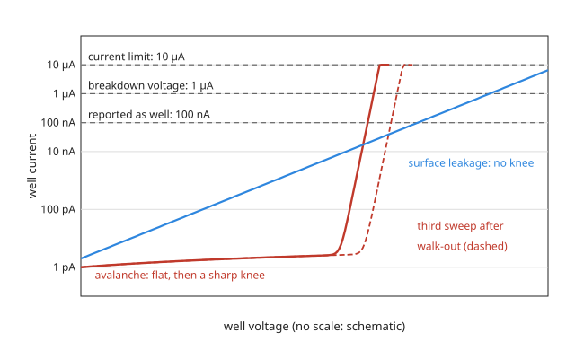
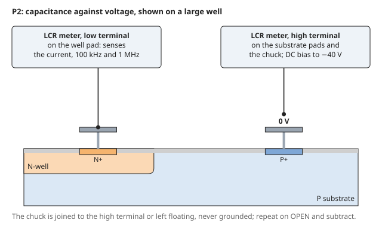
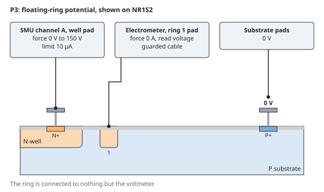
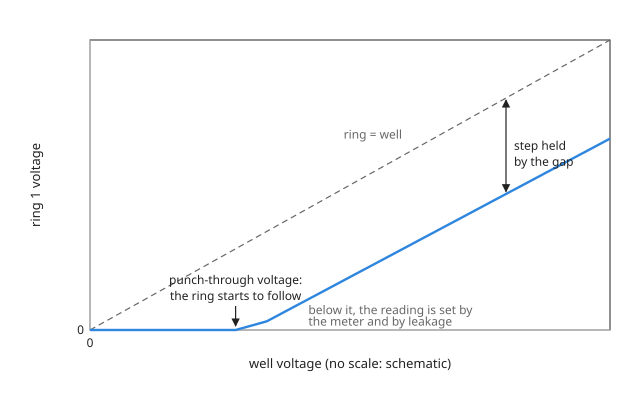
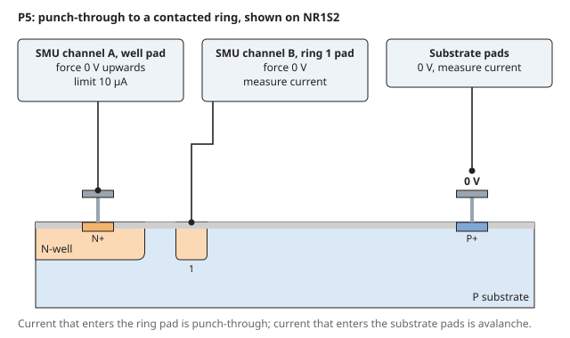
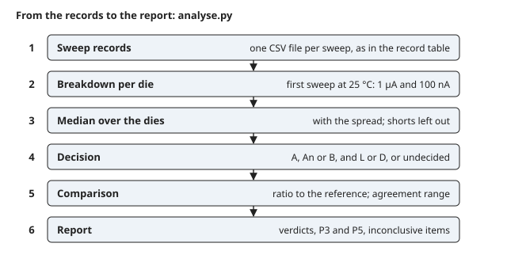

.. _hv-test-method:

Measurement method
==================

Five procedures measure the test die: a breakdown sweep on every
structure, capacitance against voltage on the large wells, and three
procedures on the structures that have a second pad. Their results select
one of the assumptions about the process, and are then compared with the
simulated values (:ref:`hv-test-predictions`). The structures and their pad
positions are listed on :ref:`hv-test-structures`.

Equipment and conditions
------------------------

The procedures need a probe station or wire-bonded dies, and the
instruments in :numref:`tab-hvt-equipment`. Every measurement is made in
the dark, because light generates carriers in a depletion region and adds
a current that hides leakage. The die sits in a shielded enclosure at
25 °C unless a procedure says otherwise.

All seven substrate pads are one net, and at least two are probed. The
resistance between two of them is measured before anything else. The pads
are joined by a Metal1 bus 6 µm wide and up to 2 mm long. At the
published 90 mΩ per square [HV-GF180-EP-5-1]_ that is about 30 Ω from the
first pad to the last, so two probes in good contact read a few tens of
ohms.
The back of the die also connects to the substrate, so the chuck is a
second path to it. In P1, P3, P4 and P5 the chuck is therefore joined to
the same channel as the substrate pads, so that this channel measures all
the current that leaves by the substrate.

.. list-table:: Instruments
   :name: tab-hvt-equipment
   :header-rows: 1
   :widths: 30 40 30

   * - Instrument
     - Requirement
     - Used in
   * - :term:`Source-measure unit`, two channels
     - One channel to 150 V. Current resolution of 1 pA or finer for P1
       and P5, and of 10 fA for P4
     - P1, P3, P4, P5
   * - :term:`Electrometer`, or a third channel forcing 0 A
     - Input current below 100 fA, voltage range to 150 V, guarded input
     - P3
   * - :term:`LCR meter`
     - 100 kHz and 1 MHz, resolution of 10 fF, DC bias to 60 V. An
       external bias source of 60 V, through the meter's bias input, where
       the meter's own range is lower
     - P2
   * - Probe station
     - Dark and shielded, three or more probes, guarded cables, chuck
       heated to 85 °C
     - All

.. _hvt-p1:

Breakdown sweep (P1)
--------------------

The breakdown sweep raises the well's voltage until the junction conducts
(:numref:`fig-hvt-conn-p1`), with the settings of :numref:`tab-hvt-p1`.
It applies to every structure and to OPEN. On a gated diode the plate pad
is shorted to the well pad at the probes for this procedure, so that the
plate acts as a field plate.

.. figure:: hvt-conn-p1.svg
   :name: fig-hvt-conn-p1
   :alt: Connection diagram on a cross-section of structure NT20. Channel
         A of the source-measure unit connects to the well pad, forces 0 V
         to 150 V in 0.5 V steps and measures current with a limit of
         10 µA. Channel B connects to the substrate pads, forces 0 V and
         measures current. The probe station is dark and shielded, and the
         chuck is at 0 V through channel B.

   Connections for the breakdown sweep.

.. list-table:: Settings of the breakdown sweep
   :name: tab-hvt-p1
   :header-rows: 1
   :widths: 35 65

   * - Setting
     - Value
   * - Well pad
     - 0 V to +150 V in steps of 0.5 V, with 100 ms of settling at each
       step
   * - Substrate pads and chuck
     - 0 V from channel B, which records the substrate current of both
   * - Current limit
     - 10 µA. The sweep ends when the well current reaches it
   * - Repeats
     - Three sweeps in succession on the same structure
   * - Temperature
     - 25 °C on every structure. 85 °C as well on one structure of each
       group: NT20, NC0, NW0, NA0p6, DT20, NM1_6 and NR3_2

The current limit keeps the junction from damage. At the end of the sweep
the junction dissipates at most 150 V × 10 µA = 1.5 mW, spread along an
edge of about 109 µm on a standard well
(:download:`calc.py <calc.py>`, section 4).

A polysilicon plate joined to the well stresses its oxide more than the
junction. The trench oxide under the plate sees the voltage between plate
and silicon surface, which is the full applied voltage where the surface
under the plate is not depleted. At the breakdown voltage predicted for
these plates under BL (:numref:`tab-hvt-pred-b`), that is up to about
3 MV/cm across the 0.31 µm that the extraction capacitance gives
[HV-OPENPDKS-EXTRACT]_. NP1, NP2, NP4, NPM12 and NGP4, with its two pads
joined, are therefore swept after every other P1 sweep on each die. Their
sweep stops at the current limit as usual, and a failure that looks like a
hard short is recorded apart from avalanche.

The breakdown voltage is the well voltage at which the well current first
reaches 1 µA. It is interpolated between the two steps either side,
linearly in voltage against the logarithm of the current. The voltage at
100 nA is found in the same way and recorded too. A junction in
:term:`avalanche breakdown` passes both levels within a volt or two of each
other. A spacing of more than 2 V means the current rose gradually, which
is leakage and not avalanche (:numref:`fig-hvt-iv`). A sweep that is
already at 1 µA at its first step above 0 V is recorded as a short or a
leak, and one that reaches 150 V below 1 µA as no breakdown below 150 V.

         to 100 µA against well voltage. Dashed lines mark 100 nA, 1 µA
         and the current limit of 10 µA. An avalanche curve stays near
         1 pA and then rises almost vertically through all three lines. A
         dashed copy, the third sweep after walk-out, has its knee at a
         slightly higher voltage. A surface-leakage curve rises steadily
         from the start with no knee and crosses the lines far apart.

   Shapes of the reverse current: avalanche, the same after walk-out, and
   surface leakage.

Three sweeps detect :term:`walk-out`. Carriers from the avalanche lodge in
the oxide beside the junction, change the field there, and move the
breakdown voltage on the next sweep. The first and third values are both
recorded. A difference larger than one step of 0.5 V counts as walk-out.

Where a structure breaks down can be seen as well as measured. A junction
in avalanche emits light, and a microscope with a sensitive camera shows
it with the well held at the current limit of 10 µA. Light along the
whole edge, at the vertices or under the Metal5 lead names the weakest
place. The step uses the P1 connections. It is required on NT20, NC0 and
NC15, because nothing else separates a breakdown set at a vertex from a
simulation whose ionisation coefficients are off. It is optional
elsewhere.

The second temperature separates the mechanisms. The avalanche breakdown
voltage rises with temperature, because hotter carriers lose more energy
to the lattice between collisions [HV-SZE-NG]_. A current
from tunnelling changes little, and a leakage current along the surface
rises steeply and has no knee. A knee that moves up at 85 °C is therefore
avalanche.

The well current and the substrate current are equal and opposite when the
junction is the only path. Channel B returns both the substrate pads and
the chuck, so a well current that exceeds its current flows somewhere
else: through a probe, the second pad, or a leak across the surface. If
the chuck is left floating instead, the same check holds; a grounded
chuck on another channel would make the well current exceed channel B's
current on every structure.

.. _hvt-p2:

Capacitance against voltage (P2)
--------------------------------

The capacitance of a reverse-biased junction gives the doping on its
lightly doped side, here the substrate under the well. The procedure
applies to the large wells CVN, CVN2, CVD, CVNA and CVNA2, and to OPEN
(:numref:`fig-hvt-conn-p2`).

         terminal of the LCR meter connects to the well pad. The high
         terminal connects to the substrate pads and the chuck and
         carries a DC bias down to minus 60 V, which reverse-biases the
         junction. The measuring signal is 30 mV at 100 kHz and at 1 MHz.
         The chuck is never grounded. The same measurement is repeated on
         OPEN and subtracted.

   Connections for capacitance against voltage.

The meter's low terminal, which senses the current, goes to the well
pad, because that node has the least stray capacitance. The high terminal
drives the substrate pads and carries the DC bias. The back of the die is
the same node as the substrate pads, so the chuck is joined to the high
terminal or left floating. A grounded chuck would short the bias, which is
the one condition that differs from the other procedures.

The bias makes the substrate negative of the well, from 0 V upwards in
steps of 0.25 V. It stays below 80 % of the breakdown voltage that P1
gives for the same well on another die. Under assumption An that is about
50 V for CVNA and CVNA2, from the prediction for NA0p6, which has the same
edge on a small well (:numref:`tab-hvt-pred-a`). The bias then comes
from an external source of 60 V where the meter's own range is lower. The capacitance is read at 100 kHz and at 1 MHz. The two
readings agree, and the dissipation factor is below 0.1, when the series
resistance of the well and substrate is negligible.

The same sweep on OPEN gives the capacitance of a pad, its lead and the
probe, which is subtracted at each bias. A Metal5 pad of 100 µm by 100 µm
directly over the substrate would have about 58 fF. Dummy Metal4 fill lies
under every pad, which raises that value by an amount the layout does not
fix. OPEN carries the same fill, so the subtraction removes it. The two
N-wells are expected to have 1.7 pF and 6.4 pF
(:download:`calc.py <calc.py>`, section 2).

A well's capacitance has a part from its flat bottom, in proportion to its
area, and a part from its edge, in proportion to its perimeter. Two wells
of different size separate them:

.. math::

   C_1 &= C_\text{a} A_1 + C_\text{p} P_1 \\
   C_2 &= C_\text{a} A_2 + C_\text{p} P_2 \\
   C_\text{a} &= \frac{C_1 P_2 - C_2 P_1}{A_1 P_2 - A_2 P_1} \\
   C_\text{p} &= \frac{C_2 A_1 - C_1 A_2}{A_1 P_2 - A_2 P_1}

.. list-table::
   :header-rows: 1
   :widths: 20 60 20

   * - Symbol
     - Meaning
     - Unit
   * - :math:`C_1`, :math:`C_2`
     - Capacitance of the large and the small well at one bias, after
       OPEN is subtracted
     - F
   * - :math:`A_1`, :math:`A_2`
     - Area of each well, from :numref:`tab-hvt-large`
     - µm\ :sup:`2`
   * - :math:`P_1`, :math:`P_2`
     - Perimeter of each well, from :numref:`tab-hvt-large`
     - µm
   * - :math:`C_\text{a}`
     - Capacitance per area of the flat bottom
     - F/µm\ :sup:`2`
   * - :math:`C_\text{p}`
     - Capacitance per length of the edge
     - F/µm

As a worked example, the published N-well model has
:math:`1.4914 \times 10^{-4}` F/m² and :math:`5.8719 \times 10^{-10}` F/m
at zero bias [HV-GF180-MODELS]_. Those values predict 6.378 pF for CVN and
1.669 pF for CVN2. Putting the two capacitances back into the equations
recovers the model:

.. math::

   C_\text{a} &= \frac{6.378 \times 372.5 - 1.669 \times 772.5}
                      {39725 \times 372.5 - 9725 \times 772.5} \\
     &= \frac{1086.5}{7.285 \times 10^{6}}
      = 1.491 \times 10^{-4}\ \text{pF/µm}^2 \\
   C_\text{p} &= \frac{1.669 \times 39725 - 6.378 \times 9725}
                      {7.285 \times 10^{6}} \\
     &= \frac{4275}{7.285 \times 10^{6}}
      = 5.87 \times 10^{-4}\ \text{pF/µm}

The edge supplies 0.45 pF of the 6.38 pF of CVN, about 7 %, so the
correction matters.

The doping follows from how the area capacitance changes with bias. For a
junction far more heavily doped on one side, each bias gives the doping at
the edge of the depletion region and the depth of that edge
[HV-SZE-NG]_:

.. math::

   N(W) &= \frac{2}{q \, \varepsilon_\text{Si} \, A^2 \,
           \dfrac{d(1/C^2)}{dV}} \\
   W &= \frac{\varepsilon_\text{Si} \, A}{C}

.. list-table::
   :header-rows: 1
   :widths: 20 60 20

   * - Symbol
     - Meaning
     - Unit
   * - :math:`N(W)`
     - Doping of the lightly doped side at depth :math:`W`
     - cm\ :sup:`-3`
   * - :math:`W`
     - Width of the depletion region, measured from the junction
     - cm
   * - :math:`C`
     - Capacitance of the flat bottom alone, :math:`C_\text{a} A`
     - F
   * - :math:`A`
     - Area of the well
     - cm\ :sup:`2`
   * - :math:`V`
     - Reverse voltage
     - V
   * - :math:`q`
     - Electron charge, :math:`1.602 \times 10^{-19}`
     - C
   * - :math:`\varepsilon_\text{Si}`
     - Permittivity of silicon, :math:`1.035 \times 10^{-12}`
     - F/cm

For CVN, :math:`A = 39725\ \text{µm}^2 = 3.9725 \times 10^{-4}\
\text{cm}^2`. The published model gives its flat bottom 3.510 pF at 2 V
and 2.252 pF at 10 V, so :math:`1/C^2` rises by
:math:`1.450 \times 10^{22}\ \text{F}^{-2}` per volt:

.. math::

   q \, \varepsilon_\text{Si} \, A^2
     &= 1.602 \times 10^{-19} \times 1.035 \times 10^{-12} \\
     &\quad \times (3.9725 \times 10^{-4})^2 \\
     &= 2.617 \times 10^{-38} \\
   N &= \frac{2}{2.617 \times 10^{-38} \times 1.450 \times 10^{22}} \\
     &= 5.3 \times 10^{15}\ \text{cm}^{-3} \\
   W(10\ \text{V}) &= \frac{1.035 \times 10^{-12} \times
        3.9725 \times 10^{-4}}{2.252 \times 10^{-12}} \\
     &= 1.83 \times 10^{-4}\ \text{cm} = 1.83\ \text{µm}

That is the estimate already drawn from the model on :ref:`hv-junctions`,
where :numref:`fig-hv-cv-doping` plots :math:`1/C^2` against voltage. The
measurement replaces the model with silicon, and gives the doping at each
depth instead of one value. The profile reaches only as deep as the bias
can push the depletion region, about 1.8 µm at 10 V in this example. A
large well that breaks down early limits the bias, and so the depth. CVNA
has NAT round it for that reason: if NAT clears the P-well from its edge,
its bias can go several times higher. Its area and perimeter equal those
of CVN2, so the two together also show what the NAT layer changes.

The sweep also shows whether a heavily doped P layer lies a few
micrometres under the N-well. Such a layer stops the depletion region from
spreading, so the capacitance falls more slowly with voltage than over
light substrate alone. In the simulation the two cases already differ
measurably at 5 V and by about a quarter at 10 V
(:numref:`tab-hvt-mc-cap`). CVN and CVN2 therefore answer the question
below 10 V, even if P-well surrounds them and they break down early.
CVNA and CVNA2 extend the sweep to higher voltages if NAT clears their
edges, where the capacitance stops falling altogether once the depletion
region meets the layer.

.. _hvt-p3:

Floating-ring potential (P3)
----------------------------

A floating ring stays near 0 V until the depletion region of the well
reaches it, and then follows the well at a fixed step below it
(:ref:`hv-grading`). The well voltage at which the ring starts to follow is
the :term:`punch-through` voltage of the gap. The procedure applies to
the eight structures with a pad on ring 1 (:numref:`fig-hvt-conn-p3`),
two of them under NAT. On NR1S5, NR1S8, NR1S12 and NAR1S8 the ring is
5 µm or more from the well and is reached late or not at all, so P5 is
their main procedure. Their floating
potential is recorded all the same.

         N-well with one floating ring. Channel A of the source-measure
         unit connects to the well pad and forces 0 V to 150 V with a
         limit of 10 µA. An electrometer connects to the pad of ring 1
         through a guarded cable, forces zero current and reads the
         voltage. The substrate pads are at 0 V.

   Connections for the floating-ring potential.

The well is swept as in P1, to the breakdown voltage that P1 gave for the
same structure on another die. The ring pad goes to an electrometer, or to
a source-measure channel that forces 0 A and reads voltage. Before the
sweep the ring is grounded through its pad, so that it starts at 0 V. The
ring voltage is then recorded at each step of a sweep upwards.

The meter must draw almost nothing. The ring's own junction leaks about
0.4 fA, from the published saturation current of the N-well junction and
the ring's area of 258 µm² (:download:`calc.py <calc.py>`, section 4). Any
meter draws more than that, so the reading below punch-through is set by
the meter and has no meaning (:numref:`fig-hvt-ring-follow`). Above
punch-through the well supplies the ring through the depleted gap, with a
current that P5 measures. The reading is valid once that current is far
above the meter's input current, which is why the input current must stay
below 100 fA.

         diagonal marks ring voltage equal to well voltage. The ring's
         curve lies on zero up to the punch-through voltage, then bends
         and rises parallel to the diagonal, a fixed step below it. Below
         the punch-through voltage the reading is set by the meter and by
         leakage.

   Ring potential against well voltage: flat, then following the well.

The ring and its cable are a capacitance that this small current must
charge. A cable of 10 pF charged through 0.5 V by 1 pA takes 5 s, so each
step needs seconds, and a guarded cable cuts the capacitance that counts.
Only the sweep upwards is used. On the way down nothing pulls the ring
back but its leakage and the meter: 0.4 fA into about 1 pF moves the ring
by a volt in about 40 minutes. A ring that lags on the way down is
therefore expected and is not a fault.

The punch-through voltage is the well voltage at which the ring reaches
1 V. The step is the well voltage minus the ring voltage at the highest
well voltage reached. Both are compared with the simulated ring potential
(:numref:`fig-hvt-pred-ring`).

.. _hvt-p4:

Gated diode (P4)
----------------

In a gated diode the plate's voltage sets the state of the silicon surface
beside the well, and the well's current and breakdown voltage report that
state [HV-GROVE-FITZGERALD]_. The procedure applies to NGP4, NGM1 and
NAGM1 (:numref:`fig-hvt-conn-p4`).

.. figure:: hvt-conn-p4.svg
   :name: fig-hvt-conn-p4
   :alt: Connection diagram on a cross-section of structure NGM1, an
         N-well with a separate Metal1 plate over its edge. Channel A of
         the source-measure unit holds the well pad at a fixed reverse
         voltage and measures current. Channel B sweeps the plate pad
         from negative to positive with a current limit of 100 nA. The
         substrate pads are at 0 V.

   Connections for the gated diode.

The first part holds the well at a fixed reverse voltage and sweeps the
plate from negative to positive (:numref:`tab-hvt-p4`). With the plate
negative, holes gather at the surface under it, and the well passes only
the leakage of its junction. Above the :term:`flat-band voltage` the
surface is depleted, and carriers generated at the depleted surface add to
the well current. At the field threshold an inversion layer of electrons
forms and joins the well. The surface generation stops, and the current
falls to a level between the two (:numref:`fig-hvt-gated-iv`).

.. figure:: hvt-gated-iv.svg
   :name: fig-hvt-gated-iv
   :alt: Schematic graph of well current against plate voltage. With the
         plate negative, in accumulation, the current is low: junction
         leakage only. At the flat-band voltage it steps up, as generation
         at the depleted surface adds to it. At the field threshold it
         falls to an intermediate level, in inversion. A dashed curve for
         a higher well voltage has the same step up but falls at a much
         higher plate voltage.

   Well current of a gated diode against plate voltage, at two well
   voltages.

.. list-table:: Settings of the gated-diode procedure
   :name: tab-hvt-p4
   :header-rows: 1
   :widths: 35 65

   * - Setting
     - Value
   * - Well pad, first part
     - Held at 2 V, then at 5 V, under a Metal1 plate; at 0 V, then at
       2 V, under the polysilicon plate. The current is recorded at 10 fA
       resolution
   * - Plate pad, Metal1
     - −20 V to +60 V in steps of 0.25 V
   * - Plate pad, polysilicon
     - −10 V to +60 V in steps of 0.25 V. The range reaches the threshold
       over P-well, about 31 V with the well at 0 V and about 58 V with it
       at 2 V
   * - Plate current limit
     - 100 nA. Any plate current means the oxide conducts, and ends the
       sweep
   * - Voltage between well and plate
     - At most 80 V in either direction, in both parts; 60 V on the
       polysilicon plate
   * - Well pad, second part
     - P1, repeated with the plate at −10 V, 0 V, +10 V and +20 V. Each
       sweep ends when the well is 80 V above the plate

The field threshold rises with the well voltage, because the inversion
layer sits at the well's potential and the plate must deplete the silicon
further to reach it. The threshold equation of :ref:`hv-metal-gate`
becomes:

.. math::

   V_\text{T}(V_\text{R}) &= V_\text{FB} + 2\phi_\text{F} + V_\text{R}
       + \frac{Q_\text{dep}}{C_\text{ox}} \\
   Q_\text{dep} &= \sqrt{2 \, \varepsilon_\text{Si} \, q \, N \,
       (2\phi_\text{F} + V_\text{R})}

.. list-table::
   :header-rows: 1
   :widths: 20 60 20

   * - Symbol
     - Meaning
     - Unit
   * - :math:`V_\text{T}(V_\text{R})`
     - Plate voltage, measured to the substrate, at which the surface
       inverts
     - V
   * - :math:`V_\text{R}`
     - Reverse voltage on the well
     - V
   * - :math:`V_\text{FB}`
     - Flat-band voltage, where the current steps up
     - V
   * - :math:`\phi_\text{F}`
     - :math:`(kT/q) \ln(N/n_\text{i})`, as on :ref:`hv-metal-gate`
     - V
   * - :math:`Q_\text{dep}`
     - Charge per area in the depleted silicon at the threshold
     - C/cm\ :sup:`2`
   * - :math:`N`
     - Doping of the P-type silicon under the plate
     - cm\ :sup:`-3`
   * - :math:`C_\text{ox}`
     - Capacitance per area under the plate: :math:`2.93 \times 10^{-9}`
       for Metal1 and :math:`1.107 \times 10^{-8}` for polysilicon
       [HV-OPENPDKS-EXTRACT]_
     - F/cm\ :sup:`2`
   * - :math:`q`, :math:`\varepsilon_\text{Si}`
     - As in the doping equation above
     - C, F/cm

For a Metal1 plate over silicon doped at :math:`3.0 \times 10^{15}`
cm\ :sup:`-3`, with :math:`V_\text{FB} = -0.9` V as on
:ref:`hv-metal-gate`, :math:`2\phi_\text{F}` is 0.652 V. At
:math:`V_\text{R} = 5` V:

.. math::

   Q_\text{dep}^2 &= 2 \times 1.035 \times 10^{-12}
       \times 1.602 \times 10^{-19} \\
     &\quad \times 3.0 \times 10^{15} \times 5.652 \\
     &= 5.62 \times 10^{-15} \\
   Q_\text{dep} &= 7.50 \times 10^{-8}\ \text{C/cm}^2 \\
   V_\text{T} &= -0.9 + 0.652 + 5
       + \frac{7.50 \times 10^{-8}}{2.93 \times 10^{-9}} \\
     &= 4.75 + 25.6 = 30.3\ \text{V}

At :math:`V_\text{R} = 0` the same equation gives 8.4 V
(:download:`calc.py <calc.py>`, section 3). The flat-band voltage is common
to both, so the difference between the thresholds at two well voltages
depends on the doping alone, and gives it. The flat-band voltage then gives
the charge in the oxide: each :math:`10^{11}` charges per cm² moves it by
5.5 V under Metal1 and by 1.4 V under polysilicon.

The current step is small. Surface generation supplies
:math:`q \, n_\text{i} \, s_0` per area of depleted surface, where the
surface generation velocity :math:`s_0` is not known for this oxide. For
the 773 µm² of the NGM1 plate beyond the well, 1 cm/s gives 12 fA and
100 cm/s gives 1.2 pA (:download:`calc.py <calc.py>`, section 4). The
first part therefore needs 10 fA resolution and long integration. It is
repeated at 85 °C, where the intrinsic carrier density, and the step with
it, is about forty times larger.

The second part does not depend on small currents. It repeats the
breakdown sweep at several plate voltages. A negative plate strengthens
the field at the well edge and lowers the breakdown voltage, and a
positive plate relieves it. The breakdown voltage against plate voltage is
compared with the simulation of the same structure with its plate at 0 V
(:numref:`tab-hvt-pred-g`).

The voltage between the well and a Metal1 plate stays within 80 V. The
plate starts 0.5 µm inside the well edge. Its Metal1 lies 1.2 µm from
the Metal1 of the well's via stack and 1.5 µm from the well's Metal1
ring, and 80 V across the narrower gap is a field of 0.67 MV/cm. Where
the plate overlaps the well, 70 V is 0.6 MV/cm across the oxide between
them. On the polysilicon plate the
limit is 60 V, which is 1.92 MV/cm across the 0.312 µm of trench oxide
between that plate and the well. Both limits are choices: no strength is
published for either oxide. A sweep with a Metal1 plate at 0 V therefore
ends at 80 V on the well, above the breakdown voltage predicted for that
case (:numref:`tab-hvt-pred-g`). The sweep with the plate joined to the
well has no such limit, because plate and well are shorted at the probes
and stay at one voltage.

If P-well lies under the plate, the first part gives the flat-band
voltage only. The threshold over silicon as heavily doped as P-well is
above 100 V under Metal1, outside the plate's range, so no fall of the
current is seen.

.. _hvt-p5:

Punch-through to a contacted ring (P5)
--------------------------------------

With ring 1 held at 0 V, the ring is a second N-well at the substrate's
potential, a known gap from the well. The well voltage at which current
flows between them is the punch-through voltage of two N-wells at that
gap. The procedure applies to the eight structures with a pad on ring 1
(:numref:`fig-hvt-conn-p5`).

         Channel A of the source-measure unit connects to the well pad
         and forces a rising voltage with a limit of 10 µA. Channel B
         holds the pad of ring 1 at 0 V and measures its current. The
         substrate pads are at 0 V and their current is measured too.
         Current into the ring pad is punch-through, and current into the
         substrate pads is avalanche.

   Connections for punch-through to a contacted ring.

The well is swept as in P1, with the ring current and the substrate
current both recorded. The punch-through voltage is the well voltage at
which the ring current reaches 1 nA. Where the current goes names the
mechanism: punch-through current leaves by the ring pad, and avalanche
current leaves by the substrate pads. The ring current against well
voltage also gives the current available to the meter in P3 at each
voltage.

The result is the spacing rule for wells at different voltages. Rule NW.2b
allows 1.4 µm, for circuits at 6 V or less (:numref:`tab-hvt-rules`). The
rings at 1.6 µm, 2 µm and 3 µm are reached at low voltages. NR1S5, NR1S8
and NR1S12, with a ring at 5 µm, 8 µm and 12 µm, show what spacing a well
at the working voltage needs from a neighbour at another voltage. Their
gaps have no NAT, so under assumption An they are limited by P-well as
under A. NAR1S3 and NAR1S8 repeat the gaps of 3 µm and 8 µm under NAT,
and give the spacing where NAT is what clears the edge.

The onset in P3 and the punch-through voltage here are not the same
number. P3 responds to femtoamperes and this procedure to 1 nA, six
decades more, so the two differ by more than a volt. P3 gives the voltage
at which the ring starts to move, and P5 the voltage at which a
neighbouring well would draw a current that matters.

Order of work
-------------

The procedures run in an order that puts the least stressful first and
decides early what the later ones are compared with
(:numref:`fig-hvt-order`). The breakdown sweeps of groups 1 to 4 come
first, because they select the process assumption. The capacitance of a
large well is measured before its breakdown sweep on that die, and at a
bias taken from another die. The gated-diode current is measured before
any sweep takes those structures to breakdown, since avalanche can charge
the oxide. The polysilicon plates come last of all, because their oxide
may fail first.

.. figure:: hvt-order.svg
   :name: fig-hvt-order
   :alt: Flow of ten steps on each die. 1, contact check between
         substrate pads, and OPEN swept to 150 V. 2, P1 on groups 1 to 4.
         3, the decision table selects the process assumption. 4, P2 on
         the large wells. 5, P1 on groups 5 and 6 except the polysilicon
         plates. 6, P3 and P5 on the ring-sense structures. 7, P4 on the
         gated diodes. 8, P1 at 85 °C on a subset. 9, P1 on the
         polysilicon plates NP1, NP2, NP4, NPM12 and NGP4. 10, comparison
         of each structure with its prediction.

   Order of work on each die.

Process assumption decision
---------------------------

Two questions about the process decide what a termination can do, and the
simulations cover each answer (:numref:`fig-hvt-assumptions`). The first
is where the foundry places P-well at the surface: everywhere (A),
everywhere except beside NAT (An), or only where drawn (B). The second is
whether a heavily doped P layer lies a few micrometres under the N-wells
(D) or only under deep N-wells (L).

Three terms have fixed meanings. "Near 14 V" is a breakdown voltage
between 8 V and 25 V, around the published 10 V minimum and 14 V typical
[HV-GF180-EP-5]_. "Much higher" is above 40 V. Two values are "the same"
when they differ by less than 15 % of the lower one or 3 V, whichever is
larger. These limits are choices. The copies NT20b, NT20c, NW0b, NC0b, NM1_6b, NA0p6b
and DT20b
show whether the spread across a die fits inside them. The same limits apply to the
ratios of the next section.

The pattern across groups 1 to 3 answers the first question
(:numref:`tab-hvt-decision`). Each structure's value is its median over
the dies. Group 1 is NT1, NT5, and the mean of NT20, NT20b and NT20c,
which is also the group 1 value that other groups are compared with.
Group 2 is NW0, as the mean of NW0 and NW0b, then NW1p5, NW3 and NW6.
Group 3 is the mean of NA0p6 and NA0p6b. The last row of the table is
checked first and, if it matches, decides.

.. list-table:: Measured patterns and the surface P-well each selects
   :name: tab-hvt-decision
   :header-rows: 1
   :widths: 22 22 22 34

   * - Group 1, plain N-wells
     - Group 2, drawn P-well
     - Group 3, NAT beside an N-well
     - Conclusion
   * - Near 14 V at every ring distance
     - The same as group 1 at every distance
     - Much higher
     - An: the foundry generates P-well everywhere, and NAT blocks it,
       also in the strip beside an N-well
   * - Near 14 V at every ring distance
     - The same as group 1 at every distance
     - The same as group 1
     - A: P-well everywhere, and either it fills the strip between an
       N-well and NAT, or NAT does not block it without a transistor. The
       die cannot tell these two apart
   * - Much higher from 5 µm of ring distance
     - Near 14 V at 0 µm. Rises with distance to the group 1 value
     - The same as group 1
     - B: only drawn P-well exists
   * - Near 14 V at every ring distance
     - Rises with distance
     - Any
     - Drawing any P-well stops the generation in that structure. A
       distant drawn P-well is then itself a way to clear the edge
   * - No knee on most dies, or NA0p6 higher than NA0p6T10
     - Any
     - Any
     - Not avalanche, or the P+ ring is reached first: see
       :numref:`tab-hvt-inconclusive`

Some structures of group 1 refine the result. If NT1 is near 14 V while
the wells with a distant ring are much higher, a P+ region close to the
well can explain the published value. NT20V against NT20 shows whether
the 6 V area differs. NT20L against NT20 shows how far the lead moves a
result. The simulation gives NT1 a value far above 14 V under B, so a
value near 14 V there would disagree with the model as well.

The second question is answered by breakdown voltages only if some N-well
edge is clear of P-well, under An or B (:numref:`tab-hvt-deep`). Under A
every N-well breaks down at its surface first. Under An the plate on a
plain N-well is limited by P-well, so the plate under NAT, NAM1_6, takes
its place in the first row. The capacitance of the large wells answers the
question in every case. Of the breakdown measurements, the first and third
rows decide: one structure above the range of its D prediction selects L,
and otherwise the ratio of the first row selects the answer it agrees
with, within 15 %.

.. list-table:: Measurements that show a deep P layer under the N-wells
   :name: tab-hvt-deep
   :header-rows: 1
   :widths: 34 33 33

   * - Measurement
     - Layer under deep N-well only (L)
     - Layer under the whole wafer (D)
   * - Under B, the mean of NM1_6 and NM1_6b divided by the mean of NT20,
       NT20b and NT20c. Under An, NAM1_6 divided by the mean of NA0p6 and
       NA0p6b
     - Above 1 by the predicted ratio (:numref:`tab-hvt-pred-band`)
     - 1: the plate adds nothing
   * - Breakdown of the other N-wells with plates or rings, against the
       plain well
     - Higher than the plain well, by different amounts
     - The same as the plain well: all stop at one voltage, set at the
       bottom of the well
   * - Any N-well structure above the agreement range of its D
       prediction (:numref:`tab-hvt-pred-band`)
     - Possible
     - Not possible
   * - Capacitance of CVN and CVN2 from 0 V to 10 V
     - Falls as over light substrate
     - Falls more slowly, by the amounts of :numref:`tab-hvt-mc-cap`
   * - Capacitance of CVNA and CVNA2 beyond about 15 V
     - Keeps falling
     - Stops falling at the depth of the layer

Group 4 checks the picture of the deep layer itself. Every deep N-well
structure is predicted to break down near 30 V, at the bottom of the
well, under every assumption. Values that are the same across the group
confirm it. A deep N-well with NAT over its edge or with a plate that
holds much more than the plain one contradicts it, and the deep N-well
predictions are then wrong. The simulated deep N-well barely reaches the
surface, so a member with a close ring or a P-well that holds less than
the plain one would show a real well that does.

Comparison with predictions
---------------------------

Once the two answers select a family of processes, such as BL, each
remaining structure is compared with its prediction under that family in
two ways (:numref:`tab-hvt-pred-band`).

The first and main comparison is a ratio. The measured breakdown voltage
of a structure is divided by that of its reference structure on the same
die, chosen by the selected assumption (:numref:`tab-hvt-refs`). The
measured ratio is the median of these ratios over the dies that have both
structures. The same ratio is formed from the predictions, and the
structure agrees when the measured ratio lies between 0.85 and 1.15 times
the predicted one. A ratio cancels most of the
error of the ionisation coefficients, as long as both structures lie in
the same regime.

.. list-table:: Reference structure of the ratio under each assumption
   :name: tab-hvt-refs
   :header-rows: 1
   :widths: 22 39 39

   * - Assumption
     - Structures
     - Reference
   * - A
     - Every N-well
     - Mean of NW0 and NW0b
   * - An
     - Every structure under NAT except NA0p6 and its copy
     - NA0p6, the plain well under NAT, because NT20 is then limited by
       P-well
   * - An and B
     - Every other N-well, the drawn P-well series included
     - NT20
   * - Any
     - Every deep N-well
     - DT20

There are two regimes. Where a heavily doped surface limits, as at
P-well, the model reads high, and where the lightly doped substrate
limits it may read low (:ref:`hv-test-predictions`). A ratio across the
two, such as NW0 against NT20 under B, is not a valid test, and the band
table marks every such ratio. The regime is taken from the prediction:
below 30 V a heavy surface limits.

The second comparison is absolute. Each structure has a band, the range
of its predictions over the family, and an agreement range, the band
widened by a rule that follows the same regimes. The lower end of the band
is widened downwards and the upper end upwards, each by the rule for its
own value. Below 30 V the widening is 30 % down and 15 % up, and at 30 V
and above it is 15 % down and 25 % up. The rule and its widths are
choices, set by the direction of the model's error in each regime.

The measured value used is the median over the dies, from the first
sweep at 25 °C, at 1 µA. A short is left out. A die without breakdown
counts at the highest voltage it reached, and the median is then a lower
bound if half the dies or more had none. A structure outside its range is reported with the
direction and size of the difference. Differences in one direction across
a group point to a wrong profile or oxide charge, which the capacitance
and gated-diode results then correct. A difference on one structure alone
points to that termination. A structure whose simulation did not finish
has no range, and its measurement stands alone.

The corner sections err in a known direction for each kind of corner.
A cut corner is simulated as an arc of its nominal radius, and its eight
135° vertices are not modelled, so its prediction is optimistic: a
measured value below it is expected. A square corner (NC0, NC0b,
NA0p6C0, NM1_6C0 and DC0) is simulated as a cylinder of 1 µm radius,
far smaller than the depletion region of 4 µm to 6 µm at breakdown. The
section is a thin post whose field converges from all round, while a 90°
vertex is a wedge, so its prediction is probably pessimistic: a measured
value above it is expected. :numref:`tab-hvt-mc-radius` gives the
sensitivity of the square-corner section to its radius. The C series,
with the photographs of the avalanche light, shows how large each
difference is.

.. _hvt-analysis:

Analysis script
---------------

The script ``docs/high-voltage/test-die/analyse.py`` performs the
reduction and the comparison from the records of :numref:`tab-hvt-record`
(:numref:`fig-hvt-analysis`). It reads every CSV file under the folder it
is given and writes a report in Markdown:

.. code-block:: sh

   uv run python docs/high-voltage/test-die/analyse.py MEASUREMENTS --out report.md

         2, the breakdown voltage of each die, from the first sweep at
         25 °C, at 1 µA and at 100 nA. 3, the median over the dies, with
         the spread, shorts left out. 4, the decision: A, An or B, and L or
         D, or undecided. 5, the comparison: the ratio to the reference
         structure and the agreement range. 6, the report, with the
         verdicts, the P3 and P5 results and the inconclusive items.

   Steps of the analysis script from the records to the report.

The report opens with the decision of :numref:`tab-hvt-decision` and
:numref:`tab-hvt-deep`, or the reason it is undecided, and the values
behind it. One row per structure then gives the median, the number of
dies, the spread, the reference, the measured and predicted ratios with
their verdict, and the agreement range with the absolute verdict. The
punch-through voltages of P3 and P5 follow beside their predictions,
since no agreement rule is set for them. The report ends with the
inconclusive items of :numref:`tab-hvt-inconclusive` that the records show,
and with any file it could not use.

The script takes the reference structures, the predicted ratios, the
bands and the agreement ranges from the code that writes the tables of
:ref:`hv-test-predictions`, so the two cannot differ. ``--family`` compares
under a family named by hand, for instance when the decision is
undecided. It reads P2 records and the plate sweeps of P4, and checks
them, but does not reduce them. Its exit status is 0 whatever the
comparison shows, and 2 when a record cannot be read, with the file and
row named.

``--example DIR`` writes a synthetic set of records under BL, so that the
script can be tried without silicon. Those files are not measurements:
each is an ideal diode at the predicted voltage with a spread of 3 %
between dies. ``test_analyse.py`` runs the script on such sets under five
families and checks that it recovers each one:

.. code-block:: sh

   uv run python docs/high-voltage/test-die/analyse.py --example DIR
   uv run --with pytest pytest docs/high-voltage/test-die/test_analyse.py

Distinguishable outcomes
------------------------

The die separates some answers firmly, others only through particular
structures, and some not at all (:numref:`tab-hvt-tell`).

.. list-table:: What the die can and cannot tell apart
   :name: tab-hvt-tell
   :header-rows: 1
   :widths: 30 20 50

   * - Question
     - Told apart
     - By what
   * - P-well everywhere (A), everywhere but beside NAT (An), or only
       where drawn (B)
     - Yes, firmly
     - Groups 1 to 3, by differences of tens of volts
       (:numref:`tab-hvt-decision`)
   * - Deep P layer under N-wells or not (D or L), when some N-well edge
       is clear of P-well
     - Yes, indirectly
     - The mean of the two Metal1 plates of 6 µm over the mean of the
       three plain wells, the other plates and rings, and the capacitance
       wells. Plain wells alone cannot: their predictions under L, under
       L with heavier substrate and under D lie within a few volts
       (:numref:`tab-hvt-pred-b`)
   * - Whether a plate rescues a 90° vertex
     - Yes
     - NM1_6C0 against NC0 and against NM1_6, with the photographs of the
       avalanche light. The simulation predicts a partial rescue: above
       the square corner alone, below the plate on a cut corner
       (:numref:`tab-hvt-pred-key`). Both square-corner predictions are
       probably pessimistic, so the rescue may be larger
   * - What rings and the spacing to a neighbouring well hold, when NAT
       is what clears the edge (An)
     - Yes
     - NAR1_2, NAR3_2, NAR1S3 and NAR1S8 against NA0p6. Under A they
       equal the other P-well-limited wells; under B they equal the rings
       without NAT
   * - Deep P layer under N-wells or not, when P-well lies against every
       N-well
     - By capacitance only
     - CVN and CVN2 below 10 V. No breakdown voltage differs
   * - Under A: P-well in the strip beside NAT, or NAT that blocks
       nothing
     - No
     - Both give group 3 the value of group 1
   * - A breakdown set at a vertex, or coefficients that are off
     - Only with photographs
     - The light of the avalanche on NT20, NC0 and NC15. A cut corner that
       fails below its prediction and a square corner that holds above
       its prediction both fit the known direction of the corner sections
   * - A plain well in the 6 V area against one in the 3.3 V area
     - Only by more than the spread
     - NT20V has no copy, so a difference counts only if it exceeds the
       spread of NT20, NT20b and NT20c

If P-well lies against every N-well and NAT does not clear it, the die
says nothing about terminations: every N-well structure breaks down at the
same low voltage. That is a valid result. It would show that no junction
of an N-well to the substrate reaches 57 V in this process as it stands.

Sample size and records
-----------------------

At least five dies are measured, taken from different positions along the
reel on which the bare dies arrive [HV-WS-SITE]_. Dies from one position
may be neighbours on the wafer, and would understate the spread.

Each bias point is one row of a CSV file with the columns of
:numref:`tab-hvt-record`, in the order measured. One file holds one sweep
and is named ``DIE.STRUCTURE.PROCEDURE.SWEEP.csv``, for example
``R03.NT20.P1.1.csv``, with the values of its own columns. A die
identifier holds letters, digits and hyphens only. A separate file per
session records the instruments, their settings, the probe positions and
the position of each die on the reel.

Every file has all the columns, with a header row. Values are in the
units the names give. A cell that does not apply is left empty. A current
is positive when it flows from the instrument into the pad. The
comparison uses magnitudes, so an instrument with the opposite convention
gives the same result.

.. list-table:: Columns of a measurement record
   :name: tab-hvt-record
   :header-rows: 1
   :widths: 28 72

   * - Column
     - Content
   * - ``die``
     - Identifier of the die
   * - ``structure``
     - Name of the structure, as on the die
   * - ``procedure``
     - P1 to P5
   * - ``sweep``
     - Index of the sweep of that procedure on that structure and die,
       from 1, in the order made at every temperature
   * - ``direction``
     - ``up`` or ``down``
   * - ``temperature_c``
     - Chuck temperature
   * - ``v_well_v``, ``i_well_a``
     - Voltage of the well pad against the substrate pads, and the current
       at the well pad. In P2 the voltage is the reverse bias
   * - ``i_sub_a``
     - Current at the substrate pads
   * - ``v_aux_v``, ``i_aux_a``
     - Voltage and current at the second pad, if any
   * - ``c_f``, ``d``, ``freq_hz``
     - Capacitance, dissipation factor and frequency, for P2
   * - ``time_s``
     - Time since the start of the sweep

A procedure needs some cells in every row: P1 the well voltage and
current; P2 the bias, capacitance, dissipation factor and frequency; P3
also the ring voltage; P4 also the plate voltage and current; P5 the
well, substrate and ring currents. The first sweep at 25 °C is the lowest
index whose temperature lies between 20 °C and 30 °C, and the third is the
third such sweep. A sweep between 80 °C and 90 °C counts as one at 85 °C.

Safety
------

The well probe carries up to 150 V and is bare metal. The current limit of
10 µA protects the die, not the operator: it is a setting, and the
instrument can supply far more. The source-measure unit's interlock is
wired to the cover of the probe station, so that the output is off
whenever the cover is open. Probes are moved only with the output off and
the well pad at 0 V.

Inconclusive results
--------------------

Some results cannot be read as a breakdown voltage, and the die has a
check for each (:numref:`tab-hvt-inconclusive`).

.. list-table:: Results that make a measurement inconclusive
   :name: tab-hvt-inconclusive
   :header-rows: 1
   :widths: 30 35 35

   * - Cause
     - Sign
     - Check
   * - Leakage along the surface before avalanche
     - No knee: the voltages at 100 nA and 1 µA are far apart
     - The T series. Surface leakage at a fixed voltage falls as the ring
       moves away, and rises steeply at 85 °C
   * - Leakage of a pad, a lead or a probe
     - Current on a structure no larger than on OPEN
     - OPEN swept to 150 V on every die. A reading counts only if it is
       ten times the OPEN current at that voltage
   * - Depletion region reaches the P+ ring
     - Breakdown voltage still rising between ring distances of 10 µm and
       20 µm: NA0p6 holds more than NA0p6T10. The plain wells have no ring
       at 10 µm
     - The value at 20 µm is then a lower bound for the other structures,
       which share that distance. No plain well has a ring further away
   * - Charge trapped in the oxide
     - Walk-out between the first and third sweep
     - Both values reported. The first sweep on a fresh die is the one
       compared with the prediction
   * - Light
     - Current that changes with the lamp
     - Sweep repeated with the lamp off and the enclosure closed
   * - Oxide under a plate conducts
     - A sweep that cannot be repeated: the next one shows a short
     - Plate current in P4. On plates joined to the well, a second sweep.
       The polysilicon plates are swept last on each die, and a hard
       short is recorded apart from avalanche
   * - Series resistance in a capacitance reading
     - Readings at 100 kHz and 1 MHz differ, or the dissipation factor
       exceeds 0.1
     - Lower frequency. The smaller well, which has less resistance
   * - Poor substrate contact
     - Resistance between two substrate pads above a few tens of ohms
     - Probes reseated

Open questions
--------------

* Are the decision limits of 8 V, 25 V and 40 V, and the widths of the
  agreement range, wide enough for the spread across a die and between
  dies?
* Under A, does P-well fill the strip beside NAT, or does NAT not block
  it? No structure on the die separates the two.
* What breakdown voltage does a large well have? It bounds the bias, and
  so the depth, of the capacitance profile. If P-well surrounds the large
  wells and NAT does not clear it from CVNA, the profile may reach less
  than 2 µm below the well.
* Can the instrument at hand resolve the surface-generation step of P4?
  The step may be as small as 12 fA at 25 °C.
* Does a probe on a bare Metal5 pad, or a wire bond, survive 150 V next to
  the pad's neighbours at a pitch of 150 µm? No voltage rating is
  published for the passivation or the pad.
* Is 150 V enough? If a structure does not break down by 150 V, only a
  lower bound is recorded.
