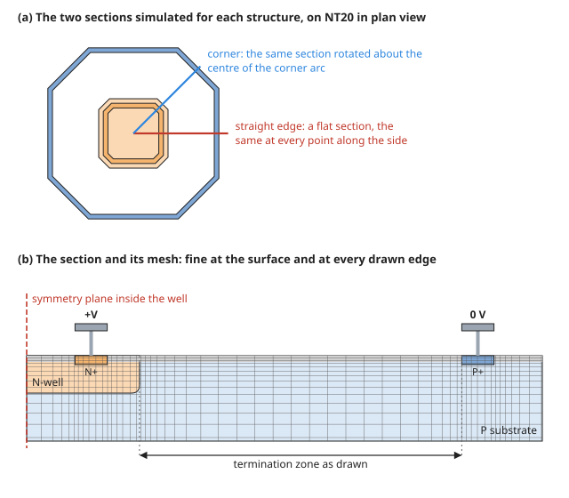
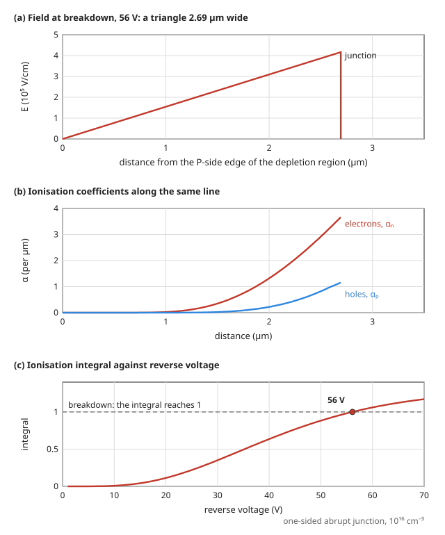
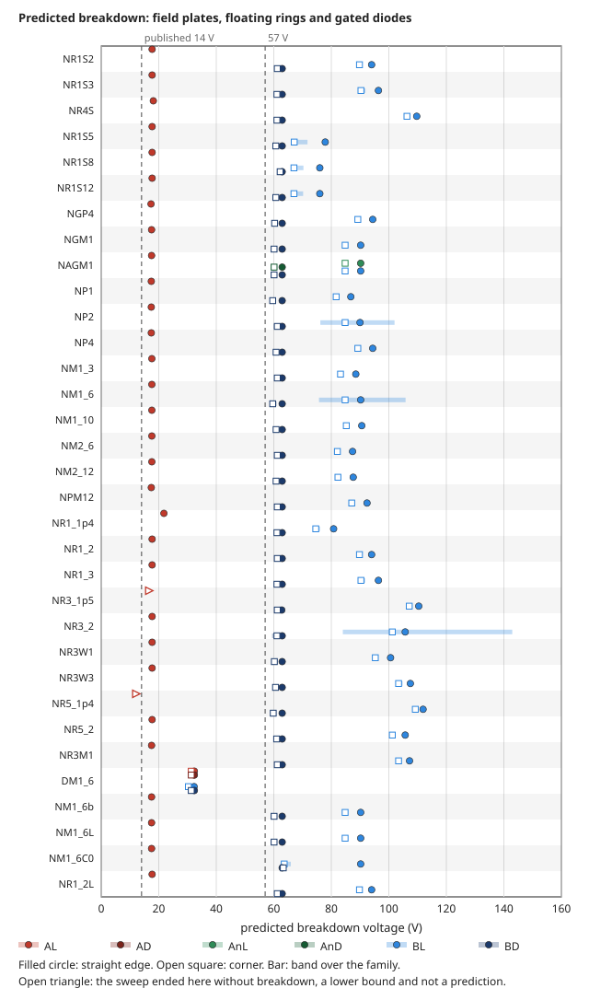
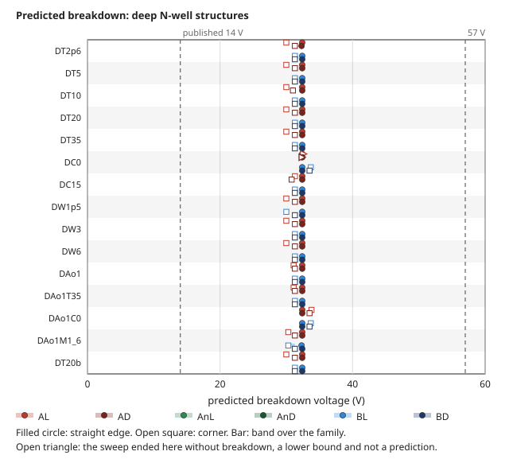
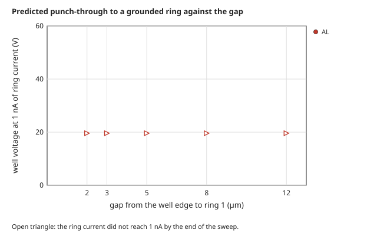
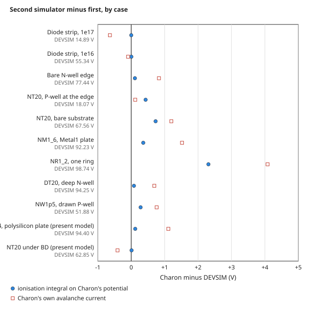

.. _hv-test-predictions:

Simulated breakdown voltages
============================

Each structure of the test die has a predicted breakdown voltage from
two-dimensional device simulation, under each assumption about where the
foundry places P-well. The predictions are made before any silicon is
measured, so that the measurement tests them
(:ref:`hv-test-method`). Every simulated value is in the tables and graphs
of `Predicted values`_, which are generated from one results file.

Simulated cross-sections
------------------------

The simulation reduces each structure to a cross-section along a radius,
built from the parameters that draw the layout
(:ref:`hv-test-structures`). The section runs from a symmetry plane inside
the well, across the termination zone, to beyond the P+ ring
(:numref:`fig-hvt-sim-section`). It holds the well, the N+ and P+ rings,
the N-well under the contact of a deep N-well, any rings, drawn P-well and
NAT, the trench oxide, and the plates in the
dielectric at their heights above the silicon [HV-GF180-IA-343]_.

Each structure is simulated twice. A straight side of the well is the flat
section itself. A corner is the same section in cylindrical coordinates,
turned about the centre of the corner's arc, which crowds the field as a
smooth corner does (:ref:`hv-junctions`). A sharp drawn corner is given a
radius of 1 µm, since the implant spreads sideways. The predicted breakdown
voltage of the structure is the lower of the two results. The wells on the
die have vertices and not smooth arcs (:ref:`hv-test-structures`), so a
corner result is an upper bound for the die.

         of the well: one through a straight side, simulated as a flat
         section, and one through a corner, simulated as the same section
         rotated about the centre of the corner arc. Bottom, the
         cross-section from a symmetry plane inside the well to beyond the
         P+ ring, with the well at +V and the P+ ring at 0 V. A mesh
         covers the silicon, fine at the surface and at each drawn edge,
         coarse deep in the substrate.

   The two sections simulated for each structure, and the mesh of one.

The simulator solves Poisson's equation with the drift and diffusion of
electrons and holes on a mesh of the section [HV-GF180-TCAD]_. The mesh is
fine at the surface and at every drawn edge, where the field changes
fastest. The well is stepped up in voltage with the P+ ring at 0 V, and the
potential is stored at each step.

Ionisation integral
-------------------

Breakdown is found from the stored potential, not from a current. A carrier
that crosses the depletion region frees new carriers at a rate per length
:math:`\alpha`, which rises steeply with the field
[HV-VANOVERSTRAETEN]_:

.. math::

   \alpha_\text{n}(E) &= a_\text{n} \exp(-b_\text{n}/E) \\
   \alpha_\text{p}(E) &= a_\text{p} \exp(-b_\text{p}/E)

The avalanche sustains itself when one electron entering the depletion
region frees, with all its descendants, one more pair. Along a field line
from the P side to the N side, that is the voltage at which the
:term:`ionisation integral` reaches 1 [HV-SZE-NG]_:

.. math::

   I_\text{n} &= \int_0^W \alpha_\text{n}(x) \, e^{-u(x)} \, dx \\
   u(x) &= \int_0^x (\alpha_\text{n} - \alpha_\text{p}) \, dx' \\
   I_\text{n} &= 1 \quad \text{at breakdown}

.. list-table::
   :header-rows: 1
   :widths: 20 60 20

   * - Symbol
     - Meaning
     - Unit
   * - :math:`I_\text{n}`
     - Ionisation integral for electrons
     - None
   * - :math:`u(x)`
     - Net ionisation between the start of the line and :math:`x`, which
       accounts for the pairs that holes free on their way back
     - None
   * - :math:`x`, :math:`W`
     - Distance along the field line from the P-side edge of the
       depletion region, and the length of the line
     - cm
   * - :math:`E`
     - Field at :math:`x`
     - V/cm
   * - :math:`\alpha_\text{n}`, :math:`\alpha_\text{p}`
     - Ionisation coefficients of electrons and holes
     - cm\ :sup:`-1`
   * - :math:`a_\text{n}`, :math:`b_\text{n}`
     - :math:`7.03 \times 10^{5}` and :math:`1.231 \times 10^{6}`
     - cm\ :sup:`-1`, V/cm
   * - :math:`a_\text{p}`, :math:`b_\text{p}`
     - :math:`1.582 \times 10^{6}` and :math:`2.036 \times 10^{6}` up to
       :math:`4 \times 10^{5}` V/cm; :math:`6.71 \times 10^{5}` and
       :math:`1.693 \times 10^{6}` above
     - cm\ :sup:`-1`, V/cm

In two dimensions the integral is taken along many field lines through
the region of highest field, and the largest value counts. The breakdown
voltage is where that value crosses 1, interpolated between voltage steps.

As a worked example in one dimension, take a junction with one side doped
at :math:`10^{16}` cm\ :sup:`-3` and the other far more heavily. Its field
is a triangle, zero at the edge of the depletion region and largest at the
junction (:numref:`fig-hvt-ionisation`). At 55 V the depletion region is
2.67 µm wide and the peak field is :math:`4.13 \times 10^{5}` V/cm, which
gives the coefficients at the junction:

.. math::

   \alpha_\text{n} &= 7.03 \times 10^{5} \times
     \exp\!\left(-\frac{1.231 \times 10^{6}}{4.13 \times 10^{5}}\right) \\
     &= 7.03 \times 10^{5} \times 0.0507
      = 3.56 \times 10^{4}\ \text{cm}^{-1} \\
   \alpha_\text{p} &= 6.71 \times 10^{5} \times
     \exp\!\left(-\frac{1.693 \times 10^{6}}{4.13 \times 10^{5}}\right) \\
     &= 1.11 \times 10^{4}\ \text{cm}^{-1}

An electron at the peak frees a pair every 0.28 µm, but the field falls
away within a micrometre. Summed along the line, the integral is 0.981 at
55 V and 1.060 at 60 V, and reaches 1 at 56 V
(:numref:`tab-hvt-ionisation`). The fit on :ref:`hv-junctions` gives 53 V
for the same doping (:numref:`tab-hv-flat-breakdown`).

.. list-table:: Ionisation integral of a one-sided junction doped at
               10\ :sup:`16` cm\ :sup:`-3`
   :name: tab-hvt-ionisation
   :header-rows: 1
   :widths: 25 25 25 25

   * - Reverse voltage (V)
     - Depletion width (µm)
     - Peak field (10\ :sup:`5` V/cm)
     - Ionisation integral
   * - 20
     - 1.61
     - 2.49
     - 0.113
   * - 30
     - 1.97
     - 3.05
     - 0.351
   * - 40
     - 2.27
     - 3.52
     - 0.635
   * - 50
     - 2.54
     - 3.93
     - 0.883
   * - 55
     - 2.67
     - 4.13
     - 0.981
   * - 60
     - 2.78
     - 4.31
     - 1.060

The values come from :download:`calc.py <calc.py>`, section 1.

         cubic centimetre. (a) The field at breakdown, 56 V: a triangle
         that rises from zero at the edge of the depletion region to
         4.2 times 10 to the 5 V/cm at the junction, 2.69 µm away. (b)
         The ionisation coefficients along the same line: both are
         negligible over the first micrometre, then the electron
         coefficient rises to 3.7 per micrometre and the hole coefficient
         to 1.2 per micrometre at the junction. (c) The ionisation
         integral against reverse voltage, rising from near zero at 10 V
         through 0.64 at 40 V to cross 1 at 56 V.

   Field, ionisation coefficients and ionisation integral of the worked
   example.

Calibration anchors
-------------------

The doping profiles of the wells and the substrate are not published, so
the simulation uses assumed profiles (:numref:`tab-hvt-profiles`). Each
region is a sum of implants that are Gaussian in depth and fall off
sideways beyond the drawn edge. The N-well and the P-well each have a
shallow, heavy part and a deeper, lighter part.

.. list-table:: Assumed doping profiles of the nominal process
   :name: tab-hvt-profiles
   :header-rows: 1
   :widths: 28 18 18 18 18

   * - Region
     - Peak (cm\ :sup:`-3`)
     - Depth of the peak (µm)
     - Vertical spread (µm)
     - Lateral spread (µm)
   * - Substrate, uniform
     - 3.56 × 10\ :sup:`15`
     - None
     - None
     - None
   * - N-well, shallow part
     - 2.5 × 10\ :sup:`17`
     - 0.32
     - 0.13
     - 0.08
   * - N-well, deep part
     - 4.63 × 10\ :sup:`16`
     - 1.42
     - 0.41
     - 0.29
   * - P-well, shallow part
     - 4 × 10\ :sup:`17`
     - 0.32
     - 0.13
     - 0.08
   * - P-well, deep part
     - 4 × 10\ :sup:`16`
     - 0.8
     - 0.4
     - 0.3
   * - Deep N-well
     - 2 × 10\ :sup:`17`
     - 2.55
     - 0.3
     - 0.3
   * - Deep P layer
     - 4.99 × 10\ :sup:`17`
     - 4.36
     - 0.3
     - 0.3

The spreads are standard deviations. The profiles are fitted to the
published values of :numref:`tab-hvt-anchors`. The deep P layer is not a
layer the process documents name. The fit needs it: the deep N-well's
published capacitance falls too slowly with voltage, and its breakdown
voltage is too low, for a well that faces only the light substrate.

.. list-table:: Published values used as anchors
   :name: tab-hvt-anchors
   :header-rows: 1
   :widths: 34 26 16 24

   * - Quantity
     - Published value
     - Source
     - Reproduced
   * - Capacitance, N-well to substrate
     - 1.4914 × 10\ :sup:`-4` F/m² at zero bias, grading 0.305
     - [HV-GF180-MODELS]_
     - Within 4 % from 0 V to 10 V with the deep P layer under the
       N-well, and not without it (:numref:`tab-hvt-mc-cap`)
   * - Sheet resistance of the N-well
     - 800 Ω, 1000 Ω and 1200 Ω per square
     - [HV-GF180-EP-5-1]_
     - 999 Ω per square under trench oxide
   * - Capacitance, deep N-well to substrate
     - 2.2998 × 10\ :sup:`-4` F/m² at zero bias, grading 0.147
     - [HV-GF180-MODELS]_
     - Within 11 %
   * - Breakdown, deep N-well to substrate
     - 30.48 V, a model parameter
     - [HV-GF180-MODELS]_
     - 32 V for the flat bottom, by a one-dimensional calculation
   * - Breakdown, N-well to substrate
     - 10 V minimum, 14 V typical
     - [HV-GF180-EP-5]_
     - 17 V to 18 V as an N-well to P-well junction, about 25 % high
   * - Thickness of the trench oxide
     - 0.32 µm
     - [HV-GF180-IA-343]_
     - Used as given

The anchors do not fix everything. Members of the family change the oxide
charge or the substrate doping round the nominal values
(:numref:`tab-hvt-processes`), and the spread of a structure's prediction
over a family is its band.

.. csv-table:: Simulated processes
   :name: tab-hvt-processes
   :file: hvt-tab-processes.csv
   :header-rows: 1
   :widths: 12 12 76

Process assumptions
-------------------

Two things about the process are assumed, each in more than one way
(:numref:`fig-hvt-assumptions`).

The first is where the P-well lies at the surface. Under assumption A the
foundry generates P-well wherever the layout has no N-well, no deep N-well
and no NAT. It reaches the edge of every N-well and stays 1.5 µm from a
deep N-well. Rule NAT.3 leaves a strip without NAT between an N-well and
the NAT layer (:numref:`tab-hvt-rules`), and under A the P-well fills that
strip. The variant An is A without P-well in the strip. Under assumption B
a P-well exists only where the layout draws one, and bare substrate
surrounds a plain well.

The second is where the deep P layer lies. Under L it lies under deep
N-well only. Under D it lies under the whole wafer, N-wells included.

Within this model D is the better supported. The profiles were fitted
with the layer present, and the N-well's simulated capacitance then stays
within 4 % of the published model from 0 V to 10 V. Without the layer
under the N-well it falls too fast, and the gap widens with voltage
(:numref:`tab-hvt-mc-cap`). These values, and those of the next two
tables, come from the final review and are not yet in a simulation record
(:numref:`tab-hvt-mc-source`).

.. csv-table:: Simulated N-well capacitance as a fraction of the
               published model, with and without the deep P layer under
               the N-well
   :name: tab-hvt-mc-cap
   :file: hvt-tab-mc-cap.csv
   :header-rows: 1

.. csv-table:: Origin of the values taken from the final review
   :name: tab-hvt-mc-source
   :file: hvt-tab-mc-source.csv
   :header-rows: 1
   :widths: 20 80

Capacitance alone does not prove a layer. Any substrate whose doping
rises with depth would have the same effect, so the evidence is for heavier doping under
the N-well and not for one particular layer. The capacitance wells measure
it (:ref:`hv-test-method`).

Under D a plain N-well cannot hold more than its flat bottom does
(:numref:`tab-hvt-pred-key`). How firm that ceiling is depends on the
depth of the layer (:numref:`tab-hvt-cap-sens`). The N-well capacitance
fixes the depth to about a quarter of a micrometre, but only if the
published model is itself right to a few per cent. The last row of the
table gives the range that follows, before the 10 % to 25 % by which the
simulation runs high.

.. csv-table:: Simulated ceiling of a plain N-well under D against the
               depth of the deep P layer
   :name: tab-hvt-cap-sens
   :file: hvt-tab-mc-ceiling.csv
   :header-rows: 1
   :widths: 60 40

A process name joins the two: BL is assumption B with the layer under
deep N-well only. A further letter marks a member of the family, such as
BLq with oxide charge. A leading G is the same process on a gated diode
whose plate is held at 0 V; without it, the plate is joined to the well.
Under A, an N-well structure breaks down at its surface long before a
layer 4 µm down can matter, so it is simulated once and the AL value
stands for AD as well.

.. figure:: hvt-assumptions.svg
   :name: fig-hvt-assumptions
   :alt: Six cross-sections. NT20 under AL: a generated P-well covers the
         surface from the N-well edge outwards, past the P+ ring. NA2
         under AL: P-well lies in the 2 µm strip between the well and the
         NAT layer and around the P+ ring, with bare substrate under the
         NAT layer. NA2 under AnL: the same without P-well in the strip.
         NT20 under BL: no P-well, and bare substrate from the well edge
         to the P+ ring. NT20 under BD: the same, with a deep P layer
         across the whole section below the well. DT20 under every
         assumption: a deep N-well with the deep P layer under it.

   Where the P-well and the deep P layer lie under each assumption.

Predicted values
----------------

The predictions are read from ``predictions.json`` beside this page, which
a script builds from the records of the simulation runs
(:numref:`tab-hvt-pred-source`). :numref:`fig-hvt-pred-bv`,
:numref:`fig-hvt-pred-bv2` and :numref:`fig-hvt-pred-bv3` plot the nominal
process of each family with the family's band. The tables give every
process: :numref:`tab-hvt-pred-a` for A and An, :numref:`tab-hvt-pred-b`
for B, and :numref:`tab-hvt-pred-g` for the gated diodes with their plate
at 0 V.

Each cell holds the straight-edge and the corner value. A value written
"> 36.3" is not a prediction. The sweep ended at that voltage without
breakdown, at its limit or because the solver stopped converging, so the
structure holds at least that much in the simulation. "Failed" marks a run
that gave no result, and a dash a case that was not simulated. Structures
that are absent from a table have no result yet. The failed cases under AL
are three-ring structures, where the solver gives up at 0 V with P-well
between the rings; their counterparts that did run all give the value of
the plain well under AL.

.. csv-table:: Source of the predictions
   :name: tab-hvt-pred-source
   :file: hvt-tab-pred-source.csv
   :header-rows: 1
   :widths: 25 75

.. figure:: hvt-pred-bv.svg
   :name: fig-hvt-pred-bv
   :alt: Chart with one row per plain, drawn P-well and NAT structure and
         a horizontal axis of predicted breakdown voltage. Each family of
         processes has a colour. A filled circle marks the straight-edge
         value and an open square the corner value of the nominal
         process, and a bar the band over the family. An open triangle
         marks a sweep that ended without breakdown. Dashed vertical lines
         mark the published 14 V and the 57 V of an Ethernet cable. The
         values are those of the prediction tables.

   Predicted breakdown voltage of the plain, drawn P-well and NAT
   structures.

         structures: one row per structure, a filled circle for the
         straight edge and an open square for the corner of each nominal
         process, a bar for the band of each family, and an open triangle
         where a sweep ended without breakdown.

   Predicted breakdown voltage of the field-plate, floating-ring and
   gated-diode structures.

         every family lies in one narrow column a little above 30 V,
         between the published 14 V and the 57 V of an Ethernet cable.

   Predicted breakdown voltage of the deep N-well structures.

.. csv-table:: Predicted breakdown under assumptions A and An
   :name: tab-hvt-pred-a
   :file: hvt-tab-pred-a.csv
   :header-rows: 1

.. csv-table:: Predicted breakdown under assumption B
   :name: tab-hvt-pred-b
   :file: hvt-tab-pred-b.csv
   :header-rows: 1

.. csv-table:: Predicted breakdown of the gated diodes with the plate at
               0 V
   :name: tab-hvt-pred-g
   :file: hvt-tab-pred-g.csv
   :header-rows: 1

A family is one answer to both assumptions, such as BL, with its members.
The band of a structure under a family is formed in two steps
(:numref:`tab-hvt-pred-band`). Each process of the family gives the lower
of its edge and corner values. The band runs from the lowest to the
highest of those. The G processes are in no band. A process is left out
when one of its runs failed, or ended below the breakdown voltage of the
other shape, because its lower value is then unknown. The agreement range
is the band widened by 30 % downwards and 15 % upwards, lopsided because
the simulation runs high. The table also names each structure's reference
and gives the predicted ratio of the two breakdown voltages, which is the
main comparison of :ref:`hv-test-method`. A ratio is formed from the
nominal process of the family. The reference is NT20, NW0 under
assumption A, and DT20 for a deep N-well. Under An the plates over NAT
take NA0p6 instead: NT20 has no NAT and is limited by P-well under An, so
it is not the plain well that those plates improve on. The last column lists what the simulation
left open.

.. csv-table:: Band and agreement range of each prediction
   :name: tab-hvt-pred-band
   :file: hvt-tab-pred-band.csv
   :header-rows: 1

Copies and lead controls have no simulation of their own. A copy is the
same drawing, and a two-dimensional section cannot contain the Metal5
lead, so each takes the section and the values of its original.

For the structures with a pad on ring 1, the simulation also records how
far the potential of the ring rises at each well voltage, on the
straight-edge section (:numref:`fig-hvt-pred-ring`). The measured curve
of procedure P3 is compared with it.

A second set of runs holds ring 1 at 0 V through a contact, as procedure
P5 does, and sweeps the well. The well current times the perimeter of
ring 1 is the current that P5 measures, and the well voltage at which it
reaches 1 nA is the predicted punch-through voltage
(:numref:`tab-hvt-p5`, :numref:`fig-hvt-p5`). The second value of each
cell is the breakdown voltage with the ring grounded. Where the first
value is above the second, or is a lower bound, the junction breaks down
before the ring draws 1 nA.

.. csv-table:: Predicted punch-through voltage and breakdown voltage
               with ring 1 held at 0 V
   :name: tab-hvt-p5
   :file: hvt-tab-p5.csv
   :header-rows: 1

         grounded ring reaches 1 nA, against the gap from the well to the
         ring at 2, 3, 5, 8 and 12 µm, one curve per process, with an open
         triangle where the current did not reach 1 nA by the end of the
         sweep. The graph reads "not yet simulated" until the results file
         of these runs exists.

   Predicted punch-through voltage to a grounded ring against the gap.

.. figure:: hvt-pred-ring.svg
   :name: fig-hvt-pred-ring
   :alt: Graph of the predicted rise of ring 1 against well voltage for
         the ring-sense structures that have a result, solid under
         process BL and dashed under BD. A grey diagonal marks ring
         voltage equal to well voltage. The ring 2 µm from the well leaves
         zero within the first volts and the ring 3 µm away after about
         12 V. Each then rises nearly parallel to the diagonal, a step
         below it. The BD curves follow the BL ones and end earlier.

   Predicted rise of ring 1 against well voltage.

Main results
------------

:numref:`tab-hvt-pred-key` collects the structures that carry the main
results. Its values are a subset of the tables above.

.. csv-table:: Predictions of the structures that carry the main results
   :name: tab-hvt-pred-key
   :file: hvt-tab-pred-key.csv
   :header-rows: 1

The two assumptions each set a ceiling, and a termination matters only
below both:

* Under A, every N-well structure breaks down at almost the same low
  voltage, whatever its termination. The junction between the N-well and
  the P-well at the surface fails before any plate or ring can act.
* Under An, the N-wells with NAT behave as under B.
* Under BD, every N-well with a clear edge stops at one voltage a little
  above 57 V, whatever its termination. The flat bottom of the well
  breaks down against the deep layer.
* Every deep N-well structure breaks down a little above 30 V under every
  assumption, at the bottom of the well. No termination changes it, so a
  deep N-well is not a way to hold 57 V in this model. The result is
  partly built in: the simulated deep N-well is a buried layer with
  almost no donors at the surface. If the real well is N-type up to the
  surface, its published breakdown could be set at the edge, and the
  structures with a close ring, a P-well or NAT would show it.

Only under BL do the terminations differ, in ways the die can test:

* A plain edge holds more than 57 V, and its corner section less than the
  edge.
* A P+ ring 1 µm from the well lowers the breakdown voltage a long way,
  but not to the published value.
* A drawn P-well at 0 µm brings the edge down to the value of assumption
  A. It still costs a third at 1.5 µm and a little at 3 µm.
* Plates of Metal1, Metal2 and polysilicon all raise the edge, by a tenth
  to a quarter. A polysilicon plate of 4 µm gains most.
* One floating ring raises the edge about as much as a plate, more at a
  gap of 2 µm or 3 µm than at 1.4 µm.
* A gated plate held at 0 V lowers the breakdown voltage below that of
  the plain well.
* Oxide charge of 10\ :sup:`11` cm\ :sup:`-2` moves the results by a few
  volts at most.

Sharp corners are the exception to these results
(:numref:`tab-hvt-pred-key`). The section of a square corner, at a radius
of 1 µm, breaks down below 57 V under BL, far below the straight edge of
the same well. A Metal1 plate lifts the square corner above 57 V, but
leaves it well short of the same plate on a cut corner. A well that must
hold the working voltage therefore needs cut corners and a plate, not one
of the two. The deep N-well is indifferent to its corner, as to everything
else at its edge.

These sections needed 128-bit arithmetic to reach breakdown. In double
precision they stalled part of the way, and the breakdown voltage was
first estimated by extending the ionisation integral in a straight line.
The later result agrees with that estimate (:numref:`tab-hvt-mc-corner`).
The members of the doping family other than the nominal ones still show
the stalled sweeps, as lower bounds.

.. csv-table:: Earlier extrapolation of the sharp-corner section against
               the converged result
   :name: tab-hvt-mc-corner
   :file: hvt-tab-mc-corner.csv
   :header-rows: 1
   :widths: 55 45

A few cases have no result: their runs failed or stopped short of breakdown,
and the tables mark them (:numref:`tab-hvt-pred-source`). The structures
with three or more rings took hours each, because the solver needs small
voltage steps while each ring is reached in turn. NW0 under B and NT1 have
a heavy P region within 1.5 µm of the edge, and are simulated on the same
fine mesh as the abutting junctions.

Second simulator
----------------

A second simulator, Charon, repeats eleven cases on the identical mesh and
doping [HV-GF180-TCAD]_: two one-dimensional diodes, a bare N-well edge,
and eight sections of the die. It differs from the first in the ways that
matter for a cross-check (:numref:`tab-hvt-crosscheck-source`). Its
equations include the generation of carriers by impact ionisation, so its
current itself runs away at breakdown, and it discretises the equations
differently. The six die sections use the doping family from before the
fit to the deep N-well, so their voltages are not the present
predictions. The comparison is between the two methods.

Each case has three values (:numref:`tab-hvt-crosscheck`,
:numref:`fig-hvt-crosscheck`): the ionisation integral on the first
simulator's potential, the same integral on Charon's potential, and the
voltage at which Charon's own avalanche current runs away. The two
integrals test whether the simulators agree on the field. The current
tests the integral as a criterion.

.. csv-table:: Set-up of the second simulator
   :name: tab-hvt-crosscheck-source
   :file: hvt-tab-crosscheck-source.csv
   :header-rows: 1
   :widths: 30 70

.. csv-table:: Breakdown voltage of the cross-check cases
   :name: tab-hvt-crosscheck
   :file: hvt-tab-crosscheck.csv
   :header-rows: 1

         Charon's breakdown voltage minus that of the first simulator,
         from minus 1 V to plus 5 V. A filled circle marks the ionisation
         integral on Charon's potential and an open square the voltage at
         which Charon's own avalanche current runs away. Both lie within
         about 1.5 V of zero for every case except the floating ring,
         where the integral is 2.3 V and the current 4.1 V above the
         first simulator.

   Difference between the second simulator and the first, by case.

The two integrals agree within 2.5 % on every case. Charon's own current
runs away within 2 % of the first simulator's value on seven cases. On
the more heavily doped diode it is 4 % low: Charon's hole coefficient has
only the low-field branch, which overstates hole ionisation at that
junction's high field. On the floating ring it is 4 % high.
Charon's ring sits a little lower than the first simulator's at every
well voltage (:numref:`tab-hvt-crosscheck-ring`), which goes with its
shorter carrier lifetime, and its breakdown voltage is higher by a few
per cent.

.. csv-table:: Rise of the floating ring in the two simulators, on the
               one-ring case
   :name: tab-hvt-crosscheck-ring
   :file: hvt-tab-crosscheck-ring.csv
   :header-rows: 1

Two of the cases use the present doping family: the polysilicon plate, whose
first simulation was wrong, and the plain well with the deep P layer under
the whole wafer. The cross-check has two gaps. Charon has no cylindrical
coordinates, so no corner section is checked. Its peak field on the die
sections is lower than the first simulator's by an amount that is not
explained (:numref:`tab-hvt-crosscheck-source`).

Limits of the predictions
-------------------------

A prediction is a statement about an assumed process, not about the
silicon. These limits bound what it can say:

* The absolute voltages may be 10 % to 25 % high. The ionisation
  coefficients give 14.9 V for a one-sided junction doped at
  10\ :sup:`17` cm\ :sup:`-3`, and the simulated N-well to P-well
  junction is 25 % above the published typical value.
* The ionisation integral changes slowly near 1. A 5 % error in the
  integral moves the breakdown voltage by about 4.5 %.
* The profiles are assumed. They reproduce the published capacitances and
  the deep N-well's breakdown, and nothing measures them directly.
* The sections are two-dimensional, and a corner is a smooth arc. The die
  has vertices, which no section represents. An arc of 1 µm radius in
  cylindrical coordinates stands in for a 90° vertex, and the 135° vertices
  of every other structure are not simulated at all. The design rules
  allow only 45° edges on a well, so a product would have the same
  vertices.
* A floating ring is simulated with the ionisation path ending at the
  ring.
* The Metal5 lead and the leads to second pads are left out. They cross the
  termination zone at one place on each structure.
* The oxide charge is a single fixed value per process. Charge that moves
  or is trapped during the sweep, the cause of :term:`walk-out`, is not
  simulated.
* Peak fields in the oxide and currents are not reported. The field at
  the corner of a plate is singular on any mesh, and the currents are at
  the level of numerical noise.
* The simulation is at 300 K, and its criterion is the ionisation
  integral. The measurement's criterion is a current of 1 µA. The two
  coincide for a sharp knee and differ where leakage comes first.

Open questions
--------------

* Does the deep P layer exist, and does it lie under N-wells too? The fit
  to the published capacitances needs heavier doping at depth under both
  wells, and no public document names such a layer.
* Is the deep N-well N-type up to the surface? The model assumes a buried
  layer.
* What does a vertex of 90° or 135° hold against the smooth arc of a
  corner section? The section of 1 µm radius is a stand-in for the first,
  and nothing represents the second.
* Why does the simulated N-well to P-well junction break down about 25 %
  above the published typical value, and does the same error apply to the
  other structures?
* Why is Charon's peak field lower on the die sections, and does the
  cross-check hold for a polysilicon plate?
* What oxide charge fits the published field thresholds, and does the same
  value apply over trench oxide beside a well?
