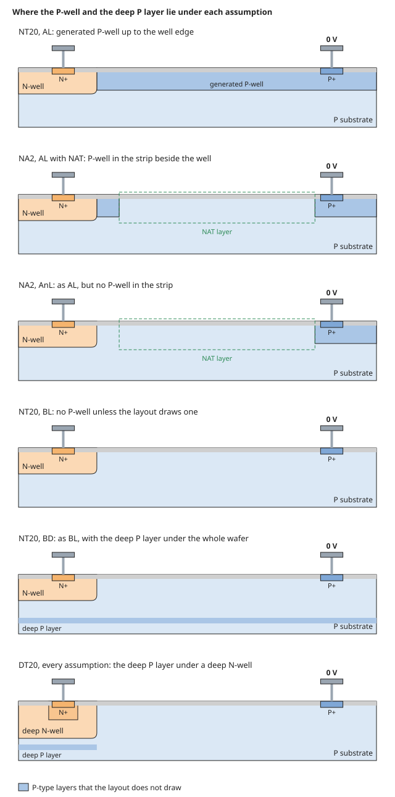
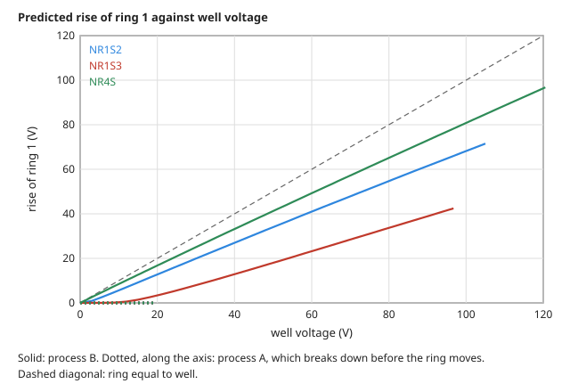

.. _hv-test-predictions:

Simulated breakdown voltages
============================

Each structure of the test die has a predicted breakdown voltage from
two-dimensional device simulation, under each assumption about where the
foundry places P-well. The predictions are made before any silicon is
measured, so that the measurement tests them
(:ref:`hv-test-method`). Every simulated value is in the tables and graphs
of `Predicted values`_, which are generated from one results file.

Simulated cross-sections
------------------------

The simulation reduces each structure to a cross-section along a radius,
built from the parameters that draw the layout
(:ref:`hv-test-structures`). The section runs from a symmetry plane inside
the well, across the termination zone, to beyond the P+ ring
(:numref:`fig-hvt-sim-section`). It holds the well, the N+ and P+ rings,
the N-well under the contact of a deep N-well, any rings, drawn P-well and
NAT, the trench oxide, and the plates in the
dielectric at their heights above the silicon [HV-GF180-IA-343]_.

Each structure is simulated twice. A straight side of the well is the flat
section itself. A corner is the same section in cylindrical coordinates,
turned about the centre of the corner's arc, which crowds the field as a
real corner does (:ref:`hv-junctions`). A sharp drawn corner is given a
small radius, since the implant spreads sideways. The predicted breakdown
voltage of the structure is the lower of the two results.

.. figure:: hvt-sim-section.svg
   :name: fig-hvt-sim-section
   :alt: Top, a plan view of structure NT20 with two lines from the centre
         of the well: one through a straight side, simulated as a flat
         section, and one through a corner, simulated as the same section
         rotated about the centre of the corner arc. Bottom, the
         cross-section from a symmetry plane inside the well to beyond the
         P+ ring, with the well at +V and the P+ ring at 0 V. A mesh
         covers the silicon, fine at the surface and at each drawn edge,
         coarse deep in the substrate.

   The two sections simulated for each structure, and the mesh of one.

The simulator solves Poisson's equation with the drift and diffusion of
electrons and holes on a mesh of the section [HV-GF180-TCAD]_. The mesh is
fine at the surface and at every drawn edge, where the field changes
fastest. The well is stepped up in voltage with the P+ ring at 0 V, and the
potential is stored at each step.

Ionisation integral
-------------------

Breakdown is found from the stored potential, not from a current. A carrier
that crosses the depletion region frees new carriers at a rate per length
:math:`\alpha`, which rises steeply with the field
[HV-VANOVERSTRAETEN]_:

.. math::

   \alpha_\text{n}(E) &= a_\text{n} \exp(-b_\text{n}/E) \\
   \alpha_\text{p}(E) &= a_\text{p} \exp(-b_\text{p}/E)

The avalanche sustains itself when one electron entering the depletion
region frees, with all its descendants, one more pair. Along a field line
from the P side to the N side, that is the voltage at which the
:term:`ionisation integral` reaches 1 [HV-SZE-NG]_:

.. math::

   I_\text{n} &= \int_0^W \alpha_\text{n}(x) \, e^{-u(x)} \, dx \\
   u(x) &= \int_0^x (\alpha_\text{n} - \alpha_\text{p}) \, dx' \\
   I_\text{n} &= 1 \quad \text{at breakdown}

.. list-table::
   :header-rows: 1
   :widths: 20 60 20

   * - Symbol
     - Meaning
     - Unit
   * - :math:`I_\text{n}`
     - Ionisation integral for electrons
     - None
   * - :math:`u(x)`
     - Net ionisation between the start of the line and :math:`x`, which
       accounts for the pairs that holes free on their way back
     - None
   * - :math:`x`, :math:`W`
     - Distance along the field line from the P-side edge of the
       depletion region, and the length of the line
     - cm
   * - :math:`E`
     - Field at :math:`x`
     - V/cm
   * - :math:`\alpha_\text{n}`, :math:`\alpha_\text{p}`
     - Ionisation coefficients of electrons and holes
     - cm\ :sup:`-1`
   * - :math:`a_\text{n}`, :math:`b_\text{n}`
     - :math:`7.03 \times 10^{5}` and :math:`1.231 \times 10^{6}`
     - cm\ :sup:`-1`, V/cm
   * - :math:`a_\text{p}`, :math:`b_\text{p}`
     - :math:`1.582 \times 10^{6}` and :math:`2.036 \times 10^{6}` up to
       :math:`4 \times 10^{5}` V/cm; :math:`6.71 \times 10^{5}` and
       :math:`1.693 \times 10^{6}` above
     - cm\ :sup:`-1`, V/cm

In two dimensions the integral is taken along many field lines through
the region of highest field, and the largest value counts. The breakdown
voltage is where that value crosses 1, interpolated between voltage steps.

As a worked example in one dimension, take a junction with one side doped
at :math:`10^{16}` cm\ :sup:`-3` and the other far more heavily. Its field
is a triangle, zero at the edge of the depletion region and largest at the
junction (:numref:`fig-hvt-ionisation`). At 55 V the depletion region is
2.67 µm wide and the peak field is :math:`4.13 \times 10^{5}` V/cm, which
gives the coefficients at the junction:

.. math::

   \alpha_\text{n} &= 7.03 \times 10^{5} \times
     \exp\!\left(-\frac{1.231 \times 10^{6}}{4.13 \times 10^{5}}\right) \\
     &= 7.03 \times 10^{5} \times 0.0507
      = 3.56 \times 10^{4}\ \text{cm}^{-1} \\
   \alpha_\text{p} &= 6.71 \times 10^{5} \times
     \exp\!\left(-\frac{1.693 \times 10^{6}}{4.13 \times 10^{5}}\right) \\
     &= 1.11 \times 10^{4}\ \text{cm}^{-1}

An electron at the peak frees a pair every 0.28 µm, but the field falls
away within a micrometre. Summed along the line, the integral is 0.981 at
55 V and 1.060 at 60 V, and reaches 1 at 56 V
(:numref:`tab-hvt-ionisation`). The fit on :ref:`hv-junctions` gives 53 V
for the same doping (:numref:`tab-hv-flat-breakdown`).

.. list-table:: Ionisation integral of a one-sided junction doped at
               10\ :sup:`16` cm\ :sup:`-3`
   :name: tab-hvt-ionisation
   :header-rows: 1
   :widths: 25 25 25 25

   * - Reverse voltage (V)
     - Depletion width (µm)
     - Peak field (10\ :sup:`5` V/cm)
     - Ionisation integral
   * - 20
     - 1.61
     - 2.49
     - 0.113
   * - 30
     - 1.97
     - 3.05
     - 0.351
   * - 40
     - 2.27
     - 3.52
     - 0.635
   * - 50
     - 2.54
     - 3.93
     - 0.883
   * - 55
     - 2.67
     - 4.13
     - 0.981
   * - 60
     - 2.78
     - 4.31
     - 1.060

The values come from :download:`calc.py <calc.py>`, section 1.

.. figure:: hvt-ionisation.svg
   :name: fig-hvt-ionisation
   :alt: Three graphs for a one-sided junction doped at 10 to the 16 per
         cubic centimetre. (a) The field at breakdown, 56 V: a triangle
         that rises from zero at the edge of the depletion region to
         4.2 times 10 to the 5 V/cm at the junction, 2.69 µm away. (b)
         The ionisation coefficients along the same line: both are
         negligible over the first micrometre, then the electron
         coefficient rises to 3.7 per micrometre and the hole coefficient
         to 1.2 per micrometre at the junction. (c) The ionisation
         integral against reverse voltage, rising from near zero at 10 V
         through 0.64 at 40 V to cross 1 at 56 V.

   Field, ionisation coefficients and ionisation integral of the worked
   example.

Calibration anchors
-------------------

The doping profiles of the wells and the substrate are not published, so
the simulation uses assumed profiles (:numref:`tab-hvt-profiles`). Each
well is a sum of implants that are Gaussian in depth and fall off sideways
beyond the drawn edge. The N-well and the P-well each have a shallow,
heavy part and a deeper, light part.

.. list-table:: Assumed doping profiles of the nominal process
   :name: tab-hvt-profiles
   :header-rows: 1
   :widths: 28 18 18 18 18

   * - Region
     - Peak (cm\ :sup:`-3`)
     - Depth of the peak (µm)
     - Vertical spread (µm)
     - Lateral spread (µm)
   * - Substrate, uniform
     - 3.5 × 10\ :sup:`15`
     - None
     - None
     - None
   * - N-well, shallow part
     - 2.5 × 10\ :sup:`17`
     - 0.32
     - 0.13
     - 0.08
   * - N-well, deep part
     - 3 × 10\ :sup:`16`
     - 0.9
     - 0.5
     - 0.35
   * - P-well, shallow part
     - 4 × 10\ :sup:`17`
     - 0.32
     - 0.13
     - 0.08
   * - P-well, deep part
     - 4 × 10\ :sup:`16`
     - 0.8
     - 0.4
     - 0.3
   * - Deep N-well
     - 4 × 10\ :sup:`16`
     - 1.5
     - 0.7
     - 0.5

The spreads are standard deviations. The profiles are chosen to reproduce
the published values of :numref:`tab-hvt-anchors`, and they do so only in
part. The N-well's sheet resistance falls inside the published range, and
its capacitance at zero bias is within 15 % of the model's. An N-well
touching a P-well breaks down at 17 V to 18 V in the simulation, against
14 V typical and 10 V minimum published, so the model is about 25 % high
at that junction. The deep N-well does not reproduce its model value of
30.48 V at all: the simulated edge holds far more
(:numref:`tab-hvt-pred-key`).

.. list-table:: Published values used as anchors
   :name: tab-hvt-anchors
   :header-rows: 1
   :widths: 36 28 18 18

   * - Quantity
     - Published value
     - Source
     - Reproduced
   * - Breakdown, N-well to substrate
     - 10 V minimum, 14 V typical
     - [HV-GF180-EP-5]_
     - About 25 % high, as an N-well to P-well junction
   * - Breakdown, deep N-well to substrate
     - 30.48 V, a model parameter
     - [HV-GF180-MODELS]_
     - No
   * - Capacitance, N-well to substrate at zero bias
     - 1.4914 × 10\ :sup:`-4` F/m², grading 0.305
     - [HV-GF180-MODELS]_
     - Within 15 %
   * - Capacitance, deep N-well to substrate at zero bias
     - 2.2998 × 10\ :sup:`-4` F/m², grading 0.147
     - [HV-GF180-MODELS]_
     - Not tested
   * - Sheet resistance of the N-well
     - 800 Ω, 1000 Ω and 1200 Ω per square
     - [HV-GF180-EP-5-1]_
     - Within the range
   * - Thickness of the trench oxide
     - 0.32 µm
     - [HV-GF180-IA-343]_
     - Used as given

The anchors do not fix the profiles, so the simulation runs a family of
processes round the nominal one (:numref:`tab-hvt-processes`). Members
change the substrate doping to 2 × 10\ :sup:`15` or 5 × 10\ :sup:`15`
cm\ :sup:`-3`, or add fixed charge at the oxide. The spread of a
structure's prediction over a family is its band.

.. csv-table:: Simulated processes
   :name: tab-hvt-processes
   :file: hvt-tab-processes.csv
   :header-rows: 1
   :widths: 12 12 76

Process assumptions
-------------------

The assumptions differ in where the P-well lies
(:numref:`fig-hvt-assumptions`). Under assumption A the foundry generates
P-well wherever the layout has no N-well, no deep N-well and no NAT. It
reaches the edge of every N-well, stays 1.5 µm from a deep N-well, and is
there whether or not the layout also draws one. Under assumption B a
P-well exists only where the layout draws one, and bare substrate
surrounds a plain well.

Rule NAT.3 leaves a strip without NAT between an N-well and the NAT layer
(:numref:`tab-hvt-rules`). Under A the P-well fills that strip. The
variant An is A without P-well in the strip. On a deep N-well the NAT
layer overlaps the edge, no strip exists, and A and An agree.

A process name gives its family. Names that start with A, An or B belong
to that assumption, and further letters mark a member of the doping
family. A name that starts with G is the process named after the G, on a
gated diode whose plate is held at 0 V. Under the plain name, the plate of
a gated diode is joined to the well.

         covers the surface from the N-well edge outwards, past the P+
         ring. NA2 under assumption A: P-well lies in the 2 µm strip
         between the well and the NAT layer and around the P+ ring, with
         bare substrate under the NAT layer. NA2 under assumption An: the
         same without P-well in the strip. DAo1 under assumption A: the
         NAT layer overlaps the edge of the deep N-well, so no strip
         exists and only bare substrate lies beside the junction. NT20
         under assumption B: no P-well, and bare substrate from the well
         edge to the P+ ring.

   Where the P-well lies under each assumption.

Predicted values
----------------

The predictions are read from ``predictions.json`` beside this page, which
a script builds from the records of the simulation runs
(:numref:`tab-hvt-pred-source`). :numref:`fig-hvt-pred-bv` and
:numref:`fig-hvt-pred-bv2` plot the nominal processes with the band of
each family. The tables give every process: :numref:`tab-hvt-pred-a` for
A and An, :numref:`tab-hvt-pred-b` for B, and :numref:`tab-hvt-pred-g` for
the gated diodes with their plate at 0 V.

Each cell holds the straight-edge and the corner value. A value written
"> 60.0" is not a prediction. The sweep ended at that voltage without
breakdown, at its limit or because the solver stopped converging, so the
structure holds at least that much in the simulation. A dash marks a case
that was not simulated.

.. csv-table:: Source of the predictions
   :name: tab-hvt-pred-source
   :file: hvt-tab-pred-source.csv
   :header-rows: 1
   :widths: 25 75

.. figure:: hvt-pred-bv.svg
   :name: fig-hvt-pred-bv
   :alt: Chart with one row per structure of groups 1 to 4 and a
         horizontal axis of predicted breakdown voltage. Each family has a
         colour: A, An and B. A filled circle marks the straight-edge
         value and an open square the corner value of the nominal
         process, and a bar the band over the family. An open triangle
         marks a sweep that ended without breakdown. Dashed vertical lines
         mark the published 14 V and the 57 V of an Ethernet cable. The
         values are those of the tables for processes A, An and B.

   Predicted breakdown voltage of the plain, drawn P-well, NAT and deep
   N-well structures.

.. figure:: hvt-pred-bv2.svg
   :name: fig-hvt-pred-bv2
   :alt: The same chart for the field-plate, floating-ring and gated-diode
         structures: one row per structure, a filled circle for the
         straight edge and an open square for the corner of each nominal
         process, a bar for the band of each family, and an open triangle
         where a sweep ended without breakdown.

   Predicted breakdown voltage of the field-plate, floating-ring and
   gated-diode structures.

.. csv-table:: Predicted breakdown under assumptions A and An
   :name: tab-hvt-pred-a
   :file: hvt-tab-pred-a.csv
   :header-rows: 1

.. csv-table:: Predicted breakdown under assumption B
   :name: tab-hvt-pred-b
   :file: hvt-tab-pred-b.csv
   :header-rows: 1

.. csv-table:: Predicted breakdown of the gated diodes with the plate at
               0 V
   :name: tab-hvt-pred-g
   :file: hvt-tab-pred-g.csv
   :header-rows: 1

The band of a structure under one assumption is formed in two steps
(:numref:`tab-hvt-pred-band`). Each process of the family gives the lower
of its edge and corner values. The band runs from the lowest to the
highest of those. The G processes are in no band. A process is left out
when one of its sweeps ended below the breakdown voltage of the other
shape, because its lower value is then unknown. The agreement range is the
band widened by 15 % at each end, the tolerance that
:ref:`hv-test-method` applies to a measurement. The last column lists what
the simulation left open for that structure.

.. csv-table:: Band and agreement range of each prediction
   :name: tab-hvt-pred-band
   :file: hvt-tab-pred-band.csv
   :header-rows: 1

For the structures with a pad on ring 1, the simulation also records how
far the potential of the ring rises at each well voltage, on the
straight-edge section (:numref:`fig-hvt-pred-ring`). The measured curve
of procedure P3 is compared with it.

         solid curve per ring-sense structure under process B. A dashed
         diagonal marks ring voltage equal to well voltage. Each curve
         leaves zero within the first volts and then rises nearly parallel
         to the diagonal, a step below it. Dotted curves for process A lie
         on the axis and end near 20 V, where the junction breaks down
         before the ring moves.

   Predicted rise of ring 1 against well voltage.

Main results
------------

:numref:`tab-hvt-pred-key` collects the structures that carry the main
results. Its values are a subset of the tables above.

.. csv-table:: Predictions of the structures that carry the main results
   :name: tab-hvt-pred-key
   :file: hvt-tab-pred-key.csv
   :header-rows: 1

Under assumption A, every N-well structure breaks down at almost the same
low voltage, whatever its termination. The junction between the N-well and
the P-well at the surface fails before any plate or ring can act. The only
structures that escape are those that A leaves without P-well: the deep
N-well with NAT over its edge and, under An, the N-wells with NAT.

Under assumption B the terminations differ, in ways the die can test:

* A plain edge holds more than 57 V, its corner less than the edge, and a
  sharp corner less again.
* A drawn P-well costs nothing from 6 µm away, a clear amount at 1.5 µm,
  and at 0 µm brings the edge down to the value of assumption A.
* Metal1 plates of 6 µm to 10 µm raise the edge by about a third, and the
  gain flattens beyond 6 µm.
* Polysilicon plates lower the breakdown voltage, and more so the longer
  they are. The trench oxide under them is thin, so the breakdown moves
  from the junction to the end of the plate (:ref:`hv-grading`). With a
  polysilicon plate held at 0 V, the field in the oxide reaches about
  3 MV/cm in the simulation.
* One floating ring at 2 µm raises the edge by almost half, and three to
  five rings raise it further.
* A deep N-well edge holds more than an N-well edge.
* Oxide charge of 10\ :sup:`11` cm\ :sup:`-2` moves the results by a few
  volts at most.

Three sets of cases did not finish. The corner sections of sharp deep
N-well corners stopped converging well below the edge value, with the
ionisation integral still far below 1. The structure with five rings at
the wider gaps did not converge. Several ring structures with oxide
charge gave no result (:numref:`tab-hvt-pred-source`). None of these is a
prediction of early breakdown.

Second simulator
----------------

A second simulator, Charon, repeats three cases on the identical mesh and
doping [HV-GF180-TCAD]_. It differs from the first in the ways that
matter for a cross-check (:numref:`tab-hvt-crosscheck-source`). Its
equations include the generation of carriers by impact ionisation, so its
current itself runs away at breakdown, and it discretises the equations
differently.

Each case therefore has three values (:numref:`tab-hvt-crosscheck`,
:numref:`fig-hvt-crosscheck`): the ionisation integral on the first
simulator's potential, the same integral on Charon's potential, and the
voltage at which Charon's own current diverges. The two integrals test
whether the simulators agree on the field. The current tests the integral
as a criterion.

.. csv-table:: Set-up of the second simulator
   :name: tab-hvt-crosscheck-source
   :file: hvt-tab-crosscheck-source.csv
   :header-rows: 1
   :widths: 30 70

.. csv-table:: Breakdown voltage of the cross-check cases
   :name: tab-hvt-crosscheck
   :file: hvt-tab-crosscheck.csv
   :header-rows: 1

.. figure:: hvt-crosscheck.svg
   :name: fig-hvt-crosscheck
   :alt: Chart with one row per cross-check case and a horizontal axis of
         Charon's breakdown voltage minus that of the first simulator,
         from minus 1.5 V to plus 1.5 V. A filled circle marks the
         ionisation integral on Charon's potential, which lies within
         about 0.1 V of zero in every case. An open square marks the
         voltage at which Charon's own avalanche current diverges, which
         lies within about 1 V of zero.

   Difference between the second simulator and the first, by case.

The integrals agree closely, so the two simulators compute the same
field. Charon's current diverges a little below the integral on the more
heavily doped diode. Charon's hole coefficient has only the low-field
branch, which overstates hole ionisation at the high field of that
junction. On the two-dimensional edge the current criterion lies a little
above the integral. The cross-check covers no plate, ring or P-well yet.

Limits of the predictions
-------------------------

A prediction is a statement about an assumed process, not about the
silicon. Six simplifications bound what it can say:

* The profiles are assumed. They reproduce some published anchors and
  miss others, and the family shows how far that leaves the result open.
* The sections are two-dimensional. A corner is treated as part of a
  cylinder about a vertical axis, with the well's depth profile unchanged.
* A drawn P-well and a generated P-well are added where both exist under
  assumption A, which doubles the doping there.
* The Metal5 lead and the leads to second pads are left out. They cross the
  termination zone at one place on each structure.
* The oxide charge is a single fixed value per process. Charge that moves
  or is trapped during the sweep, the cause of :term:`walk-out`, is not
  simulated.
* The simulation is at 300 K, and its criterion is the ionisation
  integral. The measurement's criterion is a current of 1 µA. The two
  coincide for a sharp knee and differ where leakage comes first.

Open questions
--------------

* What does a deep N-well hold under assumption A? Its sweeps ended at
  their limit without breakdown, and the published model value is far
  lower than any simulated one.
* What do sharp deep N-well corners and the widest five-ring structure
  hold? Their sections did not converge.
* Why does the simulated N-well to P-well junction break down about 25 %
  above the published typical value, and does the same error apply to the
  other structures?
* Does the cross-check hold for plates, rings and P-well? Those cases are
  not yet run on the second simulator.
* What oxide charge fits the published field thresholds, and does the same
  value apply over trench oxide beside a well?
