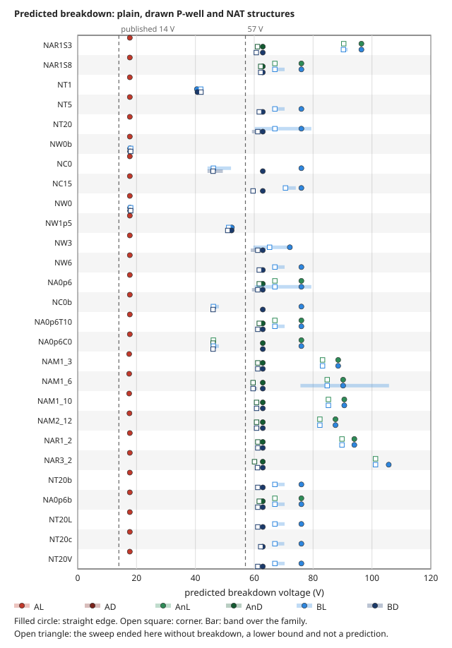

.. _hv-test-predictions:

Simulated breakdown voltages
============================

Each structure of the test die has a predicted breakdown voltage from
two-dimensional device simulation, under two assumptions about where the
foundry places P-well. The predictions are made before any silicon is
measured, so that the measurement tests them
(:ref:`hv-test-method`). Every simulated value is in the tables and graphs
of `Predicted values`_, which are generated from one results file.

Simulated cross-sections
------------------------

The simulation reduces each structure to a cross-section along a radius,
built from the parameters that draw the layout
(:ref:`hv-test-structures`). The section runs from a symmetry plane inside
the well, across the termination zone, to beyond the P+ ring
(:numref:`fig-hvt-sim-section`). It holds the well, the N+ and P+ rings,
any rings, drawn P-well and NAT, the trench oxide, and the plates in the
dielectric at their heights above the silicon [HV-GF180-IA-343]_.

Each structure is simulated twice. A straight side of the well is the flat
section itself. A corner is the same section in cylindrical coordinates,
turned about the centre of the corner's arc, which crowds the field as a
real corner does (:ref:`hv-junctions`). A sharp drawn corner is given a
small radius, since the implant spreads sideways. The predicted breakdown
voltage of the structure is the lower of the two results.

.. figure:: hvt-sim-section.svg
   :name: fig-hvt-sim-section
   :alt: Top, a plan view of structure NT20 with two lines from the centre
         of the well: one through a straight side, simulated as a flat
         section, and one through a corner, simulated as the same section
         rotated about the centre of the corner arc. Bottom, the
         cross-section from a symmetry plane inside the well to beyond the
         P+ ring, with the well at +V and the P+ ring at 0 V. A mesh
         covers the silicon, fine at the surface and at each drawn edge,
         coarse deep in the substrate.

   The two sections simulated for each structure, and the mesh of one.

The simulator solves Poisson's equation with the drift and diffusion of
electrons and holes on a mesh of the section [HV-GF180-TCAD]_. The mesh is
fine at the surface and at every drawn edge, where the field changes
fastest. The well is stepped up in voltage with the P+ ring at 0 V, and the
potential is stored at each step.

Ionisation integral
-------------------

Breakdown is found from the stored potential, not from a current. A carrier
that crosses the depletion region frees new carriers at a rate per length
:math:`\alpha`, which rises steeply with the field
[HV-VANOVERSTRAETEN]_:

.. math::

   \alpha_\text{n}(E) &= a_\text{n} \exp(-b_\text{n}/E) \\
   \alpha_\text{p}(E) &= a_\text{p} \exp(-b_\text{p}/E)

The avalanche sustains itself when one electron entering the depletion
region frees, with all its descendants, one more pair. Along a field line
from the P side to the N side, that is the voltage at which the
:term:`ionisation integral` reaches 1 [HV-SZE-NG]_ (Section 2.4):

.. math::

   I_\text{n} &= \int_0^W \alpha_\text{n}(x) \, e^{-u(x)} \, dx \\
   u(x) &= \int_0^x (\alpha_\text{n} - \alpha_\text{p}) \, dx' \\
   I_\text{n} &= 1 \quad \text{at breakdown}

.. list-table::
   :header-rows: 1
   :widths: 20 60 20

   * - Symbol
     - Meaning
     - Unit
   * - :math:`I_\text{n}`
     - Ionisation integral for electrons
     - None
   * - :math:`u(x)`
     - Net ionisation between the start of the line and :math:`x`, which
       accounts for the pairs that holes free on their way back
     - None
   * - :math:`x`, :math:`W`
     - Distance along the field line from the P-side edge of the
       depletion region, and the length of the line
     - cm
   * - :math:`E`
     - Field at :math:`x`
     - V/cm
   * - :math:`\alpha_\text{n}`, :math:`\alpha_\text{p}`
     - Ionisation coefficients of electrons and holes
     - cm\ :sup:`-1`
   * - :math:`a_\text{n}`, :math:`b_\text{n}`
     - :math:`7.03 \times 10^{5}` and :math:`1.231 \times 10^{6}`
     - cm\ :sup:`-1`, V/cm
   * - :math:`a_\text{p}`, :math:`b_\text{p}`
     - :math:`1.582 \times 10^{6}` and :math:`2.036 \times 10^{6}` up to
       :math:`4 \times 10^{5}` V/cm; :math:`6.71 \times 10^{5}` and
       :math:`1.693 \times 10^{6}` above
     - cm\ :sup:`-1`, V/cm

In two dimensions the integral is taken along many field lines through
the region of highest field, and the largest value counts. The breakdown
voltage is where that value crosses 1, interpolated between voltage steps.

As a worked example in one dimension, take a junction with one side doped
at :math:`10^{16}` cm\ :sup:`-3` and the other far more heavily. Its field
is a triangle, zero at the edge of the depletion region and largest at the
junction (:numref:`fig-hvt-ionisation`). At 55 V the depletion region is
2.67 µm wide and the peak field is :math:`4.13 \times 10^{5}` V/cm, which
gives the coefficients at the junction:

.. math::

   \alpha_\text{n} &= 7.03 \times 10^{5} \times
     \exp\!\left(-\frac{1.231 \times 10^{6}}{4.13 \times 10^{5}}\right) \\
     &= 7.03 \times 10^{5} \times 0.0507
      = 3.56 \times 10^{4}\ \text{cm}^{-1} \\
   \alpha_\text{p} &= 6.71 \times 10^{5} \times
     \exp\!\left(-\frac{1.693 \times 10^{6}}{4.13 \times 10^{5}}\right) \\
     &= 1.11 \times 10^{4}\ \text{cm}^{-1}

An electron at the peak frees a pair every 0.28 µm, but the field falls
away within a micrometre. Summed along the line, the integral is 0.981 at
55 V and 1.060 at 60 V, and reaches 1 at 56 V
(:numref:`tab-hvt-ionisation`). The fit on :ref:`hv-junctions` gives 53 V
for the same doping (:numref:`tab-hv-flat-breakdown`).

.. list-table:: Ionisation integral of a one-sided junction doped at
               10\ :sup:`16` cm\ :sup:`-3`
   :name: tab-hvt-ionisation
   :header-rows: 1
   :widths: 25 25 25 25

   * - Reverse voltage (V)
     - Depletion width (µm)
     - Peak field (10\ :sup:`5` V/cm)
     - Ionisation integral
   * - 20
     - 1.61
     - 2.49
     - 0.113
   * - 30
     - 1.97
     - 3.05
     - 0.351
   * - 40
     - 2.27
     - 3.52
     - 0.635
   * - 50
     - 2.54
     - 3.93
     - 0.883
   * - 55
     - 2.67
     - 4.13
     - 0.981
   * - 60
     - 2.78
     - 4.31
     - 1.060

The values come from :download:`calc.py <calc.py>`, section 1.

.. figure:: hvt-ionisation.svg
   :name: fig-hvt-ionisation
   :alt: Three graphs for a one-sided junction doped at 10 to the 16 per
         cubic centimetre. (a) The field at breakdown, 56 V: a triangle
         that rises from zero at the edge of the depletion region to
         4.2 times 10 to the 5 V/cm at the junction, 2.69 µm away. (b)
         The ionisation coefficients along the same line: both are
         negligible over the first micrometre, then the electron
         coefficient rises to 3.7 per micrometre and the hole coefficient
         to 1.2 per micrometre at the junction. (c) The ionisation
         integral against reverse voltage, rising from near zero at 10 V
         through 0.64 at 40 V to cross 1 at 56 V.

   Field, ionisation coefficients and ionisation integral of the worked
   example.

Calibration anchors
-------------------

The doping profiles of the wells and the substrate are not published, so
the simulation uses assumed profiles that reproduce the numbers that are
(:numref:`tab-hvt-anchors`). Each well is a sum of implants that are
Gaussian in depth. A shallow, heavy part sets the breakdown voltages near
10 V to 14 V. A deeper, light part, with the substrate, sets the
capacitance and the sheet resistance.

.. list-table:: Published values that the assumed profiles reproduce
   :name: tab-hvt-anchors
   :header-rows: 1
   :widths: 40 30 30

   * - Quantity
     - Published value
     - Source
   * - Breakdown, N-well to substrate
     - 10 V minimum, 14 V typical
     - [HV-GF180-EP-5]_
   * - Breakdown, N+ to substrate in the 6 V area
     - 8.5 V minimum, 11 V typical
     - [HV-GF180-EP-5]_
   * - Breakdown, P+ to N-well in the 6 V area
     - 10.5 V typical, 8.5 V minimum in magnitude
     - [HV-GF180-EP-5]_
   * - Breakdown, deep N-well to substrate
     - 30.48 V, a model parameter
     - [HV-GF180-MODELS]_
   * - Capacitance, N-well to substrate at zero bias
     - 1.4914 × 10\ :sup:`-4` F/m², grading 0.305
     - [HV-GF180-MODELS]_
   * - Capacitance, deep N-well to substrate at zero bias
     - 2.2998 × 10\ :sup:`-4` F/m², grading 0.147
     - [HV-GF180-MODELS]_
   * - Sheet resistance of the N-well
     - 800 Ω, 1000 Ω and 1200 Ω per square
     - [HV-GF180-EP-5-1]_
   * - Thickness of the trench oxide
     - 0.32 µm
     - [HV-GF180-IA-343]_
   * - Field threshold, polysilicon in the 3.3 V area and Metal1 in the
       6 V area
     - 8.5 V and 11 V typical
     - :ref:`hv-metal-gate`

These anchors do not fix the profiles. Several combinations of substrate
doping, well profile and oxide charge fit them equally, so the simulation
runs a family of them. :numref:`tab-hvt-processes` lists the members. The
spread of a structure's prediction over the family is its tolerance band.

.. csv-table:: Simulated processes
   :name: tab-hvt-processes
   :file: hvt-tab-processes.csv
   :header-rows: 1
   :widths: 15 85

Process assumptions
-------------------

Two assumptions cover where the P-well lies
(:numref:`fig-hvt-assumptions`). Under assumption A the foundry generates
P-well wherever the layout has no N-well, no deep N-well and no NAT, up to
the edge of every N-well. Under assumption B a P-well exists only where
the layout draws one, and bare substrate surrounds a plain well.

The two differ most on a plain well. Under A the N-well meets heavily
doped P-well at the surface, and the junction between them breaks down
early. Under B the lightly doped substrate takes the depletion region, and
the curvature of the edge sets the limit. A process name that starts with
A or B belongs to that assumption, and further letters mark a member of
the doping family.

.. figure:: hvt-assumptions.svg
   :name: fig-hvt-assumptions
   :alt: Three cross-sections. NT20 under assumption A: a generated P-well
         covers the surface from the N-well edge outwards, past the P+
         ring. NA2 under assumption A: P-well lies only in the 2 µm strip
         between the well and the NAT layer and around the P+ ring, with
         bare substrate under the NAT layer. NT20 under assumption B: no
         P-well, and bare substrate from the well edge to the P+ ring.

   Where the P-well lies under each assumption.

Predicted values
----------------

The predictions are read from ``predictions.json`` beside this page.
:numref:`tab-hvt-pred-source` states where the file's values come from and
their status, and the graphs carry the same status line.
:numref:`tab-hvt-pred` lists the prediction of each simulated structure
under each process, and :numref:`fig-hvt-pred-bv` plots it. A dash marks a
value that the file does not hold.

.. csv-table:: Source and status of the predictions
   :name: tab-hvt-pred-source
   :file: hvt-tab-pred-source.csv
   :header-rows: 1
   :widths: 25 75

         of predicted breakdown voltage. Each process has a colour. A
         filled circle marks the straight-edge value and an open square
         the corner value of each structure under each process. Dashed
         vertical lines mark the published 14 V and the 57 V of an
         Ethernet cable. A line under the title gives the status of the
         values, which the table of sources also states.

   Predicted breakdown voltage of each simulated structure, by process.

.. csv-table:: Predicted breakdown voltage by structure and process
   :name: tab-hvt-pred
   :file: hvt-tab-pred.csv
   :header-rows: 1

:numref:`tab-hvt-pred-band` gives the tolerance band of each structure:
the lowest and highest predicted breakdown voltage over the processes of
one assumption. A measured value inside the band agrees with that
assumption.

.. csv-table:: Tolerance band of each prediction
   :name: tab-hvt-pred-band
   :file: hvt-tab-pred-band.csv
   :header-rows: 1

For the structures with a pad on ring 1, the simulation also records the
potential of the ring at each well voltage
(:numref:`fig-hvt-pred-ring`). The measured curve of procedure P3 is
compared with it.

.. figure:: hvt-pred-ring.svg
   :name: fig-hvt-pred-ring
   :alt: Graph of the predicted voltage of ring 1 against well voltage,
         one curve per simulated ring-sense structure and process. A
         dashed diagonal marks ring voltage equal to well voltage. Each
         curve stays near zero at low well voltage and then rises parallel
         to the diagonal. A line under the title gives the status of the
         values.

   Predicted potential of ring 1 against well voltage.

Limits of the predictions
-------------------------

A prediction is a statement about an assumed process, not about the
silicon. Five simplifications bound what it can say:

* The profiles are assumed. They fit the published anchors, and the family
  shows how far the fit leaves the result open.
* The sections are two-dimensional. A corner is treated as part of a
  cylinder about a vertical axis, with the well's depth profile unchanged.
* The Metal5 lead and the leads to second pads are left out. They cross the
  termination zone at one place on each structure.
* The oxide charge is a single fixed value per process. Charge that moves
  or is trapped during the sweep, the cause of :term:`walk-out`, is not
  simulated.
* The simulation is at 300 K, and its criterion is the ionisation
  integral. The measurement's criterion is a current of 1 µA. The two
  coincide for a sharp knee and differ where leakage comes first.

Open questions
--------------

* Which members make up the doping family, and how wide is the band that
  results? :numref:`tab-hvt-processes` and :numref:`tab-hvt-pred-band`
  hold the current state.
* Under assumption A, is P-well generated around a structure that also
  has a drawn P-well? Group 2 of the die reads differently in the two
  cases (:numref:`tab-hvt-decision`).
* Under assumption A, is P-well generated in the strip between an N-well
  and the NAT layer?
* What oxide charge fits the published field thresholds, and does the same
  value apply over trench oxide beside a well?
