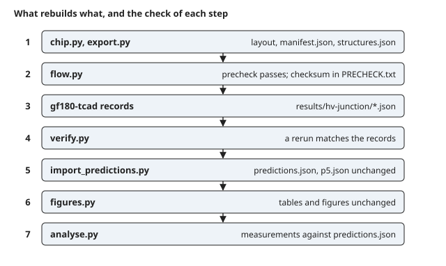

.. _hv-test-reproduction:

Reproduction and checks
=======================

Every result about the test die is rebuilt by a script from committed
files, and each rebuild has a check with a fixed pass condition. The
layout comes from the generator in ``silicon/hvtest``, the predictions
from the simulation records of mithro/gf180-tcad [HV-GF180-TCAD]_, and the
tables and figures from the data files beside the test-die pages
(:numref:`fig-hvt-reproduce`). Measurements are compared with the
predictions by a further script.

         manifest.json and structures.json. 2, flow.py runs the precheck,
         and the checksum is in PRECHECK.txt. 3, the records of
         gf180-tcad are results/hv-junction/*.json. 4, verify.py reruns
         cases and matches them with the records. 5,
         import_predictions.py writes predictions.json and p5.json, which
         come out unchanged. 6, figures.py writes the tables and figures,
         which come out unchanged. 7, analyse.py compares measurements
         with predictions.json.

   Scripts that rebuild each result, with the check of each step.

Where each answer lies
----------------------

Each question about the die has one page or file that answers it
(:numref:`tab-hvt-answers`).

.. list-table:: Questions about the test die and where each is answered
   :name: tab-hvt-answers
   :header-rows: 1
   :widths: 34 66

   * - Question
     - Answered by
   * - What does a structure test?
     - :ref:`hv-test-structures` for each group, and the
       :doc:`catalogue` for each structure
   * - How is it measured?
     - :ref:`hv-test-method`, procedures P1 to P5, and the record format of
       :numref:`tab-hvt-record`
   * - What is predicted?
     - :ref:`hv-test-predictions`, read from ``predictions.json`` and
       ``p5.json``
   * - How was it simulated?
     - ``experiments/hv-junction/README.md`` of gf180-tcad, and the
       records in ``results/hv-junction/``
   * - How is a measurement compared?
     - :ref:`hvt-analysis`, with ``analyse.py``
   * - How is the layout verified?
     - :ref:`hv-test-submission` and ``silicon/hvtest/PRECHECK.txt``

Layout
------

The layout is rebuilt by ``chip.py`` and checked by ``flow.py``, as
:ref:`hv-test-submission` sets out. Two checks apply. The floor plan that
the rebuild writes equals the committed one, so ``cmp`` prints nothing.
The flow ends with exit 0 for every step, and each check of
:numref:`tab-hvt-precheck` reads "clear":

.. code-block:: sh

   uv run --with klayout python silicon/hvtest/chip.py \
       WORKDIR/raw.gds WORKDIR/manifest.json
   cmp WORKDIR/manifest.json docs/high-voltage/test-die/manifest.json
   uv run python silicon/hvtest/flow.py \
       WORKDIR/raw.gds WORKDIR/manifest.json WORKDIR

Two runs of ``chip.py`` write GDS files that differ byte for byte, so a
rebuilt ``hvtest.oas`` is checked by the precheck and not by its
checksum. The checksum identifies the submitted file instead:
``sha256sum silicon/hvtest/hvtest.oas`` prints the value that
``PRECHECK.txt`` records.

Tables and figures
------------------

Every figure and table of the test-die pages is written by one script
from the data files: ``structures.json``, ``manifest.json``,
``predictions.json``, ``p5.json``, ``crosscheck.json`` and
``model_checks.json``. The output is the same on every run, so a pass is
a ``git status`` that shows no change:

.. code-block:: sh

   uv run python docs/high-voltage/test-die/figures.py
   git status --short docs/high-voltage/test-die

The script also stops if a page names a structure that is not on the die,
or if ``manifest.json`` and ``structures.json`` list different
structures.

Simulations and records
-----------------------

The simulations are in gf180-tcad, on the branch ``hv/junction`` of
`pull request 237 <https://github.com/mithro/gf180-tcad/pull/237>`__.
``experiments/hv-junction/README.md`` gives the commands that rebuild each
record, and ``results/hv-junction/*.json`` are the records. Each record
pins the commit and the container image of its run and holds every case
with its bias points. The commands of this section and the next run from
the root of a checkout of that branch. The structure list there,
``experiments/hv-junction/structures.json``, is a copy of
``silicon/hvtest/structures.json``, and ``cmp`` on the two prints nothing.

The test of the experiment checks the results page of gf180-tcad, with
its numbers and figures, against the records:

.. code-block:: sh

   uv run --locked pytest tests/test_hv_junction.py

Rerun against the records
-------------------------

A rerun of recorded cases is checked by ``verify.py``. It rebuilds each
named case, confirms that its parameters are those of the record, runs it
in the sandbox, and compares the breakdown voltage and the bias points
with the record. It refuses a stored result in WORKDIR whose parameters
differ from the case's, so that an earlier run is never compared as a new
one. It prints one line per case and exits non-zero when a breakdown
voltage differs by more than 0.1 V.

The 0.1 V was set after a first pass at 0.05 V, in which one case of the
first record lay 0.067 V from its recorded value. The second pass, at
0.1 V, compared the same results again and did not rerun them. A case
recorded with the present sweep code reproduces its recorded value
exactly. The cases of the first record were run with an earlier voltage
ramp, and differed by up to 0.07 V in the nine tried:

.. code-block:: sh

   uv run --locked python experiments/hv-junction/verify.py \
       WORKDIR 'NT20|BL|edge' 'NW0|BL|edge'
   uv run --locked python experiments/hv-junction/verify.py \
       WORKDIR --sample 5

A case is named as in the records, structure, process and shape.
``--sample N`` picks N cases at random from those that take minutes
rather than hours. It leaves out the cases with a floating ring and those
run in 128-bit arithmetic, the slowest, which ``--slow`` adds back; each
of those takes up to hours. WORKDIR lies outside the repository, because
the sandbox refuses it. The sandbox test reruns one short case in the same way,
and needs Docker:

.. code-block:: sh

   uv run --locked pytest -m sandbox tests/test_hv_junction.py

Records to predictions
----------------------

``import_predictions.py`` builds ``predictions.json`` from the prediction
records, in the order main, rest, rest2, rest3, mem, gaps, sharp, rest5,
ring128, family and family3. A later record replaces an earlier one case by
case. With ``--p5`` it builds ``p5.json`` from the records p5 and p5b,
whose cases hold ring 1 at 0 V. A pass leaves both files unchanged:

.. code-block:: sh

   R=GF180_TCAD/results/hv-junction
   uv run python docs/high-voltage/test-die/import_predictions.py \
       $R/main.json $R/rest.json $R/rest2.json $R/rest3.json \
       $R/mem.json $R/gaps.json $R/sharp.json $R/rest5.json \
       $R/ring128.json $R/family.json $R/family3.json
   uv run python docs/high-voltage/test-die/import_predictions.py \
       --p5 $R/p5.json $R/p5b.json
   git status --short docs/high-voltage/test-die

The N-well capacitance under L and D, which the capacitance test of P2
compares with, has its own record. ``capacitance.py`` in gf180-tcad
rebuilds it on the host in under a second, and a pass leaves the record
unchanged. The record test of ``test_analyse.py`` then checks that
``model_checks.json`` holds the same curves, and the other values that
name a record:

.. code-block:: sh

   uv run --locked python experiments/hv-junction/capacitance.py \
       results/hv-junction/capacitance.json
   git status --short results/hv-junction
   GF180_TCAD=PATH uv run --with pytest pytest \
       docs/high-voltage/test-die/test_analyse.py -k model_check_records

The first two commands run in gf180-tcad, and the last in this
repository, with PATH naming the gf180-tcad checkout.

Measurements against predictions
--------------------------------

``analyse.py`` reads the measurement records, applies the process
decision and compares every structure with ``predictions.json``. Its
command, its report and its self-test are given with the rules it applies,
under :ref:`hvt-analysis`. The self-test passes when pytest reports no
failure.
