.. _hv-test-structures:

Test structures
===============

The test die holds 71 junction test structures and four large wells on one
gf180mcu die of 1936 µm by 2531 µm. Each structure is a well with one kind
of edge termination, and differs from its neighbours in one drawn
dimension. The layout comes from a generator, ``silicon/hvtest`` in the
evampire repository, so every dimension quoted here is a parameter of that
generator.

Unknowns behind the structures
------------------------------

A circuit island that connects to an Ethernet cable must sit up to 57 V
above the substrate (:ref:`poe-limits`). The published breakdown of an
N-well to the substrate is 10 V minimum and 14 V typical
[HV-GF180-EP-5]_, while a flat junction in the estimated substrate doping
would hold 90 V to 270 V (:ref:`hv-junctions`). Something at the edge of the
well sets the published value, and the public documents do not say what.

The most likely cause is the :term:`P-well`. The P-well is a generated
layer in this process: the foundry derives its mask from the other layers,
by an algorithm that is not public [HV-GF180-DRM]_ (Section 4.4). The
design rules let a P-well touch an N-well, since rule NW.4 sets their
spacing to 0 [HV-GF180-DRM]_ (Section 7.4). If the foundry places P-well
against every N-well edge, the published value is the breakdown of an
N-well to P-well junction at the surface, not of the substrate.

Four things are not known: where the generated P-well lands, the doping
profiles of the substrate and the wells, the charge in the oxide, and what
each termination gains. The structures are grouped to answer these in
order (:numref:`tab-hvt-questions`). Groups 1 to 4 find out what silicon
surrounds a well. Groups 5 to 7 then measure terminations in that silicon,
and groups 8 and 9 supply the doping and the reference for the instruments.

.. list-table:: Questions and the structure groups that answer them
   :name: tab-hvt-questions
   :header-rows: 1
   :widths: 6 22 36 36

   * - Group
     - Structures
     - Question
     - Comparison that answers it
   * - 1
     - Plain N-well
     - What does an N-well with nothing drawn around it hold, and where
       does it break down?
     - Breakdown against the distance to the P+ ring and against the
       corner radius
   * - 2
     - Drawn P-well
     - Does a P-well near the edge lower the breakdown, and from what
       distance?
     - Breakdown against the distance at which a drawn P-well starts
   * - 3
     - NAT layer
     - Does the NAT layer keep the generated P-well away from the edge?
     - Breakdown with NAT against group 1, and against where NAT starts
   * - 4
     - Deep N-well
     - What does a deep N-well hold, and is P-well kept away from it?
     - The same series as groups 1 and 2, on a deep N-well
   * - 5
     - Field plates
     - How much does a plate of each layer and length raise the
       breakdown?
     - Breakdown against plate layer and length
   * - 6
     - Floating rings
     - At what gap does a ring start to take voltage, and how many rings
       help?
     - Breakdown against gap, count and width; ring potential on a pad
   * - 7
     - Gated diodes
     - What are the doping and the oxide charge at the surface beside the
       well?
     - Well current and breakdown against the voltage of a separate plate
   * - 8
     - Large wells
     - What is the doping profile under a well?
     - Capacitance against voltage at two well sizes
   * - 9
     - Open reference
     - How much of a reading is the pad, the lead and the probe?
     - The same measurement with no junction

Structure anatomy
-----------------

Every structure is concentric. From the centre outwards it has the well,
an N+ contact ring just inside the well's edge, the termination zone, and
a P+ ring that contacts the substrate (:numref:`fig-hvt-section`). The
termination zone is where the structures differ. It holds bare field,
a drawn P-well, the NAT layer, floating rings or field plates.

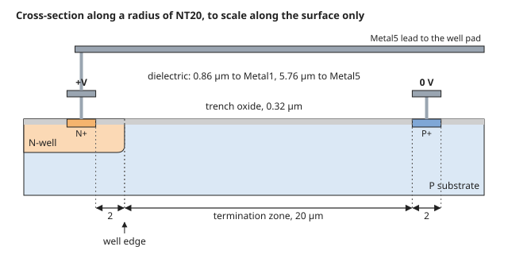
         N-well with an N+ contact ring 2 µm wide, 2 µm inside the well
         edge, joined by a metal stack to a Metal5 lead at +V. Trench
         oxide 0.32 µm thick covers the silicon surface between the
         contact rings. A termination zone of 20 µm of P substrate
         separates the well edge from a P+ ring 2 µm wide, held at 0 V.
         The dielectric is 0.86 µm thick under Metal1 and 5.76 µm under
         Metal5.

   The reference structure NT20 in cross-section, to scale along the
   surface only.

The surface between the two contact rings is :term:`field oxide`, a trench
0.32 µm deep filled with oxide. Metal1 lies 0.86 µm above the silicon,
Metal2 2.01 µm and Metal5 5.76 µm [HV-GF180-IA-343]_. The well's lead
leaves on Metal5, the highest layer, so that the lead itself acts on the
termination zone as little as a conductor can.

In plan view the well is a square with its corners cut at 45°
(:numref:`fig-hvt-site`). A cut of 0.586 times the corner radius makes the
outline touch the arc of that radius at its middle. Every outline further
out is offset from the well's, so a ring or plate keeps a constant distance
from the well edge round the corner. :numref:`tab-hvt-common` lists the
dimensions that the structures share.

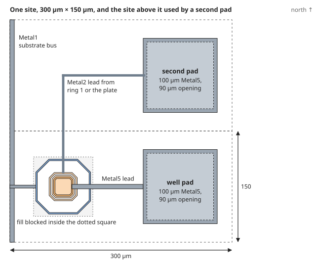
         the site north of it. In the lower site a structure with one
         floating ring sits at the west, inside a dotted square where
         dummy fill is blocked. A Metal1 tab joins its P+ ring to a
         substrate bus that runs up the west edge of the sites. A Metal5
         lead runs east from the well to a pad 100 µm square with a 90 µm
         opening. A Metal2 lead runs north from the ring into the upper
         site and east to a second pad of the same size.

   One site of the die, with the second pad that a two-pad structure has
   in the site above it.

.. list-table:: Dimensions shared by the standard structures
   :name: tab-hvt-common
   :header-rows: 1
   :widths: 50 20 30

   * - Dimension
     - Value (µm)
     - Exceptions
   * - Side of the well
     - 30
     - Large wells: 100 and 200
   * - Corner radius of the well
     - 8
     - Corner series; large wells: 20
   * - N+ contact ring: distance inside the well edge, and width
     - 2 and 2
     - None
   * - Distance from the well edge to the P+ ring
     - 20
     - Each table below
   * - Width of the P+ ring
     - 2
     - None
   * - Fill block beyond the P+ ring
     - 3
     - Large wells have no fill block
   * - Width of the Metal5 lead
     - 6
     - None
   * - Pad, and its opening in the passivation
     - 100 and 90
     - None
   * - Site pitch, east and north
     - 300 and 150
     - Large wells: 440 east

Naming scheme
-------------

A structure's name states what it varies (:numref:`tab-hvt-names`). The
first letter is N for an N-well or D for a deep N-well. Letters for the
feature follow, then its size in micrometres, with "p" for the decimal
point. NW1p5 is an N-well with a drawn P-well that starts 1.5 µm from its
edge. A dimension the name does not mention has the value in
:numref:`tab-hvt-common`.

.. list-table:: Letters in a structure name
   :name: tab-hvt-names
   :header-rows: 1
   :widths: 16 54 30

   * - Letters
     - Meaning of the number that follows
     - Example
   * - T
     - Distance from the well edge to the P+ ring
     - NT35, DT2p6
   * - C
     - Corner radius of the well
     - NC0, DC15
   * - W
     - Distance at which a drawn P-well starts
     - NW0p5
   * - A
     - Distance at which the NAT layer starts
     - NA2
   * - P, M1, M2
     - Length of a polysilicon, Metal1 or Metal2 field plate beyond the
       well edge
     - NP2, NM1_6, DM2_8
   * - PM12
     - None: a stepped plate of polysilicon, Metal1 and Metal2
     - NPM12
   * - R
     - Number of floating rings, then the first gap after an underscore;
       W and a number sets the ring width
     - NR3_1p5, NR3W3
   * - G
     - None: the plate that follows has its own pad
     - NGM1
   * - S
     - None, or the first gap: ring 1 has its own pad
     - NR1S2, NR4S
   * - CV
     - None: a large well for capacitance; 2 marks the smaller size
     - CVN, CVD2

Plain N-well surroundings
-------------------------

Group 1 varies what lies around an N-well that has nothing drawn in its
termination zone (:numref:`fig-hvt-surround`,
:numref:`tab-hvt-surround`). The T series moves the P+ ring from 5 µm to
35 µm. If the substrate alone surrounds the well, the breakdown voltage
rises with that distance until the :term:`depletion region` no longer
reaches the ring. If P-well surrounds the well, the distance changes
nothing. The C series changes the corner radius from a sharp corner to
15 µm, a fully rounded well, which shows how much of the breakdown is set
at the corners (:ref:`hv-junctions`). NT20b repeats NT20 at the far side of
the die, and the difference between the two is the spread across one die.

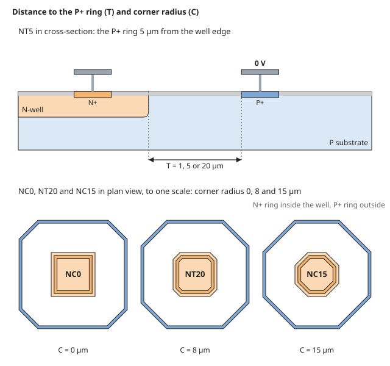
         termination zone and a P+ ring 10 µm from the well edge, with the
         distance T marked as 5, 10, 20 or 35 µm. Bottom, plan views to
         one scale of NC0, NT20 and NC15, whose wells have corner radii
         of 0, 8 and 15 µm inside identical P+ rings.

   The two dimensions that group 1 varies: the distance to the P+ ring and
   the corner radius.

.. csv-table:: Group 1, plain N-wells
   :name: tab-hvt-surround
   :file: hvt-tab-surround.csv
   :header-rows: 1

Drawn P-well distance
---------------------

Group 2 draws a P-well that starts a set distance from the well edge and
covers the rest of the termination zone, out to 1 µm beyond the P+ ring
(:numref:`fig-hvt-pwell`, :numref:`tab-hvt-pwell`). At 0 µm the two wells
touch, which is the junction suspected of setting the published 14 V. The
series then steps the P-well out to 10 µm. The distance at which the
breakdown stops rising is the clearance a high-voltage well needs from
P-well, if the foundry adds no P-well of its own in the gap.

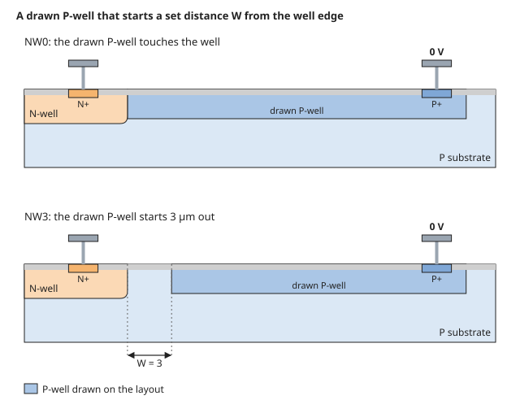
         and runs under the trench oxide past the P+ ring. In NW3 the
         drawn P-well starts 3 µm from the well edge, leaving 3 µm of
         substrate at the surface beside the well.

   A drawn P-well touching the well, and starting 3 µm from it.

.. csv-table:: Group 2, N-wells with a drawn P-well
   :name: tab-hvt-pwell
   :file: hvt-tab-pwell.csv
   :header-rows: 1

NAT layer distance
------------------

The NAT layer marks the area of a :term:`native transistor`, whose channel
is the bare substrate. The design manual says the P-well implant is
blocked there after the P-well mask is generated [HV-GF180-DRM]_ (Section
4.4). Group 3 covers the termination zone with NAT from a set distance
outwards, to 0.5 µm short of the P+ ring (:numref:`fig-hvt-nat`,
:numref:`tab-hvt-nat`). Rule NAT.3 keeps NAT 0.5 µm from an N-well
[HV-GF180-DRM]_ (Section 10.5), so the nearest start is 0.6 µm. A strip of
silicon that NAT does not cover therefore always remains beside the well.
Whether the foundry generates P-well in so narrow a strip is not known, so
the series widens it to 4 µm. The group repeats the corner, ring-distance
and metal-plate variations of the other groups under NAT.

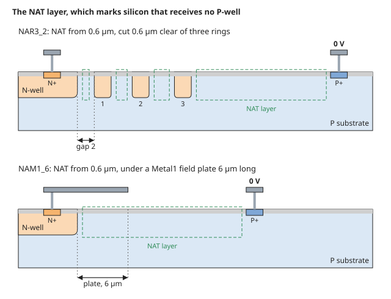
         from 2 µm beyond the well edge to just short of the P+ ring. In
         NAM1_6 the NAT layer starts 0.6 µm from the well edge and a
         Metal1 plate, joined to the well, extends 6 µm beyond the edge
         above it.

   The NAT layer over the termination zone, alone and under a Metal1
   field plate.

.. csv-table:: Group 3, N-wells with the NAT layer
   :name: tab-hvt-nat
   :file: hvt-tab-nat.csv
   :header-rows: 1

Deep N-well
-----------

Group 4 replaces the N-well with a :term:`deep N-well`, contacted by the
same N+ ring (:numref:`fig-hvt-dnw`, :numref:`tab-hvt-dnw`). The only
published breakdown for this junction is the fitted value of 30.48 V in
its diode model [HV-GF180-MODELS]_. Rule LPW.11 keeps a drawn P-well
1.5 µm from a deep N-well [HV-GF180-DRM]_ (Section 7.3). If the generated
P-well obeys the same spacing, a deep N-well has 1.5 µm of substrate beside
it that an N-well lacks. The group repeats the ring-distance, corner and
drawn-P-well series. Its nearest P+ ring is at 2.6 µm, because rule DF.18
keeps P+ in the substrate 2.5 µm from a deep N-well.

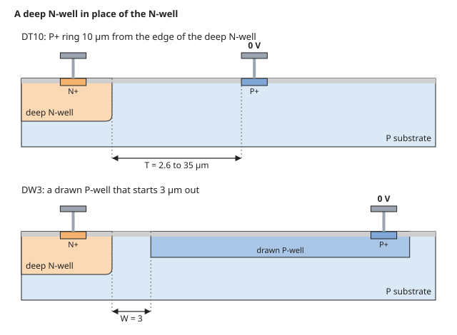
         with an N+ contact ring. In DT10 the P+ ring is 10 µm from the
         edge, and the distance T ranges from 2.6 to 35 µm over the
         series. In DW3 a drawn P-well starts 3 µm from the edge of the
         deep N-well.

   A deep N-well with a bare termination zone, and with a drawn P-well.

.. csv-table:: Group 4, deep N-wells
   :name: tab-hvt-dnw
   :file: hvt-tab-dnw.csv
   :header-rows: 1

Field plates
------------

Group 5 adds a :term:`field plate` joined to the well
(:numref:`fig-hvt-plates`, :numref:`tab-hvt-plates`). Polysilicon lies on
the trench oxide, 0.32 µm from the silicon, and acts strongly over a short
length. Metal1 and Metal2 lie further up and act more weakly over a longer
one. The stepped plates combine the layers, each reaching further than the
one below it (:ref:`hv-grading`). Every plate length is the distance the
plate extends beyond the well edge. The group has plates on both kinds of
well.

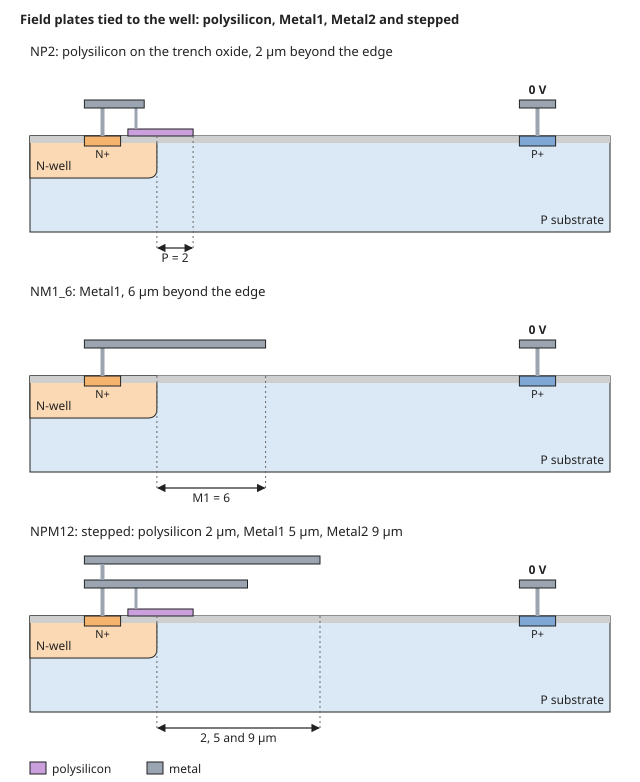
         the well. NP2 has a polysilicon plate on the trench oxide that
         extends 2 µm beyond the well edge. NM1_6 has a Metal1 plate that
         extends 6 µm. NPM12 has three plates in steps: polysilicon to
         2 µm, Metal1 to 5 µm and Metal2 to 9 µm.

   Field plates of polysilicon, of Metal1, and stepped over three layers.

.. csv-table:: Group 5, wells with field plates joined to the well
   :name: tab-hvt-plates
   :file: hvt-tab-plates.csv
   :header-rows: 1

Floating rings
--------------

Group 6 places :term:`floating field rings <floating field ring>` of
N-well between the well and the P+ ring (:numref:`fig-hvt-rings`,
:numref:`tab-hvt-rings`). One series has a single ring at gaps from 1.4 µm
to 4.5 µm, which finds the gap at which the ring starts to take voltage.
Others have three and five rings with gaps that widen outwards, rings
1 µm and 3 µm wide, and three rings under a Metal1 plate. Three structures
bring ring 1 out to a second pad through an N+ contact, so that its
potential can be measured directly.

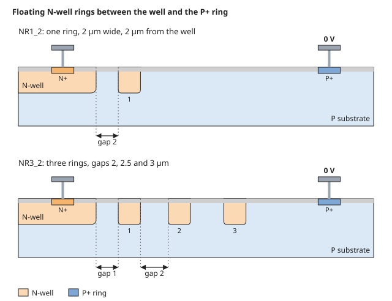
         2 µm from the well edge. NR3_2 has three rings, numbered 1 to 3
         outwards, separated by gaps of 2, 2.5 and 3 µm, between the well
         and the P+ ring.

   One floating ring, and three rings with gaps that widen outwards.

.. csv-table:: Group 6, N-wells with floating rings
   :name: tab-hvt-rings
   :file: hvt-tab-rings.csv
   :header-rows: 1

Gated diodes
------------

Group 7 has a plate that is not joined to the well. The plate starts 1 µm
inside the well edge, extends over the termination zone, and has its own
pad (:numref:`fig-hvt-gated`, :numref:`tab-hvt-gated`). Such a structure
is a :term:`gated diode`: the plate's voltage sets the state of the
silicon surface beside the junction while the well is measured. The four
structures use polysilicon and Metal1 on an N-well, Metal1 over NAT and
Metal1 on a deep N-well.

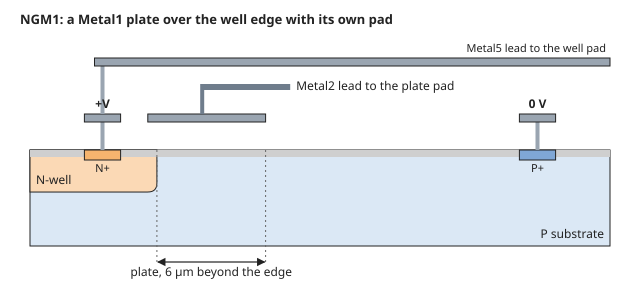
         N-well, 1 µm inside its edge, and extends 6 µm beyond the edge
         over the termination zone. A Metal2 lead joins the plate to its
         own pad. The well's N+ ring has a separate Metal5 lead to the
         well pad, and the P+ ring is at 0 V.

   The gated diode NGM1, whose Metal1 plate has its own pad.

.. csv-table:: Group 7, gated diodes
   :name: tab-hvt-gated
   :file: hvt-tab-gated.csv
   :header-rows: 1

Large wells and open reference
------------------------------

Group 8 has four wells large enough for their capacitance to be measured:
an N-well and a deep N-well, each at sides of 200 µm and 100 µm
(:numref:`fig-hvt-large`, :numref:`tab-hvt-large`). Two sizes separate the
capacitance of the flat bottom from that of the edge
(:ref:`hv-test-method`). Their P+ ring is 6 µm from the well edge, to keep
the resistance of the substrate path low.

Group 9 is the structure OPEN: a Metal5 lead and a pad on a standard site,
with no junction (:numref:`tab-hvt-open`). It gives the capacitance and the
leakage of a pad, its lead and the probe, which every other reading
includes.

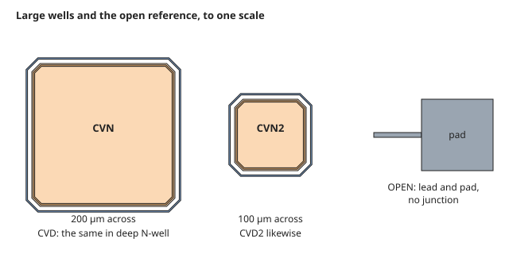
         well 100 µm across, both with corners cut and a P+ ring close
         around them. CVD and CVD2 are the same shapes in deep N-well.
         OPEN is a short Metal5 lead joined to a pad, with no well.

   The large wells and the open reference.

.. csv-table:: Group 8, large wells
   :name: tab-hvt-large
   :file: hvt-tab-large.csv
   :header-rows: 1

.. csv-table:: Group 9, the open reference
   :name: tab-hvt-open
   :file: hvt-tab-open.csv
   :header-rows: 1

Die floor plan
--------------

The die is the smallest wafer.space slot, 1936 µm by 2531 µm
[HV-WS-PRECHECK]_. The standard structures stand on a grid of six columns
(:numref:`fig-hvt-floorplan`). Each has its pad to its east, and the name
of the structure is written in Metal5 above the pad. Six of the seven
two-pad structures stand in the lowest row and one in the third row, each
with its second pad in the site to its north. The large wells form a band along the north
edge.

Every P+ ring joins a Metal1 bus that runs up the west side of its column.
The six buses join along the south edge, where six substrate pads connect
to them (:numref:`tab-hvt-pads`). All substrate pads are one net. Positions
are in micrometres from the south-west corner of the die, and the pad
positions of each structure are in the table of its group.

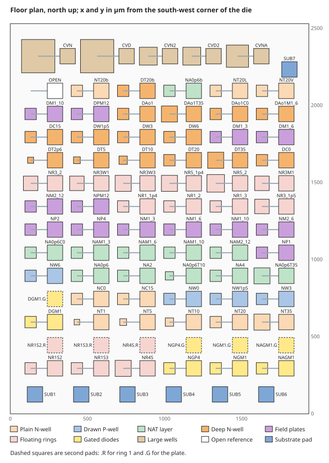
         substrate pads, SUB1 to SUB6, lie along the south edge at y of
         126 µm. Above them thirteen rows of sites at a pitch of 150 µm fill
         six columns at a pitch of 300 µm. Each site shows a structure
         with its named pad to the east, coloured by group. The lowest
         row holds three ring-sense structures and three gated diodes, and
         the third row a fourth gated diode. Their second pads, drawn
         dashed, are in the row above each. Four large wells, CVN, CVN2, CVD and CVD2, form a
         band along the north edge at y of 2320 µm.

   Floor plan of the test die, drawn from the positions the layout
   generator reports.

.. csv-table:: Substrate pads and second pads
   :name: tab-hvt-pads
   :file: hvt-tab-pads.csv
   :header-rows: 1

Design rules behind the layout
------------------------------

The foundry's design rules decide several dimensions, and the die breaks
one advisory rule on purpose (:numref:`tab-hvt-rules`). The rules assume
circuits at 6 V or less, so passing them says nothing about holding 57 V.

.. list-table:: Rules that shaped the structures
   :name: tab-hvt-rules
   :header-rows: 1
   :widths: 30 40 30

   * - Rule
     - Content
     - Effect on the die
   * - NW.2b [HV-GF180-DRM]_ (Section 7.4)
     - N-wells at different potentials are at least 1.4 µm apart. The
       rule check treats a floating well as a different net
       [HV-GF180-PV]_
     - No ring gap is below 1.4 µm
   * - NAT.3, NAT.10 and NAT.12 [HV-GF180-DRM]_ (Section 10.5)
     - NAT stays 0.5 µm from an N-well, and contains no N-well and no
       polysilicon on field oxide
     - NAT starts at 0.6 µm or more. No rings and no polysilicon plates
       under NAT
   * - DN.3 [HV-GF180-DRM]_ (Section 7.2)
     - A P+ ring surrounds each deep N-well directly. The rule check
       rejects an N-well inside that ring that does not touch the deep
       N-well [HV-GF180-PV]_
     - No floating rings around a deep N-well
   * - DF.18 and LPW.11 [HV-GF180-DRM]_ (Sections 7.5 and 7.3)
     - P+ in the substrate stays 2.5 µm, and a drawn P-well 1.5 µm, from
       a deep N-well
     - DT2p6 and DW1p5 are the closest of their series
   * - DE.3 [HV-GF180-DRM]_ (Section 10.8)
     - A fill-blocking shape is at most 15000 µm²
     - Each standard structure blocks fill out to 3 µm beyond its P+
       ring. The largest block is 120 µm square. The large wells exceed
       the limit and carry no block
   * - MDN.10f [HV-GF180-DRM]_ (Section 10.12.1)
     - Polysilicon more than 6 V from the substrate is "not allowed".
       No rule check exists for it
     - Broken on purpose: the polysilicon plates exist to find what
       polysilicon on trench oxide holds
   * - Pad guidelines [HV-GF180-DRM]_ (Sections 9.2 and 9.4.5)
     - A probe pad opening is at least 50 µm, at a pitch of at least
       80 µm, 30 µm or more from the seal ring
     - Openings are 90 µm at a pitch of 150 µm or more, 50 µm from the
       seal ring

Dummy fill matters because the foundry needs a minimum density of active
silicon, polysilicon and metal everywhere, and the fill script places
floating squares to reach it. A floating square of active silicon or
polysilicon inside a termination zone would change the field there. The
layers NDMY and PMNDMY block the fill over each standard structure. The
large wells receive fill, which adds no junction inside a well.

The pads are bare squares of Metal5 with an opening in the passivation,
and no protection device. Every pad cell in the gf180mcu libraries has
diodes from the pad to its supply rails, which would conduct a few
hundred millivolts above the 5 V rail [HV-GF180-IO]_. wafer.space accepts
dies with any arrangement of pads, or none of the library's
[HV-WS-SITE]_. The pads are large enough for a probe needle or a wire
bond.

Open questions
--------------

* Where does the foundry's generated P-well land: against every N-well
  edge, 1.5 µm from a deep N-well, and nowhere under NAT? Groups 1 to 4
  measure this (:ref:`hv-test-method`).
* Does the foundry generate P-well in the strip of 0.6 µm to 4 µm between
  an N-well and the NAT layer of group 3?
* Does the N+ ring alone make a low-resistance contact to a deep N-well?
  The deep N-well's doping at the surface is not published. A poor contact
  would show as a series resistance in the forward direction and in the
  capacitance measurement.
* How much does the Metal5 lead, which crosses every termination zone at
  the well's voltage, change the breakdown? No structure varies it.
* Does the fill inside the large wells, or its absence near their edges,
  change their capacitance by an amount that matters?
