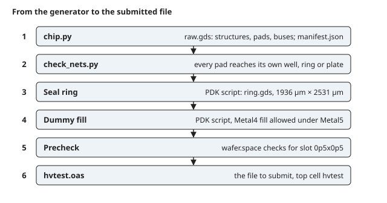

.. _hv-test-submission:

Die and submission
==================

The test die occupies the smallest slot of wafer.space run 3, 1936 µm by
2531 µm, in the gf180mcuD variant of the process with five metal layers.
It carries bare pads only: no protection against electrostatic discharge,
no pad ring, and no pads at the positions that chip-on-board assembly
needs.

Build steps
-----------

The layout is built by two scripts in ``silicon/hvtest``
(:numref:`fig-hvt-build`). ``chip.py`` draws the structures, pads and
buses, and writes the floor plan that the figures and tables of
:ref:`hv-test-structures` are drawn from. ``flow.py`` then checks the
connections and runs three steps inside the wafer.space precheck
container, which holds the layout tool and the process files
[HV-WS-PRECHECK]_:

.. code-block:: sh

   uv run --with klayout python silicon/hvtest/chip.py raw.gds manifest.json
   uv run python silicon/hvtest/flow.py raw.gds manifest.json WORKDIR

         structures, pads and buses, and manifest.json. 2, check_nets.py
         confirms that every pad reaches its own well, ring or plate. 3,
         the seal-ring script of the process files adds the ring at the
         die size of 1936 µm by 2531 µm. 4, the fill script adds dummy
         fill, with Metal4 fill allowed under Metal5. 5, the wafer.space
         precheck runs its checks for slot 0p5x0p5. 6, hvtest.oas is the
         file to submit, with top cell hvtest.

   Steps from the layout generator to the submitted file.

A design-rule check cannot see an open circuit or a wrong connection.
``check_nets.py`` therefore extracts the nets from the drawn shapes and
stops the build unless four things hold. Every well pad reaches the N+
ring of its own well. Every second pad reaches its ring or its plate. All
P+ rings and substrate pads are one net. No two pads share a net.

The seal ring comes from the script in the process files. The fill script
of the same files adds the dummy shapes that the density rules need,
outside the fill blocks of the structures (:numref:`tab-hvt-rules`). Dummy
Metal4 is allowed under Metal5 for this die. The pads are Metal5 and cover
about 15 % of the die, and with no Metal4 beneath them the Metal4 density
falls below the 30 % minimum.

Checks
------

The precheck is the set of checks that wafer.space runs on every
submission. :numref:`tab-hvt-precheck` gives the result for the submitted
file. The table is drawn from the record of that run,
``silicon/hvtest/PRECHECK.txt``, and so is the next sentence.

.. include:: hvt-precheck-note.inc

.. csv-table:: Precheck result of the submitted file
   :name: tab-hvt-precheck
   :file: hvt-tab-precheck.csv
   :header-rows: 1
   :widths: 45 55

The Magic step of the precheck also reports 29,168 warnings about
duplicate instances of fill cells. They are benign: they do not block the
precheck, and the Magic DRC check in :numref:`tab-hvt-precheck` is clear.

Passing these checks means the foundry can make the die. It says nothing
about any structure holding its voltage, since no rule is written for more
than 6 V.

Submitted file
--------------

The file to submit is ``silicon/hvtest/hvtest.oas``, with the single top
cell ``hvtest``. It is the output of the precheck step, which writes the
checked layout back out. :numref:`tab-hvt-precheck` gives its checksum.

The dies arrive bare [HV-WS-SITE]_. They are measured on a probe station,
or wire-bonded by the user to a carrier of their own. The chip-on-board
option of wafer.space needs the library's pad ring at its standard
positions, which this die does not have.

Independent reviews
-------------------

Four reviews by readers who had not worked on the die were made before
submission: one of the layout, one of the physics, a final one of the
layout and the method together, and a fourth, fresh review with no prior
involvement. Each changed the die (:numref:`tab-hvt-reviews`).

.. list-table:: Findings of the reviews and what changed
   :name: tab-hvt-reviews
   :header-rows: 1
   :widths: 12 44 44

   * - Review
     - Finding
     - Change
   * - Layout
     - The contact to ring 1 was open on two of the three ring-sense
       structures
     - Contacts placed explicitly; ``check_nets.py`` added to the build
   * - Layout
     - Grounded Metal1 of the P+ ring lay 0.6 µm below Metal2 leads that
       can be at the well's voltage
     - No Metal1 or contacts on the P+ ring for 8 µm under such a lead
   * - Layout
     - The P+ ring stood close enough to the last floating ring to limit
       some ring structures
     - P+ ring at least 15 µm beyond the last ring
   * - Layout
     - No structure showed the spread across the die or the effect of the
       Metal5 lead; labels were hard to read
     - Second copies NT20b, DT20b and NA0p6b; NT20L with a wide lead;
       larger labels; a seventh substrate pad
   * - Layout
     - The corner "radius" is one 45° cut, not an arc
     - Stated on :ref:`hv-test-structures`; the corner predictions given
       a direction for each kind of corner
   * - Physics
     - The polysilicon plate was not joined to the oxide under it in the
       simulation, so every polysilicon result was wrong
     - Corrected; a polysilicon plate raises the breakdown voltage
   * - Physics
     - The doping profiles fitted neither the deep N-well's capacitance
       nor its published breakdown voltage
     - Profiles refitted, with a deep P layer; deep N-well group treated
       as a reference
   * - Physics
     - Generated P-well was added on top of rings and of a drawn P-well
     - Removed
   * - Physics
     - Two other explanations of the published 14 V were untested: a P+
       region near the well, and the 6 V area
     - NT1 and NT20V added
   * - Final
     - Punch-through to a contacted ring was measured only at gaps of
       3 µm or less, far below the spacing a 57 V well needs
     - NR1S5, NR1S8 and NR1S12 added, with a contacted ring at 5 µm, 8 µm
       and 12 µm
   * - Final
     - The N-well under NAT had one size, so its edge capacitance could
       not be separated from that of its bottom
     - CVNA2 added, 200 µm across; CVN2 without a fill block, like CVN
   * - Final
     - Six deep N-well structures were predicted to give the same result
       as their neighbours
     - DT5, DT35, DC15, DW3, DW6, DM1_3 and CVD2 removed
   * - Reassessment
     - The ratio that decides the deep-layer question, a plated well over
       a plain one, is predicted only a little above the agreement limit
     - NT20c and NM1_6b added, so that the ratio is formed from means
   * - Reassessment
     - The lead control existed for a plain well only, and no structure
       showed whether a plate rescues a square corner
     - NM1_6L and NR1_2L added, and NM1_6C0; NT35, NA4, NA0p6T35, DT10
       and DAo1T35 removed, each predicted identical to a neighbour
   * - Reassessment
     - No simulation matched procedure P5
     - Ring 1 held at 0 V is simulated for the six ring-sense structures
       (:numref:`tab-hvt-p5`)
   * - Final
     - A symmetric tolerance of 15 % did not fit predictions known to run
       high; the capacitance connection and the ring retrace test would
       not have worked as written
     - Ratio to a reference structure made the main comparison; the
       method corrected (:ref:`hv-test-method`)
   * - Final
     - No smoother corner existed as a reference
     - None possible: the rules allow only 45° edges on a well. The
       avalanche light is photographed on three structures instead
   * - Fourth
     - If NAT is what clears the well edge, every ring and ring-sense
       structure was still limited by P-well, so rings and the spacing to
       a neighbouring well were unmeasured where they matter
     - NAR1_2, NAR3_2, NAR1S3 and NAR1S8 added under NAT; DGM1, DW1p5,
       DM1_10, DPM12, DAo1C0, NT10 and NA2 removed to make room
   * - Fourth
     - NW0, the reference under assumption A, and NC0, the square corner,
       had one copy each
     - NW0b and NC0b added
   * - Fourth
     - The Metal1 of a gated plate lay 0.7 µm from the via stack's
       Metal1: 1.14 MV/cm at 80 V
     - Plates start 0.5 µm inside the well edge, 1.2 µm clear: 0.67 MV/cm
   * - Fourth
     - The error of the ionisation model changes sign with doping, so a
       range widened mostly downwards fits only the heavily doped class
     - One-sided junctions tabulated (:numref:`tab-hvt-mc-onesided`);
       agreement range widened by regime
   * - Fourth
     - Ratios against NW0 under B cross the two regimes of the model
     - References chosen by assumption (:numref:`tab-hvt-refs`); a ratio
       across regimes marked as not a test
   * - Fourth
     - The square-corner section is a thin post, probably pessimistic,
       while the 135° vertices are not modelled at all
     - The direction stated for each kind of corner; a radius sweep added
       (:numref:`tab-hvt-mc-radius`)
   * - Fourth
     - The oxide under a polysilicon plate tied to the well may see up to
       3 MV/cm; the capacitance bias of 40 V was too low for the wells
       under NAT; the chuck was a second substrate path
     - Polysilicon plates swept last on each die; a 60 V bias source; the
       chuck returned through the substrate channel (:ref:`hv-test-method`)
   * - Fourth
     - Some readings in the catalogue did not match the simulation; the
       deep N-well reference is a fit; the second simulator checks the
       solver, not the model; NT20V has no copy
     - Each stated where it applies

The final review also put numbers on its confidence three times: for the
die and method as it found them, after the corrections of the rows marked
"Final", and after those marked "Reassessment"
(:numref:`tab-hvt-confidence`). They are one reviewer's estimates, not
measurements. At the last check the reviewer verified the committed file
independently and had nothing further to add to the die.

.. list-table:: Confidence stated by the final review at its three checks
   :name: tab-hvt-confidence
   :header-rows: 1
   :widths: 49 17 17 17

   * - Statement
     - As found
     - After the first corrections
     - After the reassessment's changes
   * - The layout passes the wafer.space precheck
     - 85 %
     - 85 %
     - 87 %
   * - The breakdown measurements work as intended
     - 85 %
     - 87 %
     - 88 %
   * - The method gives patterns and ratios comparable with the simulation
     - 60 %
     - 72 %
     - 75 %
   * - The method gives absolute values comparable with the simulation
     - 35 %
     - 50 %
     - 50 %
   * - The set of structures is sufficient
     - 45 %
     - 60 %
     - 68 %

The final review's last figure is held down by the physics, not the die.
If the P-well is generated everywhere, or the deep P layer lies under the
whole wafer, the result is that a plain junction does not reach the
working voltage, which the die is built to show.

The review named four missing items behind the figure it first gave: a
smoother corner, wider gaps to a contacted well, a 200 µm well under NAT,
and finished predictions for the multi-ring structures. The second and
third are now on the die, the first cannot be drawn, and the fourth is
done.

A fourth review, by a reader with no prior involvement, verified the
connections on the committed file with its own extraction, found no
blocker and advised taping out the layout as it is. It also gave its
confidence twice: as it found the die, and after the changes in the rows
marked "Fourth", when it checked the final file again and advised taping
out as it is (:numref:`tab-hvt-confidence-4`). The estimates are that
reviewer's alone.

.. list-table:: Confidence stated by the fourth review, before and after
                its changes
   :name: tab-hvt-confidence-4
   :header-rows: 1
   :widths: 60 20 20

   * - Statement
     - As found
     - After the changes
   * - The layout passes the wafer.space precheck
     - 95 %
     - 96 %
   * - The breakdown measurements work as intended
     - 85 %
     - 86 %
   * - The results are comparable with the simulation as patterns
     - 85 %
     - 87 %
   * - The results are comparable as ratios, within 15 %
     - 60 %
     - 65 %
   * - Absolute values fall within the agreement range
     - 40 %
     - 50 %
   * - The variants suffice, a valid negative result included
     - 70 %
     - 82 %

At the second check the reviewer attributed what remains of the two lowest
figures to things only silicon can settle: the doping profiles, the depth
of the deep layer, the vertices and the foundry's handling of NAT with no
transistor.

The reviewer named what limits each low figure. The absolute values are
held down by the unmeasured doping profiles and the error of the
ionisation coefficients, which cannot be fixed before tape-out. They were
also held down by the one-sided agreement range and the unstated
direction of the corner predictions, which are now fixed. The variants
were held down by the missing ring and spacing structures under NAT and
the single copies of NW0 and NC0, which are now on the die.

The reviews left four things open. No simulation represents a vertex in
three dimensions. The effect of the Metal5 lead is bounded by three
structures, for a plain well, a plate and a ring, and not simulated. The precheck container is one release of the process
files behind the one the wafer.space platform runs. No silicon has been
measured, so every prediction rests on public numbers alone.

Open questions
--------------

* Does the wafer.space platform, with its newer process files, pass the
  same file? The local precheck is one release behind.
* Does the Metal4 fill under a pad change what the pad holds at 150 V? The
  fill floats, 0.9 µm below the pad.
